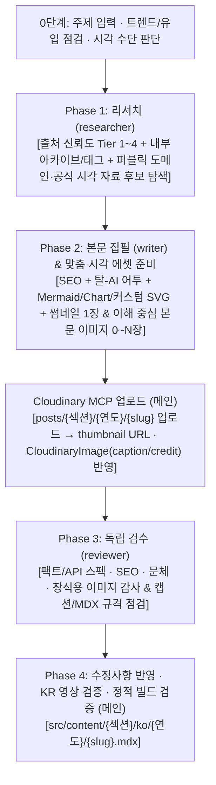

# 블로그 글 작성 오케스트레이션 (/blog)

주제 하나를 받아 **"조사와 검수는 분리, 집필은 통합"** 원칙에 따라 고품질의 블로그 포스트를 완성하는 Antigravity 멀티 에이전트 워크플로입니다.

메인 세션이 전체 워크플로의 오케스트레이터(총괄 지휘자) 역할을 맡고, 각 단계별 특화 서브에이전트를 호출하여 작업을 수행합니다.

---

## 워크플로 파이프라인 요약

---

## 모델 라우팅 및 스케일링 원칙

- **기본 모델(`Model: "inherit"`) 권장**: Gemini 4 프론티어 시리즈(Carbon · Argon · Hydrogen 등) 및 최신 Antigravity 런타임에서는 모델군 간 쿼터 풀이 공유되며, 하드코딩된 `"flash"` / `"pro"` 지정은 사용자가 선택한 세션 모델을 임의로 덮어쓰거나 미세 기술 스펙 환각을 유발할 수 있습니다. 모든 서브에이전트는 **`Model: "inherit"`을 기본값**으로 사용합니다.
  - **예외적 모델 지정**: 단순 식별자(IMDb/YouTube ID 등) 조회 위주의 가벼운 리서치에만 `"flash"`(또는 대량 단순 조회 시 `"flash_lite"`)를 선택적으로 사용하며, 메인 세션 자체가 경량 모델일 때 고난도 장문 집필이 필요한 경우에만 `writer`/`reviewer`에 `"pro"`를 지정합니다.
  - **검수 모델 하향 금지**: `reviewer`는 `writer`가 작성한 최신 API 속성명·미세 스펙 오류를 잡아내야 하므로 **최소 `writer`와 동급 이상의 모델(`"inherit"`)**로 실행합니다.
- **단일 포스트 vs 다중/영문 동시 집필**:
  - **단일 포스트(기본)**: 파일 충돌 방지와 문맥 일관성을 위해 본 문서의 `invoke_subagent` 파이프라인을 그대로 따릅니다 (`Phase 2`에서 `writer`와 `image-generator`만 병렬 호출).
  - **다중 시리즈 기획 또는 한/영(`ko`+`en`) 동시 집필**: [`docs/bilingual-post-guide.md`](../../../docs/bilingual-post-guide.md)에 따라 여러 파일을 동시에 작성·교차 검수해야 하는 대규모 작업일 때만 선택적으로 `swarm`(또는 `/teamwork` 추천)을 활용하되, 워커별 담당 파일 경로를 엄격히 분리합니다.

---

## 단계별 실행 가이드

### 0단계: 기본 메타데이터 및 유입 트렌드 확인 (메인 세션)
사용자의 요청에서 아래 항목을 결정합니다. 모호한 부분이 있다면 진행 전 사용자에게 확인합니다.
1. **대상 섹션**: `life` | `money` | `culture` | `tools` | `dev`
2. **연도 및 Slug**: 영문 소문자 2~5단어 kebab-case (예: `2026/react-compiler-deepdive`)
3. **핵심 타겟 독자 및 목표 키워드**:
   - 주제 방향이나 검색 트렌드 보정이 필요할 경우, [`docs/content-follow-up-plan.md`](../../../docs/content-follow-up-plan.md) 백로그를 확인하거나 `google-analytics` MCP(`get_account_summaries` → `run_report`, `dimensions: ["pagePath", "pageTitle"]`, `metrics: ["screenPageViews", "activeUsers"]` 문자열 배열 전달)로 기존 인기 글의 유입 패턴을 참고합니다.
4. **포스트 유형 및 목표 분량** (코드 블록 제외, 공백 포함 본문 기준):
   - 단신·트러블슈팅·일상 (`1,500～2,500자`, 읽기 2～3분) | **표준 가이드·비교·추천** (`2,500～4,000자`, 읽기 3～5분, 기본 권장) | 심층 딥다이브·총정리 (`4,500～7,000자`, 읽기 6～9분, 상단 요약표 필수). 단일 주제가 `7,000자`(읽기 10분)를 넘길 만큼 방대하면 `series` + `series_order`를 활용한 시리즈 분할을 우선 검토합니다.

---

### Phase 1: 자료 조사 (Researcher 서브에이전트)
- **에이전트 설정**:
  - `TypeName`: `"research"` (읽기 및 검색 전용 샌드박스 강제)
  - `Role`: `"Tech Researcher"`
  - `Model`: `"inherit"` (기본 권장 — 최신 API 시그니처·스펙 교차 검증 정확도 확보. 비기술 단순 조회 시에만 `"flash"` 허용)
- **전달 지침**: [`.agents/skills/blog/references/researcher.md`](references/researcher.md) 참조
- **수행 작업**:
  - 웹 검색 및 최신 공식 기술 문서·릴리스 노트 탐색 (최신 버전 API의 **정확한 메서드/어노테이션 속성명** 및 **정식(Final) vs 프리뷰(Preview) 상태** 교차 검증 필수)
  - **출처 신뢰도 점수 부여**: Tier 1(9~10점: 공식 문서/표준/논문)부터 Tier 4(1~3점: 미검증 블로그)까지 가산점 부여
  - **블로그 내부 아카이브 및 태그 규칙 스캔**: `src/content/{섹션}/ko/` 하위 **모든 연도 폴더**(`2024/`, `2025/`, `2026/` 등)와 공통 레퍼런스 가이드(`docs/post-writing-guide.md`)를 탐색하여 주제 중복을 피하고, 자연스러운 **내부 링크 후보**와 **기존 태그 표기 규칙**(영문 소문자 kebab-case 등)을 함께 수집
  - **MDX 컴포넌트용 식별자 및 원본 시각 레퍼런스 조사**: 주제에 따라 영화/드라마 IMDb ID(`ttXXXXXXX` · 인물 `nmXXXXXXX`), 도서 ISBN13(`BookCard`), 주식 티커(`StockCard`), MLB/KBO 선수 ID(`mlbId` · `kboId`), 오픈소스 저장소(`owner/repo`), App Store ID(`appStoreId`), 관련 공식 YouTube 영상 ID 후보 2~3개(미국 내수용 채널의 한국 지역 차단에 대비해 글로벌 배급사·국내 공식 채널 포함)뿐 아니라, 본문 이해에 직접 도움이 되는 **퍼블릭 도메인(Wikimedia Commons 등)·공식 기술 문서/프레스킷 원본 이미지 URL 및 라이선스 출처**가 있다면 함께 수집
  - 팩트 시트, 불확실/상충 정보, 실무 코드 예시·내부 링크·컴포넌트 식별자·원본 시각 자료 후보, SEO 추천 키워드 산출

---

### Phase 2: 본문 집필 (Writer) · 맞춤 시각 에셋 준비 & Cloudinary 업로드
> **핵심 원칙**: 본문 전체는 문맥의 일관성을 위해 하나의 `writer` 에이전트가 처음부터 끝까지 완성합니다. 대표 썸네일(`16:9` 1장)은 필수 생성하되, **본문 이미지는 기계적인 의무 할당량 없이(`0～N장` 자율) 실제로 내용 이해나 현장감을 높여줄 때만** 선택·생성하여 **Cloudinary MCP**로 업로드합니다 (단락 구분용 추상 메타포 배너 전면 금지).

#### 1) 본문 집필 (Writer)
- **에이전트 설정**:
  - `TypeName`: `"self"` (파일 읽기/쓰기 권한 포함)
  - `Role`: `"Lead Technical Writer"`
  - `Model`: `"inherit"` (세션이 경량 모델일 때만 `"pro"` 지정)
- **전달 지침**: [`.agents/skills/blog/references/writer.md`](references/writer.md), [`AGENTS.md`](../../../AGENTS.md), [`docs/post-writing-guide.md`](../../../docs/post-writing-guide.md), [`docs/astro-components.md`](../../../docs/astro-components.md) 참조
- **필수 준수 사항**:
  - **탈(脫) AI 어투**: 금지어 전면 배제, 첫 2문장 직격 훅, 단문·복문 호흡 변주 및 생생한 실무 맥락 서술
  - **SEO, 적정 분량 및 내부 연결성**: 60자 이내 타이틀, 120~160자 description, H2/H3 계층, 첫 단락 키워드 노출, 유형별 적정 분량 준수(기본 `2,500～4,000자`, SEO 목적 최소 `1,500자` 이상, 심층편 `4,500～7,000자` 이내 — 억지 늘리기 금지), 기존 연관 포스트 내부 링크 연결, **기존 태그 표기(소문자 kebab-case 등) 재사용**
  - **팩트 무결성**: Phase 1의 Tier 1~2 팩트 위주 서술, 불확실한 정보는 단정하지 않음
  - **규격 및 MDX 컴포넌트·도식 적극 활용**: Frontmatter 스키마 준수, Shiki 소문자 언어 태그, CommonMark 구두점 경계 규칙(`~` → `～`/`–`, 볼드·이탤릭 내 `()`/`""` 뒤 한글 조사 분리), `<Alert>` 외 주제별 전용 컴포넌트(`CloudinaryImage`, `ImageRow`, `MovieCard`, `PersonCard`, `PersonInline`, `BookCard`, `StockCard`, `StockInline`, `BaseballPlayerCard`, `PlayerInline`, `GitHubRepoCard`, `AppCard`, `PlaceCard`, `LinkPreviewCard`, `YouTubeEmbed`, `Chart`, `ClockChart`, `AffiliateLink`, `CoupangProductCard`) 및 필요 시 **커스텀 반응형 SVG 도식** 적극 배치 (`Callout` 절대 사용 금지)

#### 2) 이해 중심 시각 에셋 기획 · 생성/수집 및 Cloudinary MCP 업로드
상세 판단 기준과 호출 스키마는 [`.agents/skills/blog/references/visual.md`](references/visual.md)를 따릅니다.
- **본문 시각 수단 우선순위 (`0～N장` 자율, 억지 할당 금지)**:
  1. **다이어그램 / 차트 / 커스텀 SVG 도식**: 흐름도·아키텍처는 `Mermaid` 코드 블록, 정량 데이터·시간대는 `<Chart>` / `<ClockChart>`, 한글·영문 라벨이 필요한 정밀 구조도·메모리 레이아웃은 반응형 **커스텀 SVG**로 `writer`가 직접 작성합니다. **코드·IT 기술 글은 이 단계만으로도 충분하며 본문 래스터 이미지가 `0장`이어도 무방합니다.**
  2. **기존 보유 에셋 & 검증된 외부 원본 인용**: 인물·기업·작품·역사 사료 등 실물이 유익한 경우, 먼저 `cloudinary` MCP `search-assets`로 계정 내 `media/...` · `library/...` 보유 에셋을 찾고, 없다면 퍼블릭 도메인(Wikimedia Commons 등)·공식 문서의 라이선스 안전 이미지 URL(`https://...`)을 수집해 출처(`credit`·`creditUrl`)와 함께 인용합니다.
  3. **`image-generator` 맞춤 이미지 생성**: 대표 썸네일(`16:9`) 1장은 필수 생성하며(`writer`와 병렬 실행 가능), 본문 이미지는 **구체적 설명 대상이 명확할 때**(예: 크리스마스 글의 트리·교회·아기 예수 구유 장면, 제품 글의 구성도, 인물 글의 캐리커처, 여행 글의 현지 풍경 등)에만 개수 제한 없이 필요한 만큼 생성합니다. **('체스말', '등대', '천칭 저울' 같은 추상 은유나 H2 소제목 직하단 구분선 배너 생성 금지)**
- **Cloudinary MCP 직행 업로드 (로컬 `public/` 복사 생략)**:
  - `image-generator`가 반환한 로컬 파일(`file:///절대경로`) 또는 검증된 외부 원본 URL(`https://...`)을 메인 세션이 `cloudinary` MCP(`execute_tool` → `upload-asset`)로 업로드합니다:
    - `folder`: `"posts/{섹션}/{연도}/{slug}"`
    - `public_id`: `"thumbnail"` 및 (본문 이미지가 있을 때) `"fig-01-{영문키워드}"`, `"fig-02-{영문키워드}"` 등 (폴더 경로 중복 기입 금지)
  - 업로드 응답의 `public_id`, `width`, `height`를 받아 초안 `.mdx`에 즉시 반영합니다 (`Phase 3` 검수 전 반영 권장):
    - Frontmatter `thumbnail`: `"https://res.cloudinary.com/doal3ofyr/image/upload/w_1200,q_auto,f_jpg/{반환된_public_id}"` (카카오톡·슬랙 등 OG 크롤러 호환용 `f_jpg` 고정)
    - 본문 이미지(삽입 시): `<CloudinaryImage publicId="{반환된_public_id}" width={width} height={height} alt="구체적인 설명" caption="독자가 주목할 읽는 포인트 설명" />` (외부 인용 시 `credit`·`creditUrl` 필수, 비교 세트는 `<ImageRow>`로 묶고 본문 설명 흐름 속에 배치)

---

### Phase 3: 독립 검수 (Reviewer 서브에이전트)
- **에이전트 설정**:
  - `TypeName`: `"research"` (읽기 전용 강제 — 초안 파일 직접 수정 원천 차단)
  - `Role`: `"Editorial Reviewer"`
  - `Model`: `"inherit"` (`writer`와 동급 이상 유지)
- **전달 지침**: [`.agents/skills/blog/references/reviewer.md`](references/reviewer.md) 참조
- **검수 항목**:
  1. **팩트 및 코드 스펙 무결성**: 리서치 자료와의 일치성, 구버전 레거시 API 속성 혼입 여부, Preview/정식 기능 구분, 코드 스니펫 import/컴파일 완결성
  2. **탈-AI 어투**: 금지어 포함 여부, 첫 2문장 훅 및 문장 리듬 점검
  3. **SEO, 분량 적정성 및 태그 일관성**: 타이틀/디스크립션 길이 및 키워드 배치, 헤딩 구조, 본문 분량 및 밀도 적정성(1,500자 미만 Thin Content 또는 7,000자 초과 과밀 여부, 장문 상단 요약표 유무), 기존 블로그 태그 컨벤션 일치 여부, 내부 링크 유효성
  4. **기술 규격, 시각 자료 목적성 및 CommonMark/MDX 안전성**: Frontmatter 필수 필드 및 `thumbnail` URL(`w_1200,q_auto,f_jpg` OG 호환 포맷) 검증, 본문 이미지의 **정보 전달 목적성 감사**(단락 구분용 억지 메타포 배너 여부, `<CloudinaryImage>`의 `width`·`height`·`alt`·`caption` 및 외부 인용 시 `credit`/`creditUrl` 포함 여부, 본문 문맥과의 자연스러운 연결성), Shiki 소문자 언어 태그, `～`/`–` 범위 표기, 볼드/이탤릭 내 괄호·따옴표+조사 미파싱 노출 여부, 전용 컴포넌트 적절 활용 여부 (`Callout` 사용 시 즉시 필수 수정)
- **출력**: `[🚨 필수 수정]`, `[💡 권장 개선]`, `[✅ 통과 항목]`으로 정리된 수정안 보고서

---

### Phase 4: 검수 반영, KR 영상 검증 및 정적 빌드 검증 (메인 세션)
1. **검수 반영**: 메인 세션이 `reviewer`의 `[🚨 필수 수정]` 항목을 초안에 즉시 반영하고, `[💡 권장 개선]` 사항(추가 시각 자료 보강 등 포함)을 검토하여 적용합니다.
2. **시각 에셋 최종 점검**: frontmatter `thumbnail`의 Cloudinary URL과 본문 `<CloudinaryImage>`의 `publicId`·`width`·`height`가 누락 없이 매핑되었는지, 불필요한 로컬 이미지 파일이 `public/`에 생성되지 않았는지 확인합니다.
3. **`YouTubeEmbed` 한국(`KR`) 재생·임베드 검증** (해당 컴포넌트 사용 시 필수):
   - 읽기 전용 샌드박스에서 실행되는 `research`/`reviewer` 서브에이전트의 `search_web`은 클라우드 서버 기준이라 미국 전용 지역 제한(`availableCountries: ["US"]`)을 걸러내지 못합니다.
   - 본문에 `<YouTubeEmbed id="..." />`가 포함된 경우, 메인 세션이 한국 기준(`https://www.youtube.com/watch?v={id}&gl=KR`의 `ytInitialPlayerResponse`)으로 `playabilityStatus.status === "OK"`, `playableInEmbed === true`, `availableCountries` 내 `"KR"` 포함(또는 제한 없음) 여부를 직접 검증하고, 차단된 경우 글로벌 배급사·국내 공식 채널 후보 영상으로 교체합니다.
4. **최종 저장 및 정적 빌드 검증**:
   - 최종 완성본이 `src/content/{섹션}/ko/{연도}/{slug}.mdx`에 저장되었는지 확인합니다.
   - `pnpm build`를 실행하여 Astro 콘텐츠 스키마, MDX 컴포넌트 파싱, Shiki 코드 하이라이팅, Mermaid 구문, Pagefind 인덱싱이 에러 없이 통과하는지 검증합니다.
   - 빌드된 `dist/{섹션}/{slug}/index.html`에서 미파싱된 `**`·`*` 기호 노출이나 의도치 않은 `<del>`(취소선) 태그가 없는지 최종 점검합니다.
5. **결과 보고**: 사용자에게 결과물 요약(글자 수, 주요 SEO 키워드, 채택 출처 티어, 생성된 포스트 파일 링크 및 업로드된 Cloudinary 에셋 목록)을 간결하게 보고합니다.
