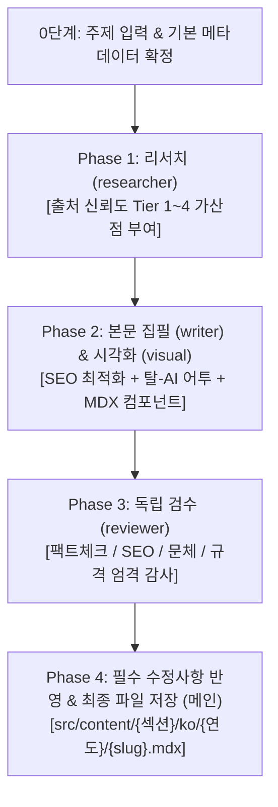

# 블로그 글 작성 오케스트레이션 (/blog)

주제 하나를 받아 **"조사와 검수는 분리, 집필은 통합"** 원칙에 따라 고품질의 블로그 포스트를 완성하는 Antigravity 멀티 에이전트 워크플로입니다.

메인 세션이 전체 워크플로의 오케스트레이터(총괄 지휘자) 역할을 맡고, 각 단계별 특화 서브에이전트를 순차적으로 호출하여 작업을 수행합니다.

---

## 워크플로 파이프라인 요약

---

## 단계별 실행 가이드

### 0단계: 기본 메타데이터 확인 (메인 세션)
사용자의 요청에서 아래 항목을 결정합니다. 모호한 부분이 있다면 진행 전 사용자에게 확인합니다.
1. **대상 섹션**: `life` | `money` | `culture` | `tools` | `dev`
2. **연도 및 Slug**: 영문 소문자 2~5단어 kebab-case (예: `2026/react-compiler-deepdive`)
3. **핵심 타겟 독자 및 목표 키워드**

---

### Phase 1: 자료 조사 (Researcher 서브에이전트)
- **에이전트 설정**:
  - `TypeName`: `"research"` 또는 `"self"`
  - `Role`: `"Tech Researcher"`
  - `Model`: `"flash"` (속도 및 토큰 효율화)
- **전달 지침**: [`.agents/skills/blog/references/researcher.md`](references/researcher.md) 참조
- **수행 작업**:
  - 웹 검색 및 최신 기술 문서 탐색
  - **출처 신뢰도 점수 부여**: Tier 1(9~10점: 공식 문서/학술)부터 Tier 4(1~3점: 미검증 블로그)까지 가산점 부여
  - 팩트 시트, 불확실/상충 정보, 실무 코드 예시, SEO 추천 키워드 산출

---

### Phase 2: 본문 집필 (Writer) & 시각화 (Visual)
> **핵심 원칙**: 본문 전체는 문맥의 일관성을 위해 하나의 `writer` 에이전트가 처음부터 끝까지 완성합니다.

#### 1) 본문 집필 (Writer)
- **에이전트 설정**:
  - `TypeName`: `"self"`
  - `Role`: `"Lead Technical Writer"`
  - `Model`: `"pro"` (또는 `"inherit"`: 최고 품질 보장)
- **전달 지침**: [`.agents/skills/blog/references/writer.md`](references/writer.md) 및 [`AGENTS.md`](../../../AGENTS.md) 참조
- **필수 준수 사항**:
  - **탈(脫) AI 어투**: 금지어 전면 배제, 첫 2문장 훅, 생생한 능동형 개발자 문체
  - **SEO 최적화**: 60자 이내 타이틀, 120~160자 description, H2/H3 계층, 본문 첫 단락 키워드 노출
  - **팩트 무결성**: Phase 1의 Tier 1~2 팩트 위주 서술, 불확실한 정보는 단정하지 않음
  - **규격**: Frontmatter 스키마 준수, `<Alert>` 컴포넌트 활용, Shiki 소문자 언어 태그

#### 2) 시각화 및 썸네일 (Visual) — 선택적 병렬 단계
- **다이어그램**: 본문 흐름에 필요한 Mermaid 코드는 `writer`가 직접 삽입.
- **썸네일 이미지**:
  - 자동 생성을 원할 경우: 내장 `image-generator` 서브에이전트를 호출하여 `public/images/posts/` 경로에 이미지 저장.
  - 외부 툴 생성을 원할 경우: [`.agents/skills/blog/references/visual.md`](references/visual.md)에 따라 최적화된 프롬프트 작성 후 writer에게 전달.

---

### Phase 3: 독립 검수 (Reviewer 서브에이전트)
- **에이전트 설정**:
  - `TypeName`: `"research"` 또는 `"self"`
  - `Role`: `"Editorial Reviewer"`
  - `Model`: `"flash"` (또는 `"inherit"`)
  - **도구 제한**: 읽기 전용 (`view_file`, `read_url_content`). 파일 직접 수정 금지.
- **전달 지침**: [`.agents/skills/blog/references/reviewer.md`](references/reviewer.md) 참조
- **검수 항목**:
  1. **팩트체크**: 리서치 자료와의 일치성, 출처 없는 허위 정보 유무
  2. **탈-AI 어투**: 금지어 포함 여부, 첫 문장 훅 점검
  3. **SEO 완성도**: 타이틀/디스크립션 길이 및 키워드 배치, 헤딩 구조
  4. **기술 규격**: Frontmatter 누락, Shiki 코드블록 태그 유효성, `Alert` 컴포넌트 사용 여부
- **출력**: `[🚨 필수 수정]`, `[💡 권장 개선]`, `[✅ 통과 항목]`으로 정리된 수정안 보고서

---

### Phase 4: 반영 및 최종 저장 (메인 세션)
1. 메인 세션이 `reviewer`의 `[🚨 필수 수정]` 항목을 초안에 반영하고, `[💡 권장 개선]` 사항을 검토하여 적용합니다.
2. 최종 완성된 글을 `src/content/{섹션}/ko/{연도}/{slug}.mdx` 파일로 저장합니다.
3. 빌드 테스트(`pnpm build` 또는 Shiki/Frontmatter 검증)가 필요한 경우 에러 여부를 점검합니다.
4. 사용자에게 결과물 요약(글자 수, SEO 키워드, 출처 티어, 파일 링크)을 보고합니다.
