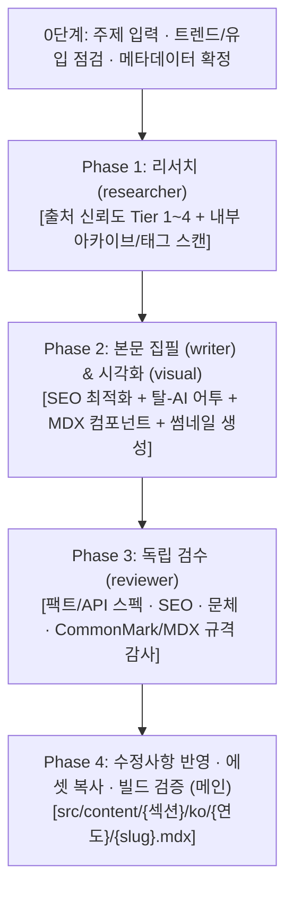

# 블로그 글 작성 오케스트레이션 (/blog)

주제 하나를 받아 **"조사와 검수는 분리, 집필은 통합"** 원칙에 따라 고품질의 블로그 포스트를 완성하는 Antigravity 멀티 에이전트 워크플로입니다.

메인 세션이 전체 워크플로의 오케스트레이터(총괄 지휘자) 역할을 맡고, 각 단계별 특화 서브에이전트를 호출하여 작업을 수행합니다.

---

## 워크플로 파이프라인 요약

---

## 모델 라우팅 및 스케일링 원칙

- **기본 모델(`Model: "inherit"`) 권장**: Gemini 4 프론티어 시리즈(Carbon · Argon · Hydrogen 등) 및 최신 Antigravity 런타임에서는 모델군 간 쿼터 풀이 공유되며, 하드코딩된 `"flash"` / `"pro"` 지정은 사용자가 선택한 세션 모델을 임의로 덮어쓰거나 미세 기술 스펙 환각을 유발할 수 있습니다. 모든 서브에이전트는 **`Model: "inherit"`을 기본값**으로 사용합니다.
  - **예외적 모델 지정**: 단순 식별자(IMDb/YouTube ID 등) 조회 위주의 가벼운 리서치에만 `"flash"`(또는 대량 단순 조회 시 `"flash_lite"`)를 선택적으로 사용하며, 메인 세션 자체가 경량 모델일 때 고난도 장문 집필이 필요한 경우에만 `writer`/`reviewer`에 `"pro"`를 지정합니다.
  - **검수 모델 하향 금지**: `reviewer`는 `writer`가 작성한 최신 API 속성명·미세 스펙 오류를 잡아내야 하므로 **최소 `writer`와 동급 이상의 모델(`"inherit"`)**로 실행합니다.
- **단일 포스트 vs 다중/영문 동시 집필**:
  - **단일 포스트(기본)**: 파일 충돌 방지와 문맥 일관성을 위해 본 문서의 `invoke_subagent` 파이프라인을 그대로 따릅니다 (`Phase 2`에서 `writer`와 `image-generator`만 병렬 호출).
  - **다중 시리즈 기획 또는 한/영(`ko`+`en`) 동시 집필**: [`docs/bilingual-post-guide.md`](../../../docs/bilingual-post-guide.md)에 따라 여러 파일을 동시에 작성·교차 검수해야 하는 대규모 작업일 때만 선택적으로 `swarm`(또는 `/teamwork` 추천)을 활용하되, 워커별 담당 파일 경로를 엄격히 분리합니다.

---

## 단계별 실행 가이드

### 0단계: 기본 메타데이터 및 유입 트렌드 확인 (메인 세션)
사용자의 요청에서 아래 항목을 결정합니다. 모호한 부분이 있다면 진행 전 사용자에게 확인합니다.
1. **대상 섹션**: `life` | `money` | `culture` | `tools` | `dev`
2. **연도 및 Slug**: 영문 소문자 2~5단어 kebab-case (예: `2026/react-compiler-deepdive`)
3. **핵심 타겟 독자 및 목표 키워드**:
   - 주제 방향이나 검색 트렌드 보정이 필요할 경우, [`docs/content-follow-up-plan.md`](../../../docs/content-follow-up-plan.md) 백로그를 확인하거나 `google-analytics` MCP(`get_account_summaries` → `run_report`, `dimensions: ["pagePath", "pageTitle"]`, `metrics: ["screenPageViews", "activeUsers"]` 문자열 배열 전달)로 기존 인기 글의 유입 패턴을 참고합니다.

---

### Phase 1: 자료 조사 (Researcher 서브에이전트)
- **에이전트 설정**:
  - `TypeName`: `"research"` (읽기 및 검색 전용 샌드박스 강제)
  - `Role`: `"Tech Researcher"`
  - `Model`: `"inherit"` (기본 권장 — 최신 API 시그니처·스펙 교차 검증 정확도 확보. 비기술 단순 조회 시에만 `"flash"` 허용)
- **전달 지침**: [`.agents/skills/blog/references/researcher.md`](references/researcher.md) 참조
- **수행 작업**:
  - 웹 검색 및 최신 공식 기술 문서·릴리스 노트 탐색 (최신 버전 API의 **정확한 메서드/어노테이션 속성명** 및 **정식(Final) vs 프리뷰(Preview) 상태** 교차 검증 필수)
  - **출처 신뢰도 점수 부여**: Tier 1(9~10점: 공식 문서/표준/논문)부터 Tier 4(1~3점: 미검증 블로그)까지 가산점 부여
  - **블로그 내부 아카이브 및 태그 규칙 스캔**: `src/content/{섹션}/ko/` 하위 **모든 연도 폴더**(`2024/`, `2025/`, `2026/` 등)와 공통 레퍼런스 가이드(`docs/post-writing-guide.md`)를 탐색하여 주제 중복을 피하고, 자연스러운 **내부 링크 후보**와 **기존 태그 표기 규칙**(영문 소문자 kebab-case 등)을 함께 수집
  - **MDX 컴포넌트용 식별자 조사**: 영화/드라마 주제는 IMDb 작품 ID(`ttXXXXXXX`) 및 주요 인물 IMDb ID(`nmXXXXXXX`), 관련 공식 YouTube 영상 ID 등을 함께 수집 (`BookCard`는 알라딘 OpenAPI 종료로 사용하지 않음)
  - 팩트 시트, 불확실/상충 정보, 실무 코드 예시·내부 링크·컴포넌트 식별자, SEO 추천 키워드 산출

---

### Phase 2: 본문 집필 (Writer) & 시각화 (Visual)
> **핵심 원칙**: 본문 전체는 문맥의 일관성을 위해 하나의 `writer` 에이전트가 처음부터 끝까지 완성하며, 썸네일 이미지 생성(`image-generator`)은 `writer`와 병렬로 호출할 수 있습니다.

#### 1) 본문 집필 (Writer)
- **에이전트 설정**:
  - `TypeName`: `"self"` (파일 읽기/쓰기 권한 포함)
  - `Role`: `"Lead Technical Writer"`
  - `Model`: `"inherit"` (세션이 경량 모델일 때만 `"pro"` 지정)
- **전달 지침**: [`.agents/skills/blog/references/writer.md`](references/writer.md), [`AGENTS.md`](../../../AGENTS.md), [`docs/post-writing-guide.md`](../../../docs/post-writing-guide.md), [`docs/astro-components.md`](../../../docs/astro-components.md) 참조
- **필수 준수 사항**:
  - **탈(脫) AI 어투**: 금지어 전면 배제, 첫 2문장 직격 훅, 단문·복문 호흡 변주 및 생생한 실무 맥락 서술
  - **SEO 및 내부 연결성**: 60자 이내 타이틀, 120~160자 description, H2/H3 계층, 첫 단락 키워드 노출, 기존 연관 포스트 내부 링크 연결, **기존 태그 표기(소문자 kebab-case 등) 재사용**
  - **팩트 무결성**: Phase 1의 Tier 1~2 팩트 위주 서술, 불확실한 정보는 단정하지 않음
  - **규격 및 MDX 컴포넌트 적극 활용**: Frontmatter 스키마 준수, Shiki 소문자 언어 태그, CommonMark 구두점 경계 규칙(`~` → `～`/`–`, 볼드·이탤릭 내 `()`/`""` 뒤 한글 조사 분리), `<Alert>` 외 주제별 전용 컴포넌트(`MovieCard`, `PersonCard`, `PersonInline`, `YouTubeEmbed`, `Chart`, `ClockChart`, `ImageRow`, `AffiliateLink`, `CoupangProductCard`) 적극 배치 (`Callout`, `BookCard` 절대 사용 금지)

#### 2) 시각화 및 썸네일 (Visual) — 병렬 실행 가능
- **다이어그램**: 본문 흐름에 필요한 Mermaid 코드는 `writer`가 직접 삽입합니다.
- **썸네일 이미지**:
  - **자동 생성(권장)**: 내장 `image-generator` 서브에이전트(`Role: "Thumbnail Designer"`)를 호출합니다. `image-generator`는 워크스페이스 `public/`에 직접 쓰지 않고 대화 아티팩트 디렉터리(`<appDataDir>/brain/<conversation-id>/`)에 이미지(주로 `.jpg`)를 저장한 뒤 파일 경로를 반환하므로, **Phase 4에서 메인 세션이 `public/images/posts/{연도}/{slug}-thumbnail.{ext}`로 복사하고 확장자를 동기화**합니다.
  - **외부 툴 프롬프트 산출**: [`.agents/skills/blog/references/visual.md`](references/visual.md)에 따라 최적화된 프롬프트를 작성해 제공합니다.

---

### Phase 3: 독립 검수 (Reviewer 서브에이전트)
- **에이전트 설정**:
  - `TypeName`: `"research"` (읽기 전용 강제 — 초안 파일 직접 수정 원천 차단)
  - `Role`: `"Editorial Reviewer"`
  - `Model`: `"inherit"` (`writer`와 동급 이상 유지)
- **전달 지침**: [`.agents/skills/blog/references/reviewer.md`](references/reviewer.md) 참조
- **검수 항목**:
  1. **팩트 및 코드 스펙 무결성**: 리서치 자료와의 일치성, 구버전 레거시 API 속성 혼입 여부, Preview/정식 기능 구분, 코드 스니펫 import/컴파일 완결성
  2. **탈-AI 어투**: 금지어 포함 여부, 첫 2문장 훅 및 문장 리듬 점검
  3. **SEO 및 태그 일관성**: 타이틀/디스크립션 길이 및 키워드 배치, 헤딩 구조, 기존 블로그 태그 컨벤션 일치 여부, 내부 링크 유효성
  4. **기술 규격 및 CommonMark/MDX 안전성**: Frontmatter 필수 필드 및 `thumbnail` 실제 확장자 일치 여부, Shiki 소문자 언어 태그, `～`/`–` 범위 표기, 볼드/이탤릭 내 괄호·따옴표+조사 미파싱 노출 여부, 전용 컴포넌트 적절 활용 여부 (`Callout`, `BookCard` 사용 시 즉시 필수 수정)
- **출력**: `[🚨 필수 수정]`, `[💡 권장 개선]`, `[✅ 통과 항목]`으로 정리된 수정안 보고서

---

### Phase 4: 반영, 에셋 배치 및 최종 빌드 검증 (메인 세션)
1. **검수 반영**: 메인 세션이 `reviewer`의 `[🚨 필수 수정]` 항목을 초안에 즉시 반영하고, `[💡 권장 개선]` 사항을 검토하여 적용합니다.
2. **썸네일 에셋 복사 및 확장자 동기화**: `image-generator`가 반환한 아티팩트 이미지 파일을 `public/images/posts/{연도}/{slug}-thumbnail.{ext}`로 복사하고, 포스트 frontmatter의 `thumbnail: "/images/posts/{연도}/{slug}-thumbnail.{ext}"` 경로 및 실제 확장자(`.jpg` / `.png` / `.webp`)가 정확히 일치하는지 확인합니다.
3. **최종 저장 및 정적 빌드 검증**:
   - 최종 완성본이 `src/content/{섹션}/ko/{연도}/{slug}.mdx`에 저장되었는지 확인합니다.
   - `pnpm build`를 실행하여 Astro 콘텐츠 스키마, MDX 컴포넌트 파싱, Shiki 코드 하이라이팅, Mermaid 구문, Pagefind 인덱싱이 에러 없이 통과하는지 검증합니다.
   - 빌드된 `dist/{섹션}/{slug}/index.html`에서 미파싱된 `**`·`*` 기호 노출이나 의도치 않은 `<del>`(취소선) 태그가 없는지 최종 점검합니다.
4. **결과 보고**: 사용자에게 결과물 요약(글자 수, 주요 SEO 키워드, 채택 출처 티어, 생성된 포스트 및 썸네일 파일 링크)을 간결하게 보고합니다.
