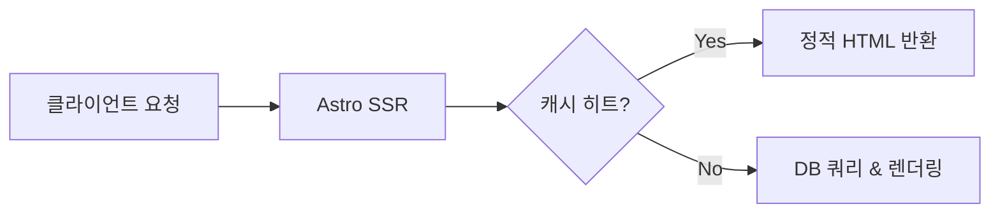

# Visual Assets Guide

이 문서는 블로그 글의 시각 자료(다이어그램, 썸네일, 이미지) 생성을 위한 가이드입니다.

---

## 1. 기본 원칙

- **가독성 최우선**: 글의 흐름을 돕는 필수적인 시각 자료만 선별하여 추가합니다.
- **분업 최적화**:
  - 본문 내 아키텍처 다이어그램 및 시퀀스 흐름도는 **`writer`가 Mermaid 코드 블록으로 직접 작성**합니다.
  - 블로그 대표 썸네일이나 그래픽 일러스트가 필요할 경우 Antigravity의 **내장 `image-generator` 서브에이전트**를 호출하거나, 정밀한 **이미지 생성 프롬프트**를 산출합니다.

---

## 2. Mermaid 다이어그램 작성 요령

Astro 블로그 본문에서 기술 아키텍처나 파이프라인을 시각화할 때 사용합니다.

```markdown

```

- **주의사항**:
  - 특수문자나 괄호가 포함된 라벨은 반드시 큰따옴표(`"Label"`)로 감쌉니다.
  - 복잡한 렌더링 오류를 방지하기 위해 `flowchart LR/TD`, `sequenceDiagram`, `stateDiagram-v2` 등 표준 다이어그램 유형을 사용합니다.

---

## 3. 썸네일 및 이미지 생성 가이드

### ① Antigravity 내장 `image-generator` 서브에이전트 활용
사용자가 이미지 자동 생성을 원하거나 썸네일이 필요한 경우, 메인 세션이 `image-generator` 서브에이전트를 호출합니다:

- **호출 프롬프트 템플릿**:
  ```text
  "다음 블로그 포스트의 16:9 와이드 썸네일 이미지를 생성해줘:
   - 주제: [포스트 주제]
   - 분위기: 모던, 미니멀, 테크 감성, 다크 테마와 어울리는 은은한 네온 악센트
   - 불필요한 텍스트나 글자는 이미지에 넣지 말고 추상적인 그래픽/아이콘 중심으로 구성해줘.
   - 저장 위치: public/images/posts/[연도]/[slug]-thumbnail.png"
  ```

### ② 외부 생성용 이미지 프롬프트 제공 (선택 시)
이미지 생성 도구가 비활성화되어 있거나 수동 생성을 원할 경우, 아래와 같은 구조화된 프롬프트를 산출물로 제공합니다:

```markdown
### 🎨 이미지 생성 프롬프트 (Midjourney / Imagen / DALL-E)
- **프롬프트**: `A minimalist modern tech illustration representing [개념], isometric perspective, soft neon accents on dark background, clean geometric lines, high resolution, 16:9 aspect ratio --no text, words, watermark`
- **삽입 추천 위치**: 포스트 상단 (frontmatter thumbnail 필드) 또는 `## [소제목]` 바로 아래
- **추천 alt 텍스트**: `[개념]의 동작 원리를 나타내는 미니멀 테크 일러스트레이션`
```
