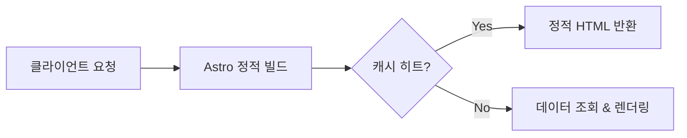

# Visual Assets Guide

이 문서는 블로그 글의 시각 자료(다이어그램, 썸네일, 이미지) 생성을 위한 가이드입니다.

---

## 1. 기본 원칙

- **가독성 최우선**: 글의 흐름과 독자의 이해를 돕는 필수적인 시각 자료만 선별하여 추가합니다.
- **분업 최적화**:
  - 본문 내 아키텍처 다이어그램 및 의사결정 흐름도는 **`writer`가 Mermaid 코드 블록으로 직접 작성**합니다.
  - 블로그 대표 썸네일이나 그래픽 일러스트가 필요할 경우 Antigravity의 **내장 `image-generator` 서브에이전트**를 `writer`와 병렬로 호출하거나, 외부 툴용 **이미지 생성 프롬프트**를 산출합니다.

---

## 2. Mermaid 다이어그램 작성 요령

Astro 블로그 본문에서 기술 아키텍처, 파이프라인, 버전 선택 플로우차트를 시각화할 때 사용합니다.

````markdown

````

- **주의사항**:
  - 괄호(`()`), 대괄호(`[]`), 슬래시(`/`) 등 특수문자가 포함된 노드 라벨은 반드시 큰따옴표(`id["Label (Extra Info)"]`)로 감쌉니다.
  - 노드 라벨 내부에 HTML 태그(`<br/>` 등)를 넣지 않고 줄바꿈(`\n`) 또는 간결한 문구를 사용합니다.
  - 렌더링 오류를 방지하기 위해 지원되는 표준 다이어그램 유형(`flowchart TD/LR`, `sequenceDiagram`, `stateDiagram-v2`, `classDiagram`, `erDiagram`, `xychart-beta`)만 사용합니다.

---

## 3. 썸네일 및 이미지 생성 가이드

### ① Antigravity 내장 `image-generator` 서브에이전트 활용 (기본)
썸네일 자동 생성이 필요한 경우 메인 세션이 Phase 2에서 `image-generator` 서브에이전트(`TypeName: "image-generator"`, `Role: "Thumbnail Designer"`)를 호출합니다.

> **파일 저장 경로 및 확장자 주의사항**:
> - `image-generator` 서브에이전트는 샌드박스 권한 구조상 워크스페이스의 `public/images/posts/...`에 직접 파일을 쓰지 않고, **대화 아티팩트 디렉터리(`<appDataDir>/brain/<conversation-id>/`)에 이미지(기본 `.jpg`)를 생성한 뒤 저장된 절대 경로를 반환**합니다.
> - 따라서 프롬프트에 `public/` 저장 경로를 지시하지 말고 시각적 브리프에만 집중하며, **Phase 4에서 메인 세션이 반환된 파일을 `public/images/posts/{연도}/{slug}-thumbnail.{ext}`로 복사**한 뒤 포스트 frontmatter의 `thumbnail` 필드 확장자(`.jpg` / `.png` / `.webp`)와 정확히 일치시킵니다.

- **호출 프롬프트 템플릿**:
  ```text
  다음 블로그 포스트의 16:9 와이드 대표 썸네일 이미지를 생성해줘:
  - 주제: [포스트 핵심 주제 및 상징 오브젝트]
  - 분위기: 모던, 미니멀, 에디토리얼 테크 일러스트레이션, 다크 슬레이트 배경과 은은한 포인트 컬러 조화
  - 제약사항: 이미지 안에 텍스트, 글자, 숫자, 워터마크를 절대 넣지 말고 순수 그래픽·기하학적 메타포로만 구성해줘.
  ```

### ② 외부 생성용 이미지 프롬프트 제공 (선택 시)
이미지 생성 도구를 사용하지 않거나 사용자가 직접 외부 툴로 생성하길 원할 경우, 아래와 같은 구조화된 프롬프트를 산출물로 제공합니다:

```markdown
### 🎨 이미지 생성 프롬프트 (Midjourney / Imagen / DALL-E)
- **프롬프트**: `A minimalist modern editorial tech illustration representing [개념], isometric perspective, subtle accent lighting on deep slate dark background, clean geometric lines, high resolution, 16:9 aspect ratio --no text, letters, numbers, words, watermark`
- **배치 경로**: `public/images/posts/[연도]/[slug]-thumbnail.[jpg|png|webp]` (frontmatter `thumbnail` 필드와 확장자 일치 필수)
- **추천 alt 텍스트**: `[개념]의 핵심 구조를 나타내는 미니멀 테크 일러스트레이션`
```
