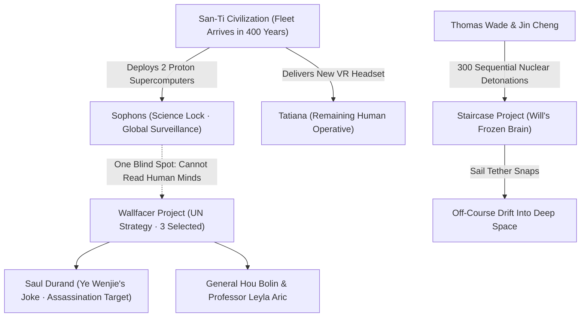

import Alert from '@/components/Alert.astro';
import MovieCard from '@/components/MovieCard.astro';
import YouTubeEmbed from '@/components/YouTubeEmbed.astro';
import PersonInline from '@/components/PersonInline.astro';
import BookCard from '@/components/BookCard.astro';

The long wait finally has an end date. Netflix has officially set **January 14, 2027** for the global premiere of *3 Body Problem* Season 2. If you skipped Season 1, you are probably wondering whether it is worth starting now; if you watched it nearly three years ago, you are probably struggling to remember who died, whose brain is floating in space, and why Saul was suddenly put in charge of saving humanity.

This guide is split in two. The first half stays completely spoiler-free so newcomers can decide whether to binge Season 1. Below the warning box, you will find a 5-minute recap of every major Season 1 plot thread and character status heading into *The Dark Forest*.

## 3 Body Problem Season 2: Confirmed Release Details

On November 17, 2026, Netflix unveiled the official teaser and locked in **January 14, 2027** as the launch date—almost two years and ten months after Season 1 debuted on March 21, 2024. Season 2 trims the episode count slightly from eight episodes to a tighter **six-episode run**.

One major hesitation with any big-budget Netflix sci-fi series is the fear of sudden cancellation. That risk is off the table here. Showrunners <PersonInline name="David Benioff" role="Showrunner" imdbId="nm1125275" />, <PersonInline name="D.B. Weiss" role="Showrunner" imdbId="nm1888967" />, and Alexander Woo mapped Cixin Liu's trilogy across **three seasons total**, with **Season 3 confirmed as the final season**. Even better, Seasons 2 and 3 were filmed **back-to-back** in Budapest, Hungary. While Season 3 does not have an announced release date yet, the full story is guaranteed to finish.

<MovieCard title="3 Body Problem" imdbId="tt13016388" />

The official teaser signals a sharp shift in scale. Season 1 played like a globe-trotting sci-fi mystery; Season 2 opens up into full-scale planetary defense and cosmic brinkmanship.

<YouTubeEmbed id="KInfw7kCPkc" title="3 Body Problem: Season 2 | Official Teaser | Netflix" />

<Alert type="info">
Because *3 Body Problem* carries a mature rating, the official teaser is age-restricted on YouTube in several regions. If playback does not start inside the embedded player, click **Watch on YouTube** and sign in to view it.
</Alert>

## [Spoiler-Free] Is Season 1 Worth Binge-Watching Now?

Short answer: yes, especially if you enjoy high-concept sci-fi with a fast TV pace. Season 1 landed a **78%** Critics Score on Rotten Tomatoes, a **7.5** on IMDb, and **six Primetime Emmy nominations** including Outstanding Drama Series. It also pulled in **over 52 million views** in the first half of 2024 alone, cementing itself as one of Netflix's flagship genre dramas.

Still, it is not a universal crowd-pleaser. Here is a quick gut check before you press play:

- **You will probably love it if**: you enjoy mystery-box openings that rapidly escalate into existential sci-fi, and you want an eight-episode binge that moves briskly from episode one.
- **You might bounce off it if**: you expect textbook-level hard-science exposition at every turn, or if you prefer warm character-driven drama over cold, concept-heavy plot mechanics in the back half.

### Netflix Adaptation vs. Original Novels vs. Tencent Series

Because Cixin Liu's trilogy already has a loyal readership and a 30-episode Chinese television adaptation from Tencent, newcomers often ask which version to pick. They offer very different experiences:

| Category | Netflix Series (Season 1) | Original Trilogy (Novels) | Tencent Drama (2023) |
| :--- | :--- | :--- | :--- |
| **Length & Pacing** | 8 episodes, brisk momentum | 3 books, 2,000+ pages total | 30 episodes, slow and methodical |
| **Core Cast** | Reframed around the "Oxford Five" | Rotating protagonists each book | Centered on Book 1's Wang Miao |
| **Story Scope** | Book 1 + early setups from Books 2 & 3 | Strict chronological book order | Faithful adaptation of Book 1 only |
| **Best For** | A weekend binge with high production value | Deep dives into hard sci-fi physics | Purists wanting Book 1 page by page |

Netflix's smartest structural move was pulling characters who never met in the novels into a single London friend group—the **Oxford Five**. By doing so, Season 1 quietly plants the opening chapters of Books 2 and 3 so Season 2 can hit the ground running.

### Can You Skip Season 1 and Jump Straight Into Season 2?

You really shouldn't. Season 2 does not reset the board; it picks up directly from two massive planetary-defense projects launched in the Season 1 finale. At eight episodes, Season 1 is an easy weekend watch before January 14—and if you are short on time, the recap below covers the essentials.

<Alert type="warning" title="Major Season 1 Spoilers Ahead">
If you have not watched Season 1 yet, stop here and queue it up on Netflix first. Everything below breaks down the Season 1 twists, core sci-fi rules, and final character fates so returning viewers can refresh their memory in five minutes.
</Alert>

## [Spoilers] Season 1 Ending & Core Plot: 5-Minute Recap

To follow Season 2 without pausing every ten minutes, keep these five pillars in mind.

### 1. The San-Ti Fleet Is 400 Years Away
During China's Cultural Revolution in the 1960s, disillusioned astrophysicist Ye Wenjie (<PersonInline name="Rosalind Chao" role="Ye Wenjie" imdbId="nm0001034" />) used the sun as an amplifier to beam a message into space. An alien civilization called the **San-Ti** (the Trisolarans in the novels) answered. Trapped on a doomed world orbiting three chaotic suns, they launched an invasion fleet toward Earth. Because their ships travel below light speed, the fleet will arrive in roughly **400 years**.

### 2. Two Sophons—and Their One Blind Spot
Four centuries is more than enough time for human technology to leapfrog an incoming fleet. To prevent that, the San-Ti unfolded two proton-sized supercomputers—**Sophons**—and sent them to Earth at light speed. The Sophons scramble particle-accelerator experiments to freeze fundamental physics, surveil every conversation on Earth in real time, and project the terrifying **"YOU ARE BUGS"** message onto skies and screens worldwide.

Crucially, however, Sophons have one fatal limitation: **they cannot read human thoughts**. That single rule drives the entire plot of Season 2.

### 3. The *Judgment Day* Nanofiber Operation and the Discovery of Lies
To seize communication logs from the San-Ti's human collaborators aboard the massive tanker *Judgment Day*, intelligence chief Thomas Wade (<PersonInline name="Liam Cunningham" role="Thomas Wade" imdbId="nm0192377" />) rigged the Panama Canal with razor-thin nanofibers invented by Auggie (<PersonInline name="Eiza González" role="Auggie Salazar" imdbId="nm2555462" />), slicing the ship and everyone on board to ribbons.

The recovered hard drive revealed why the San-Ti turned completely hostile. After hearing the fairy tale *Little Red Riding Hood*, the San-Ti—whose thoughts are transparent to one another—realized humans are capable of **lying**. Terrified of a species that can conceal its intentions, they abandoned their human followers and declared humanity a threat to be exterminated.

### 4. The Wallfacer Project (Three Wallfacers on Netflix)
Exploiting the Sophons' inability to read minds, the United Nations launched the **Wallfacer Project**. Note a key change from the books: while *The Dark Forest* names four Wallfacers, **the Netflix series selects three**—Chinese military strategist **General Hou Bolin**, Kurdish asymmetric-warfare veteran **Professor Leyla Ariç**, and reluctant Oxford physicist **Saul Durand** (<PersonInline name="Jovan Adepo" role="Saul Durand" imdbId="nm5381254" />).

Wallfacers command near-unlimited resources to devise a defense strategy kept strictly inside their own heads, with zero obligation to explain their actions. Saul tries to refuse the role, yet the San-Ti immediately mark him for assassination. Why? Just before her death, Ye Wenjie told Saul a cryptic **joke about Einstein playing violin with God** (who plays saxophone), ending with the warning *"Never play with God."* The San-Ti recognized that the joke hides a dangerous clue about cosmic survival.

### 5. The Staircase Project Goes Off Course
To send a scout toward the approaching fleet, Jin Cheng (<PersonInline name="Jess Hong" role="Jin Cheng" imdbId="nm10810538" />) and Thomas Wade spearheaded the **Staircase Project**: propelling an ultralight radiation-sail probe to roughly 1% of light speed using **300 sequential nuclear detonations**. Because of extreme weight limits, only a human brain could make the trip. Dying of terminal cancer, Will Downing (<PersonInline name="Alex Sharp" role="Will Downing" imdbId="nm5189784" />) volunteered out of love for Jin—after secretly buying her a star. Moments after launch, one of the sail's support tethers snapped, sending Will's frozen brain drifting off-trajectory into deep space.

### Where Everyone Stands After Season 1

Keep this quick roster handy before hitting play on Season 2, Episode 1:

| Character | Group | Status & Location at the End of Season 1 |
| :--- | :--- | :--- |
| **Jin Cheng** | Oxford Five | Devastated after the Staircase Project goes off course and Will is lost to space |
| **Saul Durand** | Oxford Five | Forced into the Wallfacer role against his will; active San-Ti assassination target |
| **Auggie Salazar** | Oxford Five | Haunted by the *Judgment Day* massacre; open-sources nanofibers and builds water filters in Mexico |
| **Will Downing** | Oxford Five | Deceased from cancer; his frozen brain is drifting off-course in deep space |
| **Jack Rooney** | Oxford Five | **Deceased** (murdered at home by Tatiana after refusing to cooperate with the San-Ti) |
| **Ye Wenjie** | Key Cast | **Deceased** (killed by Tatiana at the old Red Coast base after passing her joke to Saul) |
| **Thomas Wade** | Key Cast | Still leading planetary defense; directly taunted by Sophon visions aboard his plane |
| **Da Shi** | Key Cast | Veteran investigator (<PersonInline name="Benedict Wong" role="Da Shi" imdbId="nm0938950" />); takes Jin and Saul to a locust swarm to remind them bugs always survive |
| **Tatiana** | Key Cast | Fanatical San-Ti assassin; receives a new VR headset in the woods, teasing her Season 2 mission |

Season 1 closes on Da Shi's locust-swarm speech: humans have spent millennia trying to eradicate bugs and have never succeeded. Even if the San-Ti look down on humanity as insects, we are not going quietly.

## What to Watch for in Season 2 (*The Dark Forest*)

Season 2 adapts the heart of *The Dark Forest*, widely considered the crown jewel of Cixin Liu's trilogy. The showrunners have promised a "much bigger" and more cosmic second chapter spanning both Earth's centuries-long space-fleet buildup and the psychological chess match waged inside Saul Durand's head.

How an apathetic researcher decodes Ye Wenjie's Einstein joke under 24/7 Sophon surveillance—and uncovers the ruthless cosmic principle behind the title *The Dark Forest*—is the centerpiece of the six-episode season. The returning ensemble is also joined by fresh faces, including <PersonInline name="Claudia Doumit" role="Captain Van Rijn" imdbId="nm4707628" /> (*The Boys*) and <PersonInline name="Alfie Allen" role="Season 2 Cast" imdbId="nm0654295" /> (*Game of Thrones*), alongside Ellie de Lange, David Yip, and Jordan Sunshine.

If you want to dive deeper into the science and mind games before January 14, picking up Cixin Liu's first two novels is well worth your time.

<BookCard
  title="The Three-Body Problem"
  isbn13="9780765382030"
  author="Cixin Liu (Translated by Ken Liu)"
  publisher="Tor Books"
  lang="en"
  amazonHref="https://link.amazon/B0buQdwa2"
  comment="The Hugo Award-winning novel behind Netflix's Season 1. Instead of the Oxford Five, it follows Chinese nanomaterials researcher Wang Miao, unpacking the physics behind the Sophons and the VR game in far greater detail."
/>

<BookCard
  title="The Dark Forest"
  isbn13="9780765386694"
  author="Cixin Liu (Translated by Joel Martinsen)"
  publisher="Tor Books"
  lang="en"
  amazonHref="https://link.amazon/B04CHfvLN"
  comment="Widely considered the fan-favorite installment of the trilogy. Read ahead to experience the Wallfacer mind games and the chilling cosmic sociology that anchor Season 2."
/>

With two months left until January 14, 2027, you have plenty of runway—either to binge Season 1 over a weekend, or to keep this recap bookmarked and jump straight into *The Dark Forest* on launch day.
