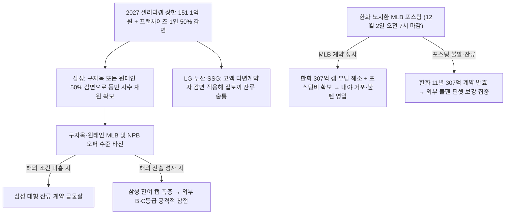

import Alert from '@/components/Alert.astro';
import Chart from '@/components/Chart.astro';
import CloudinaryImage from '@/components/CloudinaryImage.astro';
import BaseballPlayerCard from '@/components/BaseballPlayerCard.astro';
import PlayerInline from '@/components/PlayerInline.astro';

대구 삼성라이온즈파크를 수놓았던 V9 축포의 화약 냄새가 가시기도 전에, 2027 KBO FA 스토브리그는 개장 벨과 동시에 도장 찍는 소리로 뒤덮였습니다. 교섭 첫날인 11월 17일 두산 양의지(2년 55억 원)와 SSG 오태곤(3년 11억 원)이 잔류를 확정한 데 이어, 18일에는 외야 최대어 최지훈마저 4년 67억 원에 SSG 잔류 사인을 마쳤죠.

이틀 만에 133억 원이 움직였지만 본게임은 이제부터입니다. 직전 [2026 KBO 시즌 총결산과 2027 신인드래프트](/culture/2026-kbo-review-2027-draft)에서 다뤘듯 올가을 12년 만의 업셋 한국시리즈 우승을 일군 삼성의 투타 기둥 구자욱·원태인은 해외 무대를 노크 중이고, 정규 1위 KT에서는 무려 6명이 한꺼번에 풀렸거든요. 11월 19일 기준 미계약 19인의 가치와 10개 구단의 셈법을 짚어봅니다.

---

## 한눈에 보는 2027 KBO FA 시장 현황: 최종 승인 22인 요약표

지난 11월 13일 공시된 자격 선수 28명(노시환·고영표·나성범·김광현·김재환·박세웅·박건우·박민우·김재현 등 다년계약·유보 9명 별도) 중 6명이 권리 행사를 접었습니다. 김성현·이재원은 은퇴를 택했고, 서진용·한유섬·박승욱은 'FA 재수'를, 최주환은 기존 다년계약 연장선을 선택했죠.

그 결과 11월 16일 확정된 **2027 KBO FA 승인 선수는 총 22명**(A등급 6명·B등급 10명·C등급 6명)입니다.

| 등급 | 선수명 | 원소속 | 포지션(나이) | 2026시즌 핵심 성적 | 계약 현황 (11.19) |
| :---: | :--- | :---: | :---: | :--- | :--- |
| **A** | **구자욱** | 삼성 | LF (33) | 114G .371(1위) 15홈런 102타점 출루율 .458(1위) OPS 1.039 | 미계약 (MLB 타진) |
| **A** | **원태인** | 삼성 | SP (26) | 26G 145.1이닝 7승 9패 ERA 4.52 (PS ERA 1.74) | 미계약 (MLB·NPB 타진) |
| **A** | **홍창기** | LG | RF (32) | 128G .239 0홈런 33타점 출루율 .375 OPS .659 | 미계약 |
| **A** | **김민혁** | KT | LF (30) | 117G .285 107안타 1홈런 41타점 OPS .676 | 미계약 |
| **A** | **배정대** | KT | CF (31) | 95G .214 25안타 0홈런 14타점 OPS .589 | 미계약 |
| **A** | **박상원** | 한화 | RP (32) | 56G 50.2이닝 3승 4패 2세이브 11홀드 ERA 4.80 | 미계약 |
| **B** | **최지훈** | SSG | CF (29) | 141G .250 13홈런 64타점 21도루 OPS .716 | **SSG 잔류** (4년 67억) |
| **B** | **박동원** | LG | C (36) | 128G .225 14홈런 56타점 OPS .727 | 미계약 |
| **B** | **정수빈** | 두산 | CF (36) | 142G .253 7홈런 52타점 20도루 OPS .681 | 미계약 |
| **B** | **박치국** | 두산 | RP (28) | 56G 48.1이닝 0승 2패 8홀드 ERA 5.40 45탈삼진 | 미계약 |
| **B** | **김태군** | KIA | C (36) | 88G .252 6홈런 27타점 OPS .711 | 미계약 |
| **B** | **최재훈** | 한화 | C (37) | 55G .170 0홈런 13타점 OPS .462 | 미계약 |
| **B** | **한승혁** | KT | RP (33) | 35G 32.1이닝 3승 2패 10홀드 ERA 6.68 37탈삼진 | 미계약 |
| **B** | **김민수** | KT | RP (34) | 39G 42.2이닝 2승 3패 1세이브 3홀드 ERA 5.70 | 미계약 |
| **B** | **오윤석** | KT | IF (34) | 113G .285 55안타 1홈런 28타점 OPS .701 | 미계약 |
| **B** | **권희동** | NC | OF (35) | 100G .233 5홈런 34타점 출루율 .349 OPS .680 | 미계약 |
| **C** | **양의지** | 두산 | C (39) | 135G .249 23홈런 79타점 OPS .797 (통산 300홈런) | **두산 잔류** (2년 55억) |
| **C** | **오태곤** | SSG | IF/OF (35) | 106G .252 9홈런 34타점 8도루 OPS .711 | **SSG 잔류** (3년 11억) |
| **C** | **문승원** | SSG | RP (36) | 62G 62.2이닝 2승 2패 2세이브 17홀드 ERA 3.45 | 미계약 |
| **C** | **김호령** | KIA | CF (34) | .267 140안타 13홈런 68타점 (정상급 중견수 수비) | 미계약 |
| **C** | **김상수** | KT | IF (36) | .282 내야 멀티 주전 유틸리티 | 미계약 |
| **C** | **전병우** | 삼성 | IF (34) | 118G .238 12홈런 54타점 | 미계약 |

<Alert type="info" title="2027 FA 등급별 보상 규정 및 외부 영입 상한">
보상 방식의 **최종 선택권은 영입 구단이 아닌 원소속 구단**에 있습니다.

- **A등급**: 직전 연봉 **200% + 보호선수 20인 외 1명** 또는 직전 연봉 **300%**
- **B등급**: 직전 연봉 **100% + 보호선수 25인 외 1명** 또는 직전 연봉 **200%**
- **C등급**: **보상선수 없음**, 직전 연봉 **150%** 금전 보상
- **외부 영입 한도**: 승인 선수 22명(21～30명 구간) 기준으로 타 구단 FA **최대 3명**까지 영입 가능
</Alert>

---

## 등급·포지션별 핵심 매물 스포트라이트

### 개장 48시간의 속도전: 양의지 290억 금자탑과 최지훈 잔류

초반 시장은 대어급 집토끼들의 속전속결 잔류가 이끌었습니다. 1호 계약자 <PlayerInline name="양의지" team="두산" number={25} position="C" kboId="76232" />는 기존 4+2년 계약의 +2년(42억 원) 선수 옵션을 포기하고 3차 FA를 선언했는데요. 39세에도 23홈런·통산 300홈런을 달성한 기량을 인정받아 **2년 최대 55억 원**(계약금 40억·연봉 10억·인센티브 5억)에 도장을 찍으며, 통산 FA 누적 **290억 원**이라는 역대 1위 대기록을 세웠습니다.

<BaseballPlayerCard
  name="최지훈"
  team="SSG"
  number={54}
  position="CF"
  batsThrows="우투좌타"
  season="2026 KBO"
  kboId="50854"
  stats={{ avg: '.250', hr: 13, rbi: 64, sb: 21, ops: '.716' }}
  comment="4년 67억 원(계약금 38억·연봉 20억·옵션 9억)에 잔류하며 청라돔 시대의 핵심 코어로 남았다. 계약 직후 인천 지역에 1억 원을 기부했다."
/>

SSG 역시 유틸리티 오태곤(3년 최대 11억 원, 계약금 2억·연봉 7.4억·옵션 1.6억)에 이어 29세 중견수 **최지훈**까지 4년 67억 원에 묶었습니다. 20대 후반 외야 최대어가 일찌감치 사라지면서 시장에 남은 센터라인 매물들의 몸값은 오히려 탄력을 받게 됐습니다.

### A등급 6인의 딜레마: 삼성 V9 투타 기둥 vs 20인 보호명단 장벽

A등급 최대어는 단연 삼성의 한국시리즈 업셋 우승(V9)을 견인한 **구자욱**과 **원태인**입니다.

<BaseballPlayerCard
  name="구자욱"
  team="삼성"
  number={5}
  position="LF"
  batsThrows="우투좌타"
  season="2026 KBO"
  kboId="62404"
  stats={{ avg: '.371', hr: 15, rbi: 102, obp: '.458', ops: '1.039' }}
  comment="정규시즌 타율·출루율 2관왕이자 한국시리즈 MVP. 미국 에이전시 마코 코퍼레이션(제런 롱)을 선임해 MLB 진출 가능성을 함께 타진하고 있다."
/>

<BaseballPlayerCard
  name="원태인"
  team="삼성"
  number={18}
  position="SP"
  batsThrows="우투우타"
  season="2026 KBO"
  kboId="69446"
  stats={{ era: '4.52', record: '7승 9패', ip: '145.1', so: 117, whip: '1.39' }}
  comment="포스트시즌 5경기 2승 ERA 1.74의 역투로 V9을 완성한 26세 토종 에이스. 완전 FA 자격으로 MLB·NPB 무대를 노크 중이다."
/>

실력과 상징성 모두 압도적이지만 국내 이적 가능성은 희박합니다. 천문학적 총액에 **보호선수 20인 외 1명** 유출까지 감수할 외부 구단을 찾기 어렵기 때문이죠.

나머지 A등급 4명을 향한 시선은 한층 냉정합니다.

<BaseballPlayerCard
  name="홍창기"
  team="LG"
  number={51}
  position="RF"
  batsThrows="우투좌타"
  season="2026 KBO"
  kboId="66108"
  stats={{ avg: '.239', hr: 0, rbi: 33, obp: '.375', ops: '.659' }}
  comment="타율 .239·무홈런 커리어 로우에 그쳤으나 출루율 .375를 지킨 선구안은 여전하다. A등급 보상 장벽 속 LG와의 눈높이 조율이 관건이다."
/>

LG **홍창기**는 극심한 타격 슬럼프 속에서도 통산 출루 가치를 증명했지만, A등급 보상을 지불할 외부 입찰자가 나서기엔 올해 성적표가 무겁습니다. KT 외야진의 <PlayerInline name="김민혁" team="KT" number={53} position="LF" kboId="64004" />과 <PlayerInline name="배정대" team="KT" number={27} position="CF" kboId="64166" />, 한화 우완 필승조 <PlayerInline name="박상원" team="한화" number={58} position="RP" kboId="67703" /> 역시 20인 외 보상 규정이 이적의 발목을 잡아 원소속 구단 잔류 협상이 유력합니다.

### 진짜 전쟁터는 B·C등급: 안방마님 쟁탈전과 무보상 알짜 사냥

구단 간 영입전이 불붙을 진짜 무대는 B등급(25인 외)과 보상선수가 없는 **C등급**입니다. 안방에서는 양의지 잔류 이후 남은 베테랑 포수 3인방의 가치가 치솟았습니다.

<BaseballPlayerCard
  name="박동원"
  team="LG"
  number={27}
  position="C"
  batsThrows="우투우타"
  season="2026 KBO"
  kboId="79365"
  stats={{ avg: '.225', hr: 14, rbi: 56, obp: '.337', ops: '.727' }}
  comment="두 자릿수 장타력과 노련한 리드를 겸비한 남은 포수 시장 최대어. 원소속팀 LG의 최우선 잔류 타깃이다."
/>

**박동원**을 필두로 다년계약이 끝난 <PlayerInline name="김태군" team="KIA" number={42} position="C" kboId="78122" />, 신예 허인서의 성장 속에 출전 폭이 줄어든 <PlayerInline name="최재훈" team="한화" number={13} position="C" kboId="78288" />이 안방 보강을 노리는 팀들의 레이더에 들어와 있습니다.

특히 현장 스카우트들이 지목하는 최고 격전지는 **C등급 실속 매물**입니다.
- **김호령**(KIA, CF): 타율 .267, 140안타, **13홈런 68타점**으로 커리어 하이를 찍었습니다. 리그 정상급 중견수 수비에 두 자릿수 홈런까지 더했는데 보상선수조차 없어, 최지훈을 놓친 구단들의 영입 1순위로 꼽힙니다.
- **문승원**(SSG, RP): <PlayerInline name="문승원" team="SSG" number={42} position="RP" kboId="62869" />은 62경기 **17홀드, ERA 3.45**로 필승조 경쟁력을 입증한 C등급 불펜 최대어입니다.
- **내·외야 및 불펜 실속파**: 타율 .282를 기록한 내야 멀티 주전 **김상수**(KT)와 12홈런으로 삼성 V9을 도운 우타 내야수 **전병우**(삼성)가 C등급에서 인기를 끌고 있으며, B등급에서는 베테랑 중견수 <PlayerInline name="정수빈" team="두산" number={31} position="CF" kboId="79231" />과 28세 사이드암 <PlayerInline name="박치국" team="두산" number={1} position="RP" />, 강백호 보상선수로 KT 유니폼을 입었던 파이어볼러 <PlayerInline name="한승혁" team="KT" number={35} position="RP" />이 매력적인 카드입니다.

---

## 10개 구단 스토브리그 판도: 집토끼 비상 vs 외부 수혈·새판 짜기

<CloudinaryImage
  publicId="posts/culture/2026/2027-kbo-fa-stove-league-guide/fig-01-fa-market-chess"
  width={1376}
  height={768}
  alt="야구 내야 다이아몬드 전술 보드 위에서 구단 간 집토끼 단속과 외부 영입 수싸움을 상징하는 체스 말 일러스트"
/>

구단별 FA 승인 인원을 나열하면 올겨울 각 프런트의 포지션이 명확히 드러납니다.

<Chart
  type="bar"
  caption="2027 KBO 구단별 최종 FA 승인 선수 배출 인원 (총 22명)"
  height={300}
  data={{
    labels: ['KT', '삼성', '두산', 'SSG', 'KIA', 'LG', '한화', 'NC', '롯데', '키움'],
    datasets: [{
      label: 'FA 승인 선수 수 (명)',
      data: [6, 3, 3, 3, 2, 2, 2, 1, 0, 0],
      backgroundColor: [
        '#000000',
        '#005BAC',
        '#131230',
        '#CE0E2D',
        '#C70125',
        '#C30452',
        '#FF6600',
        '#1D467E',
        '#002955',
        '#570514'
      ]
    }]
  }}
/>

### 집토끼 수성 그룹: KT·삼성·LG·두산·SSG

가장 분주한 팀은 90승 정규시즌 1위 **KT**입니다. 이강철 감독과 3년 34억 원 재계약을 맺어 사령탑은 일찍 안정시켰으나, 김민혁·배정대·한승혁·김민수·오윤석·김상수까지 무려 **6명**이 풀렸습니다. 전원 잔류는 현실적으로 버거운 만큼 김민혁·김상수 등 주전 야수 코어를 우선 단속하며 선택과 집중에 나설 전망입니다.

**삼성**은 V9 주역 구자욱·원태인 동반 사수에 사활을 걸었고, 전병우까지 묶어 왕조 재건의 기틀을 다진다는 방침입니다. **LG** 역시 리드오프 홍창기와 안방마님 박동원 중 한 명만 이탈해도 전력 타격이 치명적이라 집토끼 단속이 절대 우선순위입니다.

지난겨울 유격수 박찬호 영입 등으로 투자 기조를 보였던 **두산**(정재훈 신임 단장)은 양의지를 눌러 앉힌 뒤 정수빈·박치국 잔류 협상으로 넘어갔고, **SSG**(김성용 운영담당 체제)는 최지훈·오태곤 계약을 마무리한 채 마지막 남은 문승원 단속에 집중하고 있어요.

### 외부 사냥 및 새판 짜기 그룹: 롯데·한화·KIA·NC·키움

반면 유출 부담이 적은 구단들은 체질 개선과 외부 수혈 타이밍을 노리고 있습니다.

가장 공격적인 행보가 점쳐지는 구단은 9년 연속 가을야구에 실패한 **롯데**예요. 사장부터 **이택근 단장·이동욱 감독**까지 리더십을 전면 교체한 데다 내부 FA가 **0명**이라 운신 폭이 한결 넓거든요. 보상선수 출혈이 없는 김호령·문승원·김상수 등 C등급 알짜 매물 시장의 최대 큰손으로 꼽힙니다.

지난 스토브리그를 다룬 [2026 KBO 개막 관전 포인트](/culture/2026-kbo-season-preview)에서도 짚었듯, 100억 FA 강백호의 34홈런 분전에도 불펜 붕괴로 9위에 그친 **한화** 역시 **류지현 감독·석장현 단장** 체제로 새판을 짰습니다. 박상원·최재훈 내부 협상과 더불어 뒷문 보강이 발등의 불입니다.

그 외 **KIA**는 김호령·김태군 수성을 중심으로 핀셋 보강을 노리고, **NC**는 권희동 협상과 마운드 보강을 병행합니다. 유출 0명인 10위 **키움**은 16억 루키 하현승 중심의 리빌딩을 이어가면서 내년에 도입될 샐러리캡 하한액 충족 계산을 함께 두드리고 있습니다.

---

## 스토브리그 향방을 가를 2대 변수: 프랜차이즈 감면과 해외 진출 도미노

<CloudinaryImage
  publicId="posts/culture/2026/2027-kbo-fa-stove-league-guide/fig-02-cap-and-posting"
  width={1376}
  height={768}
  alt="샐러리캡 균형을 맞추는 황동 천칭 저울과 야구장 조명 너머 해외 무대로 향하는 여객기를 대비한 일러스트"
/>

올해 스토브리그는 단순한 자금력 대결이 아닙니다. 새로 도입된 **샐러리캡 감면 룰**과 **해외 진출 시계**가 톱니바퀴처럼 맞물려 돌아갑니다.

### 변수 1. 151억 샐러리캡과 '프랜차이즈 1인 50% 감면' 히든카드

2027시즌 경쟁균형세(샐러리캡) 상한액은 5% 인상된 **151억 1,709만 원**입니다. 여기에 올해부터 **7시즌 이상 소속된 프랜차이즈 선수 1명의 연봉·계약금 안분액·옵션 합산분 50%를 총액 산정에서 제외**하는 한국판 래리 버드 룰이 본격 가동됩니다.

이 카드가 빅마켓 구단들의 숨통을 틔웠습니다. 삼성이 연평균 30억～35억 원 규모가 예상되는 구자욱(또는 원태인)을 감면 대상자로 지정하면 장부상 **연 15억 원 이상의 캡 공간**이 즉시 열립니다. 제재금 부담 없이 두 기둥을 모두 잔류시킬 재원이 마련되는 셈이죠. 고액 다년계약자가 포진한 SSG·LG·두산·한화 역시 이 예외 조항을 지렛대 삼아 지갑을 열고 있습니다.

### 변수 2. 12월 2일 노시환 포스팅 마감과 원태인·구자욱의 해외 타진

태평양 건너편에서 날아올 소식도 시장 판도를 뒤흔듭니다. 비FA 신분인 한화 **노시환**의 메이저리그 포스팅 마감일이 임박했기 때문입니다.

<BaseballPlayerCard
  name="노시환"
  team="한화"
  number={8}
  position="3B"
  batsThrows="우투우타"
  season="2026 KBO"
  kboId="69737"
  stats={{ avg: '.283', hr: 29, rbi: 96, obp: '.360', ops: '.865' }}
  comment="지난 2월 맺은 11년 307억 원 다년계약 특약에 따라 MLB 포스팅 공시. 한국시간 12월 2일 오전 7시 마감 결과에 한화의 겨울 노선이 갈린다."
/>

노시환은 지난 2월 한화와 **11년 총액 307억 원**(2027 발효) 다년계약을 맺으며 '2026시즌 종료 후 MLB 포스팅 허용' 특약을 넣었습니다. 11월 1일 공시된 협상 마감 시한은 **한국시간 12월 2일 오전 7시**(미 동부시간 12월 1일 오후 5시)입니다.
- **MLB 계약 성사 시**: 307억 다년계약이 발효되지 않고 백지화되면서 한화는 두둑한 포스팅비와 거대한 샐러리캡 여유분을 한꺼번에 확보해, 3루 공백과 불펜을 메울 시장 최대 큰손으로 돌변합니다.
- **포스팅 불발 시**: 즉시 11년 307억 원 계약이 발효되며, 한화는 노시환에게 프랜차이즈 50% 감면을 씌운 뒤 남은 캡을 불펜 보강에 집중 투입합니다.

아울러 포스팅비 부담이 없는 **완전 FA 신분**으로 해외 구단과 접촉 중인 원태인(MLB·NPB)과 구자욱(MLB 타진)은 미국 윈터미팅 전후까지 현지 오퍼를 저울질할 공산이 커, 최종 거취 확정까지는 12월 중순 이후 장기전이 예상됩니다.

---

양의지·최지훈의 속전속결 잔류가 스토브리그 1막이었다면, 남은 19인의 연쇄 이동을 촉발할 2막의 신호탄은 **12월 2일 오전 7시 노시환 포스팅 마감 벨**입니다. 그전까지는 보상선수가 없는 김호령·문승원·김상수 등 C등급 매물과 안방 최대어 박동원을 둘러싼 물밑 쟁탈전이 가장 치열하게 펼쳐질 테니, 응원 팀의 25인 보호명단부터 미리 계산해 보셔도 좋겠습니다.

<Alert type="info" title="다음 포스트 예고: 2027 KBO 리그 달라지는 규정 총정리">
이번 글에서 짚어본 프랜차이즈 1인 50% 감면 외에도 2027시즌 KBO 리그에는 굵직한 제도 변화가 대기 중입니다. 사상 최초 시행되는 **샐러리캡 하한액**(60.6억 원)부터 **참가활동기간 1주일 조기화**(1월 25일 개시), 그리고 **ABS 존 미세 보완**까지 달라지는 새 시즌 규정은 이어지는 다음 포스트에서 상세히 다룹니다.
</Alert>
