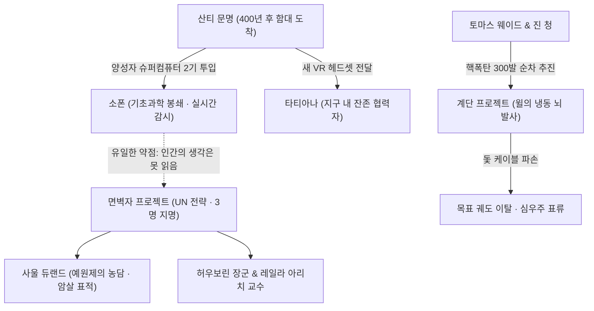

import Alert from '@/components/Alert.astro';
import MovieCard from '@/components/MovieCard.astro';
import YouTubeEmbed from '@/components/YouTubeEmbed.astro';
import PersonInline from '@/components/PersonInline.astro';
import BookCard from '@/components/BookCard.astro';

기다림이 드디어 끝을 보입니다. 넷플릭스 SF 시리즈 《삼체》(3 Body Problem) 시즌 2가 **2027년 1월 14일** 전 세계 동시 공개로 확정됐거든요. 시즌 1을 아직 안 보신 분은 "지금이라도 정주행할 만한가?"가 궁금할 테고, 2년 전에 다 보신 분은 "도대체 누가 죽었고 끝이 어땠더라?"부터 막막하실 겁니다.

이 글은 두 독자층을 위해 절반으로 나눴어요. 앞부분은 스포일러 없이 시즌 2 확정 정보와 시즌 1 입문 가이드를 담았고, 경고 박스 아래부터는 시즌 1의 핵심 떡밥과 결말을 5분 만에 되살릴 수 있게 압축했습니다.

## 삼체 시즌 2 확정 정보 한눈에 보기

2026년 11월 17일 넷플릭스가 공식 발표한 일정에 따르면, 《삼체》 시즌 2는 **2027년 1월 14일** 공개됩니다. 시즌 1이 2024년 3월 21일에 나왔으니 무려 **2년 10개월 만의 귀환**이죠. 회차 구성은 시즌 1의 8부작에서 **총 6부작**으로 압축됐습니다.

미시청자가 넷플릭스 오리지널을 시작할 때 가장 꺼리는 지점이 "보다가 중간에 캔슬되면 어쩌지?"라는 불안감인데요. 《삼체》는 그 걱정을 내려놓아도 됩니다. 제작진은 류츠신의 원작 3부작을 끝까지 완결하기 위해 **시즌 3를 최종 시즌**으로 설계했고, 시즌 2와 시즌 3를 헝가리 부다페스트에서 **연속 촬영**(Back-to-Back)으로 이미 마쳤습니다. 시즌 3의 구체적인 공개일은 아직 발표되지 않았지만, 적어도 이야기가 공중에 붕 뜰 일은 없는 셈이죠.

<MovieCard title="삼체 (3 Body Problem)" imdbId="tt13016388" />

공식 티저 예고편부터 분위기가 확 달라졌습니다. 시즌 1이 미스터리 스릴러에 가까웠다면, 시즌 2는 인류 전체가 외계 문명과 전면전을 준비하는 스케일로 넘어갑니다.

<YouTubeEmbed id="MEsBnTrMPjc" title="삼체: 시즌 2 공식 티저 예고편 (Netflix Korea)" />

<Alert type="info">
이 영상은 청소년 관람불가 등급 예고편으로 YouTube 연령 제한이 적용되어 있습니다. 페이지 안에서 바로 재생되지 않으면 플레이어의 **YouTube에서 보기**를 눌러 로그인(성인 인증) 후 감상해 주세요.
</Alert>

## [노스포일러] 시즌 1, 지금 정주행할 만할까?

결론부터 말하면, SF 장르에 조금이라도 관심이 있다면 지금 정주행하기에 타이밍이 딱 좋습니다. 시즌 1은 로튼토마토 신선도 **78%**, IMDb **7.5점**을 기록하며 평단과 대중 양쪽에서 안정적인 평가를 받았고, 제76회 에미상에서도 드라마 시리즈 작품상을 포함해 **6개 부문**에 이름을 올렸습니다. 2024년 상반기에만 누적 **5,200만 회 이상** 시청되며 넷플릭스 대표 SF 간판작으로 자리 잡았죠.

다만 취향을 타는 지점이 꽤 뚜렷합니다. 본인의 시청 성향과 맞는지 먼저 따져보세요.

- **이런 분께 강력 추천해요**: 《왕좌의 게임》처럼 거대한 세계관이 서서히 펼쳐지는 서사를 좋아하고, 1화부터 미스터리를 빠르게 던져주는 8부작 템포를 선호하는 분.
- **호불호가 갈릴 수 있는 지점**: 원작 특유의 묵직한 하드 SF 물리학 고증을 기대했다면 설명이 다소 간결하게 느껴질 수 있습니다. 반대로 캐릭터 간 감정선이나 드라마틱한 서사에 집중하는 시청자는 중반부 이후 차가운 전개에 거리감을 느끼기도 해요.

### 넷플릭스판 vs 원작 소설 vs 텐센트 30부작 비교

《삼체》는 이미 원작 소설과 중국 텐센트 드라마(30부작)가 존재해서, 어느 버전부터 접할지 헷갈리는 분이 많습니다. 세 버전은 호흡과 캐릭터 구성 자체가 완전히 다릅니다.

| 구분 | 넷플릭스판 (시즌 1) | 원작 소설 (3부작) | 텐센트 드라마 |
| :--- | :--- | :--- | :--- |
| **분량 및 템포** | 8부작, 빠른 전개 | 3권 총 2,000쪽 이상 | 30부작, 매우 느린 호흡 |
| **주인공 구성** | 옥스퍼드 5인방으로 재편 | 1·2·3부 주인공이 매권 교체 | 원작 1부 주인공 왕먀오 중심 |
| **이야기 범위** | 1부 중심 + 2·3부 초반 앞당김 | 권별 시간대 순차 전개 | 원작 1부만 충실히 영상화 |
| **추천 대상** | 주말에 속도감 있게 입문할 분 | 하드 SF 설정을 깊게 파고들 분 | 원작 1부 고증을 원형 그대로 볼 분 |

넷플릭스판의 가장 영리한 각색은 원작 1·2·3부에 흩어져 있던 핵심 인물들을 런던의 **옥스퍼드 5인방**으로 한데 묶어놓은 점입니다. 덕분에 시즌 1을 보면서 자연스럽게 시즌 2와 3의 복선을 미리 밟게 되죠.

### 시즌 1을 건너뛰고 시즌 2만 봐도 될까요?

솔직히 권하지 않습니다. 시즌 2는 새로운 사건을 처음부터 설명해 주는 옴니버스가 아니라, 시즌 1 마지막 화에서 던져진 두 개의 거대한 인류 생존 프로젝트를 곧바로 이어받는 구조거든요. 8부작이라 주말 이틀이면 충분히 끝낼 수 있으니, 1월 공개 전에 직접 정주행하는 편이 몰입도가 훨씬 높습니다.

<Alert type="warning" title="여기서부터 시즌 1 핵심 스포일러가 포함됩니다">
아직 시즌 1을 시청하지 않으셨다면 여기까지만 읽고 정주행을 시작하시길 권해요. 아래 내용은 시즌 1을 이미 보았지만 2년 10개월 사이에 줄거리와 인물 관계가 가물가물해진 분들을 위한 압축 복습입니다.
</Alert>

## [스포일러 포함] 시즌 1 핵심 설정 & 결말 5분 복습

시즌 2를 이해하기 위해 반드시 머릿속에 꺼내놓아야 할 핵심 떡밥은 딱 다섯 가지입니다.

### 1. 산티 함대의 400년 후 지구 도착
1960년대 중국 문화대혁명 시기, 천체물리학자 예원제(<PersonInline name="로잘린드 차오" role="예원제" imdbId="nm0001034" />)는 인류에 대한 환멸 끝에 태양을 증폭기로 삼아 우주로 신호를 보냅니다. 이 신호를 수신한 외계 문명 **산티**(원작의 삼체 문명)는 불안정한 세 개의 태양 때문에 멸망 위기에 놓인 고향을 버리고 지구로 함대를 출격시켰어요. 지구 도착까지 남은 시간은 약 **400년**입니다.

### 2. 지자(소폰, Sophon) 2기의 감시와 단 하나의 약점
400년 뒤 도착할 함대가 가장 경계한 건 인류의 폭발적인 과학 발전이었습니다. 그래서 산티는 양성자 크기의 슈퍼컴퓨터 **소폰**(지자) 2기를 빛의 속도로 지구에 먼저 보냈어요. 소폰은 전 세계 입자가속기 실험을 교란해 인류의 기초과학을 봉쇄하고, 지구 곳곳을 실시간으로 도청·감시합니다. 전 세계 하늘과 스크린에 "너희는 벌레다"(YOU ARE BUGS)라는 문구를 띄워 인류를 공포에 몰아넣은 것도 소폰의 소행이죠.

하지만 소폰에게도 치명적인 약점이 하나 있습니다. **인간의 머릿속 생각은 읽지 못한다**는 점이에요. 이 설정이 시즌 2 전체를 지배하는 핵심 규칙이 됩니다.

### 3. '심판의 날' 호 나노섬유 사건과 거짓말
산티와 교신하던 지구 내 협력 조직(마이크 에반스 일당)의 본거지인 거대 유조선 '심판의 날' 호를 급습하기 위해, 토마스 웨이드(<PersonInline name="리암 커닝햄" role="토마스 웨이드" imdbId="nm0192377" />)는 오기(<PersonInline name="에이사 곤살레스" role="오기 살라자르" imdbId="nm2555462" />)가 개발한 초미세 나노섬유를 파나마 운하에 설치해 배를 통째로 절단해 버립니다.

이 작전으로 확보한 하드디스크에서 더 큰 변수가 터져 나와요. 에반스가 들려준 '빨간 모자' 동화를 통해 산티는 인간이 **거짓말**을 할 수 있다는 사실을 처음 깨닫습니다. 생각이 곧바로 공유되는 산티 문명 입장에서, 속내를 숨기고 기만할 수 있는 인류는 더 이상 공존할 수 없는 공포의 대상이 됐고, 그 즉시 지구 내 협력자들마저 버리며 전면 적대 노선으로 돌아섰습니다.

### 4. 면벽자 프로젝트 — 넷플릭스판은 3명
소폰이 인간의 머릿속만은 훔쳐볼 수 없다는 약점을 파고든 UN의 전략이 바로 **면벽자 프로젝트**(Wallfacer Project)입니다. 원작 소설에서는 4명이 지명되지만, **넷플릭스판에서는 3명**만 선발된다는 점을 기억해 두세요. 중국의 **허우보린 장군**, 쿠르드족 전쟁 영웅 **레일라 아리치 교수**, 그리고 옥스퍼드 5인방 중 한 명인 **사울 듀랜드**(<PersonInline name="조반 아데포" role="사울 듀랜드" imdbId="nm5381254" />)가 그 주인공입니다.

면벽자는 누구에게도 계획을 설명하지 않고 막대한 자원을 동원해 산티에 맞설 전략을 머릿속으로만 구상합니다. 평범한 연구원이던 사울이 갑자기 면벽자로 지명되고 산티의 암살 표적이 된 결정적 이유는, 예원제가 죽기 직전 사울에게 들려준 **아인슈타인과 신의 농담**(바이올린과 색소폰 이야기) 때문이에요. "신과 장난치지 마라"는 그 농담 속에 우주의 생존 법칙에 관한 중대한 힌트가 숨어 있다는 걸 산티가 간파했기 때문입니다.

### 5. 계단 프로젝트의 실패와 심우주 표류
산티 함대를 정찰하기 위해 진 청(<PersonInline name="제스 홍" role="진 청" imdbId="nm10810538" />)과 토마스 웨이드가 밀어붙인 계획이 **계단 프로젝트**(Staircase Project)입니다. 방사선 돛을 단 초소형 탐사선 뒤에 **300발의 핵폭탄**을 순차적으로 터뜨려 광속의 1%까지 가속하는 과감한 작전이었죠. 질량 한계 때문에 통째로 인간을 태울 수 없었고, 말기 암으로 죽어가던 윌(<PersonInline name="알렉스 샤프" role="윌 다우닝" imdbId="nm5189784" />)이 진 청을 향한 마음으로 자원해 자신의 냉동 뇌를 실어 보냅니다. 하지만 발사 직후 돛의 고정 케이블 하나가 끊어지면서 캡슐은 목표 궤도를 이탈해 끝없는 심우주로 표류하고 말았습니다.

### 옥스퍼드 5인방 + 핵심 조연 시즌 1 결말 현황표

누가 살아남아 어디에 있는지 한눈에 정리해 두면 시즌 2 1화를 훨씬 편하게 따라갈 수 있어요.

| 인물 | 구분 | 시즌 1 결말 상태 및 위치 |
| :--- | :--- | :--- |
| **진 청** | 옥스퍼드 5인방 | 계단 프로젝트 실패와 윌의 상실감으로 깊은 충격에 빠짐 |
| **사울 듀랜드** | 옥스퍼드 5인방 | 본인은 거부했지만 면벽자로 강제 지명, 산티의 암살 위협 직면 |
| **오기 살라자르** | 옥스퍼드 5인방 | 나노섬유 살상 죄책감에 멕시코로 떠나 정수 필터 보급·기술 오픈소스 공개 |
| **윌 다우닝** | 옥스퍼드 5인방 | 말기 암으로 사망 후 냉동 뇌 상태로 탐사선에 실려 심우주 표류 중 |
| **잭 루니** | 옥스퍼드 5인방 | **사망** (산티 명령을 받은 타티아나에게 자택에서 살해됨) |
| **예원제** | 핵심 조연 | **사망** (사울에게 농담을 남긴 뒤 중국 기지 옛터에서 타티아나에게 최후를 맞음) |
| **토마스 웨이드** | 핵심 조연 | 계단 프로젝트 실패 후에도 인류 방위 총괄 유지, 소폰의 직접적인 심리 위협 직면 |
| **다 시** | 핵심 조연 | 형사(<PersonInline name="베네딕트 웡" role="다 시" imdbId="nm0938950" />), 절망한 진 청·사울을 메뚜기 떼가 가득한 늪지로 데려가 생존 의지 환기 |
| **타티아나** | 핵심 조연 | 산티의 충실한 암살자, 숲속에서 새 VR 헤드셋을 건네받으며 다음 임무 암시 |

시즌 1의 마지막 장면은 다 시가 절망에 빠진 진 청과 사울을 메뚜기 떼 앞으로 데려가는 장면으로 끝납니다. 인류가 수천 년 동안 벌레를 박멸하려 했지만 단 한 번도 완전히 없애지 못했듯, 산티가 인류를 벌레라 부르더라도 우리는 끝내 살아남을 것이라는 묵직한 선언이었죠.

## 시즌 2(《암흑의 숲》) 관전 포인트와 원작 도서

시즌 2는 원작 3부작 중에서도 팬들이 최고 걸작으로 꼽는 2부 《암흑의 숲》을 본격적으로 다룹니다. 쇼러너 <PersonInline name="데이비드 베니오프" role="쇼러너" imdbId="nm1125275" />, <PersonInline name="D.B. 와이스" role="쇼러너" imdbId="nm1888967" />, 그리고 알렉산더 우는 앞선 인터뷰에서 시즌 1이 거대한 서막이었다면 시즌 2부터는 인류가 본격적으로 맞서는 스케일과 심리전이 폭발할 것이라고 예고한 바 있습니다.

가장 기대되는 축은 역시 사울 듀랜드입니다. 아무것도 하기 싫어하던 평범한 과학자가 소폰의 24시간 감시망 속에서 어떻게 예원제의 농담을 해독하고, 우주의 잔혹한 생존 원리인 '암흑의 숲' 이론에 도달할지가 시즌 2의 핵심 관전 포인트예요. 여기에 《더 보이즈》로 얼굴을 알린 <PersonInline name="클라우디아 두밋" role="반 레인 대위" imdbId="nm4707628" />과 《왕좌의 게임》에서 테온 그레이조이를 연기했던 <PersonInline name="알피 앨런" role="시즌 2 합류" imdbId="nm0654295" /> 등 새로운 인물들이 합류해 6부작을 꽉 채울 예정입니다.

공개일까지 남은 두 달 동안 원작의 치밀한 과학 설정과 심리전을 미리 맛보고 싶다면, 1부와 2부 소설을 먼저 읽어두는 것도 좋은 선택입니다. 드라마가 생략한 물리학 디테일과 면벽자들의 기상천외한 전략을 훨씬 깊게 즐길 수 있거든요.

<BookCard
  title="삼체 1: 삼체문제"
  isbn13="9788954442695"
  coupangHref="https://link.coupang.com/a/iOnc8fn1SC"
  comment="넷플릭스 시즌 1의 바탕이 된 원작. 옥스퍼드 5인방 대신 중국 나노과학자 왕먀오의 시선으로 소폰의 정체와 삼체 게임의 비밀을 훨씬 촘촘하게 파고듭니다."
/>

<BookCard
  title="삼체 2: 암흑의 숲"
  isbn13="9788954442701"
  coupangHref="https://link.coupang.com/a/iOnjj7TUwm"
  comment="삼체 3부작 중 팬덤이 가장 열광하는 2부. 시즌 2의 핵심인 면벽자 심리전과 우주 문명 간의 잔혹한 생존 법칙을 미리 만나볼 수 있습니다."
/>

2027년 1월 14일까지 아직 두 달 남짓 여유가 있습니다. 미시청자라면 이번 주말에 시즌 1 8부작을 가볍게 정주행해 보시고, 이미 보셨다면 위 복습표만 한 번 더 훑어둔 채 6부작으로 응축된 《암흑의 숲》을 맞이하시면 충분합니다.
