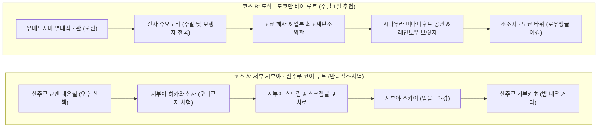

import Alert from '@/components/Alert.astro';
import CloudinaryImage from '@/components/CloudinaryImage.astro';
import MovieCard from '@/components/MovieCard.astro';
import PersonCard from '@/components/PersonCard.astro';
import PersonInline from '@/components/PersonInline.astro';
import PlaceCard from '@/components/PlaceCard.astro';
import YouTubeEmbed from '@/components/YouTubeEmbed.astro';

도쿄 항공권을 끊고 나면 한 번쯤 넷플릭스 『아리스 인 보더랜드』처럼 인파가 증발한 시부야 한복판이나 붉은 철골이 치솟은 도쿄 타워 아래 서 있는 장면을 상상하게 됩니다. 하지만 극 중 지명이나 예전 블로그 후기만 믿고 움직였다간 일반인 출입이 막힌 지방 세트장 앞에서 허탕을 치거나, 2026년 초 영구 폐장한 오다이바 테마파크 문 앞에서 발길을 돌리는 낭패를 겪기 십상이죠.

도쿄 시내에서 실제로 두 발로 걸으며 작품의 공기감을 생생하게 체감할 수 있는 진짜 로케이션과 배경 모델 명소 8곳만 추렸습니다. 어디까지가 도쿄 실물이고 어디서부터가 타 지역 세트장·VFX인지 명확히 가려내고, 일반 여행 일정에 바로 끼워 넣기 좋은 반나절～1일 코스까지 함께 묶었습니다.

## 한눈에 보는 도쿄 성지순례 명소 8선 요약

바쁜 일정 중 핵심만 빠르게 비교할 수 있도록 도쿄 내 방문 가능한 8개 스폿의 등장 장면과 촬영 진실을 표로 압축했습니다.

| 번호 | 명소명 | 등장 시즌 · 주요 장면 | 도쿄 실물 vs 촬영 진실 | 최단 역 · 추천 시간대 |
| :--- | :--- | :--- | :--- | :--- |
| **1** | **시부야 스크램블 교차로 · 도겐자카 · 스트림** | S1 무인 교차로 · S2 ♠K 총격전 · S3 최종전 | 도겐자카·스트림은 **실제 촬영**, 무인 교차로는 아시카가 세트+VFX | 시부야역 하치코·C2 출구 / 낮·야경 |
| **2** | **시부야 스카이** (SHIBUYA SKY) | S2 8화 하트 퀸(♥Q) 옥상 크로케 경기장 | **실제 도쿄 로케이션** (229m 옥상 데크 촬영 + 정원·폐허 VFX) | 시부야역 B6 출구 직결 / 일몰 1시간 전 |
| **3** | **시부야 히카와 신사** | S3 1～2화 불화살 게임 '오미쿠지' | 도쿄 내 **분위기 성지·추정 모델** (공식 촬영은 고베 나가타 신사·세트) | 시부야역 C2 출구 도보 12분 / 낮 |
| **4** | **도쿄 타워 & 시바공원 · 조조지** | S2 비행선 스카이라인 · S3 4화 '도쿄 빙고 타워' | 외형·입지 **실물 그대로**, 고공 철골 액션은 버추얼 스튜디오 | 아카바네바시역 도보 5분 / 해 질 녘～밤 |
| **5** | **시바우라 미나미후토 공원 & 레인보우 브릿지** | S1 중반 아리스·우사기 바닷가 대화 | **실제 도쿄 로케이션** (미나토구 필름 커미션 지원 수변 공원) | 시바우라후토역 도보 5분 / 일몰 전후 |
| **6** | **일본 최고재판소 & 오테마치 빌딩숲** | S2 6화 다이아몬드 킹(♦K) '천칭' · 무인 도심 | 최고재판소 외관 실물, 오테마치·니혼바시 공도는 **실제 도심 촬영** | 나가타초역 도보 5분 / 낮 |
| **7** | **긴자 주오도리 & 신주쿠 가부키초** | 무인 8차선 대로 & 밤의 게임 아레나 네온 | 스턴트는 지방 도로 봉쇄 촬영, **주말 보행자 천국**으로 재현 가능 | 긴자역 (주말 낮) / 신주쿠역 (밤) |
| **8** | **신주쿠 교엔 대온실 & 유메노시마 열대식물관** | S1 3화 하트 7(♥7) '숨바꼭질' 식물원 | 실제 촬영은 오사카 식물원이나, **도쿄 내 정글 온실 대안 2선** | 신주쿠교엔마에역 / 신키바역 (낮) |

---

## 폐허가 된 메트로폴리스: 시즌 1～3을 관통하는 도쿄라는 무대

아소 하로의 만화를 <PersonInline name="사토 신스케" imdbId="nm0766348" /> 감독이 연출한 『아리스 인 보더랜드』는 **도쿄라는 메가시티의 지형 자체를 생존 게임의 규칙으로 치환한 시리즈**입니다. 실존 마천루와 자치구 역사를 영웅 서사로 탈바꿈시킨 [뉴욕 히어로물의 도시 스토리텔링](/culture/nyc-heroes-and-villains)처럼, 익숙한 도쿄 랜드마크가 하루아침에 데스게임 아레나로 변모할 때의 기묘한 이질감이 극의 몰입도를 끌어올려요.

<MovieCard title="아리스 인 보더랜드 (Alice in Borderland)" imdbId="tt10795658" />

  <PersonCard name="사토 신스케" role="감독" imdbId="nm0766348" />
  <PersonCard name="야마자키 켄토" role="아리스 역" imdbId="nm4081467" />
  <PersonCard name="츠치야 타오" role="우사기 역" imdbId="nm3145634" />
  <PersonCard name="무라카미 니지로" role="치시야 역" imdbId="nm6327727" />
  <PersonCard name="나카 리이사" role="카노 미라 역" imdbId="nm2337578" />
  <PersonCard name="카쿠 켄토" role="류지 역" imdbId="nm3237199" />

2020년 12월 공개된 **시즌 1**(8부작)은 사람이 증발한 평행세계 도쿄('보더랜드')에서 숫자 카드(3～10) 게임과 리조트 '**비치**'의 마녀사냥(♥10)을 돌파하는 과정을 그렸고, 2022년 12월 **시즌 2**(8부작)는 도쿄 상공에 거대 비행선을 띄우며 그림 카드(J·Q·K) 시민들과의 대결을 도심 전역으로 넓혔습니다. 스페이드 킹(♠K)과 하트 퀸(♥Q)을 꺾은 뒤 클로즈업된 '**조커**'(JOKER) 카드 한 장은 강렬한 복선으로 남았죠.

뒤이어 2025년 9월 25일 공개된 최종장 **시즌 3**(6부작)가 대단원의 막을 내렸어요. 현실로 돌아와 결혼한 아리스(<PersonInline name="야마자키 켄토" imdbId="nm4081467" />)와 우사기(<PersonInline name="츠치야 타오" imdbId="nm3145634" />)가 4년 뒤 사후세계 연구자 류지(<PersonInline name="카쿠 켄토" imdbId="nm3237199" />)와 시민 반다의 조커 카드에 이끌려 다시 보더랜드로 진입하는데요. 신사의 불화살 게임 '**오미쿠지**', 폭주 전철, 333m 도쿄 타워 외벽 등반 '**도쿄 빙고 타워**', 시부야 최종 결전 '**미라이 스고로쿠**'까지 정주행하고 나면 도쿄의 풍경이 완전히 새롭게 다가옵니다.

---

## 시부야 권역: 보더랜드의 시작과 끝을 걷다

보더랜드 성지순례의 출발점은 단연 시부야입니다. 시즌 1 1화의 정적부터 시즌 3 최종화의 소용돌이까지, 핵심 무대 세 곳이 도보 15분 반경 안에 모여 있습니다.

### 1. 시부야 스크램블 교차로 · 하치코 광장 · 도겐자카 & 시부야 스트림

시즌 1 1화에서 시부야역 화장실에 숨었던 아리스 삼총사가 밖으로 나와 마주한 **텅 빈 스크램블 교차로**는 시리즈의 알파이자 오메가입니다. 시즌 2 7화에서는 수풀에 덮인 `SHIBUYA109` 앞에서 스페이드 킹 총격전이 벌어지고, 시즌 3 5～6화에서는 최종 게임 '미라이 스고로쿠'와 거대한 홍수 소용돌이의 무대가 되죠.

인파가 사라진 교차로와 폭파 장면은 도치기현 아시카가시에 지은 축구장 약 2개 규모의 오픈세트 '**아시카가 스크램블 시티 스튜디오**'(일반 비공개)에서 아스팔트와 하치코 동상까지 실물 크기로 제작해 찍은 뒤 고층 빌딩 VFX를 입혔습니다. 단, **시즌 1 1화 현실 시부야 질주 컷**(도겐자카 일대)과 **시즌 2 1화 이동 시퀀스**(시부야 스트림 일대)는 실제 도쿄 시부야 현장에서 촬영했습니다.

<YouTubeEmbed id="Xit-ScWgtOs" title="아리스 인 보더랜드 시부야 세트장 및 VFX 제작 비하인드 | Netflix" />

현실 교차로에서는 신호가 바뀔 때마다 최대 3,000명이 한꺼번에 쏟아져 나옵니다. 북적이는 인파 한복판에서 극 중 적막감을 겹쳐 보는 재미가 일품이죠. 교차로를 위에서 내려다보는 구도는 `MAGNET by SHIBUYA109` 옥상 전망대나 `SHIBUYA TSUTAYA` 스타벅스 창가 자리가 가장 정확합니다.

<PlaceCard
  name="시부야 스크램블 교차로"
  category="도심 랜드마크 · S1～S3 핵심 무대"
  query="Shibuya Scramble Crossing Tokyo"
  address="도쿄도 시부야구 도겐자카 2-2-1 일대"
  info="시부야역 하치코 출구 도보 1분 · 시부야 스트림은 C2 출구 직결"
  abroad={true}
/>

### 2. 시부야 스카이: 지상 229m 하트 퀸의 옥상 크로케 경기장

교차로 바로 위 시부야 스크램블 스퀘어 최상층 전망대 **시부야 스카이**(SHIBUYA SKY)는 시즌 2 8화 최종 보스 **하트 퀸**(♥Q, 카노 미라 역 <PersonInline name="나카 리이사" imdbId="nm2337578" />)과의 결전지입니다. 아리스와 우사기가 크로케 경기를 치르고 홍차 환각 심리전에 휘말리던 초고층 옥상 정원이 바로 이곳이죠.

CG 세트처럼 보이지만, 도쿄도 공식 '도쿄 로케이션 박스' 지원 아래 **지상 229m 실제 시부야 스카이 옥상 헬리패드 데크에서 촬영한 진짜 로케이션**이에요. 실제 옥상 데크 촬영본 위에 잔디·장미 덩굴 세트와 폐허가 된 도쿄 360도 파노라마 VFX를 합성해 완성했습니다.

<CloudinaryImage
  publicId="posts/culture/2026/alice-in-borderland-tokyo-spots/fig-01-shibuya-crossing-sky"
  width={1376}
  height={768}
  alt="시부야 스카이 옥상 전망대에서 내려다본 시부야 스크램블 교차로와 도쿄 도심 파노라마 전경"
  caption="지상 229m 시부야 스카이 옥상 데크에서 내려다본 도쿄 전경. 시즌 2 최종화 하트 퀸의 크로케 경기장이 실제 이곳 헬리패드 위에서 촬영됐다."
/>

입장 요금은 시간대별로 나뉘어 온라인 사전 예매 기준 15:00 이전은 2,700엔, 15:00 이후 일몰·야경 시간대는 3,400엔입니다(현장 매표소 구매 시 300엔 추가).

<Alert type="tip" title="시부야 스카이 예매 · 반입 금지 물품 · 결제 주의점">
일몰 시간대는 **2～4주 전 매진**되므로 사전 예매가 필수입니다. 옥상 안전 규정상 **모자·가방·삼각대·셀카봉은 반입이 금지**되어 46층 무료 락커에 보관해야 하며(스마트폰 스트랩 지참 권장, 강풍·우천 시 옥상 폐쇄 가능), 현장 결제나 쇼핑 시 단말기에서 원화(KRW) 대신 **엔화**(JPY) 현지통화를 골라야 이중 환전 수수료를 피할 수 있어요. 결제 팁은 [해외여행 원화결제(DCC) 수수료 주의 가이드](/culture/travel-scam-currency)를 미리 확인해 두세요.
</Alert>

<PlaceCard
  name="시부야 스카이 (SHIBUYA SKY)"
  category="전망대 · S2 8화 실제 촬영지"
  query="SHIBUYA SKY Tokyo"
  address="도쿄도 시부야구 시부야 2-24-12 시부야 스크램블 스퀘어 14F·45F～47F"
  info="시부야역 B6 출구 직결 · 10:00～22:30 (마감 21:20, 사전 온라인 예매 필수)"
  abroad={true}
/>

### 3. 시부야 히카와 신사: 시즌 3 '오미쿠지' 신사의 도쿄권 성지

시즌 3 1～2화 재진입 첫 게임 '**오미쿠지**'(신성한 제비뽑기)는 운세 제비에 적힌 수치 추론·확률 퀴즈의 오답 오차만큼 불화살이 날아오고, 마지막 지구 인구수 문제에서는 무려 1억 발의 불화살이 밤하늘을 뒤덮는 명장면을 남겼죠. 공식 크레딧에 이름을 올린 실제 촬영지는 효고현 고베시 나가타 신사(고베 필름 오피스 지원)와 전용 오픈세트지만, 팬들 사이에서 도쿄 시내 배경 모델이자 대체 성지로 꼽히는 곳이 시부야 최고령 고사(古社)인 **시부야 히카와 신사**(渋谷氷川神社)예요.

화재 위험 때문에 불화살 스턴트는 지방에서 찍었어도, 번화가 한복판에서 신사 특유의 깊고 서늘한 공기감을 느끼기엔 이곳만 한 곳이 없습니다. 시부야 스트림에서 도보 10분만 걸으면 거대한 느티나무 숲길이 펼쳐지니 낮 시간대에 들러 직접 오미쿠지를 뽑아보세요.

<PlaceCard
  name="시부야 히카와 신사"
  category="신사 · S3 1～2화 분위기 성지"
  query="Shibuya Hikawa Shrine"
  address="도쿄도 시부야구 히가시 2-5-6"
  info="시부야역 C2·신남출구 도보 12분 · 경내 무료 개방 (수여소 09:00～17:00)"
  abroad={true}
/>

---

## 미나토구 · 도쿄만 권역: 333m 철골 등반과 바닷가 안식처

시부야 동쪽 미나토구와 베이 에어리어는 시즌 3 고공 액션의 긴장감과 시즌 1의 서정적인 바닷가 풍경을 함께 품고 있습니다.

### 4. 도쿄 타워 & 시바공원 · 조조지: 시즌 3 '도쿄 빙고 타워'의 전율

시즌 2 그림 카드 비행선이 떠다니던 스카이라인의 중심이자 시즌 3 4화 준결승 게임 '**도쿄 빙고 타워**'의 무대가 바로 높이 333m **도쿄 타워**입니다. 우사기와 류지 팀이 철골 외벽을 맨몸으로 기어오르며 낙하하는 거대 철구와 전류를 피해 빙고 버튼을 누르던 극한의 고공 액션이 펼쳐진 곳이죠.

위치와 외형은 미나토구 도쿄 타워 실물 그대로이며, 위험한 고공 철골 스턴트는 요코하마 미도리야마 스튜디오 내 대형 버추얼 스튜디오('THE SEVEN M6 스튜디오') 철골 세트와 풀 3D 에셋으로 촬영했습니다.

<CloudinaryImage
  publicId="posts/culture/2026/alice-in-borderland-tokyo-spots/fig-02-tokyo-tower-zojoji"
  width={1376}
  height={768}
  alt="조조지 사찰 지붕 너머로 붉게 빛나는 도쿄 타워의 저녁 야경과 철골 트러스 구조"
  caption="조조지·시바공원 일대에서 바라본 도쿄 타워. 타워 바로 밑에서 붉은 철골 트러스를 수직 로우앵글로 올려다보면 시즌 3 '도쿄 빙고 타워'의 위압감이 그대로 전해진다."
/>

전망대 내부로 올라가는 것도 좋지만, 시즌 3 성지순례 포인트는 타워 바로 밑에서 **붉은 철골 트러스를 수직으로 올려다보는 로우앵글 샷**이에요. 인증샷을 남긴 뒤 옆 고찰 조조지 경내·시바공원 4호지·아카바네바시역 교차로를 한 동선으로 묶어 걸으면 도쿄 타워 야경의 진가를 만끽할 수 있습니다.

<PlaceCard
  name="도쿄 타워 (Tokyo Tower)"
  category="랜드마크 · S3 4화 핵심 무대"
  query="Tokyo Tower"
  address="도쿄도 미나토구 시바코엔 4-2-8"
  info="오에도선 아카바네바시역 도보 5분 · 메인 데크(150m) 1,500엔 / 탑 데크 온라인 3,300엔"
  abroad={true}
/>

### 5. 시바우라 미나미후토 공원 & 레인보우 브릿지 프롬나드

시즌 1 중반부 아리스와 우사기가 '비치'의 단서를 쫓다 도쿄만 바닷가 난간에 나란히 서서 레인보우 브릿지 주탑을 올려다보던 장면, 기억하시나요? 미나토구 필름 커미션 공식 지원 아래 **시바우라 미나미후토 공원**(芝浦南ふ頭公園)에서 찍은 **진짜 도쿄 로케이션**이에요.

시바우라 측 교각 바로 아래 자리해 도심 전망대와는 또 다른 한적한 해안 정취가 흐릅니다. 공원 옆 교대 엘리베이터를 타면 무료 보행자 통로 '**레인보우 브릿지 프롬나드**'(약 1.7km, 도보 25～30분)로 다리 위를 직접 걸어 오다이바 해변공원까지 건널 수도 있어요. 4～10월은 09:00～21:00, 11～3월은 10:00～18:00(마감 30분 전 입장 종료, 매월 셋째 주 월요일 휴무)에 열리며, **북쪽 루트**로 걸으면 도쿄 타워가, **남쪽 루트**로 걸으면 오다이바와 후지산이 시야에 들어옵니다.

<Alert type="warning" title="2026년 폐업 주의보: 오다이바 '이머시브 포트 도쿄' 영구 폐장">
오다이바 옛 비너스포트 자리에 2024년 개장해 공식 체험 어트랙션 『아리스 인 보더랜드 더 얼티밋』을 운영했던 **이머시브 포트 도쿄**(Immersive Fort Tokyo)는 **2026년 2월 28일부로 영구 폐장**(영업 종료)했습니다. 예전 블로그 후기만 보고 찾아가 헛걸음하지 않도록 동선에서 반드시 제외하세요.
</Alert>

<PlaceCard
  name="시바우라 미나미후토 공원"
  category="수변 공원 · S1 실제 촬영지"
  query="Shibaura Minamifuto Park"
  address="도쿄도 미나토구 카이간 3-33-20"
  info="유리카모메 시바우라후토역 도보 5분 · 공원 08:00～21:00 무료 · 레인보우 브릿지 도보 통로 연결"
  abroad={true}
/>

---

## 도심 마천루와 유리 온실: 수리 심리전부터 하트 7의 정글까지

도쿄 도심 관청가·대로변과 대형 식물원으로 발걸음을 옮기면 두뇌 심리전 경기장과 시즌 1 최고 명장면의 정글 아레나 분위기를 만날 수 있습니다.

### 6. 일본 최고재판소 & 오테마치 · 니혼바시 빌딩숲

시즌 2 6화에서 치시야(<PersonInline name="무라카미 니지로" imdbId="nm6327727" />)와 **다이아몬드 킹**(♦K, 쿠즈류)이 머리 위에 왕수(강산) 저울을 매단 채 0～100 평균값×0.8 수리 심리전 '**천칭**'(Balance Scale)을 벌인 경기장 외관은 치요다구 **일본 최고재판소** 실물입니다. 오카다 신이치가 설계한 거대한 회색 화강암 브루탈리즘 성채 건축물로(내부 법정은 스튜디오 세트), 보안상 일반 여행자의 내부 자유 출입은 불가하지만 맞은편 고쿄(황거) **사쿠라다몬 해자 산책로**에서 창문 없이 솟아오른 압도적 외벽을 감상하기 좋아요.

인근 **오테마치·니혼바시 고층 빌딩 공도** 역시 도쿄 로케이션 박스·경시청 협조 아래 시즌 2 무인 도심 이동 배경을 실제 촬영한 로케이션이니, 고쿄 외원 → 도쿄역 마루노우치 → 도쿄 국제포럼 → 니혼바시 도보 코스로 묶어 걸어보세요.

<PlaceCard
  name="일본 최고재판소"
  category="건축 랜드마크 · S2 6화 외관 모델"
  query="Supreme Court of Japan Tokyo"
  address="도쿄도 치요다구 하야부사초 4-2"
  info="나가타초역 2·4번 출구 도보 5분 · 내부 출입 불가 (사쿠라다몬 해자 산책로 조망 추천)"
  abroad={true}
/>

### 7. 긴자 주오도리 '보행자 천국' & 신주쿠 가부키초 네온 거리

낮에는 차 한 대 없이 멈춰 선 대로, 밤에는 암흑 속 게임 아레나 빌딩만 네온사인을 밝히는 대비는 보더랜드 도쿄의 상징적 미장센입니다(시즌 2 1화 도심 카체이스 등 실제 차량 스턴트는 나고야 니시키도리·도야마·고베 도로를 봉쇄해 촬영한 뒤 도쿄 빌딩 VFX를 합성했습니다).

여행자가 합법적으로 **차 한 대 없는 8차선 도심 아스팔트 한복판**에 서서 무인 도심 구도 인증샷을 남기려면 매주 **토·일·공휴일 낮**(4～9월 12:00～18:00 / 10～3월 12:00～17:00) 긴자역 A9·A10 출구 앞 긴자 주오도리(긴자 4초메 SEIKO 하우스 시계탑 일대) '**보행자 천국**'(歩行者天国) 시간대를 공략하세요. 밤의 게임 아레나 네온 분위기는 **신주쿠 가부키초**(도큐 가부키초 타워·고질라 로드 일대) 대로변에서 가장 생생하게 체감할 수 있습니다(뒷골목 호객 업소 출입은 주의).

<PlaceCard
  name="긴자 주오도리 (긴자 4초메 교차로)"
  category="도심 대로 · 주말 보행자 천국"
  query="Ginza 4-chome Crossing"
  address="도쿄도 주오구 긴자 4-6 일대"
  info="긴자역 A9·A10 출구 직결 · 토·일·공휴일 12:00～18:00 차량 통제 (10～3월은 17:00까지)"
  abroad={true}
/>

### 8. 신주쿠 교엔 대온실 & 유메노시마 열대식물관: 하트 7 식물원의 진실과 도쿄 대안

아리스와 친구 카루베·초타의 비극적 전환점이 된 시즌 1 3화 **하트 7**(♥7) '**숨바꼭질**'은 극 중 이름이 '신주쿠구립 자연식물원'(가공 명칭)이라 도쿄 어딘가에 있을 법하지만, 실제 온실 내부는 오사카 쓰루미녹지의 '**사쿠야코노하나칸**'에서 촬영했어요. 그래도 아쉬워할 필요는 없습니다. 오사카까지 내려가지 않아도 도쿄 일정 안에서 '도심 속 거대 정글 유리 온실' 현장감을 그대로 느낄 수 있는 대안이 두 곳이나 있거든요.

<CloudinaryImage
  publicId="posts/culture/2026/alice-in-borderland-tokyo-spots/fig-03-yumenoshima-tropical-dome"
  width={1376}
  height={768}
  alt="높이 28m의 3연속 반구형 격자 유리 돔 아래 거대한 야자수와 폭포가 우거진 유메노시마 열대식물관 내부"
  caption="유메노시마 열대식물관의 높이 28m 반구형 격자 유리 돔과 열대 우림 통로. 철골 돔 구조와 폭포 뒤 산책로가 시즌 1 3화 하트 7 '숨바꼭질'의 정글 경기장 무드와 놀라울 만큼 닮아 있다."
/>

- **신주쿠 교엔 대온실** (지리적 모티프 & 도심 접근성): 신주쿠교엔마에역 1번 출구 도보 5분, 성인 500엔(월요일 휴무, 봄 벚꽃·가을 국화철 무휴)이에요. 신주쿠 마천루 바로 옆에서 폭포와 열대 우림 산책로를 걷는 접근성이 압도적입니다.
- **유메노시마 열대식물관** (정글 아레나 싱크로율 최고): 높이 28m의 **3연속 반구형 격자 유리 돔** 외관과 폭포 뒤 통로, 식충식물 존이 디스토피아 정글 아레나와 소름 돋게 닮았어요. 입장료도 250엔으로 저렴해 베이 에어리어·도요스 동선과 묶기 좋습니다.

<PlaceCard
  name="유메노시마 열대식물관"
  category="식물원 · S1 3화 분위기 성지"
  query="Yumenoshima Tropical Greenhouse Dome"
  address="도쿄도 고토구 유메노시마 2-1-2"
  info="신키바역 도보 13분 · 성인 250엔 · 09:30～17:00 (입장 마감 16:00, 월요일 휴무)"
  abroad={true}
/>

---

## 실패 없는 도쿄 성지순례 반나절～1일 추천 동선 2코스

앞서 정리한 8개 명소는 크게 **서부 권역**(시부야·신주쿠)과 **도심·베이 에어리어**(치요다·긴자·미나토·고토) 두 축으로 나뉩니다. 기존 쇼핑·맛집 일정을 해치지 않으려면 아래 두 코스 중 하나만 반나절 일정으로 떼어 넣거나, 이틀에 나누어 도는 편이 동선 낭비가 없어요.

야외 도보 비중이 큰 만큼 복사열이 심한 7～8월 폭염기나 5월 초 골든위크는 피하고 선선한 봄·가을이나 조망이 맑은 겨울에 방문하는 편이 쾌적한데, 계절별 준비 요령은 [일본 여행 최적 계절 및 일정 계획 가이드](/culture/japan-family-travel-guide)를 참고하세요. 또한 하루 2만 보 이상 걷고 난 밤에는 호텔 대욕장이나 온천에서 다리 피로를 풀어주면 회복 속도가 훨씬 빠르니 입욕 매너가 궁금하다면 [일본 온천·대욕장 이용 에티켓 총정리](/culture/japanese-spa-trip)도 함께 읽어보시길 권합니다.

### 도쿄 시내에서 찾으면 헛걸음하는 타 지역 · 철거 촬영지 요약

극 중 설정은 도쿄지만 실제로는 지방에서 촬영했거나 이미 철거된 아래 장소들은 도쿄 여행 동선에서 과감히 제외하셔도 됩니다.

<Alert type="info" title="도쿄 밖 촬영지 및 해체 완료 스폿 체크리스트">
- **무인 시부야 메인 오픈세트**: 도치기현 아시카가시 '아시카가 스크램블 시티 스튜디오' (일반 비공개)
- **시즌 1 해변 리조트 호텔**(비치·BEACH): 시가현 오쓰시 '구 로열 오크 호텔'에서 촬영했으나 **2020년 폐관 후 건물 해체가 완료**되었습니다.
- **효고현 고베시 촬영분**: 시즌 1 ♠5 복도식 아파트·♣4 버스 터널, 시즌 2 ♣K 큐마 컨테이너 부두, 시즌 3 3～4화 폭주 전철(미사키 차량기지)·4화 깡통 차기(고베 패션마트) 장면은 전부 **고베시 일대**에서 촬영했습니다.
- **시즌 1 ♥7 식물원 내부 원본**: 오사카 쓰루미녹지 '사쿠야코노하나칸'
</Alert>

화면 너머로만 보던 비현실적인 생존 게임의 무대도 직접 그 자리에 서서 시부야의 신호등 소리를 듣고 도쿄 타워의 붉은 철골을 올려다보는 순간 입체적인 여행의 기억으로 남습니다. 시부야 스카이 예매 일정과 2026년 오다이바 폐장 이슈만 미리 챙겨 두신다면, 이번 도쿄 여행에서 훨씬 밀도 높은 성지순례 코스를 완성하실 수 있을 겁니다.
