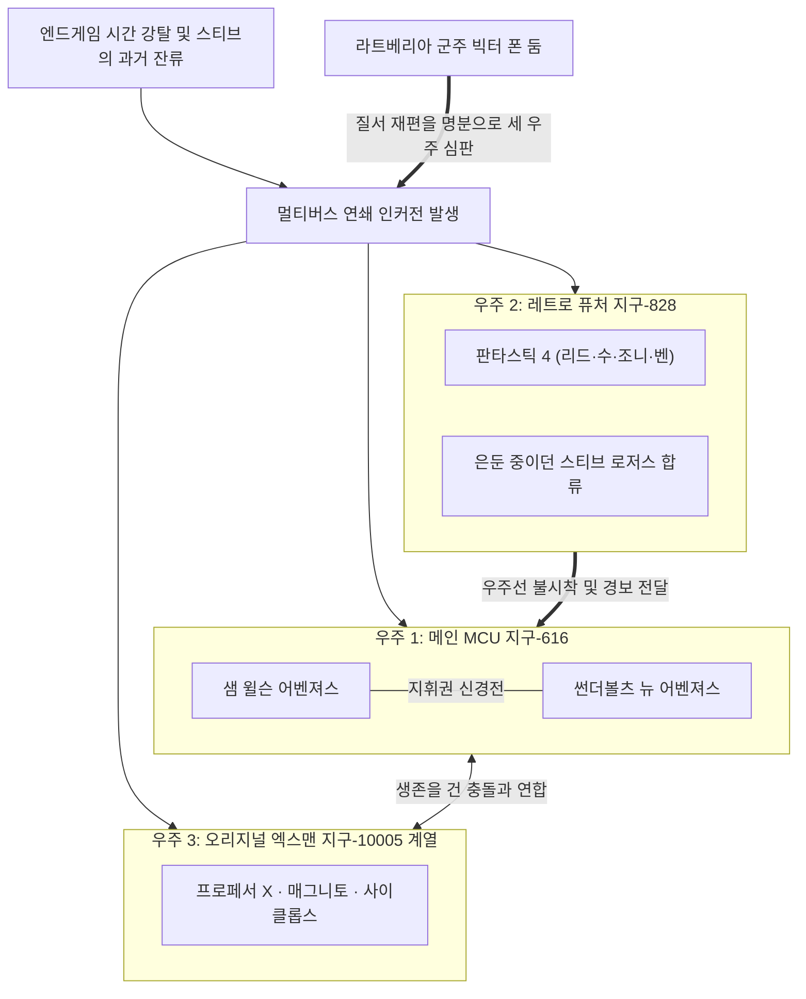

import Alert from '@/components/Alert.astro';
import MovieCard from '@/components/MovieCard.astro';
import PersonCard from '@/components/PersonCard.astro';
import PersonInline from '@/components/PersonInline.astro';
import YouTubeEmbed from '@/components/YouTubeEmbed.astro';

행성이 산산조각 나는 우주 전쟁부터 보여줄 거라던 모두의 예상은 첫 프레임부터 빗나갔습니다. 11월 23일 전격 공개된 **어벤져스 둠스데이 파이널 예고편**은 포화 대신 햇살이 내리쬐는 고요한 교외 주택, 그리고 아들에게 자신의 과거를 숨긴 채 살아가는 스티브 로저스의 떨리는 고백으로 문을 열었죠. 오는 **12월 16일 한국 전 세계 최초 개봉**을 불과 3주 앞두고 베일을 벗은 이번 메인 예고편의 결정적 단서들을 프레임 단위로 뜯어봤습니다.

<MovieCard title="Avengers: Doomsday" imdbId="tt21357150" />

| 구분 | 핵심 확정 정보 |
| :--- | :--- |
| **한국 개봉일** | **2026년 12월 16일(수) 전 세계 최초 개봉** (북미 12월 18일) |
| **감독 · 각본 · 음악** | 앤서니·조 루소 / 스티븐 맥필리·마이클 월드론 / 앨런 실베스트리 |
| **러닝타임** | 약 150분 (2시간 29분～30분 내외) |
| **관람등급** | 북미 PG-13 — **MCU 사상 최초 '유혈 이미지'(bloody images) 경고 포함** (국내 심의 중) |
| **핵심 충돌 구도** | 세 개의 지구 인커전(Incursion) × 라트베리아의 군주 빅터 폰 둠 |

<YouTubeEmbed id="Oae1ZnQ15gQ" title="[어벤져스: 둠스데이] 메인 예고편 (마블 코리아 공식)" />

<Alert type="info" title="확정 팩트와 팬 가설을 구분해 읽는 가이드">
  이 글은 마블 스튜디오 공식 파이널 예고편 영상과 시놉시스, 케빈 파이기·루소 형제의 공식 인터뷰로 확인된 **확정 팩트**를 중심축으로 삼고, 아직 베일에 가려진 떡밥과 팬 커뮤니티의 **추론 가설**은 문장마다 명확히 선을 그어 구분했습니다.
</Alert>

---

## 파이널 예고편 결정적 시퀀스 해부: 스티브 로저스의 '숨겨진 아들'과 은퇴 번복

예고편 본편이 시작되기도 전에 마블은 전 세계 동시 카운트다운 라이브 방송으로 노골적인 감정선부터 건드렸습니다. 대기 화면 위로 흐른 음악이 다름 아닌 《어벤져스: 엔드게임》 마지막 장면에서 스티브와 페기가 거실 춤을 추던 재즈곡 "It's Been a Long, Long Time"이었거든요. 7년 전 우리가 가장 완벽한 해피엔딩이라 믿으며 극장을 나섰던 바로 그 순간이, 이번 재앙의 출발점임을 소리로 먼저 선언한 셈입니다.

이어지는 오프닝 시퀀스는 소름이 돋을 만큼 평화롭습니다. 인피니티 스톤을 제자리에 돌려놓은 뒤 과거에 남기로 선택했던 스티브 로저스(<PersonInline name="크리스 에반스" imdbId="nm0262635" />)와 페기 카터(<PersonInline name="헤일리 앳웰" imdbId="nm2017943" />) 부부는 아담한 교외 주택에서 어린 아들을 키우며 조용히 살아가고 있어요. 아이는 자신의 아버지가 세상을 구했던 캡틴 아메리카였다는 사실을 전혀 모릅니다. 하지만 평온한 일상을 비추는 카메라 위로 스티브의 무거운 독백이 겹치죠.

> "왜 아이에게 거짓말하는 게 이토록 잘못된 일처럼 느껴질까? …… 아빠는 어벤져였단다. 원래 여섯 명이었지."

스티브가 원년 어벤져스 6인을 회상하며 방패를 다시 꺼내 드는 순간, 루소 형제가 왜 그의 은퇴를 굳이 번복시켰는지가 단번에 납득됩니다. 단순히 추억 팔이용 카메오로 호출한 게 아니에요. 자신이 선택한 '평범한 행복'이 시간선의 균열을 불렀고, 그 대가를 아들이 살아갈 미래가 치르게 생겼다는 도덕적 부채감이 스티브의 발목을 잡은 것입니다.

정점을 찍는 건 평화롭던 앞마당의 하늘이 찢어지며 판타스틱 4의 우주선이 불시착하는 컷입니다. 스티브가 지켜내려 했던 안식처 한복판으로 멀티버스의 붕괴가 직접 추락해 들어오죠. 뒤이어 전장으로 복귀한 스티브가 오랜 친구 버키 반즈(<PersonInline name="세바스찬 스탠" imdbId="nm1659221" />)와 말없이 짧은 포옹을 나누는 장면은 대사 한 줄 없이도 묵직합니다. 《엔드게임》 호숫가에서 노인이 되어 방패를 넘겼던 스티브와는 다른 시간대의 젊은 그가 왜 다시 참전했는지, 두 사람의 눈빛만으로 서사가 완성됩니다.

---

## 로버트 다우니 주니어의 닥터 둠: '토니 스타크 흑화 변종' 루머가 틀린 이유

캐스팅 발표 직후부터 팬덤을 가장 뜨겁게 달궜던 논쟁은 단연 "로다주의 닥터 둠은 결국 타락한 토니 스타크 변종 아니냐"는 의구심이었습니다. 파이널 예고편과 제작진의 공식 입장을 종합하면 이 루머는 명확히 **틀렸습니다**.

먼저 케빈 파이기는 《엠파이어》(Empire) 매거진 인터뷰를 통해 "그는 토니 스타크의 변종이 아니다. 원작 그대로 **빅터 폰 둠**(Victor Von Doom) 본인이다"라고 못을 박았습니다. 루소 형제 역시 닥터 둠의 비극적 기원과 라트베리아 군주로서의 정체성을 정면으로 다룬다고 밝혔죠. 그렇다면 왜 하필 <PersonInline name="로버트 다우니 주니어" role="빅터 폰 둠 / 닥터 둠" imdbId="nm0000375" />여야 했을까요?

해답은 앞서 1차 티저에서 둠이 내뱉었던 서늘한 대사, "너희 모두는 훔친 삶을 살아왔다(You have all lived stolen lives)"와 이번 파이널 예고편의 오프닝이 맞물리는 지점에 있습니다. 《엔드게임》에서 어벤져스가 감행한 '시간 강탈' 작전과 스티브 로저스의 과거 잔류는 메인 우주(지구-616) 입장에선 구원이었지만, 인접한 다른 우주에는 연쇄적인 시공 붕괴인 **인커전**(Incursion)을 촉발한 방아쇠였습니다. 둠의 시선에서 스티브와 어벤져스는 영웅이 아니라, 자기들만의 해피엔딩을 위해 타인의 우주를 파멸로 몰아넣은 '시간의 도둑들'인 셈이죠.

무엇보다 잔인한 건 그 심판자가 **토니 스타크와 똑같은 얼굴**을 하고 있다는 설정입니다. 자기 목숨을 바쳐 스티브에게 새 삶을 선물했던 친구의 얼굴을 한 이방인이 나타나, 그 삶 자체를 죄악이라 단죄하며 목을 조여 오는 구도니까요. 변종 설정 없이도 어벤져스 멤버들의 멘탈을 무너뜨리기에 이보다 영리하고 가혹한 심리전은 없습니다.

예고편 후반부를 장식한 닥터 둠의 시각적 위압감도 압도적입니다. 안개 낀 동유럽 고딕 양식의 **라트베리아**(Latveria) 성채를 배경으로 등장한 둠은 군주로서 옥좌를 지킬 때의 짙은 초록색 후드 망토 복장과, 전면전에 나설 때의 분절형 티타늄 질감 중장갑 전투 아머 두 가지 모습을 번갈아 보여줍니다.

<figure class="not-prose my-6">
  

    <svg viewBox="0 0 760 330" class="h-auto w-full min-w-[600px]" role="img" aria-label="예고편에 등장한 빅터 폰 둠의 두 가지 복장 조형과 과학·비술 하이브리드 능력 구조도">
      <defs>
        <linearGradient id="doomCardLeft" x1="0%" y1="0%" x2="100%" y2="100%">
          <stop offset="0%" stop-color="#10b981" stop-opacity="0.14" />
          <stop offset="100%" stop-color="#059669" stop-opacity="0.04" />
        </linearGradient>
        <linearGradient id="doomCardRight" x1="0%" y1="0%" x2="100%" y2="100%">
          <stop offset="0%" stop-color="#64748b" stop-opacity="0.16" />
          <stop offset="100%" stop-color="#334155" stop-opacity="0.05" />
        </linearGradient>
        <linearGradient id="doomCore" x1="0%" y1="0%" x2="100%" y2="0%">
          <stop offset="0%" stop-color="#10b981" stop-opacity="0.12" />
          <stop offset="50%" stop-color="#10b981" stop-opacity="0.2" />
          <stop offset="100%" stop-color="#64748b" stop-opacity="0.12" />
        </linearGradient>
      </defs>
      <text x="380" y="28" text-anchor="middle" class="fill-foreground" font-size="15" font-weight="700">빅터 폰 둠 (Doctor Doom) — 파이널 예고편 이중 조형 &amp; 전투 체계 해부</text>
      <line x1="28" y1="44" x2="732" y2="44" stroke="currentColor" stroke-opacity="0.15" stroke-width="1.5" />
      <rect x="28" y="60" width="332" height="172" rx="10" fill="url(#doomCardLeft)" stroke="#10b981" stroke-opacity="0.65" stroke-width="1.5" />
      <rect x="44" y="74" width="132" height="22" rx="5" fill="#059669" />
      <text x="110" y="89" text-anchor="middle" fill="#ffffff" font-size="11" font-weight="700">조형 A · 라트베리아 군주복</text>
      <text x="44" y="118" class="fill-foreground" font-size="13.5" font-weight="700">고딕 성채 옥좌 &amp; 에메랄드 비술(Mystic Arts)</text>
      <text x="44" y="142" class="fill-foreground" fill-opacity="0.85" font-size="12">• 금장 파이핑·금속 사슬 버클이 결합된 초록 후드 망토</text>
      <text x="44" y="164" class="fill-foreground" fill-opacity="0.85" font-size="12">• 눈가만 드러낸 은빛 가면 너머의 서늘한 심리전 연출</text>
      <text x="44" y="186" fill="#059669" class="dark:fill-emerald-400" font-size="12" font-weight="700">• 능력 축: 초록빛 비술 화염 · 공간 균열 · 흑마법 결계</text>
      <text x="44" y="212" class="fill-muted-foreground" font-size="11">대응 포지션: 닥터 스트레인지급 마법 학파 위협</text>
      <rect x="400" y="60" width="332" height="172" rx="10" fill="url(#doomCardRight)" stroke="#64748b" stroke-opacity="0.65" stroke-width="1.5" />
      <rect x="416" y="74" width="132" height="22" rx="5" fill="#475569" />
      <text x="482" y="89" text-anchor="middle" fill="#ffffff" font-size="11" font-weight="700">조형 B · 전투용 중장갑</text>
      <text x="416" y="118" class="fill-foreground" font-size="13.5" font-weight="700">분절형 티타늄 아머 &amp; 초고도 공학(Tech)</text>
      <text x="416" y="142" class="fill-foreground" fill-opacity="0.85" font-size="12">• 코믹스 원작 고증의 다중 분절 금속 판금·건틀릿</text>
      <text x="416" y="164" class="fill-foreground" fill-opacity="0.85" font-size="12">• 토르의 스톰브레이커를 두 손가락으로 제압하는 출력</text>
      <text x="416" y="186" fill="#2563eb" class="dark:fill-sky-400" font-size="12" font-weight="700">• 능력 축: 역장 방어막 · 초인적 물리 괴력 · 성채 병기</text>
      <text x="416" y="212" class="fill-muted-foreground" font-size="11">대응 포지션: 아이언맨·리드 리처즈급 천재 공학자</text>
      <circle cx="380" cy="146" r="18" class="fill-card" stroke="#10b981" stroke-width="2" />
      <text x="380" y="151" text-anchor="middle" fill="#059669" class="dark:fill-emerald-400" font-size="16" font-weight="700">×</text>
      <rect x="28" y="248" width="704" height="64" rx="10" fill="url(#doomCore)" stroke="#10b981" stroke-opacity="0.5" stroke-width="1.2" />
      <text x="380" y="273" text-anchor="middle" class="fill-foreground" font-size="13" font-weight="700">핵심 차별점: &quot;토니 스타크 변종이 아닌 정통 빅터 폰 둠&quot; (케빈 파이기 공식 확인)</text>
      <text x="380" y="295" text-anchor="middle" class="fill-muted-foreground" font-size="12">옛 동료의 얼굴로 어벤져스의 &apos;훔친 삶(Stolen Lives)&apos;을 단죄하는 심리적 타격 + 과학·마법 동시 구사</text>
    </svg>
  

  <figcaption class="mt-2 text-center text-sm text-muted-foreground">
    파이널 예고편이 드러낸 빅터 폰 둠의 이중 조형 — 의례용 군주 망토와 분절형 전투 아머를 오가며 마법과 과학을 동시에 구사한다.
  </figcaption>
</figure>

전투력 묘사는 타노스와도 결이 완전히 다릅니다. 토르(<PersonInline name="크리스 헴스워스" imdbId="nm1165110" />)가 전력을 다해 내리찍은 스톰브레이커의 도끼날을 단 **두 손가락**만으로 가볍게 멈춰 세우는 괴력을 과시하는가 하면, 곧바로 손끝에서 에메랄드빛 비술 화염을 뿜어내며 전장을 휩쓸어버리거든요. 아이언맨에 필적하는 초고도 공학 슈트와 닥터 스트레인지를 위협하는 흑마법을 동시에 다루는 원작의 '과학+마법 하이브리드 절대자' 설정을 스크린에 그대로 옮겨놓았습니다. 북미 등급 심의에서 MCU 역사상 처음으로 **유혈 이미지**(bloody images) 경고가 붙은 이유도 둠의 자비 없는 전투 방식과 무관하지 않아 보입니다.

---

## 세 개의 우주 대충돌: 어벤져스 × 판타스틱 4 × 오리지널 엑스맨 진영 구도

마블이 공개한 공식 시놉시스는 이번 사태를 **세 개의 서로 다른 우주**(three distinct universes)가 부딪히는 생존 전쟁으로 정의합니다. 두 지구가 충돌해 어느 한쪽을 파괴하지 않으면 공멸하는 인커전 법칙 위에서, 각 진영이 처한 입장을 도식으로 정리하면 훨씬 선명하게 읽힙니다.

### 1. 분열된 지구-616 작전 회의실과 리드 리처즈의 경고

예고편 중반부 작전 회의실 씬은 현재 지구-616이 얼마나 어수선한 상태인지를 적나라하게 보여줍니다. 캡틴 아메리카의 방패를 이어받은 샘 윌슨(<PersonInline name="앤서니 매키" imdbId="nm1107001" />) 진영과, 발렌티나의 언론 플레이로 정부 공인 '뉴 어벤져스' 간판을 달게 된 옐레나 벨로바(<PersonInline name="플로렌스 퓨" imdbId="nm6073955" />)·레드 가디언(썬더볼츠\*) 일행이 한 테이블에 앉아 팽팽한 신경전을 벌이죠. 영웅들의 구심점이 사라진 자리를 적나라하게 꼬집는 대목입니다.

이 혼란을 단숨에 잠재우는 인물이 타 차원에서 넘어온 과학자 리드 리처즈(<PersonInline name="페드로 파스칼" imdbId="nm0050959" />)입니다. 홀로그램 궤도 모형을 띄운 리드가 두 지구의 충돌 반경을 수치로 짚어내고, 수잔 스톰과 함께 둠의 개입을 경고하자 회의실 공기가 순식간에 얼어붙죠. 곁에 서 있던 토르가 신들조차 막지 못한 파멸이라며 비장하게 입을 여는 순간, 내부 알력 다툼은 생존의 문제로 바뀝니다.

### 2. 쓰러진 자비에 학교 표지판과 "To me, my X-Men!"

올드 팬들의 심박수를 가장 높인 시퀀스는 단연 폭스 오리지널 엑스맨 우주의 등장입니다. 폐허로 변한 정원 바닥에 부서진 '자비에 영재학교' 명패가 나뒹굴고, 노쇠한 프로페서 X와 매그니토가 다가오는 종말의 빛을 마주하며 나란히 서 있습니다. 자기 우주가 통째로 지워질 위기에 처한 뮤턴트들에게는 물러설 곳이 없어요.

그 직후 원작 코믹스(1990년대 짐 리 작화)의 노란색·파란색 전술 슈트와 정통 바이저를 착용한 사이클롭스(<PersonInline name="제임스 마스던" imdbId="nm0005188" />)가 전장 한가운데서 바이저에 붉은 옵틱 블래스트를 장전하며 외칩니다.

> **"To me, my X-Men!"** (내게로 모여라, 나의 엑스맨!)

2000년대 폭스 실사 영화 3부작 내내 제대로 된 리더 대접을 받지 못했던 사이클롭스의 한을 26년 만에 풀어주는 장면입니다. 비스트, 미스틱, 나이트크롤러의 연쇄 텔레포트 액션과 플라즈마 카드를 흩뿌리는 갬빗까지 가세하면서, 엑스맨 진영이 단순 카메오가 아니라 지구-616 히어로들과 정면으로 맞붙고 연대하는 핵심 축임을 확실히 각인시켰습니다.

  <PersonCard name="앤서니 루소" role="감독" imdbId="nm0751577" />
  <PersonCard name="조 루소" role="감독" imdbId="nm0751648" />
  <PersonCard name="로버트 다우니 주니어" role="빅터 폰 둠" imdbId="nm0000375" />
  <PersonCard name="크리스 에반스" role="스티브 로저스" imdbId="nm0262635" />
  <PersonCard name="크리스 헴스워스" role="토르" imdbId="nm1165110" />
  <PersonCard name="페드로 파스칼" role="미스터 판타스틱" imdbId="nm0050959" />
  <PersonCard name="바네사 커비" role="인비저블 우먼" imdbId="nm3948952" />
  <PersonCard name="패트릭 스튜어트" role="프로페서 X" imdbId="nm0001772" />
  <PersonCard name="이안 맥켈런" role="매그니토" imdbId="nm0005212" />
  <PersonCard name="제임스 마스던" role="사이클롭스" imdbId="nm0005188" />

---

## 파이널 예고편에서 끝내 감춘 히든카드: 로키 · 닥터 스트레인지 · 스파이더맨

2분 남짓한 파이널 예고편에 수십 명의 캐릭터가 스쳐 지나갔지만, 정작 마블이 철저하게 꽁꽁 숨긴 이름들을 보면 영화의 후반부 전개가 읽힙니다. 여기서부터는 **공식 캐스팅 확정자**와 **미출연·루머 대상**을 냉정하게 나눠 봐야 합니다.

먼저 공식 출연진 명단에 이름을 올렸는데도 예고편에서 전투 컷 하나 내주지 않은 인물이 로키(<PersonInline name="톰 히들스턴" imdbId="nm1089991" />)와 센트리(<PersonInline name="루이스 풀먼" imdbId="nm5730649" />)입니다. 현재 로키는 시간의 끝 왕좌에서 멀티버스 시간선 다발(세계수 이그드라실)을 직접 양손으로 붙잡아 유지하고 있는 살아있는 코어 그 자체죠. 닥터 둠이 멀티버스의 질서를 자기 손으로 재편하려 한다면, 필연적으로 로키가 지키는 시간의 왕좌를 침탈할 수밖에 없습니다. 예고편에서 로키와 폭주 병기 센트리의 모습을 통째로 뺀 건 이들이 영화 3막의 클라이맥스 반전을 쥐고 있기 때문일 가능성이 큽니다.

반면 팬들이 애타게 찾았던 닥터 스트레인지(<PersonInline name="베네딕트 컴버배치" imdbId="nm1212722" />)와 톰 홀랜드의 **스파이더맨**은 공식 캐스팅 명단과 이번 파이널 예고편 모두에서 모습을 감췄습니다. 지난여름 개봉해 폭발적인 반응을 얻었던 《스파이더맨: 브랜드 뉴 데이》([브랜드 뉴 데이 예고편 분석](/culture/spider-man-brand-new-day-trailer-analysis))에서 뉴욕의 고독한 자경단원으로 홀로 섰던 피터 파커, 그리고 다크디멘션으로 떠나 인커전을 수습하던 스트레인지의 부재는 오히려 자연스러운 포석에 가깝습니다. 이번 《둠스데이》가 영웅들의 처절한 패배로 끝나고 둠이 창조한 '배틀월드'로 넘어간다면, 2027년 12월 개봉할 후속편 《어벤져스: 시크릿 워즈》에서 판을 뒤집을 외부 구원 투수가 반드시 필요하니까요.

참고로 예고편 중반 둠의 성채 복도 그림자 속에 스쳐 지나간 붉은 기운의 여성 실루엣을 두고 해외 커뮤니티에서는 "살아 돌아온 완다 막시모프(스칼렛 위치)다" 혹은 "진 그레이의 다크 피닉스다"라는 가설이 쏟아지고 있습니다. 다만 이는 색보정과 실루엣만으로 추정한 **미확인 팬 루머**일 뿐 공식 크레딧으로 확인된 바는 없으니, 개봉 전까지는 가벼운 추리 영역으로만 남겨두는 편이 안전합니다.

---

## 12월 16일 개봉 전 딱 2편만 복습한다면 & 예매 상영관 팁

《엔드게임》 이후 쏟아진 마블 드라마와 영화를 지금부터 전부 정주행하기란 현실적으로 불가능합니다. 다행히 파이널 예고편의 서사 구조는 꽤 친절해서, 극장 가기 전 **딱 두 편의 영화**(특히 쿠키 영상)만 체크해도 모든 퍼즐이 매끄럽게 맞물립니다.

*]:my-0">
  <MovieCard title="Thunderbolts*" imdbId="tt20969586" />
  <MovieCard title="The Fantastic Four: First Steps" imdbId="tt10676052" />

1. **《썬더볼츠\*》** (2025): 원제 끝에 붙어 있던 별표(`*`)의 정체가 곧 정부 공인 **뉴 어벤져스**였음을 밝히는 작품입니다. 왜 샘 윌슨의 어벤져스와 옐레나·버키 진영이 두 팀으로 쪼개져 갈등하는지, 그리고 최종 쿠키 영상에서 대기권을 뚫고 진입하던 **숫자 4 로고 우주선**이 어떻게 이번 파이널 예고편 오프닝으로 직결되는지 바로 이어집니다.
2. **《판타스틱 4: 새로운 출발》** (2025): 지구-828의 판타스틱 패밀리가 어떤 능력을 지녔는지 보여주는 것을 넘어, 쿠키 영상이 결정적입니다. 리드와 수잔의 어린 아들 **프랭클린 리처즈**(현실 조작 능력을 지닌 오메가 레벨 존재) 앞에 초록색 망토를 두르고 금속 가면을 벗어 든 채 무릎을 꿇고 있던 인물이 바로 닥터 둠이었죠. 스티브 로저스의 아들과 리드 리처즈의 아들, 두 아버지의 부성애가 둠의 계획과 어떻게 얽히는지가 이번 영화의 핵심 열쇠입니다.

예매 전쟁을 준비 중이라면 상영관 선택 공식도 전작들과는 완전히 다르게 잡아야 합니다. 같은 시기 맞붙는 드니 빌뇌브 감독의 [듄: 파트 3 상영관 추천 가이드](/culture/dune-part-3-theater-format-guide)에서 짚었듯 1.43:1 IMAX 필름으로 찍은 《듄: 파트 3》가 글로벌 IMAX 관을 선점한 데다, 《어벤져스: 둠스데이》 자체도 수십 명의 군상극 구도를 담기 위해 **2.39:1 시네마스코프**를 기본 마스터 비율로 설계했기 때문이에요.

굳이 위아래 검은 여백(레터박스)이 크게 남는 용아맥 취소표에 매달리기보다, 라트베리아 성채의 칠흑 같은 어둠 속에서 타오르는 닥터 둠의 초록빛 비술과 메탈릭 아머의 질감을 선명하게 뿜어내는 **돌비시네마**(Dolby Vision + Atmos)나 와이드 전투 씬을 좌우 벽면까지 확장해 주는 **용산 4면 SCREENX**를 노리는 편이 훨씬 만족도가 높습니다. 포맷별 화면 가동률 비교는 [어벤져스 둠스데이 상영관 추천 가이드](/culture/avengers-doomsday-theater-format-guide)를, 실제 피케팅 시 노려야 할 핵심 명당 열과 번호는 [코돌비·남돌비 좌석 명당 총정리](/culture/coex-namyangju-dolby-seat-guide)와 [용산CGV SCREENX(4관) 좌석 총정리](/culture/cgv-yongsan-screenx-seat-guide)를 미리 띄워두고 대비해 보세요.

7년 전 《엔드게임》이 완벽한 마침표였다면, 스티브 로저스의 평화로운 거실을 박살 내며 시작된 《어벤져스: 둠스데이》는 그 해피엔딩의 청구서를 정면으로 들이미는 작품입니다. 과연 옛 친구의 얼굴을 한 빅터 폰 둠 앞에서 세 우주의 영웅들이 어떤 대가를 치르게 될지, 12월 16일 수요일 첫 회차 극장에서 직접 확인해 보시죠.
