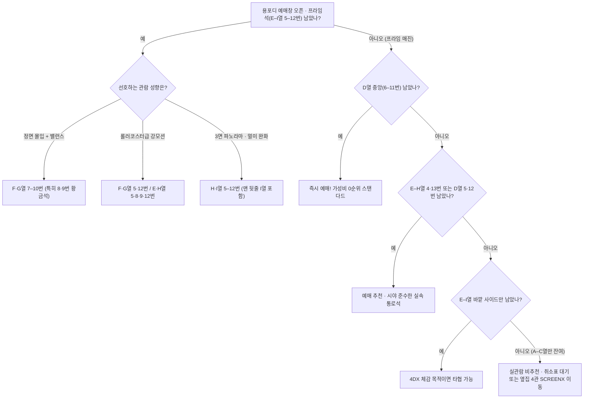

import Alert from '@/components/Alert.astro';
import Chart from '@/components/Chart.astro';
import MovieCard from '@/components/MovieCard.astro';
import PersonInline from '@/components/PersonInline.astro';
import Yongsan4dxSeatMap from '@/components/Yongsan4dxSeatMap.astro';

예매 오픈 알림을 보고 바로 접속했는데도 CGV 용산 4DX(**용포디**) 한복판의 프라임석 40석은 이미 잿빛으로 변해 있기 일쑤입니다. 남은 스탠다드석을 결제해도 제값을 하는지, 아니면 다른 회차를 노려야 할지 아래 **10초 판별표**와 **144석 인터랙티브 배치도**에서 내 좌석 번호부터 바로 찍어보세요.

## ⚡ 10초 판별표: 용포디 자리 티어 & 남은 좌석 예매 기준

| 등급 | 열 · 좌석 번호 | 구분 | 실전 예매 판단 |
| :--- | :--- | :---: | :--- |
| **S등급** | **F·G열 7–10번** | 프라임석 | 정면 시야 수평 + Sway & Twist 입체 모션 밸런스 1순위 (8·9번은 정중앙 + 끝자리 겸비 황금석) |
| **A+등급** | **F·G열 5·12번** / **E·H열 5·8·9·12번** | 프라임석 | Sway & Twist에 4연석 회전축 바깥 가속도가 더해지는 롤러코스터급 강모션 명당 |
| **A등급** | **F·G열 6·11번** / **E·H열 안쪽** / **I열 5–12번** | 프라임석 | E열은 근접 몰입감, 맨 뒷줄 I열은 좌우 3면 ScreenX 조망 및 멀미 완화에 유리 |
| **B+등급** | **D열 6–11번** | 스탠다드석 | 프라임(E열) 바로 한 줄 앞 정중앙! Sway & Twist는 없지만 시야가 훌륭하고 1,000원 저렴한 매진 시 0순위 |
| **B등급** | **E–H열 4·13번** / **D열 5·12번** | 스탠다드석 | 프라임 구역과 통로 하나만 사이에 둔 명당 열 높이 + 4연석 끝자리라 기본 모션이 경쾌함 |
| **C등급** | **D열 1–4·13–16번** / **E–I열 사이드** | 스탠다드석 | 반대편 벽면 ScreenX 각도는 아쉽지만 기본 3축 모션과 광역 환경효과 체험용으로 무난 |
| **기피 권장** | **A–C열 전체** (1–16번) | 스탠다드석 | 올려다보는 목 통증 + 3면 화면 왜곡 + 전방 물·바람 노즐 과다 직격 (특히 양 사이드 비추천) |

<Alert type="tip" title="같은 용산아이파크몰 특별관끼리 고민 중이라면">

압도적인 정면 1.43:1 수직 스케일이 우선이라면 [용아맥 좌석 명당 총정리](/culture/yongamac-seat-map)를, 리클라이너에 편히 기대 4면 파노라마와 돌비 애트모스를 즐기고 싶다면 바로 옆 관인 [용산CGV SCREENX(4관) 좌석 총정리](/culture/cgv-yongsan-screenx-seat-guide)를 확인해보세요. 작품 성격에 따른 포맷 궁합은 [용아맥 vs 돌비시네마 vs 스크린X 포맷 비교](/culture/spider-man-brand-new-day-theater-format-guide)에 정리해 두었습니다.

</Alert>

---

## 인터랙티브 좌석 배치도: 내 자리 바로 찍어보기

용포디 좌석표를 처음 볼 때 가장 많이 헷갈리는 포인트가 두 가지 있어요. 첫째, 전체 열은 **A열부터 I열까지 딱 9개 열**뿐이며 **맨 뒷줄이 I열**입니다(J·K·L열은 아예 존재하지 않아요). 둘째, 한 줄당 1번부터 16번까지 균일하게 들어가 **총 144석**(9열 × 16석) 고정 구조인데, 중앙 블록 한복판의 **8번과 9번 사이는 걸어 다니는 복도가 아니라 4석짜리 모션 프레임 두 개가 맞닿아 있는 경계**입니다.

아래 배치도에서 상단 탭(**종합 추천 티어** / **프라임 vs 스탠다드** / **4연석 모션 강도**)을 전환해 보거나, 궁금한 좌석을 직접 탭해보세요.

<Yongsan4dxSeatMap />

---

## 왜 다들 '용포프'만 찾을까? 프라임석 vs 스탠다드석 진짜 차이

타 지점에도 4DX 상영관은 많지만 유독 영화 팬들이 **용포프**(용산 4DX 프라임석)에 집착하는 데는 명확한 하드웨어적 이유가 있습니다. 6층 로비에서 티켓 확인을 거친 뒤 에스컬레이터를 타고 7층 복도로 올라가면 바로 옆 4관(4면 SCREENX 리클라이너관)과 나란히 자리한 **3관 ULTRA 4DX**가 나오는데, 이곳이 전 세계 4DX 상영관의 기준점 역할을 하기 때문이죠.

### 3관 ULTRA 4DX의 정체와 40석의 희소성

CJ 4DPLEX는 2024년 2월 기존 `4DX Screen` 포맷을 **ULTRA 4DX**로 공식 리브랜딩했습니다. 4DX 모션체어·환경효과에 정면과 좌우 벽면을 아우르는 **3면 270도 ScreenX**를 결합한 최상위 융합 포맷이에요. 특히 서울에 본사를 둔 CJ 4DPLEX i-Studio 모션 프로그래머들이 할리우드·국내 텐트폴 영화의 4DX 모션 코드를 설계하고 최종 검수할 때 레퍼런스로 삼는 플래그십 상영관이 바로 용산 3관입니다.

문제는 144석이 전부 같은 의자가 아니라는 점입니다. 상영관 중·후열 중앙 블록인 **E–I열 5–12번 단 40석**(전체의 27.8%)만 프라임석이고, 앞쪽 **A–D열 전체**(64석)와 뒤쪽 **E–I열 양 사이드 1–4번·13–16번**(40석)을 합친 **104석**(72.2%)은 스탠다드석으로 운영됩니다.

| 비교 항목 | 프라임석 (용포프 · 40석) | 스탠다드석 (104석) |
| :--- | :--- | :--- |
| **해당 구역** | **E–I열 중앙 5–12번** (5개 열 × 8석) | **A–D열 1–16번** + **E–I열 1–4·13–16번** |
| **모션 하드웨어** | 기본 3축 + **국내 유일 Sway & Twist 입체 모션** | 기본 3축 모션 (Pitch · Roll · Heave) |
| **시트 및 부가 체감** | 밝은 실버·화이트 톤 고급 가죽 시트, 목뒤 온풍 체감 우수 | 다크 톤 일반 4DX 시트, 기본 진동·티클러·워터샷 |
| **광역 환경효과** | 강풍 · 전방 열풍 · 눈 · 비눗방울 · 안개 · 번개 · 향기 동일 | 상영관 전체 설비라 **프라임석과 동일하게 체감** |
| **요금 차이** | 스탠다드석 대비 **+1,000원 차등** (조조 등 일부 시간대 동일) | 기본 ULTRA 4DX 요금 (2026년 기준 2만 원대 초중반 수준) |

### 1,000원 이상의 격차를 만드는 Sway & Twist 하드웨어

일반 스탠다드석(그리고 국내 다른 지점의 일반 4DX관)은 의자가 앞뒤로 기울어지는 **피치**(Pitch), 좌우로 까딱이는 **롤**(Roll), 위아래로 들썩이는 **히브**(Heave) 중심의 기본 3축 모션으로 움직입니다.

반면 용포디 프라임석 40석 하부에는 국내 유일하게 좌우 수평 슬라이딩인 **스웨이**(Sway)와 수평 회전·비틀림인 **트위스트**(Twist) 액추에이터가 추가로 들어가 있어요. 자동차가 코너를 돌며 뒷바퀴가 미끄러지는 드리프트 장면이나 전투기가 급선회할 때, 의자가 단순히 옆으로 기울기만 하는 게 아니라 **몸 전체를 수평으로 밀어내며 비틀어버리는 횡G**(측면 가속도)를 만들어냅니다. 밝은 실버 톤 가죽 시트가 몸을 탄탄하게 잡아주고 목덜미 쪽 온풍까지 정교하게 들어오다 보니, 스탠다드석과 요금 차이는 **+1,000원**에 불과해도 체감 만족도는 체급이 다릅니다(기본 관람료는 시간대·2D/3D·극장 정책에 따라 변동되지만 차등 폭은 1,000원 기준).

### 스탠다드석에 대한 흔한 오해: 물·바람·눈 효과도 빠질까?

예매 커뮤니티에서 정말 자주 보이는 오해가 "스탠다드석에 앉으면 눈이나 비, 번개 같은 환경효과도 안 나오냐"는 질문인데, 전혀 그렇지 않습니다.

오른쪽 팔걸이에 달린 개별 워터샷(물 분사 ON/OFF 스위치 탑재), 종아리를 스치는 레그 티클러, 등·엉덩이 타격 및 진동은 스탠다드석에도 그대로 들어갑니다. 무엇보다 상영관 천장과 좌우 벽면 설비에서 뿜어져 나오는 **강풍**, **전방 열풍**, **눈**(Snow), **비눗방울**(Bubble), **안개**(Fog), **번개**(섬광), **향기**는 상영관 전체를 덮는 광역 효과라 스탠다드석에서도 똑같이 맞을 수 있어요. 결국 프라임석과 스탠다드석을 가르는 진짜 핵심은 환경효과 유무가 아니라 **Sway & Twist 모션축과 중앙 시야각**입니다.

<Chart
  type="bar"
  height={320}
  caption="용포디 구역별 4대 관람 체감 지표 비교 (10점 만점 자체 평가 기준)"
  data={{
    labels: ['정면 시야 몰입', '모션 타격감', '3면 ScreenX 조망', '티켓 가성비'],
    datasets: [
      {
        label: 'F·G열 프라임 (7–10번)',
        data: [9.8, 9.5, 9.0, 9.0],
        backgroundColor: '#ef4444',
      },
      {
        label: 'H·I열 프라임 (5–12번)',
        data: [8.2, 9.3, 9.8, 8.8],
        backgroundColor: '#eab308',
      },
      {
        label: 'D열 중앙 스탠다드 (6–11번)',
        data: [9.0, 7.2, 8.2, 9.6],
        backgroundColor: '#10b981',
      },
      {
        label: 'E–H열 통로 스탠다드 (4·13번)',
        data: [8.3, 7.6, 7.5, 8.7],
        backgroundColor: '#06b6d4',
      },
      {
        label: 'A–C열 앞줄 스탠다드',
        data: [3.5, 6.8, 3.8, 4.0],
        backgroundColor: '#64748b',
      },
    ],
  }}
/>

---

## 프라임석 안에서도 갈리는 명당 공식: 열(E–I)과 4연석 끝자리 법칙

운 좋게 보랏빛 프라임 40석이 열려 있는 타이밍에 들어갔다면 어디부터 찍어야 할까요? 같은 용포프 안에서도 **어느 열에 앉느냐**와 **4연석 중 몇 번에 앉느냐**에 따라 관람 성격이 꽤 뚜렷하게 갈립니다.

### 열 선택: 왜 용포디는 맨 뒷줄(I열)보다 F·G열이 1순위일까?

용아맥(31m × 22m)이나 옆집 4관 SCREENX(20m)에 익숙한 관객들은 습관적으로 중후열 뒤쪽부터 찾곤 합니다. 하지만 용포디(3관)의 정면 스크린은 두 상영관처럼 거대하지 않고 상대적으로 아담한 체급이에요.

그래서 정면 화면이 시야를 빈틈없이 채우면서 모션 타격감과 시선이 딱 맞아떨어지는 **최우선 스윗스팟은 F·G열 중앙**입니다. 한 줄 앞인 **E열**은 화면이 시야 가득 들어차는 근접 몰입형 프라임석이라 속도감을 좋아하는 분들에게 잘 맞고요. 반대로 **H·I열**(맨 뒷줄 I열)은 정면 스크린이 살짝 아담하게 느껴질 수 있는 대신, **좌우 벽면까지 펼쳐지는 3면 270도 ScreenX 파노라마를 고개를 돌리지 않고 한눈에 조망**하기 가장 편합니다. 시야 흔들림 각도도 완만해져서 **평소 4DX 멀미가 걱정되는 관객에게는 오히려 H·I열이 더 쾌적한 선택**이 됩니다.

### 번호 선택: 4연석 모듈(5–8 / 9–12)과 '바이킹 끝자리 효과'

4DX 좌석은 한 석씩 따로 놀지 않고 **4석이 하나의 하부 액추에이터 베이스 프레임**(4연석 1유닛)으로 묶여 통째로 움직입니다. 용포디의 가로 16석은 `1–4번`(좌측 블록) | 통로 | `5–8번` + `9–12번`(중앙 블록) | 통로 | `13–16번`(우측 블록) 네 묶음으로 나뉘어 있죠.

여기서 놀이공원 바이킹과 똑같은 물리 법칙이 작동합니다. 4석짜리 프레임이 가운데 축을 기준으로 좌우로 기울거나(Roll) 수평 회전할 때(Twist), 회전축 안쪽인 **6·7번과 10·11번**보다 바깥쪽 팔 길이가 긴 **유닛 양 끝 번호**(5번·8번 및 9번·12번, 특히 양 외곽 끝인 5번·12번)의 물리적 이동 변위와 튕겨 나가는 가속도가 훨씬 크게 걸립니다.

- **시야 정중앙 + 안정적 밸런스 1순위** (`F·G열 7–10번`): 그중에서도 **8번과 9번**은 상영관 정중앙 시야를 확보하면서 각각 `5–8번` 유닛의 우측 끝, `9–12번` 유닛의 좌측 끝에 해당해 시야와 회전 타격감을 동시에 챙기는 황금 번호입니다. 반면 **6·7번과 10·11번**은 흔들림의 중심축에 가까워 2시간 내내 안정감 있게 몰입하기 좋습니다.
- **롤러코스터급 하드코어 강모션 1순위** (`F·G열 5번·12번`, `E·H열 5·8·9·12번`): 의자 밖으로 몸이 튕겨 나갈 듯한 최대 진폭을 원한다면 프라임 바깥 끝자리인 5번·12번이 단연 독보적입니다. 옆이 바로 통로라 시야가 트여 있다는 것도 소소한 장점이에요.

### 어떤 영화에서 이 하드웨어 차이가 폭발할까?

용포프의 Sway & Twist와 3면 ScreenX 조합은 대사 위주의 정적인 드라마보다 **기류·중력가속도·회전 반경이 뚜렷한 블록버스터**를 만났을 때 진가를 발휘합니다.

대표적인 레퍼런스가 <PersonInline name="조셉 코신스키" role="감독" imdbId="nm2676052" />와 <PersonInline name="톰 크루즈" role="주연" imdbId="nm0000129" />가 호흡을 맞춘 항공 액션 《탑건: 매버릭》, 그리고 코신스키 감독이 실제 그랑프리 서킷의 속도감을 그대로 옮겨온 레이싱 대작 《F1 더 무비》입니다. 협곡 저공비행 급선회나 시속 300km 코너링 구간에서 좌우 ScreenX 벽면으로 배경이 휙휙 스쳐 지나갈 때 프라임석의 Sway & Twist가 수평 횡G를 걸어주면, 객석에 앉아 영화를 보는 게 아니라 콕핏 시트에 묶여 있는 듯한 착각이 들거든요.

div]:my-0">
  <MovieCard title="Top Gun: Maverick" imdbId="tt1745960" />
  <MovieCard title="F1: The Movie" imdbId="tt16311594" />

여기에 <PersonInline name="정이삭" role="감독" imdbId="nm1818032" />이 연출한 《트위스터스》처럼 거대 토네이도가 정면으로 덮쳐오는 재난 블록버스터에서는 수평 회전(Twist) 모션과 천장 강풍·워터샷·섬광이 한꺼번에 터지면서 '영화를 관람한다'보다 '어트랙션을 탄다'는 표현이 딱 들어맞는 경험을 줍니다.

<MovieCard title="Twisters" imdbId="tt12584954" />

---

## 프라임석 매진 시 실전 타협 가이드: 스탠다드석 어디까지 괜찮을까

현실적으로 인기작 개봉 첫 주에 프라임 40석을 정가로 잡기란 하늘의 별 따기입니다. 예매창에 스탠다드석만 남았을 때는 아래 순서대로 빠르게 판단하면 실패가 없어요.

### 0순위 알짜석: D열 6–11번 (가성비 최강 스탠다드)

용포디 좌석표에서 아는 사람만 노리는 숨은 꿀자리가 바로 **D열 중앙 블록**(5–12번, 특히 6–11번)입니다. 프라임 구역이 E열부터 시작하기 때문에 바로 한 줄 앞인 D열은 상영관 정중앙인데도 스탠다드석 요금이 적용됩니다.

비록 Sway & Twist 모션은 빠지지만, 앞서 짚었듯 용포디 정면 스크린이 아담한 편이라 D열에서도 고개가 크게 꺾이지 않고 오히려 화면이 시야에 꽉 차는 박력이 상당합니다. 프라임석보다 1,000원 저렴하면서 기본 3축 모션과 광역 환경효과는 온전히 누릴 수 있으니, 프라임석이 전멸했다면 1초의 망설임도 없이 가장 먼저 선점해야 할 자리입니다.

### 1순위 차선책: E–H열 4번·13번 (실속 통로 스탠다드)

D열 중앙마저 나갔다면 눈을 옆으로 돌려 **E–H열 4번과 13번**을 확인하세요. 프라임 구역 끝자리(5번, 12번)와 복도 통로 하나만 사이에 둔 좌석입니다.

눈높이와 스크린 거리가 프라임 명당 열과 완전히 똑같고, 좌우 사이드 4연석 유닛(`1–4번`, `13–16번`) 중에서도 중앙 쪽 끝자리에 해당해 기본 3축 모션의 튕김 폭이 꽤 경쾌합니다. 한쪽이 복도라 낯선 관객 사이에 끼지 않고 쾌적하게 볼 수 있다는 것도 실전에서는 큰 이점이에요.

### 타협선(E–I열 사이드)과 기피 권장(A–C열)의 경계

`E–H열 1–3번·14–16번` 및 `I열 양 사이드석(1–4번, 13–16번)`은 반대편 벽면 ScreenX 시야각이 비스듬해지는 아쉬움은 있어도 기본 모션과 광역 효과를 즐기기엔 무리가 없습니다.

반면 **A–C열 전체**(특히 양 끝 사이드인 A–C열 1–4번, 13–16번)는 실관람 용도로 권하기 어렵습니다. 올려다보는 목 피로도와 3면 ScreenX 각도 왜곡에 더해, 상영관 앞쪽 노즐에서 뿜어져 나오는 물·바람·안개를 너무 가까운 거리에서 직격으로 맞기 때문이에요. 포스터나 필름마크 같은 특전 수령용 예매가 아니라면, 앞줄을 억지로 잡기보다 아래 기준표에 따라 다른 회차 취소표를 노리거나 옆 관으로 우회하는 편이 훨씬 만족스럽습니다.

---

## 용포프 예매 오픈 & 취소표(취켓팅) 사수 타이밍

대작 블록버스터의 용포디 예매는 통상 개봉 1–3주 전 특별관 사전예매 또는 순차 오픈으로 열리며, 공지와 동시에 프라임 40석은 **1–3분 이내**에 전석 매진됩니다. CGV 앱에서 보고 싶은 작품을 미리 관심 영화로 등록해 푸시 알림을 켜두는 건 기본이고, 오픈 타이밍을 놓쳤더라도 실망할 필요는 없어요. 취소표가 집중적으로 풀리는 시간대가 분명히 존재하거든요.

1. **첫 번째 골든타임 — 상영 전날 밤 23:30–00:30 전후**: 관람 전날 자정을 전후해 일정을 확정하거나 중복 예매분을 정리하는 취소 물량이 한꺼번에 풀립니다. 2인 연석을 노린다면 이때가 가장 확률이 높습니다.
2. **두 번째 골든타임 — 상영 당일 시작 1시간–20분 전**: 앱·현장 환불 마감 시간이 다가오면서 끝까지 쥐고 있던 알짜 좌석들이 풀리는 진짜 승부처입니다. 특히 혼자 관람하는 '혼영족'이라면 이 시간대에 `E–I열 5–12번` 프라임 구역 한복판에서 **단석 취소표**(1자리)를 낚아채기가 의외로 수월합니다.

<Alert type="warning" title="입장 직후 꼭 챙겨야 할 실전 관람 팁 2가지">

첫째, 안경을 쓰거나 물방울이 얼굴에 튀는 게 부담스럽다면 앉자마자 **오른쪽 팔걸이의 워터샷 ON/OFF 버튼**(Water 스위치)부터 확인하세요. 꺼두면 좌석 전방 물 분사는 멈추지만, 천장에서 넓게 뿌려지는 광역 비·안개 효과는 살짝 닿을 수 있으니 안경닦이를 하나 챙기면 든든합니다.

둘째, **팝콘과 음료 참사**를 조심하세요. 프라임석 끝자리(5·8·9·12번)에서 레이싱·전투기 영화를 볼 때는 의자가 좌우로 강하게 비틀리기 때문에 가득 담긴 팝콘 통이나 뚜껑 없는 음료는 어김없이 쏟아집니다. 음료는 반드시 뚜껑을 닫아 홀더 깊숙이 꽂고, 외투·가방·스마트폰은 무릎 위에 올려두지 말고 가방 지퍼를 잠가 발밑에 두는 것이 안전합니다.

</Alert>

같은 CGV 용산아이파크몰 안에서도 세 특별관의 역할은 명확히 다릅니다. 시야를 압도하는 초대형 화면비는 [용아맥](/culture/yongamac-seat-map), 전 좌석 리클라이너에 몸을 묻고 즐기는 4면 파노라마와 입체 음향은 바로 옆 [용산 4관 SCREENX](/culture/cgv-yongsan-screenx-seat-guide), 그리고 온몸으로 영화의 속도와 바람을 타는 어트랙션 쾌감은 3관 ULTRA 4DX의 몫이에요. 예매창 앞에서 망설여질 때 위 배치도를 띄워두고 내 취향에 딱 맞는 좌표를 골라보시기 바랍니다.
