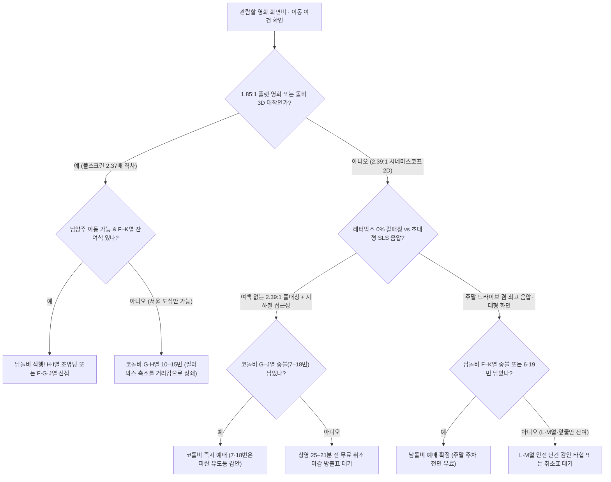

import Alert from '@/components/Alert.astro';
import Chart from '@/components/Chart.astro';
import DolbyCinemaSeatMap from '@/components/DolbyCinemaSeatMap.astro';
import MovieCard from '@/components/MovieCard.astro';
import PersonInline from '@/components/PersonInline.astro';

메가박스 예매창을 열어놓고 "평일 저녁에 바로 갈 수 있는 코엑스의 `G열 통로`나 `K열 중앙`을 결제할까, 아니면 주말에 차를 몰고 남양주까지 원정을 다녀올까?" 고민하며 새로고침만 누르고 계신가요? 똑같은 오리지널 돌비시네마 간판을 달고 있어도 가로형 커브드 스크린인 **코돌비 명당**과 상단 거치 초대형 플랫 스크린인 **남돌비 명당**은 단차와 스크린 높이, 복도 유도등 변수까지 완전히 다릅니다.

내 눈앞에 남은 좌석 한 칸이 돈값을 하는 자리인지 10초 만에 판독할 수 있도록, 수도권 양대 돌비 성지의 하드웨어 격차와 열·번호별 실전 예매 기준을 인터랙티브 배치도로 한데 묶었습니다.

<Alert type="info" title="돌비시네마 완전 가이드 시리즈 (2/2)">
  이 글은 시리즈의 두 번째 편으로 코엑스·남양주 돌비시네마의 실전 좌석 선택법과 예매·동선 팁을 다룹니다. 돌비 비전 100만:1 명암비의 광학 원리나 오리지널 돌비시네마 8곳 vs 신규 `Dolby Vision+Atmos`(DVA) 6곳의 등급 차이가 먼저 궁금하다면 1편 [돌비 비전·애트모스 원리와 메가박스 돌비시네마 vs DVA 등급 차이 총정리](/culture/dolby-vision-atmos-cinema-guide)를 함께 읽어보세요.
</Alert>

---

## ⚡ 10초 판별표: 코돌비 vs 남돌비 티어별 좌석 좌표 한눈에 보기

피케팅 중이라면 아래 요약표에서 등급부터 확인하고, 바로 이어지는 인터랙티브 배치도에서 상단 탭(`코돌비` ↔ `남돌비`, `종합 추천 티어` ↔ `시야·단차 & 음향존`)을 전환하며 원하는 번호를 직접 찍어보세요. 두 상영관 모두 중앙 블록이 짝수(12석) 구조라 **정중앙 대칭축은 12번과 13번 팔걸이 사이**를 지납니다.

| 추천 티어 | 코돌비 (코엑스 1관 · 378석 · A–R열) | 남돌비 (남양주 5관 · 290석 · A–M열) | 실전 예매 판단 포인트 |
| :--- | :--- | :--- | :--- |
| **S등급** (초명당) | **H·I열 10–15번** (`12·13번` 황금코어) | **H·I열 10–15번** (`12·13번` 성지 코어) | 시야각·천장 애트모스 음장 초점 100% 일치, 보이면 즉시 결제 |
| **A등급** (강력 추천) | **G·J열 10–15번** / **H·I열 8–9·16–17번** | **F·G·J열 10–15번** / **H·I열 8–9·16–17번** | 코돌비 `G열`은 1.85:1 필러박스 상쇄, 남돌비 `F·G열`은 압도적 음압·시야 |
| **B등급** (차선·실속) | **F·K열 9–16번** / **G·J열 7–9·16–18번** / **H·I열 7·18번** | **E·K열 9–16번** / **F·G·J열 8–9·16–17번** / **F–J열 6–7·18–19번** | 코돌비 `7·18번`은 복도 파란 유도등 유의, 남돌비는 사블 `6·19번`까지 준수 |
| **C등급** (타협 가능) | **L–N열 8–17번** / **G–K열 4–6·19–21번** | **L·M열 8–17번** / **F–K열 4–5·20–21번** | 코돌비 사블 안쪽은 커브드 덕에 무난, 남돌비 `L·M열`은 앞 안전 난간 유의 |
| **기피 권장** | **A–D열 전체** / **E열 사이드** / **O–R열** / **1–3·22–24번** | **A–D열 전체** / **1–3·22–24번** | 앞줄 목 꺾임 심함(특히 남돌비), 코돌비 `O–R열`은 원거리·영사 광축 후방 |

<DolbyCinemaSeatMap />

---

## 같은 돌비시네마인데 왜 '남돌비'가 부동의 성지일까? 3대 하드웨어·구조 차이

서울 도심 한복판이라는 압도적인 접근성을 가진 코엑스점을 두고도 주말마다 수많은 영화 팬들이 왕복 두 시간을 감수하며 남양주로 향하는 데는 분명한 이유가 있습니다. 영사기(`Christie E3LH` 듀얼 4K RGB 레이저)와 돌비 비전·애트모스 인증 규격은 동일하지만, **물리적인 건축 체적과 스크린 비율, 투입된 스피커 하드웨어**에서 체급 차이가 벌어지기 때문이죠.

| 비교 항목 | 코돌비 (메가박스 코엑스 1관) | 남돌비 (남양주현대아울렛 스페이스원 5관) |
| :--- | :--- | :--- |
| **개관 및 공간 태생** | 2020.07 개관 (구 1관→M관→M2관→MX관 개조) | 2020.11 개관 (신축 아울렛 3–4개 층고 통합 설계) |
| **좌석 규모** | **378석** (`A–R열`, 총 18개 열) | **290석** (`A–M열`, 총 13개 열) |
| **스크린 규격·비율** | **17.4m × 7.4m** (**2.39:1 시네마스코프 커브드**) | **20.5m × 11.7m** (**1.85:1 비스타비전 플랫**) |
| **전체 스크린 면적** | 약 **128.8㎡** | 약 **239.9㎡** (코돌비의 **약 1.86배**) |
| **스피커 시스템** | **QSC 시네마 스피커** (총 73개 · 바닥 데크 진동 강함) | **SLS 리본 드라이버 스피커** (고해상도 고역·흉부 타격 음압) |
| **단차 및 거치 특성** | 구관 리뉴얼 한계로 단차 완만, 앞사람 앉은키 영향 있음 | 높은 층고 상단부 스크린 거치로 중열 자막 가림 스트레스 최소 |

### 1. 물리 스크린 화면비와 투사 면적의 역전 (2.39:1 커브드 vs 1.85:1 플랫)

가장 먼저 짚어야 할 차이는 **화면비와 절대 면적**입니다. 코돌비는 국내 오리지널 돌비시네마 8개 지점 가운데 **유일하게 가로로 긴 2.39:1 시네마스코프 커브드 스크린**(`17.4m × 7.4m`, 약 `128.8㎡`)을 채택했습니다. 반면 남돌비는 세로 높이가 4m 이상 더 높은 **1.85:1 비스타비전**(Flat) 비율의 초대형 스크린(`20.5m × 11.7m`, 약 `239.9㎡`)이 걸려 있어요. 단순 물리 치수 1위 타이틀은 2024년 개관한 하남스타필드(`21.5m × 11.9m`)가 가져갔지만, 공간 체적과 음향·화질이 맞물리는 종합 완성도에서는 여전히 남돌비가 부동의 1위 성지로 꼽힙니다.

여기서 많은 관객이 착각하는 포인트가 바로 **2.39:1 영화를 볼 때의 실제 영상 크기**입니다.

- **2.39:1 시네마스코프 영화 상영 시**: 코돌비는 위아래 검은 여백(레터박스)이 전혀 없는 **100% 풀매칭**으로 `128.8㎡` 전 면적을 깔끔하게 채웁니다. 남돌비는 위아래 레터박스가 생기지만 스크린 가로 폭 자체가 `20.5m`로 훨씬 넓어, 실제 영사되는 화면 크기는 약 **176.3㎡**(`20.5m × 8.6m`)에 달합니다. 여백을 제외하고도 남돌비의 실제 영상 면적이 약 **37% 더 큰 셈**이고, 돌비 비전 특유의 100만:1 트루 블랙 덕분에 상하 여백이 암실 벽면과 섞여 눈에 거의 거슬리지 않습니다.
- **1.85:1 비스타비전 영화 상영 시**: 격차가 극단적으로 벌어집니다. 코돌비는 세로 높이(`7.4m`)에 화면을 맞춰야 해서 좌우가 비는 **필러박스**가 발생하며, 실제 영상 투사 면적이 약 **101.4㎡**(`13.7m × 7.4m`, 화면 가동률 `78.7%`)로 쪼그라듭니다. 반대로 남돌비는 `239.9㎡` 풀스크린을 100% 가동해 코돌비 대비 **약 2.37배**라는 압도적인 시각적 스케일을 보여줍니다.

<Chart
  type="bar"
  height={300}
  caption="영화 원본 화면비에 따른 코돌비 vs 남돌비 실제 영상 투사 면적 비교 (단위: ㎡)"
  data={{
    labels: [
      '스크린 전체 물리 면적 (㎡)',
      '2.39:1 스코프 영화 실투사 면적 (㎡)',
      '1.85:1 플랫 영화 실투사 면적 (㎡)',
    ],
    datasets: [
      {
        label: '코돌비 (17.4m × 7.4m · 2.39:1)',
        data: [128.8, 128.8, 101.4],
        backgroundColor: 'rgba(59, 130, 246, 0.82)',
      },
      {
        label: '남돌비 (20.5m × 11.7m · 1.85:1)',
        data: [239.9, 176.3, 239.9],
        backgroundColor: 'rgba(6, 182, 212, 0.88)',
      },
    ],
  }}
/>

### 2. 스피커 브랜드와 층고 체적: QSC 데크 진동 vs SLS 리본 드라이버 음압

사운드 성향도 두 상영관의 태생을 그대로 따라갑니다. 코돌비는 과거 코엑스 1관에서 출발해 M관, M2관, MX관을 거치며 수차례 개조된 공간에 **QSC 시네마 스피커 총 73개**를 촘촘히 배치했습니다. 상대적으로 아담한 층고 안에서 소리가 단단하게 응집되고, 좌석 바닥 구조물을 타고 엉덩이와 발바닥으로 직접 전달되는 **물리적 우퍼 진동**이 무척 강렬해요.

반면 남돌비는 신축 쇼핑몰의 3–4개 층고를 통째로 비워낸 광활한 체적 위에 돌비 본사가 인수한 하이엔드 오디오 자회사 **SLS**(Superior Listening Systems)의 **리본 드라이버 스피커**를 전면 투입했습니다. 일반 혼(Horn) 트위터와 달리 얇은 평면 진동판을 쓰는 리본 드라이버는 총성이나 금속 마찰음이 최고 음량으로 치솟아도 귀가 따갑게 찢어지지 않고 유리알처럼 맑게 뻗어 나갑니다. 여기에 흉부를 묵직하게 때리는 중저음 음압(SPL)과 아득히 높은 천장에서 수직으로 내리꽂히는 오버헤드 사운드가 결합해, 돌비 인트로가 흐르는 첫 10초 만에 왜 이곳이 성지인지 온몸으로 납득하게 됩니다.

### 3. 단차 설계와 스크린 거치 높이의 결정적 차이

코돌비의 가장 아쉬운 약점은 구관 건물의 층고 제약 때문에 **객석 계단 단차가 완만하다**는 점입니다. 앞열에 체격이 크거나 허리를 꼿꼿이 세워 앉는 관객이 들어오면 시야 하단이 아슬아슬하게 겹칠 수 있죠.

남돌비는 계단 경사도 자체보다 **높은 층고 상단부에 스크린을 시원하게 띄워 거치**한 건축 구조가 신의 한 수로 작용합니다. 중열(`F–K열`)에 앉아 정면을 바라보면 앞사람의 머리통이 스크린 하단 베젤보다 한참 아래쪽에 위치하기 때문에, 2줄짜리 번역 자막이 가리는 일 없이 쾌적한 시야가 확보됩니다.

---

## 코돌비(메가박스 코엑스 1관 · 378석) 열·블록별 실전 가이드

코돌비는 가로 `1–24번`이 `1–6번`(좌블) | 통로 | `7–18번`(중블) | 통로 | `19–24번`(우블)로 나뉘며, 세로로는 `A열`부터 `R열`까지 무려 **18개 열**(378석)이 길게 뻗어 있습니다. 맨 뒤쪽 `P–R열` 중앙이 텅 비어 있는 이유는 상영관 뒤편 영사기실에서 쏘는 듀얼 레이저 광축이 관객 머리에 가리지 않도록 좌석을 덜어냈기 때문입니다.

### S·A등급 핵심 구간: H·I열 초명당과 1.85:1 필러박스를 이기는 G열 전략

- **0순위 초명당** (`H·I열 10–15번`, 특히 `12·13번`): 17.4m 커브드 스크린이 눈앞에 수평으로 가득 차오르고 73개 QSC 스피커의 서라운드 초점이 정확히 맺히는 레퍼런스 스윗스팟입니다.
- **전진 명당** (`G열 10–15번`): 스크린 중심과 눈높이가 딱 맞아떨어지는 박력 있는 자리입니다. 특히 **1.85:1 비율 영화**를 코돌비에서 볼 때 좌우 필러박스로 작아진 화면(`13.7m × 7.4m`)의 아쉬움을 한 줄 앞당긴 거리감으로 말끔히 상쇄해 줍니다.
- **자막 안정권 및 마지노선** (`J–K열 9–16번`): 앞사람 머리에 신경 쓰지 않고 자막과 화면 전체를 안정적으로 조망하고 싶다면 `J열`이 훌륭합니다. 천장 애트모스 입체감이 도망가지 않는 실질적인 후방 마지노선은 **K열**까지이며, `L–N열`부터는 화면이 멀어지고 `O–R열` 극후방은 몰입도가 크게 떨어집니다.
- **사이드 블록 타협선** (`G–K열 4–6번·19–21번`): 중블이 전멸했다면 앞줄(`A–D열`)로 내려가는 것보다 중열 사블 안쪽을 잡는 편이 낫습니다. 스크린이 안쪽으로 완만하게 휘어진 커브드 형태라 평면 스크린보다 측면 사다리꼴 왜곡이 덜하거든요.

### 코돌비 예매 전 반드시 알아야 할 3가지 현장 복병

명당 열을 잡더라도 코돌비만의 현장 특성을 미리 알고 가야 당황하지 않습니다.

<Alert type="warning" title="코돌비 실관람 3대 복병 체크리스트">

1. **완만한 단차 변수**: `E–H열` 구간은 앞좌석 관객의 앉은키가 클 경우 화면 최하단 자막이 살짝 스칠 수 있습니다. 자막 간섭에 예민하다면 `I·J열`로 반보 물러나세요.
2. **복도 계단 파란색 유도등 빛 번짐**: `6|7번`과 `18|19번` 사이 계단 바닥에 켜져 있는 **파란색 유도등** 불빛이 꽤 선명합니다. 중블 끝자리인 `7번·18번`이나 사블 통로석인 `6번·19번`에 앉으면 돌비 비전의 칠흑 같은 암전 장면에서 시야 가장자리에 푸른 잔광이 어른거릴 수 있으니 암부 몰입을 중시한다면 `8–17번` 안쪽을 노리세요.
3. **좌석 데크 통울림**: 바닥 데크가 하나로 이어진 구조라 폭발음 우퍼 진동은 짜릿하지만, 같은 줄 옆 관객이 다리를 떨거나 크게 뒤척일 때 미세한 진동이 시트로 함께 전달됩니다.

</Alert>

---

## 남돌비(남양주현대아울렛 스페이스원 5관 · 290석) 열·블록별 실전 가이드

남돌비는 코돌비보다 앞뒤 깊이가 압축된 `A–M열` **13개 열**(290석) 구조입니다. 상영관 전체 폭은 넓은데 열 수가 적다 보니 중열 어디에 앉아도 거대한 벽면 같은 스크린이 시야를 압도합니다.

### S·A·B등급 핵심 구간: H·I열 황금석부터 사블 6·19번 알짜석까지

- **부동의 성지 황금석** (`H·I열 10–15번`, 특히 `12·13번`): 20.5m 대형 화면의 시야각과 SLS 리본 스피커의 3차원 반구형 음장이 정점으로 교차하는 전국구 명당입니다.
- **아이맥스급 압도감** (`F·G열 10–15번`): 시야 전체가 화면 속으로 빨려 들어가는 근접 몰입감과 가슴을 치는 직진성 고음압을 좋아하는 마니아들이 `H열` 못지않게 선호하는 구간입니다.
- **수평 안락 조망권** (`J열 10–15번`): 높게 거치된 스크린 정중앙과 눈높이가 가장 편안한 수평선을 이루는 열입니다. 3시간에 육박하는 대작이나 3D 영화를 볼 때 목과 눈의 피로도가 가장 적습니다.
- **숨은 통로 꿀자리** (`F–J열 6번·19번` 및 `K열 9–16번`): 남돌비는 사운드 공간감이 워낙 넓고 복도 유도등 방해도 적어서, 사이드 블록 안쪽 통로석인 **6번과 19번**의 체감 만족도가 코돌비 사블보다 한 수 위입니다. 중블이 매진되었을 때 가장 먼저 우회할 만한 알짜 실속석이에요.

### 남돌비 주의 구간: A–D열 목 꺾임과 L·M열 앞 안전 난간(안전바)

남돌비에서 꼭 피하거나 주의해야 할 구간은 맨 앞과 맨 뒤 두 곳입니다.

우선 **A–D열 전체**는 상단부에 높게 걸린 11.7m 스크린을 코앞에서 우러러봐야 해 러닝타임 내내 목과 승모근에 강한 무리가 갑니다. 그리고 의외로 많은 분이 놓치는 복병이 맨 뒤 두 줄인 **L·M열**입니다.

<Alert type="warning" title="남돌비 L·M열 예매 시 안전 난간(안전바) 시야 확인">
  `K열`과 `L열` 사이 단차가 높아지는 경계에는 추락 방지를 위한 가로형 **안전 난간**(안전바)이 설치되어 있습니다. 시선 높이 자체는 편안하지만 앉은키가 아담하거나 시트 등받이에 엉덩이를 깊숙이 빼고 누워 앉으면 화면 최하단 가장자리에 난간 봉이 살짝 걸릴 수 있고, 전방 SLS 스피커의 음압도 중열 대비 한결 반감됩니다. 후열을 선호하더라도 가급적 난간 바로 앞줄인 **K열 이하**를 우선 선점하세요.
</Alert>

---

## 영화 포맷별 코돌비 vs 남돌비 선택 기준 (2.39:1 스코프 vs 1.85:1 돌비 3D)

결국 두 상영관 중 어디로 향할지는 **내가 예매하려는 영화의 원본 화면비와 상영 포맷**이 결정합니다.

*]:my-0">
  <MovieCard title="Avengers: Doomsday" imdbId="tt21357150" />
  <MovieCard title="Avatar: Fire and Ash" imdbId="tt1757678" />

- **2.39:1 시네마스코프 대작** (`코돌비` 프레임 일체감 vs `남돌비` 사운드·체급): <PersonInline name="뉴턴 토마스 시겔" role="촬영감독" imdbId="nm0005875" />이 촬영을 맡은 《어벤져스: 둠스데이》처럼 2.39:1 시네마스코프 비율로 제작된 영화는 양쪽 모두 매력이 뚜렷합니다. 위아래 레터박스 여백이 1mm도 없는 칼 같은 마스킹 일체감과 강남 도심 접근성을 원한다면 **코돌비**가 정답이고, 상하 여백을 감수하더라도 37% 더 넓은 실투사 화면과 SLS 스피커의 폭발적인 출력을 원한다면 **남돌비**가 우세합니다 ([어벤져스: 둠스데이 상영관 추천 가이드](/culture/avengers-doomsday-theater-format-guide) 참조).
- **1.85:1 비스타비전 & 돌비 3D 블록버스터** (`남돌비` 압도적 완승): 반대로 <PersonInline name="제임스 카메론" role="감독" imdbId="nm0000116" />의 《아바타: 불과 재》처럼 **1.85:1 풀스크린에 돌비 비전 3D HFR**이 결합된 레퍼런스 작품은 고민할 필요 없이 **남돌비 원정**을 권합니다. 좌우 필러박스로 화면이 줄어드는 코돌비와 달리, 남돌비는 `20.5m × 11.7m` 전 면적을 48 nits 듀얼 레이저 3D 밝기로 가득 메워 코돌비 대비 **2.37배**에 달하는 압도적인 시야감을 터뜨려 줍니다.

내 조건에 맞는 최종 행선지가 헷갈린다면 아래 10초 의사결정 트리를 따라가 보세요.

---

## 메가박스 돌비시네마 취켓팅 골든타임 · 전용 관람권 · 주차/조조 동선 꿀팁

인기 대작 개봉 첫 주에는 예매 오픈과 동시에 `F–K열` 중블이 순식간에 회색으로 뒤덮입니다. 하지만 메가박스 예매 시스템의 규칙을 알면 당일에도 `H·I열` 정중앙을 주울 기회가 세 번 찾아옵니다.

### 1. 취소표 3대 골든타임과 부분 취소·결제창 잠금 규칙

- **1순위 골든타임 — 상영 시작 30–20분 전**: 메가박스 앱·웹 온라인 무료 취소 마감 시각은 정확히 **상영 시작 20분 전**입니다(수수료 0원, 20분 이내부터는 현장 매표소 방문 취소만 가능). 이 때문에 예비용으로 잡아두었던 중복 예매분이나 교통 체증으로 늦은 관객의 **H·I열 중블 황금 취소표가 상영 25–21분 전에 무더기로 쏟아집니다**. 미리 영화관 로비 근처에 도착해 예매창을 새로고침하면 명당 입성 확률이 가장 높습니다.
- **2순위 골든타임 — 밤 23:30–02:00 심야 정리표**: 다음 날 일정을 정리하며 취소하는 표와 결제 미완료 자동 취소분이 풀리는 심야 시간대입니다.
- **3순위 골든타임 — 돌비 포스터·오리지널 티켓 공지 직후**: 메가박스 특전 증정 일정이 뜨는 순간 비증정일 예매자들이 증정 회차로 대거 이동하면서 기존 매진 회차의 중앙석이 연쇄적으로 열립니다.
- **부분 취소 불가 & 5–10분 결제 잠금 활용**: 메가박스는 **부분 취소가 불가능**합니다. 일행 몫까지 2연석을 결제했다가 1명만 못 가게 되어도 1석만 따로 취소할 수 없고 2석 전체를 취소한 뒤 다시 잡아야 해요. 또한 누군가 좌석을 찍고 결제창에 진입하면 결제 완료 전이라도 **약 5–10분간 좌석이 잠금 상태**로 묶이므로, 회색으로 변한 좌석도 5분 뒤 다시 불이 켜지는 경우가 흔합니다.

### 2. 관람권·할인권 함정 주의: 빵원티켓·일반 2D 관람권 사용 불가

결제창 마지막 단계에서 황금 좌석을 날리지 않으려면 관람권 규정을 미리 숙지해야 합니다.

<Alert type="danger" title="일반 2D 관람권·빵원티켓 차액 결제 업그레이드 불가">
  메가박스 선착순 프로모션인 **빵원티켓**은 물론이고, 시중 기프티콘이나 오픈마켓에서 구매한 **일반 2D 영화관람권**(더 부티크·컴포트 겸용권 포함)은 돌비시네마 예매 시 **추가 차액을 내고 업그레이드하는 것조차 전면 불가**합니다. 오직 `Dolby Cinema 전용 관람권`, 한정 판매되는 `돌비 패스`, 또는 **VIP 특별관 전용 쿠폰**만 적용되므로 피케팅 전에 내 쿠폰함 권종부터 반드시 확인해 두세요.
</Alert>

### 3. 코돌비 vs 남돌비 교통·주차·오픈 전 조조 입장 동선 비교

초행길에 주차장이나 쇼핑몰 통로에서 헤매다 돌비 공식 인트로부터 놓치지 않도록 핵심 동선만 압축했습니다.

| 동선 구분 | 코돌비 (메가박스 코엑스) | 남돌비 (남양주현대아울렛 스페이스원) |
| :--- | :--- | :--- |
| **대중교통 최단 루트** | **9호선 봉은사역 7번 출구** → 아셈플라자 통로 직진 **도보 5분** (2호선 삼성역은 도보 12–15분 소요) | **8호선**(별내선) **다산역 1번 출구** 연계 버스(땡큐11번 등) 환승 또는 **2번 출구** 도보 약 15–20분 |
| **자차 주차 요금** | 티켓 인증 시 **주간 4시간 4,800원** (**22:00 이후 종영 영화**는 심야 4시간 2,400원) | 평일 티켓 인증 **3시간 무료** / **주말·공휴일 전면 무료** (무인증 하이패스 출차) |
| **최단 주차 구역** | **북문 지하주차장 B4층 16번 기둥** 인근 (메가박스 직결 에스컬레이터 인접) | 평시 `SPACE A` 지하·지상주차장 / **10:30 이전 조조는 SPACE B 지상주차장** |

<Alert type="tip" title="남돌비 오전 10:30 이전 조조 회차 입장 시 전용 엘리베이터 필수">
  남양주현대프리미엄아울렛이 정식 오픈하는 **오전 10시 30분 이전 조조 회차**를 보러 갈 때는 쇼핑몰 일반 출입구와 중앙 에스컬레이터가 모두 잠겨 있습니다. 자차 방문 시 **SPACE B 지상주차장**에 주차한 뒤 길을 건너 **SPACE A관 4번 게이트 옆 영화관 전용 엘리베이터**를 이용해야 3층 메가박스 로비로 곧장 올라갈 수 있으니 10분만 여유 있게 도착하세요.
</Alert>

위아래로 시야가 확장되는 1.43:1·1.90:1 전용 촬영 시퀀스가 핵심인 작품이라면 [듄: 파트 3 상영관 추천 가이드](/culture/dune-part-3-theater-format-guide)와 [용아맥 좌석 명당 총정리](/culture/yongamac-seat-map)를, 벽면과 천장까지 감싸는 4면 파노라마가 궁금하다면 [용산CGV SCREENX(4관) 좌석 총정리](/culture/cgv-yongsan-screenx-seat-guide)를, 모션 체어의 역동적인 타격감을 원한다면 [용포디 좌석 명당 총정리](/culture/cgv-yongsan-4dx-seat-guide)를 함께 비교해 보세요. 내가 볼 영화의 원본 화면비 하나만 미리 확인하고 위 배치도에서 `H·I열` 인근 좌표를 챙긴다면, 돌비 인트로가 암실을 가르는 첫 순간부터 티켓값이 아깝지 않은 두 시간을 만끽할 수 있을 겁니다.
