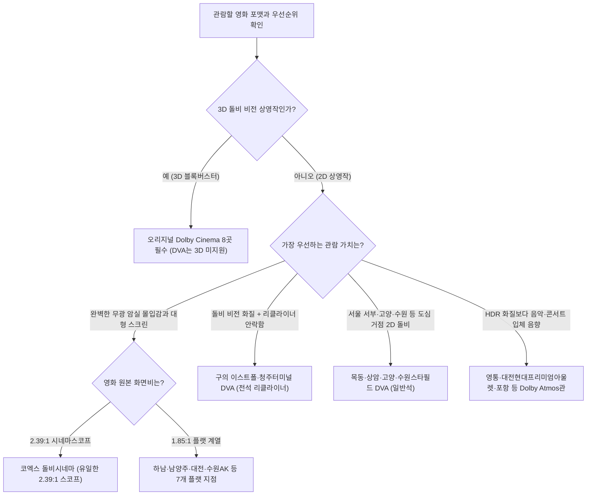

import Alert from '@/components/Alert.astro';
import MovieCard from '@/components/MovieCard.astro';
import PersonInline from '@/components/PersonInline.astro';
import YouTubeEmbed from '@/components/YouTubeEmbed.astro';
import Chart from '@/components/Chart.astro';

대작 개봉 주간에 메가박스 예매창을 열면 지점마다 `Dolby Cinema`, `Dolby Vision+Atmos`, `Dolby Atmos`라는 세 가지 영문 배지가 제각각 붙어 있어 당황하기 일쑤입니다. 티켓 가격은 전부 2만 원 안팎인데, 이 중 무엇을 골라야 흔히 말하는 진짜 **돌비시네마**의 압도적인 화질과 입체 음향을 손해 없이 다 챙길 수 있는지 이름만 봐서는 단번에 구별하기 어렵거든요.

특히 메가박스가 아시아 최초로 신규 통합 포맷인 **Dolby Vision+Atmos**(일명 DVA) 상영관을 빠르게 늘리면서, 기존 오리지널 돌비시네마나 옛 MX관이 이름만 바꾼 일반 돌비 애트모스관과 혼동해 엉뚱한 상영관을 결제하는 사례도 부쩍 많아졌습니다. 예매창에서 3초 만에 등급을 가려내는 판별법부터 **돌비 비전**과 **돌비 애트모스**의 광학·음향 원리, 그리고 전국 지점별 스펙 차이까지 한 번에 정리해 드립니다.

<Alert type="info" title="돌비시네마 완전 가이드 시리즈 (1/2)">
  이번 1편에서는 돌비 비전·애트모스의 핵심 기술 원리와 메가박스 돌비 3단계 등급 및 전국 지점별 선택 기준을 다룹니다. 상영관을 고른 뒤 어느 열에 앉아야 실패가 없는지 궁금하다면 이어지는 2편 [코돌비·남돌비 좌석 명당 총정리 및 인터랙티브 배치도](/culture/coex-namyangju-dolby-seat-guide)를 함께 확인해 보세요.
</Alert>

---

## ⚡ 10초 판별표: 메가박스 돌비 3단계 등급 한눈에 구분하기

메가박스 앱에서 '돌비'라는 단어가 들어가는 특별관은 스펙에 따라 정확히 세 등급으로 나뉩니다. 예매 버튼을 누르기 전에 아래 표로 화질(`Vision`)과 공간 설계 유무부터 확인하세요.

| 구분 | `Dolby Cinema` (오리지널) | `Dolby Vision+Atmos` (DVA) | `Dolby Atmos` (일반 애트모스관) |
| :--- | :--- | :--- | :--- |
| **화질 규격** (영사기) | **돌비 비전 HDR** (`Christie E3LH` 듀얼 4K RGB 6P 순수 레이저) | **돌비 비전 HDR** (차세대 싱글 모듈 4K RGB 레이저) | **일반 SDR** (일반 레이저·디지털 영사기) |
| **명암비 / 2D 피크 밝기** | **1,000,000:1** / **108 nits** (31 fL) | **1,000,000:1** / **108 nits** (31 fL) | 약 2,000:1 / 48 nits (14 fL) |
| **3D 돌비 비전 상영** | **지원** (3D 밝기 48 nits) | **미지원** (2D 돌비 비전 전용) | 미지원 |
| **음향 시스템** | **돌비 애트모스** (최대 64개 독립 스피커 피드) | **돌비 애트모스** | **돌비 애트모스** |
| **공간 설계 규격** | **Dolby Inspired Design 필수** (엔트런스 패스웨이·전면 매트 블랙·히든 스피커) | 기존 상영관 구조 활용 (벽면 스피커 노출, 일부 지점 **전석 리클라이너** 적용) | 기존 상영관 구조 (구 MX관 명칭 변경) |
| **돌비 공식 인트로** | 비전+애트모스 통합 인트로 상영 | 비전+애트모스 통합 인트로 상영 | 애트모스 단독 트레일러만 상영 |
| **전국 운영 지점** | **8곳** (코엑스·안성·남양주·대전·대구·수원AK·송도·하남) | **6곳** (구의 이스트폴·목동·청주터미널·고양·상암·수원스타필드) | 영통·대전현대프리미엄아울렛·포항 등 |
| **성인 2D 관람료 참고치** | 주중 약 19,000–20,000원 / 주말 약 20,000–21,000원 | 주중 약 18,000–19,000원 / 주말 약 19,000–20,000원 | 주중 약 16,000–17,000원 / 주말 약 17,000–18,000원 |

<Alert type="tip" title="예매창 3초 구분 팁: 배지에 'Vision' 단어가 있는지 확인하세요">
  예매창 포맷 라벨에 `Vision`이 빠져 있고 `Dolby Atmos`만 적혀 있다면, 천장 스피커를 활용한 입체 음향만 들어간 **사운드 단독 특화관**(구 MX관)입니다. 화질은 일반 상영관(SDR) 수준이므로 돌비 특유의 쨍한 HDR 화질을 기대하고 예매하면 실망할 수 있습니다. 반면 2D 영화를 볼 때는 `Dolby Cinema`와 `Dolby Vision+Atmos`(DVA) 모두 **100만:1 명암비와 108 nits 돌비 비전 화질**을 똑같이 구현합니다.
</Alert>

---

## 돌비 비전(Dolby Vision): 우리가 극장에서 보던 검은색은 진짜 검은색이 아니었다

돌비시네마나 DVA관에 앉아 본편이 시작되기 직전, 칠흑 같은 어둠을 가르며 돌비 공식 인트로 영상이 흐릅니다. 화면이 완전히 꺼진 줄 알았는데 그 어둠보다 한 단계 더 깊은 진짜 검은색이 열리며 객석 곳곳에서 탄성이 터져 나오죠. 이 극적인 시각적 충격의 정체가 바로 **돌비 비전**(Dolby Vision for Cinema) 광학 설계입니다.

### 일반 극장의 회색빛 어둠(2,000:1) vs 100만:1 트루 블랙과 108 nits

우리가 평소 동네 영화관에서 보는 일반 DCI 표준 상영관(SDR)의 명암비는 약 **2,000:1** 수준에 머뭅니다. 사양이 꽤 좋은 일반 레이저 영사기를 들여놓은 상영관조차 **2,500–3,000:1**을 넘기기 힘듭니다. 영사기 내부 광원이 검은 화면을 쏠 때도 미세한 잔류 빛을 완벽히 차단하지 못해 최소 블랙 레벨이 약 **0.024 nits** 정도로 들뜨기 때문인데요. 밤거리 추격전이나 심우주 장면을 볼 때 화면 전체에 '짙은 회색 안개'가 낀 것처럼 뿌옇게 보였던 이유가 바로 여기에 있습니다.

밝기 한계도 뚜렷합니다. 일반 상영관의 2D 피크 밝기는 약 **48 nits**(14 fL, 풋램버트)이며, 일반 3D 상영 시에는 편광 필터와 안경 렌즈를 거치며 빛이 깎여 나가 실제 눈에 들어오는 밝기가 약 **12–15 nits**(3.5–4.5 fL)까지 급감합니다. 일반관에서 3D 영화를 보면 유독 화면이 침침하고 눈이 쉽게 피로해지는 원인이죠.

반면 극장용 **돌비 비전**(EDR)은 커스텀 듀얼 변조 방식의 `Christie E3LH` 순수 RGB 레이저(오리지널) 또는 차세대 싱글 모듈 4K RGB 순수 레이저(DVA)를 투입해 영사 스펙의 자릿수를 아예 바꿔 놓았습니다.

- **명암비 1,000,000:1 이상**: 일반 상영관 대비 **500배** 높은 수치로, 빛이 없는 픽셀의 최소 블랙 레벨을 **0.0001 nits 이하**까지 떨어뜨립니다. 암전 장면에서는 스크린 테두리와 상영관 벽면의 경계가 아예 사라지는 **트루 블랙**이 구현됩니다.
- **2D 피크 밝기 31 fL**(약 108 nits): 일반관(48 nits)보다 **2.25배** 더 밝은 하이라이트를 뿜어냅니다.
- **오리지널 돌비 3D 피크 밝기 14 fL**(약 48 nits): 듀얼 레이저 기반의 오리지널 돌비시네마에서는 3D 안경을 착용하고도 일반 상영관 2D와 동일한 **48 nits** 밝기를 그대로 유지합니다.
- **12-bit 색심도와 광색역**: 색상 채널당 4,096단계를 쪼개 표현하는 **12-bit 색심도**(약 687억 색), 인간의 시각 인지에 맞춘 **SMPTE ST 2084**(PQ) 감마 곡선, 그리고 **Rec. 2020**에 근접한 광색역이 결합해 미세한 피부 톤부터 네온사인 원색까지 계조 뭉개짐 없이 그려냅니다.

<Chart
  type="bar"
  height={290}
  caption="일반 DCI 표준 상영관 vs 돌비 비전 극장 2D·3D 피크 밝기 비교 (단위: nits, 일반 3D는 12–15 nits 중간값 13.5 기준)"
  data={{
    labels: [
      '2D 상영 피크 밝기 (nits)',
      '3D 상영 피크 밝기 (nits · 오리지널 돌비 기준)',
    ],
    datasets: [
      {
        label: '일반 DCI 표준 상영관 (SDR)',
        data: [48, 13.5],
        backgroundColor: 'rgba(148, 163, 184, 0.75)',
      },
      {
        label: '돌비 비전 극장 (EDR)',
        data: [108, 48],
        backgroundColor: 'rgba(59, 130, 246, 0.85)',
      },
    ],
  }}
/>

### 집에서 보는 OLED TV 돌비 비전과 극장 돌비시네마가 체급이 다른 2가지 이유

디스플레이 스펙에 밝은 독자라면 한 가지 의문이 들 법합니다. 최신 하이엔드 OLED TV나 아이패드 프로는 피크 밝기가 1,000–2,000 nits를 훌쩍 넘는데, 왜 숫자상 **108 nits**인 극장 돌비시네마가 체감상 훨씬 눈부시고 입체적으로 느껴질까요? 비결은 인간의 시각 생리학과 할리우드 후반 마스터링 공정 두 가지에 있습니다.

1. **완전 암순응과 반사광의 총 광속**(Dark Adaptation): 거실이나 방에서는 간접 조명과 벽지·천장 반사광 때문에 우리 눈의 동공이 일정 수준 이상 열리지 않습니다. 반면 비상구 유도등 빛 번짐까지 철저히 억제한 극장 무광 암실에서는 시신경이 **완전 암순응** 상태에 도달합니다. 동공이 활짝 열린 상태에서 가로 15–21m 대형 스크린 전체를 채우는 **108 nits** 반사광은 폭발 화염이나 태양 역광 장면에서 눈이 시릴 만큼 강렬한 스펙큘러 하이라이트를 터뜨리면서도, 자발광 패널 특유의 눈부심 피로 없이 깊고 묵직한 필름 질감을 동시에 만들어 냅니다.
2. **극장 전용 108-nit DI 색보정**(Theatrical Trim Pass): OTT 스트리밍으로 서비스되는 소비자용 돌비 비전은 스마트폰부터 보급형 TV까지 제각각인 기기 성능에 맞춰 실시간 동적 톤매핑(압축)을 거칩니다. 반면 극장에 배급되는 돌비 비전 DCP(디지털 시네마 패키지)는 할리우드 DI 스튜디오 내 돌비 인증 영사 룸에서 감독과 컬러리스트가 **108 nits 피크 밝기와 0.0001 nits 블랙 규격**으로 직접 별도 색보정한 무손실 마스터 원본입니다.

### 돌비 비전의 진가를 증명한 레퍼런스 영화

*]:my-0">
  <MovieCard title="The Batman" imdbId="tt1877830" />
  <MovieCard title="Blade Runner 2049" imdbId="tt1856101" />

화질 체감 격차를 가장 극명하게 보여준 대표작이 바로 《더 배트맨》과 《블레이드 러너 2049》입니다. 《더 배트맨》은 <PersonInline name="그레이그 프레이저" role="촬영감독" imdbId="nm0292132" />가 영화의 80% 이상을 칠흑 같은 밤과 폭우 속 그림자로 설계한 작품이라 일반 상영관에서는 수트 디테일이 회색 어둠에 묻히기 일쑤였죠. 하지만 돌비 비전 상영관에서는 0.0001 nits 트루 블랙 위에서 배트맨 아머의 가죽·금속 결이 또렷이 살아나고, 어둠 속 복도를 찢는 총구 섬광만으로 인물 실루엣을 드러내는 연출 의도가 100% 구현되었습니다.

<PersonInline name="로저 디킨스" role="촬영감독" imdbId="nm0005683" />에게 생애 첫 아카데미 촬영상을 안긴 《블레이드 러너 2049》 역시 돌비 비전의 광색역과 초저역 사운드가 만났을 때 어떤 시너지가 나는지 증명한 교과서입니다. 비 내리는 디스토피아 도심의 마젠타·시안 홀로그램 네온 빛깔과 황폐해진 라스베이거스를 뒤덮은 짙은 주황빛 방사능 모래폭풍의 미묘한 농도 변화는 12-bit 색심도와 Rec. 2020 광색역이 아니면 온전히 재현하기 어렵습니다. [어벤져스: 둠스데이 상영관 추천 가이드](/culture/avengers-doomsday-theater-format-guide)에서 다뤘듯 화면비 확장이 없는 2.39:1 시네마스코프 대작일수록 어두운 우주 배경과 금속 아머 질감을 살려주는 돌비 비전 상영관이 압도적으로 유리한 이유입니다.

---

## 돌비 애트모스(Dolby Atmos): 벽면 채널을 부수고 3차원 좌표를 찍다

화질의 절반을 돌비 비전이 책임진다면, 나머지 절반의 몰입감은 상영관 공기를 통째로 흔드는 **돌비 애트모스**(Dolby Atmos for Cinema)에서 나옵니다. 기존 극장 서라운드 사운드와 돌비 애트모스의 차이는 단순히 '천장에 스피커 몇 개를 더 달았다' 수준이 아닙니다. 소리를 기록하고 재생하는 패러다임 자체가 다릅니다.

### 5.1·7.1 채널 묶음의 한계 vs 128트랙 객체 기반(Object-based) 아키텍처

전통적인 **5.1채널**이나 **7.1채널** 사운드는 소리를 '벽면 구역' 단위로 묶어서 보냅니다. 예를 들어 왼쪽 벽면에 서라운드 스피커가 6개 걸려 있어도, 이 6개 스피커는 전부 하나의 `Left Surround` 채널 신호를 받아 똑같은 소리를 동시에 재생합니다. 주인공 왼쪽 귓가를 총알이 스쳐 지나가거나 헬기가 왼쪽 앞자리에서 뒷자리로 비스듬히 날아가야 하는 장면에서도, 관객에게는 그저 '왼쪽 벽 전체'가 뭉뚱그려 울리는 것처럼 들릴 뿐 특정 지점에 소리가 꽂히지 않는 한계가 있었습니다.

돌비 애트모스는 이 벽면 채널의 굴레를 깨고 **객체 기반**(Object-based) 오디오 아키텍처를 도입했습니다. 빗소리, 총성, 헬기 로터, 배우의 숨소리 하나하나를 채널에 귀속시키지 않고 상영관 3차원 공간 좌표 `(X, Y, Z)`와 시간별 이동 궤적 메타데이터를 가진 독립된 **오디오 오브젝트**로 기록합니다.

- **최대 128개 동시 트랙 구성**: 배경 음악이나 환경음처럼 공간의 밑바탕을 까는 **10채널 베드**(9.1 Bed)에, 상영관 허공 어디로든 자유롭게 유영하는 **최대 118개 동적 오디오 오브젝트**를 더해 총 **128트랙**의 사운드 데이터를 실시간으로 처리합니다.
- **최대 64개 독립 스피커 피드**(Discrete Speaker Feeds): 상영관 내부에 설치된 최대 **64개 물리 스피커 각각이 개별 앰프 채널로 독립 구동**됩니다. 천장을 가로지르는 2열 **오버헤드 스피커 어레이**, 스크린 후면의 3–5채널 메인 스피커 및 메인 서브우퍼, 그리고 측·후면 벽면의 저역대를 보강하는 **서라운드 서브우퍼**(Bass Management)가 결합해 객석 전체를 반구형(Hemispherical) 3D 음장으로 빈틈없이 감쌉니다.

<Alert type="warning" title="자주 틀리는 상식: '128트랙'이지 '스피커 128개'가 아닙니다">
  간혹 돌비 애트모스 상영관에 스피커가 128개 설치되어 있다고 잘못 알려진 글이 있는데, **128은 영화 사운드 데이터에 담기는 최대 트랙·오브젝트 수**(9.1 베드 + 118 오브젝트)입니다. 실제 극장에서 독립적으로 제어해 소리를 내보내는 물리 스피커 출력은 **최대 64개 독립 스피커 피드**입니다. 영화관 프로세서가 128개 트랙의 3차원 좌표값을 읽어들여 그 상영관의 실제 스피커 배치(최대 64개)에 맞게 실시간 렌더링하는 구조입니다.
</Alert>

<YouTubeEmbed id="HZS5a3cm7zU" title="Dolby Atmos: Unfold 공식 시네마 트레일러" />

위 공식 트레일러처럼 돌비 애트모스에서는 나뭇잎 하나, 금속 파편 하나가 머리 위 천장 정중앙을 스쳐 오른쪽 뒤편 구석으로 떨어지는 궤적이 바늘 끝처럼 예리하게 맺힙니다. 특히 오리지널 돌비시네마에서는 수십 개의 벽면 스피커를 검은 흡음 패브릭 배플 뒤로 완전히 숨기는 **히든 스피커 설계**를 적용해, 눈으로 스피커 위치를 의식하지 않고 허공 자체에서 소리가 태어나는 듯한 청각적 착시를 극대화합니다.

### 돌비 애트모스 입체 음향의 기준점이 된 레퍼런스 영화

*]:my-0">
  <MovieCard title="Gravity" imdbId="tt1454468" />
  <MovieCard title="Ford v Ferrari" imdbId="tt1950186" />

극장 사운드 역사에서 돌비 애트모스의 존재 이유를 단숨에 납득시킨 첫 번째 사건은 단연 《그래비티》입니다. <PersonInline name="알폰소 쿠아론" role="감독" imdbId="nm0190859" />은 진공 상태인 우주 공간에서 폭발음이나 충돌음이 공기를 타고 전달될 수 없다는 과학적 전제를 엄격하게 지켰습니다. 대신 우주복 헬멧 안으로 들려오는 휴스턴 관제소의 무전 교신 목소리와 주인공의 거친 호흡을 동적 오디오 오브젝트로 띄워, 카메라와 인물이 칠흑 같은 허공에서 빙글빙글 회전할 때마다 목소리 역시 객석 정면에서 측면, 천장 오버헤드, 후면을 따라 **360도 연속 패닝**으로 공전하게 만들었죠. 소리만으로 관객에게 무중력 현기증을 안긴 전설적인 믹싱입니다.

레이싱 사운드의 정점으로 꼽히는 《포드 V 페라리》도 빼놓을 수 없습니다. 7,000 RPM까지 치솟는 V8 엔진의 포효와 기어 변속 시 터지는 기계적 마찰음이 스크린 뒤편과 측·후면 서라운드 서브우퍼를 타고 좌석 바닥까지 묵직하게 진동시킵니다. 르망 24시 야간 폭우 레이스에서 천장을 때리는 빗줄기 소리 아래로 경쟁 차량이 왼쪽 뒤편 대각선에서 맹렬히 추월해 정면으로 치고 나가는 공간 정위감은 일반 채널 기반 상영관에서는 결코 맛볼 수 없는 쾌감입니다.

---

## 2026년 메가박스 지점별 완벽 정리: 오리지널 8곳 vs DVA 6곳, 어디로 갈까?

기술 원리를 이해했다면 이제 실제로 어느 지점을 예매할지 고를 차례입니다. 2026년 현재 메가박스에서 돌비 비전 HDR 화질과 돌비 애트모스 음향을 동시에 만날 수 있는 곳은 **오리지널 돌비시네마 8곳**과 **Dolby Vision+Atmos**(DVA) **6곳**, 도합 전국 14개 지점입니다.

### 1. 오리지널 `Dolby Cinema` 전국 8개 지점: 유일한 스코프 코엑스 vs 7개 대형 플랫관

오리지널 돌비시네마는 듀얼 레이저 영사기(`Christie E3LH`, 2D·3D 돌비 비전 모두 지원), 최대 64개 독립 피드의 돌비 애트모스, 그리고 돌비 본사가 까다롭게 감수하는 **Dolby Inspired Design** 공간 설계 3대 요건을 모두 충족한 최상위 플래그십 상영관입니다. 입장할 때 마주하는 곡선 비디오월과 시그니처 블루 조명의 **엔트런스 패스웨이**, 스크린 빛 반사를 원천 차단하는 **전면 매트 블랙 패브릭 흡음 마감**, 벽면 스피커를 감춘 **히든 스피커 설계**가 오리지널만의 상징이죠.

개관 순서대로 정리한 국내 오리지널 8개 지점의 핵심 스펙은 다음과 같습니다.

1. **코엑스** (2020.07 개관): 국내 1호점이자 오리지널 8개 지점 중 **유일한 2.39:1 시네마스코프 비율** 커브드 스크린(약 17.4m × 7.4m, 378석)을 보유한 곳입니다. 대다수 할리우드 영화의 기본 포맷인 2.39:1 스코프 작품을 위아래 검은 여백(레터박스) 없이 100% 꽉 채워 감상할 수 있죠.
2. **안성스타필드** (2020.10 개관): 경기 남부권 수요를 아우르는 쾌적한 1.85:1 플랫 계열 상영관입니다.
3. **남양주현대아울렛 스페이스원** (2020.11 개관): 약 **20.5m × 11.7m** 규모의 거대한 **1.85:1 플랫** 스크린(290석)과 상영관 체적을 꽉 채우는 압도적인 저음 출력 덕분에 전국 영화 팬들의 성지('남돌비')로 불려요.
4. **대전신세계 아트앤사이언스** (2021.08 개관): 대형 1.85:1 플랫 스크린을 갖춰 충청권은 물론 호남권 원정 관람객까지 흡수하고 있습니다.
5. **대구신세계** (2022.06 개관): 동대구역 복합환승센터와 바로 연결되어 영남권 접근성이 가장 뛰어난 1.85:1 플랫 지점이에요.
6. **수원AK플라자** (2023.06 개관): 수원역 직결 입지에 단단한 중고음·저음 밸런스로 정평이 나 있습니다.
7. **송도** (2024.02 개관): 인천 및 수도권 서남부 관객의 원정 갈증을 덜어준 1.85:1 플랫 상영관입니다.
8. **하남스타필드** (2024.07 개관): 약 **21.5m × 11.9m**(1.85:1 플랫 계열)로 **국내 돌비시네마 중 최대 스크린 크기**를 자랑하죠.

핵심 체크 포인트는 **화면비**입니다. 코엑스를 제외한 나머지 7개 지점은 전부 **1.85:1 플랫 계열 스크린**이거든요. 따라서 1.85:1 플랫 비율 영화나 《아바타》 시리즈 같은 1.85:1 3D 블록버스터를 볼 때는 **하남스타필드**나 **남양주현대아울렛 스페이스원**이 거대한 스크린 면적을 100% 활용해 압도적인 시야감을 선사하고, 2.39:1 스코프 영화에서 상하 레터박스 여백조차 보기 싫다면 **코엑스**가 정답입니다.

### 2. `Dolby Vision+Atmos`(DVA) 전국 6개 지점: 리클라이너가 만든 반전 선택지

DVA관은 2024년 6월 메가박스가 전 세계 극장사 최초로 돌비의 신규 통합 솔루션 파트너십을 맺고, 2025년 6월 아시아 최초로 도입한 유연화 포맷입니다. 듀얼 영사부스 확보와 엔트런스 패스웨이·전면 히든 배플 등 대규모 구조 변경 공사(`Dolby Inspired Design`)가 필수였던 오리지널 돌비시네마의 공간·비용 제약을 덜어내, 신규 출점지는 물론 기존 도심 핵심 지점(주로 구 MX관)에도 돌비 비전 화질을 빠르게 이식한 것이 핵심이에요.

오리지널 돌비시네마와 비교할 때 기억해야 할 실질적인 차이는 딱 네 가지입니다.

- **2D 화질·음향은 오리지널과 동일**: 2D 상영 기준 **1,000,000:1 명암비와 108 nits**(31 fL) **돌비 비전 화질**, 돌비 애트모스 입체 음향, 그리고 본편 전 돌비 공식 인트로 트레일러까지 오리지널과 똑같이 제공됩니다.
- **3D 돌비 비전 미지원**: 듀얼 레이저가 아닌 **차세대 싱글 모듈**(Single-chassis) **4K RGB 레이저 영사기**를 사용하므로 2D 돌비 비전 전용으로만 운영돼요.
- **Inspired Design 건축 규격 미적용**: 엔트런스 패스웨이나 히든 배플 공사가 강제되지 않아 벽면 스피커가 눈에 보이며, 완전 무광 암실 마감 수준에서는 오리지널보다 소폭 타협이 있습니다.
- **일부 지점 전 좌석 리클라이너 탑재**: 엄격한 음향 반사 기준 때문에 일반 시트만 설치하는 오리지널 돌비시네마와 달리, DVA 지점 중 **구의 이스트폴점**과 **청주터미널점**은 **전 좌석 리클라이너**가 결합되어 있습니다. 러닝타임이 3시간에 육박하는 대작을 2D로 볼 때는 허리 피로도가 없는 리클라이너 DVA관이 체감 만족도에서 오히려 우위를 점하기도 하죠.

2025–2026년 개관 순으로 정리한 국내 DVA 6개 지점은 아래와 같습니다.

1. **구의 이스트폴** (2025.06 개관): 아시아 최초 DVA 상영관이자 **전 좌석 리클라이너**를 갖춰 서울 동부권 최고의 인기 특별관으로 자리 잡았습니다.
2. **목동** (2025.07 개관): 과거 명성이 높았던 대형 MX관을 리뉴얼한 **일반석 318석** 규모로, 서울 서남권 관객에게 든든한 2D 돌비 거점 역할을 해요.
3. **청주터미널** (2025.08 개관): 비수도권 최초 DVA관이며 구의 이스트폴과 함께 **전 좌석 리클라이너** 프리미엄을 누릴 수 있습니다.
4. **고양스타필드** (2025.11 개관): 기존 MX관의 검증된 음향 설계에 돌비 비전 영사기를 결합한 일반석 지점이에요.
5. **상암월드컵경기장** (2026.02 개관): 1관(일반석)에 DVA 포맷이 적용되었습니다 (예매 시 혼동 주의: 상암점은 나머지 일반관들이 '르 리클라이너' 좌석이고, 정작 DVA인 1관은 일반석입니다).
6. **수원스타필드** (2026.05 개관): 수원 북서부 관객이 멀리 이동하지 않고도 2D 돌비 비전과 애트모스를 즐길 수 있는 일반석 지점입니다.

### 3. 일반 `Dolby Atmos`관: 화질 대신 사운드 가성비를 챙길 때

메가박스는 2023년 11월 1일 모션 체어 특별관인 MX4D와의 명칭 혼동을 없애기 위해 기존 사운드 특화관이던 `MX관` 이름을 `Dolby Atmos`관으로 일괄 변경했습니다. 이후 목동·고양 등 주요 지점이 DVA로 승격되었고, 현재는 **영통**, **대전현대프리미엄아울렛**, **포항** 등이 일반 `Dolby Atmos`관으로 운영되고 있어요.

비록 영사기는 돌비 비전 HDR이 아닌 일반 레이저·디지털(SDR) 사양이지만, 천장 오버헤드 어레이를 포함한 정식 돌비 애트모스 사운드 설계만큼은 제대로 갖추고 있습니다. 어두운 야간 미장센보다 콘서트 실황, 뮤지컬, 음악 영화처럼 입체 음향 자체가 목적인 작품을 주말 17,000–18,000원 선(지점별 상이)에서 실속 있게 즐기고 싶을 때 알맞은 대안입니다.

### 상황·포맷별 최적 상영관 10초 선택 트리

내가 볼 영화와 동선에 맞춰 어느 관을 결제할지 고민된다면 아래 의사결정 흐름도를 따라가 보세요.

---

## IMAX vs 돌비시네마 한 줄 선택 기준과 좌석 명당 안내

결국 특별관 예매의 핵심은 '그 영화가 어떤 무기로 찍혔는가'에 달려 있습니다. [듄: 파트 3 상영관 추천 가이드](/culture/dune-part-3-theater-format-guide)처럼 위아래로 시야가 뻥 뚫리는 1.43:1·1.90:1 전용 확장 화면비 시퀀스가 핵심인 영화는 [용아맥 좌석 명당 총정리](/culture/yongamac-seat-map)를 참고해 아이맥스로 향하는 것이 맞고, 좌우 벽면과 천장까지 펼쳐지는 파노라마 효과를 원한다면 [용산CGV SCREENX(4관) 좌석 총정리](/culture/cgv-yongsan-screenx-seat-guide)가 색다른 현장감을 줍니다. 반대로 **고정된 프레임 안에서 진짜 어둠의 깊이, 눈부신 광원 대비, 허공에 좌표를 찍는 3차원 사운드의 밀도**를 최우선으로 둔다면 돌비시네마와 DVA관을 대체할 상영관은 없습니다.

지점을 정했다면 마지막 관문은 좌석표입니다. 같은 오리지널 돌비시네마라도 2.39:1 가로형인 **코돌비**와 1.85:1 거대 플랫형인 **남돌비**는 단차와 스크린 높이가 완전히 달라 명당 열 공식이 정반대로 갈리거든요. 피케팅 전에 이어지는 2편 [코돌비·남돌비 좌석 명당 총정리 및 인터랙티브 배치도](/culture/coex-namyangju-dolby-seat-guide)에서 열별 시야각과 애트모스 사운드 스위트 스팟 좌표를 미리 확인해 두세요.
