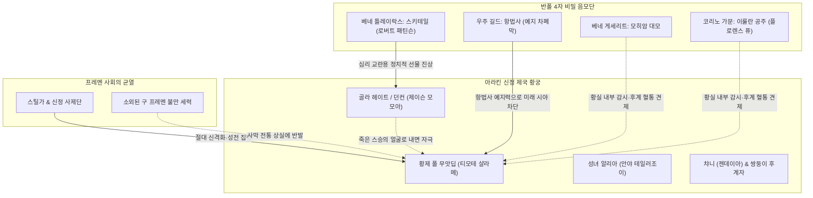

import Alert from '@/components/Alert.astro';
import MovieCard from '@/components/MovieCard.astro';
import PersonCard from '@/components/PersonCard.astro';
import PersonInline from '@/components/PersonInline.astro';
import YouTubeEmbed from '@/components/YouTubeEmbed.astro';
import BookCard from '@/components/BookCard.astro';
import LinkInline from '@/components/LinkInline.astro';

북미(12월 18일)보다 이틀 빠른 **2026년 12월 16일**(수) 대한민국 전 세계 최초 개봉을 앞둔 《듄: 파트 3》 티켓을 예매해 두고 공식 예고편을 다시 틀었다가, 순간 멈칫한 분들이 적지 않을 겁니다. 1편에서 분명 사다우카의 칼날에 장렬히 전사했던 던컨 아이다호(<PersonInline name="제이슨 모모아" imdbId="nm0597388" />)가 버젓이 걸어 나오고, 그림자 속에서는 처음 보는 변신 빌런 스키테일(<PersonInline name="로버트 패틴슨" imdbId="nm1500155" />)이 음모를 속삭이며, 전작 끝날 때까지 어머니 배 속에 있던 알리아(<PersonInline name="안야 테일러조이" imdbId="nm5896355" />)가 다 큰 성인의 모습으로 사막을 거닐고 있으니까요.

2024년 2월 《듄: 파트 2》 개봉 이후 거의 3년 가까운 세월이 흐른 탓에 "내가 중간에 외전 드라마나 쿠키 영상을 놓쳤나?" 싶어 검색창을 열기 딱 좋은 시점입니다. 걱정하실 필요 없어요. 원작 소설 『듄의 메시아』의 중후반 전개나 결말 스포일러는 단 한 줄도 건드리지 않고, 극장 불이 꺼진 뒤 **초반 10분 만에 아라킨 황궁의 숨 막히는 정치극 속으로 곧장 빠져들 수 있는 오프닝 기준선**만 밀도 있게 짚어드립니다.

*]:my-0">
  <MovieCard title="Dune" imdbId="tt1160419" />
  <MovieCard title="Dune: Part Two" imdbId="tt15239678" />
  <MovieCard title="Dune: Part Three" imdbId="tt31378509" />

<Alert type="info" title="100% 결말 스포일러 없는 관람 전 복습 가이드">
  이 글은 《듄》 파트 1·2의 지난 줄거리와 《듄: 파트 3》의 공식 예고편·시놉시스에 공개된 **도입부 전제 설정**까지만 다룹니다. 주요 인물의 최후나 원작 소설 결말부의 반전은 일절 포함하지 않으니 첫 관람 전 안심하고 읽으셔도 됩니다. 같은 주 극장가 맞대결 구도가 궁금하다면 [2026년 하반기 블록버스터 총정리](/culture/blockbusters-late-2026)를 함께 참고해 보세요.
</Alert>

## ⚡ 30초 요약: 시리즈 타임라인 & 파트 3 출발선 핵심 표

상영관 입장 직전 시간이 촉박하다면 아래 네 단계 흐름만 머릿속에 먼저 고정해 두세요.

| 시리즈 구간 | 작중 시간대 | 폴 아트레이데스의 위치 | 핵심 사건 및 파트 3 연결 고리 |
| :--- | :--- | :--- | :--- |
| **듄** (파트 1) | 제국력 10191년 | 공작 가문 후계자 → 사막 도망자 | 황제와 하코넨의 합작 기습으로 가문 멸문, 스승 **던컨 아이다호 전사**, 프레멘 합류 |
| **듄: 파트 2** | 파트 1 직후 수개월 | 프레멘 전사 **무앗딥** → 제국 황제 등극 | 생명의 물 각성, 샤담 4세 굴복 및 이룰란 공주 정략결혼 선언, **챠니의 이탈과 성전 발발** |
| **시간 점프** (공백기) | **약 15～17년 경과** | 은하계를 평정한 신정 제국 황제 | 프레멘 성전이 우주를 휩쓸며 수백억 명 희생, 태아였던 **알리아의 성인 성장** 및 10대 쌍둥이 등장 |
| **듄: 파트 3 출발선** | 즉위 약 15～17년 후 | 예지의 딜레마에 갇힌 절대 권력자 | 황제를 끌어내리려는 **4자 비밀 음모단** 결성, 죽은 던컨의 복제 인간 **골라 헤이트**가 황궁에 도착 |

---

## 파트 1·2 핵심 줄거리 압축 복습: 가문의 멸문에서 우주 성전 개막까지

### 파트 1: 황제의 함정과 아라키스 사막으로 내몰린 후계자

인류가 생각하는 기계(인공지능)를 파괴한 먼 미래, 은하계 제국을 움직이는 유일한 동력원은 사막 행성 **아라키스**(듄)에서만 나는 **스파이스 멜란지**입니다. 수명을 늘려줄 뿐 아니라, 초공간 항행을 가능하게 하는 예지력의 원천이기 때문이죠. 파디샤 황제 샤담 4세는 대가문 의회에서 신망이 두터워진 레토 아트레이데스 공작을 제거하기 위해, 80년간 아라키스를 착취하던 하코넨 가문을 물리고 아트레이데스 가문에 행성 통치권을 넘기는 함정을 팝니다.

결국 황제가 비밀리에 빌려준 최정예 군단 사다우카와 하코넨 대군의 야습으로 아트레이데스 가문은 하룻밤 새 무너지고 레토 공작도 목숨을 잃습니다. 이때 폴과 어머니 레이디 제시카를 탈출시키기 위해 사다우카 정예병들을 홀로 막아서다 숨을 거둔 인물이 바로 검술 스승이자 친형제 같았던 **던컨 아이다호**입니다. 구사일생으로 사막 깊숙이 피신한 폴 모자는 토착민 **프레멘**의 족장 스틸가와 전사 챠니를 만나 사막의 생존법을 배우며 복수의 칼날을 갑니다.

### 파트 2: 생명의 물 각성과 메시아의 서늘한 흑화

프레멘 사회에 녹아들어 **무앗딥**이라는 전사 이름을 얻은 폴은 챠니와 연인으로 발전하며 하코넨의 스파이스 수확기를 연달아 파괴합니다. 하지만 폴의 내면은 내내 찢겨 있었어요. 자신이 프레멘의 구원자 예언을 등에 업고 남부 근본주의 부족들 앞에 서는 순간, 자신의 이름으로 우주를 불태우는 광신적 성전이 터져 수백억 명이 죽게 된다는 미래 환영을 보았기 때문입니다.

반면 프레멘의 대모가 되기 위해 모래벌레의 맹독인 **생명의 물**을 마신 레이디 제시카(<PersonInline name="레베카 퍼거슨" imdbId="nm0272581" />)는 태중의 딸 **알리아**와 함께 수천 년 치 여성 선조들의 기억을 각성한 뒤, 아들의 집권을 위해 남부의 종교적 열기를 무자비하게 부채질합니다. 끝내 하코넨의 새 후계자 페이드 로타가 북부 은신처 시에치 타브르를 포격해 초토화하자, 퇴로가 막힌 폴은 남부로 내려가 스스로 생명의 물을 마시고 시공간을 꿰뚫어 보는 초인 **퀴사츠 해더락**으로 깨어납니다.

각성 직후 완전히 다른 사람처럼 냉혹해진 폴은 아라키스에 직접 강림한 샤담 4세 황제를 단숨에 제압하고 결투 끝에 페이드 로타를 처단합니다. 이어 황제의 장녀 **이룰란 공주**와의 정략결혼으로 제위를 차지하겠다고 선언한 뒤, 이를 거부하며 아라키스 궤도를 포위한 대가문 연합 함대를 향해 "그들을 낙원으로 이끌어라"라는 짧은 명령을 내리며 성전의 불길을 당겼습니다.

---

## 영화 팬이 가장 헷갈리는 지점: 드니 빌뇌브가 파트 2 결말에서 원작과 바꾼 3가지

예매 직후 인터넷에서 원작 소설 1권 줄거리 요약본만 찾아 읽고 극장에 가면 파트 3 초반부부터 퍼즐이 어긋나기 십상입니다. <PersonInline name="드니 빌뇌브" imdbId="nm0898288" /> 감독이 카리스마 넘치는 영웅을 경계하라는 원작자 프랭크 허버트의 주제의식을 선명하게 살리기 위해, 《듄: 파트 2》 결말에서 원작의 굵직한 설정 세 가지를 과감히 고쳐 썼기 때문이에요.

### 1. 정략결혼을 수용한 원작의 챠니 vs 홀로 사막으로 떠난 영화의 챠니

원작 1권의 마지막 장에서 챠니는 이룰란 공주가 그저 정치적 서류상의 아내일 뿐 역사는 우리를 진짜 아내로 부를 것이라는 제시카의 말에 수긍하며 폴의 곁에 남습니다. 하지만 영화 속 <PersonInline name="젠데이아" role="챠니 역" imdbId="nm3918035" />가 연기한 챠니는 거짓 예언으로 동족을 전쟁터에 내모는 연인을 끝내 용납하지 않았습니다. 이룰란 공주의 손을 잡겠다는 폴의 선언에 배신감과 분노가 뒤섞인 시선을 던진 채, 홀로 사막으로 걸어 나가 모래벌레에 몸을 싣고 떠났죠. 갈라섰던 두 사람이 긴 세월 동안 어떤 타협과 갈등을 거쳐 다시 마주 서게 되었는지가 파트 3 초반의 가장 묵직한 감정선입니다.

### 2. 태아 상태였던 알리아와 원작보다 넓어진 시간 점프 (약 15～17년 후)

원작 1권에서는 제시카가 아라키스에서 알리아를 출산한 뒤 약 2년이 흐르고, 성인의 지성을 지닌 두 살배기 유아 알리아가 외할아버지 하코넨 남작을 독침으로 직접 처단합니다. 반면 영화 파트 2는 작중 시간을 수개월 안쪽으로 압축하면서 알리아를 끝까지 태중에 남겨두었고, 폴의 미래 환영 속에서만 성인이 된 알리아(<PersonInline name="안야 테일러조이" imdbId="nm5896355" />)의 얼굴을 잠깐 비췄습니다.

이 각색은 곧바로 파트 3의 시간대 확장으로 이어졌습니다. <LinkInline href="https://dunenovels.com/dune-messiah/" label="프랭크 허버트 재단 공식 가이드" />에 기록된 원작 2부 『듄의 메시아』의 시간적 배경은 폴이 즉위한 지 **12년 후**입니다. 하지만 영화 파트 2 끝자락까지 태어나지 않았던 알리아가 성인 배우 안야 테일러조이의 외모로 등장하고, 나아가 이번 영화에 캐스팅된 폴과 챠니의 10대 쌍둥이 남매 **레토 2세**(나코아울프 모모아)와 **가니마**(아이다 브룩)까지 서사에 합류하려면 12년이라는 시간으로는 나이가 맞지 않죠. 그래서 영화 《듄: 파트 3》는 전작 엔딩으로부터 **약 15～17년**, 체감상 거의 20년에 가까운 세월을 훌쩍 뛰어넘은 시점에서 이야기를 시작합니다.

### 3. 휴전 협상 대신 즉각 발발한 성전과 냉혹해진 제시카

원작 1권이 대가문 연합을 협상 테이블에 굴복시키며 일시적인 봉합으로 막을 내렸다면, 영화 파트 2는 대가문들이 승복을 거부하자마자 프레멘 전사들이 수송선에 올라타 우주로 출격하는 전면전으로 끝맺었습니다. 어머니 레이디 제시카 역시 아들의 안위를 염려하던 조력자에서 벗어나 "성전이 시작되었다"고 읊조리는 서늘한 종교 권력자로 완전히 탈바꿈했죠. 덕분에 관객이 파트 3에서 마주할 아라키스는 승리의 축제장이 아니라, 이미 은하계 전역을 피로 물들인 거대한 업보가 짓누르는 제국의 수도입니다.

---

## 《듄: 파트 3》 인물·세력도 해부: 황제 폴을 포위하는 4자 비밀 음모단

세월이 흐른 뒤 아라키스의 수도 아라킨에는 산맥조차 초라해 보일 만큼 거대한 황궁 신전이 들어섰습니다. 무소불위의 권력을 쥔 황제 폴(<PersonInline name="티모테 샬라메" imdbId="nm3154303" />)은 겉보기에 전 우주를 지배하는 신이지만, 실상은 자신이 괴물처럼 키워버린 신정 관료제와 광신도 군단에 역으로 포위된 상태예요 <LinkInline href="https://www.warnerbros.com/movies/dune-part-three" label="Warner Bros. Pictures" variant="badge" />. 한때 호쾌한 사막 부족장이었던 스틸가(<PersonInline name="하비에르 바르뎀" imdbId="nm0000849" />)는 황제를 숭배하는 대신으로 변했고, 초원화된 아라키스와 변질된 전통에 환멸을 느낀 일부 구 프레멘 퇴역 전사들 사이에서는 은밀한 반감이 자라납니다.

  <PersonCard name="드니 빌뇌브" role="감독" imdbId="nm0898288" />
  <PersonCard name="티모테 샬라메" role="폴 아트레이데스 역" imdbId="nm3154303" />
  <PersonCard name="젠데이아" role="챠니 역" imdbId="nm3918035" />
  <PersonCard name="플로렌스 퓨" role="이룰란 공주 역" imdbId="nm6073955" />
  <PersonCard name="로버트 패틴슨" role="스키테일 역" imdbId="nm1500155" />
  <PersonCard name="안야 테일러조이" role="알리아 아트레이데스 역" imdbId="nm5896355" />
  <PersonCard name="제이슨 모모아" role="헤이트 / 던컨 아이다호 역" imdbId="nm0597388" />
  <PersonCard name="레베카 퍼거슨" role="레이디 제시카 역" imdbId="nm0272581" />
  <PersonCard name="하비에르 바르뎀" role="스틸가 역" imdbId="nm0000849" />

이 틈을 파고들어 폴의 권좌를 무너뜨리기 위해 제국의 구 기득권 네 세력이 손을 잡습니다. 대포와 함대로 맞붙었던 전작과 달리, 이번 3편은 보이지 않는 단검과 심리전이 오가는 궁정 스릴러에 가깝습니다.

### 스키테일과 부활한 던컨 아이다호: 왜 죽은 자가 살아 돌아왔나

예고편 공개 직후 관객들이 가장 어리둥절해했던 두 인물의 정체는 오프닝 설정만 알면 단번에 명쾌해집니다.

먼저 **스키테일**(로버트 패틴슨)은 제국에서 가장 폐쇄적이고 기괴한 유전자·생체 공학 종파 **베네 틀레이락스**(Bene Tleilax)가 파견한 공작원입니다. 그는 자신의 근육과 골격, 성대까지 자유자재로 재구성해 남녀노소 누구의 모습으로든 완벽하게 둔갑하는 생체 변신 병기 **얼굴 춤꾼**(Face Dancer)이에요. 하코넨 남작이나 페이드 로타가 육체적 폭력을 앞세운 정복자였다면, 스키테일은 상대의 가장 약한 심리적 빈틈을 해부하듯 파고드는 지능형 설계자입니다.

그렇다면 1편에서 전사한 던컨 아이다호(제이슨 모모아)는 어떻게 다시 숨을 쉬게 된 걸까요? 베네 틀레이락스가 당시 전장에서 은밀히 수거한 던컨의 시신 세포를 인공 생체 배양조에서 재생시켜 만든 복제 인간 **골라**(Ghola)이기 때문입니다. 전생의 기억은 백지처럼 지워진 채 인간 컴퓨터인 멘타트이자 철학자 훈련을 거쳐 **헤이트**(Hayt)라는 새 이름을 얻었고, 음모단이 황제의 냉철한 이성을 흔들기 위해 황궁에 '정치적 선물'로 보내옵니다. 눈앞에 선 남자가 적들이 벼려낸 정교한 심리적 함정임을 꿰뚫어 보면서도, 자신을 위해 목숨을 바쳤던 옛 벗의 얼굴을 차마 내치지 못하는 폴의 인간적인 흔들림이 초반부 긴장감의 핵심 축을 이룹니다.

### 미래를 보는 황제의 눈을 가리는 법: 우주 길드 항법사와 이룰란 공주

여기서 자연스럽게 한 가지 의문이 떠오릅니다. "어차피 폴은 퀴사츠 해더락이라 미래를 다 내다보는데 비밀 음모가 성립할 수 있나?"라는 점이죠.

4자 음모단이 이 문제를 돌파하기 위해 끌어들인 핵심 퍼즐이 바로 **우주 길드 항법사**입니다. 고농도 스파이스 가스 수조 속에서 살아가며 제한적인 예지 능력을 쓰는 길드 항법사가 모의 현장에 함께 자리하면, 같은 예지 능력자인 폴의 미래 시야에 짙은 안개가 드리워져 음모가 꾸며지는 시공간이 사각지대로 가려집니다. 아라키스 대중 사이에 번진 예언 카드 놀이인 '듄 타로'까지 예지의 파장을 어지럽히는 가운데, 이름뿐인 정실 황후 **이룰란 공주**(<PersonInline name="플로렌스 퓨" imdbId="nm6073955" />)와 베네 게세리트의 모히암 대모가 황실 가장 안쪽에서 폴의 후계 구도를 집요하게 견제합니다.

<YouTubeEmbed id="_9F2bDoimVM" title="[듄: 파트 3] 공식 3차 예고편" />

---

## 자막 읽느라 놓치기 쉬운 필수 세계관 용어 사전 7선

아이맥스 초대형 스크린에서 압도적인 미장센과 배우들의 미세한 동공 연기를 쫓아가다 보면, 낯선 고유명사 자막 한 줄 때문에 대사 맥락을 놓치기 쉽습니다. 극장에 들어가기 전 아래 일곱 가지 개념만 가볍게 스캔해 두면 자막 의존도가 확 줄어듭니다.

| 핵심 용어 | 영문 표기 | 극 중 의미와 파트 3 관람 포인트 |
| :--- | :--- | :--- |
| **리산 알 가입** | Lisan al-Gaib | '외계에서 온 목소리'라는 뜻의 프레멘 구원자 칭호. 실상은 베네 게세리트 선교 보호단이 훗날 교단이 이용할 목적으로 수백 년 전 심어둔 조작된 예언이다. |
| **무앗딥** | Muad'Dib | 사막의 작은 캥거루쥐를 뜻하는 폴의 프레멘 전사명. 파트 3 시점에서는 은하계 전체가 경외와 공포로 부르는 신성 황제의 공식 존호로 통한다. |
| **퀴사츠 해더락** | Kwisatz Haderach | '길을 단축하는 자'. 베네 게세리트가 90세대 혈통 교배로 빚어내려 했던 궁극의 초인으로, 여성 대모들도 접근 못 하는 남녀 양측 유전 기억과 미래 예지를 동시에 다룬다. |
| **베네 틀레이락스** | Bene Tleilax | 유전자 조작과 육체 개조 기술을 독점한 은밀한 종파. 변신 공작원 **얼굴 춤꾼**(스키테일)과 복제 인간 **골라**(헤이트)를 투입해 파트 3의 판을 흔드는 핵심 세력이다. |
| **골라 & 멘타트** | Ghola & Mentat | 사망자의 세포를 생체 배양조에서 되살린 복제 인간이 골라, 컴퓨터가 금지된 우주에서 인간 두뇌로 초고속 연산과 추론을 수행하는 전문가가 멘타트다. |
| **우주 길드 & 항법사** | Spacing Guild | 행성 간 우주 수송을 독점한 기관. 스파이스 가스에 절여진 변이 인간 **항법사**가 예지력으로 항로를 찾으며, 음모단의 모의를 폴의 예지 시야로부터 가려주는 방패가 된다. |
| **초암 공사 & 랜드스라드** | CHOAM & Landsraad | 제국 전체의 경제·스파이스 지분을 나누는 초거대 독점 기업이 초암 공사, 귀족 대가문 연합 의회가 랜드스라드다. 폴이 스파이스 산지를 장악하며 두 집단의 목줄을 쥐고 있다. |

---

## 관람 전 마지막 고민: 원작 『듄의 메시아』 미리 읽을까, 재개봉으로 예습할까?

서점에 들러보면 944쪽에 달하는 벽돌책인 1권 옆에 379쪽으로 훌쩍 얇아진 2권 『듄의 메시아』가 꽂혀 있어, 개봉 전 주말에 미리 읽고 갈지 망설이는 분들이 많습니다. 이 선택은 관객 본인이 극장에서 무엇을 최우선으로 즐기고 싶은지에 따라 명확히 갈립니다.

<BookCard
  title="듄 2: 듄의 메시아"
  isbn13="9791158887551"
  author="프랭크 허버트 지음 · 김승욱 옮김"
  publisher="황금가지"
  comment="944쪽에 달하는 1권과 달리 379쪽으로 압축된 고밀도 정치·심리 스릴러. 영웅 신화의 이면을 파헤친 프랭크 허버트의 문제작이다."
  coupangHref="https://link.coupang.com/a/iZ3KxvVU9k"
/>

- **책을 덮어두고 백지상태로 관람해야 하는 유형**: 후반부 사건의 파격적인 전개와 인물들의 선택이 주는 시청각적 충격을 극장에서 처음 맞닥뜨리고 싶다면 개봉 전 독서는 무조건 참으시는 편이 낫습니다. 특히 이번 완결편은 전체 러닝타임 150분(극장 표기 151분 · 12세 이상 관람가) 가운데 약 71분 분량이 실제 15/65mm 필름으로 촬영된 1.43:1 확장 화면비로 열리도록 설계되어 있어 <LinkInline href="https://www.imax.com/movie/dune-part-three" label="IMAX 공식 페이지" variant="badge" />, 결말을 모르는 상태에서 체감하는 서스펜스가 전작 이상으로 강렬합니다.
- **원작 선독이 오히려 큰 무기가 되는 유형**: 반대로 줄거리 스포일러에 크게 구애받지 않고, 폴과 헤이트·스키테일이 주고받는 선문답 같은 철학적 독백과 예지력의 역설을 1회차부터 깊이 있게 음미하고 싶다면 379쪽 분량의 원작이 하루 이틀 만에 읽히는 든든한 해설서가 되어줍니다.

두 마리 토끼를 모두 잡고 싶다면 **극장 재개봉을 끼워 넣는 3단계 루트**가 가장 이상적입니다. 완결편 개봉을 딱 일주일 앞둔 **2026년 12월 9일**(수)부터 **12월 15일**(화)까지 전국 CGV IMAX관에서 전작 《듄: 파트 2》 단독 재개봉이 진행되거든요. 재개봉 상영으로 파트 2 마지막 30분의 열기와 챠니의 눈빛을 극장 사운드로 생생하게 되살린 뒤, **12월 16일**(수) 1회차로 《듄: 파트 3》를 백지상태에서 온몸으로 받아내고, 여운이 가시기 전에 『듄의 메시아』 책을 읽은 뒤 N차 관람으로 넘어가는 코스를 권합니다.

상영 포맷에 따라 위아래 화면이 얼마나 잘리는지, 왜 이번 작품에서 특별관 스펙 격차가 유독 크게 벌어지는지는 [듄 파트 3 상영관 추천: 용아맥 vs 일반 아이맥스 vs 돌비시네마 비교](/culture/dune-part-3-theater-format-guide)에 자세히 비교해 두었습니다. 아직 취소표 취켓팅이나 대체 상영관 좌석을 고민하고 계신다면 열별 시야각 기준선을 정리한 [용아맥 좌석표·명당 총정리](/culture/yongamac-seat-map), [수도권 4대 레이저 IMAX 좌석 명당](/culture/metro-laser-imax-seat-guide), [월드타워 수퍼플렉스 좌석 명당 총정리](/culture/worldtower-superplex-seat-guide)까지 함께 챙겨서 3년을 기다린 아라키스의 대단원을 최고의 컨디션으로 마주하시길 바랍니다.

## 참고 자료

- [Dune: Part Three Official Movie Site — Warner Bros. Pictures](https://www.warnerbros.com/movies/dune-part-three)
- [Dune: Part Three IMAX Experience — IMAX Official](https://www.imax.com/movie/dune-part-three)
- [Dune Messiah Official Novel Guide — Frank Herbert Estate](https://dunenovels.com/dune-messiah/)
