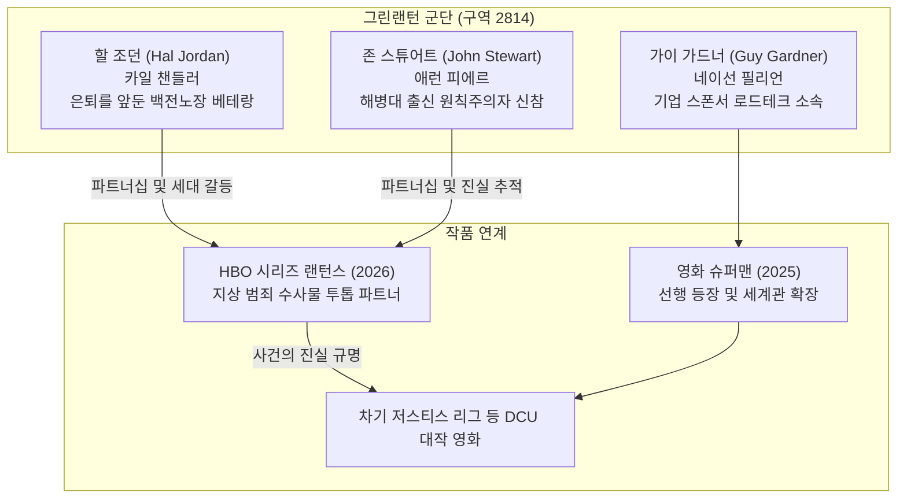
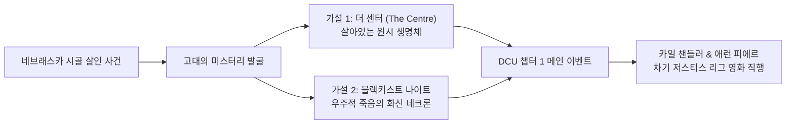

import Alert from '@/components/Alert.astro';

초록색 CG 타이즈를 입고 눈가면을 쓴 라이언 레이놀즈를 떠올리면 아직도 머리가 지끈거립니다. 2011년 영화 《그린랜턴: 반지의 선택》이 남긴 상흔은 그만큼 깊었고, 그 후 15년 가까이 DC 팬들에게 그린랜턴 실사화는 일종의 볼드모트 같은 금기어였습니다. 반지를 끼고 상상하는 모든 것을 형상화한다는 매력적인 설정에도 불구하고, 워너브라더스는 번번이 제작을 엎으며 표류를 거듭했죠.

그런 그린랜턴이 2026년, 완전히 다른 옷을 입고 돌아옵니다. 우주를 날아다니는 화려한 SF 블록버스터가 아닙니다. 흙먼지 날리는 미국 중부 네브래스카의 시골 마을을 배경으로, 두 형사가 엽기적인 살인 사건과 고대의 거대한 음모를 파헤치는 네오 웨스턴 범죄 수사물입니다. 바로 HBO의 8부작 텐트폴 시리즈 《랜턴스》(Lanterns)입니다.

<Alert type="info" title="DCU 챕터 1의 핵심 앵커">
제임스 건(James Gunn) DC 스튜디오 공동 CEO는 《랜턴스》를 가리켜 "지상에서 펼쳐지는 트루 디텍티브(True Detective) 스타일의 범죄 수사물이자, DCU 전체 거대 서사를 관통하는 가장 중요한 핵심 프로젝트"라고 못 박았습니다.
</Alert>

## 왜 갑자기 그린랜턴이 3명이나 등장할까?

코믹스를 깊게 보지 않은 관객이라면 "그린랜턴은 한 명이 아니었나?" 하고 고개를 갸웃할 수 있습니다. 2025년 영화 《슈퍼맨》에 가이 가드너가 등장하는 데 이어, 이번 드라마 《랜턴스》에서는 할 조던과 존 스튜어트가 투톱 주인공으로 나섭니다. DCU 세계관에 그린랜턴이 동시에 셋이나 활약하는 셈입니다.

### 우주 구역 2814와 멀티 랜턴 체제

원작 코믹스 설정상 우주 수호자 가디언즈는 전 우주를 3,600개의 섹터(구역)로 나누었습니다. 지구가 속한 구역이 바로 **구역 2814**(Sector 2814)입니다. 원래 구역당 1～2명의 랜턴이 배치되는 것이 규정이지만, 지구는 유독 우주급 사건사고가 끊이지 않는 위험 지역이라 여러 명의 랜턴이 공존하는 특수한 멀티 랜턴 체제를 유지합니다.

제임스 건은 이번 DCU를 기획하며 **Lived-in Universe**(이미 완성된 세계)라는 철학을 전면에 내세웠습니다. 관객들은 이미 배트맨 부모님이 골목길에서 피살당하는 장면이나 피터 파커가 거미에 물리는 장면을 질리도록 보았습니다. 외계인 아빈 수르가 사막에 추락해 반지를 넘겨주고, 주인공이 비행 연습을 하다 곤두박질치는 지루한 오리진(기원) 스토리를 1화부터 또 되풀이할 이유가 없는 것입니다.

DCU는 이미 히어로들이 세상에 실존하고, 자신들의 사회적 역할을 수행 중인 상태에서 이야기를 시작합니다.

### 각기 다른 세대와 명확한 롤

세 명의 랜턴은 성격과 역할이 확연히 갈립니다.

1. **할 조던**(카일 챈들러 분): 은퇴를 앞두고 삶에 찌든 전설적인 베테랑입니다. 수십 년간 우주의 온갖 참상을 겪으며 냉소적으로 변했고, 반지를 끼는 일 자체에 지쳐 있는 노장 형사 캐릭터입니다.
2. **존 스튜어트**(애런 피에르 분): 해병대 저격수 출신의 원칙주의자 신참입니다. 감정보다 규율을 앞세우며 할 조던의 제멋대로인 수사 방식을 불신하지만, 사건의 본질을 파고들며 시청자의 시선을 대변하는 핵심 주인공입니다.
3. **가이 가드너**(네이선 필리언 분): 가슴에 기업 스폰서인 **로드테크**(LordTech) 로고를 박고 다니는 마초 성향의 괴짜 랜턴입니다. 2025년 개봉 영화 《슈퍼맨》에서 먼저 등장해 자본과 결탁한 현실 속 히어로의 단면을 유쾌하고 뻔뻔하게 보여줍니다.

묵직한 버디 형사물의 전형적인 매력을 풍기는 할 조던과 존 스튜어트의 조합에, 엉뚱한 돌출 행동을 일삼는 가이 가드너의 존재감이 얹히면서 DCU의 랜턴 군단은 단조로움을 완벽하게 벗어던집니다.

---

## 2011년 라이언 레이놀즈 영화의 악몽과 잔혹사

지금 《랜턴스》의 기획 방향을 이해하려면, 2011년 개봉했던 마틴 캠벨 감독의 《그린랜턴: 반지의 선택》(Green Lantern)이 남긴 궤멸적인 상처를 짚고 넘어가지 않을 수 없습니다.

| 구분 | 2011년 영화 《그린랜턴: 반지의 선택》 | 2026년 HBO 《랜턴스》 |
| :--- | :--- | :--- |
| **제작비 및 손익** | 2억 달러 투입 / 흥행 2.19억 달러 (순손실 7,500만 달러 이상) | HBO 정규 텐트폴 시리즈 예산 편성 |
| **주요 무대** | 우주 오아(Oa) 행성 및 대도시 공중전 | 미국 중부 네브래스카의 건조한 시골 마을 |
| **톤앤매너** | 가벼운 SF 히어로 활극 | 어둡고 서늘한 네오 웨스턴 범죄 수사물 |
| **시각 효과** | 전신 풀(Full) CGI 슈트 (불쾌한 골짜기 논란) | 실물 슈트와 지상 로케이션 위주의 현실적 질감 |
| **장르 레퍼런스** | 90년대 스페이스 오페라 | 《트루 디텍티브》, 《노인을 위한 나라는 없다》 |

### "슈트까지 CG로 칠해버린" 처참한 흑역사

2011년 영화는 2억 달러라는 당시 천문학적인 제작비를 쏟아부었지만, 전 세계 박스오피스에서 고작 2억 1,900만 달러를 벌어들이는 데 그쳤습니다. 마케팅 비용을 감안하면 최소 7,500만 달러(한화 약 1,000억 원) 이상의 막대한 순손실을 낸 역사적 폭망이었습니다.

무엇보다 관객들을 경악하게 만든 건 시각 효과였습니다. 몸에 핏줄처럼 발광하는 초록색 슈트를 100% 컴퓨터 그래픽으로 덧입힌 탓에, 라이언 레이놀즈의 얼굴과 목 밑 몸통이 따로 노는 기괴한 '불쾌한 골짜기'를 연출했죠. 라이언 레이놀즈 본인조차 《데드풀 2》에서 과거로 돌아가 그린랜턴 대본을 들고 기뻐하는 자신을 뒤에서 쏴 죽이는 셀프 디스를 감행했을 정도입니다.

### 15년간 이어진 실사화의 저주

이 실패의 여파는 상상 이상으로 길었습니다. 워너브라더스는 그린랜턴이라는 단어 자체를 꺼내기 두려워했고, 이후 추진된 모든 프로젝트는 줄줄이 저주에 걸렸습니다.

- **《잭 스나이더의 저스티스 리그》**(2021): 잭 스나이더 감독은 존 스튜어트 역으로 배우 웨인 T. 카(Wayne T. Carr)를 캐스팅해 자택 진입로에서 그린랜턴 쿠키 영상까지 직접 촬영했습니다. 하지만 워너브라더스 경영진은 "그린랜턴 단독 프로젝트 계획이 따로 있다"며 해당 장면의 삭제를 강요했습니다. 결국 스나이더는 억울함을 삼키며 부랴부랴 마샨 맨헌터로 장면을 대체해야 했습니다.
- **그렉 버란티의 Max 10부작 시리즈 백지화**: 에로우버스의 수장 그렉 버란티가 핀 위트록(가이 가드너 역)과 제레미 어바인(앨런 스콧 역)을 캐스팅하고 수천억 원 규모의 시공간 초월 우주 대작을 준비했으나, 제작비 폭증과 수뇌부 교체로 2022년 끝내 엎어졌습니다.

이번 《랜턴스》가 화려한 우주 SF를 버리고 흙먼지 날리는 네브래스카 시골 마을을 택한 것은 우연이 아닙니다. 컴퓨터 그래픽에 과도하게 의존했다가 침몰했던 과거의 트라우마를 철저히 반면교사 삼아, 배우들의 서늘한 눈빛과 각본의 밀도 높은 서스펜스로 승부하겠다는 정면 돌파 선언입니다.

---

## 드림팀 제작진과 캐스팅 비하인드

이번 프로젝트가 단순한 히어로 드라마를 넘어 기대를 모으는 가장 결정적인 이유는 바로 제작진의 이름값과 플랫폼의 성격 변화에 있습니다.

### Max 오리지널에서 'HBO 정규 텐트폴'로의 승격

원래 이 작품은 스트리밍 플랫폼인 Max(구 HBO Max) 전용 오리지널로 기획되었습니다. 하지만 각본 초고가 완성된 직후, 워너브라더스 디스커버리는 이 작품을 HBO 본 채널의 정규 황금시간대 텐트폴 라인업으로 전격 승격시켰습니다.

단순한 채널 변경이 아닙니다. HBO 브랜드를 단다는 것은 《왕좌의 게임》, 《체르노빌》, 《더 라스트 오브 어스》와 동등한 제작비와 엄격한 각본 퀄리티 심사를 통과했음을 의미합니다.

### 이 조합이 실화인가 싶은 제작진 라인업

- **크리스 먼디**(Chris Mundy, 쇼러너 겸 작가): 넷플릭스 범죄 걸작 《오자크》(Ozark)의 총괄 쇼러너입니다. 건조한 시골 마을에서 벌어지는 숨 막히는 범죄와 인간의 탐욕을 묘사하는 데 있어 현재 할리우드에서 가장 탁월한 감각을 지닌 작가입니다.
- **데이먼 린델로프**(Damon Lindelof, 공동 총괄 프로듀서 겸 작가): 에미상을 휩쓴 HBO 《왓치맨》(Watchmen), 《레프트오버》(The Leftovers), 《로스트》(Lost)의 거장입니다. 원작의 유산을 존중하면서도 파격적인 현대적 미스터리로 재해석하는 능력이 압도적입니다.
- **톰 킹**(Tom King, 공동 작가): 전직 CIA 대테러 분석관 출신이자, 만화계의 아카데미상인 아이스너상을 휩쓴 DC 코믹스 간판 스토리텔러입니다. 《미스터 미라클》, 《슈퍼걸: 우먼 오브 투모로우》 등을 통해 히어로의 내면적 트라우마를 심도 있게 다뤄왔습니다.
- **제임스 호스**(James Hawes, 총괄 연출): 애플TV+의 명작 첩보물 《슬로우 호시스》(Slow Horses) 시즌 1과 영화 《원 라이프》를 연출한 영국 출신 베테랑 감독입니다. 1～2화의 메가폰을 잡아 시리즈 전체의 건조하고 묵직한 톤을 확립합니다.

<Alert type="tip" title="창작진의 공통점">
범죄 스릴러(오자크), 정치적 미스터리(왓치맨), 냉철한 정보기관 분석(톰 킹의 CIA 이력), 첩보 서스펜스(슬로우 호시스). 네 사람의 경력 어디에도 가벼운 액션 히어로물의 흔적이 없습니다. 지독하게 어둡고 현실적인 수사극이 탄생할 수밖에 없는 판이 짜였습니다.
</Alert>

### 치열했던 캐스팅 비하인드

| 배우 | 배역 | 캐릭터 설정 및 역할 | 주요 대표작 |
| :--- | :--- | :--- | :--- |
| **카일 챈들러** | 할 조던 | 은퇴를 앞둔 냉소적인 백전노장 베테랑 랜턴 | 《프라이데이 나잇 라이츠》, 《블러드라인》 |
| **애런 피에르** | 존 스튜어트 | 군인 출신의 원칙주의자 신참, 진실을 쫓는 핵심 시선 | 《레벨 리지》, 《무파사: 라이온 킹》 |
| **울리히 톰센** | 탈 시네스트로 | 군단의 전설적인 멘토이자 훗날의 숙적 | 《더 씽》, 《007 언리미티드》, 드라마 《밴시》 |
| **켈리 맥도널드** | 보안관 케리 | 네브래스카 러시빌 마을의 단호한 현지 경찰 책임자 | 《노인을 위한 나라는 없다》, 《보드워크 엠파이어》 |
| **가렛 딜라헌트** | 윌리엄 메이컨 | 냉혹한 야망과 독선적인 면모를 숨긴 현대식 카우보이 | 《노인을 위한 나라는 없다》, 《데드우드》 |

주연 캐스팅 과정 또한 숱한 우여곡절을 겪었습니다.

1. **조시 브롤린의 정중한 고사**: 제작진이 백전노장 할 조던 역으로 가장 먼저 점찍은 인물은 마블의 타노스로 친숙한 조시 브롤린(Josh Brolin)이었습니다. 하지만 그는 아마존 프라임 비디오의 네오 웨스턴 드라마 《아우터 레인지》(Outer Range) 촬영 직후였고, 장기간 이어지는 TV 시리즈 스케줄에 따른 체력적 부담을 이유로 정중히 제안을 고사했습니다.
2. **카일 챈들러의 완벽한 안착**: 조시 브롤린의 고사 직후 지휘봉을 잡은 배우는 에미상 수상자 **카일 챈들러**(Kyle Chandler)였습니다. 《프라이데이 나잇 라이츠》와 《블러드라인》에서 보여준 묵직하고도 지친 눈빛은, 삶의 풍파를 겪고 감정이 메마른 베테랑 할 조던의 이미지에 더할 나위 없이 들어맞았습니다.

3. **애런 피에르의 전격 발탁**: 신참 존 스튜어트 역에는 넷플릭스 영화 《레벨 리지》(Rebel Ridge)로 전 세계 관객에게 강렬한 눈도장을 찍은 **애런 피에르**(Aaron Pierre)가 낙점되었습니다. 특유의 위압적인 체격과 냉철한 발성, 규율에 묶인 전직 군인의 서늘한 카리스마는 원작 팬들의 환호를 이끌어냈습니다.

4. **명품 조연 라인업**: 《더 씽》, 《밴시》의 덴마크 명배우 **울리히 톰센**(Ulrich Thomsen)이 전설적인 멘토이자 훗날 숙적이 되는 **탈 시네스트로**(Thaal Sinestro) 역으로 합류했습니다. 여기에 《노인을 위한 나라는 없다》의 켈리 맥도널드(Kelly Macdonald)가 네브래스카 보안관 케리 역을, 가렛 딜라헌트(Garret Dillahunt)가 냉혹한 현대 카우보이 윌리엄 마콘 역을 맡아 극의 서스펜스를 단단히 받칩니다.

---

## DCU 전체를 관통할 고대의 미스터리와 향후 전망

《랜턴스》의 배경은 미국 중부 네브래스카의 광활하고 황량한 평원입니다. 할 조던과 존 스튜어트는 이곳에서 발생한 기괴한 살인 사건을 조사하다가, 지구 깊은 곳에 묻혀 있던 거대한 고대의 비밀과 마주하게 됩니다.

제임스 건은 이 사건이 단순한 단발성 에피소드로 끝나지 않고, 향후 DCU 전체 페이즈를 뒤흔들 거대한 복선이 될 것이라고 공언했습니다.

### 네브래스카에 묻힌 미스터리의 정체는?

코믹스 팬들과 해외 매체들은 극 중에서 파헤쳐질 '고대의 미스터리'에 대해 크게 두 가지 유력한 가설을 제기하고 있습니다.

1. **더 센터**(The Centre) 가설: DC 코믹스 불멸의 걸작인 다윈 쿡의 《DC: 더 뉴 프론티어》(The New Frontier)에 등장하는 고대 생명체입니다. 지구 탄생기부터 존재했던 살아있는 거대 유기체로, 인류의 파괴적이고 잔혹한 본성을 감지하고 인류 절멸을 꾀하는 초월적 존재입니다. 제임스 건이 평소 《더 뉴 프론티어》를 DCU의 가장 거대한 영감의 원천으로 꼽아왔다는 점에서 가장 설득력 높은 후보입니다.
2. **블랙키스트 나이트**(Blackest Night) 가설: DC 코믹스 역사상 가장 처절했던 좀비 코즈믹 호러 이벤트의 단초입니다. 지구는 우주 전체 생명의 발원지이자 우주적 죽음의 화신 '네크론'이 봉인된 장소입니다. 지구 땅속에서 어둠의 에너지가 태동하는 설정은 향후 DCU의 거대한 크로스오버 이벤트를 암시하기에 부족함이 없습니다.

### 한 번 캐스팅되면 영화까지: 제임스 건의 '단일 유니버스' 원칙

마블 시네마틱 유니버스(MCU)가 디즈니+ 드라마를 쏟아내며 영화와 TV 시리즈 간의 '숙제형 콘텐츠' 피로도와 질적 불균형을 겪었던 것과 달리, DCU는 철저한 **단일 유니버스**(Unified Canon) 원칙을 고수합니다.

영화 관람을 위해 억지로 예습해야 하는 부속물이 아니라, 그 자체로 HBO 프레스티지 드라마급 완성도를 갖추면서도 자연스럽게 거대 세계관으로 뻗어나가는 방식입니다. 영화, TV 시리즈, 애니메이션, 심지어 비디오 게임까지 동일한 배우가 목소리와 실사 연기를 겸하며, 드라마에서 구축된 캐릭터는 그대로 스크린으로 직행합니다. 즉, 카일 챈들러의 할 조던과 애런 피에르의 존 스튜어트는 8부작 드라마를 마친 뒤 차기 DCU 텐트폴 영화(예: 차기 《저스티스 리그》)의 주연으로 자연스럽게 합류하게 됩니다.

---

반지의 힘으로 화려한 녹색 무기를 허공에 띄우는 히어로의 활극은 잠시 잊어도 좋습니다. 2026년 공개될 HBO 《랜턴스》는 흙먼지 묻은 카우보이 부츠를 신고, 어둠이 짙게 깔린 도로 위에서 침묵 속에 단서를 쫓는 거친 형사들의 이야기입니다. 15년간 이어진 긴 악몽을 깨부수고, DCU가 마블과는 완전히 다른 성인 취향의 고품격 서사를 증명해낼 수 있을지 기대가 모입니다.
