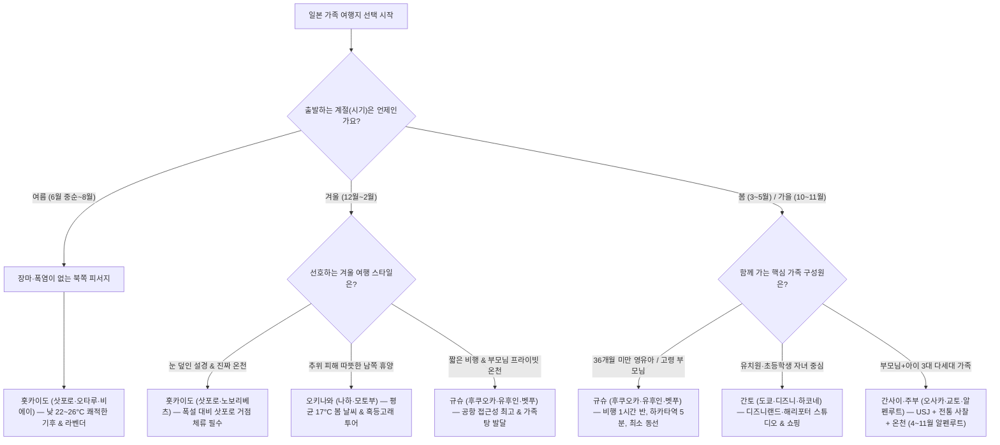

import Alert from '@/components/Alert.astro';
import Chart from '@/components/Chart.astro';

8월 여름휴가에 부모님 모시고 오사카에 갔다가 36도 폭염에 도톤보리 한복판에서 진이 다 빠졌다거나, 1월 삿포로에서 폭설로 기차가 끊겨 아이 안고 공항에서 발을 동동 굴렀다는 후기, 남 일 같지 않으실 겁니다. 남북으로 3,000km 넘게 늘어진 일본은 같은 달이라도 어디를 고르느냐에 따라 천국과 지옥이 갈려요. 성공적인 **일본 가족 여행**을 준비할 때 숙소나 맛집 검색보다 **일본 여행 시기**와 동반자 체력에 맞춘 지역 선정이 먼저여야 하는 이유입니다.

혼자나 친구끼리 가는 여행이라면 비가 억수로 쏟아져도, 전철 환승 통로를 20분씩 걸어도 추억으로 넘길 수 있죠. 하지만 유모차를 타는 영유아나 무릎 관절이 약한 부모님, 혹은 3대가 함께 움직이는 대가족 여행에서는 작은 변수 하나가 일정 전체를 망치곤 합니다. 홋카이도부터 오키나와까지 5대 권역의 동선 난이도와 일본 기상청(JMA) 데이터 기반 월별 날씨, 그리고 한국인들이 가장 많이 당하는 현지 성수기·자연재해 대처법까지 실전 기준으로 정리해 드릴게요.

---

## 한눈에 고르는 가족 구성원·시기별 일본 여행지

일본 가족 여행의 성패는 첫 단추인 '시기×지역 매칭'에서 80%가 결정됩니다. 아무리 좋은 료칸을 예약해도 6월 하순 규슈 장마철에 걸리면 산사태 우려로 열차가 멈추고, 8월 한여름에 도쿄 디즈니랜드를 가면 아스팔트 복사열에 아이들이 먼저 지쳐버리거든요.

아직 행선지를 못 정하셨다면 아래 의사결정 흐름도를 따라 우리 가족에게 가장 무리가 없는 지역부터 좁혀보세요.

---

## 5대 권역별 특징과 가족 여행 추천 포인트 (동선·체력 난이도)

지도상으로는 가깝게 보여도 공항에서 시내까지 들어가는 시간, 기차 환승 난이도, 렌터카 필수 여부가 권역마다 완전히 다릅니다. 체력과 이동 시간(★ 1개가 가장 편함)을 기준으로 5대 권역의 장단점을 짚어볼게요.

### 1. 규슈 (후쿠오카·유후인·벳푸·구마모토) — 동선 난이도 ★☆☆☆☆

처음 아이를 데리고 해외에 나가거나 걸음이 느린 부모님을 모실 때 가장 실패 확률이 낮은 곳이 규슈입니다.

- **압도적인 접근성**: 인천·김포에서 직항으로 1시간 15분～30분, 부산에서는 50분이면 도착해요. 무엇보다 **후쿠오카 공항 국내선 청사에서 하카타역까지 지하철로 단 2정거장**(약 5～6분), 국제선 청사에서 택시를 타도 15분 안팎(요금 1,500～2,000엔 수준)이면 시내 중심부 호텔에 짐을 풀 수 있습니다.
- **부모님·영유아 맞춤 온천**: 하카타역에서 관광 특급열차 '유후인노모리'나 고속버스로 약 2시간이면 유후인과 벳푸에 닿습니다. 다른 지역보다 **가족탕**(카시키리부로·전세 온천) 문화가 잘 발달해 있어서, 기저귀를 떼지 못한 아기나 대중탕 입수가 조심스러운 어르신도 남 눈치 보지 않고 온천을 즐길 수 있어요.

### 2. 간사이 & 주부 (오사카·교토·고베·나고야·알펜루트) — 동선 난이도 ★★☆☆☆

"아이들은 놀이공원에 가고 싶어 하고, 부모님은 옛날 사찰이나 자연 경관을 보고 싶어 해요." 이런 3대 다세대 가족의 서로 다른 취향을 한 번에 묶어줄 수 있는 권역입니다.

- **30～60분 생활권**: 오사카를 거점으로 잡으면 유니버설 스튜디오 재팬(USJ), 세계 최대급 실내 수족관인 **가이유칸**(계단 대신 완만한 나선형 경사로를 내려오며 관람하는 구조라 유모차·휠체어 이동이 매우 편합니다)을 즐길 수 있고, 전철로 30～50분이면 교토의 전통 사찰이나 고베 아리마 온천으로 넘어갈 수 있습니다.
- **나고야 & 다테야마 구로베 알펜루트**: 초등 저학년 이하 아이라면 나고야의 레고랜드와 지브리 파크가 좋은 선택지입니다. 부모님 효도 여행이라면 '일본의 지붕'이라 불리는 **다테야마 구로베 알펜루트**가 압권인데요. 매년 **4월 15일경부터 11월 30일까지**만 개통하며(겨울철 폐쇄), 특히 **4월 중순～6월 중순**에는 높이 15～20m에 달하는 거대한 눈 벽 사이를 걷는 '유키노오타니(눈의 대계곡)'가 열립니다. 산악 트롤리버스, 로프웨이, 케이블카 등 6가지 교통수단을 갈아타며 해발 2,450m 무로도까지 올라가기 때문에 등산이 힘든 어르신도 편안하게 설산 절경을 감상하실 수 있죠.

### 3. 간토 (도쿄·하코네·닛코) — 동선 난이도 ★★★☆☆

쇼핑, 테마파크, 미술관, 미식까지 도시형 엔터테인먼트의 정점입니다.

- **테마파크 투톱**: 도쿄 디즈니랜드·디즈니씨는 물론이고, 옛 도시마엔 부지에 문을 연 **워너 브라더스 스튜디오 투어 도쿄**(해리포터 스튜디오)는 실내 관람 비중이 압도적으로 높아 비 오는 날이나 한여름 폭염 속에서도 쾌적하게 일정을 소화할 수 있습니다(100% 사전 예약제이므로 출국 전 예매 필수).
- **도심+온천 하이브리드 동선**: 도쿄 도심만 걷다 보면 부모님이 쉽게 피로해하십니다. 신주쿠역에서 오다큐 로망스카로 85분이면 닿는 **하코네**(온천·아시노코 호수 해적선·오와쿠다니 로프웨이)나, 아사쿠사역에서 특급 스페시아X로 110분 걸리는 **닛코**(도쇼구·주젠지 호수·게곤 폭포)를 1박 2일로 묶으면 만족도가 확 올라가요.
- **유모차 이동 시 주의점**: 도쿄 전철역은 엘리베이터와 다기능 화장실(오스토메이트·수유실)이 잘 갖춰져 있지만, **평일 출퇴근 시간**(07:30～09:30, 17:30～19:30)의 도심 전철은 숨쉬기도 힘든 지옥철로 변합니다. 이 시간대에는 유모차 탑승을 피하거나 택시(GO 앱 호출)를 이용하세요.

### 4. 홋카이도 (삿포로·오타루·비에이·노보리베츠) — 동선 난이도 ★★★★☆

광활한 대자연과 미식, 온천을 모두 품은 곳이지만, 본토와 같은 감각으로 일정을 짰다가는 이동만 하다 끝나는 곳이기도 합니다.

- **여름 피서와 겨울 설경**: 일본 본토와 달리 **공식적인 장마가 아예 없습니다**(츠유 없음). 7～8월 한여름에도 평균기온이 20～22°C 안팎이고 습도가 낮아, 7월 후라노·비에이의 보랏빛 라벤더 밭을 거닐기에 더할 나위 없죠. 겨울(12～2월)에는 온 세상이 하얗게 덮인 설경과 2월 초 삿포로 눈축제가 기다립니다.
- **거리 감각의 함정**: 홋카이도 면적은 남한 전체의 약 83%에 달합니다. 삿포로에서 오타루까지는 JR 쾌속 에어포트로 35～40분이면 가지만, **비에이·후라노까지는 편도 2시간～2시간 반**(140～160km), **하코다테까지는 특급열차로 편도 3시간 반～4시간**(약 310km)이 걸려요. 아이나 부모님과 함께라면 무리하게 숙소를 옮기지 말고, 삿포로 시내에 연박하며 일일 투어 버스나 노보리베츠 온천(특급열차 약 1시간 10분) 정도만 다녀오는 것이 현명합니다.

### 5. 오키나와 (나하·차탄·모토부) — 동선 난이도 ★★★☆☆

한국에서 2시간 남짓 날아가 만나는 아열대 휴양지입니다. 다만 계절별 특성을 정확히 알고 가야 실망하지 않아요.

- **겨울 해수욕의 오해와 진실**: 1～2월 한겨울에도 평균기온이 17°C를 웃돌아 부모님과 추위를 피해 가기 좋습니다. 하지만 **11월부터 이듬해 3월 중순까지는 수온이 낮고 바닷바람이 강해 오키나와 해수욕장 대부분이 공식 폐장**(유영 금지)합니다. 물놀이가 목적이라면 비치가 개장하는 **3월 하순～10월**(특히 태풍이 적고 햇살이 좋은 4월이나 10월)을 노리세요. 대신 **1월～4월 초 겨울 시즌에는 거대한 혹등고래가 번식을 위해 오키나와 근해로 찾아오는 시기**라, 보트를 타고 나가는 '혹등고래 관찰(Whale Watching) 투어'와 리조트 온수 풀 호캉스가 핵심 코스가 됩니다.
- **렌터카 필수**: 나하 공항에서 시내(국제거리·슈리성)까지만 모노레일(유이레일)이 다니고, 중부 아메리칸 빌리지나 북부 **추라우미 수족관**(나하 공항에서 고속도로 경유 약 95～100km, 차로 1시간 45분～2시간 소요)으로 가려면 렌터카나 택시 대절이 필수입니다.

---

## 계절별·월별(1월～12월) 날씨와 베스트·워스트 여행지 매트릭스

"6월에는 장마니까 피하고, 9월 가을에 도쿄 가야지!"라고 생각하셨나요? 실제 기상청 데이터를 열어보면 정반대 결과가 나옵니다. 일본 기상청(JMA)의 30년 평년값(1991～2020년) 통계를 바탕으로 5대 거점 도시의 기온 추이와 월별 최적의 여행지를 비교해 봤습니다.

<Chart
  type="line"
  height={340}
  caption="일본 기상청(JMA) 30년 평년값(1991～2020) 기준 5대 도시 월별 평균기온(°C) 추이"
  data={{
    labels: ['1월', '2월', '3월', '4월', '5월', '6월', '7월', '8월', '9월', '10월', '11월', '12월'],
    datasets: [
      { label: '삿포로 (홋카이도)', data: [-3.2, -2.7, 1.1, 7.3, 13.0, 17.0, 21.1, 22.3, 18.6, 12.1, 5.2, -0.9] },
      { label: '도쿄 (간토)', data: [5.4, 6.1, 9.4, 14.3, 18.8, 21.9, 25.7, 26.9, 23.3, 18.0, 12.5, 7.7] },
      { label: '오사카 (간사이)', data: [6.2, 6.6, 9.9, 15.2, 20.1, 23.6, 27.7, 29.0, 25.2, 19.5, 13.8, 8.7] },
      { label: '후쿠오카 (규슈)', data: [7.0, 7.7, 10.7, 15.3, 19.9, 23.0, 27.2, 28.2, 24.4, 19.4, 14.0, 9.2] },
      { label: '나하 (오키나와)', data: [17.3, 17.5, 19.1, 21.5, 24.2, 26.8, 28.9, 28.9, 27.9, 25.5, 22.5, 19.0] }
    ]
  }}
/>

### 1월～12월 월별 기후 특징 및 추천·비추천 여행지 한눈에 보기

| 월 | 주요 기후 특징 (JMA 평년값 기준) | 추천 여행지 (Best) | 피해야 할 곳 & 주의점 (Worst/Caution) |
| :---: | :--- | :--- | :--- |
| **1월** | 홋카이도 영하권 폭설(-3.2°C), 도쿄·오사카는 맑고 건조(강수량 47～60mm), 오키나와 17.3°C | 규슈(온천), 오키나와(피한·고래투어), 도쿄·오사카(맑은 겨울) | **1/1～1/4 연말연시** 상점 휴무 및 기차표 매진 주의, 홋카이도 폭설 결항 대비 |
| **2월** | 삿포로 눈축제 시즌, 태평양 연안(도쿄·후지산) 쾌청, 규슈 남부 매화 개화 | 홋카이도(눈축제), 규슈(유후인·벳푸), 도쿄·하코네(후지산 조망) | 삿포로 눈축제 기간(2월 초) 숙박비 2～3배 급등(최소 4～5개월 전 예약 필수) |
| **3월** | 본토 봄기운(10°C 전후), 3월 하순 도쿄·후쿠오카·간사이 벚꽃 개화 | 후쿠오카·도쿄·교토(벚꽃), 오키나와(3월 하순 비치 개장 시작) | **3월 하순～4월 초 일본 봄방학**으로 디즈니·USJ 대기시간 연중 최악 |
| **4월** | 본토 전역 15°C 안팎 쾌적, 4월 중순 알펜루트 개통, 4월 말 홋카이도 벚꽃 | 도쿄·오사카·교토, 알펜루트(설벽 오픈), 오키나와(쾌적한 해수욕) | **4/29～5/6 골든위크** 기간 전국 교통·숙소 마비 |
| **5월** | **중하순 본토·홋카이도 날씨 연중 최고**(18～20°C, 적은 강수량). 오키나와는 5/8경 장마 진입 | 일본 본토 전역(도쿄·오사카·규슈), 홋카이도, 알펜루트 | **오키나와**(5월 초순～6월 하순 장마철로 흐리고 습함), 5월 첫째 주 골든위크 |
| **6월** | **초순～하순 본토 장마**(츠유). 특히 후쿠오카 6월 강수량 250mm로 폭우 빈번 | 홋카이도(장마 없음, 평균 17°C), 오키나와(6월20일경 장마 종료 후) | **규슈·간사이·도쿄**(6월 중순～7월 중순 장마 및 고온다습) |
| **7월** | 7/20경 본토 장마 종료 후 즉각 폭염 시작. 후쿠오카 7월 강수량 271mm(연중 최다) | 홋카이도(비에이·후라노 라벤더 만개, 평균 21.1°C) | **후쿠오카**(7월 중순까지 집중호우 위험), **오사카·교토**(장마 직후 찜통더위) |
| **8월** | 본토 살인적 폭염(오사카 평균 29.0°C, 낮 체감 35°C+), 태풍 발생 최다(월 5.7개) | 홋카이도(유일한 여름 피서지), 실내 위주 짧은 일정 | **오사카·교토·도쿄·규슈 야외 일정**(열사병 위험), **8/13～16 오봉절** 대정체 |
| **9월** | **태풍 접근·상륙 최다월**, 도쿄 가을장마(9월 강수량 225mm). 홋카이도부터 가을 시작 | 홋카이도(대설산 단풍 시작, 선선함), 9월 하순 이후 본토 | **오키나와·간사이·규슈**(태풍 직격탄 위험), **도쿄**(6월보다 비가 더 많이 옴) |
| **10월** | 중순 이후 태풍 물러가고 **전국적으로 맑고 선선한 가을 황금기**(18～20°C) | **일본 전 지역 베스트**(도쿄·오사카·규슈·오키나와·알펜루트 단풍) | 10월 초순까지는 막바지 가을 태풍 및 도쿄 비 예보 확인 필요 |
| **11월** | 강수량 적고 청명함. **11월 중하순 도쿄·교토·오사카·후쿠오카 도심 단풍 절정** | 교토·오사카·도쿄·후쿠오카(단풍+온천), 오키나와(골프·드라이브) | 교토 단풍 절정기(11월 셋째～넷째 주) 주말 숙박비 급등 및 버스 만원 |
| **12월** | 도쿄·오사카는 눈 거의 안 오고 맑음(51mm). 홋카이도는 본격적인 겨울 왕국 | 규슈(부모님 온천), 도쿄·오사카(일루미네이션), 홋카이도(설경) | **12/28 이후 연말 귀성 전쟁** 및 12/31 상점 조기 폐점·휴무 |

### 계절별 숨은 팩트 4가지

1. **봄의 진짜 황금기는 '5월 중하순'입니다**: 3월 말～4월 초 벚꽃 시즌은 아름답지만 일본 봄방학 인파와 꽃샘추위, 비 소식이 잦습니다. 반면 골든위크가 끝난 직후인 **5월 10일경～5월 말**은 항공권과 숙박비가 뚝 떨어지면서도 기온은 20°C 안팎에 강수량이 적어 부모님·아이와 걷기에 일 년 중 가장 완벽해요(단, 5월 초에 장마가 시작되는 오키나와는 제외).
2. **장마철(6～7월) 규슈는 피하고, 홋카이도로 가세요**: 일본 본토(규슈·간사이·간토)는 6월 초부터 7월 20일경까지 장마(츠유)가 이어집니다. 특히 **후쿠오카를 비롯한 규슈 지역은 6월(249.7mm)과 7월(270.5mm) 두 달 동안 연 강수량의 3분의 1이 쏟아질 만큼** 호우가 잦아 유후인행 열차가 멈추는 일이 빈번합니다. 이 시기엔 장마가 없는 홋카이도가 정답입니다.
3. **도쿄에서 비가 가장 많이 오는 달은 6월이 아니라 '9～10월'입니다**: 많은 분이 도쿄의 가을을 쾌청할 거라 기대하지만, JMA 통계를 보면 **도쿄의 9월(224.9mm)과 10월(234.8mm) 강수량은 6월 장마철(167.7mm)보다 60mm 이상 많습니다.** 가을장마 전선(아키사메)과 태풍이 겹치기 때문인데요. 쾌청한 가을 도쿄·교토를 원하신다면 태풍이 완전히 물러가는 **10월 중순～11월 말**을 공략하세요.
4. **도심 단풍은 10월이 아니라 '11월 하순～12월 초'에 물듭니다**: 설악산 단풍 시기를 생각하고 10월 중순에 교토나 도쿄에 가면 푸른 나뭇잎만 보게 됩니다. 10월 중하순 단풍은 홋카이도와 알펜루트, 닛코 같은 고산지대 이야기고, **도쿄·교토·오사카·후쿠오카 시내 단풍은 11월 20일경부터 12월 첫째 주 사이**에 가장 화려하게 불타오릅니다.

---

## 가족 여행 테마별 맞춤 큐레이션

동반자의 연령대와 취향에 따라 일정의 밀도를 조절해야 모두가 웃으며 귀국할 수 있습니다.

### 1. 자연 & 온천 (부모님 효도·힐링 중심)

어르신들과 함께할 때는 하루 관광지를 딱 2곳으로 줄이고, 오후 3～4시에는 료칸에 체크인해 온천과 가이세키 요리를 여유롭게 즐기는 일정이 가장 반응이 좋습니다.

- **규슈 벳푸 & 유후인**: 벳푸에서는 펄펄 끓는 코발트빛 온천수가 솟구치는 '바다 지옥(우미지고쿠)' 등 지옥순례 코스가 평지 위주라 부모님과 산책하기 좋고, 따뜻한 화산 모래를 덮고 땀을 빼는 해변 모래찜질도 별미입니다. 유후인에서는 아침 물안개가 피어오르는 긴린코 호수를 산책해 보세요.
- **간토 하코네**: 신주쿠에서 특급 로망스카를 타면 도시락을 까먹으며 기차 여행 기분을 낼 수 있습니다. 하코네 등산전철과 케이블카, 로프웨이를 차례로 타고 유황 연기가 뿜어져 나오는 오와쿠다니 계곡을 넘어 아시노코 호수 해적선까지 타는 '하코네 프리패스' 코스는 교통수단 자체가 관광이라 걷는 부담이 적습니다.
- **홋카이도 노보리베츠**: 일본 유수의 온천향답게 유황천, 철천, 산성천 등 무려 9가지 수질(천질)의 온천수가 한 마을에서 솟아납니다. 대욕장 규모가 압도적인 대형 온천 호텔이 많아 가족 단위로 묵기 좋습니다.

<Alert type="tip" title="온천·료칸 예약 전 필독!">
지역별 온천수 수질 차이와 료칸 가이세키 예약 요령, 가족탕 이용법 및 타투(문신)·입욕 에티켓이 궁금하시다면 앞서 정리한 **[일본 온천 여행 완벽 가이드](/culture/japanese-spa-trip)** 포스트를 먼저 확인해 보세요.
</Alert>

### 2. 쇼핑 & 테마파크 (아이 동반·다세대 만족)

테마파크는 아이들에게 평생 기억에 남는 선물이지만, 부모님과 엄빠의 체력을 가장 빠르게 고갈시키는 곳이기도 합니다.

- **도쿄 디즈니랜드 vs 디즈니씨**: 미취학 아동이나 초등 저학년이라면 동화 속 성곽과 퍼레이드, 완만한 어트랙션이 많은 **디즈니랜드**가 무조건 유리합니다. 반면 초등 고학년 이상이거나 최근 오픈한 '판타지 스프링스(겨울왕국·라푼젤·피터팬 테마 구역)'를 노린다면 **디즈니씨**를 추천해요.
- **오사카 USJ**(유니버설 스튜디오 재팬): '슈퍼 닌텐도 월드(마리오)'와 '해리포터' 구역이 핵심입니다. 다만 아이 데리고 폭염이나 추위 속에 120～180분씩 줄을 서다 보면 정작 놀이기구를 타기도 전에 가족 싸움이 나기 십상입니다. 비행기 표를 아끼더라도 USJ에서는 **익스프레스 패스**(Express Pass)를 사전에 구매해 돈을 시간과 체력으로 바꾸는 것이 가족 평화를 지키는 지름길입니다.
- **후쿠오카 라라포트**(LaLaport): 실물 크기(약 25m)의 움직이는 '뉴건담(RX-93ff νGundam)' 입상이 서 있어 아빠와 아들들의 눈이 휘둥그레지는 대형 쇼핑몰입니다. 내부에 **키자니아 후쿠오카**, 대형 푸드코트, 아기 휴게실이 완벽히 갖춰져 있어 비 오는 날이나 한여름 폭염을 피하는 실내 구원투수로 최고예요.

### 3. 먹거리 & 미식 (아이와 어르신 입맛 모두 잡는 메뉴)

일본 음식이 대체로 달고 짜서 부모님이 물려하시거나 아이가 매운 걸 못 먹어 걱정하시는 경우가 많은데요. 아래 메뉴들은 호불호 없이 온 가족이 잘 먹습니다.

- **홋카이도의 4대 미식**: 살이 꽉 찬 **3대 게 요리**(털게·대게·킹크랩) 찜과 샤브샤브는 어르신들의 원픽입니다. 잡내 없는 어린 양고기를 구워 먹는 **징기스칸**, 큼직한 구운 야채와 닭다리가 통째로 들어가고 매운맛 단계를 0단계(안 매움)부터 세밀하게 고를 수 있는 **스프카레**, 그리고 고농축 우유로 만든 소프트아이스크림과 오타루 **르타오 치즈케이크**(LeTAO)는 아이들이 정말 좋아해요.
- **후쿠오카·오사카의 가족 친화 메뉴**: 돈코츠 라멘을 시킬 때 유명한 '이치란' 등에서는 주문서에 '비법 소스(매운 양념) 없음(なし)', **'기름기 담백하게'**를 체크하면 유아도 맛있게 먹을 수 있습니다. 특히 부모님과 아기에게 강력 추천하는 메뉴는 **후쿠오카식 우동**(하카타 우동)이에요. 쫄깃한 사누키 우동과 달리 면발을 아주 부드럽고 폭신하게 삶아내고 맑은 가쓰오부시·고등어포 육수를 써서 소화가 정말 잘됩니다(우엉튀김 '고보텐'을 얹어 드셔보세요).

<Alert type="info" title="후쿠오카 나카스 포장마차(야타이), 아이 데리고 가도 될까요?">
강변을 따라 늘어선 나카스 야타이는 낭만적이지만, 좌석이 어른 어깨가 맞닿을 정도로 비좁고 화장실이 멀며 주변 흡연·음주 분위기가 강합니다. 유모차나 어린아이를 동반했다면 강변 산책 삼아 분위기만 구경하시고, 식사는 쾌적한 실내 이자카야나 모츠나베 전문점을 예약해 방문하시는 것을 권장합니다.
</Alert>

---

## 자연재해(태풍·지진·폭설·폭염) 리스크와 실전 대비 매뉴얼

가족을 인솔하는 입장에서는 "설마 무슨 일 있겠어?"보다 "만약의 상황에서 어떻게 움직일까?"를 알고 가는 것이 심리적 안정감을 줍니다.

### 1. 태풍 시즌(7～10월) 통계와 간사이공항 고립 주의보

일본 기상청(JMA)의 30년 평년 통계를 보면 태풍은 1년 평균 25.1개가 발생해 그중 **11.7개가 일본 열도 300km 이내로 접근하고, 3.0개가 본토에 직접 상륙**합니다.

<Chart
  type="bar"
  height={300}
  caption="일본 기상청(JMA) 30년 평년값(1991～2020) 기준 월별 태풍 발생·접근·상륙 수(개)"
  data={{
    labels: ['5월', '6월', '7월', '8월', '9월', '10월', '11월'],
    datasets: [
      { label: '태풍 발생 수', data: [1.0, 1.7, 3.7, 5.7, 5.0, 3.4, 2.2] },
      { label: '일본 접근 수 (오키나와·본토 300km 이내)', data: [0.4, 0.8, 2.1, 3.3, 3.3, 1.5, 0.3] },
      { label: '일본 본토 상륙 수', data: [0.0, 0.2, 0.6, 0.9, 1.0, 0.3, 0.0] }
    ]
  }}
/>

차트에서 보듯 **태풍이 가장 많이 만들어지는 달은 8월**(5.7개)이지만, 여름 북태평양 고기압이 살짝 수축하며 일본 본토를 향해 직격탄으로 올라오는 **접근·상륙 피크는 8월 하순부터 9월 내내**(접근 3.3개, 상륙 1.0개)입니다.

<Alert type="danger" title="8～9월 오사카(간사이공항) 여행 시 '연락교 통제' 리스크">
오사카 관문인 **간사이국제공항**(KIX)은 바다 한가운데를 매립해 만든 인공섬 공항입니다. 오사카 시내(육지)로 나오려면 길이 3.75km의 유일한 다리인 **'간사이공항 연락교'**를 건너야 하는데요. 태풍으로 강풍 기준치를 넘기면 안전을 위해 이 다리의 철도(난카이 라피트·JR 하루카)와 도로가 전면 폐쇄됩니다. 실제로 2018년 9월 태풍 '제비' 때는 유조선이 연락교에 충돌하고 활주로가 침수되어 여행객 3,000～5,000명이 섬에 고립되었고, 2023년 8월 태풍 '란' 상륙 때도 연락교 사전 통제로 항공편 560여 편이 결항하며 650여 명이 공항 바닥에서 밤을 지새웠습니다. 8～9월에 간사이나 오키나와를 가신다면 **항공기 지연·결항 보상 특약이 포함된 여행자보험**에 반드시 가입하시고, 태풍 북상 예보 시 귀국일 전날 공항 근처(린쿠타운 등)나 시내 연장 숙박 플랜B를 미리 염두에 두세요.
</Alert>

### 2. 지진·쓰나미 및 '난카이 해구 지진 임시정보' 대처법

최근 뉴스에 자주 오르내리는 '난카이 해구 지진 임시정보(거대지진 주의)'는 "내일 당장 대지진이 난다"는 확정 예보가 아닙니다. 지진 발생 가능성이 평소보다 상대적으로 높아졌으니 **1주일간 가구 고정, 비상용품 확인, 해안가 대피 경로 숙지 등 사전 대비 태세를 갖추라는 일본 정부의 공식 경계령**(기상청·내각부 발표)입니다.

여행 중 흔들림(지진)을 느꼈다면 당황하지 말고 아래 3가지만 기억하세요:
1. **실내**(호텔·식당): 즉시 식탁이나 책상 아래로 들어가 방석이나 가방으로 **머리부터 보호**합니다. 흔들림이 멈출 때까지 밖으로 뛰쳐나가지 마세요(유리창 파편 낙하 위험).
2. **엘리베이터 절대 금지**: 비상계단을 이용하고, 만약 엘리베이터 안에 있다면 **모든 층의 버튼을 눌러** 가장 먼저 열리는 층에서 즉시 내립니다.
3. **해안가**(오키나와·가마쿠라·벳푸 해변 등): 강한 진동을 느꼈거나 쓰나미 경보가 울리면 해변 구경을 즉시 멈추고 해발고도가 높은 언덕이나 **'쓰나미 대피 빌딩'**(津波避難ビル) 표지판이 붙은 3층 이상 철근콘크리트 건물 옥상으로 대피합니다.

### 3. 겨울 홋카이도 폭설 결항 & 여름 열사병 경계 알람

- **겨울 신치토세 공항 고립 주의**: 1～2월 홋카이도에서는 폭설로 비행기가 안 뜨는 것 못지않게 **신치토세 공항과 삿포로 시내를 잇는 JR 쾌속 에어포트 열차와 고속버스가 동시에 멈추는 상황**이 자주 발생합니다. 귀국 날 아침에 비에이나 노보리베츠, 하코다테 등 먼 곳에서 공항으로 바로 이동하는 일정은 매우 위험해요. **귀국 전날 밤에는 무조건 삿포로 시내나 치토세(공항 인근)에 숙소를 잡으세요.**
- **여름 열사병 경계 알람**(WBGT): 일본 환경성과 기상청은 기온·습도·복사열을 종합한 더위지수(WBGT)가 33 이상으로 예측되면 '열사병 경계 알람(熱中症警戒アラート)'을 발령합니다. 지면과 가까운 유모차 안은 성인 체감온도보다 3～4°C가량 더 높으므로, 여름철에는 **유모차 쿨시트, 휴대용 선풍기, 자외선 차단 양산**, 그리고 편의점에서 쉽게 파는 **염분 보충 사탕**(시오아메)과 **포카리스웨트·오츠카 OS-1**(경구수액)을 수시로 챙겨 마셔야 합니다.

### 4. 출국 전 가족 스마트폰 필수 세팅 체크리스트

공항에서 비행기 탑승 대기할 때 아래 앱과 번호만 저장해 두셔도 현지에서 당황할 일이 절반으로 줄어듭니다.

- **Safety tips 앱**(필수 설치): 일본 관광청(JTA)이 감수·제공하는 외국인 여행자 전용 재난 알림 앱입니다. **한국어를 완벽 지원**하며, 현재 내 위치의 지진 조기경보, 쓰나미 경보, 폭우·열사병 알람, 난카이 해구 임시정보를 실시간 푸시로 알려주고 상황별 대피 행동 카드와 의료기관 검색 기능까지 제공합니다.
- **긴급 연락처 저장**:
  - 일본 현지 범죄·교통사고 신고(경찰): **`110`** / 화재·응급환자 구급차 요청: **`119`**
  - **일본정부관광국 24시간 핫라인**(JNTO): **`050-3816-2787`** (연중무휴 24시간 **한국어 통역** 및 응급 병원·재난 안내 지원)
  - **대한민국 외교부 영사콜센터**: **`+82-2-3210-0404`** (유료) 또는 카카오톡에서 '외교부 영사콜센터' 채널 추가 후 무료 상담

---

## 일본 현지 휴가철(극성수기) 피하기: 물가 폭등 & 신칸센 탑승 주의

한국의 삼일절, 어린이날, 추석 연휴만 달력에서 체크하고 항공권을 끊었다가 현지에서 낭패를 보는 경우가 정말 많습니다. 일본 국민 전체가 대이동을 하는 **3대 극성수기**와 **2대 준성수기**는 피하거나 최소 4～6개월 전에 모든 예약을 마쳐야 합니다.

1. **골든위크**(Golden Week, 4월 29일 ～ 5월 5일/6일경): 쇼와의 날(4/29), 헌법기념일(5/3), 녹색의 날(5/4), 어린이날(5/5)이 이어지는 일본 최대 연휴입니다. 한국의 어린이날 연휴와 정확히 겹치는데, 비즈니스호텔 숙박비가 평소의 2～3배로 뛰고 어디를 가나 인산인해를 이룹니다.
2. **오봉절**(Obon, 8월 13일 ～ 16일경 전후 1주일): 한국의 추석에 해당하는 명절이자 일본 직장인들의 여름휴가 집중 기간입니다. 한국의 광복절(8/15) 징검다리 연휴와 겹치며, 고속도로가 40～50km씩 정체되므로 이 기간에 렌터카나 고속버스로 유후인·하코네·후지산을 이동하면 길 위에서 반나절을 버릴 수 있습니다.
3. **연말연시**(쇼가츠, 12월 28일 ～ 1월 4일경): 교통 혼잡보다 더 큰 문제는 **'상점 셧다운'**입니다. 한국과 달리 일본은 양력설을 쇠기 때문에 **12월 31일부터 1월 2일(또는 3일)까지 주요 백화점, 쇼핑몰, 박물관, 개인 맛집들이 일제히 문을 닫습니다.** 반대로 유명 신사와 사찰(도쿄 아사쿠사 센소지, 교토 후시미이나리 등)은 새해 첫 참배(하츠모데)를 하려는 수백만 명의 인파로 발 디딜 틈이 없어요.
4. **실버위크**(Silver Week, 9월 셋째 주～넷째 주) & **봄방학 시즌**(3월 하순 ～ 4월 초): 9월 경로의 날·추분의 날 연휴에는 부모님 효도 여행객이 몰려 온천 료칸 구하기가 하늘의 별 따기이고, 3월 말～4월 초 일본 학생들의 봄방학·졸업여행 시즌에는 **디즈니랜드와 USJ 대기시간이 연중 최고치**(인기 어트랙션 180～240분 이상)를 찍습니다.

<Alert type="warning" title="과거 블로그 글 주의! 3대 성수기 신칸센 '노조미' 자유석 완전 폐지">
예전 여행 후기만 보고 *"지정석 매진이면 일찍 역에 나가서 줄 서서 노조미 자유석(1～3호차) 타면 된다"*고 생각하시면 역에서 가족들과 열차를 타지 못하는 대형 사고가 납니다. 2023년 말부터 JR 도카이·JR 서일본의 정책 개정으로, **골든위크·오봉절·연말연시 3대 성수기 기간에는 도카이도·산요 신칸센 '노조미'(Nozomi) 열차가 자유석을 아예 없애고 1～16호차 전석 지정석(All-reserved seats)으로만 운행**합니다. 자유석 특급권이나 JR 패스만 들고 노조미에 타면 좌석에 앉을 수 없고 입석 데크 서성거리기만 허용(또는 탑승 제한)되므로, 성수기에 도쿄～교토·오사카～하카타 구간을 이동할 때는 반드시 사전에 지정석을 예약하거나 자유석이 남아 있는 '히카리(Hikari)'·'고다마(Kodama)' 열차를 이용하셔야 합니다.
</Alert>

---

## 출발 전 마지막 점검: 우리 가족에게 딱 맞는 한 줄 공식

항공권 결제 버튼을 누르기 전에 우리 가족의 상황과 아래 세 가지 공식을 마지막으로 대조해 보세요.

- **체력이 약한 부모님·36개월 미만 아기와 첫 여행이라면**: 비행시간이 짧고 시내 이동이 15분 안에 끝나는 **규슈**(후쿠오카·유후인·벳푸)를 **3～5월**(골든위크 제외)이나 **10～12월**에 다녀오세요.
- **7～8월 여름방학에 휴가를 낼 수밖에 없다면**: 본토의 폭염과 장마를 피해 무조건 **홋카이도**(삿포로·오타루·비에이)로 직항을 끊되, 숙소는 삿포로 한 곳에 고정해 이동 피로를 줄이세요.
- **초등학생 이상 자녀를 포함한 3대 대가족이라면**: **4월 중순～5월 하순**이나 **10월 중순～11월 말**에 **간사이**(오사카·교토·고베) 또는 **도쿄+하코네** 코스를 잡고, 테마파크 익스프레스 패스와 신칸센·특급열차 지정석만 출국 전에 미리 확보해 두시면 모두가 편안한 여행이 됩니다.
