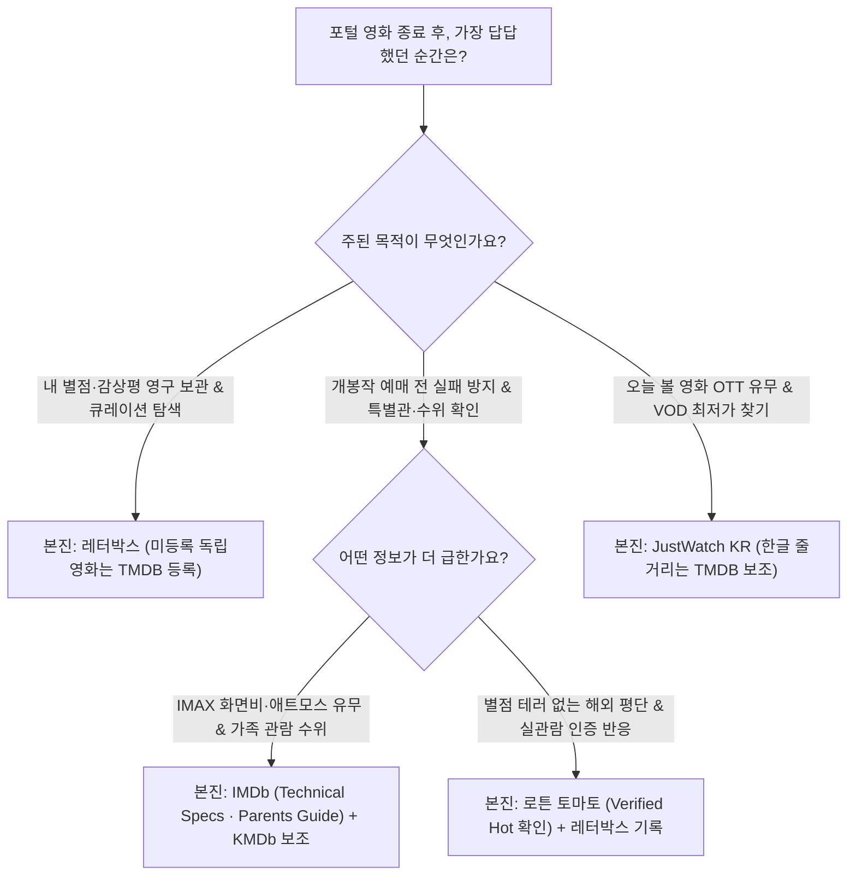

import Alert from '@/components/Alert.astro';
import AppCard from '@/components/AppCard.astro';
import CloudinaryImage from '@/components/CloudinaryImage.astro';
import LinkPreviewCard from '@/components/LinkPreviewCard.astro';

극장 불이 켜지고 엔딩 크레딧이 올라갈 때, 방금 마음을 흔든 촬영감독의 전작이 궁금해 스마트폰으로 영화를 검색해 보신 적 있으실 겁니다. 예전 같으면 포털 영화 페이지에서 스태프 이름을 눌러 숨은 구작까지 줄줄이 파고들었겠지만, 지금 **네이버 영화**와 **다음 영화**가 사라진 자리에 뜨는 건 상영시간표와 줄거리 서너 줄뿐인 통합검색 카드 한 장이 전부죠.

20년 넘게 당연한 놀이터였던 포털 영화 DB가 문을 닫고 민간 별점 앱마저 부침을 겪으면서, 영화 정보를 찾고 기록을 쌓아 둘 새 본진을 찾는 분이 많습니다. 아래한글 문서에서 출발했던 한국 영화 아카이브 25년 흥망사를 먼저 짚어보고, 영어가 부담스러워도 당장 정착할 수 있는 **IMDb**, **로튼 토마토**, **레터박스**, **TMDB** 실전 활용법을 목적별로 정리했습니다.

---

## ⚡ 10초 요약: 목적별 영화 사이트 대안 한눈에 보기

예전 포털 한 곳에서 해결하던 기능들은 이제 목적별로 두세 곳을 조합해 쓰는 편이 훨씬 쾌적합니다. 내가 가장 자주 쓰는 용도에 맞춰 아래 표에서 주력 사이트부터 골라보세요.

| 주요 목적 | 추천 사이트 | 한국어 지원 수준 | 핵심 킬러 기능 |
| :--- | :--- | :--- | :--- |
| **스태프 디깅 · 특별관 스펙 검증** | **IMDb** (`imdb.com`) | UI 영문 (개봉작 **한글 제목 검색 지원**) | `Technical Specs`(화면비·애트모스), `Parents Guide`(수위 판별), `Trivia` |
| **예매 전 호불호 · 실패 확률 점검** | **로튼 토마토** (`rottentomatoes.com`) | 영문 전용 | 평단 `Tomatometer`, 실관람 인증 `Popcornmeter` 및 `Verified Hot` 배지 |
| **평생 별점 백업 · 시네필 다이어리** | **레터박스** (`letterboxd.com`) | UI 영문 (**한글 검색·한글 리뷰 지원**) | 관람일 `Diary`, 인생작 4편 `Four Favorites`, 무료 **CSV 일괄 백업·이관** |
| **친절한 한글 줄거리 · 포스터 확인** | **TMDB** (`themoviedb.org`) | **한국어 UI·줄거리·포스터 최상급** | 국내 유저 참여형 오픈 위키, 레터박스·Plex·Infuse의 원천 메타데이터 DB |
| **구독 OTT 유무 · VOD 최저가 비교** | **JustWatch KR** (`justwatch.com/kr`) | **한국어 완벽 지원** | 넷플릭스·티빙·쿠팡플레이·웨이브 스트리밍 유무 및 대여 최저가 통합 검색 |
| **한국 고전 · 독립영화 사료 열람** | **KMDb** (`kmdb.or.kr`) | **한국어 공식 사료** | 한국영상자료원 운영, 1950～90년대 한국 영화 상세 크레딧·원본 시나리오 |

---

## 필름스에서 포털 영화의 퇴장까지: 우리는 왜 영화 놀이터를 잃었을까

우리가 공기처럼 누렸던 한국어 영화 데이터베이스는 처음부터 거대 기업의 자본으로 만들어진 결과물이 아니었습니다. 시작점을 따라 올라가면 1990년대 한 영화광 고등학생의 책상 앞 풍경이 나옵니다.

### 286 PC와 아래한글로 쌓아 올린 전설, ‘필름스’와 ‘홍성진 영화해설’

옛 네이버 영화 상세 페이지 하단을 묵묵히 지키던 ‘**홍성진 영화해설**’ 코너를 기억하는 분이 많을 겁니다. 시대 배경과 연출 의도까지 촘촘히 풀어내던 그 해설의 뿌리는 운영자 홍성진 씨가 고교 2학년 시절 286 PC에서 띄운 **아래한글** 파일이었습니다. 영화 제목과 감독, 스태프 이름을 수기로 타이핑해 모으던 기록이 PC통신 하이텔 영화 자료실을 거쳐 인터넷 영화 전문 DB **필름스**(`films.co.kr`)로 자라났죠.

<CloudinaryImage
  publicId="posts/culture/2026/korean-movie-db-alternatives/fig-01-retro-pc-film-archive"
  width={1376}
  height={768}
  alt="1990년대 후반 베이지색 CRT 모니터와 쌓여 있는 VHS 비디오테이프, 영화 잡지와 수기 노트가 놓인 영화 마니아의 책상"
  caption="포털 영화 서비스가 태동하기 전, 하이텔 자료실과 개인 PC에서 수기로 쌓아 올린 영화 기록이 훗날 국내 최대 영화 DB의 씨앗이 됐다."
/>

혼자 힘으로 구축한 데이터 규모부터 압도적이었습니다. 2003년 3월 오마이뉴스 인터뷰 기준 필름스는 이미 **영화 2만 6,555편, 영화인 21만 9,135명**의 정보를 모아 ‘한국판 IMDb’로 불렸거든요. 이후 2004년경 영화 서비스를 키우던 **NHN**(현 네이버)이 필름스 DB를 흡수·통합하고 홍성진 씨도 합류하면서, 네이버 영화의 근간을 이룬 아카이브와 시그니처 해설 코너가 탄생했습니다.

### 2023～2024년 포털 영화의 연쇄 종료, 통합검색 편입이 악수였던 이유

그렇게 20년 넘게 국내 영화 담론을 지탱하던 양대 포털의 전용 웹사이트는 불과 1년 사이에 잇달아 문을 닫았습니다.

- **네이버 영화**(`movie.naver.com`): 2000년 개설 후 23년간 운영되다 **2023년 3월 31일** 독립 웹 서비스를 공식 종료하고 통합검색 내 ‘지식베이스’ 카드로 축소 편입됐습니다. 이어 단건 VOD 플랫폼이던 **네이버 시리즈온**마저 **2024년 12월 18일** 콘텐츠 판매를 종료했습니다.
- **다음 영화**(`movie.daum.net`): 2000년부터 24년간 운영되다 2023년 12월 31일 평점·댓글을 마감한 뒤 **2024년 1월 4일** 최종 종료됐고, 역시 다음 통합검색 기본 정보 카드로만 남았습니다.

통합검색 편입이 영화 팬들에게 뼈아팠던 이유는 분명합니다. 검색 카드는 **이미 제목을 아는 신작**의 개봉 정보만 빠르게 띄워줄 뿐이거든요. 촬영감독·각본가·조연 배우의 필모그래피를 꼬리에 꼬리를 물고 타고 넘어가며 숨은 명작을 **디깅**(digging)하던 하이퍼링크 동선이 끊겼고, 20년간 웹 곳곳에 인용되던 고유 영화 URL과 제작노트·장문 리뷰 맥락이 한꺼번에 증발했습니다.

<figure class="not-prose my-6">
  <svg
    viewBox="0 0 1000 256"
    role="img"
    aria-label="한국 영화 데이터베이스 25년 흥망사와 플랫폼 이동 타임라인"
    class="w-full h-auto rounded-xl border border-border bg-card p-4 shadow-sm"
  >
    <style>{`
      .tl-line { stroke: var(--border); }
      .tl-box { fill: var(--background); stroke: var(--border); }
      .dark .tl-box { fill: var(--muted); }
      .tl-title { fill: var(--foreground); font-size: 14px; font-weight: 700; }
      .tl-item { fill: var(--foreground); fill-opacity: 0.82; font-size: 12px; }
      .tl-dot { stroke: var(--card); stroke-width: 3px; }
      .tl-c1 { fill: #b45309; }
      .tl-c1-dot { fill: #d97706; }
      .dark .tl-c1, .dark .tl-c1-dot { fill: #fbbf24; }
      .tl-c2 { fill: #047857; }
      .tl-c2-dot { fill: #059669; }
      .dark .tl-c2, .dark .tl-c2-dot { fill: #34d399; }
      .tl-c3 { fill: #be123c; }
      .tl-c3-dot { fill: #e11d48; }
      .dark .tl-c3, .dark .tl-c3-dot { fill: #fb7185; }
      .tl-c4 { fill: #0369a1; }
      .tl-c4-dot { fill: #0284c7; }
      .dark .tl-c4, .dark .tl-c4-dot { fill: #38bdf8; }
    `}</style>

    <line x1="64" y1="56" x2="936" y2="56" class="tl-line" stroke-width="2.5" />

    <circle cx="134" cy="56" r="9" class="tl-c1-dot tl-dot" />
    <text x="134" y="32" text-anchor="middle" class="tl-c1" font-size="12.5" font-weight="700">1990년대 후반–2003</text>
    <rect x="20" y="82" width="228" height="150" rx="10" class="tl-box" stroke-width="1.2" />
    <text x="36" y="110" class="tl-title">개인 아카이브 태동기</text>
    <text x="36" y="136" class="tl-item">• 286 PC·아래한글 수기 기록</text>
    <text x="36" y="158" class="tl-item">• 하이텔 거쳐 필름스 구축</text>
    <text x="36" y="180" class="tl-item">• 2003.02 기준 2.6만 편 돌파</text>
    <text x="36" y="210" class="tl-c1" font-size="12" font-weight="700">‘한국판 IMDb’ 자생적 탄생</text>

    <circle cx="378" cy="56" r="9" class="tl-c2-dot tl-dot" />
    <text x="378" y="32" text-anchor="middle" class="tl-c2" font-size="12.5" font-weight="700">2000 · 2004–2022</text>
    <rect x="264" y="82" width="228" height="150" rx="10" class="tl-box" stroke-width="1.2" />
    <text x="280" y="110" class="tl-title">양대 포털 영화 전성기</text>
    <text x="280" y="136" class="tl-item">• 2000 네이버·다음 영화 개설</text>
    <text x="280" y="158" class="tl-item">• 2004 NHN, 필름스 DB 통합</text>
    <text x="280" y="180" class="tl-item">• ‘홍성진 영화해설’·제작노트</text>
    <text x="280" y="210" class="tl-c2" font-size="12" font-weight="700">20여 년간 국민 영화 백과사전</text>

    <circle cx="622" cy="56" r="9" class="tl-c3-dot tl-dot" />
    <text x="622" y="32" text-anchor="middle" class="tl-c3" font-size="12.5" font-weight="700">2023.03–2024.12</text>
    <rect x="508" y="82" width="228" height="150" rx="10" class="tl-box" stroke-width="1.2" />
    <text x="524" y="110" class="tl-title">포털 DB·VOD 연쇄 종료</text>
    <text x="524" y="136" class="tl-item">• 23.03.31 네이버 영화 종료</text>
    <text x="524" y="158" class="tl-item">• 24.01.04 다음 영화 종료</text>
    <text x="524" y="180" class="tl-item">• 24.12.18 시리즈온 판매 종료</text>
    <text x="524" y="210" class="tl-c3" font-size="12" font-weight="700">통합검색 카드 축소·디깅 단절</text>

    <circle cx="866" cy="56" r="9" class="tl-c4-dot tl-dot" />
    <text x="866" y="32" text-anchor="middle" class="tl-c4" font-size="12.5" font-weight="700">2025.08–2026 이후</text>
    <rect x="752" y="82" width="228" height="150" rx="10" class="tl-box" stroke-width="1.2" />
    <text x="768" y="110" class="tl-title">민간 재편 &amp; 글로벌 이주</text>
    <text x="768" y="136" class="tl-item">• 2025.08 왓챠 기업회생 절차</text>
    <text x="768" y="158" class="tl-item">• 2026.07–08 키노라이츠 인수</text>
    <text x="768" y="180" class="tl-item">• IMDb·레터박스·TMDB 정착</text>
    <text x="768" y="210" class="tl-c4" font-size="12" font-weight="700">목적별 해외 4대장 분산 활용</text>
  </svg>
  <figcaption class="mt-2 text-center text-sm text-muted-foreground">
    한국 영화 DB 25년 변천사 — 개인 수기 아카이브에서 출발해 포털 전성기를 거친 뒤, 연쇄 종료와 민간 재편 끝에 글로벌 전문 DB로 분화하고 있다.
  </figcaption>
</figure>

### 왓챠피디아·키노라이츠의 부침과 공공 DB의 한계

포털 철수 직후에는 예상 별점에 강한 **왓챠피디아**와 신호등 지수·OTT 검색을 내세운 **키노라이츠**가 빈자리를 일부 메웠으나, 백과사전식 심층 크레딧·해설 DB와는 성격이 달랐습니다. 설상가상으로 왓챠가 전환사채 상환 실패 등 경영난으로 **2025년 8월 서울회생법원 기업회생 절차**에 들어갔고, **2026년 7～8월 스토킹호스 방식을 통해 키노라이츠가 약 42억 5,000만 원 규모로 왓챠를 인수**하기로 확정되면서 국내 민간 플랫폼 기반 자체가 흔들렸죠.

공공 영역의 한국영상자료원 **KMDb**(`kmdb.or.kr`)와 영진위 **KOBIS**(`kobis.or.kr`)는 한국 영화 사료와 박스오피스 통계에서 최고 공신력을 지니지만, 해외 영화 탐색이나 개인의 별점·리뷰 공간으로는 쓸 수 없습니다. 결국 해답은 글로벌 표준 플랫폼들을 내 입맛에 맞게 조합하는 것입니다.

---

## 1. IMDb: 크레딧 디깅부터 특별관 기술 스펙 검증까지

**IMDb**(`imdb.com`)는 전 세계 영화 산업의 표준 인명·작품 사전입니다. 단순 10점 만점 별점판으로만 쓰기엔 아까운 진짜 가치가 하위 탭 세 곳에 모여 있습니다.

### 특별관 티켓값을 아껴주는 `Technical Specs`

특별관 티켓값이 2만 원을 훌쩍 넘는 요즘, IMDb의 `Technical Specs` 탭은 예매 전 필수 코스입니다. 런타임은 물론 원본 **화면비**(`Aspect Ratio` — `1.43:1`, `1.90:1`, `2.39:1`)와 **사운드 믹싱 규격**(`Sound Mix` — `Dolby Atmos`, `IMAX 6-Track` 등)을 정확히 알려주거든요. [용아맥 좌석 명당 총정리](/culture/yongamac-seat-map)나 [돌비 비전·애트모스 원리와 등급 차이](/culture/dolby-vision-atmos-cinema-guide), [코돌비·남돌비 좌석 명당 총정리](/culture/coex-namyangju-dolby-seat-guide)를 보고 피케팅에 뛰어들기 전에 이 영화가 진짜 확장 화면비와 애트모스 믹싱을 지원하는지 판별하는 1차 레퍼런스입니다.

### 가족 관람 사고를 막는 `Parents Guide`와 비하인드 창고 `Trivia`

아이·부모님과 영화 보기 전에는 `Parents Guide` 탭을 꼭 열어보세요. **선정성**·**폭력성**·**욕설**·**음주 및 마약**·**공포** 5대 항목별로 유저 투표 기반 `None`·`Mild`·`Moderate`·`Severe` 등급을 매기고, 구체적 장면 묘사를 스포일러 분리 상태로 보여줘 민망한 상황을 예방해 줍니다. 관람 후에는 방대한 비하인드 스토리와 옥에 티를 모은 `Trivia`와 `Goofs` 탭이 옛 홍성진 영화해설과 제작노트의 빈자리를 든든히 채워줍니다.

<Alert type="tip" title="IMDb 한글 검색 & 어색한 한국어 음차 제목 원제로 바꾸기">
  국내 정식 개봉작은 IMDb 검색창에 **한글 제목을 쳐도 바로 검색**됩니다. 간혹 어색한 한국어 음차 제목이 먼저 떠서 거슬린다면 로그인 후 `Account settings` → `Site Preferences` → `Title display country/region`을 `Original`(원제) 또는 `United States`로 바꾸면 모든 제목이 깔끔하게 통일됩니다.
</Alert>

<AppCard
  name="IMDb: Movies & TV Shows"
  appStoreId="342792525"
  platform={["iOS", "Android", "Web"]}
  price="무료"
  href="https://www.imdb.com"
  description="전 세계 영화·시리즈 크레딧, 촬영·음향 기술 스펙(Technical Specs), 관람 수위 가이드(Parents Guide)와 트리비아를 총망라한 표준 영화 DB 앱."
  comment="예매 직전 특별관 화면비·애트모스 스펙을 검증하거나 엔딩 크레딧 직후 트리비아를 찾아볼 때 가장 든든합니다."
/>

---

## 2. 로튼 토마토(Rotten Tomatoes): 별점 테러 없는 호불호 온도계

별점 테러와 알바 댓글로 오염됐던 옛 포털 평점 대신, 개봉 직후 해외 평단·관객 반응을 가장 직관적으로 읽을 수 있는 곳이 **로튼 토마토**(`rottentomatoes.com`)입니다. 다만 토마토 지수 `90%`는 “100점 만점에 90점짜리 걸작”이 아니라 전체 리뷰 중 **긍정적 리뷰를 남긴 비율**(`60점` 또는 별점 `3.5/5` 이상)이 **90%라는 뜻**이에요. 호불호 없이 무난한 오락 영화가 90%대를 찍는 이유죠.

- `Tomatometer`(**평론가 지수**): 긍정률 `60%` 이상은 `Fresh`, `59%` 이하는 `Rotten`입니다. **75% 이상** + 와이드 개봉 리뷰 **80개 이상**(제한 개봉 40개 이상) + Top Critics 5명 이상 조건을 넘기면 `Certified Fresh` 마크가 붙고, `70%` 미만 하락 시 박탈됩니다.
- `Popcornmeter`(**관객 지수**): 2024년 8월 기존 `Audience Score`에서 공식 리브랜딩됐습니다. 2019년 도입된 실관람 티켓 인증 관객(`Verified Audience`) 평가를 바탕으로 하며, 2024년 8월 신설된 `Verified Hot` 배지(인증 관객 긍정률 **90% 이상** + 와이드 개봉 500건 이상 평가)가 붙은 작품은 대중적 재미가 검증된 오락 영화로 믿고 골라도 좋아요.

두 지수의 괴리 해석법 등 더 자세한 판독 요령은 [로튼토마토 점수, 제대로 읽는 법](/culture/rotten-tomatoes-how-to-use)에서 확인해 보세요.

<LinkPreviewCard
  url="https://www.rottentomatoes.com"
  title="Rotten Tomatoes: Movies | TV Shows | Movie Trailers | Reviews"
  description="북미 공인 평론가 리뷰(Tomatometer)와 실관람 인증 관객 반응(Popcornmeter · Verified Hot)을 집계하는 글로벌 영화·시리즈 평점 플랫폼."
  siteName="Rotten Tomatoes"
  comment="개봉 첫 주 신작 예매 전, 평단 완성도와 대중적 쾌감 중 어디에 강점이 있는 영화인지 빠르게 판독하기 좋습니다."
/>

---

## 3. 레터박스(Letterboxd): 10년 치 관람 기록을 지켜줄 시네필의 본진

국내 플랫폼의 불안정성에 지쳐 “내 10년 치 영화 기록을 안전하게 쌓아둘 영구 본진”을 찾는 분에게는 전 세계 시네필들의 영화 다이어리이자 SNS인 **레터박스**(`letterboxd.com`)가 최고의 정착지입니다.

`0.5～5.0` 반개 별점과 별개로 순수 애정을 뜻하는 **주황색 하트**(`Like`), 관람일·재관람 여부를 기록하는 `Diary`, 프로필 상단 인생 영화 4편 `Four Favorites`, 전 세계 유저들의 재치 있는 한줄 리뷰와 큐레이션 `Lists`가 핵심 매력이에요. 원천 데이터를 TMDB에서 받아오므로 **검색창에 한국어로 영화 제목을 입력해도 대부분 바로 검색**됩니다. 무료(`Free`)로도 충분하며, 연간 관람 통계(`Stats`)와 내 구독 OTT 필터가 탐나면 `Pro`(연 `$19`), 작품별 포스터·배경 커스텀까지 원하면 `Patron`(연 `$49`)을 선택하면 됩니다.

<AppCard
  name="Letterboxd"
  appStoreId="1054047074"
  platform={["iOS", "Android", "Web"]}
  price="무료 (Pro $19/년 · Patron $49/년)"
  href="https://letterboxd.com"
  description="별점·하트·관람 날짜별 다이어리(Diary)·인생 영화 4편(Four Favorites)과 큐레이션 리스트를 지원하는 글로벌 영화 기록 플랫폼."
  comment="극장을 나서며 관람일과 짧은 감상을 기록하고 전 세계 시네필들의 큐레이션 리스트를 타고 디깅하기 가장 좋은 앱입니다."
/>

### 기존 별점 CSV 이관(`letterboxd.com/import/`) 실전 팁

레터박스는 무료 계정에서도 **CSV 가져오기와 내보내기**를 완벽히 지원합니다. UTF-8 `.csv` 파일에 아래 컬럼을 맞춰 올리면 자동 매칭되며, 10점 만점 정수로 적어 둔 점수는 `Rating` 대신 `Rating10` 컬럼명을 쓰면 5점 만점으로 자동 변환됩니다.

```csv
Title,Year,imdbID,Rating,WatchedDate,Rewatch,Tags,Review
Parasite,2019,tt6751668,5.0,2019-05-30,false,"칸영화제,봉준호","계단과 냄새로 수직 계급을 그려낸 마스터피스."
Decision to Leave,2022,tt12477480,4.5,2026-10-12,true,"박찬욱,N차관람","두 번째 볼 때 비로소 파도 소리의 진짜 의미가 들린다."
```

왓챠피디아는 공식 CSV 내보내기 버튼이 없어 고객센터 **개인정보 열람 요청**으로 평가 내역을 받거나, 오픈소스 추출 스크립트(예: `erinyskim/watchapedia-export` — 단, 왓챠 웹 개편에 따라 최신 포크 수정본 동작 여부 확인 필요)를 거쳐 변환해 올리는 흐름이 현실적입니다.

<Alert type="warning" title="레터박스 CSV 업로드 전 필수 체크: 1MB 한도 & 취소 불가">
  1회 업로드 파일은 **최대 1MB**까지만 허용되므로 데이터가 많다면 연도별로 파일을 나눠 올리세요. 무엇보다 최종 확정 후에는 일괄 **되돌리기**(Undo)가 **불가능**하므로, 확정 전 미리보기 화면에서 동명 영화 오매칭이 없는지 반드시 검수해야 합니다 (`imdbID`를 함께 넣으면 가장 정확합니다).
</Alert>

---

## 4. TMDB와 보조 조합: 한국어 위키·OTT 최저가·한국 고전 사료

영어 화면이 부담스러울 때나 OTT 검색, 한국 고전 사료가 필요할 때는 아래 세 곳을 보조로 곁들이면 빈틈이 사라집니다.

### TMDB(`themoviedb.org`): 한국어 번역이 가장 친절한 오픈 영화 위키

**TMDB**는 위키 방식으로 한국 유저들이 직접 한글 제목, 한국어 줄거리, 국내 공식 포스터를 활발히 등록해 두어 국내 팬에게 가장 친절해요. 레터박스의 원천 DB이자 Plex·Infuse·Jellyfin 같은 개인 미디어 서버의 표준 메타데이터 소스이므로, 한국 독립·단편영화가 레터박스에 안 뜰 때 TMDB에 직접 등록하면 생태계 전체에 반영됩니다.

<LinkPreviewCard
  url="https://www.themoviedb.org/?language=ko"
  title="The Movie Database (TMDB)"
  description="전 세계 커뮤니티가 함께 구축하는 다국어 영화·TV 오픈 데이터베이스. 한국어 제목·줄거리·공식 포스터 및 API 생태계를 제공한다."
  siteName="TMDB"
  comment="영어가 부담스러울 때 자연스러운 한국어 줄거리와 국내 개봉 포스터를 확인하기 가장 쾌적한 오픈 영화 위키입니다."
/>

### JustWatch KR & KMDb: OTT 통합 검색과 한국 영화 사료 퍼즐

네이버 시리즈온 종료 이후 “이 영화 지금 넷플릭스·티빙·쿠팡플레이·웨이브 중 어디에 있지? 대여 최저가는 어디지?”를 찾을 때는 국가를 한국(`/kr`)으로 맞춘 **JustWatch**가 가장 빠릅니다. 반대로 해외 DB에도 스태프 정보가 비어 있는 **1950～90년대 한국 고전영화**나 국내 독립영화 사료·시나리오가 필요할 때만 한국영상자료원 **KMDb**(`kmdb.or.kr`)를 꺼내 쓰면 완벽한 퍼즐이 완성되죠.

<AppCard
  name="JustWatch - Movies & TV Shows"
  appStoreId="979227482"
  platform={["iOS", "Android", "Web"]}
  price="무료"
  href="https://www.justwatch.com/kr"
  description="넷플릭스·티빙·쿠팡플레이·웨이브·애플TV 등 국내외 주요 OTT의 스트리밍 유무 및 VOD 대여·구매 최저가를 비교하는 통합 검색 가이드."
  comment="보고 싶은 영화가 내 구독 OTT에 포함되어 있는지, 단건 대여는 어디가 가장 저렴한지 3초 만에 비교해 줍니다."
/>

<LinkPreviewCard
  url="https://www.kmdb.or.kr"
  title="KMDb - 한국영화데이터베이스"
  description="한국영상자료원이 운영하는 공식 한국 영화 아카이브. 고전·독립영화를 망라한 상세 스태프 크레딧, 시나리오, 포스터, 평론 사료를 제공한다."
  siteName="한국영화데이터베이스 (KMDb)"
  comment="해외 DB에 누락된 한국 고전·독립영화 크레딧과 원본 시나리오 사료를 찾을 때 대체 불가능한 공신력을 지닙니다."
/>

---

## 내 영화 습관에는 어디가 맞을까? 성향별 정착 조합표

모든 사이트에 한꺼번에 가입할 필요는 없습니다. 내 영화 소비 습관에 맞춰 **주력 본진 1곳 + 보조 도구 1곳**만 먼저 골라 스마트폰 홈 화면에 올려두세요.



한곳에 모든 것이 모여 있던 포털 영화의 시대는 저물었지만, 국내 기업 한 곳의 운영 정책에 따라 20년 치 링크와 관람 기록이 통째로 휘청이던 구조에서 벗어날 기회이기도 합니다. 오늘 밤에는 거창한 이관 작업 대신 레터박스 계정을 열어 내 인생 영화 네 편(`Four Favorites`)을 골라 걸어 두거나, 이번 주말 예매해 둔 영화를 IMDb에 검색해 `Technical Specs`와 `Trivia` 탭부터 가볍게 열어보세요. 끊겼던 영화 디깅의 즐거움이 생각보다 훨씬 쾌적하게 다시 이어질 겁니다.
