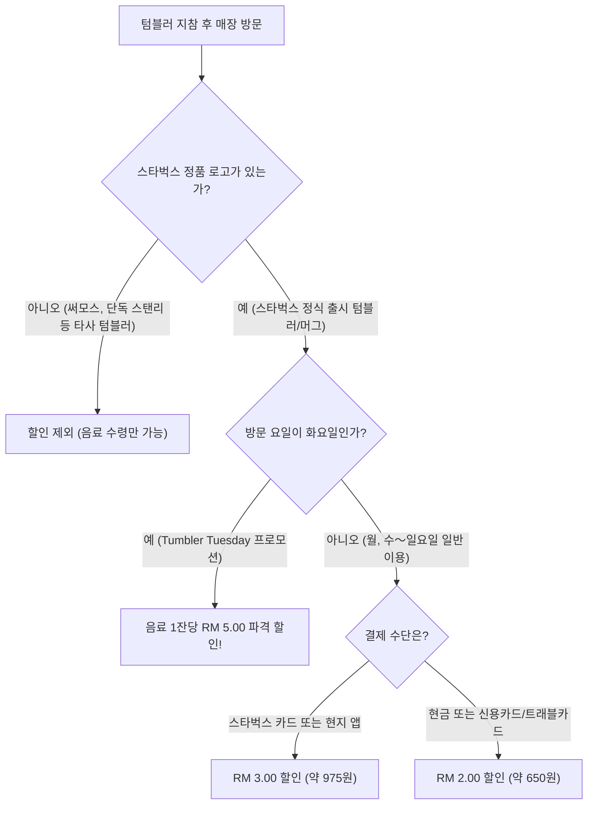

import Alert from '@/components/Alert.astro';

한국 스타벅스 생각하고 평소 애용하던 써모스나 스탠리 텀블러를 챙겨갔다가, 말레이시아 카운터에서 정중하게 할인을 거절당하고 당황한 경험 있으신가요? 국내 매장과 달리 **말레이시아 스타벅스**는 아무 개인 컵이나 가져온다고 무조건 음료값을 깎아주지 않습니다.

연중 32～35℃를 넘나드는 무더운 날씨 덕분에 여행 중 하루에도 서너 번씩 시원한 카페를 찾게 되는 곳이 바로 말레이시아입니다. 특히 환율 혜택과 특유의 여유로운 공간 덕분에 스타벅스 매장은 여행자들의 필수 오아시스 역할을 하죠. 하지만 현지 매장 특유의 할인 룰과 독점 굿즈, 결제 방식을 미리 모른 채 방문하면 놓치기 아쉬운 혜택들이 꽤 많습니다. 

캐리어에 텀블러를 챙기기 전 반드시 확인해야 할 텀블러 할인 규정부터 현지에서만 만날 수 있는 희귀 굿즈, 그리고 매장 이용 꿀팁까지 실전 노하우를 한자리에 정리했습니다.

---

## 1. 말레이시아 스타벅스 텀블러 할인 규정(T&C)의 진실

많은 여행자가 가장 헷갈려하는 부분이 바로 개인 컵 할인 정책인데요. 핵심부터 명확히 짚자면, **스타벅스 정품 텀블러나 머그를 지참했을 때만 공식 할인이 적용**됩니다.

### 써모스나 락앤락 텀블러는 왜 할인이 안 될까?
스타벅스 말레이시아(Berjaya Starbucks Coffee Company)의 공식 이용약관(T&C)에는 개인 컵 지참 프로그램(Bring Your Own Tumbler)의 대상이 **"Starbucks Tumbler or Starbucks Mug"**로 명확히 한정되어 있습니다. 

타사 텀블러를 내밀면 위생상 음료를 담아주는 것은 흔쾌히 응해주지만, 영수증에서 음료 금액 할인(RM 2～3)은 제외되는 것이 본사 원칙입니다. 가끔 신입 파트너의 재량으로 타사 컵도 할인해 주는 경우가 드물게 있지만, 공식 규정이 아니므로 거절당하더라도 얼굴 붉힐 필요가 전혀 없습니다.

<Alert type="tip" title="스탠리(Stanley) 콜라보 텀블러는 할인 대상일까?">
스탠리 브랜드 단독 제품은 할인 대상이 아니지만, 스타벅스 매장에서 정식 출시되어 스타벅스 세이렌 로고가 음각 또는 프린팅된 **'Stanley x Starbucks'** 정품 콜라보 텀블러는 정상 할인 혜택을 받을 수 있습니다.
</Alert>

### 기본 할인 금액: 결제 수단에 따라 달라진다
스타벅스 텀블러를 챙겼다면 결제 수단에 따라 할인 폭이 달라집니다.

- **일반 결제**(현금, 트래블카드, 해외 신용카드): 음료 1잔당 **RM 2.00**(약 650원) 즉시 할인
- **말레이시아 스타벅스 카드 / 전용 모바일 앱 결제**: 음료 1잔당 **RM 3.00**(약 975원) 할인

현지 물가 기준 아메리카노 톨 사이즈가 약 RM 9～11 수준임을 감안하면, 잔당 2～3링깃 할인은 체감상 20～30% 수준에 달하는 결코 적지 않은 혜택입니다.

### 매주 화요일의 기적: 텀블러 튜즈데이 (Tumbler Tuesday)
말레이시아에 머무는 일정 중 화요일이 겹쳐 있다면 무조건 스타벅스로 달려가야 합니다. 매주 화요일마다 진행되는 상시 프로모션 **'Tumbler Tuesday'** 덕분입니다.

- **프로모션 혜택**: 스타벅스 정품 텀블러 지참 시 전 제조 음료 **RM 5.00**(약 1,625원) 파격 할인
- **체감 가격**: 그란데 사이즈 아이스 아메리카노 기준, 5링깃 할인을 적용받으면 결제 금액이 단 **RM 4～5**(약 1,300～1,600원) 안팎으로 떨어집니다. 한국 저가 커피 프랜차이즈 가격에 스타벅스 리저브급 매장의 쾌적함을 누릴 수 있는 셈이죠.

<Alert type="warning" title="프로모션 및 텀블러 할인 제외 매장 확인">
관광객이 많이 찾는 명소 중 일부 특수 매장은 제휴 정책상 텀블러 할인 및 화요일 프로모션에서 제외됩니다:
- **할인 제외**: 겐팅 하이랜드(Genting Highlands) 전 지점, 버자야 힐스(Berjaya Hills), 셈포르나(Semporna), KLIA1 및 KLIA2 국제공항 일부 매장
- 그랩푸드(GrabFood)나 푸드판다(Foodpanda) 배달 주문, 모바일 오더앤페이 역시 현장 텀블러 할인이 불가합니다.
</Alert>

---

## 2. 캐리어에 꼭 담아야 할 말레이시아 한정 굿즈 TOP 4

말레이시아는 동남아시아 중에서도 스타벅스 머천다이즈(MD) 기획력이 뛰어나기로 소문난 나라입니다. 다민족 문화의 독창적인 문양과 자연유산이 어우러진 현지 독점 굿즈들은 지인 선물용이나 개인 소장용으로 손색이 없습니다.

### ① 바틱(Batik) 에디션: 전통과 모던의 완벽한 조화
말레이시아의 상징이자 유네스코 인류무형문화유산으로 지정된 전통 납방염 직물 공예 **바틱**(Batik) 문양을 입힌 라인업입니다.

현지 바틱 장인 및 로컬 디자인 스튜디오와 협업하여 출시되는 이 시리즈는 말레이시아의 국화(國花)인 붉은 히비스커스, 즉 **붕아 라야**(Bunga Raya)와 열대 식물 잎사귀 패턴을 감각적인 기하학 그래픽으로 풀어냈습니다. 
스테인리스 텀블러, 세라믹 머그, 차가운 음료 전용 콜드컵은 물론 탄탄한 캔버스 재질의 **바틱 토트백**은 출시될 때마다 한국 여행자들 사이에서 품절 대란을 빚는 대표 아이템입니다.

### ② 전통의상 베어리스타(Bearista): 마니아들의 원픽
스타벅스 마스코트 곰 인형 '베어리스타'를 수집하는 분들이라면 말레이시아 매장의 굿즈 진열대를 그냥 지나칠 수 없습니다.

- **남성 버전**: 말레이 전통 남성 예복인 **바주 멜라유**(Baju Melayu)를 곱게 차려입고, 머리에는 격식을 갖춘 전통 벨벳 모자 **송콕**(Songkok)을 쓴 채 허리에 사롱을 두르고 있습니다.
- **여성 버전**: 전통 블라우스 형태의 **바주 쿠룽**(Baju Kurung) 또는 섬세한 레이스 자수가 돋보이는 **케바야**(Kebaya) 의상을 입고 있습니다.

손바닥만 한 클래식 플러시 인형부터 가방이나 차 키에 달고 다니기 좋은 미니 백팩 참 키링 형태까지 다양하게 갖춰져 있어 선물용으로 인기가 매우 높습니다.

### ③ 시티 & 스테이트(City & State) 컬렉션
여행지 인증용으로 머그를 모으신다면 시티 컬렉션을 눈여겨보세요. 16oz(약 473ml) 대용량 세라믹 머그와 트리에 걸 수 있는 2oz 데미타스(Demitasse) 에스프레소 오너먼트 두 가지 규격으로 나뉩니다.

- **Kuala Lumpur**: 페트로나스 트윈타워(KLCC)와 바투 동굴(Batu Caves)의 거대한 무루간 신상 일러스트
- **Penang**: 조지타운 유네스코 세계문화유산 숍하우스 페라나칸 건축물과 동남아 최장 길이의 페낭대교
- **Melaka**: 붉은 벽돌이 인상적인 네덜란드 광장 크라이스트 처치와 말라카 해협 바다 위에 뜬 해상 모스크
- **Sabah**: 동남아 최고봉 키나발루 산과 오랑우탄, 거대한 라플레시아 꽃

각 주(State)의 랜드마크가 정교하게 양각으로 새겨져 있어 여행의 추억을 간직하기에 더없이 좋습니다.

### ④ 하리라야(Hari Raya) 시즌 에디션
만약 이슬람 최대 명절인 하리라야 아이딜피트리(Hari Raya Aidilfitri) 시즌 전후(보통 라마단 기간～축제 주간)에 방문했다면 초록빛 머천다이즈를 눈여겨보세요.

이슬람 문화를 상징하는 에메랄드 그린과 골드 컬러 배색, 그리고 야자 잎을 엮어 만든 전통 찹쌀떡 **크투팟**(Ketupat)의 격자무늬가 새겨진 텀블러 및 콜드컵이 쏟아져 나옵니다. 1년에 단 몇 주 동안만 한정 수량으로 판매되기 때문에 희소성이 매우 높습니다.

---

## 3. 현지 매장 이용 실전 팁과 추천 로컬 푸드

말레이시아 스타벅스는 단순히 커피만 마시는 공간을 넘어, 현지 식문화와 기후 특성이 반영된 독특한 운영 방식을 보여줍니다.

### 전 매장 100% JAKIM 할랄(Halal) 인증
말레이시아의 스타벅스는 국교가 이슬람인 국가 특성에 맞춰 말레이시아 이슬람 개발부(JAKIM)의 엄격한 할랄 표준을 준수합니다.

매장에서 취급하는 모든 음료 시럽, 우유, 원두뿐만 아니라 쇼케이스에 진열된 베이커리류와 샌드위치까지 **돼지고기**(Pork)나 라드, 식용 알코올 성분이 **원천 배제**되어 있습니다. 평소 성분에 민감한 여행자라도 안심하고 푸드 메뉴를 주문할 수 있습니다.

### 꼭 맛봐야 할 쇼케이스 속 로컬 디저트 & 푸드
한국 매장에서는 절대 볼 수 없는 로컬 특화 메뉴들이 매일 아침 쇼케이스를 채웁니다.

- **판단 굴라 멜라카 케이크**(Pandan Gula Melaka Cake): '동양의 바닐라'로 불리는 초록빛 천연 판단(Pandan) 잎 스펀지 시트에 말라카 특산 야자 종려당(**굴라 멜라카**)으로 만든 크림을 샌드한 시그니처 케이크입니다. 은은하고 고급스러운 단맛이 아메리카노와 환상적인 페어링을 자랑합니다.
- **커리 퍼프**(Curry Puff) & **른당 치킨 파이**(Rendang Chicken Pie): 바삭한 페이스트리 속에 매콤짭짤한 감자 커리나 진한 향신료로 푹 졸인 치킨 른당이 꽉 차 있습니다. 출출한 오후 든든한 간식으로 제격입니다.
- **나시 르막**(Nasi Lemak) 간편식: 코코넛 밀크로 지은 밥에 삼발 소스, 멸치, 땅콩, 삶은 달걀을 곁들인 말레이시아 국민 요리로, 일부 도심 대형 매장에서는 아침 식사 대용 밀박스 형태로도 판매합니다.

### 결제는 트래블로그·트래블월렛 탭(Tap) 결제가 정답
국내에서 쓰던 스타벅스 모바일 앱이나 충전식 선불카드는 해외 매장과 전산이 연동되지 않아 결제나 별 적립이 불가능합니다. 

현지 스타벅스 전용 모바일 앱을 다운받아 선불카드를 등록하면 3링깃 할인을 받을 수 있지만, 현지 유심 전화번호 인증과 번거로운 계좌 충전 절차를 거쳐야 하므로 단기 여행자에게는 비효율적입니다.

가장 편리하고 경제적인 결제 방법은 **트래블로그, 트래블월렛, 토스 외화체크카드** 같은 외화 충전식 체크카드를 사용하는 것입니다. 말레이시아 스타벅스의 모든 POS 단말기는 카드 IC 칩을 긁지 않고 단말기에 살짝 대기만 하면 1초 만에 승인되는 비접촉 탭 결제(Contactless Tap to Pay)를 완벽 지원합니다. 환전 수수료 없이 실시간 환율로 간편하게 결제하세요.

### 에어컨 추위와 콘센트 규격 주의사항
말레이시아의 실내 냉방은 상상을 초월할 정도로 강력합니다. 바깥 기온이 35℃에 육박해도 매장 안은 18～20℃ 수준으로 냉기를 뿜어내므로, 30분 이상 머무를 계획이라면 **가벼운 셔츠나 얇은 바람막이, 가디건**을 챙겨 들어가는 것이 좋습니다.

또한 테이블 주변에서 스마트폰이나 노트북을 충전할 때는 영국의 영향을 받은 **3핀 사각 플러그**(Type G) 어댑터가 필요합니다. 콘센트에 코드를 꽂은 뒤 벽면에 붙어 있는 **빨간색 전원 스위치를 눌러 'ON' 상태로 켜야만 전력이 공급**된다는 점도 잊지 마세요.

---

다음에 말레이시아 비행기에 오르실 때는 서랍 속에 잠자고 있던 스타벅스 로고 텀블러를 가방에 꼭 챙겨가 보세요. 화요일마다 쏟아지는 파격적인 5링깃 할인 혜택을 챙기면서, 은은한 판단 향이 감도는 달콤한 로컬 케이크 한 조각과 함께 열대의 무더위를 시원하게 식혀보시길 권합니다.
