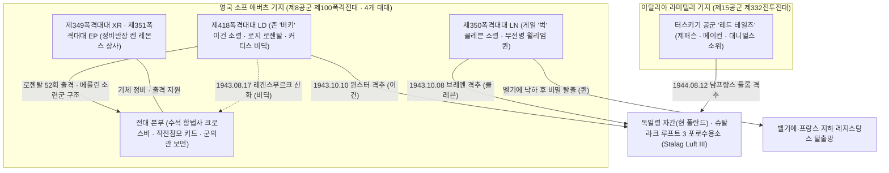

import Alert from '@/components/Alert.astro';
import BookCard from '@/components/BookCard.astro';
import Chart from '@/components/Chart.astro';
import CloudinaryImage from '@/components/CloudinaryImage.astro';
import ImageRow from '@/components/ImageRow.astro';
import MovieCard from '@/components/MovieCard.astro';
import PersonCard from '@/components/PersonCard.astro';
import PersonInline from '@/components/PersonInline.astro';
import YouTubeEmbed from '@/components/YouTubeEmbed.astro';

[《밴드 오브 브라더스》 등장인물 소개](/culture/band-of-brothers-casts)와 [《더 퍼시픽》 등장인물 총정리](/culture/the-pacific-casts)에 이어 14년 만에 도착한 완결편 《**마스터스 오브 디 에어**》(Masters of the Air)를 틀었다가 초반부터 일시정지를 누르는 이유는 아주 현실적입니다. 영하 50도의 조종석에서 전부 똑같은 가죽 비행모와 고글, 산소마스크로 얼굴을 가리고 나오는 데다 주연 두 명의 별명까지 한 명은 '**벅**'(Buck), 다른 한 명은 '**버키**'(Bucky)라서 도통 구분이 안 가기 때문이죠. **마스터스 오브 디 에어 등장인물** 구도는 누가 B-17 폭격기의 어느 자리에 앉고 격추 뒤 어디로 모이는지만 알면 단번에 풀립니다.

<MovieCard title="마스터스 오브 디 에어 (Masters of the Air)" imdbId="tt2640044" />

정주행 중 스마트폰으로 검색해 들어온 분들을 위해 자주 헷갈리는 핵심 인물 8인의 식별 포인트부터 10초 요약표로 정리했습니다.

| 극 중 이름 · 별명 | 소속 · 보직 | 담당 배우 | 한 줄 식별 포인트 & 실화 키워드 |
| :--- | :--- | :--- | :--- |
| **게일 '벅' 클레븐** 소령 | 제350대대(`LN`) 조종사 | 오스틴 버틀러 | 이쑤시개를 문 과묵한 원칙주의자 · 브레멘 격추 후 죽음의 행군 탈출 |
| **존 '버키' 이건** 소령 | 제418대대(`LD`) 조종사 | 칼럼 터너 | 노래를 즐기는 쾌남 · 단짝 클레븐 격추 이틀 뒤 뮌스터 자원 출격·포로 |
| **해리 H. 크로스비** 중령 | 전대 수석 항법사 | 앤서니 보일 | 극 전체 내레이터 · 심한 비행 멀미를 극복하고 D-Day 항로를 짠 두뇌 |
| **로버트 '로지' 로젠탈** 중령 | 제418·350대대 조종사 | 네이트 만 | 유대계 변호사 출신 · 뮌스터 유일 생환 및 **52회 출격** 후 뉘른베르크 검사 |
| **커티스 비딕** 중위 | 제418대대(`LD`) 조종사 | 배리 키오건 | 거친 승부사 기질 · 스코틀랜드 불시착 생존 후 3화 레겐스부르크 산화 |
| **켄 레몬스** 상사 | 제351대대(`EP`) 정비반장 | 래퍼티 로 | 활주로 끝에서 귀환기를 세며 밤새 엔진을 고치는 정비병 (주드 로 친아들) |
| **알렉산더 제퍼슨** 소위 | 제332전투전대(터스키기) | 브랜든 쿡 | 8화 합류 흑인 P-51 조종사 · 수용소에서 클레븐·이건과 연대 |
| **산드라 웨스게이트** | 영국 여군(ATS) 장교 | 벨 파울리 | 크로스비와 교감하는 영국 장교 · 실제 회고록 속 이중 가명 인물 |

---

## 작품 기본 정보 — 영하 50도 상공 25,000피트, 왜 '피의 100전대'인가

당초 HBO가 약 2억 5,000만 달러 규모의 제작비 부담으로 포기한 프로젝트를 Apple Studios가 인수하면서, [애플 TV+ 《사일로》](/culture/silo-apple-tv-plus-guide)와 함께 플랫폼을 대표하는 간판 대작으로 완성됐습니다. <PersonInline name="스티븐 스필버그" role="총괄 프로듀서" imdbId="nm0000229" />·<PersonInline name="톰 행크스" role="총괄 프로듀서" imdbId="nm0000158" />·<PersonInline name="개리 고츠먼" role="총괄 프로듀서" imdbId="nm0324556" /> 사단이 2024년 1월 26일～3월 15일 총 **9부작**으로 선보인 제2차 세계대전 3부작의 최종장이며, 제76회 프라임타임 크리에이티브 아츠 에미상 음향믹싱상을 받았습니다.

《밴드 오브 브라더스》 2·9화를 썼던 <PersonInline name="존 올로프" role="크리에이터 · 각본" imdbId="nm0650275" />가 극본을 총괄했고, 1～4화는 <PersonInline name="캐리 조지 후쿠나가" role="감독" imdbId="nm1560977" />, 5～6화는 안나 보든 & 라이언 플렉, 7～8화는 디 리스, 9화는 <PersonInline name="팀 반 패튼" role="감독" imdbId="nm0887700" />이 연출했으며 음악은 <PersonInline name="블레이크 닐리" role="음악" imdbId="nm0624201" />가 맡았습니다. 도널드 L. 밀러 교수의 동명 논픽션(국내 출판사 '행북' 전 2권 정식 출간)과 해리 크로스비의 회고록 『A Wing and a Prayer』가 원작입니다.

<BookCard
  title="마스터스 오브 디 에어 1"
  isbn13="9791198058737"
  comment="스티븐 스필버그·톰 행크스의 9부작 드라마 원작 논픽션. 미 제8공군 폭격기 승무원들의 고고도 주간 폭격과 포로수용소 실화를 방대한 사료로 복원했다. 국내 번역본은 전 2권으로 분책 출간됐다."
/>

<YouTubeEmbed id="lA-1JCRguZ0" title="마스터스 오브 디 에어(Masters of the Air) 공식 예고편 — Apple TV" />

<Alert type="tip" title="9화 시청 직후 필수 코스: 공식 다큐멘터리 《더 블러디 헌드레드》">
최종화를 본 뒤 Apple TV+에 함께 공개된 62분짜리 공식 다큐멘터리 《**더 블러디 헌드레드**》(The Bloody Hundredth, IMDb `tt31510396`)를 꼭 이어서 보세요. 톰 행크스 내레이션 위로 존 이건·해리 크로스비·로버트 로젠탈·알렉산더 제퍼슨 등 실존 주역들의 육성 인터뷰가 펼쳐집니다.
</Alert>

### 산소마스크 속 인물 구분법 — B-17 플라잉 포트리스 10인 승무원 배치도

미 제8공군의 주력 중폭격기 **B-17 플라잉 포트리스** 한 대에는 **총 10명**(장교 4명 + 부사관·병 사수 6명)이 탑승합니다. 여압 장치가 없는 동체라 고도 25,000피트(약 7.6km)에서는 기온이 **영하 50도**까지 내려갔고, 산소 호스가 얼어붙으면 몇 분 만에 저산소증으로 의식을 잃는 환경이었습니다.

<figure class="not-prose my-6">
  <svg viewBox="0 0 760 300" class="w-full h-auto rounded-lg border border-border bg-card p-4 text-card-foreground" role="img" aria-label="B-17 플라잉 포트리스 폭격기 10인 승무원 탑승 위치 및 보직 도식">
    <defs>
      <marker id="arrow" viewBox="0 0 10 10" refX="6" refY="5" markerWidth="6" markerHeight="6" orient="auto-start-reverse">
        <path d="M 0 1 L 10 5 L 0 9 z" fill="currentColor" opacity="0.6" />
      </marker>
    </defs>
    <text x="20" y="26" font-size="14" font-weight="700" fill="currentColor">B-17 Flying Fortress 10인 승무원 포지션 (기수 좌측 진행 방향)</text>
    <text x="20" y="44" font-size="11" fill="currentColor" opacity="0.65">장교 4명(조종·부조종·항법·폭격) + 부사관 사수 6명 | 고도 25,000ft · 기온 영하 50°C 비여압 동체</text>
    <path d="M 595 142 L 665 68 L 692 68 L 680 145 Z" fill="#3b82f6" fill-opacity="0.18" stroke="#3b82f6" stroke-width="2" />
    <text x="652" y="108" font-size="12" font-weight="700" fill="#3b82f6" text-anchor="middle">LN / LD</text>
    <path d="M 82 162 C 82 142, 128 134, 175 134 L 220 116 L 280 116 L 305 130 L 675 142 C 698 143, 706 152, 706 160 C 706 169, 695 175, 670 176 L 360 184 L 145 184 C 102 184, 82 175, 82 162 Z" fill="currentColor" fill-opacity="0.08" stroke="currentColor" stroke-opacity="0.55" stroke-width="2" />
    <path d="M 82 162 C 82 145, 112 137, 145 136 L 145 183 C 108 183, 82 174, 82 162 Z" fill="#38bdf8" fill-opacity="0.28" stroke="#0284c7" stroke-width="1.8" />
    <path d="M 205 133 L 224 118 L 274 118 L 285 133 Z" fill="#38bdf8" fill-opacity="0.28" stroke="#0284c7" stroke-width="1.6" />
    <path d="M 292 128 C 294 113, 318 113, 320 128 Z" fill="#f59e0b" fill-opacity="0.3" stroke="#d97706" stroke-width="1.8" />
    <line x1="292" y1="118" x2="270" y2="112" stroke="#d97706" stroke-width="2" />
    <rect x="330" y="140" width="68" height="42" rx="3" fill="none" stroke="currentColor" stroke-opacity="0.35" stroke-dasharray="4 3" />
    <text x="364" y="153" font-size="10" fill="currentColor" opacity="0.55" text-anchor="middle">폭탄창</text>
    <ellipse cx="355" cy="170" rx="44" ry="9" fill="currentColor" fill-opacity="0.14" stroke="currentColor" stroke-opacity="0.45" stroke-width="1.5" />
    <circle cx="445" cy="190" r="14" fill="#ef4444" fill-opacity="0.25" stroke="#dc2626" stroke-width="1.8" />
    <line x1="433" y1="197" x2="414" y2="205" stroke="#dc2626" stroke-width="2" />
    <rect x="515" y="149" width="34" height="18" rx="2" fill="#f59e0b" fill-opacity="0.25" stroke="#d97706" stroke-width="1.6" />
    <circle cx="696" cy="160" r="9" fill="#f59e0b" fill-opacity="0.3" stroke="#d97706" stroke-width="1.6" />
    <line x1="705" y1="160" x2="726" y2="158" stroke="#d97706" stroke-width="2" />
    <line x1="112" y1="182" x2="95" y2="232" stroke="currentColor" stroke-opacity="0.5" stroke-width="1.2" marker-end="url(#arrow)" />
    <rect x="16" y="236" width="176" height="50" rx="6" fill="currentColor" fill-opacity="0.06" stroke="#0284c7" stroke-opacity="0.6" />
    <text x="24" y="254" font-size="11.5" font-weight="700" fill="currentColor">① 기수 (2명): 폭격수·항법사</text>
    <text x="24" y="270" font-size="10.5" fill="currentColor" opacity="0.8">노든 조준기 · 해리 크로스비</text>
    <line x1="242" y1="116" x2="215" y2="92" stroke="currentColor" stroke-opacity="0.5" stroke-width="1.2" marker-end="url(#arrow)" />
    <rect x="115" y="54" width="185" height="36" rx="6" fill="currentColor" fill-opacity="0.06" stroke="#0284c7" stroke-opacity="0.6" />
    <text x="123" y="70" font-size="11.5" font-weight="700" fill="currentColor">② 조종석 (2명): 조종사·부조종사</text>
    <text x="123" y="84" font-size="10.5" fill="currentColor" opacity="0.8">클레븐 · 이건 · 로젠탈 · 비딕</text>
    <line x1="312" y1="114" x2="365" y2="92" stroke="currentColor" stroke-opacity="0.5" stroke-width="1.2" marker-end="url(#arrow)" />
    <rect x="312" y="54" width="166" height="36" rx="6" fill="currentColor" fill-opacity="0.06" stroke="#d97706" stroke-opacity="0.6" />
    <text x="320" y="70" font-size="11.5" font-weight="700" fill="currentColor">③ 상부 포탑 (1명)</text>
    <text x="320" y="84" font-size="10.5" fill="currentColor" opacity="0.8">비행기관사 겸 상부 기관총 사수</text>
    <line x1="415" y1="142" x2="520" y2="92" stroke="currentColor" stroke-opacity="0.5" stroke-width="1.2" marker-end="url(#arrow)" />
    <rect x="488" y="54" width="150" height="36" rx="6" fill="currentColor" fill-opacity="0.06" stroke="currentColor" stroke-opacity="0.35" />
    <text x="496" y="70" font-size="11.5" font-weight="700" fill="currentColor">④ 무전실 (1명): 무전병</text>
    <text x="496" y="84" font-size="10.5" fill="currentColor" opacity="0.8">폭탄창 뒤 · 윌리엄 퀸 기술하사</text>
    <line x1="445" y1="205" x2="335" y2="235" stroke="currentColor" stroke-opacity="0.5" stroke-width="1.2" marker-end="url(#arrow)" />
    <rect x="204" y="236" width="186" height="50" rx="6" fill="currentColor" fill-opacity="0.06" stroke="#dc2626" stroke-opacity="0.6" />
    <text x="212" y="254" font-size="11.5" font-weight="700" fill="currentColor">⑤ 하부 구형 포탑 (1명)</text>
    <text x="212" y="270" font-size="10.5" fill="currentColor" opacity="0.8">몸을 웅크려 타는 동체 배면 사수</text>
    <line x1="532" y1="168" x2="500" y2="235" stroke="currentColor" stroke-opacity="0.5" stroke-width="1.2" marker-end="url(#arrow)" />
    <rect x="402" y="236" width="176" height="50" rx="6" fill="currentColor" fill-opacity="0.06" stroke="#d97706" stroke-opacity="0.6" />
    <text x="410" y="254" font-size="11.5" font-weight="700" fill="currentColor">⑥ 좌·우 측면 사수 (2명)</text>
    <text x="410" y="270" font-size="10.5" fill="currentColor" opacity="0.8">개방형 창문 영하 50도 직격</text>
    <line x1="696" y1="172" x2="672" y2="235" stroke="currentColor" stroke-opacity="0.5" stroke-width="1.2" marker-end="url(#arrow)" />
    <rect x="590" y="236" width="154" height="50" rx="6" fill="currentColor" fill-opacity="0.06" stroke="#d97706" stroke-opacity="0.6" />
    <text x="598" y="254" font-size="11.5" font-weight="700" fill="currentColor">⑦ 후미 포탑 사수 (1명)</text>
    <text x="598" y="270" font-size="10.5" fill="currentColor" opacity="0.8">꼬리 끝 후방 추격기 방어</text>
  </svg>
  <figcaption class="mt-2 text-center text-sm text-muted-foreground">
    기수 투명창(①)에 폭격수와 항법사가, 상단 조종석(②)에 조종사·부조종사가 앉고, 폭탄창 뒤로 무전실(④)·하부 구형 포탑(⑤)·개방형 측면 창문(⑥)·후미 포탑(⑦) 사수가 배치된다.
  </figcaption>
</figure>

4개 폭격대대(제349·350·351·418대대)로 편성된 **제100폭격전대**(100th Bomb Group)가 평균 손실률이 엇비슷했음에도 "**피의 100전대**"(The Bloody Hundredth)라 불린 건 단일 출격에서 전대가 전멸할 만큼 참혹한 집중 손실을 입었기 때문입니다. 공식 기록(`100thbg.com`)상 총 306회 임무에서 **B-17 177대 손실, 757명 전사·실종, 923명 포로**를 냈고, 1943년 기준 25회 투어 완수율은 **약 25% 수준**에 그쳤습니다. 3화 레겐스부르크 셔틀 임무에서는 **21대 출격 중 9대**, 5화 뮌스터 참사 때는 목표 진입 **13대 중 12대가 격추**되고 로젠탈의 단 1대만 생환했죠.

<Chart
  type="bar"
  height={280}
  caption="제100폭격전대 주요 지옥 출격별 B-17 폭격기 손실 대수 (출처: 100th Bomb Group Foundation 공식 통계)"
  data={{
    labels: [
      '브레멘 첫 출격 (6/25 · 1화)',
      '레겐스부르크 (8/17 · 3화)',
      '브레멘 2차 (10/8 · 4화)',
      '뮌스터 참사 (10/10 · 5화)',
      '베를린 블랙 먼데이 (3/6 · 7화)',
    ],
    datasets: [
      {
        label: '단일 출격 격추·손실 B-17 수 (대)',
        data: [3, 9, 7, 12, 15],
      },
    ],
  }}
/>

### 소프 애버츠 기지에서 슈탈라크 루프트 3 수용소까지 — 인물 소속 & 합류 동선도

영국 노퍽주 **소프 애버츠** 기지의 제100폭격전대 대원들과 이탈리아 **라미텔리** 기지에서 출격한 **터스키기 공군**(제15공군 제332전투전대) 조종사들은 격추된 뒤 독일령 자간(현 폴란드 자간)의 장교 포로수용소 **슈탈라크 루프트 3**(Stalag Luft III)에서 한자리로 합류합니다.

---

## 에피소드 1～9화 전장 & 중심 인물 가이드

공식 에피소드 제목은 **Part One**부터 **Part Nine**까지 번호로만 표기됩니다. **1～3화**(1막)는 초기 출격과 레겐스부르크 공습, **4～6화**(2막)는 '블랙 위크' 뮌스터 참사와 로젠탈의 부상 및 수용소 재회, **7～9화**(3막)는 베를린 공습·P-51 머스탱과 터스키기 공군 합류·죽음의 행군과 네덜란드 식량 투하 작전으로 이어집니다.

| 화수 | 시간 배경 | 주요 전장 · 배경지 | 중심 인물 | 핵심 사건 및 관전 포인트 |
| :---: | :--- | :--- | :--- | :--- |
| **1화** (`Part One`) | 1943.05～06 | 소프 애버츠 · 브레멘 | 클레븐, 이건, 크로스비 | 영국 기지 전개, 비행 멀미와 싸우는 크로스비, 브레멘 첫 주간 폭격 |
| **2화** (`Part Two`) | 1943.06～07 | 노르웨이 · 스코틀랜드 | 클레븐, 이건, 비딕 | 유보트 기지 출격, 피격된 비딕의 스코틀랜드 채소밭 비상착륙 |
| **3화** (`Part Three`) | 1943.08.17 | 레겐스부르크 · 북아프리카 | 클레븐, 비딕, 퀸 | 대규모 왕복 폭격, 비딕의 전사와 클레븐의 북아프리카 착륙 강행 |
| **4화** (`Part Four`) | 1943.10 초 | 런던 · 브레멘 · 벨기에 | 클레븐, 이건, 로젠탈 | 신입 로젠탈 전입, 클레븐의 브레멘 격추 소식과 무전병 퀸의 탈출 |
| **5화** (`Part Five`) | 1943.10.10 | 독일 뮌스터 | 이건, 로젠탈, 크로스비 | 단짝을 따라 출격한 이건의 격추, 13대 중 홀로 생환한 로젠탈 |
| **6화** (`Part Six`) | 1943.10 | 옥스퍼드 · 뤼셀스하임 · 자간 | 이건, 로젠탈, 크로스비 | 독일 민간인 린치 위기를 넘긴 이건과 클레븐의 슈탈라크 루프트 3 재회 |
| **7화** (`Part Seven`) | 1944.03 | 베를린 · 슈탈라크 루프트 3 | 로젠탈, 클레븐, 크로스비 | 베를린 '블랙 먼데이' 15대 손실, P-51 호위 등장과 로젠탈의 재복무 |
| **8화** (`Part Eight`) | 1944.06～08 | 노르망디 · 남프랑스 · 자간 | 크로스비, 제퍼슨, 메이컨 | D-Day 72시간 불침번 작전, 남프랑스 격추 후 수용소에 합류한 터스키기 공군 |
| **9화** (`Part Nine`) | 1945.01～05 | 베를린 · 폴란드 · 네덜란드 | 클레븐, 이건, 로젠탈, 크로스비 | 로젠탈의 소련군 구조, 혹한의 강제 행군 탈출, 네덜란드 '초우하운드' 식량 투하 |

---

## 하늘과 수용소를 이끈 4대 주역 — 실존 인물과 전후의 삶

  <PersonCard name="오스틴 버틀러" role="게일 '벅' 클레븐 소령 역" imdbId="nm2581521" />
  <PersonCard name="칼럼 터너" role="존 '버키' 이건 소령 역" imdbId="nm4360085" />
  <PersonCard name="앤서니 보일" role="해리 크로스비 중령 역" imdbId="nm4996269" />
  <PersonCard name="네이트 만" role="로버트 '로지' 로젠탈 중령 역" imdbId="nm11216373" />

극을 지탱하는 4인방은 모두 극적인 궤적을 남긴 실존 장교들입니다. 드라마 배우들과 비교해 볼 수 있도록 제2차 세계대전 당시 미 육군 항공대(USAAF)가 남긴 실제 군복 초상 사진 세 장을 나란히 모았습니다.

<ImageRow cols={3} caption="좌로부터 실제 제100폭격전대의 주역 게일 '벅' 클레븐 소령, 존 '버키' 이건 소령, 로버트 '로지' 로젠탈 중령의 제2차 세계대전 복무 당시 군복 사진">
  <CloudinaryImage
    publicId="posts/culture/2026/masters-of-the-air-casts/fig-02-real-gale-cleven"
    width={500}
    height={635}
    alt="제2차 세계대전 당시 미 육군 항공대 제100폭격전대 게일 벅 클레븐 소령의 실제 군복 초상 사진"
    credit="USAAF / Wikimedia Commons (Public Domain)"
    creditUrl="https://commons.wikimedia.org/wiki/File:Major_Gale_Cleven_(studio_portrait).jpg"
  />
  <CloudinaryImage
    publicId="posts/culture/2026/masters-of-the-air-casts/fig-03-real-john-egan"
    width={500}
    height={689}
    alt="제2차 세계대전 당시 미 육군 항공대 제100폭격전대 존 버키 이건 소령의 실제 군복 초상 사진"
    credit="USAAF / Wikimedia Commons (Public Domain)"
    creditUrl="https://commons.wikimedia.org/wiki/File:John_Egan.jpg"
  />
  <CloudinaryImage
    publicId="posts/culture/2026/masters-of-the-air-casts/fig-04-real-robert-rosenthal"
    width={640}
    height={820}
    alt="제2차 세계대전 당시 미 육군 항공대 제100폭격전대 로버트 로지 로젠탈 중령의 실제 군복 초상 사진"
    credit="USAAF / Wikimedia Commons (Public Domain)"
    creditUrl="https://commons.wikimedia.org/wiki/File:Lt_Col._Robert_Rosenthal.jpg"
  />
</ImageRow>

### 1. 게일 '벅' 클레븐 소령 — 흔들리지 않던 금빛 날개 (오스틴 버틀러)

와이오밍주 출신 클레븐(1918～2006)은 술·담배를 멀리하는 금욕적인 원칙주의자입니다. 별명 '**벅**'(Buck)은 단짝 이건이 고향 친구 '벅'과 닮았다며 붙여준 호칭이에요. 3화 레겐스부르크에서 반파된 기체로 북아프리카까지 강행 돌파해 수훈십자장(DSC)을 받았으나, **1943년 10월 8일 브레멘 임무**에서 격추되어 슈탈라크 루프트 3에 수감됩니다. 이후 1945년 1월 혹한의 강제 행군 도중 탈출해 생환했죠. 《엘비스》·《듄: 파트 2》의 오스틴 버틀러가 묵직한 존재감을 살렸습니다. 귀국 직후인 1945년 7월 단짝 이건의 들러리 축복 속에 연인 마지 스펜서(<PersonInline name="이소벨 메이" imdbId="nm8908475" />)와 결혼했으나 1953년 갑작스러운 병환으로 사별했고, 이후 재혼해 하버드 MBA와 조지타운대 천체물리학 박사 학위를 따고(펜타곤 초기 전산화 사업에도 참여) 공군 대령으로 예편한 뒤 2006년 87세로 별세했습니다.

### 2. 존 '버키' 이건 소령 — 단짝을 따라 불길 속으로 날아간 쾌남 (칼럼 터너)

호쾌한 분위기 메이커 이건(1915～1961)은 클레븐과 묶여 기지에서 "**투 버키스**"(Two Buckys)로 불렸습니다. 런던 휴가 중 단짝 클레븐의 격추 소식에 즉시 복귀해 이틀 뒤 **1943년 10월 10일 뮌스터 지옥 출격**을 자원했다가 똑같이 격추됩니다. 독일 민간인들의 집단 린치 위기를 가까스로 넘기고 수용소에서 클레븐과 재회하는 대목은 시리즈 최고의 명장면이죠. 1945년 4월 모스부르크 수용소에서 해방된 뒤 한국전쟁까지 복무했으나, 1961년 45세에 심장마비로 타계했습니다.

### 3. 해리 H. 크로스비 중령 — 멀미를 이겨내고 항로를 설계한 이야기꾼 (앤서니 보일)

극 전체 내레이터인 크로스비(1919～2010)는 심한 비행 멀미를 극복하고 전대·사단 수석 항법사로 성장해 **32회 출격**을 완수하며, D-Day 직전 72시간 불침번으로 대규모 편대 작전을 입안했습니다. 단짝 항법사 **조셉 '버블스' 페인 대위**(<PersonInline name="루이스 그레이토렉스" imdbId="nm3899575" />)와 영국 여군 장교 **산드라 웨스게이트**(<PersonInline name="벨 파울리" imdbId="nm2525790" />)에는 눈여겨볼 고증 차이가 있습니다. 드라마 5화에선 버블스 페인이 뮌스터에서 전사하지만 실제로는 6개월 뒤인 **1944년 4월 28일 프랑스 소트바스트 임무**에서 산화했고, 산드라 웨스게이트는 회고록 속 가명('Landra Wingate')을 한 번 더 바꾼 **이중 가명**입니다. 전후 보스턴대 영문학 교수로 26년간 재직하며 회고록 『A Wing and a Prayer』를 집필했고 2010년 91세로 별세했습니다.

### 4. 로버트 '로지' 로젠탈 중령 — 52회 출격 후 뉘른베르크 법정에 선 변호사 (네이트 만)

브루클린 유대계 변호사 출신 로젠탈(1917～2007)은 세 번째 출격인 뮌스터 참사에서 13대 중 홀로 '로열 플러시' 기체로 생환하며 후반부 공중전의 주역이 됩니다. 의무 25회를 채우고도 재복무해 **총 52회 출격**을 달성했고, 1945년 2월 베를린 격추 뒤 소련군에 구조되어 폴란드 내 나치 수용소를 목격하죠. 종전 후에는 **뉘른베르크 국제군사재판 미국 측 검사단**에 합류해 헤르만 괴링 등을 직접 신문했으며, 재판장으로 향하던 대서양 선상에서 동료 여검사 필리스 헬러를 만나 결혼하는 영화 같은 삶을 살았습니다.

---

## 잊을 수 없는 핵심 조연 · 지상 정비병 · 터스키기 공군(레드 테일즈)

  <PersonCard name="배리 키오건" role="커티스 비딕 중위 역" imdbId="nm4422686" />
  <PersonCard name="래퍼티 로" role="켄 레몬스 상사 역" imdbId="nm3834174" />
  <PersonCard name="브랜든 쿡" role="알렉산더 제퍼슨 소위 역" imdbId="nm10363234" />
  <PersonCard name="조사이아 크로스" role="리처드 메이컨 소위 역" imdbId="nm8582283" />
  <PersonCard name="슈티 개트와" role="로버트 대니얼스 소위 역" imdbId="nm6967441" />

### 1. 커티스 비딕 중위 & 소프 애버츠의 하늘과 땅을 지킨 사람들

- **커티스 비딕 중위** (배리 키오건): 《이니셰린의 밴시》·《솔트번》의 배리 키오건이 2화 스코틀랜드 채소밭 불시착 실화를 생생히 살렸습니다. 3화 레겐스부르크 최후는 부조종사를 살리려 숲에 비상착륙하다 산화하는 것으로 각색됐으나, 실제로는 **20mm 기관포탄이 산소 배관을 관통해 일어난 조종석 고열 산소 화재**로 탈출하지 못하고 전사했습니다.
- **켄 레몬스 상사** (래퍼티 로): 활주로 끝에서 돌아오지 않는 폭격기 숫자를 세며 밤새 엔진을 고치는 지상 정비반을 대변합니다. 담당 배우 래퍼티 로는 영국 명배우 **주드 로의 친아들**입니다.
- **키드 소령 · 보먼 군의관 · 퀸 기술하사**: 전후 공군 소장까지 진급한 작전참모 **존 '잭' 키드 소령**(<PersonInline name="에드워드 애슐리" imdbId="nm5361352" />), 대원들의 전투 피로증('Flak Happy')을 돌본 군의관 **마빈 '레드' 보먼 소령**(<PersonInline name="스티븐 캠벨 무어" imdbId="nm1304386" />), 벨기에 상공 낙하산 탈출 뒤 프랑스·스페인 지하 레지스탕스 탈출망으로 생환한 무전병 **윌리엄 퀸 기술하사**(<PersonInline name="카이 알렉산더" imdbId="nm5701094" />)도 빛나는 실존 조연입니다.
- **아는 척하기 딱 좋은 혈연 카메오**: 조종사 로이 클레이터 중위 역의 <PersonInline name="소여 스필버그" imdbId="nm3245539" />는 **스티븐 스필버그 감독의 친아들**입니다. 23년 전 [《밴드 오브 브라더스》](/culture/band-of-brothers-casts) 8화에서 톰 행크스의 아들 콜린 행크스가 신임 장교(헨리 존스 소위)로 깜짝 출연했던 전통이 스필버그 부자에게로 이어졌습니다.

### 2. 터스키기 공군(Tuskegee Airmen · 레드 테일즈) — 차별을 뚫고 날아올라 수용소에서 만난 전우들

제15공군 제332전투전대 최초의 흑인 전투기 조종사들인 '**터스키기 공군**'(일명 '**레드 테일즈**')은 8화 **1944년 8월 12일** 남프랑스 툴롱 해안 레이더 기지 기총소사 임무 중 피격되어 슈탈라크 루프트 3에서 클레븐·이건과 합류합니다. 귀국 후 초등학교 과학교사·교감으로 헌신하고 회고록을 남긴 **알렉산더 제퍼슨 소위**(브랜든 쿡, 2022년 100세 별세), 목뼈 골절 중상을 버텨낸 수학 천재 **리처드 메이컨 소위**(조사이아 크로스), 그리고 《오티스의 비밀 상담소》와 영드 《닥터 후》 **제15대 닥터**로 친숙한 슈티 개트와가 연기한 **로버트 대니얼스 소위** 모두 실존 영웅들입니다.

---

## 땅의 형제애, 섬의 생존, 그리고 하늘의 무력감과 인도주의

《밴드 오브 브라더스》(땅)는 참호 옆 전우와 엄폐물 뒤에 몸을 숨기며 전진할 수 있었고, 《더 퍼시픽》(섬)은 진흙탕에서 방아쇠를 당기며 살아남을 수 있었습니다. 반면 **25,000피트 상공의 폭격기 승무원들은 폭격 코스에 들어서는 순간 회피 기동조차 금지된 채 영하 50도의 얇은 알루미늄 통 안에서 운명처럼 날아오는 대공포 파편을 견뎌야 했던 극한의 무력감**과 싸워야 했습니다.

그렇기에 파괴만 일삼던 폭탄창에 폭탄 대신 식량을 가득 싣고 굶주린 네덜란드 시민들 머리 위로 날아가 지붕 위 튤립 글자 "**MANY THANKS**"를 내려다보는 9화 **초우하운드 작전**(Operation Chowhound)은 전쟁 3부작 전체를 닫는 가장 숭고한 마침표가 됩니다. 산소마스크 뒤에 가려져 있던 이들의 이름과 계보를 떠올리며 다시 1화의 출격 장면을 틀어보신다면, 차가운 창공을 가르던 프로펠러 소리가 한층 묵직한 여운으로 다가올 것입니다.
