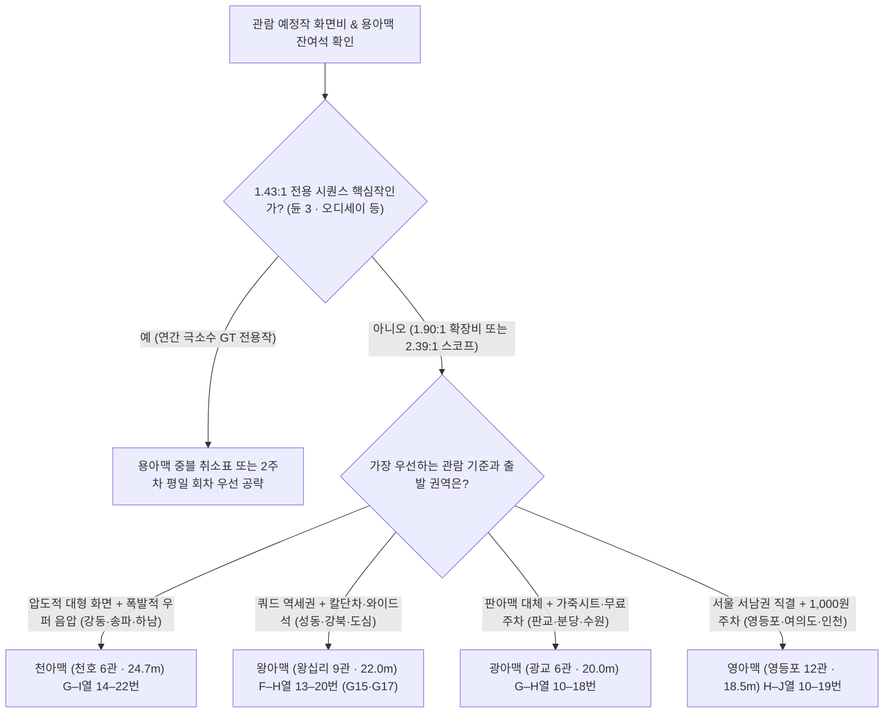

import Alert from '@/components/Alert.astro';
import Chart from '@/components/Chart.astro';
import MetroLaserImaxSeatMap from '@/components/MetroLaserImaxSeatMap.astro';
import MovieCard from '@/components/MovieCard.astro';
import PersonInline from '@/components/PersonInline.astro';
import PlaceCard from '@/components/PlaceCard.astro';

예매 오픈 알림을 맞춰놓고 들어갔는데도 용산 IMAX 중앙 블록이 1분 만에 회색으로 뒤덮였을 때, 억지로 앞줄 사이드를 결제할지 다른 지점으로 돌릴지 망설여지곤 합니다. 다행히 최근 2년 사이 수도권 주요 거점들이 대대적인 리뉴얼을 거치면서 **왕아맥**(왕십리)·**천아맥**(천호)·**광아맥**(광교)·**영아맥**(영등포) 4곳 모두 **4K 레이저 영사기와 12채널 사운드**를 완비한 현역 성지로 올라섰습니다.

내가 보려는 영화의 화면비와 출발 동선만 맞추면 용산 앞줄에서 목을 꺾는 것보다 훨씬 쾌적한 관람이 가능해요. 지금 예매창에 남은 좌석 한 칸이 돈값을 하는 자리인지 즉시 판독할 수 있도록, 수도권 4대 레이저 IMAX의 하드웨어 격차와 열·번호별 명당 좌표를 인터랙티브 배치도로 정리했습니다.

<Alert type="warning" title="잠깐, 판아맥(CGV 판교 IMAX)을 찾고 계셨나요? (2026.08.19 영업 종료)">

경기 남부 대표 IMAX였던 **CGV 판교**(판아맥)는 현대백화점 판교점과의 임대차 계약 만료로 **2026년 8월 19일 완전 폐점**되었습니다. 해당 공간에는 후속 영화관 입점 계획이 없으며, 판아맥은 영업 종료 시점까지도 구형 **2K 디지털 제논** 영사기 체제에 머물러 있었습니다. 판교역에서 신분당선을 타면 **딱 18분** 만에 닿는 **광아맥**(CGV 광교 6관)이 빌트인 **4K 레이저 + 12채널 사운드 + 티켓 인증 주차 3시간 무료**를 모두 갖춘 완벽한 상위호환 직계 대체 성지이니 고민 없이 광교로 향하시면 됩니다.

</Alert>

---

## ⚡ 10초 판별표: 수도권 4대 레이저 IMAX 티어별 좌석 좌표 한눈에 보기

피케팅 중이라면 아래 요약표에서 목표 지점의 S·A등급 열과 번호부터 확인하고, 곧바로 이어지는 인터랙티브 배치도에서 상단 4개 지점 탭(`왕아맥` · `천아맥` · `광아맥` · `영아맥`)을 눌러 내 좌석을 직접 찍어보세요.

| 구분 | 왕아맥 (왕십리 9관 · 268석) | 천아맥 (천호 6관 · 323석) | 광아맥 (광교 6관 · 282석) | 영아맥 (영등포 12관 · 387석) |
| :--- | :--- | :--- | :--- | :--- |
| **물리 스크린** | **22.0m × 13.3m** (`A–J열`) | **24.7m × 18.7m** (`B–P열` 중심) | **20.0m × 12.0m** (`A–L열`) | **18.5m × 10.6m** (`A–N열`) |
| **S등급** (초명당) | **F–H열 13–20번** (`G15·G17` 와이드 황금석) | **G–I열 14–22번** (`17·18번` 정중앙 코어) | **G–H열 10–18번** (`13·14번` 정중앙 코어) | **H–I열 11–18번** (`14·15번` 정중앙 코어) |
| **A등급** (강력 추천) | **E·I열 12–21번** / **F–H열 11–12·21–22번** | **F·J열 13–23번** / **G–I열 11–13·23–25번** | **F·I열 9–19번** / **G–H열 9·19번** | **G·J열 10–19번** / **H–I열 10·19번** (`J열` 수평 자막 명당) |
| **B등급** (차선·실속) | **J열 11–22번** / **F–I열 8–10·23–25번** | **E·K·L열 중블**(`11–25번`) / **F·J열 11–12·24–25번** | **E·J·K열 중블**(`7–21번`) / **F–I열 7–8·20–21번** | **F·K열 10–19번** / **G–J열 8–9·20–21번** |
| **C등급** (타협선) | **D열 중블** / **E–J열 외곽 중블**(`5–7·26–28번`) | **M–P열 중블** / **중후열 사블 안쪽**(`7–10·26–29번`) | **D·L열 중블** / **중열 사블 안쪽**(`4–6·22–24번`) | **L–N열 중블** / **중열 사블 안쪽**(`4–6·23–25번`) |
| **기피 권장** | **A–C열 전체** / **양끝 사블**(`1–4·29–32번`) | **B–D열 앞줄** / **극사이드**(`1–6·30–34번`) | **A–C열 전체** / **극사이드**(`1–3·25–27번`) | **A–E열 앞줄**(목 꺾임) / **극사이드**(`1–3·26–28번`) |

<MetroLaserImaxSeatMap />

---

## 용아맥(1.43:1 GT) vs 수도권 4대 레이저 IMAX(1.90:1 CoLa): 언제 타협해도 손해가 0%일까?

"그래도 무조건 용아맥에 가야 원본을 다 보는 것 아닐까?"라는 의문부터 명쾌하게 짚고 넘어가야 합니다. 정답은 **상영작의 최대 확장 화면비가 `1.43:1`인지, `1.90:1`·`2.39:1`인지**에 따라 정반대로 갈립니다.

| 상영관 | 물리 스크린 규격 | 영사기 · 사운드 | 최대 투사 비율 | 1.90:1 실투사 면적 | 2.39:1 실투사 면적 |
| :--- | :--- | :--- | :---: | :---: | :---: |
| **용아맥** (용산 20관) | **31.0m × 22.4m** | 듀얼 4K 레이저 (`GT`) · 12ch | **1.43:1** | **505.8㎡** | **402.1㎡** |
| **천아맥** (천호 6관) | **24.7m × 18.7m** | 싱글 4K 레이저 (`CoLa`) · 12ch | **1.90:1** | **321.1㎡** | **255.3㎡** |
| **왕아맥** (왕십리 9관) | **22.0m × 13.3m** | 싱글 4K 레이저 (`CoLa`) · 12ch | **1.90:1** | **254.7㎡** | **202.5㎡** |
| **광아맥** (광교 6관) | **20.0m × 12.0m** | 싱글 4K 레이저 (`CoLa`) · 12ch | **1.90:1** | **210.5㎡** | **167.4㎡** |
| **영아맥** (영등포 12관) | **18.5m × 10.6m** | 싱글 4K 레이저 (`CoLa`) · 12ch | **1.90:1** | **180.1㎡** | **143.2㎡** |

여기서 가장 많이 오해하는 광학 포인트가 천아맥과 왕아맥의 스크린 세로 길이입니다. 천아맥(`24.7m × 18.7m`, 물리 비율 약 `1.32:1`)이나 왕아맥(`22.0m × 13.3m`, 약 `1.65:1`)은 과거 대형 규격 시절 지어진 상영관이라 스크린 천 자체가 위아래로 아주 깁니다. 하지만 리뉴얼 시 투입된 **싱글 4K 레이저**(`CoLa`, Commercial Laser) 영사기는 광학 설계상 **최대 `1.90:1` 비율까지만 영상을 투사**할 수 있어요. 즉, 물리 스크린 높이가 아무리 높아도 실제 불이 들어오는 영상 높이는 가로 폭 기준 `1.90:1`에 맞춰 위아래 여백을 남긴 채 맺힙니다.

<Chart
  type="bar"
  height={320}
  caption="용아맥(GT) vs 수도권 4대 레이저 IMAX(CoLa)의 영화 화면비별 실제 영상 투사 면적 비교 (단위: ㎡)"
  data={{
    labels: [
      '용아맥 (31.0m)',
      '천아맥 (24.7m)',
      '왕아맥 (22.0m)',
      '광아맥 (20.0m)',
      '영아맥 (18.5m)',
    ],
    datasets: [
      {
        label: '1.90:1 IMAX 확장 영화 실투사 면적 (㎡)',
        data: [505.8, 321.1, 254.7, 210.5, 180.1],
        backgroundColor: 'rgba(37, 99, 235, 0.86)',
      },
      {
        label: '2.39:1 스코프 영화 실투사 면적 (㎡)',
        data: [402.1, 255.3, 202.5, 167.4, 143.2],
        backgroundColor: 'rgba(6, 182, 212, 0.82)',
      },
    ],
  }}
/>

이 원리를 알면 어떤 영화에서 용아맥 고집을 내려놓아도 되는지 계산이 아주 쉬워집니다.

*]:my-0">
  <MovieCard title="Dune: Part Three" imdbId="tt31378509" />
  <MovieCard title="Avengers: Doomsday" imdbId="tt21357150" />

- **`1.43:1` 전용 촬영 시퀀스가 담긴 영화** (`용아맥` 대체 불가): <PersonInline name="드니 빌뇌브" role="감독" imdbId="nm0898288" />의 [《듄: 파트 3》](/culture/dune-part-3-theater-format-guide)나 <PersonInline name="크리스토퍼 놀란" role="감독" imdbId="nm0634240" />의 《오디세이》처럼 65mm IMAX 필름 카메라와 `1.43:1` 풀프레임 확장이 핵심인 작품은 연간 손에 꼽을 정도로 드뭅니다. 이런 영화를 `CoLa` 상영관에서 보면 위아래 화면 약 25%가 `1.90:1`로 크롭되므로, 2주차 평일 심야 표를 기다려서라도 국내 유일의 GT 레이저 관인 [용아맥](/culture/yongamac-seat-map)을 사수할 가치가 충분합니다.
- **`1.90:1` 확장비 및 `2.39:1` 스코프 블록버스터** (수도권 4대 레이저 관 **손실 0%**): 반대로 연간 개봉하는 IMAX 영화의 90% 이상을 차지하는 `1.90:1` 배급작([《스파이더맨: 브랜드 뉴 데이》](/culture/spider-man-brand-new-day-theater-format-guide) 등)이나 `2.39:1` 시네마스코프 대작([《어벤져스: 둠스데이》](/culture/avengers-doomsday-theater-format-guide) 등)은 이야기가 완전히 다릅니다. 용아맥에 가도 어차피 `1.90:1`이나 `2.39:1`로만 영사되기 때문에, 천아맥·왕아맥·광아맥·영아맥에 가도 **잘려 나가는 화각이 단 1픽셀도 없습니다**. 용아맥 `B–D열` 구석에서 사다리꼴로 찌그러진 화면을 올려다보느니, 천아맥이나 왕아맥·광아맥의 S등급 정중앙에 앉아 4K 레이저 칼핀 화질과 12채널 사운드 초점을 정면으로 받는 편이 만족도가 압도적으로 높아요.

만약 관람하려는 영화가 위아래 확장 분량이 전혀 없는 고정 `2.39:1` 스코프 작품이고 암부 표현력과 트루 블랙 명암비가 더 중요하다면 [코돌비·남돌비 좌석 명당 총정리](/culture/coex-namyangju-dolby-seat-guide)를, 좌우 벽면까지 감싸는 파노라마나 모션 체어 타격감이 끌린다면 [용산CGV SCREENX(4관) 좌석 총정리](/culture/cgv-yongsan-screenx-seat-guide)와 [용포디 좌석 명당 총정리](/culture/cgv-yongsan-4dx-seat-guide)를 대안으로 비교해 보셔도 좋습니다.

---

## 수도권 4대 레이저 IMAX 지점별 하드웨어 특징 & 좌석 공략 디테일

네 지점 모두 동일한 `CoLa` 4K 레이저와 12채널 사운드 엔진을 쓰지만, 상영관의 건축 태생과 객석 구조가 완전히 달라 명당을 찍는 공식도 지점마다 다릅니다.

### 1. 왕아맥 (CGV 왕십리 9관 · 268석): 홀수열 와이드석과 정중앙 통로의 마법

2008년 오픈 당시부터 일반관 개조가 아닌 **IMAX 전용 설계**(Built-in)로 지어진 전통의 강호입니다. 용아맥이 문을 열기 전까지 수년간 수도권 부동의 1위 성지로 군림했던 곳답게 객석 경사각이 가파르고 스크린과의 일체감이 발군이에요. **2024년 9월 11일** CGV의 'IMAX 리본(Re-Born) 프로젝트 1호점'으로 선정되면서 숙원이던 **4K 레이저 + 12채널 사운드** 업그레이드를 마쳤고, 동시에 영사기실 아래 후방 `K·L열`을 과감하게 들어내며 총 **268석**(`A–J열`)의 알짜 상영관으로 거듭났습니다.

왕아맥 예매창을 열었을 때 당황하지 않으려면 **두 가지 독보적인 좌석 구조**를 알아야 합니다.

첫째, 다른 지점들과 달리 상영관 정중앙 대칭축인 **`16번`과 `17번` 사이를 중앙 계단 통로가 관통**합니다(`좌블 1–4` | 통로 | `좌중블 5–16` | **중앙통로** | `우중블 17–28` | 통로 | `우블 29–32`). 둘째, 리뉴얼과 함께 국내 IMAX 최초로 홀수번째 열(`A, C, E, G, I열`)의 중앙 통로 양옆 자리인 **`15번`과 `17번`에 일반석 대비 1.5배 넓은 와이드 시트**를 배치해 짝수열과 지그재그로 엇갈리게 만들었습니다. 앞열 두 사람 어깨 사이로 시야가 시원하게 뚫려 앞사람 앉은키 영향을 전혀 받지 않는 구조죠.

- **0순위 황금석** (`G15·G17`을 포함한 `F–H열 13–20번`): 그중에서도 와이드 시트의 쾌적함과 눈높이 스윗스팟이 겹치는 **G15와 G17**은 왕아맥 268석 중 가장 먼저 사라지는 1티어 명당입니다. 다만 상영 도중 중앙 계단 통로로 화장실을 오가는 관객의 움직임에 민감한 편이라면 통로에 딱 붙은 `16·17번`(짝수열) 대신 한두 칸 안쪽인 **14–15번 또는 18–19번**을 잡는 것이 훨씬 차분합니다.
- **차선 및 후열 꿀자리** (`E·I열 12–21번`, `J열 11–22번`): 와이드석이 배치된 `E15·E17`(박력 있는 근접 시야)과 `I15·I17`(안정적 조망) 역시 A등급 특석입니다. 과거 `K·L열` 철거 덕분에 현재 맨 뒷줄이 된 **`J열` 중블**도 일반 상영관 최후방과 달리 화면 크기와 사운드 밀도가 짱짱하게 살아 있어 숨은 실속석으로 꼽힙니다.

### 2. 천아맥 (CGV 천호 6관 · 323석): 국내 2위 크기 '용아맥 Mk.2'의 4K 레이저 부활

천아맥은 가로 **24.7m**, 세로 **18.7m**라는 거대한 물리 스크린을 품은 **국내 IMAX 전체 크기 2위** 상영관입니다. 오랜 세월 거대한 화면 면적을 구형 2K 제논 램프 두 개로 버티느라 어두운 밝기와 자글거리는 픽셀 격자감이 약점으로 지적됐지만, **2025년 12월 17일** 마침내 **4K 레이저 + 12채널 사운드** 리뉴얼을 완료하며 '용아맥 Mk.2'라는 별명에 걸맞은 화질을 되찾았습니다.

`1.90:1` 확장비 영화를 틀었을 때 천아맥의 실제 투사 면적은 **321.1㎡** 규모로, 왕아맥(`254.7㎡`)보다 약 26% 넓고 광아맥(`210.5㎡`)보다는 52% 이상 거대합니다. 여기에 상영관 공기 전체를 짓누르듯 뿜어져 나오는 **초저역대 우퍼 음압**은 때때로 용아맥보다 더 폭력적인 타격감을 들려줄 정도예요.

- **2025.12 리뉴얼 좌석 변화**: 레이저 공사 과정에서 스크린 코앞이라 사실상 관람이 불가능했던 **중앙 블록 `A열`과 좌측 블록 `A–C열`을 전면 철거**해 총 **323석**(`B–P열` 중심, 좌블 `1–10` | 중블 `11–25` | 우블 `26–34`)으로 정돈했습니다. 중앙 블록이 15석 구조라 정중앙 코어는 **17·18번**입니다.
- **추천 열·번호 공략**: 초대형 화면이 시야각에 이상적으로 들어차고 12채널 천장·후방 서라운드 초점이 맺히는 **G–I열 14–22번**이 S등급입니다. 압도적인 아이맥스 체감을 원한다면 `F열` 중블을, 자막과 화면 전체를 한눈에 편하게 담고 싶다면 `J열` 중블(이상 A등급)을 추천합니다. 천아맥은 워낙 기본 스크린 체급이 커서 **`K·L열` 중블**(B등급)로 물러나도 타 지점 중열 못지않은 스케일이 유지되지만, 반대로 철거 직후 첫 줄들이 된 **B–D열**은 여전히 18.7m 벽면이 코앞에 서 있어 목 피로가 심하니 피하세요.

### 3. 광아맥 (CGV 광교 6관 · 282석): 판아맥의 빈자리를 완벽히 채운 빌트인 정석

**2020년 3월** 갤러리아백화점 광교점 10층에 문을 연 광아맥은 국내 최초로 건축 설계 단계부터 **싱글 4K 레이저**(`CoLa`) **규격에 맞춰 지어진 빌트인 전용관**입니다. 2026년 8월 판아맥이 역사 속으로 사라진 뒤 분당·판교·수원·용인 권역 관객들의 대체 불가능한 홈그라운드가 되었죠.

수치상 스크린 규격(`20.0m × 12.0m`)만 보면 천아맥·왕아맥보다 아담해 보이지만, 막상 객석에 앉아보면 체감 스케일이 숫자 이상으로 꽉 차게 다가옵니다. 총 **282석**(`A–L열` 12개 열, 좌블 `1–6` | 중블 `7–21` | 우블 `22–27`)의 앞뒤 깊이를 컴팩트하게 당겨 설계한 데다, 스타디움처럼 치솟는 **급경사 칼단차** 덕분에 앞좌석 관객의 머리가 시야 하단에 걸리는 일이 아예 없기 때문입니다. 푹신한 **가죽 시트와 타 IMAX 대비 넉넉한 앞뒤 레그룸**까지 갖춰 3시간짜리 대작을 볼 때 신체 피로도가 가장 적습니다.

- **추천 열·번호 공략**: 정중앙 대칭축인 **13·14번**을 품은 **G–H열 10–18번**이 이견 없는 S등급 초명당입니다. 한 줄 앞뒤인 **`F·I열 9–19번`**(A등급) 역시 시야각 손실이 거의 없으며, 상영관 전체 열 수가 12줄뿐이라 **`J·K열` 중블**(B등급)에 앉아도 화면이 멀게 느껴지지 않고 레이저 특유의 쨍한 컨트라스트를 온전히 즐길 수 있습니다.

### 4. 영아맥 (CGV 영등포 12관 · 387석): 상단 거치 스크린과 층수·등받이 착시 주의보

서울 서남권과 여의도·목동·인천 라인 관객들의 든든한 거점인 영아맥은 타임스퀘어 내 구 SPHEREX 관을 리뉴얼해 **2023년 12월 15일** 개관한 **4K 레이저 + 12채널** 상영관입니다(`18.5m × 10.6m`, 총 **387석**, `A–N열`, 좌블 `1–6` | 중블 `7–22` | 우블 `23–28`). 4개 지점 중 좌석 수는 가장 많고 스크린 가로 폭은 `18.5m`로 가장 컴팩트하지만, 최신 리뉴얼 상영관다운 깔끔한 12채널 분리도와 영등포역 직결 접근성이 강점입니다.

다만 영아맥은 초행길 관객이 현장에서 가장 많이 실수하는 두 가지 함정이 있어 방문 전 꼭 체크해 두어야 합니다.

<Alert type="danger" title="영아맥 첫 방문 시 절대 놓치면 안 될 현장 주의사항 2가지">

1. **6층 SCREENX와 층수 혼동 주의**: 타임스퀘어 CGV 매표소(4층)에서 에스컬레이터를 타고 올라가다 **6층 대형 상영관**(4관 SCREENX · 구 스타리움) 앞으로 잘못 들어가는 분들이 정말 많습니다. 영아맥은 6층에서 한 층 더 올라가는 **7층 12관** 단독 홀에 위치하니 상영 직전 층수를 꼭 확인하세요.
2. **계단 바닥 알파벳과 시트 등받이 알파벳의 반 계단 착시**: 영아맥은 객석 계단 바닥에 붙은 열 표기 스티커와 실제 좌석의 단 높이가 반 계단가량 어긋나 보여, 바닥만 보고 들어갔다가 앞줄이나 뒷줄 남의 자리에 앉는 일이 비일비재합니다. 착석할 때는 바닥 대신 반드시 **좌석 시트 등받이 상단에 적힌 열 알파벳**을 눈으로 확인하고 앉으세요.

</Alert>

- **상단 거치 스크린 맞춤 좌표**: 영아맥은 상영관 구조상 스크린이 바닥보다 비교적 **높게 상단 거치**되어 있습니다. 일반 상영관 습관대로 `D·E열`을 예매하면 러닝타임 내내 고개를 뒤로 젖히고 봐야 해 목 피로가 상당해요. 중후열인 **H–I열 11–18번**(`14·15번` 정중앙 코어)이 가장 완벽한 S등급이며, 높게 걸린 스크린 중심과 눈높이가 수평으로 딱 맞아 자막 읽기가 가장 편안한 **`J열 10–19번`**(A등급)과 `G열 10–19번`(A등급)이 후회 없는 선택입니다.

---

## 내 동선·작품별 10초 상영관 선택 플로우차트

네 곳 중 어디를 먼저 노릴지 아직 고민된다면, 내가 보려는 영화의 확장 비율과 출발 권역을 기준으로 아래 흐름도를 따라가 보세요.

---

## CGV 레이저 IMAX 취켓팅 골든타임 · 심야 입출차 & 주차 동선 총정리

대작 개봉 첫 주말에는 수도권 4대 레이저 관 역시 오픈 직후 S·A등급이 빠르게 소진됩니다. CGV 예매 시스템의 취소 마감 규칙과 지점별 주차·심야 출입 동선을 미리 챙겨두면 당일에도 정중앙 명당을 낚아챌 수 있습니다.

### 1. 취소표 방출 골든타임 (온라인 취소 마감 '상영 20분 전' 통일 규정)

현행 CGV 모바일 앱과 웹의 온라인 예매 취소 마감 시각은 **상영 시작 20분 전**으로 일원화되어 있습니다. 상영 20분 미만으로 남은 시점부터는 앱 취소가 막히고 오직 현장 매표소나 티켓 판매기에서만 취소가 가능해요. 또한 메가박스와 마찬가지로 2자리 이상을 한 번에 결제한 경우 **1자리만 따로 빼는 부분 취소가 불가능**해, 일행 한 명이 못 오게 되면 전체 좌석을 취소했다가 다시 잡아야 합니다.

- **1차 골든타임** (`상영 시작 30～21분 전`): 예비로 잡아둔 중복 예매표와 도로 정체로 제시간 도착을 포기한 관객들의 **중앙 블록 S·A석이 가장 무더기로 풀리는 시간대**입니다. 미리 상영관 로비 근처에 도착해 상영 30분 전부터 새로고침하면 앞줄 표를 황금열로 갈아타기 가장 쉽습니다.
- **2차 골든타임** (`자정 00:00～새벽 01:30`): 다음 날 일정을 정리하며 내놓는 취소분과 결제 미완료 잠금 해제 좌석이 순차 방출되는 심야 시간대입니다.
- **3차 골든타임** (`IMAX 포스터 · 필름마크 증정 공지 직후`): CGV 공식 앱에 주차별 특전 증정 일정이 올라오는 날 오후에는 비증정일 예매자들이 특전 회차로 대거 이동하면서 기존 매진 회차의 중앙석이 연쇄적으로 열립니다.

### 2. 4개 지점 대중교통 · 주차 요금 · 백화점/쇼핑몰 폐점 후 심야 동선 비교

네 지점 모두 대형 복합쇼핑몰·백화점·대형마트 건물에 입점해 있어, **조조나 밤 10시 이후 심야 회차**를 볼 때 일반 에스컬레이터가 잠기는 동선 변수가 있습니다.

| 지점 | 대중교통 최단 루트 | 영화 관람 주차 요금 | 쇼핑몰·마트 폐점 후 심야/조조 동선 팁 |
| :--- | :--- | :--- | :--- |
| **왕아맥** (왕십리 9관) | 2·5호선·수인분당·경의중앙선 **왕십리역 민자역사 5층**(비트플렉스) 실내 직결 | 티켓 인증 시 **3시간 2,000원** (**21:00 이후 입차 시 3시간 1,000원**, 이후 10분당 1,000원) | 엔터식스·이마트 영업 종료 후에는 쇼핑몰 통로 대신 **지상 주차장**(4～6층) **연결 통로 및 역사 중앙 직통 엘리베이터** 이용 |
| **천아맥** (천호 6관) | 5·8호선 **천호역 2번 출구** 도보 약 6～8분 / 5호선 **굽은다리역** 도보 약 7분 (홈플러스 강동점 4층) | 매표소·키오스크 차량 등록 시 **3시간 2,000원** (**홈플러스 마트 구매 금액과 주차 시간 합산 불가!**) | 마트 영업 종료(24:00) 및 정기 의무휴업일에는 매장 에스컬레이터가 닫히므로 **건물 측면 영화관 전용 엘리베이터** 이용 |
| **광아맥** (광교 6관) | 신분당선 **광교중앙역** 도보 약 10분 (판교역에서 **18분** 직결, 갤러리아 광교점 10층) | 앱·키오스크 사전 정산 시 **3시간 무료** (백화점 구매 영수증 합산 가능) | 백화점 폐점(20:00～20:30) 이후 심야·조조 관람 시 내부 에스컬레이터 전면 차단 → **정문 우측 및 지하주차장 연결 영화관 전용 직통 엘리베이터** 필수 |
| **영아맥** (영등포 12관) | 1호선 **영등포역** 지하상가 실내 직결 (타임스퀘어 4층 로비 → **7층 12관**) | 로비 주차 인증기 등록 시 **3시간 1,000원** (초과 시 10분당 1,000원) | 쇼핑몰 폐점(22:00) 이후 심야 출차 시 헤매지 않도록 입차 때 **지하주차장 A·B구역 인근 영화관 직통 엘리베이터 기둥 번호** 촬영 권장 |

내비게이션 목적지 검색이나 대중교통 출구 확인이 바로 필요할 때는 아래 지점별 지도 바로가기 카드를 활용하세요.

*]:my-0">
  <PlaceCard
    name="CGV 왕십리 (왕아맥 · 9관)"
    category="4K 레이저 IMAX · 268석"
    address="서울 성동구 왕십리광장로 17 왕십리민자역사(비트플렉스) 5층"
    info="왕십리역 실내 직결 · 티켓 인증 주차 3시간 2,000원 (21시 이후 입차 1,000원)"
    query="CGV 왕십리"
  />
  <PlaceCard
    name="CGV 천호 (천아맥 · 6관)"
    category="4K 레이저 IMAX · 323석"
    address="서울 강동구 양재대로 1571 홈플러스 강동점 4층"
    info="천호역 2번 출구 도보 7분 · 주차 3시간 2,000원 (홈플러스 영수증 합산 불가)"
    query="CGV 천호"
  />
  <PlaceCard
    name="CGV 광교 (광아맥 · 6관)"
    category="4K 레이저 IMAX · 282석"
    address="경기 수원시 영통구 광교중앙로 124 갤러리아백화점 광교점 10층"
    info="신분당선 광교중앙역 도보 10분(판교역 18분) · 티켓 인증 주차 3시간 무료"
    query="CGV 광교"
  />
  <PlaceCard
    name="CGV 영등포 (영아맥 · 7층 12관)"
    category="4K 레이저 IMAX · 387석"
    address="서울 영등포구 영중로 15 타임스퀘어 7층 (매표소 4층)"
    info="1호선 영등포역 지하 직결 · 티켓 인증 주차 3시간 1,000원 (6층 SCREENX와 층수 구분 필수)"
    query="CGV 영등포"
  />

이제 용아맥 예매창이 회색빛으로 닫혀 있더라도 아쉬워하며 앞줄 구석 자리를 억지로 잡을 필요가 없습니다. `1.90:1`과 `2.39:1` 영화라면 내 집에서 가장 가까운 레이저 IMAX의 `G–I열` 정중앙이 곧 최고의 프라임석이니, 위 배치도에서 미리 점찍어 둔 번호로 선명하고 묵직한 두 시간을 챙기시길 바랍니다.
