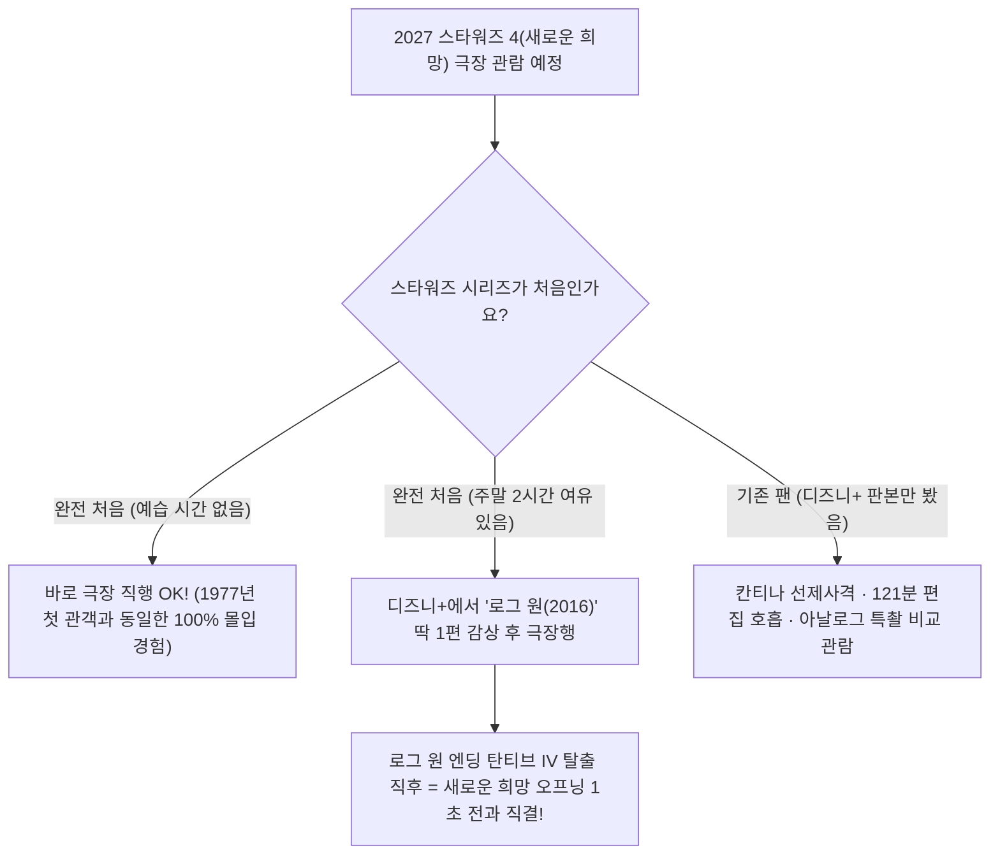

import Alert from '@/components/Alert.astro';
import CloudinaryImage from '@/components/CloudinaryImage.astro';
import MovieCard from '@/components/MovieCard.astro';
import PersonCard from '@/components/PersonCard.astro';
import YouTubeEmbed from '@/components/YouTubeEmbed.astro';

디즈니+를 켜면 지금 당장 4K 돌비 비전으로 틀 수 있는 게 흔히 '스타워즈4'라 부르는 《스타워즈 4: 새로운 희망》인데, 왜 2027년 **스타워즈 50주년 재개봉** 소식에 전 세계 영화 팬들이 이렇게 들썩일까요? 이유는 명확합니다. 우리가 지난 30년 동안 DVD, 블루레이, 스트리밍으로 봐온 판본은 1977년 여름 극장에 걸렸던 **스타워즈 오리지널 극장판**이 아니라 수차례 디지털 CG를 덧칠한 수정본이었기 때문입니다.

루카스필름이 50주년을 맞아 드디어 금고를 열고, 1997년 이후 공식 상영이 끊겼던 **1977년 초판 무수정 원본**을 새로 복원해 극장에 다시 걸기로 확정했습니다. 바쁜 분들을 위해 현재까지 확정된 핵심 정보부터 표로 압축했습니다.

| 구분 | 핵심 확정 내용 (2026년 11월 발표 기준) |
| :--- | :--- |
| **글로벌 재개봉일** | **2027년 2월 19일** (당초 예고된 2027년 4월 30일에서 약 두 달 앞당겨짐) |
| **국내 개봉 여부** | 2026년 11월 현재 **디즈니코리아 국내 개봉일·상영관 미발표** (추후 공식 공지 대기) |
| **상영 판본 · 러닝타임** | **1977년 오리지널 극장판 무수정 신규 복원본 · 121분** (스페셜 에디션 125분 대비 4분 단축) |
| **글로벌 확정 포맷** | IMAX 70mm · 디지털 IMAX · 70mm/35mm 필름 · 4DX · D-BOX 및 일반관 |
| **50주년 특별 요소** | 존 윌리엄스 신규 오케스트레이션 루카스필름 인트로 · 맷 퍼거슨 50주년 공식 포스터 |

<MovieCard title="Star Wars: Episode IV - A New Hope" imdbId="tt0076759" />

<YouTubeEmbed id="hwkOrfFtN8w" title="Celebrate Star Wars 50th Anniversary 공식 티저" />

---

## 왜 30년 만의 사건인가: 봉인됐던 1977년 원본의 귀환

오리지널 《스타워즈 4》 복원이 단순한 추억팔이 재개봉과 무게감이 다른 이유는 조지 루카스의 오랜 원칙에 있습니다. 루카스필름은 1995년 `"One Last Time"`(마지막 기회)이라는 슬로건을 내걸고 오리지널 극장판 VHS와 레이저디스크(LD)를 절판시킨 뒤, 1997년 개봉 20주년을 맞아 3D CG와 미공개 장면을 대거 추가한 **스페셜 에디션**(Special Edition)을 내놓았습니다.

문제는 그다음이었습니다. 루카스가 "스페셜 에디션이야말로 내가 원래 의도했던 완성본"이라고 못 박으면서, 이후 2004년 DVD와 2011년 블루레이, 2019년 디즈니+ 4K까지 오직 거듭 수정된 판본만 공식 유통됐거든요. 2006년 한정판 DVD 보너스 디스크로 한 차례 풀린 적도 있지만, 1993년 레이저디스크 마스터를 옮긴 비-아나모픽(Non-anamorphic) 저화질 영상이라 대화면 TV에서는 사방에 검은 여백이 두껍게 생기는 반쪽짜리 판본이었습니다. 참다못한 팬들이 해외에 남은 1977년 35mm 상영 프린트를 직접 구해 4K로 스캔·복원하는 `Project 4K77` 운동까지 벌였을 정도죠.

그 봉인이 풀리기 시작한 신호탄은 2025년 6월 영국영화협회(BFI) 영화제였습니다. 당시 루카스필름 사장이던 캐슬린 케네디가 무대에 직접 올라 BFI 보관 **1977년 오리지널 35mm 테크니컬러 프린트** 상영을 공식 소개했고, 현장의 뜨거운 반응은 2026년 11월 12일 디즈니·루카스필름의 '신규 복원판 극장 재개봉' 공식 발표로 결실을 맺었습니다.

  <PersonCard name="조지 루카스" role="감독·각본" imdbId="nm0000184" />
  <PersonCard name="마크 해밀" role="루크 스카이워커" imdbId="nm0000434" />
  <PersonCard name="해리슨 포드" role="한 솔로" imdbId="nm0000148" />
  <PersonCard name="캐리 피셔" role="레아 오르가나" imdbId="nm0000402" />
  <PersonCard name="알렉 기네스" role="오비완 케노비" imdbId="nm0000027" />
  <PersonCard name="존 윌리엄스" role="음악" imdbId="nm0002354" />

이번 50주년 상영본 앞머리에는 90대를 넘긴 거장 존 윌리엄스가 특별히 새로 편곡·오케스트레이션한 루카스필름 기념 인트로 음악도 붙습니다. 참고로 흔히 스타워즈 하면 떠올리는 다스 베이더의 〈제국군 행진곡〉(The Imperial March)은 후속작인 5편 《제국의 역습》(1980)에서 처음 작곡된 테마이고, 1977년 런던 심포니 오케스트라가 녹음한 《새로운 희망》 원작에서는 가슴을 뛰게 하는 메인 타이틀 팡파르와 쌍둥이 태양 아래 흐르는 〈포스의 테마〉(Binary Sunset)가 극을 이끕니다. 당시 전자음악 일색이던 SF 영화계에 정통 교향곡을 부활시킨 뒷이야기는 [존 윌리엄스의 삶과 스타워즈 음악 비하인드](/culture/john-williams-life-and-star-wars)에서 더 자세히 읽을 수 있습니다.

---

## 디즈니+ 판본과 무엇이 다른가? 1977 오리지널 vs 스페셜 에디션 5대 차이

"CG 좀 손본 게 그렇게 큰 차이야?" 싶을 수 있습니다. 하지만 1997년 이후 덧입혀진 수정 요소들은 단순한 화질 보정을 넘어 **주인공의 캐릭터 해석과 영화의 편집 리듬 자체**를 바꿔 놓았습니다. 지금 디즈니+에서 볼 수 있는 판본과 2027년 극장에 걸리는 1977년 무수정 원본의 결정적 차이 다섯 가지를 짚어봅니다.

<CloudinaryImage
  publicId="posts/culture/2026/star-wars-4-rerelease-guide/fig-01-analog-restoration"
  width={1376}
  height={768}
  alt="1977년 35mm 아날로그 필름 복원과 실물 미니어처 특촬의 질감을 디지털 수정본과 대비한 일러스트"
/>

| 비교 항목 | 1977 오리지널 극장판 (2027 재개봉본) | 디즈니+ 4K 스페셜 에디션 (현행 스트리밍) |
| :--- | :--- | :--- |
| **오프닝 크롤 제목** | 부제 없음 (순수 **STAR WARS** 단독 표기) | `Episode IV: A NEW HOPE` 부제 포함 |
| **칸티나 총격전** | **한 솔로가 망설임 없이 단독 선제사격** | 그리도가 `"Maclunkey!"` 외치며 거의 동시 사격 |
| **94번 격납고 자바 더 헛** | **장면 없음** (깔끔한 121분 편집 호흡) | 어설픈 초기 CG 자바 등장 + 꼬리 밟는 코믹 연출 (125분) |
| **모스 아이슬리 진입** | 튀니지 사막 로케이션의 거칠고 황량한 풍경 | CG 공룡(론토)·개그 드로이드가 화면 전면을 가림 |
| **데스스타 공략전** | 다익스트라플렉스 실물 미니어처 + 원형 아날로그 폭발 | CG 전투기 증식 + 수평 충격파 링(Praxis effect) 합성 |

### 1. 부제 없는 오프닝 크롤과 빈티지 폭스 팡파르

1977년 5월 25일 첫 개봉 당시 노란색 오프닝 크롤에는 지금 우리에게 익숙한 `Episode IV: A NEW HOPE`(에피소드 4: 새로운 희망)라는 문구가 아예 없었습니다. 속편을 만들 수 있을지조차 불투명했던 영화가 초대박을 터뜨리고, 1980년 속편 《제국의 역습》이 `Episode V`를 달고 성공한 뒤에야 **1981년 4월 재개봉 판본부터 4편 부제가 소급 추가**됐죠. 빈티지 20세기 폭스 팡파르와 함께 부제 없이 묵직하게 떠오르는 초판 크롤을 극장에서 보는 것만으로도 묘한 전율이 있습니다. (애초에 왜 1편이 아닌 4편 이야기부터 만들었는지는 [스타워즈가 에피소드 4부터 시작한 진짜 이유](/culture/star-wars-history-why-episode-4-first)에 정리해 두었습니다.)

### 2. 한 솔로 vs 그리도: "Han Shot First"에서 "Maclunkey!"까지

영화사상 가장 치열한 편집 논쟁을 낳은 모스 아이슬리 칸티나 장면입니다. 1977년 원본에서 밀수꾼 한 솔로는 총구를 겨누며 협박하는 현상금 사냥꾼 그리도와 마주 앉아 있다가, 테이블 밑으로 조용히 블라스터를 뽑아 **먼저 쏴 죽입니다**. 돈밖에 모르던 냉혹한 무법자였기에, 영화 막바지에 목숨을 걸고 친구 루크를 도우러 돌아올 때 비로소 뜨거운 성장 서사가 완성됐던 거죠.

그런데 루카스는 1997년 스페셜 에디션에서 한 솔로를 도덕적인 영웅으로 보이게 하겠다며 그리도가 먼저 쏘고 한 솔로가 목을 꺾어 피한 뒤 반격하는 어색한 합성 컷으로 바꿨습니다. 팬들의 거센 반발(`Han Shot First`)이 이어지자 2004년 DVD와 2011년 블루레이에서는 두 사람이 거의 동시에 쏘는 것으로 프레임을 다시 깎았고, 2019년 디즈니+ 4K 판본에서는 그리도가 총을 쏘기 직전 생뚱맞게 `"Maclunkey!"`(맥클렁키!)라고 외치는 대사까지 추가해 거대한 밈을 낳았습니다. 이번 재개봉에서는 30년 만에 군더더기 없는 한 솔로의 원조 선제사격이 돌아옵니다.

### 3. 영화의 리듬을 망쳤던 '94번 격납고 자바 더 헛' 삭제

디즈니+ 판본을 보다 보면 밀레니엄 팔콘이 정박한 94번 격납고에 1990년대 후반 기술로 만든 어색한 CG 자바 더 헛이 나타나는 장면이 있습니다. 원래 1977년 촬영 당시 인간 대역 배우를 세워 찍었다가 본편 편집에서 과감히 덜어냈던 컷인데, 1997년에 CG 자바를 덮어씌워 억지로 살려낸 장면입니다.

직전 칸티나 장면에서 그리도에게 이미 설명했던 '빚 독촉' 대사를 똑같이 반복해 중반부 템포를 늘어지게 만드는 데다, 한 솔로가 무시무시한 범죄 군주 자바의 꼬리를 밟고 뒤뚱거리며 넘어가는 슬랩스틱 연출까지 들어가 두 캐릭터의 위엄을 동시에 깎아 먹었죠. 원본에서는 이 사족이 통째로 사라지면서 러닝타임도 **125분에서 팽팽한 121분**으로 회복됩니다.

### 4. 모스 아이슬리 우주항의 거친 '리빙 월드' 미장센

루크와 오비완이 랜드스피더를 타고 타투인의 모스 아이슬리 우주항으로 들어가는 대목 역시 인상이 확 달라집니다. 스페셜 에디션에서는 거대한 CG 초식 동물(론토)이 카메라 바로 앞을 가로막고 소형 드로이드들이 서로 부딪히며 소란을 피우지만, 1977년 원본에서는 튀니지 사막 로케이션의 흙먼지와 낡고 때 묻은 우주 변경의 공기(`Used Universe`)가 화면을 가리는 방해물 없이 담백하게 펼쳐집니다.

### 5. 아카데미 6관왕을 안긴 아날로그 미니어처 공중전

하이라이트인 야빈 전투(데스스타 공략전)는 시각효과 감독 존 다익스트라가 개발한 컴퓨터 제어 모션 컨트롤 카메라 **다익스트라플렉스**(Dykstraflex)의 결정체입니다. 정지된 실물 X-윙·타이 파이터 정밀 모형 주위로 카메라가 정해진 궤도를 반복 이동하며 배경 별빛, 엔진 화염, 기체를 수십 겹 광학 합성해 완성한 아날로그 특촬의 정점이죠.

디지털 전투기 떼를 복제해 채워 넣고 데스스타 폭발에 수평 충격파 링까지 합성한 후대 판본과 달리, 원본은 실제 미니어처와 화약 폭발만이 낼 수 있는 묵직한 질량감을 보여줍니다. 당시 제50회 아카데미 시상식에서 시각효과상·편집상·음향상·미술상·의상상·음악상 등 6개 경쟁 부문(음향효과 특별업적상 포함 7개 트로피)을 휩쓴 '1977년 영화 기술의 기적'을 날것 그대로 확인할 수 있습니다.

---

## 입문자 관람 가이드: 스타워즈 처음인데 바로 극장 가도 될까?

시리즈 편수가 워낙 많다 보니 "1～3편부터 보고 가야 하나요?"라고 묻는 분들이 많아요. 답은 간단합니다. **사전 지식 0인 상태로 그냥 극장에 앉아도 100% 이해할 수 있습니다.** 애초에 1977년 전 세계 관객 모두가 제다이도, 포스도, 다스 베이더도 처음 들어본 상태에서 만났던 프랜차이즈의 첫 출발점이 바로 이 영화거든요. (시리즈 전체의 기본 매력은 [스타워즈 무경험자를 위한 입문 가이드](/culture/why-we-love-star-wars)에서 가볍게 확인해 보세요.)

다만 극장에 가기 전 주말에 여유가 있어 **디즈니+에서 딱 한 편만 예습하고 싶다면** 《로그 원: 스타워즈 스토리》(2016)만큼 완벽한 선택지가 없습니다.

<MovieCard title="Rogue One: A Star Wars Story" imdbId="tt3748528" />

《로그 원》은 이름 없는 반란군 요원들이 행성 파괴 병기 데스스타의 약점이 담긴 설계도를 훔쳐내기 위해 사지로 뛰어드는 첩보 전쟁 영화입니다. 제다이 족보 지식이 없어도 단독 전쟁물로 손색없고, 무엇보다 **영화의 마지막 5분이 《스타워즈 4: 새로운 희망》의 오프닝 첫 장면 불과 몇 분 전 상황과 물리적으로 직결**돼요. 《로그 원》 엔딩 크레딧을 본 뒤 극장에서 《새로운 희망》의 거대한 스타 디스트로이어 추격전을 맞이하면 오프닝의 긴박감이 배가됩니다. (《로그 원》이 왜 디즈니 인수 이후 최고 수작으로 꼽히는지는 [로그 원·만도버스 심층 분석](/culture/star-wars-spinoffs-mando-verse)을 참고하세요.)

---

## 국내 개봉 전망 & 특별관(IMAX vs 4DX) 선택 기준

<Alert type="info" title="한국 개봉 일정 및 상영관 공지 확인 안내">
`2027년 2월 19일`은 북미를 포함한 글로벌 개봉 기준일입니다. 2026년 11월 현재 **월트디즈니 컴퍼니 코리아의 국내 개봉 확정일 및 CGV·메가박스·롯데시네마 특별관 배정 여부는 아직 발표되지 않았습니다.** 다만 직전 2025년 《에피소드 3: 시스의 복수》 20주년 재개봉 당시에도 국내 4DX 등 특별관 상영이 성사된 만큼, 추후 디즈니코리아 공지가 뜨면 아래 기술 스펙을 기준으로 포맷을 고르시면 됩니다.
</Alert>

<CloudinaryImage
  publicId="posts/culture/2026/star-wars-4-rerelease-guide/fig-02-imax-cockpit"
  width={1376}
  height={768}
  alt="초대형 극장 스크린에 영사되는 2.35:1 시네마스코프 우주 참호 전투 장면 일러스트"
/>

### 1. IMAX: 확장 화면비가 아니라 '35mm 필름 질감과 사운드'로 고르는 관

예매 전 꼭 알아두실 기술적 팩트가 하나 있습니다. 1977년 원작 《스타워즈》는 35mm 파나비전 아나모픽 렌즈로 촬영된 **2.35:1 고정 시네마스코프 화면비** 작품입니다. 즉 북미 일부 극장에 걸리는 IMAX 70mm 필름 프린트든 국내 디지털 레이저 IMAX 상영관이든, 《듄》이나 《오펜하이머》처럼 위아래가 1.43:1이나 1.90:1로 열리는 확장 화면비는 존재하지 않아요(국내에는 상업용 IMAX 70mm 필름 영사기 자체가 없어 디지털 레이저로 상영되며, 1.43:1 스크린에서는 상하단 레터박스가 생깁니다).

그럼에도 IMAX가 1순위 후보인 이유는 분명합니다. 새로 스캔·복원한 1977년 35mm 아날로그 필름의 입자감과 실물 스타 디스트로이어 모형의 압도적 스케일을 초대형 스크린으로 마주할 수 있고, 존 윌리엄스의 런던 심포니 금관 사운드를 대출력 IMAX 음향 시스템으로 온몸에 맞을 수 있기 때문이죠. 티켓팅이 열릴 때 시야각이 가장 좋은 중블록 명당 기준은 [용산 IMAX(용아맥) 좌석 배치 가이드](/culture/yongamac-seat-map)에서 미리 확인해 두세요.

### 2. 4DX: 데스스타 '트렌치 런'을 콕핏에서 체감하는 의외의 복병

이번 루카스필름 글로벌 발표에서 IMAX와 나란히 이름을 올린 특별 포맷이 바로 **4DX**입니다. 50년 전 고전 영화에 웬 모션체어인가 싶지만, 《스타워즈 4》의 클라이맥스인 야빈 전투 '데스스타 트렌치 런'(좁은 인공 참호를 따라 초고속으로 저공비행하는 공략 시퀀스)은 조지 루카스가 제2차 세계대전 공중전 기록필름을 한 컷씩 편집 레퍼런스로 삼아 만든 1인칭 도그파이트 교본입니다.

X-윙 조종석 시점으로 좁은 벽면을 스치듯 급기동하고 뒤쫓아오는 다스 베이더의 타이 어드밴스드 레이저 포화를 피하는 후반 15분은 4DX 모션체어의 롤링·피칭 진동 및 바람 효과와 찰떡궁합을 보여줄 구간이에요. 국내 4DX 편성이 확정된다면 모션 강도가 가장 정교한 프라임석 기준을 정리한 [CGV 용산 4DX 좌석 판독 가이드](/culture/cgv-yongsan-4dx-seat-guide)가 좋은 이정표가 됩니다.

### 3. 돌비 시네마 / 애트모스 (국내 추가 편성 시)

글로벌 1차 보도자료 문구에는 `Dolby Cinema`가 별도로 적히지 않았지만, 국내 배급 상황에 따라 메가박스 돌비 시네마나 돌비 애트모스 상영이 열릴 가능성도 열어둘 만해요. 만약 편성된다면 원작의 2.35:1 화면비와 거의 일치해 레터박스 손실이 없는 2.39:1 스코프 스크린(코엑스 돌비 시네마 등)에서 칠흑 같은 우주 배경과 광선검의 명암비를 또렷하게 감상할 수 있습니다. 상영관별 스크린 비율 차이는 [코엑스·남양주 돌비 시네마 좌석 가이드](/culture/coex-namyangju-dolby-seat-guide)를 참고하세요.

---

## 2027년 스타워즈 50주년 로드맵: 왜 2월로 앞당겼을까?

루카스필름은 원래 50주년 재개봉일을 2027년 4월 30일로 예고했다가 **2월 19일**로 두 달 넘게 앞당겼습니다. 5월 극장가를 점령할 신작 블록버스터들과 상영관(특히 IMAX·특별관)이 겹치는 것을 피하는 동시에, 2027년 상반기 내내 쉼 없이 이어지는 50주년 릴레이 라인업의 포문을 넓게 열기 위한 포석입니다.

- **2027년 1월 20일**: 디즈니+ 오리지널 드라마 《아소카》(Ahsoka) 시즌 2 공개
- **2027년 2월 19일**: **《스타워즈》(1977) 오리지널 극장판 무수정 복원본 글로벌 재개봉**
- **2027년 5월 4일 (스타워즈 데이)**: R.J. 커틀러 감독의 공식 다큐멘터리 《더 히어로 어웨이큰스》(The Hero Awakens: Creating Star Wars) 공개
- **2027년 5월 28일**: 숀 레비 감독 · 라이언 고슬링 주연의 신작 극장판 **《스타워즈: 스타파이터》** 개봉 ([《스타워즈: 스타파이터》 줄거리·캐스팅 총정리](/culture/star-wars-starfighter-ryan-gosling-facts))

2월에 1977년 시리즈의 태동을 극장에서 확인하고, 5월에는 스카이워커 사가 이후 완전히 새로운 시대를 여는 《스타파이터》까지 이어 달리는 구도입니다. 평생 집 거실 화면의 수정본으로만 접했던 전설의 첫 장면을 1977년 원형 그대로 극장에서 마주할 흔치 않은 기회이니, 추후 디즈니코리아의 국내 개봉일과 특별관 예매 일정이 확정되는 대로 본문에 상영관 정보를 발 빠르게 업데이트하겠습니다.
