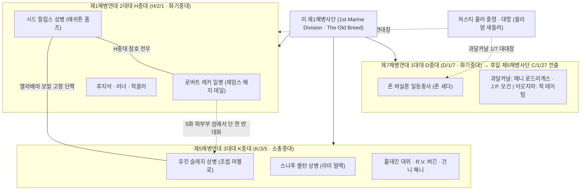

import Alert from '@/components/Alert.astro';
import MovieCard from '@/components/MovieCard.astro';
import PersonCard from '@/components/PersonCard.astro';
import PersonInline from '@/components/PersonInline.astro';
import YouTubeEmbed from '@/components/YouTubeEmbed.astro';

[《밴드 오브 브라더스》 등장인물 소개](/culture/band-of-brothers-casts)를 찾아보며 이지 중대원 한 명 한 명에게 정을 붙였던 시청자들이 후속작인 HBO 《**더 퍼시픽**》(The Pacific)을 틀었다가 1～3화쯤에서 일시정지를 누르는 가장 흔한 이유가 있습니다. "대체 누가 누구고, 왜 얘네는 같은 해병대인데 한자리에 안 모이지?"라는 당혹감 때문이죠. **더 퍼시픽**(The Pacific) **등장인물** 구도가 유독 헷갈리는 까닭은 단일 중대를 끝까지 따라가는 전작과 달리, **미 제1해병사단**(1st Marine Division, 별칭 'The Old Breed')이라는 거대한 우산 아래 서로 다른 **3개 연대**(제1·제5·제7해병연대) 해병들의 시점을 교차 진행하기 때문입니다.

<MovieCard title="더 퍼시픽 (The Pacific)" imdbId="tt0374463" />

어느 주인공이 어느 연대 소속인지, 세 갈래 이야기가 어디서 스치고 갈라지는지만 머릿속에 지도를 그려두면 10시간 내내 전혀 다른 몰입감이 열립니다. 정주행하거나 다시 볼 때 옆에서 아는 척하기 딱 좋은 부대 계보와 실존 해병들의 전후 삶, 지금은 할리우드 간판스타가 된 배우들의 풋풋한 얼굴까지 한데 묶어 정리했습니다.

---

## 작품 기본 정보 — 왜 《밴드 오브 브라더스》와 결이 다를까

2010년 HBO에서 방영된 10부작 미니시리즈 《더 퍼시픽》은 약 2억～2억 1,700만 달러라는 당시 TV 드라마 사상 최고 제작비를 투입해 완성한 대작입니다. 방영 직후 제62회 프라임타임 에미상에서 미니시리즈 부문 작품상을 포함해 무려 8관왕을 휩쓸며 작품성을 증명했죠.

전작 《밴드 오브 브라더스》(2001)가 역사학자 스티븐 앰브로스의 단일 논픽션을 원작으로 삼아 제101공수사단 506연대 2대대 **E중대**(이지 중대)라는 한 울타리 안의 형제애를 그렸다면, 광활한 태평양의 섬들을 징검다리처럼 건너뛰며 치러진 태평양 전쟁은 한 개 중대의 시선만으로는 도저히 담아낼 수 없었습니다. 과달카날에 첫발을 디딘 부대와 이오지마 검은 모래 해변에 상륙한 부대, 오키나와 진흙탕을 구른 부대가 모두 달랐기 때문이에요.

그래서 제작진은 실제 참전 해병들이 남긴 회고록 두 권을 양대 기둥으로 세웠습니다.

| 원작 회고록 · 증언록 | 저자 (극 중 배역) | 반영된 주요 전장 및 서사 |
| :--- | :--- | :--- |
| 『**With the Old Breed: At Peleliu and Okinawa**』(1981) | 유진 B. 슬레지 (`K/3/5` 박격포병) | 펠렐리우 · 오키나와 전투의 참상과 귀향 후 트라우마 |
| 『**Helmet for My Pillow**』(1957) | 로버트 레키 (`H/2/1` 기관총 사수) | 과달카날 · 멜버른 휴양 · 글로스터 곶 · 펠렐리우 초기 전투 |
| 『**Red Blood, Black Sand**』(1995) 외 | 척 테이텀 (`C/1/27` 기관총병) | 명예훈장 수훈자 존 바실론의 캠프 펜들턴 교관 시절과 이오지마 최후 |
| 『**You'll Be Sor-ree**!』(2010) · 『**Islands of the Damned**』(2010) | 시드 필립스 (`H/2/1`) · R.V. 버긴 (`K/3/5`) | 앨라배마 모빌 고향 에피소드 및 K중대 박격포반 현장 고증 |

제작진 면면도 전작의 영광을 고스란히 이어받았습니다. <PersonInline name="스티븐 스필버그" role="총괄 프로듀서" imdbId="nm0000229" />와 <PersonInline name="톰 행크스" role="총괄 프로듀서 · 내레이션" imdbId="nm0000158" />, 플레이톤의 <PersonInline name="게리 고츠만" role="총괄 프로듀서" imdbId="nm0324556" />이 다시 의기투합했고, 톰 행크스는 매 화 오프닝 다큐멘터리의 역사 내레이션까지 직접 맡았습니다. 여기에 전작 각본가이자 훗날 [애플 TV+ 《사일로》](/culture/silo-apple-tv-plus-guide)의 쇼러너로 맹활약하는 <PersonInline name="그레이엄 요스트" role="공동 총괄 프로듀서" imdbId="nm0003662" />가 각본과 4화 연출까지 맡아 시리즈의 건조하고 서늘한 심리 묘사를 조율했죠. 스케치북 위의 검은 목탄이 포탄 파편처럼 부서져 내리는 오프닝 타이틀 테마 〈Honor〉는 <PersonInline name="한스 짐머" role="음악" imdbId="nm0001877" />가 제프 자넬리, 블레이크 닐리와 함께 작곡해 전작의 〈Band of Brothers〉 못지않은 비장한 울림을 남겼습니다.

<YouTubeEmbed id="Q1fXW-dU1Cc" title="더 퍼시픽(The Pacific) 공식 예고편 — Warner Bros. Entertainment" />

<Alert type="tip" title="정주행 전 꼭 알아둘 포인트: 오프닝 프롤로그를 건너뛰지 마세요">
각 화가 시작할 때 약 2～3분 동안 실제 태평양 전선 기록 영상과 지도 위로 톰 행크스의 전황 해설이 흐르고, 생존 참전 용사(시드 필립스, R.V. 버긴 등)의 육성 인터뷰가 이어집니다. 일부 OTT에서 무심코 '**오프닝 건너뛰기**'를 누르면 타이틀 시퀀스 앞의 이 역사 브리핑까지 통째로 날아갑니다. 어느 섬에서 왜 싸우는 전투인지 맥락을 잡고 보려면 프롤로그부터 끝까지 재생하는 편이 훨씬 이해하기 수월합니다.
</Alert>

### 미 제1해병사단('The Old Breed') 산하 3대 주인공 소속 부대 한눈에 보기

드라마를 보며 가장 먼저 기억해 둘 사실이 하나 있습니다. **세 주인공 로버트 레키, 유진 슬레지, 존 바실론이 한 화면에 다 같이 모이는 장면은 10부작 내내 단 한 번도 나오지 않습니다**. 각자 소속 연대가 다르기 때문인데요. 아래 계보도를 한 번 훑어보면 세 사람의 동선이 어떻게 얽히는지 단번에 풀립니다.

- **시드 필립스가 유일한 가교입니다**: 시드 필립스는 고향 앨라배마 모빌에서는 유진 슬레지와 죽마고우였고, 입대 후 배치된 제1해병연대 H중대(`H/2/1`)에서는 로버트 레키의 참호 단짝이 됩니다. 5화 파부부 섬 막사에서 슬레지가 시드를 찾아왔다가 레키와 짤막하게 인사를 나누는 대목이 **두 회고록 저자가 극 중에서 마주치는 유일한 순간**입니다.
- **존 바실론은 독자 노선을 걷습니다**: 과달카날에서는 제1해병사단 예하 제7해병연대 1대대 화기중대(`D/1/7`, 헨더슨 비행장 방어전 당시 C중대 구역 배속) 소속으로 싸우지만, 명예훈장 수훈 후 본국 전쟁채권 투어를 돌고 캠프 펜들턴에서 신설된 **제5해병사단 제27해병연대**(`C/1/27`)로 옮겨 이오지마로 향합니다. 대신 과달카날에서 바실론의 대대장이었던 **처스티 풀러**가 펠렐리우에서는 레키 소속 제1해병연대의 연대장으로 재등장해 두 서사를 느슨하게 이어줍니다.

---

## 에피소드 1～10화 전장 & 중심 주인공 가이드

《밴드 오브 브라더스》는 〈커래히〉, 〈카랑탕〉, 〈바스토뉴〉처럼 부제만 봐도 어디서 벌어지는 이야기인지 감이 잡혔지만, 《더 퍼시픽》의 HBO 공식 에피소드 제목은 **Part One**부터 **Part Ten**까지 번호로만 적혀 있습니다. 회차별로 어느 연도, 어느 섬에서 누구를 비추는지 표로 정리해 두면 정주행 길잡이로 요긴합니다.

| 화수 | 시간 배경 | 주요 전장 · 배경지 | 중심 주인공 | 핵심 사건 및 관전 포인트 |
| :---: | :--- | :--- | :--- | :--- |
| **1화** (`Part One`) | 1941.12～1942.08 | 미국 본토 · 과달카날(테나루강) | 레키, 바실론 | 진주만 공습 직후 입대, 제1해병연대의 과달카날 상륙과 테나루강 야간 방어전 |
| **2화** (`Part Two`) | 1942.10 | 과달카날(헨더슨 비행장) | 바실론, 레키 | 고립된 정글의 굶주림, 일본군 약 3,000명의 파상 야간 공세를 막아낸 바실론의 명예훈장 혈투 |
| **3화** (`Part Three`) | 1943 초 | 호주 멜버른 | 레키, 바실론 | 천국 같은 재정비 휴양지, 그리스계 호주 여성 스텔라와의 사랑과 이별, 바실론의 본국 귀환 명령 |
| **4화** (`Part Four`) | 1943.12～1944.05 | 글로스터 곶 · 파부부 | 레키 | 뉴브리튼섬 열대 폭우와 진흙탕 정글이 부른 정신적 붕괴, 레키의 스트레스성 야뇨증과 병원 입원 |
| **5화** (`Part Five`) | 1944.05～09 | 미국 본토 · 파부부 · 펠렐리우 | 슬레지, 레키, 바실론 | 채권 투어에 지친 바실론, 파부부에서 유일하게 만나는 레키와 슬레지, 산호섬 펠렐리우 상륙 |
| **6화** (`Part Six`) | 1944.09 | 펠렐리우(비행장 활주로) | 슬레지, 레키 | 섭씨 46도 폭염과 오염된 식수통 속 활주로 횡단 돌격, 포탄 충격파 부상으로 후송되는 레키 |
| **7화** (`Part Seven`) | 1944.09～10 | 펠렐리우(블러디 노즈 능선 · 140고지) | 슬레지 | 산호 암반 지옥에서 무너지는 전우들, K중대의 정신적 지주 애크-애크 홀데인 대위의 저격 전사 |
| **8화** (`Part Eight`) | 1944 말～1945.02 | 캠프 펜들턴 · 이오지마(유황도) | 바실론 | 해병 여군 레나 리기와의 운명적 결혼, 신병들을 이끌고 상륙한 이오지마 해변에서의 장렬한 전사 |
| **9화** (`Part Nine`) | 1945.04～06 | 오키나와 | 슬레지 | 끝없는 장마와 구더기 들끓는 진흙 참호, 민간인 비극 속 슬레지의 인간성을 붙드는 스나푸 |
| **10화** (`Part Ten`) | 1945.08～1946 초 | 일본 항복 · 미국 본토 귀향 | 레키, 슬레지, 레나 | 총성이 멎은 뒤에도 계속되는 내면의 전쟁, 고향과 가족 품에서 다시 일상을 살아내는 귀환 해병들 |

크게 세 덩어리로 기억하면 편합니다. **1～4화**는 로버트 레키와 존 바실론이 이끄는 태평양 전쟁 전반기(과달카날～글로스터 곶), **5～7화**는 신병 유진 슬레지가 본격 합류해 레키와 바통을 주고받는 중반기 최대 격전지 펠렐리우, 그리고 **8～10화**는 바실론의 이오지마 최후와 슬레지의 오키나와 지옥도, 종전 후 귀향으로 마무리됩니다.

---

## 극을 이끄는 3대 주인공 — 실존 인물과 전후의 삶

  <PersonCard name="제임스 배지 데일" role="로버트 레키 역" imdbId="nm0197647" />
  <PersonCard name="조셉 마젤로" role="유진 슬레지 역" imdbId="nm0001515" />
  <PersonCard name="존 세다" role="존 바실론 역" imdbId="nm0781218" />

세 주인공은 계급도, 자라온 집안 환경도, 전쟁을 받아들이는 태도도 완전히 다릅니다. 지성적이고 냉소적인 관찰자(레키), 순수한 신앙심을 품었다가 처참하게 부서지는 소년(슬레지), 살아있는 전설이 되었으나 전우들 곁으로 돌아가 산화한 영웅(바실론)의 세 궤적이 겹치며 태평양 전선의 입체적인 얼굴을 완성합니다.

### 1. 로버트 '러키' 레키 일병 — 시인의 눈으로 지옥을 기록한 기관총 사수 (제임스 배지 데일)

- **실존 인물 / 최종 계급**: 로버트 휴 레키 일병 (PFC Robert Hugh "Lucky" Leckie, 1920～2001)
- **소속 부대**: 제1해병사단 제1해병연대 2대대 H중대 (`H/2/1`, 화기중대 'How Company') 기관총 사수 · 정찰병

뉴저지주 러더퍼드의 아일랜드계 가톨릭 다자녀 가정에서 자란 레키는 입대 전부터 지역 신문사에서 스포츠 기자로 일하던 글쟁이였습니다. 진주만 공습 바로 다음 날 해병대에 자원입대한 그는 어릴 적 동네 친구 베라 켈러에게 수줍게 마음을 고백하고 편지를 약속한 채 태평양으로 떠납니다. 성인 'Leckie'의 발음에서 따온 '**러키**'(Lucky)라는 별명과 달리, 참호 속에서의 레키는 신의 섭리를 의심하고 군의 부조리를 비트는 냉소적인 시인에 가깝습니다.

과달카날 테나루강에서 첫 실전을 치른 뒤 3화 호주 멜버른에서는 그리스계 호주 이민자 가정의 딸 스텔라와 사랑에 빠져 잠시 인간다운 숨을 쉬지만, 이별의 후유증으로 술김에 상급자에게 총을 겨누고 무단이탈해 영창 신세를 지기도 하죠. 진짜 시련은 4화 뉴브리튼섬 **글로스터 곶**(Cape Gloucester)이었습니다. 일본군보다 더 무서운 끝없는 열대 폭우와 썩어 들어가는 정글 속에서 극심한 전투 피로증이 찾아왔고, 성인 해병이 통제 불능의 **스트레스성 야뇨증**(유뇨증)까지 겪으며 해군 병원 정신과 병동에 입원합니다. 훗날 펠렐리우 상륙작전에 복귀해 타는 듯한 비행장 활주로에서 부상당한 동료를 구하고 의무대에 연락하러 뛰던 중, 코앞에서 터진 일본군 포탄의 충격파에 날아가 전신 파편상과 고막 파열을 입고 병원선 솔러스호(USS Solace)로 후송되면서 그의 전쟁은 막을 내립니다.

영화 《디파티드》, 《월드워Z》, 《13시간》 등으로 익숙한 제임스 배지 데일이 레키 특유의 메마른 유머와 흔들리는 눈빛을 깊숙이 살려냈습니다. 실제 로버트 레키는 귀향 후 자신을 끝까지 기다려준 베라 켈러와 결혼해 3남매를 두었고, 1957년 회고록 『Helmet for My Pillow』를 출간한 것을 시작으로 한국전쟁 통사 『Conflict: The History of the Korean War』 등 평생 **40권 이상의 미국 군사·역사서를 집필한 저명한 군사 역사가**로 활동하다 2001년 12월 81세로 별세했습니다.

### 2. 유진 '슬레지해머' 슬레지 상병 — 포켓 성경에 지옥을 받아적은 소년 (조셉 마젤로)

- **실존 인물 / 최종 계급**: 유진 본듀런트 슬레지 상병 (Cpl. Eugene Bondurant "Sledgehammer" Sledge, 1923～2001)
- **소속 부대**: 제1해병사단 제5해병연대 3대대 K중대 (`K/3/5`, 소총중대 'King Company') 60mm 박격포병

유진 슬레지는 시리즈의 정서적 심장입니다. 앨라배마주 모빌의 유복한 의사 집안 막내아들로 태어난 그는 어릴 적 앓은 류머티즘열 후유증으로 **심장 잡음**(Heart murmur)이 있어 입대 신체검사에서 불합격 판정을 받습니다. 제1차 세계대전 당시 군의관으로 참전해 참호전 트라우마가 얼마나 참혹한지 직접 목격했던 아버지 에드워드 슬레지 박사(<PersonInline name="코너 오패럴" imdbId="nm0640970" />)는 아들의 영혼이 망가질까 봐 끝까지 입대를 만류했죠. 하지만 단짝 친구 시드 필립스가 먼저 해병대 군복을 입고 떠나자, 유진은 조지아 공대 해군 장교 후보생 과정(V-12)에 등록한 뒤 "장교가 되길 기다리다간 전쟁이 끝나버린다"며 **집단으로 일부러 시험을 백지로 내 낙제하고 사병으로 해병대에 재입대**하는 기행을 감행합니다.

그렇게 훈련소 교관이 붙여준 '**슬레지해머**'(오함마)라는 별명을 달고 도착한 전장은 하필 태평양 전쟁 최악의 도살장으로 불리는 **펠렐리우**와 **오키나와**였습니다. 담배도 피우지 않고 매일 밤 기드온 포켓 신약성경을 읽던 창백한 도련님이 섭씨 46도의 산호 바위섬과 시체 썩는 구더기 참호를 거치며 서서히 눈빛을 잃어가는 과정은 드라마 전체에서 가장 고통스럽고도 압도적인 서사입니다. 당시 미군은 적에게 노획될 위험 때문에 전선에서 일기를 쓰는 행위를 엄격히 금지했는데, 슬레지는 늘 가슴 주머니에 품고 다니던 **포켓 성경 여백과 작은 종잇조각에 남몰래 전장의 나날을 깨알같이 기록**했습니다. 종전 후 수십 년간 서랍 속에 봉인되어 있던 이 메모를 아내의 권유로 정리해 1981년 세상에 내놓은 책이 바로 불멸의 전쟁 고전 『With the Old Breed』입니다.

배우 조셉 마젤로의 얼굴이 어딘가 낯익다면 눈썰미가 정확합니다. 스티븐 스필버그 감독의 영화 《쥬라기 공원》(1993)에서 고압 전기 철조망에 매달렸던 공룡 박사 꼬마 '**팀 머피**'가 바로 그입니다. 스필버그가 어릴 때부터 지켜본 아역 배우를 17년 만에 태평양 지옥도의 주연으로 다시 불러들인 셈이죠. 훗날 2018년 영화 《보헤미안 랩소디》에서는 K중대 단짝 스나푸 역의 라미 말렉(프레디 머큐리 역)과 밴드 퀸의 베이시스트 존 디콘 역으로 다시 호흡을 맞추는 진풍경도 연출했습니다.

실제 유진 슬레지는 귀향 후 어릴 때부터 아버지와 즐기던 메추라기 사냥터에 나갔다가 총에 맞은 새가 죽어가는 모습을 견디지 못하고 총을 내려놓은 채 오열할 만큼 깊은 외상 후 스트레스 장애(PTSD)를 앓았습니다. 그 상처를 치유해 준 것은 생명을 죽이는 대신 연구하는 자연과학이었어요. 흔히 일부 국내 자료에 오번대 교수로 잘못 적혀 있곤 하지만, 정확히는 **오번 대학교**(구 앨라배마 폴리테크닉 대학)에서 학·석사 학위를, **플로리다 대학교**에서 생물학 박사 학위를 받은 뒤 1962년부터 1990년 은퇴할 때까지 앨라배마주 **몬테발로 대학교**(University of Montevallo) **생물학·조류학 교수로 약 30년간 재직**했습니다. 제자들에게 유독 따뜻하고 괴짜 같은 은사로 존경받던 그는 2001년 3월 위암으로 77세의 생을 마감했습니다.

### 3. 존 '마닐라 존' 바실론 일등중사 — 이오지마로 스스로 돌아간 영웅 (존 세다)

- **실존 인물 / 최종 계급**: 존 바실론 일등중사 (GySgt. John "Manila John" Basilone, 1916～1945)
- **소속 부대**: 제1해병사단 제7해병연대 1대대 D중대 (`D/1/7`, 화기중대 'Dog Company') → 제5해병사단 제27해병연대 1대대 C중대 (`C/1/27`) 기관총 소대 선임하사

뉴저지주 이탈리아계 이민자 가정의 10남매 중 여섯째로 자란 존 바실론은 해병대에 들어오기 전 이미 미 육군 소속으로 필리핀 마닐라에서 3년간 복무하며 육군 권투 챔피언으로 이름을 날린 베테랑이었습니다. 입만 열면 마닐라 시절 무용담을 늘어놓아 해병 동료들이 붙여준 별명이 바로 '**마닐라 존**'(Manila John)이죠.

바실론의 이름을 미군 역사에 영원히 새긴 전투는 2화에 그려진 **1942년 10월 과달카날 헨더슨 비행장 방어전**입니다. 폭우가 쏟아지는 한밤중, 일본군 센다이 제2사단 정예 병력 약 3,000명이 비행장을 탈환하기 위해 바실론이 지휘하는 2개 기관총 분대(단 15명) 정면으로 파상 돌격을 감행했습니다. 48시간 동안 이어진 사투 속에서 바실론은 고장 난 기관총을 어둠 속에서 손감각만으로 수리하고, 적의 포위망을 뚫고 탄약 벨트를 직접 메고 날랐으며, 산더미처럼 쌓인 적의 시체 때문에 사계가 막히자 진지를 옮겨가며 사격을 이어갔습니다. 결정적으로 단열용 석면 장갑까지 잃어버린 긴박한 순간에 **펄펄 끓는 냉각수가 담긴 수랭식 M1917 브라우닝 중기관총 총열 뭉치를 맨손과 팔뚝으로 부둥켜안고 양손에 중화상을 입어가며 적을 쓸어 담는 초인적인 투혼**을 발휘합니다. 날이 밝았을 때 그의 진지 앞에는 일본군 전사자 수백 구가 놓여 있었고, 이 전공으로 그는 **미군 최고 무공훈장인 명예훈장**(Medal of Honor)을 받습니다.

미 정부는 살아 돌아온 전쟁 영웅을 본국으로 불러들여 전국을 순회하는 **전쟁채권**(War Bond) 판매 캠페인의 간판스타로 세웁니다. 화려한 퍼레이드와 박수갈채가 쏟아졌지만, 정작 바실론은 열대 정글에 남겨두고 온 후임들에 대한 부채감에 밤잠을 설쳤죠. 해군성의 만류를 뿌리치고 세 차례나 전선 복귀를 청원한 끝에 그는 캘리포니아 캠프 펜들턴의 신병 훈련 교관으로 부임하고, 그곳에서 해병대 여군 부사관 레나 리기를 만나 결혼하며 생애 가장 눈부시고 평화로운 몇 달을 보냅니다.

하지만 그는 끝내 안전지대에 머물지 않았습니다. 자신이 직접 조련한 신병들과 함께 **1945년 2월 19일 이오지마**(유황도) 상륙 첫파로 검은 화산재 해변에 뛰어든 바실론은, 쏟아지는 포화에 해변에 못 박힌 대원들을 독려하며 단신으로 일본군 대형 콘크리트 토치카 지붕 위로 기어올라 수류탄과 폭약으로 진지를 무력화했습니다. 이어 지뢰밭에 갇힌 아군 셔먼 전차를 총탄 세례 속에서 맨몸으로 안전 지대까지 유도한 직후, 날아온 일본군 박격포탄 파편에 맞아 28세의 나이로 전사합니다. **제2차 세계대전 미 해병대 사병 중 유일하게 명예훈장과 해군십자장**(Navy Cross, 사후 추서), **퍼플하트를 모두 수훈한 전설**로, 미 해군은 구축함 두 척(USS Basilone DD-824 및 최신 알레이버크급 DDG-122)에 그의 이름을 헌정했습니다.

---

## 주인공만큼 강렬한 핵심 조연 & 지휘관들

《밴드 오브 브라더스》에서 톰 하디, 마이클 패스벤더, 제임스 맥어보이, 사이먼 페그의 신인 시절을 숨은그림찾기하듯 발견하는 재미가 있었다면, 《더 퍼시픽》 역시 지금은 오스카 수상자이자 마블 히어로가 된 쟁쟁한 배우들이 해병 군복을 입고 진흙탕을 구릅니다.

  <PersonCard name="라미 말렉" role="스나푸 셸턴 역" imdbId="nm1785339" />
  <PersonCard name="애쉬튼 홈즈" role="시드 필립스 역" imdbId="nm1525948" />
  <PersonCard name="스콧 깁슨" role="홀데인 대위 역" imdbId="nm0317181" />
  <PersonCard name="윌리엄 새들러" role="처스티 풀러 중령 역" imdbId="nm0006669" />
  <PersonCard name="존 번설" role="매니 로드리게스 역" imdbId="nm1256532" />

### 1. K중대(`K/3/5`) — 유진 슬레지의 전우들과 정신적 지주

- **메리엘 '스나푸' 셸턴 상병** (Cpl. Merriell "Snafu" Shelton / 라미 말렉)
  《더 퍼시픽》 전 회차를 통틀어 시청자 뇌리에 가장 지워지지 않는 인물을 한 명만 꼽으라면 단연 **스나푸**입니다. 별명인 'SNAFU'부터가 "Situation Normal: All Fucked Up"(상황 정상, 모든 게 엉망진창)이라는 미군 자조 속어에서 유래했죠. 루이지애나 늪지대 출신 특유의 느릿한 케이준 억양을 구사하며, 전투가 끝난 자리에서 단검으로 일본군 시체의 금니를 캐내 주머니에 모으거나 죽은 적병의 깨진 두개골에 자갈을 던져 넣는 섬뜩한 기행으로 신병 슬레지를 경악하게 만듭니다.
  그런데 전투가 막바지로 치달을수록 스나푸의 진짜 얼굴이 드러납니다. 자신이 이미 괴물로 망가졌음을 누구보다 잘 알기에, 순수했던 동생 같은 슬레지만큼은 그 선을 넘지 못하도록 온몸으로 막아서는 보호자가 되기 때문이죠. 특히 9화 오키나와에서 분노에 눈이 뒤집힌 슬레지가 똑같이 일본군 전사자의 금니를 뽑으려 단검을 꺼내 들자, 스나푸가 조용히 팔을 붙잡고 "**세균 옮아**" 한마디만 던진 채 대신 손을 더럽히는 장면은 시리즈 최고의 명장면으로 꼽힙니다. 드라마 《미스터 로봇》과 아카데미 남우주연상 수상작 《보헤미안 랩소디》로 세계적인 스타가 되기 전, 무명에 가까웠던 라미 말렉이 할리우드 관계자들을 전율하게 만든 출세작입니다.
  **실화 비하인드**도 영화보다 더 영화 같습니다. 종전 후 루이지애나 시골로 돌아간 실제 스나푸는 에어컨 수리공과 목수로 일하며 무려 **35년 동안이나 외부에 해병대 참전 사실조차 숨긴 채 은둔**해 살았습니다. K중대 전우회에서도 그가 이미 세상을 떠난 줄 알았는데, 1981년 슬레지가 『With the Old Breed』를 출간하자 스나푸의 아들이 서점에서 책을 발견하고 연락을 취해 노년이 된 슬레지·버긴·스나푸 세 전우가 눈물의 재회를 이뤘습니다(1993년 71세로 별세).

- **앤드루 '애크-애크' 홀데인 대위** (Capt. Andrew "Ack-Ack" Haldane / 스콧 깁슨)
  이지 중대에 리처드 윈터스 소령이 있었다면, 제5해병연대 K중대에는 '**애크-애크**'(대공포라는 뜻의 연합군 무전 약어에서 유래한 별명) 홀데인 대위가 있었습니다. 보든 칼리지 미식축구부 주장 출신인 그는 권위 의식 없이 부하 한 사람 한 사람의 상태를 세심하게 챙기면서도 전투에서는 가장 먼저 포화를 뚫고 나서는 최고의 야전 지휘관이었죠. 슬레지는 회고록에서 그를 가리켜 "우리가 알고 지낸 가장 훌륭한 해병이자 K중대 전원의 아버지 같은 분"이라 추모했습니다. 부대가 지옥 같던 펠렐리우에서 교대 철수하기 불과 사흘 전인 1944년 10월 12일, 140고지 능선을 직접 정찰하다 일본군 저격수의 총탄에 맞아 27세로 전사합니다(은성무공훈장 추서). 그의 전사 직후 K중대원들이 넋이 나간 채 들것을 바라보는 장면은 전쟁이 어떻게 부대의 영혼을 앗아가는지 가장 아프게 보여줍니다.

- **로머스 'R.V.' 버긴 병장 & K중대 고참·동료들**
  텍사스 특유의 묵직한 침착함으로 슬레지와 스나푸를 통솔하는 박격포 분대장 **R.V. 버긴 병장**(<PersonInline name="마틴 매캔" imdbId="nm0564901" />)은 글로스터 곶, 펠렐리우, 오키나와 3대 격전을 모두 완주하고 동성훈장을 받은 실존 인물입니다. 방영 당시 생존해 계셨던 덕분에 제작 자문과 오프닝 인터뷰이로 직접 참여했고 회고록 『Islands of the Damned』를 남긴 뒤 2019년 96세로 영면하셨죠.
  그 옆에서 파부부 막사 마당을 알몸으로 행진하며 총검을 갈던 **엘모 '건니' 해니 일등중사**(<PersonInline name="게리 스위트" imdbId="nm0842251" />)는 무려 제1차 세계대전 벨로 숲 전투까지 뛰었던 백전노장이지만, 그런 강철 같은 베테랑마저 펠렐리우의 포격 속에서 신경쇠약으로 무너지며 태평양 전선의 광기를 대변합니다. 또한 대원들에게 신망이 두터웠으나 펠렐리우 벙커 강습 중 전사하는 소대장 **에드워드 '힐빌리' 존스 중위**(<PersonInline name="리언 포드" imdbId="nm0285640" />), 슬레지와 훈련소부터 함께하다 펠렐리우에서 파편상을 입고 생환하는 **빌 레이든 일병**(<PersonInline name="브렌던 플레처" imdbId="nm0281956" />), 오키나와 전선에서 보충병으로 들어와 고참이 된 슬레지의 사수가 되는 **제이 드 로 상병**(배우 딜런 영) 모두 원작 회고록에 실명으로 기록된 실존 전우들입니다.

### 2. H중대(`H/2/1`) — 로버트 레키의 참호 동료들과 인연

- **시드니 '시드' 필립스 상병** (Cpl. Sidney "Sid" Phillips / 애쉬튼 홈즈)
  앞서 계보도에서 짚었듯 시드 필립스는 고향 단짝 슬레지와 H중대 전우 레키를 한 줄로 묶어주는 핵심 조연입니다. 만 17세에 입대해 과달카날과 글로스터 곶의 생지옥을 버텨낸 뒤 순환 보직 제도로 펠렐리우 상륙 직전 본국 귀환선에 오르는 행운을 얻죠. 귀향 후에는 제대군인 원호법(GI Bill)으로 의과대학에 진학해 고향 모빌에서 수십 년간 존경받는 가정의학과 의사로 살았습니다. 매 화 프롤로그 인터뷰에 등장하는 온화한 인상의 백발 어르신이 바로 실제 시드 필립스 박사입니다(2015년 91세로 별세).

- **후지어 · 러너 · 척클러 — 별명 뒤에 숨겨졌던 진짜 이름들**
  레키와 한 기관총반에서 농담을 주고받으며 빗물을 받아 마시던 세 단짝, **빌 '후지어' 스미스 일병**(<PersonInline name="제이콥 피츠" imdbId="nm0686009" />), **윌버 '러너' 콘리 일병**(<PersonInline name="키스 놉스" imdbId="nm0633470" />), **루 '척클러' 유르겐스 상병**(<PersonInline name="조쉬 헬만" imdbId="nm2890541" />)에게는 아는 척하기 딱 좋은 고증 비하인드가 있습니다. 로버트 레키는 1957년 회고록을 쓸 때 전우들의 명예와 사생활을 지켜주기 위해 본명을 일절 적지 않고 '후지어'(인디애나주 출신 별명), '러너'(중대 전령), '척클러'(늘 킬킬대는 친구)라는 별명으로만 표기했는데요. 50년 뒤 HBO 제작진이 당시 제1해병연대 인사 명부와 유족 증언을 샅샅이 대조해 세 사람의 실제 성명을 모두 찾아내어 극 중과 엔딩 크레딧에 정식으로 복원했습니다. 덧붙여 척클러를 연기한 조쉬 헬만은 5년 뒤 영화 《매드맥스: 분노의 도로》(2015)에서 입가에 은색 스프레이를 뿌리며 광기 어린 눈을 부라리던 워보이 '**슬릿**' 역의 바로 그 배우입니다.

- **스텔라 카라만리스 & 베라 켈러**
  3화 멜버른 에피소드를 애절한 멜로 영화처럼 물들이는 그리스계 호주 여성 **스텔라**(<PersonInline name="클레어 반 더 붐" imdbId="nm1834096" />)는 과달카날에서 돌아온 제1해병사단 장병들을 가족처럼 품어주었던 멜버른 시민들의 실제 환대 기록과 레키 회고록 속 여러 로맨스 일화를 하나로 빚어낸 극적 합성 캐릭터입니다. 반대로 레키가 전선에서 보낸 편지를 간직한 채 귀향을 맞이하고 평생을 함께하는 이웃집 여성 **베라 켈러**(<PersonInline name="캐롤라인 다버나스" imdbId="nm0223518" />)는 실존 인물로, 남편이 세상을 떠난 뒤에도 오랜 세월 가족의 중심을 지켰습니다.

### 3. 바실론의 전우들 · 해병대의 전설 · 반가운 얼굴들

- **루이스 '처스티' 풀러 중령 · 대령** (Lt. Col. / Col. Lewis B. "Chesty" Puller / 윌리엄 새들러)
  오늘날까지도 미 해병대 신병 교육대에서 취침 점호 마지막 구호로 "Good night, Chesty, wherever you are!"(처스티 장군님, 어디 계시든 편히 주무십시오!)를 외칠 만큼 미 해병대 역사상 가장 신화적인 야전 지휘관입니다. 해병대 사상 최다인 **해군십자장**(Navy Cross) **5회**에 미 육군 수훈십자장(DSC) 1회까지 더해 미군 2등 무공훈장을 여섯 번이나 가슴에 달았죠. 한국 시청자들에게도 남다른 인연이 있는 인물인데, 5년 뒤 발발한 **한국전쟁에서 제1해병연대장으로 인천상륙작전과 서울 수복을 이끌었고, 영하 30도의 장진호 전투** 당시 중공군 수개 사단에 겹겹이 포위되자 "적에게 완전히 포위됐다. 이제 놈들이 도망치지 못하게 사방으로 공격할 수 있게 됐다"는 전설적인 어록을 남기며 철수 작전을 성공시켰습니다.
  극 중에서는 과달카날 당시 제7해병연대 1대대장(`1/7`) 중령으로 존 바실론의 명예훈장 상신서를 올리고, 펠렐리우에서는 제1해병연대장 대령으로 진급해 로버트 레키 연대를 지휘합니다. 영화 《쇼생크 탈출》의 헤이우드와 《다이 하드 2》의 스튜어트 대령으로 친숙한 명배우 윌리엄 새들러가 파이프 담배를 입에 문 불독 같은 풍모를 생생하게 되살렸습니다.

- **마누엘 '매니' 로드리게스 병장** (Sgt. Manuel "Manny" Rodriguez / 존 번설)
  1～2화 과달카날에서 존 바실론의 오른팔처럼 호흡을 맞추다 정글 수색 도중 일본군 매복에 걸려 장렬히 전사하는 단짝 부사관입니다(바실론과 함께 과달카날에서 싸우다 산화한 실존 해병들의 사연을 응축한 캐릭터). 지금 다시 틀어보면 등장하자마자 단번에 시선이 꽂히는데, 이 작품이 방영된 바로 그해 가을 《워킹 데드》 시즌 1의 셰인 월시 역으로 일약 스타덤에 오르고 훗날 마블 시네마틱 유니버스의 **퍼니셔**(최근 [《스파이더맨: 브랜드 뉴 데이》](/culture/spider-man-brand-new-day-trailer-analysis) 합류까지 이어지는 프랭크 캐슬)로 자리 잡는 존 번설의 거칠고 패기 넘치는 초기 연기를 만날 수 있습니다.

- **레나 메이 리기 바실론 병장 · J.P. 모건 · 척 테이텀**
  캠프 펜들턴 해병대 여군 예비역(MCWR) 부사관으로 복무하다 바실론과 처음에는 티격태격 신경전을 벌이고 곧 깊은 사랑에 빠져 결혼하는 **레나 바실론**(<PersonInline name="애니 파리스" imdbId="nm0661755" />)은 실존 해병입니다. 결혼 7개월 만에 남편의 이오지마 전사 통지서를 받아 든 뒤, 10화에서 시댁 식구들을 찾아가 남편의 명예훈장 케이스를 건네며 슬픔을 삼키는 장면은 눈시울을 붉히게 하죠. 실제 레나 여사는 남편 사후 **54년 동안 단 한 번도 재혼하지 않고 바실론 성을 지켰으며**, 해군 구축함 USS 바실론 진수식 후원자로 나서는 등 평생 남편을 기리다 1999년 86세로 별세해 리버사이드 국립묘지에 잠들었습니다.
  이 밖에 과달카날 정글부터 3화 멜버른 부두의 작별 순간까지 바실론의 곁을 지키는 유쾌한 단짝 **J.P. 모건 병장**(<PersonInline name="조슈아 비튼" imdbId="nm0084581" /> · 리처드 그리어 하사 등 실제 기관총반 전우들을 바탕으로 한 인물), 그리고 캠프 펜들턴에서 바실론에게 기관총 사격을 배운 뒤 만 18세의 나이로 이오지마 해변에 상륙해 스승 바실론의 마지막 돌격과 죽음을 바로 옆에서 지켜보고 회고록을 남긴 실존 해병 **척 테이텀 일병**(<PersonInline name="벤 에슬러" imdbId="nm2607858" />)도 눈여겨볼 조연입니다.

- **버지니아 그레이 — 반가운 특급 카메오**
  5화 전쟁채권 홍보 투어 파티장에서 바실론과 함께 무대에 서고 짧은 하룻밤 인연을 스쳐 보내는 할리우드 여배우 **버지니아 그레이**(<PersonInline name="안나 토브" imdbId="nm1396022" />) 역시 당대 MGM 스튜디오의 실존 스타(클라크 게이블의 오랜 연인으로도 유명했던 배우)입니다. SF 수사물 《프린지》의 올리비아 던햄과 HBO 《더 라스트 오브 어스》의 테스 역으로 국내 팬들에게도 친숙한 호주 배우 안나 토브가 단 한 화 출연만으로도 고전 할리우드 배우 같은 우아한 존재감을 남깁니다.

---

## 유럽 전선의 전우애, 태평양 전선의 생존과 치유

처음 《더 퍼시픽》을 감상할 때 《밴드 오브 브라더스》 같은 카타르시스를 기대했다가 당혹스러워하는 분들이 적지 않습니다. 유럽 서부전선의 이지 중대원들은 나치 점령지에서 해방된 마을 시민들의 꽃다발과 와인을 받았고, 내가 왜 이 전쟁터에서 총을 들고 있는지 의심할 필요가 없었습니다. 비록 포탄이 쏟아지는 참호는 춥고 두려웠어도, 곁에 있는 전우와 어깨를 맞대면 버텨낼 수 있다는 숭고한 연대의 서사가 성립했죠.

반면 제1해병사단 대원들이 상륙주정 문을 열고 내딛은 태평양의 섬들은 달랐습니다. 해방을 기뻐해 줄 주민 하나 없는 검은 화산재와 산호초 바위섬, 섭씨 40도를 웃도는 열기와 썩은 물, 말라리아와 폭우, 그리고 항복 대신 야간 반자이 돌격과 자폭을 택하는 적과의 끝없는 소모전뿐이었습니다. 전우애만으로는 영혼이 닳아 없어지는 속도를 막을 수 없었던 전쟁터였기에, 《더 퍼시픽》은 승리의 쾌감 대신 "**인간성을 집어삼키는 지옥 한복판에서 어떻게 인간으로 살아남고, 부서진 마음을 안은 채 어떻게 다시 일상으로 돌아오는가**"를 집요하게 묻습니다.

10화 마지막에 고향 앨라배마 모빌로 돌아온 유진 슬레지가 밤마다 악몽에 시달리며 흐느끼고, 그런 아들의 방문 밖에서 아버지가 조용히 눈물을 훔치는 대목이 전투 장면보다 더 긴 여운을 남기는 이유도 바로 거기에 있습니다. 제1연대 H중대와 제5연대 K중대, 그리고 바실론이 거쳐 간 제7연대 D중대·제27연대 C중대라는 세 갈래 지도를 머릿속에 담아두고 다시 1화를 재생해 보세요. 철모 아래 흙탕물을 뒤집어쓴 채 이름 모를 산호섬을 기어가던 스무 살 해병 한 사람 한 사람의 얼굴이 처음 볼 때와는 전혀 다른 무게로 다가올 것입니다.
