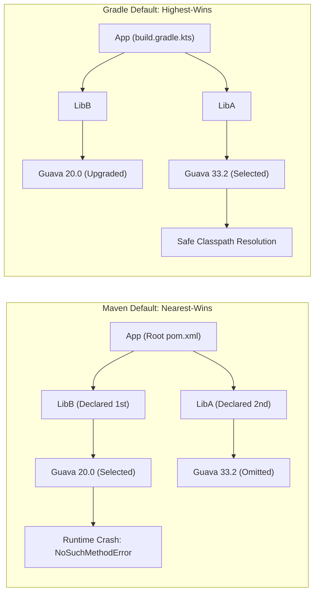
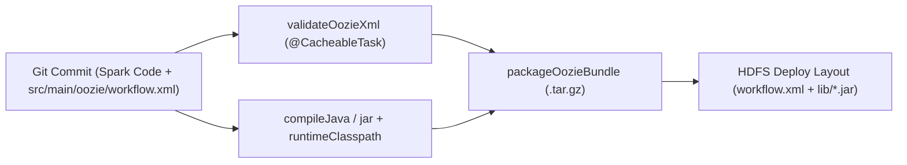

import Alert from '@/components/Alert.astro';
import Chart from '@/components/Chart.astro';
import GitHubRepoCard from '@/components/GitHubRepoCard.astro';
import LinkInline from '@/components/LinkInline.astro';

Years ago, when our data platform orchestrated dozens of Hadoop and Spark batch pipelines through **Apache Oozie** (which officially retired to the Apache Attic in spring 2025), we lived with an awkward split brain. Our Spark and MapReduce application code sat safely in Git with full CI coverage, yet the Oozie DAG `workflow.xml` definitions had no unified build or version-control lifecycle. Engineers edited XML files by hand and uploaded them directly to HDFS, and operational overhead kept climbing until the inevitable happened: an accidental overwrite triggered a **production DAG XML file loss incident**, halting downstream batch jobs while we reconstructed workflow definitions from cluster logs.

Already exhausted by sprawling multi-module `pom.xml` files and recurring transitive dependency clashes, I proposed consolidating everything into a Gradle repository powered by a **custom Gradle plugin** — validating, versioning, and bundling Oozie DAG definitions right alongside our Spark and Hadoop jobs in Git. The pushback from part of the team was immediate: *"Maven already does everything we need. Why introduce another build tool?"*

Answering that pushback takes more than complaining about XML verbosity. You have to look at why JVM build tools kept evolving over the past two decades, where Gradle structurally diverges from Maven under production load, and which build tool actually fits your architecture in 2026.

| Build Tool | Core Philosophy | Config Format | Standout Strength | Best Fit in 2026 |
| :--- | :--- | :--- | :--- | :--- |
| **Maven** (`3.9/3.10` · `4 RC`) | Strict linear lifecycle & conventions | `pom.xml` (`4.0.0` / `4.1.0`) | Zero-surprise standardization, rock-solid stability | 1–3 module Java/Spring Boot CRUD services |
| **Gradle** (`9.x`) | Incremental Task DAG & extensible model | `build.gradle.kts` + `libs.versions.toml` | Highest-wins resolution, `build-logic` convention plugins, remote build cache | 5+ module backends, Kotlin repos, custom artifact pipelines |
| **Mill** (`1.0+`) | Fast, explicit task graph without daemon bloat | `build.mill` / `build.mill.yaml` | GraalVM native launcher (around 100ms startup), sandboxed tasks | Java/Kotlin/Scala teams wanting Gradle speed with simpler mental models |
| **Kotlin Toolchain** (`Alpha`) | Purely declarative UX over build mechanics | `module.yaml` | Minimal boilerplate for Kotlin Multiplatform & Spring Boot | Greenfield Kotlin prototypes (formerly JetBrains Amper) |
| **Bazel** (`8/9`) | Hermetic, reproducible polyglot graph | `MODULE.bazel` + `BUILD` (Starlark) | Distributed remote execution across massive monorepos | Large polyglot monorepos (Java + Go + C++ + Python) |

---

## The Evolution of JVM Build Tools: Why Did We Keep Reinventing Them?

Every generation of JVM build tooling was born as a direct reaction to the operational blind spots of the tool before it.

- **Apache Ant (2000)**: Created to escape `make`'s OS-specific shell lock-in, Ant gave Java teams cross-platform builds written in XML (`build.xml`). Because it was purely procedural, however, Ant lacked standard directory conventions and built-in dependency management (later bolted on via Apache Ivy). Every repository devolved into thousands of lines of bespoke XML targets that no two teams structured alike.
- **Apache Maven (2004–2005)**: Maven fixed Ant's chaos by enforcing **Convention over Configuration** (`src/main/java`, `src/test/java`), a strict linear lifecycle (`validate` → `compile` → `test` → `package` → `deploy`), declarative `pom.xml` metadata, and transitive dependency resolution backed by **Maven Central**. For standard JAR and WAR packaging, Maven felt effortless — until you needed conditional build steps or custom packaging outside its fixed lifecycle phases.
- **sbt (2008 → `sbt 2.0` GA in June 2026) & Gradle (2008 → 1.0 in 2012 → `Gradle 9.0` GA in August 2025)**: Both tools broke away from rigid XML lifecycles in favor of code-driven DSLs, **Task DAGs (Directed Acyclic Graphs)**, and fine-grained incremental builds. Notably, sbt pioneered the **Zinc** incremental compiler, which became a foundational incremental compilation engine adopted by Gradle and Mill alike. Today, `Gradle 9.x` defaults to the type-safe Kotlin DSL (`build.gradle.kts`, requiring JDK 17+ to run the daemon), while `sbt 2.0` migrated build definitions to Scala 3 and added Bazel-compatible remote caching.

As we explored in [From Oracle's Acquisition to Java's Comeback: 15 Years of the JVM Ecosystem](/en/dev/jvm-ecosystem-15-years), the rise of Kotlin, Scala, and cloud-native microservices stretched the JVM far beyond monolithic WAR deployments — and build tools split sharply along language ecosystems as a result. According to the <LinkInline href="https://www.jetbrains.com/lp/devecosystem-2023/java/" label="JetBrains State of Developer Ecosystem Survey" /> (multiple answers allowed), Maven still anchors traditional Java repositories (`74%` vs. Gradle's `46%`, remaining #1 at `67%` in the 2025 Java report), whereas Gradle dominates the Kotlin ecosystem at `90%`.

<Chart
  type="bar"
  height={300}
  caption="JVM Build Tool Adoption by Language Ecosystem — JetBrains State of Developer Ecosystem Survey (%, multiple answers allowed)"
  data={{
    labels: ['Maven', 'Gradle', 'Ant / Bazel / Others'],
    datasets: [
      {
        label: 'Java Ecosystem (%)',
        data: [74, 46, 7],
        backgroundColor: 'rgba(59, 130, 246, 0.8)',
        borderColor: 'rgba(59, 130, 246, 1)',
        borderWidth: 1,
      },
      {
        label: 'Kotlin Ecosystem (%)',
        data: [19, 90, 1],
        backgroundColor: 'rgba(16, 185, 129, 0.8)',
        borderColor: 'rgba(16, 185, 129, 1)',
        borderWidth: 1,
      },
    ],
  }}
/>

---

## Answering "Maven Already Works": 3 Structural Advantages of Gradle

When engineers defend Maven, they usually point to familiarity: standard CRUD services build reliably without touching `pom.xml` for months. Where Gradle pulls ahead is not toy single-module apps, but multi-module repositories where dependency graphs, CI minutes, and custom deployment artifacts start compounding.

### 1. Concise, Type-Safe Kotlin DSL and Version Catalogs vs. Verbose XML

In Maven, adding a single library costs five lines of angle-bracket ceremony (`<dependency>`, `<groupId>`, `<artifactId>`, `<version>`, `<scope>`). Across a 15-module backend, `pom.xml` files routinely balloon past 500 lines of visual noise where spotting a misconfigured scope or duplicate override requires careful scrolling.

Pairing Gradle's Kotlin DSL (`build.gradle.kts`) with **Version Catalogs** (`gradle/libs.versions.toml`) turns dependency coordinates into compile-time type-safe accessors with full IDE autocomplete and refactoring support:

```toml
# gradle/libs.versions.toml
[versions]
spring-boot = "4.0.2"
guava = "33.4.0-jre"

[libraries]
spring-boot-webmvc = { module = "org.springframework.boot:spring-boot-starter-webmvc", version.ref = "spring-boot" }
guava = { module = "com.google.guava:guava", version.ref = "guava" }
```

```kotlin
// service-order/build.gradle.kts
dependencies {
    implementation(libs.spring.boot.webmvc)
    implementation(libs.guava)
    testImplementation(kotlin("test"))
}
```

### 2. Dependency Conflict Resolution: Nearest-Wins Traps vs. Highest-Wins

The most dangerous difference between Maven and Gradle hides inside transitive dependency mediation. Per the <LinkInline href="https://maven.apache.org/guides/introduction/introduction-to-dependency-mechanism.html" label="Apache Maven Dependency Mechanism Guide" />, Maven resolves version conflicts using **Nearest Definition** (**Nearest-Wins**): whichever version sits fewer hops from your root `pom.xml` wins. Worse yet, if two conflicting versions sit at the exact same graph depth, **declaration order in `pom.xml` decides the winner** — completely ignoring semantic version numbers.

Picture a routine production failure mode:
- `LibB` (declared first in `pom.xml`, depth 2) depends on legacy `Guava 20.0`.
- `LibA` (declared second, depth 2 — or nested at depth 3) relies on `ImmutableMap.ofEntries()`, a method introduced in newer Guava releases (`Guava 33.2`).
- Maven selects `Guava 20.0` because it is nearer or declared earlier. Your project's own source code compiles cleanly without a single warning — and production blows up at runtime with `java.lang.NoSuchMethodError`.

By contrast, the <LinkInline href="https://docs.gradle.org/current/userguide/dependency_resolution.html" label="Gradle Dependency Resolution Guide" /> defaults to **Highest Version Wins**, automatically upgrading the graph to `Guava 33.2`. Beyond simple version comparison, Gradle models **Rich Version Constraints** (`strictly`, `require`, `prefer`, and `reject` to block known CVEs across transitive paths) alongside **Capability Conflict** detection, which catches mutually exclusive implementations hiding under different coordinates (such as `commons-logging:commons-logging` colliding with `org.springframework:spring-jcl`).



```kotlin
// Enforcing transitive CVE blocks and version floors in build.gradle.kts
dependencies {
    constraints {
        implementation("org.apache.logging.log4j:log4j-core") {
            version {
                require("2.24.3")
                reject("[2.0, 2.17.1)") // Hard-block vulnerable Log4Shell versions
            }
            because("Block legacy Log4j CVE range across all transitive dependencies")
        }
    }
}
```

<Alert type="info" title="Can Maven Defend Against Silent Downgrades?">
Yes — experienced Maven teams mitigate Nearest-Wins traps by importing BOMs in `<dependencyManagement>`, configuring `maven-enforcer-plugin`'s `requireUpperBoundDeps` rule to fail builds on transitive downgrades, or passing Maven Resolver's (`3.9+`) `-Daether.conflictResolver.versionSelector.selectionStrategy=highest` flag. The structural difference is **safe defaults out of the box**: Gradle protects against silent version downgrades on day one without extra plugin ceremony.
</Alert>

### 3. Custom & Convention Plugins: Ending Our Oozie DAG Loss Incidents

Returning to our data engineering incident: per the <LinkInline href="https://oozie.apache.org/docs/5.2.1/WorkflowFunctionalSpec.html" label="Apache Oozie Workflow Functional Specification" />, deploying an Oozie coordinator or workflow to HDFS requires a strict directory layout — `workflow.xml` (and job `.properties`) at the bundle root, alongside every compiled Spark/MapReduce application JAR and third-party dependency inside `lib/*.jar`.

Automating this in Maven meant writing a custom **Mojo** (`maven-plugin`) in a separate repository, publishing plugin versions to Nexus or Artifactory every time we tweaked validation logic, and pasting verbose `<execution>` blocks into every pipeline module's `pom.xml`. Most teams understandably give up and write ad-hoc Bash deployment scripts instead — which is how our `workflow.xml` files drifted out of Git in the first place.

With Gradle's composite builds (`includeBuild("build-logic")`) and **Convention Plugins**, we built a self-contained `mycorp.oozie-workflow` plugin directly inside the repository. An incremental `@CacheableTask` validated every `src/main/oozie/**/*.xml` file against XML well-formedness and required `<start>`/`<end>` workflow nodes during `./gradlew check`, then packaged `workflow.xml` and `lib/*.jar` into a deterministic `.tar.gz` artifact:

```kotlin
// build-logic/src/main/kotlin/mycorp.oozie-workflow.gradle.kts
import javax.xml.parsers.DocumentBuilderFactory
import org.gradle.api.tasks.bundling.Compression

plugins {
    java
}

@CacheableTask
abstract class ValidateOozieXmlTask : DefaultTask() {
    @get:InputFiles
    @get:PathSensitive(PathSensitivity.RELATIVE)
    abstract val workflowFiles: ConfigurableFileCollection

    @get:OutputFile
    abstract val reportFile: RegularFileProperty

    @TaskAction
    fun validate() {
        val factory = DocumentBuilderFactory.newInstance().apply { isNamespaceAware = true }
        val files = workflowFiles.files
        val workflowXml = checkNotNull(files.find { it.name == "workflow.xml" }) {
            "Missing required Oozie workflow.xml!"
        }
        files.forEach { xml ->
            val doc = factory.newDocumentBuilder().parse(xml)
            if (xml == workflowXml) {
                check(doc.getElementsByTagName("start").length > 0 && doc.getElementsByTagName("end").length > 0) {
                    "Invalid Oozie DAG (${xml.name}): missing <start> or <end> node"
                }
            }
        }
        reportFile.get().asFile.writeText("Validated ${files.size} Oozie DAG file(s).\n")
    }
}

val validateOozieXml = tasks.register<ValidateOozieXmlTask>("validateOozieXml") {
    workflowFiles.from(fileTree("src/main/oozie") { include("**/*.xml") })
    reportFile.set(layout.buildDirectory.file("reports/oozie/validation.txt"))
}

tasks.named("check") { dependsOn(validateOozieXml) }

tasks.register<Tar>("packageOozieBundle") {
    dependsOn(validateOozieXml)
    archiveExtension.set("tar.gz")
    compression = Compression.GZIP
    from("src/main/oozie") { include("**/*.xml", "**/*.properties") }
    into("lib") {
        from(tasks.named("jar"))
        from(configurations.runtimeClasspath)
    }
}
```



Every batch pipeline module simply declared `plugins { id("mycorp.oozie-workflow") }`. Spark code changes and Oozie DAG edits moved together in the same pull request, tagged under the same release artifact, eliminating manual XML uploads and file-loss incidents overnight.

That same task-graph architecture also powers Gradle's **4-tier build performance model**:
1. **Incremental Tasks (`UP-TO-DATE`)**: By hashing declared `@InputFiles` and `@OutputFile` snapshots, Gradle skips tasks whose inputs haven't changed — removing the habitual `mvn clean install` tax that wastes hours every week.
2. **Local & Remote Build Cache (`FROM-CACHE`)**: `@CacheableTask` outputs are keyed by input hashes and shared across CI runners and developer laptops.
3. **Configuration Cache**: Matured across Gradle 8 and first-class in `Gradle 9.x`, caching the resolved task graph itself so repeat invocations start executing tasks almost immediately.
4. **Isolated Projects (`Incubating` in Gradle 9.7+)**: Eliminates cross-project mutable state during configuration so large multi-module builds configure in parallel and sync faster inside IntelliJ IDEA.

---

## 2026 Trends: Gradle's Trade-Offs and the Next Wave of JVM Build Tools

Advocating for Gradle doesn't mean ignoring its warts. Because `build.gradle.kts` is Turing-complete code, undisciplined teams often dump imperative loops and ad-hoc network calls directly into build files rather than isolating logic inside `build-logic` plugins, turning builds into brittle spaghetti. The Gradle Daemon consumes noticeable RAM alongside IntelliJ IDEA, and major Gradle upgrades (`7.x` → `8.x` → `9.x`) demand strict attention to deprecated plugin APIs.

Those exact pain points have sparked the most active competition the JVM build ecosystem has seen in a decade:

1. **Apache Maven's Counterpunch (`Maven 3.10` GA & `Maven 4` RC)**: While production stable releases sit on the `3.9.x` and `3.10.x` lines, <LinkInline href="https://maven.apache.org/whatsnewinmaven4.html" label="Maven 4" source="4.0.0-rc-7" variant="badge" /> is in late Release Candidate testing (requiring JDK 17+ to run). Introducing `modelVersion="4.1.0"`, Maven 4 cleanly separates the **Build POM from the Consumer POM** published to Maven Central, infers parent versions automatically across `<subprojects>` (killing boilerplate `<version>` repetition), and adds dedicated `packaging="bom"` support.
2. **Mill (`1.0+` GA)**: Created by Li Haoyi and reaching `1.0` GA in mid-2025, Mill expanded well beyond Scala into a first-class build tool for **Java, Kotlin, and Scala**. Backed by a GraalVM native client launcher (around 100ms CLI startup), filesystem-sandboxed tasks, discoverable IDE autocomplete in `build.mill`, and lightweight declarative `build.mill.yaml` configs, Mill targets teams who want Gradle-grade caching without Gradle's steep mental model.
3. **JetBrains Kotlin Toolchain (formerly Amper, `Alpha`)**: Originally unveiled as Project Amper, JetBrains spun the project out into a standalone declarative `module.yaml` build toolchain (`Alpha` in late 2026 under `JetBrains/kotlin-toolchain`). It strips Kotlin Multiplatform and Spring Boot setup down to a dozen lines of YAML, though plugin extensibility remains too early for complex enterprise core systems.
4. **Bazel (`Bazel 8/9` & `MODULE.bazel`)**: Bazel has fully retired legacy `WORKSPACE` files in favor of **Bzlmod** (`MODULE.bazel`). When 500 engineers share a polyglot monorepo mixing Java, Go, C++, and Python with remote build execution, Bazel has no equal — but maintaining Starlark rules and IDE sync (`bazelbsp`) is heavy overkill for pure JVM backend teams.

<div class="my-6 grid gap-4 md:grid-cols-2">
  <GitHubRepoCard
    class="!my-0"
    repo="gradle/gradle"
    comment="Gradle 9.x — Incremental Task DAG, Kotlin DSL default, Configuration Cache, and build-logic convention plugins."
  />
  <GitHubRepoCard
    class="!my-0"
    repo="apache/maven"
    comment="Apache Maven — The enterprise standard evolving toward Maven 4 (Build/Consumer POM split and automatic parent version inference)."
  />
  <GitHubRepoCard
    class="!my-0"
    repo="com-lihaoyi/mill"
    comment="Mill 1.0+ — Fast GraalVM native launcher, sandboxed tasks, and clean Java/Kotlin/Scala builds without Gradle complexity."
  />
  <GitHubRepoCard
    class="!my-0"
    repo="JetBrains/kotlin-toolchain"
    comment="JetBrains Kotlin Toolchain (formerly Amper, Alpha) — Declarative module.yaml build experience for Kotlin and KMP."
  />
</div>

---

## Practical Decision Guide: Matching the Build Tool to Your Project

Much like choosing runtime stacks in our [2026 Backend Framework Guide: Beyond the Spring Default](/en/dev/backend-framework-guide), picking a JVM build tool is an exercise in matching architectural constraints rather than chasing trends:

- **When Staying on Maven Makes Total Sense**: You run single-module or compact 2–3 module Java Spring Boot CRUD microservices, deploy standard executable JARs or container images (via Jib or Buildpacks), and want rigid guardrails so nobody on the team can invent clever imperative build scripts. Pair Maven `3.9+`/`3.10+` with `<dependencyManagement>` BOMs and `maven-enforcer-plugin` (`requireUpperBoundDeps`), and keep an eye on Maven 4 GA.
- **When Gradle (`build.gradle.kts` + `build-logic`) Pays Off**: You maintain a 5+ module repository, write Kotlin, manage deep transitive dependency graphs requiring explicit CVE rejections and capability rules, rely on remote build caching to keep CI under five minutes, or package custom operational artifacts (like our Oozie/Spark bundles, OpenAPI/Protobuf codegen, or custom static checks). Enforce one ground rule from day one: keep root `build.gradle.kts` files declarative and isolate all custom task logic inside `build-logic` convention plugins.
- **When to Evaluate Mill, Kotlin Toolchain, or Bazel**: Pilot **Mill `1.0+`** on greenfield Java/Kotlin/Scala services if your team resents Gradle daemon overhead and upgrade churn; test **Kotlin Toolchain** on internal KMP apps where declarative `module.yaml` shines; reserve **Bazel (`MODULE.bazel`)** strictly for large polyglot monorepos backed by a dedicated Developer Productivity / Platform Engineering team.

Next time a teammate asks, *"Maven already works — why switch?"*, skip the debate over XML angle brackets versus Kotlin curly braces. Ask instead what happens when two transitive dependencies quietly disagree on a library version at runtime, or when operational workflow files live outside your build pipeline because writing a custom plugin felt too painful. The right build tool is the one that turns both failure modes into compile-time guarantees.

---

## References

- [Introduction to the Dependency Mechanism — Apache Maven Official Documentation](https://maven.apache.org/guides/introduction/introduction-to-dependency-mechanism.html)
- [What's New in Maven 4 — Apache Maven Project](https://maven.apache.org/whatsnewinmaven4.html)
- [Dependency Resolution & Rich Versions — Gradle User Manual](https://docs.gradle.org/current/userguide/dependency_resolution.html)
- [Sharing Build Logic between Subprojects (`build-logic` Convention Plugins) — Gradle User Manual](https://docs.gradle.org/current/userguide/sharing_build_logic_between_subprojects.html)
- [Gradle 9.0 Release Notes — Gradle Official Documentation](https://docs.gradle.org/9.0.0/release-notes.html)
- [Workflow Functional Specification (HDFS Deployment Layout) — Apache Oozie 5.2.1](https://oozie.apache.org/docs/5.2.1/WorkflowFunctionalSpec.html)
- [The State of Developer Ecosystem 2023 & 2025 (Java & Kotlin Build Tools) — JetBrains](https://devecosystem-2025.jetbrains.com/java)
- [Mill Build Tool Documentation (`1.0+` Java/Kotlin/Scala) — Mill Project](https://mill-build.org/mill/index.html)
