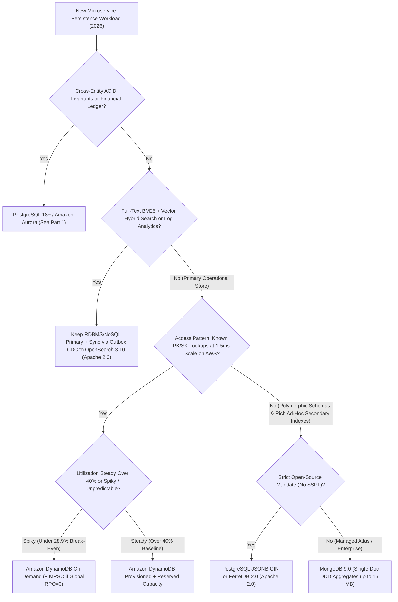

import Alert from '@/components/Alert.astro';
import Chart from '@/components/Chart.astro';
import LinkPreviewCard from '@/components/LinkPreviewCard.astro';
import LinkInline from '@/components/LinkInline.astro';
import GitHubRepoCard from '@/components/GitHubRepoCard.astro';

Even after standardizing core transactional ledgers on PostgreSQL 18+ or Amazon Aurora in [Part 1](/en/dev/msa-rdbms-mysql-mariadb-aurora), forcing polymorphic product catalogs, 50,000-RPS shopping carts, and hybrid lexical + vector search into a single relational cluster leads straight to `LIKE '%keyword%'` buffer-pool meltdowns and painful manual sharding. Relational engines enforce ironclad ACID invariants across normalized rows, yet every cross-shard join, unindexed substring filter, or sparse Entity-Attribute-Value (EAV) pivot pushes fixed-page B-trees into access patterns they were never built to serve. Part 2 of our Cloud & MSA Database Selection Guide breaks down persistent NoSQL architectures in microservices—comparing **MongoDB 8.0 / 9.0, Amazon DynamoDB, and OpenSearch 3.x (vs. Elasticsearch 9.x)** across open-source licensing wars, storage engine ceilings, FinOps break-even math, and zero-dual-write CDC synchronization.

| Engine & 2026 Baseline | Data Model & Storage Engine | License & Governance | Hard Physical Limits | Ideal MSA Role |
| :--- | :--- | :--- | :--- | :--- |
| **MongoDB 8.0 / 9.0** | Binary `BSON` Documents · `WiredTiger` (MVCC + Zstd) | **SSPL v1** *(MongoDB Inc.; OSI non-open-source)* | **`16 MB`** max BSON doc · **`60s`** default multi-doc TX limit | Polymorphic catalogs, DDD Aggregate stores, rich secondary indexing |
| **Amazon DynamoDB** | Partitioned Key-Value / Wide-Column · 3-AZ `Paxos` + SSD | **AWS Proprietary Managed** *(Serverless API)* | **`400 KB`** max item · **`1,000 WCU / 3,000 RCU`** per partition | Tier-1 carts, session state, gaming/IoT ingestion, Global `RPO=0` (MRSC) |
| **OpenSearch 3.x** *(vs. ES 9.x)* | Inverted Index + HNSW Vector · **Apache Lucene 10** (JVM 21+) | **Apache 2.0** *(Linux Foundation)* vs. ES **AGPLv3 / SSPL / ELv2** | **`1s` NRT** default `refresh_interval` · No multi-doc ACID rollback | CQRS secondary read model, BM25 + k-NN `hybrid` search, log analytics |

---

## When RDBMS Hits Physics Walls & Polyglot Persistence

PostgreSQL and Aurora handle vertical scale and read replicas remarkably well, right up until a microservice hits four specific structural bottlenecks that relational storage engines fight by design.

### Four Friction Points Where Manual RDBMS Sharding Hurts

1. **Horizontal Write Sharding Destroys Relational Ergonomics**: Scaling writes past a single primary writer node in MySQL or PostgreSQL means introducing sharding middleware (`Vitess`, `Citus`) or application-level shard routing. The moment rows split across physical shards, cross-shard `JOIN`s turn into high-latency scatter-gather fan-out, foreign keys stop working, and online resharding during tenant growth becomes an operational minefield.
2. **Polymorphic Domain Schemas**: Consider a marketplace catalog spanning 600 product categories—laptops carry CPU socket and RAM timings, apparel carries fabric weave and regional sizing grids, and groceries carry cold-chain expiration metadata. Modeling that in pure relational tables forces ugly choices: wide tables with hundreds of `NULL` columns, five-way EAV self-joins that cripple query plans, or opaque `JSONB` blobs stripped of strict column-level invariants.
3. **Predictable Single-Digit Millisecond Latency Under Flash Spikes**: Connection pools, lock managers, and MVCC vacuuming introduce tail-latency jitter (`p99` spikes) when flash-sale traffic jumps 20x in ten seconds. High-velocity shopping carts, feature-flag evaluators, and IoT telemetry pipelines often need guaranteed 1–5 ms key-value lookups with zero connection-pool ceremonies.
4. **Full-Text Lexical + High-Dimensional Vector Search**: Running `WHERE description LIKE '%wireless%'` bypasses B-tree indexes and scans cold pages straight through your OLTP buffer pool. Even native full-text extensions and `pgvector` eventually contend for RAM with live payment transactions once you combine language-specific stemming, typo-tolerant fuzziness, dynamic facet aggregations, and multi-million-vector HNSW filtering.

In 2011, **Martin Fowler** coined <LinkInline href="https://martinfowler.com/bliki/PolyglotPersistence.html" label="Polyglot Persistence" /> to describe an architecture that pairs each bounded context with the data store matching its exact access pattern. Microservices turned that concept from a risky monolith complication into a natural consequence of **Database per Service**: keep payments, settlements, and inventory ledgers on [Aurora or PostgreSQL 18+](/en/dev/msa-rdbms-mysql-mariadb-aurora), while assigning document, key-value, or inverted-index stores solely to services that genuinely earn the operational trade-off.

<Alert type="warning" title="Two Expensive Production NoSQL Anti-Patterns">
① **Resume-Driven NoSQL on Financial & Inventory Ledgers**: Adopting a document or key-value store for double-entry accounting, wallet balances, or SKU stock deductions just because "NoSQL scales" pushes constraint enforcement and multi-entity rollback into application code. Hand-rolled application locks eventually leak race conditions under pod restarts—if your core domain invariant spans normalized relational entities, stay on an ACID RDBMS.

② **Treating OpenSearch or Elasticsearch as Your Sole Primary Source of Truth**: Inverted-index engines optimize for Near Real-Time (NRT) search visibility (`refresh_interval: 1s` by default), provide zero multi-document ACID rollback, and routinely require destructive full reindexing whenever you modify text analyzers, field mappings, or embedding dimensions. Always store authoritative records in an RDBMS, MongoDB, or DynamoDB, and treat your search cluster strictly as a rebuildable downstream read projection.
</Alert>

---

## Licensing Wars & Lineage: From SSPL Shocks to AGPLv3 and the Linux Foundation

Just as Oracle's acquisition of Sun fractured the MySQL family tree in Part 1, cloud computing triggered an existential licensing war across NoSQL and search vendors between 2018 and 2026. Choosing an engine today is as much a cloud-governance decision as a technical benchmark.

### MongoDB: AGPLv3 to SSPL v1, Protocol Clones, and MongoDB 9.0 GA

Released in **2009** by 10gen (now MongoDB Inc.) under the **GNU AGPLv3**, MongoDB popularized developer-friendly JSON-like document persistence. As cloud adoption accelerated, however, hyperscalers began selling lucrative managed MongoDB services without contributing revenue back upstream.

In **October 2018**, MongoDB Inc. relicensed MongoDB Server (starting from 4.0.3 / 3.6.8) under the **Server Side Public License (SSPL v1)**. Section 13 of SSPL requires any organization offering MongoDB as a managed service to release the complete source code of its surrounding cloud management plane—backups, orchestration, billing, monitoring, and host provisioning—under SSPL. The Open Source Initiative (OSI) rejected SSPL as non-open-source, effectively locking public clouds out of running upstream MongoDB versions without a commercial partnership.

That licensing wall split the document database ecosystem into three distinct tracks:

- **AWS `Amazon DocumentDB` (8.0 compatibility)**: Launched in January 2019, DocumentDB does not run a single line of MongoDB Server code; instead, it emulates the MongoDB wire protocol atop Amazon Aurora's distributed 3-AZ storage engine. While convenient for AWS-native shops, edge-case aggregation operators, indexing behaviors, and transaction semantics still trail upstream MongoDB.
- **`FerretDB` (2.0, Apache 2.0)**: A genuinely open-source **Apache 2.0** proxy/engine (backed by Microsoft's open-source `DocumentDB` PostgreSQL extension) that translates MongoDB wire-protocol queries directly into **PostgreSQL**—giving Kubernetes and multi-cloud teams an SSPL-free path for moderate document workloads.
- **Upstream `MongoDB 9.0` (September 2026 GA) & MongoDB Atlas**: Unrestricted by cloud copycats, MongoDB Inc. poured engineering investment into performance and security, shipping **`MongoDB 9.0` GA in September 2026** <LinkInline href="https://www.mongodb.com/docs/manual/release-notes/9.0/" label="MongoDB 9.0 Release Notes" variant="badge" />. Building atop 8.0's foundational WiredTiger path optimizations, MongoDB 9.0 delivers up to **+35% faster `findOne` reads and +30% faster `updateOne` writes** over 8.0, promotes **Prefix, Suffix, and Substring Queryable Encryption** to GA on encrypted fields, adds **Intelligent Workload Management** for adaptive admission control during overload, and ships native **OpenTelemetry** distributed tracing.

<GitHubRepoCard
  repo="mongodb/mongo"
  comment="Upstream MongoDB Server (SSPL v1) — MongoDB 9.0 (Sep 2026 GA) delivers +30–35% single-doc throughput gains over 8.0 plus GA substring Queryable Encryption."
/>

### Amazon DynamoDB: From the 2007 Leaderless Paper to Paxos & 2025 MRSC

System design interviews routinely confuse two very different systems built inside Amazon: the **2007 `Dynamo` research paper** and the managed **Amazon DynamoDB** cloud service launched in **January 2012**.

Amazon's **SOSP 2007 paper** (*"Dynamo: Amazon's Highly Available Key-value Store"*, DeCandia et al.) described an internal shopping-cart store built on a **leaderless consistent-hashing ring**, **sloppy quorums**, and client-side **vector clocks**—sacrificing strong consistency (`AP` tendencies) so writes never stalled during network partitions. That paper directly inspired **Apache Cassandra** and **Riak**, yet running decentralized Dynamo clusters inside Amazon still burdened product teams with operational provisioning and gnarly vector-clock conflict resolution.

When AWS built **Amazon DynamoDB** from scratch for public GA in **2012**—and pulled back the curtain ten years later in its **USENIX ATC 2022 paper**—the internal architecture was radically different:

<LinkPreviewCard
  url="https://www.amazon.science/publications/amazon-dynamodb-a-scalable-predictably-performant-and-fully-managed-nosql-database-service"
  title="Amazon DynamoDB: A Scalable, Predictably Performant, and Fully Managed NoSQL Database Service (USENIX ATC 2022)"
  siteName="Amazon Science"
  comment="Elhemali et al. reveal how production DynamoDB replaced 2007 Dynamo's leaderless sloppy quorums with per-partition 3-AZ Paxos leader consensus, log-only replicas, and global admission control."
/>

Instead of leaderless eventual consistency, every physical storage partition in **Amazon DynamoDB** forms a **3-AZ replication group governed by `Paxos` leader consensus**, augmented by lightweight write-ahead log replicas for fast quorum durability. Routing writes and **`ConsistentRead: true` (Strongly Consistent Reads)** through an elected partition leader gives microservices linearizable single-region consistency at single-digit millisecond latency.

In **June 2025**, AWS closed DynamoDB's last remaining architectural ceiling for financial and mission-critical global systems by launching **Global Tables `Multi-Region Strong Consistency` (MRSC, GA)** <LinkInline href="https://docs.aws.amazon.com/amazondynamodb/latest/developerguide/V2globaltables_HowItWorks.html" label="DynamoDB Global Tables MRSC" variant="badge" />. Unlike classic Global Tables (`MREC`—asynchronous multi-region eventual consistency with last-writer-wins conflict resolution), MRSC stretches multi-region Paxos consensus across three AWS Regions (or two Regions plus a witness), delivering **`RPO = 0` zero data loss** and cross-region strongly consistent reads out of the box.

### Elasticsearch vs. OpenSearch: The 2024–2026 Governance Plot Twist

Created by **Shay Banon** and released under **Apache 2.0 in February 2010**, **Elasticsearch** wrapped **Apache Lucene** inside a distributed, RESTful JSON engine that powered a decade of full-text search and ELK observability stacks.

In **January 2021**, Elastic followed MongoDB's playbook, switching Elasticsearch **7.11+** and Kibana off Apache 2.0 onto dual **SSPL / Elastic License v2 (ELv2)** to block AWS's managed Elasticsearch Service. Three months later, in **April 2021**, AWS forked the final Apache 2.0 release (`Elasticsearch 7.10.2`) to launch the **OpenSearch** project (reaching **1.0 GA** in July 2021) and OpenSearch Dashboards under **Apache 2.0**.

For three years critics questioned whether OpenSearch was merely an AWS-controlled single-vendor fork in disguise—until **18 dramatic days in late summer 2024** reshaped both projects permanently:

- **August 29, 2024 — Elastic Adds GNU AGPLv3**: Declaring *"Elasticsearch is Open Source, Again"*, Elastic added the OSI-approved **GNU AGPLv3** alongside SSPL and ELv2 starting in **Elasticsearch 8.16** (evolving into the **Elasticsearch 9.x** line, at **9.6** as of November 2026). While welcoming for self-hosted developers, AGPLv3's network-copyleft trigger still bars cloud providers from offering managed Elasticsearch without commercial terms, and advanced enterprise features (certain security integrations, ML pipelines, and commercial ES|QL tiers) remain gated under **ELv2** or paid subscriptions.
- **September 16, 2024 — OpenSearch Joins The Linux Foundation**: Just **18 days later**, AWS, SAP, and Uber transferred stewardship of OpenSearch to **The Linux Foundation**, establishing the vendor-neutral **`OpenSearch Software Foundation`** <LinkInline href="https://opensearch.org/blog/introducing-the-opensearch-software-foundation/" label="OpenSearch Software Foundation" variant="badge" />. Every core plugin—enterprise RBAC/SAML/OIDC security, anomaly detection, alerting, SQL/PPL, and k-NN vector search—ships **100% free under permissive Apache 2.0**.

By November 2026, **`OpenSearch 3.10`** runs on **Apache Lucene 10** and **JVM 21+**, exploiting modern JDK breakthroughs like Panama `Vector API` SIMD acceleration and lightweight concurrency (part of the runtime renaissance we explored in [From Oracle's Acquisition to Java's Comeback](/en/dev/jvm-ecosystem-15-years)). OpenSearch 3.x also ships native query-level **`hybrid` search** (fusing BM25 lexical scores with k-NN vector similarity in a single normalization pipeline) and **GPU-accelerated HNSW vector index builds** that slash multi-million-embedding indexing times by up to 9x.

<GitHubRepoCard
  repo="opensearch-project/OpenSearch"
  comment="Apache 2.0 distributed search & vector engine under The Linux Foundation's OpenSearch Software Foundation (since Sep 2024) — OpenSearch 3.10 runs atop Lucene 10 & JVM 21+."
/>

---

## Storage Internals, Hard Quotas, FinOps Math & CQRS Outbox Sync

Most NoSQL outages in microservices happen not because the engine failed, but because engineers modeled schemas as if they were writing to PostgreSQL. Every NoSQL engine trades relational flexibility for raw throughput by enforcing strict physical guardrails.

### MongoDB (`BSON + WiredTiger`): Respect the 16 MB Ceiling & DDD Aggregates

Under the hood, MongoDB serializes JSON documents into length-prefixed binary **`BSON`** (preserving explicit `Decimal128`, `Date`, `ObjectId`, and binary array types) inside the **`WiredTiger`** storage engine, combining document-level MVCC concurrency with Zstandard block compression.

Two storage rules dictate whether a MongoDB cluster hums at 50,000 ops/sec or pages an on-call SRE at 3 AM:

1. **Never Grow Unbounded Arrays Toward the `16 MB` Hard Limit**: MongoDB enforces a strict **`16 MB` maximum BSON document size** so a single document never monopolizes RAM or network buffers during replication. Embedding fixed, bounded sub-objects (an order's shipping address and 5–20 line items) is ideal; pushing unbounded events (every user login, IoT sensor tick, or product review) into an array inside one parent document is a ticking time bomb. Use the **Bucket Pattern** (grouping e.g. 200 readings per document) or separate child collections for unbounded `1:N` relationships.
2. **Design Around Single-Document Atomicity, Not Heavy Multi-Doc Transactions**: Although MongoDB supports multi-document ACID transactions across replica sets and sharded clusters, transactions carry a default **`60s` runtime limit** (`transactionLifetimeLimitSeconds`) and pin point-in-time read snapshots inside the **WiredTiger cache**. High-concurrency multi-document transactions drive up dirty-cache ratios and trigger stall throttling. Align each MongoDB document with a **Domain-Driven Design (DDD) Aggregate** so **95%+ of writes commit atomically within a single document**, and publish state changes downstream via **`Change Streams`** backed by the replica set `oplog`.

### DynamoDB: Single-Table Physics, Partition Ceilings & the New `28.9%` Break-Even

DynamoDB achieves flat single-digit millisecond latency at any scale by stripping away cross-item joins and forcing access-pattern-first modeling. In **Single-Table Design**, co-located entity types share generic keys—hashing the **Partition Key (`PK`)** across storage nodes while maintaining a sorted B-tree on the **Sort Key (`SK`)**:

- `PK = CUSTOMER#c_901`, `SK = PROFILE` → Customer account metadata
- `PK = CUSTOMER#c_901`, `SK = ORDER#2026-11-25T10:14:02Z#ord_8841` → Order summary + embedded items

A single `Query` (`PK = 'CUSTOMER#c_901' AND SK BEGINS_WITH 'ORDER#'`, `ScanIndexForward = false`, `Limit = 20`) fetches a customer's 20 newest orders in 3 ms with zero joins. Yet three physical ceilings govern every DynamoDB table:

1. **`400 KB` Maximum Item Size**: Attribute names and values combined cannot exceed **`400 KB`**. Store large payloads or audit blobs in **Amazon S3** and keep only the S3 object key and checksum inside DynamoDB.
2. **`1,000 WCU / 3,000 RCU` per Physical Storage Partition**: Regardless of how high your table-level quota scales, a **single physical partition** caps throughput at **`1,000 WCU`** (`1 KB` write/sec per WCU) and **`3,000 RCU`** (`4 KB` strongly consistent read/sec per RCU, or `6,000` eventually consistent reads/sec). Even on On-Demand tables, hammering one hot `PK` (such as a flash-sale SKU or viral livestream ID) past `1,000 writes/sec` triggers `ProvisionedThroughputExceededException`. Distribute hot writes across **write-sharded keys** (`PROMO#2026#SHARD_0..9`), and pre-allocate partition capacity before major launches using DynamoDB's **`WarmThroughput`** configuration.
3. **GSI Async Replication Backpressure**: Global Secondary Indexes (`GSI`s, up to 20 per table) maintain independent partition layouts fed asynchronously from the base table. If a GSI has a low-cardinality hot partition key (like `STATUS#UNPAID`) or insufficient write capacity, its replication buffer fills up and **throttles writes to your primary base table** to prevent unbounded lag.

Equally important in 2026 is throwing out outdated DynamoDB cost heuristics. For years, architecture guides repeated that DynamoDB On-Demand cost nearly `7x` Provisioned capacity—making Provisioned cheaper above `14%` utilization. **In November 2024, AWS cut DynamoDB On-Demand prices by 50%** (`$1.25 → $0.625` per million Write Request Units and `$0.25 → $0.125` per million Read Request Units in `us-east-1`) <LinkInline href="https://aws.amazon.com/dynamodb/pricing/" label="Amazon DynamoDB Pricing" variant="badge" />.

Run the exact numbers on a **`1,000 WCU` baseline** (`$0.00065 per WCU-hour × 730 hours` = **`$474.50/month` ≈ `$475/month`** for unscaled Provisioned capacity, capable of `2.628 billion` monthly writes at 100% flat saturation):

<Chart
  type="line"
  height={320}
  caption="Monthly DynamoDB Write Cost Break-Even After the 50% On-Demand Price Cut (1,000 WCU Baseline, us-east-1)"
  data={{
    labels: ['10% Util', '20% Util', '28.9% (Break-Even)', '50% Util', '80% Util'],
    datasets: [
      {
        label: 'DynamoDB On-Demand (USD/mo)',
        data: [164, 329, 475, 821, 1314],
        borderColor: 'rgba(59, 130, 246, 0.9)',
        backgroundColor: 'rgba(59, 130, 246, 0.12)',
        tension: 0.1,
      },
      {
        label: 'DynamoDB Provisioned 1,000 WCU (USD/mo)',
        data: [475, 475, 475, 475, 475],
        borderColor: 'rgba(16, 185, 129, 0.9)',
        backgroundColor: 'rgba(16, 185, 129, 0.12)',
        tension: 0,
      },
    ],
  }}
/>

The break-even line doubled from `14.4%` to **`28.9%` average monthly utilization** (`$475/mo`). Because real-world Provisioned Auto Scaling requires keeping 30–50% idle buffer headroom (`Target Utilization = 50–70%`) just to survive sudden traffic spikes without throttling, **On-Demand is now cheaper and safer than Provisioned capacity for the vast majority of spiky microservice workloads**. Switch to Provisioned + 1-year/3-year Reserved Capacity only after a table demonstrates steady, predictable utilization well above **40%**.

### Synchronizing RDBMS to OpenSearch: Transactional Outbox + Debezium CDC

Suppose your Catalog Service stores authoritative product pricing and inventory state in [PostgreSQL 18+ or Aurora](/en/dev/msa-rdbms-mysql-mariadb-aurora) while serving faceted BM25 + semantic vector search from **OpenSearch 3.10**. How do you keep OpenSearch in sync whenever a product changes?

The naive temptation—whether in Spring Boot, NestJS, FastAPI, or Go (see our [2026 Backend Framework Guide](/en/dev/backend-framework-guide))—is an application-level **Dual Write**: commit `productRepo.save(p)` to Postgres, then immediately call `openSearch.index(p)` over HTTP. In production, Dual Writes silently corrupt search indexes in two ways:

- **Partial-Failure Phantom Drift**: If the pod OOM-kills, drops a TCP socket, or hits an OpenSearch `429 Too Many Requests` burst right after Postgres commits, the database change succeeds while OpenSearch stays blind forever—without distributed 2PC locks that cripple microservice availability.
- **Out-of-Order Race Conditions**: Two rapid price updates (`$100` at `t1`, `$80` at `t2`) commit sequentially in Postgres, yet network jitter delays the `t1` HTTP call to OpenSearch so it lands *after* `t2`—permanently overwriting the `$80` search listing with stale `$100` data.

The battle-tested fix combines **CQRS** with the **Transactional Outbox Pattern** and log-based **Debezium Change Data Capture (CDC)**:

<figure class="not-prose my-6">
  <svg viewBox="0 0 880 440" class="w-full h-auto rounded-lg border border-border bg-card p-4" role="img" aria-label="Comparison between broken Application Dual-Write anti-pattern versus reliable CQRS Transactional Outbox with Debezium CDC, Kafka, and OpenSearch 3.10 idempotent upserts">
    <defs>
      <marker id="arrow-red" viewBox="0 0 10 10" refX="8" refY="5" markerWidth="6" markerHeight="6" orient="auto-start-reverse">
        <path d="M 0 1 L 10 5 L 0 9 z" fill="#ef4444" />
      </marker>
      <marker id="arrow-emerald" viewBox="0 0 10 10" refX="8" refY="5" markerWidth="6" markerHeight="6" orient="auto-start-reverse">
        <path d="M 0 1 L 10 5 L 0 9 z" fill="#10b981" />
      </marker>
      <marker id="arrow-blue" viewBox="0 0 10 10" refX="8" refY="5" markerWidth="6" markerHeight="6" orient="auto-start-reverse">
        <path d="M 0 1 L 10 5 L 0 9 z" fill="#3b82f6" />
      </marker>
    </defs>
    <rect x="14" y="14" width="852" height="168" rx="10" fill="none" stroke="var(--border)" stroke-width="1.5" />
    <text x="440" y="38" text-anchor="middle" font-size="13.5" font-weight="700" fill="var(--foreground)">Anti-Pattern: Application-Level Dual Write (Silent Index Drift)</text>
    <text x="440" y="55" text-anchor="middle" font-size="11" font-weight="600" class="fill-red-600 dark:fill-red-400">No Cross-Store Atomicity · Partial Failures &amp; Out-of-Order HTTP Races</text>
    <rect x="34" y="74" width="174" height="86" rx="8" fill="#ef4444" fill-opacity="0.08" stroke="#ef4444" stroke-width="1.4" />
    <text x="121" y="99" text-anchor="middle" font-size="12" font-weight="700" fill="var(--foreground)">Catalog Service Pod</text>
    <text x="121" y="117" text-anchor="middle" font-size="10.5" fill="var(--muted-foreground)">db.save(product)</text>
    <text x="121" y="134" text-anchor="middle" font-size="10.5" fill="var(--muted-foreground)">search.index(product)</text>
    <line x1="208" y1="95" x2="338" y2="95" stroke="#10b981" stroke-width="2" marker-end="url(#arrow-emerald)" />
    <text x="273" y="86" text-anchor="middle" font-size="10" font-weight="700" class="fill-emerald-700 dark:fill-emerald-400">1. SQL COMMIT (OK)</text>
    <line x1="208" y1="141" x2="338" y2="141" stroke="#ef4444" stroke-width="2" stroke-dasharray="5 3" marker-end="url(#arrow-red)" />
    <text x="273" y="157" text-anchor="middle" font-size="10" font-weight="700" class="fill-red-600 dark:fill-red-400">2. HTTP 429 / Crash!</text>
    <rect x="342" y="70" width="206" height="44" rx="7" fill="none" stroke="var(--border)" stroke-width="1.4" />
    <text x="445" y="89" text-anchor="middle" font-size="11" font-weight="700" fill="var(--foreground)">PostgreSQL Primary</text>
    <text x="445" y="105" text-anchor="middle" font-size="9.5" class="fill-emerald-700 dark:fill-emerald-400">Committed Price = $80</text>
    <rect x="342" y="122" width="206" height="44" rx="7" fill="none" stroke="#ef4444" stroke-width="1.4" />
    <text x="445" y="141" text-anchor="middle" font-size="11" font-weight="700" fill="var(--foreground)">OpenSearch Index</text>
    <text x="445" y="157" text-anchor="middle" font-size="9.5" class="fill-red-600 dark:fill-red-400">Stale Price = $100 (or Missing)</text>
    <line x1="548" y1="117" x2="588" y2="117" stroke="#ef4444" stroke-width="1.8" marker-end="url(#arrow-red)" />
    <rect x="592" y="72" width="252" height="92" rx="8" fill="#ef4444" fill-opacity="0.06" stroke="#ef4444" stroke-width="1.3" />
    <text x="718" y="95" text-anchor="middle" font-size="11.5" font-weight="700" class="fill-red-600 dark:fill-red-400">Permanent Read/Write Split</text>
    <text x="718" y="114" text-anchor="middle" font-size="10" fill="var(--muted-foreground)">Search shows $100, Checkout bills $80;</text>
    <text x="718" y="130" text-anchor="middle" font-size="10" fill="var(--muted-foreground)">async HTTP retries reorder v1 over v2</text>
    <text x="718" y="146" text-anchor="middle" font-size="10" fill="var(--muted-foreground)">without strict sequence versioning.</text>
    <rect x="14" y="198" width="852" height="228" rx="10" fill="none" stroke="var(--border)" stroke-width="1.5" />
    <text x="440" y="223" text-anchor="middle" font-size="13.5" font-weight="700" fill="var(--foreground)">Production CQRS Blueprint: Transactional Outbox + Debezium CDC + OpenSearch 3.10</text>
    <text x="440" y="241" text-anchor="middle" font-size="11" font-weight="600" class="fill-emerald-700 dark:fill-emerald-400">Single Local ACID Commit · Zero-Polling WAL Tail · Ordered Idempotent Upserts</text>
    <rect x="32" y="258" width="212" height="122" rx="8" fill="#10b981" fill-opacity="0.08" stroke="#10b981" stroke-width="1.5" />
    <text x="138" y="279" text-anchor="middle" font-size="11.5" font-weight="700" fill="var(--foreground)">PostgreSQL 18+ / Aurora</text>
    <rect x="46" y="290" width="184" height="36" rx="6" fill="var(--card)" stroke="var(--border)" stroke-width="1.2" />
    <text x="138" y="312" text-anchor="middle" font-size="10.5" font-weight="600" fill="var(--foreground)">1a. UPDATE products</text>
    <rect x="46" y="334" width="184" height="36" rx="6" fill="var(--card)" stroke="#10b981" stroke-width="1.2" />
    <text x="138" y="356" text-anchor="middle" font-size="10.5" font-weight="700" class="fill-emerald-700 dark:fill-emerald-400">1b. INSERT outbox_events</text>
    <line x1="244" y1="319" x2="298" y2="319" stroke="#10b981" stroke-width="2.2" marker-end="url(#arrow-emerald)" />
    <text x="271" y="308" text-anchor="middle" font-size="9.5" font-weight="700" class="fill-emerald-700 dark:fill-emerald-400">WAL</text>
    <rect x="302" y="270" width="166" height="98" rx="8" fill="#3b82f6" fill-opacity="0.08" stroke="#3b82f6" stroke-width="1.4" />
    <text x="385" y="295" text-anchor="middle" font-size="11.5" font-weight="700" fill="var(--foreground)">Debezium Connect</text>
    <text x="385" y="314" text-anchor="middle" font-size="10" class="fill-blue-700 dark:fill-blue-400" font-weight="600">pgoutput Logical Slot</text>
    <text x="385" y="332" text-anchor="middle" font-size="10" fill="var(--muted-foreground)">Outbox Event Router</text>
    <text x="385" y="349" text-anchor="middle" font-size="10" fill="var(--muted-foreground)">Unwraps JSON Payload</text>
    <line x1="468" y1="319" x2="518" y2="319" stroke="#3b82f6" stroke-width="2.2" marker-end="url(#arrow-blue)" />
    <text x="493" y="308" text-anchor="middle" font-size="9.5" font-weight="700" class="fill-blue-700 dark:fill-blue-400">CDC</text>
    <rect x="522" y="270" width="144" height="98" rx="8" fill="none" stroke="var(--border)" stroke-width="1.5" />
    <text x="594" y="295" text-anchor="middle" font-size="11.5" font-weight="700" fill="var(--foreground)">Apache Kafka</text>
    <text x="594" y="314" text-anchor="middle" font-size="10" fill="var(--muted-foreground)">Key: aggregateid</text>
    <text x="594" y="332" text-anchor="middle" font-size="10" fill="var(--muted-foreground)">Per-Entity Ordering</text>
    <text x="594" y="349" text-anchor="middle" font-size="10" class="fill-emerald-700 dark:fill-emerald-400" font-weight="600">Replayable Log</text>
    <line x1="666" y1="319" x2="708" y2="319" stroke="#10b981" stroke-width="2.2" marker-end="url(#arrow-emerald)" />
    <text x="687" y="308" text-anchor="middle" font-size="9.5" font-weight="700" class="fill-emerald-700 dark:fill-emerald-400">Bulk</text>
    <rect x="712" y="258" width="142" height="122" rx="8" fill="#10b981" fill-opacity="0.1" stroke="#10b981" stroke-width="1.5" />
    <text x="783" y="282" text-anchor="middle" font-size="11.5" font-weight="700" fill="var(--foreground)">OpenSearch 3.10</text>
    <text x="783" y="302" text-anchor="middle" font-size="10" class="fill-emerald-700 dark:fill-emerald-400" font-weight="600">_id = product_id</text>
    <text x="783" y="320" text-anchor="middle" font-size="10" fill="var(--muted-foreground)">version_type=external_gte</text>
    <text x="783" y="338" text-anchor="middle" font-size="10" fill="var(--muted-foreground)">BM25 + HNSW k-NN</text>
    <text x="783" y="356" text-anchor="middle" font-size="10" class="fill-blue-700 dark:fill-blue-400" font-weight="600">Hybrid Search</text>
    <text x="440" y="405" text-anchor="middle" font-size="10.5" fill="var(--muted-foreground)">Local ACID commit + WAL tailing + external-versioned _id upserts guarantee eventual consistency with zero lost writes.</text>
  </svg>
  <figcaption class="mt-2 text-center text-sm text-muted-foreground">Application Dual Writes risk permanent index drift on network timeouts or race conditions. Committing an outbox row inside the RDBMS transaction and streaming WAL events via Debezium CDC into OpenSearch 3.10 decouples write availability from search indexing.</figcaption>
</figure>

<GitHubRepoCard
  repo="debezium/debezium"
  comment="Apache 2.0 Change Data Capture (CDC) engine — tails PostgreSQL WAL and MySQL Binlog with built-in Outbox Event Router SMT for zero-dual-write microservice synchronization."
/>

Here is the concise three-piece production wiring—combining PostgreSQL 18's native `uuidv7()` outbox table, Debezium's `EventRouter` transform, and OpenSearch 3.10's native `hybrid` BM25 + vector search request (`POST /products_v3/_search?search_pipeline=nlp-hybrid-norm-pipeline`):

```sql
-- 1. PostgreSQL 18+: Atomic Domain + Outbox Table (Committed in One Local TX)
CREATE TABLE outbox_events (
    id             UUID PRIMARY KEY DEFAULT uuidv7(),
    aggregatetype  VARCHAR(64)  NOT NULL, -- Routes to Kafka topic: outbox.event.product
    aggregateid    VARCHAR(128) NOT NULL, -- Becomes Kafka message key & OpenSearch _id
    type           VARCHAR(64)  NOT NULL, -- e.g. ProductUpserted
    version        BIGINT       NOT NULL, -- Monotonic entity version for external concurrency control
    payload        JSONB        NOT NULL,
    created_at     TIMESTAMPTZ  NOT NULL DEFAULT now()
);
```

```json
{
  "name": "catalog-postgres-outbox-cdc",
  "config": {
    "connector.class": "io.debezium.connector.postgresql.PostgresConnector",
    "database.hostname": "${env:PG_HOST}",
    "database.port": "5432",
    "database.user": "${env:PG_USER}",
    "database.password": "${env:PG_PASSWORD}",
    "database.dbname": "catalog",
    "topic.prefix": "catalog",
    "plugin.name": "pgoutput",
    "table.include.list": "public.outbox_events",
    "transforms": "outbox",
    "transforms.outbox.type": "io.debezium.transforms.outbox.EventRouter",
    "transforms.outbox.table.fields.additional.placement": "version:header:eventVersion",
    "transforms.outbox.table.expand.json.payload": "true",
    "value.converter": "org.apache.kafka.connect.json.JsonConverter",
    "value.converter.schemas.enable": "false"
  }
}
```

```json
{
  "size": 10,
  "query": {
    "hybrid": {
      "queries": [
        {
          "bool": {
            "must": [{ "match": { "title": "low profile mechanical keyboard" } }],
            "filter": [{ "term": { "in_stock": true } }]
          }
        },
        {
          "knn": {
            "title_embedding": {
              "vector": [0.021, -0.084, 0.119],
              "k": 50,
              "filter": { "term": { "in_stock": true } }
            }
          }
        }
      ]
    }
  }
}
```

Notice two subtle production details in this pipeline:

- **Zero Table Bloat on `outbox_events`**: Because Debezium reads `INSERT` events directly from PostgreSQL's Write-Ahead Log (`pgoutput`), your application can either `DELETE` immediately after `INSERT` in the same transaction or partition `outbox_events` hourly and `DROP` old partitions instantaneously with zero `VACUUM` overhead.
- **External Version Guard (`version_type=external`)**: Passing the domain entity's monotonic `version` column into OpenSearch's bulk index API (`/_bulk` with `version` and `version_type=external`) guarantees that even if Kafka replays a batch during consumer rebalance, older events are deterministically rejected rather than overwriting newer state.

---

## 2026 MSA Polyglot Persistence Decision Guide

Run every new microservice storage requirement through this architectural filter before spinning up another database cluster:



Polyglot persistence earns its keep only when each extra storage engine eliminates an order of magnitude more complexity than it adds in backups, IAM governance, and CDC pipelines. Anchor your core domain truth in relational tables, reach for **MongoDB 9.0** when polymorphic aggregates genuinely outgrow `JSONB`, deploy **DynamoDB On-Demand** when predictable single-digit millisecond partition scale matters most, and feed **OpenSearch 3.10** asynchronously through a Transactional Outbox.

Even single-digit millisecond disk-backed NoSQL engines hit latency and cost ceilings when microservices validate millions of auth tokens per minute, absorb viral cache stampedes, or coordinate mutually exclusive distributed locks across autoscaling Kubernetes pods. In **[Part 3: Valkey vs. Redis, Stateless JWT Sessions & Distributed Locks](/en/dev/msa-redis-valkey-session-lock)**, we move from disk to pure RAM—examining the 2024–2026 Redis licensing U-turn, the Linux Foundation's `Valkey` takeover, refresh-token rotation architectures, and why Redlock still sparks fierce debate among distributed systems engineers.

---

## References

- [PolyglotPersistence — Martin Fowler](https://martinfowler.com/bliki/PolyglotPersistence.html)
- [Release Notes for MongoDB 9.0 — MongoDB Manual](https://www.mongodb.com/docs/manual/release-notes/9.0/)
- [Amazon DynamoDB: A Scalable, Predictably Performant, and Fully Managed NoSQL Database Service (USENIX ATC 2022) — Amazon Science](https://www.amazon.science/publications/amazon-dynamodb-a-scalable-predictably-performant-and-fully-managed-nosql-database-service)
- [Global Tables: How It Works (Multi-Region Strong Consistency) — AWS Documentation](https://docs.aws.amazon.com/amazondynamodb/latest/developerguide/V2globaltables_HowItWorks.html)
- [Amazon DynamoDB Pricing — AWS](https://aws.amazon.com/dynamodb/pricing/)
- [Introducing the OpenSearch Software Foundation under The Linux Foundation — OpenSearch Project](https://opensearch.org/blog/introducing-the-opensearch-software-foundation/)
- [Outbox Event Router Single Message Transformation — Debezium Documentation](https://debezium.io/documentation/reference/stable/transformations/outbox-event-router.html)
