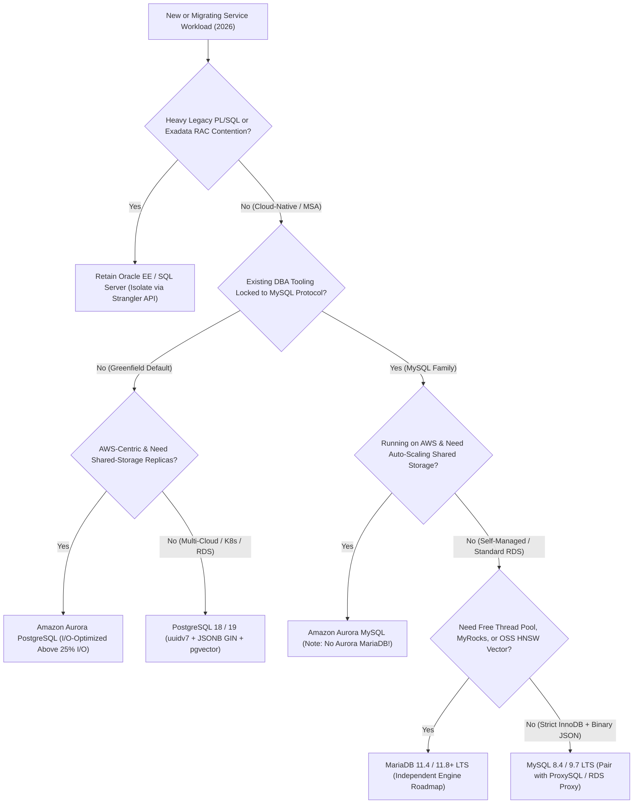

import Alert from '@/components/Alert.astro';
import Chart from '@/components/Chart.astro';
import LinkPreviewCard from '@/components/LinkPreviewCard.astro';
import GitHubRepoCard from '@/components/GitHubRepoCard.astro';

Provisioning a relational database for a new microservice on AWS RDS or Kubernetes looks trivial until someone asks why you picked MySQL over PostgreSQL—or assumes MariaDB is still a drop-in replacement for MySQL 8.4+. Between commercial core-licensing traps, diverging open-source storage internals, and cloud I/O billing surprises, a casual default on day one routinely turns into a painful data migration eighteen months later. This first part of our three-part Cloud & MSA Database Selection Guide breaks down how relational engines evolved for cloud-native architectures and gives you concrete selection criteria for **MySQL, MariaDB, Amazon Aurora, and PostgreSQL** as of late 2026.

| Engine | 2026 Production Baseline | Core License | Architectural Sweet Spot | Primary Watchout |
| :--- | :--- | :--- | :--- | :--- |
| **MySQL** | **8.4 LTS** / **9.7 LTS** *(8.0 EOL Apr 2026)* | GPLv2 + Commercial Dual | Predictable InnoDB OLTP, binary `JSON` partial updates, Multi-Valued Indexes | Thread Pool & HNSW vector index locked behind paid Enterprise / HeatWave |
| **MariaDB** | **11.4 LTS** / **11.8 LTS** / **12.3 LTS** | GPLv2 *(Foundation-governed)* | Free Community Thread Pool, pluggable engines (`MyRocks`, `ColumnStore`), open-source HNSW Vector | `JSON` stored as `LONGTEXT`; zero native GTID or physical backup parity with MySQL |
| **Amazon Aurora** | **Aurora MySQL** / **Aurora PostgreSQL** *(No MariaDB)* | AWS Managed Proprietary Storage | Log-structured 3-AZ 6-way quorum storage, sub-20ms lag across 15 shared-storage replicas | `Aurora Standard` per-million I/O charges spike fast on unindexed scans |
| **PostgreSQL** | **PostgreSQL 18** / **19** | Permissive PostgreSQL *(MIT/BSD-style)* | Complex joins, `JSONB` + GIN, `PostGIS`, `pgvector`, native `uuidv7()`, `REPACK (CONCURRENTLY)` | Connection process overhead still favors pooling (`PgBouncer` / RDS Proxy) at scale |

---

## Why Cloud & MSA Retired Oracle and SQL Server

Walk through the architecture diagrams of banks, telcos, and retailers built in the 2000s and you will find one massive **Oracle Database** or **Microsoft SQL Server** cluster anchoring the entire company. Walk through greenfield cloud-native microservices today and those two names have largely vanished, replaced by PostgreSQL, MySQL, MariaDB, and Amazon Aurora. That shift was not driven by startup fashion—it was forced by cloud unit economics and microservice boundaries.

### Per-Core Licensing vs. Scale-Out & Database-per-Service

Commercial RDBMS pricing was designed for an era when scaling meant wheeling a bigger SMP box into an on-premise data center once every four years. Microservices broke that math in two ways: horizontal autoscaling and the **Database per Service** isolation pattern.

Look at the actual enterprise price sheet:

- **Oracle Database Enterprise Edition (EE)** lists at **$47,500 per processor**, before adding **$23,000 per processor** for Real Application Clusters (RAC) and **22% annual support**. Worse, Oracle's cloud licensing policy strips away its traditional on-premise x86 **0.5 Core Factor** table on AWS (EC2/RDS) and Azure. With hyperthreading enabled, **2 vCPUs count as 1 full Processor license**—effectively doubling per-core licensing cost the moment you move to public cloud compute. On Amazon RDS, "License Included" is restricted to Standard Edition 2 (SE2); running Enterprise Edition requires Bring Your Own License (BYOL) and audit exposure.
- **Microsoft SQL Server Enterprise Edition** (**$15,123 per 2-core pack**) enforces a **4-core minimum license ($30,246) per VM or container**—even if an isolated order-history or notification microservice database barely touches 1 or 2 vCPUs. Nor can public-facing architectures fall back on cheaper User/Device CALs: once requests pass through an API gateway or connection pool, multiplexing rules mandate core-based licensing across the board.

Split a monolith into thirty microservices with dedicated schemas or instances, add Multi-AZ standby nodes, and commercial per-core licensing scales linearly with *topology count* rather than actual throughput. Open-source engines decouple instance topology from software licensing entirely.

### Evicting Stored Procedures & Embracing Cloud-Native Managed HA

In monolithic architectures, packing thousands of lines of billing, inventory, and settlement rules into `PL/SQL` or `T-SQL` stored procedures was a badge of performance craftsmanship—it saved network round-trips between the app server and the database.

In MSA, a shared database stuffed with cross-domain stored procedures becomes the **Integration Database** anti-pattern. When five services mutate the same tables through tightly coupled `PL/SQL` packages, no team can deploy independently without coordinating schema locks and regression windows. Modern architectures push domain logic, orchestration (Sagas, transactional outbox), and CPU scaling up into stateless application containers, leaving the database focused on clean OLTP queries and strict ACID durability. Once you stop writing vendor-specific procedural code inside the database, 80% of your lock-in to Oracle or SQL Server evaporates.

At the infrastructure layer, managed cloud platforms commoditized high availability. Teams used to pay premium license tiers just to unlock **Oracle RAC** or **Active Data Guard**. Cloud providers replaced those add-ons with automated Multi-AZ failover, automated point-in-time recovery (PITR), and quorum-backed storage out of the box.

The ultimate proof came from Amazon itself. Under **Project Rolling Stone** (completed in October 2019), Amazon's Consumer Business migrated roughly **7,500 Oracle databases spanning 75 petabytes** across Prime, Alexa, fulfillment, and payments onto Amazon Aurora, DynamoDB, and RDS—cutting **database costs by over 60% and reducing consumer service latency by 40%**.

### Three Exceptions Where Commercial RDBMS Still Earns Its Keep

Ripping out commercial databases blindly is just as dogmatic as keeping them forever. Three scenarios still justify Oracle or SQL Server in 2026:

1. **Ultra-High-Contention Shared-Everything Ledgers**: Core banking ledgers and securities matching engines where hot-row write contention demands specialized hardware interconnects (**Oracle Exadata / RAC** Active-Active clustering) backed by on-site vendor kernel engineers.
2. **Deep Brownfield `PL/SQL` Estates**: Legacy enterprise backbones running hundreds of thousands of lines of mission-critical, undocumented `PL/SQL` where the operational risk of a multi-year rewrite far outweighs annual maintenance invoices.
3. **Tightly Coupled Microsoft Enterprise Stacks**: Organizations standardized end-to-end on `.NET`, Active Directory, SQL Server Integration Services (SSIS), and Power BI, where operational cohesion beats raw engine savings.

---

## Origin Story & Lineage: MySQL → MariaDB → Amazon Aurora

To understand why MySQL, MariaDB, and Amazon Aurora behave so differently under load—despite sharing client wire protocols—you have to trace the family tree that split them apart.

### Two Daughters and a $7.4 Billion Acquisition

In **May 1995**, Swedish developers **Michael "Monty" Widenius**, David Axmark, and Allan Larsson released **MySQL** under `MySQL AB`, naming the engine after Monty's eldest daughter, **My**. Lightweight, fast on read-heavy workloads, and easy to administer, MySQL became the `"M"` in the **LAMP** stack (Linux, Apache, MySQL, PHP/Python) that powered the explosive growth of Web 2.0.

In **January 2008**, Sun Microsystems acquired `MySQL AB` for **$1 billion**. Just fourteen months later (**announced April 2009, closed January 2010**), **Oracle acquired Sun Microsystems for $7.4 billion**. Just as that acquisition triggered a fifteen-year existential battle over Java (a saga we traced in [From Oracle's Acquisition to Java's Comeback](/en/dev/jvm-ecosystem-15-years)), it handed the world's most widely deployed open-source RDBMS directly to its biggest commercial competitor.

Monty didn't wait around for antitrust assurances. In **October 2009**, before the Sun-Oracle deal even closed, he forked the GPLv2 MySQL 5.1 codebase to launch **MariaDB**—named after his younger daughter, **Maria**—and founded the non-profit **MariaDB Foundation** in December 2012 to guarantee vendor-neutral governance. For its early `5.1`–`5.5` releases, MariaDB tracked MySQL version numbers as a drop-in binary replacement. That era ended permanently with **MariaDB 10.0 in March 2014**, when MariaDB abandoned MySQL version parity and set off on an independent architectural roadmap.

### Amazon Aurora (2015 GA): "The Log is the Database"

While Oracle and MariaDB competed over SQL features and governance, AWS engineers noticed a deeper structural flaw: **traditional monolithic storage engines were never built for cloud networks**.

When you run stock MySQL or MariaDB on cloud block storage like Amazon EBS, a single `UPDATE` transaction triggers severe **write amplification**. To guarantee crash safety without torn pages, InnoDB writes modified **16KB pages** to the doublewrite buffer, flushes those 16KB dirty pages to data files, writes **redo logs**, appends **binlogs**, and mirrors every block across the network to a synchronous Multi-AZ standby EBS volume. Your network pipe saturates long before your CPUs break a sweat.

Unveiled at re:Invent 2014 and **generally available in July 2015** for MySQL (**October 2017 GA** for PostgreSQL), **Amazon Aurora** kept the familiar upper query processor and parser while ripping out the local disk subsystem entirely. As AWS detailed in its landmark **SIGMOD 2017 paper** (*"Amazon Aurora: Design Considerations for High Throughput Cloud-Native Relational Databases"*, Verbitski et al.), Aurora's entire design rests on four words: **"The Log is the Database."**

<LinkPreviewCard
  url="https://www.amazon.science/publications/amazon-aurora-design-considerations-for-high-throughput-cloud-native-relational-databases"
  title="Amazon Aurora: Design Considerations for High Throughput Cloud-Native Relational Databases (SIGMOD 2017)"
  siteName="Amazon Science"
  comment="The foundational Verbitski et al. paper explaining how offloading page materialization to a 6-way quorum storage fleet cuts network I/O by roughly 7.7x."
/>

Instead of flushing 16KB dirty pages or doublewrite buffers across the network, an Aurora compute node ships **only lightweight redo log records** to a multi-tenant distributed storage fleet. Storage nodes append those log records immediately and coalesce them into data pages asynchronously in the background:

- **7.7x Less Network I/O & 5x Throughput**: Eliminating dirty-page flushes, doublewrite buffers, and synchronous standby block mirroring slashes network writes per transaction by roughly **7.7x**, unlocking up to **5x the throughput** of stock MySQL on identical hardware—with near-instant crash recovery since compute nodes never replay gigabytes of redo logs on startup.
- **3-AZ 6-Way Quorum (`Vw = 4`, `Vr = 3`)**: Aurora stripes volumes into 10 GB protection groups (auto-scaling up to **256 TiB**) replicated **6 ways across 3 Availability Zones (`V = 6`)**. A write commits as soon as **4 of 6 copies acknowledge (`Vw = 4`)**, and uncached reads reconstruct state using a **3 of 6 quorum (`Vr = 3`)**. You can lose an entire Availability Zone plus one extra storage node (`AZ + 1`) without losing data or stalling writes.
- **Shared-Storage Read Replicas**: Traditional RDS replicas maintain independent EBS volumes and replay SQL events asynchronously via binlog, often lagging seconds or minutes behind during write bursts. Aurora allows **up to 15 Read Replicas** to mount the **exact same shared storage volume**—incurring zero duplicate storage writes. The writer simply streams redo updates to invalidate or refresh replica buffer pools in memory, holding **replica lag to 10–20ms** and keeping failover **under 30 seconds**.

<figure class="not-prose my-6">
  <svg viewBox="0 0 880 430" class="w-full h-auto rounded-lg border border-border bg-card p-4" role="img" aria-label="Architectural comparison between Standard Cloud RDS on EBS with heavy write amplification versus Amazon Aurora shipping redo logs only to a 3-AZ 6-way quorum shared storage fleet">
    <defs>
      <marker id="arrow-red" viewBox="0 0 10 10" refX="8" refY="5" markerWidth="6" markerHeight="6" orient="auto-start-reverse">
        <path d="M 0 1 L 10 5 L 0 9 z" fill="#ef4444" />
      </marker>
      <marker id="arrow-emerald" viewBox="0 0 10 10" refX="8" refY="5" markerWidth="6" markerHeight="6" orient="auto-start-reverse">
        <path d="M 0 1 L 10 5 L 0 9 z" fill="#10b981" />
      </marker>
      <marker id="arrow-blue" viewBox="0 0 10 10" refX="8" refY="5" markerWidth="6" markerHeight="6" orient="auto-start-reverse">
        <path d="M 0 1 L 10 5 L 0 9 z" fill="#3b82f6" />
      </marker>
    </defs>
    <rect x="14" y="14" width="414" height="402" rx="10" fill="none" stroke="var(--border)" stroke-width="1.5" />
    <text x="221" y="40" text-anchor="middle" font-size="14" font-weight="700" fill="var(--foreground)">Standard Cloud RDS (EBS-Backed MySQL)</text>
    <text x="221" y="58" text-anchor="middle" font-size="11" class="fill-red-600 dark:fill-red-400" font-weight="600">Heavy Network Write Amplification</text>
    <rect x="34" y="74" width="230" height="72" rx="8" fill="#ef4444" fill-opacity="0.08" stroke="#ef4444" stroke-width="1.4" />
    <text x="149" y="96" text-anchor="middle" font-size="12" font-weight="700" fill="var(--foreground)">Primary Compute (InnoDB)</text>
    <text x="149" y="114" text-anchor="middle" font-size="10.5" fill="var(--muted-foreground)">16KB Buffer Pool + Doublewrite</text>
    <text x="149" y="130" text-anchor="middle" font-size="10.5" fill="var(--muted-foreground)">Redo Log + Binary Log</text>
    <rect x="282" y="74" width="128" height="72" rx="8" fill="none" stroke="var(--border)" stroke-width="1.3" stroke-dasharray="4 3" />
    <text x="346" y="98" text-anchor="middle" font-size="11" font-weight="600" fill="var(--foreground)">Read Replica</text>
    <text x="346" y="115" text-anchor="middle" font-size="9.5" fill="var(--muted-foreground)">Async Binlog SQL</text>
    <text x="346" y="130" text-anchor="middle" font-size="9.5" class="fill-red-600 dark:fill-red-400">High Lag Under Load</text>
    <line x1="264" y1="110" x2="279" y2="110" stroke="#ef4444" stroke-width="1.6" marker-end="url(#arrow-red)" />
    <line x1="75" y1="146" x2="75" y2="250" stroke="#ef4444" stroke-width="2" marker-end="url(#arrow-red)" />
    <line x1="125" y1="146" x2="125" y2="250" stroke="#ef4444" stroke-width="2" marker-end="url(#arrow-red)" />
    <line x1="175" y1="146" x2="175" y2="250" stroke="#ef4444" stroke-width="2" marker-end="url(#arrow-red)" />
    <line x1="225" y1="146" x2="225" y2="250" stroke="#ef4444" stroke-width="2" marker-end="url(#arrow-red)" />
    <line x1="346" y1="146" x2="346" y2="250" stroke="var(--muted-foreground)" stroke-width="1.3" stroke-dasharray="4 3" />
    <rect x="36" y="176" width="226" height="48" rx="6" fill="var(--card)" stroke="#ef4444" stroke-width="1" />
    <text x="149" y="196" text-anchor="middle" font-size="10.5" font-weight="700" class="fill-red-600 dark:fill-red-400">4 Separate Network Streams:</text>
    <text x="149" y="213" text-anchor="middle" font-size="10" fill="var(--muted-foreground)">16KB Pages + DblWrite + Redo + Binlog</text>
    <rect x="34" y="256" width="110" height="76" rx="8" fill="none" stroke="var(--border)" stroke-width="1.4" />
    <text x="89" y="284" text-anchor="middle" font-size="11" font-weight="700" fill="var(--foreground)">Primary EBS</text>
    <text x="89" y="302" text-anchor="middle" font-size="9.5" fill="var(--muted-foreground)">AZ-1 Block Disk</text>
    <text x="89" y="317" text-anchor="middle" font-size="9.5" fill="var(--muted-foreground)">Full Write Copy</text>
    <line x1="144" y1="294" x2="159" y2="294" stroke="#ef4444" stroke-width="1.8" marker-end="url(#arrow-red)" />
    <rect x="162" y="256" width="110" height="76" rx="8" fill="none" stroke="var(--border)" stroke-width="1.4" />
    <text x="217" y="284" text-anchor="middle" font-size="11" font-weight="700" fill="var(--foreground)">Standby EBS</text>
    <text x="217" y="302" text-anchor="middle" font-size="9.5" fill="var(--muted-foreground)">AZ-2 Sync Mirror</text>
    <text x="217" y="317" text-anchor="middle" font-size="9.5" fill="var(--muted-foreground)">Duplicated I/O</text>
    <rect x="286" y="256" width="124" height="76" rx="8" fill="none" stroke="var(--border)" stroke-width="1.3" stroke-dasharray="4 3" />
    <text x="348" y="284" text-anchor="middle" font-size="11" font-weight="600" fill="var(--foreground)">Replica EBS</text>
    <text x="348" y="302" text-anchor="middle" font-size="9.5" fill="var(--muted-foreground)">Separate Disk</text>
    <text x="348" y="317" text-anchor="middle" font-size="9.5" fill="var(--muted-foreground)">Re-executes Writes</text>
    <text x="221" y="366" text-anchor="middle" font-size="10.5" fill="var(--muted-foreground)">Every commit flushes full 16KB blocks across network links;</text>
    <text x="221" y="384" text-anchor="middle" font-size="10.5" fill="var(--muted-foreground)">each Read Replica duplicates storage cost and disk writes.</text>
    <rect x="452" y="14" width="414" height="402" rx="10" fill="none" stroke="var(--border)" stroke-width="1.5" />
    <text x="659" y="40" text-anchor="middle" font-size="14" font-weight="700" fill="var(--foreground)">Amazon Aurora ("The Log is the Database")</text>
    <text x="659" y="58" text-anchor="middle" font-size="11" class="fill-emerald-700 dark:fill-emerald-400" font-weight="600">Redo-Only Stream · 7.7x Less Network I/O</text>
    <rect x="472" y="74" width="176" height="72" rx="8" fill="#10b981" fill-opacity="0.1" stroke="#10b981" stroke-width="1.5" />
    <text x="560" y="96" text-anchor="middle" font-size="12" font-weight="700" fill="var(--foreground)">Writer Instance</text>
    <text x="560" y="114" text-anchor="middle" font-size="10.5" fill="var(--muted-foreground)">No 16KB Page Flushes</text>
    <text x="560" y="130" text-anchor="middle" font-size="10.5" class="fill-emerald-700 dark:fill-emerald-400" font-weight="600">No Doublewrite Buffer</text>
    <rect x="676" y="74" width="170" height="72" rx="8" fill="#3b82f6" fill-opacity="0.1" stroke="#3b82f6" stroke-width="1.5" />
    <text x="761" y="96" text-anchor="middle" font-size="12" font-weight="700" fill="var(--foreground)">Up to 15 Read Replicas</text>
    <text x="761" y="114" text-anchor="middle" font-size="10.5" fill="var(--muted-foreground)">Async Redo Cache Sync</text>
    <text x="761" y="130" text-anchor="middle" font-size="10.5" class="fill-blue-700 dark:fill-blue-400" font-weight="600">Lag: 10–20ms · Sub-30s HA</text>
    <line x1="648" y1="110" x2="673" y2="110" stroke="#3b82f6" stroke-width="1.8" marker-end="url(#arrow-blue)" />
    <line x1="560" y1="146" x2="560" y2="236" stroke="#10b981" stroke-width="2.6" marker-end="url(#arrow-emerald)" />
    <line x1="761" y1="236" x2="761" y2="149" stroke="#3b82f6" stroke-width="1.8" stroke-dasharray="5 3" marker-end="url(#arrow-blue)" />
    <rect x="472" y="168" width="178" height="44" rx="6" fill="var(--card)" stroke="#10b981" stroke-width="1.1" />
    <text x="561" y="187" text-anchor="middle" font-size="10.5" font-weight="700" class="fill-emerald-700 dark:fill-emerald-400">Compact Redo Records Only</text>
    <text x="561" y="203" text-anchor="middle" font-size="9.5" fill="var(--muted-foreground)">Write Quorum: 4/6 (Vw=4)</text>
    <rect x="676" y="168" width="170" height="44" rx="6" fill="var(--card)" stroke="#3b82f6" stroke-width="1.1" />
    <text x="761" y="187" text-anchor="middle" font-size="10.5" font-weight="700" class="fill-blue-700 dark:fill-blue-400">Shared Storage Reads</text>
    <text x="761" y="203" text-anchor="middle" font-size="9.5" fill="var(--muted-foreground)">Zero Extra Disk Writes</text>
    <rect x="472" y="242" width="374" height="104" rx="8" fill="#10b981" fill-opacity="0.06" stroke="#10b981" stroke-width="1.5" />
    <text x="659" y="262" text-anchor="middle" font-size="11.5" font-weight="700" fill="var(--foreground)">Shared Distributed Storage Fleet (Auto-scales to 256 TiB)</text>
    <rect x="486" y="272" width="106" height="62" rx="6" fill="var(--card)" stroke="var(--border)" stroke-width="1.2" />
    <text x="539" y="290" text-anchor="middle" font-size="10.5" font-weight="700" fill="var(--foreground)">AZ-1 (2 Copies)</text>
    <text x="539" y="307" text-anchor="middle" font-size="9.5" class="fill-emerald-700 dark:fill-emerald-400">Node 1 [ACK]</text>
    <text x="539" y="322" text-anchor="middle" font-size="9.5" class="fill-emerald-700 dark:fill-emerald-400">Node 2 [ACK]</text>
    <rect x="606" y="272" width="106" height="62" rx="6" fill="var(--card)" stroke="var(--border)" stroke-width="1.2" />
    <text x="659" y="290" text-anchor="middle" font-size="10.5" font-weight="700" fill="var(--foreground)">AZ-2 (2 Copies)</text>
    <text x="659" y="307" text-anchor="middle" font-size="9.5" class="fill-emerald-700 dark:fill-emerald-400">Node 3 [ACK]</text>
    <text x="659" y="322" text-anchor="middle" font-size="9.5" class="fill-emerald-700 dark:fill-emerald-400">Node 4 [ACK]</text>
    <rect x="726" y="272" width="106" height="62" rx="6" fill="var(--card)" stroke="var(--border)" stroke-width="1.2" />
    <text x="779" y="290" text-anchor="middle" font-size="10.5" font-weight="700" fill="var(--foreground)">AZ-3 (2 Copies)</text>
    <text x="779" y="307" text-anchor="middle" font-size="9.5" fill="var(--muted-foreground)">Node 5 (Async)</text>
    <text x="779" y="322" text-anchor="middle" font-size="9.5" fill="var(--muted-foreground)">Node 6 (Async)</text>
    <text x="659" y="366" text-anchor="middle" font-size="10.5" fill="var(--muted-foreground)">Storage nodes materialize 16KB pages asynchronously in the background;</text>
    <text x="659" y="384" text-anchor="middle" font-size="10.5" fill="var(--muted-foreground)">6-way quorum (Vw=4, Vr=3) survives full AZ + 1 failure seamlessly.</text>
  </svg>
  <figcaption class="mt-2 text-center text-sm text-muted-foreground">Standard EBS-backed RDS flushes 16KB dirty pages, doublewrite buffers, redo logs, and binlogs over the network. Amazon Aurora ships only compact redo log records to a 6-way 3-AZ quorum storage layer shared directly by up to 15 Read Replicas.</figcaption>
</figure>

<Alert type="warning" title="Critical Gotcha: There Is No 'Amazon Aurora MariaDB'">
Architects migrating MariaDB estates to AWS regularly assume they can lift-and-shift straight onto Aurora. **Amazon Aurora only offers MySQL-compatible and PostgreSQL-compatible editions—there is no Aurora MariaDB.** If you standardize on MariaDB-specific features on AWS, you will run standard EBS-backed **Amazon RDS for MariaDB**, forfeiting Aurora's shared quorum storage and sub-20ms storage-level replicas.
</Alert>

---

## MySQL vs. MariaDB in 2026: 5 Reasons They Are No Longer Drop-in Replacements

Twelve years after MariaDB 10.0 broke version parity, treating MariaDB as "MySQL with a sea-lion logo" will break your replication pipelines, backup scripts, and query plans.

Check the **November 2026 release landscape** first: **MySQL 8.0 reached End-of-Life (EOL) in April 2026**. Production MySQL workloads now anchor on **MySQL 8.4 LTS** and **9.7 LTS**, while Oracle shifted its fast-moving innovation track to `YY.M` calendar versioning starting with **MySQL 26.7**. Across the aisle, MariaDB maintains **11.4 LTS** (5-year support) alongside **11.8 LTS** (introducing native open-source vector search) and **12.3 LTS**.

<GitHubRepoCard
  repo="mysql/mysql-server"
  comment="Oracle-stewarded MySQL Server — production fleets in late 2026 target 8.4 LTS and 9.7 LTS following MySQL 8.0's April 2026 EOL."
/>

<GitHubRepoCard
  repo="MariaDB/server"
  comment="MariaDB Server — independently governed since the 2009 fork, shipping Community Thread Pool, MyRocks/ColumnStore, and open-source HNSW Vector in 11.8+ LTS."
/>

Beneath the shared `3306` default port, the two engines have diverged across five critical fault lines:

### 1. JSON Storage Internals: Binary DOM vs. `LONGTEXT` Alias

When a microservice stores semi-structured event metadata or flexible product attributes in a `JSON` column, MySQL and MariaDB execute completely different storage mechanics:

- **MySQL** compiles `JSON` into an internal **binary object format** with embedded key/offset lookup tables. Reading a nested field jumps directly to its byte offset without parsing the surrounding document, **in-place partial updates** overwrite individual keys without rewriting a 50KB row, and **Multi-Valued Indexes (`CAST(... AS ... ARRAY)`)** index multi-element JSON arrays directly inside InnoDB B-trees.
- **MariaDB** defines `JSON` as a syntactic **alias for `LONGTEXT` paired with an automatic `CHECK (JSON_VALID(col))` constraint**. Every read reparses raw UTF-8 text, and binary row-based replication (`binlog_format=ROW`) between MySQL and MariaDB breaks immediately on `JSON` columns due to incompatible wire type metadata.

### 2. Incompatible GTID Replication

Global Transaction Identifiers (GTIDs) make failover and topology changes deterministic—until you try linking MySQL and MariaDB together. MySQL tracks transactions as `source_uuid:transaction_id` (a 128-bit server UUID plus monotonic integer), whereas MariaDB uses a three-part `domain_id-server_id-seq_no` coordinate. Native GTID cross-replication does not work; migrating live traffic between the two requires logical Change Data Capture (CDC) pipelines such as Debezium or **AWS Database Migration Service (DMS)**.

### 3. Data Dictionary, Physical Backups & the Collation Nuance

Starting in 8.0, MySQL abolished legacy `.frm` metadata files in favor of a transactional InnoDB Data Dictionary. Stopping `mysqld` and pointing `mariadbd` at `/var/lib/mysql` is long dead, and physical hot-backup tooling split cleanly in half: MySQL shops run **Percona XtraBackup** (or MySQL Enterprise Backup), while MariaDB shops must use **`mariadb-backup`**.

Logical dumps carry their own traps. For years, piping a MySQL 8.0 `mysqldump` into MariaDB 10.x blew up immediately with `Unknown collation: 'utf8mb4_0900_ai_ci'`. **MariaDB 11.4.5+ and 11.8 LTS eased that specific friction by adding alias mapping for `utf8mb4_0900_ai_ci`**, yet cross-dumping remains treacherous in production due to incompatible default authentication plugins (`caching_sha2_password` in MySQL vs. `ed25519` and `unix_socket` in MariaDB), binary `JSON` expectations, and diverged `mysql.*` system catalog schemas.

### 4. The Thread Pool Licensing Gap

In a Kubernetes cluster where forty autoscaling microservice pods each spin up a connection pool during flash traffic, connection count jumps into the thousands within seconds. Stock MySQL Community Edition uses a **one-OS-thread-per-connection** execution model—past a few hundred active threads, CPU caches thrash on context switches and throughput falls off a cliff.

Here lies one of the sharpest commercial divides between the two engines: **MariaDB bundles a production-grade Thread Pool (`thread_handling=pool-of-threads`) completely free in Community Edition**, multiplexing thousands of client sockets across a tight worker pool. Official **MySQL locks its Thread Pool plugin behind paid MySQL Enterprise Edition** (Percona Server for MySQL is the notable open-source exception), forcing standard MySQL Community and RDS MySQL teams to police HikariCP pool sizing aggressively or place **RDS Proxy** or **ProxySQL** in front of the cluster.

### 5. Pluggable Storage Engines & AI Vector Search Lock-in

Oracle consolidated MySQL squarely around a single transactional engine (**InnoDB**) plus **Group Replication** (`InnoDB Cluster`). And while MySQL 9.x Community added a basic `VECTOR` column type, **hardware-accelerated HNSW (Hierarchical Navigable Small World) vector indexing is restricted to Oracle Cloud's proprietary `MySQL HeatWave`**—a classic cloud lock-in play.

MariaDB went the opposite direction, maintaining a rich suite of purpose-built engines alongside InnoDB: crash-safe **Aria** for internal temporary tables, Facebook-originated LSM-tree **MyRocks** for write-intensive workloads requiring 2x better storage compression, **ColumnStore** for distributed analytical OLAP queries, and built-in synchronous multi-master **Galera Cluster**. Even more relevant for AI-enabled microservices, **MariaDB 11.8+ LTS ships fully open-source HNSW vector indexing (`MariaDB Vector`)** right inside the core Community server.

---

## Final Decision Guide: Adding PostgreSQL (18 / 19) & Avoiding the Aurora Cost Trap

If MySQL and MariaDB spent the past decade diverging from each other, **PostgreSQL** spent that same decade quietly eating both of their lunches in greenfield microservice architectures.

### Why PostgreSQL Is Now the Default Greenfield Choice

In the **2026 Stack Overflow Developer Survey**, PostgreSQL leads every database on earth at **57.9% adoption**—ahead of MySQL (**35.1%**), SQL Server (**27.1%**), MariaDB (**20.3%**), and Oracle (**9.4%**). Whether your backend teams write Kotlin on Spring Boot, TypeScript on NestJS, Python on FastAPI, or Go (see how these stacks pair with data layers in our [2026 Backend Framework Guide](/en/dev/backend-framework-guide)), four concrete engineering advantages made Postgres the greenfield default:

1. **Permissive Governance Without Dual-Licensing Friction**: Released under the **MIT/BSD-style PostgreSQL License**, Postgres belongs to no single vendor. SaaS teams and cloud providers never lose sleep over GPLv2 reciprocity or Enterprise feature paywalls.
2. **Optimizer Sophistication & `JSONB`**: Unlike MySQL, which relied solely on Nested Loop joins for decades before adding Hash Joins in 8.0.18, Postgres sports a battle-tested cost-based optimizer capable of Hash Joins, Merge Joins, parallel query plans, partial/expression indexes, and binary **`JSONB` backed by GIN indexes**. Its rich SQL dialect and `PL/pgSQL` also offer the lowest-friction migration path off legacy Oracle.
3. **Category-Defining Extensions (`PostGIS` & `pgvector`)**: Need geospatial radius queries? `PostGIS` is unmatched. Building a RAG pipeline or semantic search microservice? **`pgvector`** has become the industry standard for storing HNSW/IVFFlat embeddings directly alongside relational foreign keys and ACID transactions—sparing teams from running a separate vector database until scale genuinely demands one.
4. **PostgreSQL 18 & 19 Dismantled Classic MVCC Objections**: For years, MySQL engineers rightly pointed out Postgres's operational warts: append-only MVCC tuple versions caused table/index bloat, `autovacuum` tuning bit unseasoned DBAs, and random `UUIDv4` primary keys fragmented B-tree pages across distributed microservices. **PostgreSQL 18 and 19** systematically neutralized those complaints—shipping kernel-level asynchronous I/O (**`io_uring`** on Linux) and built-in timestamp-ordered **`uuidv7()`** in **PG 18** for sequential, globally unique MSA primary keys without central sequence contention, followed in **PG 19** by native online bloat reclamation via **`REPACK (CONCURRENTLY)`** without third-party extensions or exclusive table locks.

<GitHubRepoCard
  repo="postgres/postgres"
  comment="PostgreSQL core mirror — #1 in the 2026 Stack Overflow Survey (57.9%), supercharged in PG 18 & 19 by async I/O (io_uring), native uuidv7(), and REPACK (CONCURRENTLY)."
/>

Compare how all three open-source engines handle distributed keys, semi-structured JSON payloads, and secondary indexing in 2026:

```sql
-- 1. MySQL 8.4+ / 9.7 LTS: Binary JSON + Multi-Valued Index on JSON Arrays
CREATE TABLE orders_mysql (
    id BIGINT UNSIGNED NOT NULL AUTO_INCREMENT PRIMARY KEY,
    payload JSON NOT NULL,
    INDEX idx_tags ((CAST(payload->'$.tags' AS CHAR(32) ARRAY)))
) ENGINE=InnoDB;

-- Uses InnoDB B-tree index idx_tags; supports partial in-place JSON updates
SELECT id FROM orders_mysql
WHERE 'priority-express' MEMBER OF (payload->'$.tags');


-- 2. MariaDB 11.4 / 11.8+ LTS: JSON is LONGTEXT + CHECK (JSON_VALID)
CREATE TABLE orders_mariadb (
    id BIGINT UNSIGNED NOT NULL AUTO_INCREMENT PRIMARY KEY,
    payload LONGTEXT CHARACTER SET utf8mb4 COLLATE utf8mb4_bin NOT NULL
        CHECK (JSON_VALID(payload)),
    -- Requires virtual generated column to index scalar paths (no Multi-Valued array index)
    customer_tier VARCHAR(20) AS (JSON_VALUE(payload, '$.tier')) VIRTUAL,
    INDEX idx_customer_tier (customer_tier)
) ENGINE=InnoDB;

-- Filters via indexed virtual column (MariaDB 11.8+ optimizer also matches raw JSON_VALUE() expressions)
SELECT id FROM orders_mariadb
WHERE customer_tier = 'enterprise';


-- 3. PostgreSQL 18 / 19: Native Sequential uuidv7() PK + JSONB GIN Index
CREATE TABLE orders_pg (
    id UUID PRIMARY KEY DEFAULT uuidv7(), -- Sequential B-tree locality across MSA pods!
    payload JSONB NOT NULL
);

-- Compact jsonb_path_ops GIN index accelerates containment (@>) and jsonpath (@?, @@) queries
-- (Use default jsonb_ops — i.e., omit jsonb_path_ops — if you also need ?, ?|, ?& key-existence lookups)
CREATE INDEX idx_orders_pg_payload ON orders_pg USING GIN (payload jsonb_path_ops);

SELECT id FROM orders_pg
WHERE payload @> '{"tags": ["priority-express"]}';
```

### The Aurora Billing Trap: `Aurora Standard` vs. `Aurora I/O-Optimized`

Choosing **Amazon Aurora** (whether MySQL-compatible or PostgreSQL-compatible) solves Multi-AZ durability and read scaling, only to ambush unsuspecting teams on their monthly AWS invoice.

By default, clusters launch on **`Aurora Standard`**, which advertises an inviting **`$0.10/GB-month`** storage rate while metering **`$0.20 per 1 million I/O requests`**. In a chatty microservice architecture, a single missing composite index, an ORM `N+1` query regression, or a nightly reconciliation batch job scanning millions of cold buffer pages can burn billions of read/write I/Os—pushing your monthly I/O line item well past the cost of your `r7g` compute instances.

To cap runaway bills, AWS introduced **`Aurora I/O-Optimized`**, which increases compute instance pricing by **+30%** and storage to **`$0.225/GB-month`**, while dropping per-request **I/O charges to `$0`**.

Consider a concrete production Multi-AZ cluster (one Writer + one Reader at `$760/month` compute plus `1,000 GB` of storage):

- **`Aurora Standard` baseline (`0` I/Os)**: `$760` compute + `$100` storage = **`$860/month`**, climbing by `$200` for every billion monthly I/O requests.
- **`Aurora I/O-Optimized` flat rate**: `$988` compute (+30%) + `$225` storage = **`$1,213/month`**, regardless of whether you execute 10 million or 10 billion I/Os.

<Chart
  type="line"
  height={320}
  caption="Monthly Total Cost Break-Even: Aurora Standard vs. Aurora I/O-Optimized (Multi-AZ Writer + Reader, 1 TB Storage)"
  data={{
    labels: ['0', '1B', '1.76B (Break-even)', '3B', '6B'],
    datasets: [
      {
        label: 'Aurora Standard (USD/mo)',
        data: [860, 1060, 1213, 1460, 2060],
        borderColor: 'rgba(239, 68, 68, 0.9)',
        backgroundColor: 'rgba(239, 68, 68, 0.12)',
        tension: 0.15,
      },
      {
        label: 'Aurora I/O-Optimized (USD/mo)',
        data: [1213, 1213, 1213, 1213, 1213],
        borderColor: 'rgba(16, 185, 129, 0.9)',
        backgroundColor: 'rgba(16, 185, 129, 0.12)',
        tension: 0,
      },
    ],
  }}
/>

Right at **1.76 billion monthly I/Os**, the two curves cross (`$1,213/month`). At that exact inflection point, your `$353` I/O charge represents roughly **29% of your total Aurora bill**—matching the practical FinOps rule of thumb: **once I/O charges exceed 25% of your monthly Aurora spend, flip the cluster to `Aurora I/O-Optimized`** (modifiable online with zero downtime on standard non-NVMe instances like `r7g`, once every 30 days) to lock in predictable budgets and save 30–40% on write-heavy workloads.

### 2026 MSA Relational Database Decision Flowchart

Use this architectural decision tree when selecting the relational backbone for your next service:



Pick **PostgreSQL 18+** (or **Aurora PostgreSQL**) as your greenfield default unless an existing operational investment pulls you toward the MySQL ecosystem—and if you do stay in the MySQL family, treat **MySQL 8.4/9.7 LTS** and **MariaDB 11.8+ LTS** as two distinct databases with separate backup, replication, and indexing playbooks.

Even the best-tuned relational cluster hits physics walls when microservices ingest millions of schema-less event documents per second, demand single-digit millisecond global key-value lookups, or run full-text lexical + vector hybrid search at scale. In **Part 2**, we step outside ACID tables to evaluate **persistent NoSQL engines in MSA—MongoDB, Amazon DynamoDB, and OpenSearch**—and map out when polyglot persistence pays off versus when it merely multiplies operational pain.
