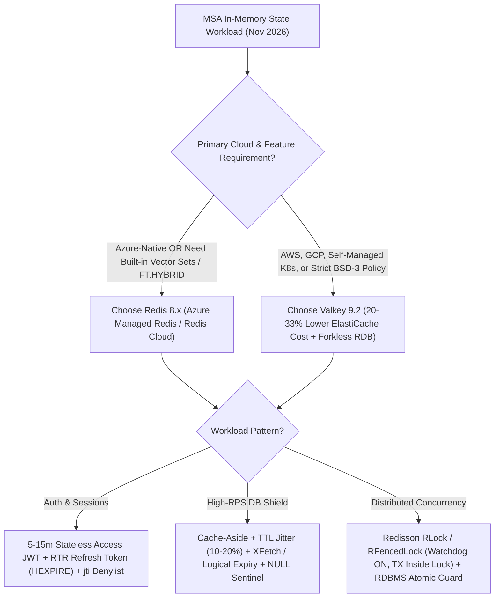

import Alert from '@/components/Alert.astro';
import Chart from '@/components/Chart.astro';
import LinkPreviewCard from '@/components/LinkPreviewCard.astro';
import LinkInline from '@/components/LinkInline.astro';
import GitHubRepoCard from '@/components/GitHubRepoCard.astro';

Teams adopt stateless JWTs expecting to retire session stores—only to spin up Redis two sprints later when security demands instant token revocation. Weeks after that, they wrap flash-sale endpoints in distributed locks and still wake up to negative inventory after a JVM garbage collection pause. Following [Part 1: Open-Source RDBMS](/en/dev/msa-rdbms-mysql-mariadb-aurora) and [Part 2: Persistent NoSQL](/en/dev/msa-nosql-mongodb-dynamodb-opensearch), this Part 3 finale covers the in-memory state layer: hybrid JWT session architecture, cache failure engineering, distributed concurrency traps, and the **Valkey 9.2 vs. Redis 8.x** split reshaping cloud budgets in late 2026.

| Dimension | Valkey 8.1 / 9.2 *(Linux Foundation)* | Redis 8.x (`8.0`–`8.12`, *Redis Inc.*) |
| :--- | :--- | :--- |
| **Core License** | **3-Clause BSD** *(permanently open, vendor-neutral)* | **Tri-licensed: `RSALv2` / `SSPLv1` / `AGPLv3`** *(network copyleft)* |
| **Engine Breakthroughs** | Async multi-core I/O (**2.1M RPS** in 9.1), **Forkless Snapshots**, **B+ Tree Sorted Sets** (36–43% less RAM), `HEXPIRE`, `DELEX` | Unified former Redis Stack in core (JSON, TimeSeries, Bloom, **`Vector Sets`**, **`FT.HYBRID`** lexical + vector search), `DELEX` |
| **Managed Cloud Ecosystem** | **AWS ElastiCache for Valkey** (20–33% cheaper, 100 MB Serverless min), **GCP Memorystore for Valkey**, Linux distro defaults | **Azure Managed Redis** (1st-party Microsoft + Redis Enterprise up to 99.999% SLA), Redis Cloud |
| **Primary Sweet Spot** | Default choice on AWS, GCP, Kubernetes, and SaaS teams avoiding AGPLv3 compliance friction | Azure-native estates or architectures consolidating caching + hybrid vector/full-text search in one engine |

---

## Stateless MSA & Auth: Why Even JWT Architectures Still Need Valkey or Redis

Microservices scale horizontally only when individual compute pods are disposable. The moment user authentication state lives inside a pod's heap, autoscaling and zero-downtime deployments start dropping active users.

### Why Heap `HttpSession` and Sticky Sessions Break in Kubernetes

In traditional single-datacenter deployments, teams stored login state inside Tomcat's in-memory `HttpSession` and configured L4/ALB **Sticky Sessions** (`AWSALB` affinity cookies) to pin each browser to one server. Kubernetes Horizontal Pod Autoscalers (HPA) and rolling updates dismantle that model across three failure modes:

- **Rolling Deployments & Spot Evictions**: Every deployment or Karpenter node consolidation terminates old pods, logging out every user pinned to those instances unless sessions are replicated externally.
- **Load Skew Under Autoscaling**: Newly launched HPA pods sit cold while older pods stay overloaded with long-lived sticky connections.
- **Multi-Device & Service-to-Service Routing**: A user switching from iOS over cellular to a desktop web client—or an API Gateway fanning one request across four downstream microservices—cannot rely on ingress cookie affinity to reach the same pod heap.

Externalizing session state into an in-memory cluster via **`Spring Session Data Redis`** (compatible out of the box with both Valkey and Redis) decouples authentication lifetime from pod lifecycle in under two milliseconds per lookup.

### Pure Stateless JWT's Revocation Blind Spot & the RFC 9700 Hybrid Pattern

To eliminate session lookups altogether, many teams swing to the opposite extreme: **pure stateless JWTs**. Because every API Gateway or pod verifies the HMAC/RSA/EdDSA signature locally, read throughput scales linearly with CPU cores.

Then reality hits during your first security audit. **A pure stateless JWT cannot be revoked server-side before its `exp` timestamp expires.** If an attacker exfiltrates a 24-hour token via XSS, if an administrator suspends a compromised enterprise seat, or if a user clicks "Log out of all devices" after changing a password, the stolen JWT remains cryptographically valid across every microservice until the clock runs out.

Published in January 2025, <LinkInline href="https://datatracker.ietf.org/doc/html/rfc9700" label="IETF RFC 9700" source="OAuth 2.0 Security BCP" /> and OWASP authentication guidelines codify the **hybrid stateless + in-memory revocation pattern** now standard across production microservices:

1. **Short-Lived Access JWT (`5–15 minutes`)**: Verified purely via local signature checks at the API Gateway and downstream pods—preserving stateless CPU efficiency for 99% of read traffic.
2. **Stateful Refresh Token in Valkey/Redis with Refresh Token Rotation (RTR)**: Stored server-side (`rt:{userId}:{familyId}`) with a `7–14 day` TTL. Every token refresh issues a brand-new Refresh Token and atomically invalidates the previous one. If a retired token is ever presented again, the auth service detects replay theft and deletes the entire token family immediately.
3. **`jti` Denylist (Blacklist) for Instant Logout**: When a user explicitly logs out or loses privileges, insert only the Access Token's unique `jti` ID (`bl:jti:{uuid}`) into Valkey/Redis with a `PX` TTL matching its exact remaining lifespan (`exp - now`). Because entries auto-evict within minutes, the denylist consumes negligible RAM while closing the revocation window completely.

---

## Protecting Your RDBMS: Caching Patterns & Defeating the 3 Classic Cache Failures

Placing Valkey or Redis in front of [Part 1's relational database](/en/dev/msa-rdbms-mysql-mariadb-aurora) absorbs 90%+ of repetitive read traffic, keeping PostgreSQL or Aurora CPU focused on transactional writes. Most microservices default to **`Cache-Aside` (Look-Aside)**—application code checks the cache first, falls back to the RDBMS on a miss, and populates the key with a TTL—while reserving **`Write-Through`** and asynchronous **`Write-Behind` (Write-Back)** for high-velocity view counters, rate-limit buckets, and real-time sorted-set leaderboards.

In production, caches rarely fail when warm. They fail catastrophically during expiration transitions and adversarial misses. Every backend architect needs battle-tested defenses for three classic failure modes:

### 1. Cache Stampede (Thundering Herd)

When a hot key—say, the main flash-sale banner or global feature-flag payload receiving 15,000 RPS—expires at `t = 0`, thousands of concurrent threads across dozens of pods register a cache miss within the same millisecond. Every single pod fires identical expensive `JOIN` queries straight at your primary RDBMS, exhausting HikariCP connection pools and cascading into cluster-wide timeouts.

Three engineering patterns stop stampedes cold:

- **Singleflight / Distributed Mutex Recomputation**: Only the first thread acquiring a short rebuild lock queries the RDBMS and populates Valkey; peer threads wait briefly on Pub/Sub or serve slightly stale cached data.
- **Logical Expiration**: Store `"logicalExpireAt"` inside the JSON value while setting the physical Redis TTL hours longer. Readers return the cached payload immediately, and the first thread noticing `now > logicalExpireAt` acquires a non-blocking `NX` lock to refresh the key asynchronously in the background.
- **Probabilistic Early Recomputation (`XFetch` / PER)**: Formalized in the <LinkInline href="https://www.vldb.org/pvldb/vol8/p886-vattani.pdf" label="VLDB 2015 XFetch paper" source="Vattani et al." />, a single lucky reader triggers an early refresh slightly *before* actual expiration as `expiry` approaches, weighted by how expensive the query was (`delta`):

```java
// VLDB 2015 XFetch (Probabilistic Early Recomputation) condition
// deltaMillis: measured DB recomputation latency (e.g., 120ms), beta: 1.0 default
boolean shouldRecomputeEarly =
    (System.currentTimeMillis() - beta * deltaMillis * Math.log(ThreadLocalRandom.current().nextDouble()))
        >= logicalExpiryEpochMillis;
```

Because `Math.log(random)` is negative, the probability of one thread refreshing early rises smoothly in the final milliseconds before `expiry`—renewing hot keys seamlessly with zero lock contention.

### 2. Cache Avalanche

Cache Avalanche strikes when tens of thousands of keys warm up in a nightly batch job with an identical `TTL = 3600s` and expire on the exact same second an hour later. Fix this permanently at the repository layer by enforcing **TTL Jitter**—appending a random `10–20%` offset (`3600 + random(0, 720)` seconds) to every write so expirations spread into a flat, harmless curve.

### 3. Cache Penetration

Cache Penetration happens when buggy clients or malicious scrapers hammer your API with IDs that exist in *neither* Valkey nor your RDBMS (`GET /products/-99912` or random fabricated UUIDs). Because misses never populate the cache, 100% of attack traffic pierces straight through to disk I/O. Block penetration using **short-TTL `"NULL"` sentinel caching** (`30–120s` so newly created records are not masked for long) or place a compact **Bloom Filter** in front of the endpoint to reject impossible keys in O(1) memory before touching storage.

---

## Distributed Concurrency Control & 3 Deadly Locking Traps

Inside a monolith running on a single JVM, slapping `synchronized` or `ReentrantLock` onto an inventory-deduction method guarantees thread safety (for how concurrency primitives evolved alongside Virtual Threads, see [15 Years of the JVM Ecosystem](/en/dev/jvm-ecosystem-15-years)). Scale that microservice out to 20 Kubernetes pods, however, and JVM monitor locks only serialize threads inside *their own pod's heap*—allowing up to 20 pods to enter the critical section simultaneously.

### Atomic Lock Protocol: `SET NX PX`, Lua & Native `DELEX`

Coordinating mutual exclusion across pods requires an external atomic primitive with bounded lease time so crashed pods never deadlock the cluster:

1. **Acquire Atomically**: Combine existence check and TTL in one command—`SET lock:coupon:42 <uuid:threadId> NX PX 30000`. The value *must* be a unique caller token (`UUID + thread ID`), never a static `"1"`.
2. **Release Atomically (Owner Verification)**: Never write `GET` followed by `DEL` in application code; if your lock expired milliseconds after `GET`, your `DEL` will wipe out another pod's freshly acquired lock! Historically, every client executed a 4-line Lua check-and-delete script. Starting in **Valkey 9.2+** (following Valkey 9.0's `DELIFEQ`) and **Redis 8.4+**, engines also provide the native O(1) conditional delete command **`DELEX`**:

```bash
# 1. Acquire lock with unique owner token and 30-second lease
SET lock:coupon:42 "9b1deb4d-3b7d:thread-19" NX PX 30000

# 2A. Universal atomic release via Lua script (all Redis / Valkey versions)
EVAL "if redis.call('get', KEYS[1]) == ARGV[1] then return redis.call('del', KEYS[1]) else return 0 end" \
  1 lock:coupon:42 "9b1deb4d-3b7d:thread-19"

# 2B. Native O(1) conditional release (Valkey 9.2+ and Redis 8.4+)
DELEX lock:coupon:42 IFEQ "9b1deb4d-3b7d:thread-19"
```

### Lettuce Spin-Locks vs. Redisson Pub/Sub & Watchdog

Spring Boot ships **`Lettuce`** as its default reactive/Netty Redis driver. Lettuce excels at standard caching, yet building distributed locks on raw Lettuce requires **polling spin-locks** (`while (!setNx) { sleep(50); }`), burning Valkey CPU when hundreds of threads retry tight loops and adding artificial latency when locks free up early.

**`Redisson`** solves both problems out of the box: waiting threads subscribe to a **Redis Pub/Sub channel** so they wake the instant the lock holder publishes an unlock event, and an internal **Watchdog** background timer (default `lockWatchdogTimeout = 30,000ms`) automatically extends the key's TTL back to 30 seconds **every 10 seconds** (`timeout / 3`) for as long as the owning JVM thread remains alive.

<GitHubRepoCard
  repo="redisson/redisson"
  comment="Production JVM client for Valkey & Redis — provides Pub/Sub-driven RLock, Watchdog lease renewal, and RFencedLock monotonic fencing tokens."
/>

Even with Redisson, three subtle traps routinely cause race conditions and oversold inventory in production.

### Trap 1: Silent Watchdog Deactivation When Passing `leaseTime`

Look closely at the signature `lock.tryLock(waitTime, leaseTime, unit)`. Passing an explicit positive `leaseTime`—for example, `lock.tryLock(3, 10, TimeUnit.SECONDS)`—**silently disables Redisson's Watchdog renewal altogether**. If a downstream payment gateway or slow SQL query stalls for 10.5 seconds, the lock vanishes in Valkey while Thread A is still mid-transaction, letting Thread B enter concurrently. Watchdog auto-renewal only runs when `leaseTime` is omitted (`lock.tryLock(3, TimeUnit.SECONDS)`) or explicitly passed as `-1`.

### Trap 2: The `@Transactional` Proxy Ordering Bug

Annotating a single service method with `@Transactional` while calling `lock.tryLock()` and `lock.unlock()` inside that method body is the most common concurrency bug in Spring Boot codebases:

1. Spring's outer `@Transactional` AOP proxy opens the database transaction first.
2. Method body acquires the Redisson lock, checks `remaining > 0`, decrements stock, and executes `finally { lock.unlock(); }`.
3. **In the millisecond gap *before* Spring's outer proxy flushes the DB `COMMIT`**, Thread B acquires the freshly released Redis lock, queries the RDBMS, and reads the *uncommitted* old stock count (`remaining = 1`)—issuing duplicate coupons!

Always enforce strict nesting—**`acquire lock → begin TX & COMMIT → finally unlock`**—either via a custom outer AOP `@Aspect` ordered with `@Order(Ordered.HIGHEST_PRECEDENCE)` or explicitly via Spring's programmatic `TransactionTemplate`:

```java
package one.eone.coupon.application;

import java.util.concurrent.TimeUnit;
import org.redisson.api.RLock;
import org.redisson.api.RedissonClient;
import org.springframework.stereotype.Component;
import org.springframework.transaction.support.TransactionTemplate;

@Component
public class CouponIssueFacade {

    private final RedissonClient redissonClient;
    private final TransactionTemplate transactionTemplate;
    private final CouponRepository couponRepository;

    public CouponIssueFacade(
            RedissonClient redissonClient,
            TransactionTemplate transactionTemplate,
            CouponRepository couponRepository) {
        this.redissonClient = redissonClient;
        this.transactionTemplate = transactionTemplate;
        this.couponRepository = couponRepository;
    }

    public void issueCoupon(Long campaignId, Long userId) {
        RLock lock = redissonClient.getLock("lock:coupon:" + campaignId);
        boolean acquired = false;
        try {
            // Omit leaseTime (or pass -1) so Redisson's 30s Watchdog renews every 10s!
            acquired = lock.tryLock(3, TimeUnit.SECONDS);
            if (!acquired) {
                throw new IllegalStateException("Traffic spike: failed to acquire coupon lock");
            }

            // DB transaction starts AND commits strictly inside the lock boundary
            transactionTemplate.executeWithoutResult(status -> {
                int updated = couponRepository.decrementIfAvailable(campaignId);
                if (updated == 0) {
                    throw new IllegalStateException("Campaign sold out");
                }
                couponRepository.insertIssuedCoupon(campaignId, userId);
            });
        } catch (InterruptedException e) {
            Thread.currentThread().interrupt();
            throw new IllegalStateException("Interrupted while waiting for coupon lock", e);
        } finally {
            if (acquired && lock.isHeldByCurrentThread()) {
                lock.unlock();
            }
        }
    }
}
```

<Alert type="warning" title="3 Non-Negotiable Rules for Redisson Locks in Spring Boot">
① **Keep `leaseTime` unset or `-1`**: Calling `tryLock(3, 10, TimeUnit.SECONDS)` turns off the Watchdog timer completely; rely on Watchdog auto-renewal instead of guessing worst-case latency.

② **Commit DB transactions *before* unlocking**: Never release `RLock` inside a method whose `@Transactional` boundary commits on the outer AOP proxy—wrap the transactional unit in `TransactionTemplate` or extract it into a separate `@Transactional(propagation = Propagation.REQUIRES_NEW)` delegate bean.

③ **Guard `unlock()` with `lock.isHeldByCurrentThread()`**: Calling `unlock()` when acquisition failed or after a network partition expired the key throws `IllegalMonitorStateException` and masks your real root-cause exception.
</Alert>

### Trap 3: Kleppmann's Redlock Critique, Fencing Tokens & Dual-Layer RDBMS Guards

What if your microservice acquires a lock cleanly, only for the JVM to hit a 35-second Stop-The-World GC pause (or kernel scheduling stall) that prevents even the Watchdog thread from renewing the TTL?

In his landmark distributed systems analysis, **Martin Kleppmann** demonstrated why neither single-node locks nor multi-master **Redlock** algorithms can guarantee strict correctness on their own when process pauses or clock jumps occur:

<LinkPreviewCard
  url="https://martin.kleppmann.com/2016/02/08/how-to-do-distributed-locking.html"
  title="How to do distributed locking — Martin Kleppmann"
  comment="Essential reading on why Redis locks are for efficiency rather than standalone correctness, introducing monotonic Fencing Tokens."
/>

Recognizing this exact limitation, Redisson officially marked **`RedissonRedLock` as `@Deprecated`** and introduced **`RFencedLock`**, which hands each lock holder a monotonically increasing `Long` **fencing token** so downstream storage servers can reject delayed writes carrying older tokens.

<figure class="not-prose my-6">
  <svg viewBox="0 0 880 410" class="w-full h-auto rounded-lg border border-border bg-card p-4" role="img" aria-label="Comparison between GC pause split-brain lock failure and dual-layer Fencing Token plus RDBMS conditional guard">
    <defs>
      <marker id="arrow-muted" viewBox="0 0 10 10" refX="8" refY="5" markerWidth="6" markerHeight="6" orient="auto-start-reverse">
        <path d="M 0 1 L 10 5 L 0 9 z" fill="var(--muted-foreground)" />
      </marker>
    </defs>
    <rect x="16" y="16" width="416" height="378" rx="10" fill="#ef4444" fill-opacity="0.04" stroke="#ef4444" stroke-opacity="0.45" stroke-width="1.5" />
    <text x="224" y="42" text-anchor="middle" font-size="13" font-weight="700" class="fill-red-600 dark:fill-red-400">Split-Brain Bug: GC Pause Outlasts Lock TTL</text>
    <text x="224" y="60" text-anchor="middle" font-size="10.5" fill="var(--muted-foreground)">Redis lock alone cannot block delayed writes after expiry</text>
    <rect x="36" y="78" width="376" height="46" rx="7" fill="var(--card)" stroke="var(--border)" stroke-width="1.2" />
    <text x="224" y="97" text-anchor="middle" font-size="11" font-weight="700" fill="var(--foreground)">1. Pod A acquires lock (PX 30000ms), reads stock = 1</text>
    <text x="224" y="114" text-anchor="middle" font-size="9.5" fill="var(--muted-foreground)">SET lock:item:9 token_A NX PX 30000</text>
    <line x1="224" y1="124" x2="224" y2="141" stroke="var(--muted-foreground)" stroke-width="1.4" marker-end="url(#arrow-muted)" />
    <rect x="36" y="144" width="376" height="52" rx="7" fill="var(--card)" stroke="#ef4444" stroke-dasharray="4 3" stroke-width="1.3" />
    <text x="224" y="165" text-anchor="middle" font-size="11" font-weight="700" class="fill-red-600 dark:fill-red-400">2. Pod A freezes in 35s Stop-The-World GC Pause</text>
    <text x="224" y="184" text-anchor="middle" font-size="9.5" fill="var(--muted-foreground)">t = 30s: Watchdog stalled; lock TTL expires in Valkey</text>
    <line x1="224" y1="196" x2="224" y2="213" stroke="var(--muted-foreground)" stroke-width="1.4" marker-end="url(#arrow-muted)" />
    <rect x="36" y="216" width="376" height="52" rx="7" fill="var(--card)" stroke="#3b82f6" stroke-width="1.2" />
    <text x="224" y="237" text-anchor="middle" font-size="11" font-weight="700" class="fill-blue-700 dark:fill-blue-400">3. Pod B acquires fresh lock, updates stock 1 -&gt; 0</text>
    <text x="224" y="256" text-anchor="middle" font-size="9.5" fill="var(--muted-foreground)">Pod B commits RDBMS TX cleanly and unlocks</text>
    <line x1="224" y1="268" x2="224" y2="285" stroke="var(--muted-foreground)" stroke-width="1.4" marker-end="url(#arrow-muted)" />
    <rect x="36" y="288" width="376" height="58" rx="7" fill="#ef4444" fill-opacity="0.1" stroke="#ef4444" stroke-width="1.5" />
    <text x="224" y="310" text-anchor="middle" font-size="11" font-weight="700" class="fill-red-600 dark:fill-red-400">4. Pod A wakes at t = 35s, unaware lock expired!</text>
    <text x="224" y="330" text-anchor="middle" font-size="10" fill="var(--foreground)">Executes blind write -&gt; stock = -1 (Oversold Inventory)</text>
    <text x="224" y="374" text-anchor="middle" font-size="10" fill="var(--muted-foreground)">TTL guarantees liveness (no deadlocks), never safety alone.</text>
    <rect x="448" y="16" width="416" height="378" rx="10" fill="#10b981" fill-opacity="0.04" stroke="#10b981" stroke-opacity="0.5" stroke-width="1.5" />
    <text x="656" y="42" text-anchor="middle" font-size="13" font-weight="700" class="fill-emerald-700 dark:fill-emerald-400">Dual-Layer Defense: Fencing + RDBMS Guard</text>
    <text x="656" y="60" text-anchor="middle" font-size="10.5" fill="var(--muted-foreground)">Valkey serializes bursts; RDBMS enforces final invariant</text>
    <rect x="468" y="78" width="376" height="46" rx="7" fill="var(--card)" stroke="var(--border)" stroke-width="1.2" />
    <text x="656" y="97" text-anchor="middle" font-size="11" font-weight="700" fill="var(--foreground)">1. Pod A gets RFencedLock (token = 33), pauses 35s</text>
    <text x="656" y="114" text-anchor="middle" font-size="9.5" fill="var(--muted-foreground)">Monotonic token increments on every lock grant</text>
    <line x1="656" y1="124" x2="656" y2="141" stroke="var(--muted-foreground)" stroke-width="1.4" marker-end="url(#arrow-muted)" />
    <rect x="468" y="144" width="376" height="52" rx="7" fill="var(--card)" stroke="#10b981" stroke-width="1.3" />
    <text x="656" y="165" text-anchor="middle" font-size="11" font-weight="700" class="fill-emerald-700 dark:fill-emerald-400">2. Pod B acquires lock after TTL (token = 34)</text>
    <text x="656" y="184" text-anchor="middle" font-size="9.5" fill="var(--muted-foreground)">Commits UPDATE ... WHERE stock &gt; 0 (fence = 34)</text>
    <line x1="656" y1="196" x2="656" y2="213" stroke="var(--muted-foreground)" stroke-width="1.4" marker-end="url(#arrow-muted)" />
    <rect x="468" y="216" width="376" height="52" rx="7" fill="var(--card)" stroke="var(--border)" stroke-width="1.2" />
    <text x="656" y="237" text-anchor="middle" font-size="11" font-weight="700" fill="var(--foreground)">3. Pod A resumes at t = 35s with stale token = 33</text>
    <text x="656" y="256" text-anchor="middle" font-size="9.5" fill="var(--muted-foreground)">Sends delayed SQL mutation to primary RDBMS</text>
    <line x1="656" y1="268" x2="656" y2="285" stroke="var(--muted-foreground)" stroke-width="1.4" marker-end="url(#arrow-muted)" />
    <rect x="468" y="288" width="376" height="58" rx="7" fill="#10b981" fill-opacity="0.1" stroke="#10b981" stroke-width="1.5" />
    <text x="656" y="310" text-anchor="middle" font-size="11" font-weight="700" class="fill-emerald-700 dark:fill-emerald-400">4. RDBMS Rejects Stale Write Atomically (0 rows)</text>
    <text x="656" y="330" text-anchor="middle" font-size="10" fill="var(--foreground)">WHERE stock &gt; 0 AND fence &lt; 33 (or UNIQUE / @Version)</text>
    <text x="656" y="374" text-anchor="middle" font-size="10" fill="var(--muted-foreground)">Zero overselling even across GC stalls or Redis failover.</text>
  </svg>
  <figcaption class="mt-2 text-center text-sm text-muted-foreground">Left: Relying solely on an in-memory lock leaks split-brain writes when a JVM GC pause outlasts the key TTL. Right: Pairing Valkey/Redisson traffic serialization (and RFencedLock tokens) with RDBMS atomic guards guarantees 100% data integrity.</figcaption>
</figure>

In RDBMS-backed microservices, apply Kleppmann's distinction directly: **use Valkey/Redis locks for *efficiency* (shielding your database from 10,000 concurrent row-lock waiters), and enforce *correctness* at the RDBMS boundary** via composite `UNIQUE (campaign_id, user_id)` constraints, JPA `@Version` optimistic locking, or atomic conditional SQL (`UPDATE coupon_campaign SET remaining = remaining - 1 WHERE id = ? AND remaining > 0`).

---

## Origin Story Act II: The Redis License Shock, Valkey 9.2's Rise & 2026 Decision Guide

Just as Oracle's acquisition of Sun triggered the [MySQL-to-MariaDB fork in Part 1](/en/dev/msa-rdbms-mysql-mariadb-aurora), the in-memory database world experienced its own seismic split in 2024—with consequences that define cloud architecture and FinOps budgets in late 2026.

### Eight Days in March 2024—and the 2025 AGPLv3 Plot Twist

In **2009**, Italian engineer **Salvatore Sanfilippo (`antirez`)** open-sourced **Redis** under the permissive **3-Clause BSD license**, making it the ubiquitous cache, message broker, and session store of modern web infrastructure. For fifteen years, every cloud provider and Linux distribution shipped Redis without legal friction.

On **March 20, 2024**, **Redis Inc.** abruptly abandoned BSD-3 starting with Redis 7.4, switching to a source-available dual license (**`RSALv2`** and **`SSPLv1`**) aimed at blocking cloud hyperscalers from offering managed Redis without commercial revenue-sharing agreements. The open-source response was instantaneous: **just eight days later, on March 28, 2024**, the <LinkInline href="https://www.linuxfoundation.org/press/linux-foundation-launches-open-source-valkey-community" label="Linux Foundation launched Valkey" />, backed by **AWS, Google Cloud, Oracle, Ericsson, and Snap**, forking Redis 7.2.4 under a **permanently permissive BSD-3 governance charter**.

Then came the 2025 plot twist. After `antirez` rejoined Redis as an evangelist and core contributor, **Redis 8.0 GA (May 2025)** added the OSI-approved **`AGPLv3`** license alongside `RSALv2` and `SSPLv1`—reclaiming formal "Open Source" status while folding previously proprietary Redis Stack modules (JSON, TimeSeries, Bloom/Cuckoo filters, **`Vector Sets`**, and **`Redis 8.4`'s `FT.HYBRID`** combined full-text + vector search) directly into core Redis (`8.0`–`8.8`).

Why didn't the industry simply migrate back to Redis 8? **AGPLv3's network copyleft clause** requires organizations modifying the server and exposing it over a network to release source code—a red line for hyperscaler managed services and strict enterprise open-source compliance boards. Consequently, Fedora, Debian, Ubuntu, AWS, and Google Cloud cemented **Valkey** as their primary open-source standard.

<GitHubRepoCard
  repo="valkey-io/valkey"
  comment="Linux Foundation BSD-3 in-memory store — backed by AWS, GCP, Oracle, and Ericsson, reaching 2.1M RPS, Forkless Snapshots, and B+ Tree Sorted Sets by Valkey 9.2."
/>

<GitHubRepoCard
  repo="redis/redis"
  comment="Redis 8.x (RSALv2 / SSPLv1 / AGPLv3) — bundles JSON, TimeSeries, Bloom filters, Vector Sets, and FT.HYBRID lexical + vector search directly in core."
/>

### Valkey 8.0 to 9.2: Out-Engineering Its Single-Threaded Heritage

Freed from single-vendor roadmap constraints, AWS, Google, Huawei, and Ericsson kernel engineers tackled architectural bottlenecks that Redis users had endured for a decade:

- **`Valkey 8.0` & `8.1`**: Offloaded network socket reads/writes, TLS encryption, and command parsing onto **asynchronous multi-core I/O threads** (surpassing **1.2M+ RPS**), followed in `8.1` by a cache-line-aligned hash table that shaved roughly **20 bytes per key**—cutting total memory usage by up to **20%** on key-dense session and cache clusters.
- **`Valkey 9.0` & `9.1`**: Delivered **Atomic Slot Migration** (moving entire hash slots cleanly without per-key `MIGRATE` blocking stalls), native hash-field expiration (**`HEXPIRE`**—ideal for per-device Refresh Tokens inside a single user hash!), and **2.1 million RPS** on a single node in `9.1`.
- **`Valkey 9.2` (November 2026)**: Landed two landmark memory breakthroughs: **Forkless Snapshots**, eliminating the notorious `fork()` Copy-on-Write (CoW) memory-doubling spikes that triggered sudden OOM kills during background RDB saves under heavy writes; **B+ Tree Sorted Sets**, cutting per-element memory overhead by **36–43%** on large leaderboards and time-windowed rate limiters; and native **`DELEX`** for lock release.

Best of all, Valkey preserves **100% RESP2/RESP3 wire-protocol compatibility** for standard commands. Whether your microservices run Spring Boot 4 (`Lettuce` / `Redisson`), NestJS (`ioredis`), Go (`go-redis`), or FastAPI (see our [2026 Backend Framework Guide](/en/dev/backend-framework-guide)), migrating to Valkey is a zero-code endpoint swap.

### Cloud FinOps Split: AWS & GCP Savings vs. the Azure Exception

On **AWS** and **Google Cloud**, adopting Valkey translates immediately into hard infrastructure savings. AWS prices **ElastiCache for Valkey 33% lower on Serverless** (while slashing the minimum billed capacity 10x from `1 GB` down to **`100 MB`**, eliminating wasted spend on dev/staging and lightweight microservice caches) and **20% lower on node-based Graviton instances** compared to ElastiCache for Redis OSS <LinkInline href="https://aws.amazon.com/elasticache/pricing/" label="AWS ElastiCache Pricing" variant="badge" />:

<Chart
  type="bar"
  height={320}
  caption="Estimated Monthly AWS Spend: ElastiCache for Redis OSS vs. ElastiCache for Valkey (US East, On-Demand / Serverless Baseline)"
  data={{
    labels: [
      'Serverless Small (5GB)',
      'Node HA (r7g.large x3)',
      'Serverless Med (20GB)',
      '3-Shard Cluster (r7g.xlarge x6)',
    ],
    datasets: [
      {
        label: 'ElastiCache for Redis OSS (USD/mo)',
        data: [457, 480, 1828, 1918],
        backgroundColor: 'rgba(239, 68, 68, 0.8)',
        borderColor: 'rgba(239, 68, 68, 1)',
        borderWidth: 1,
      },
      {
        label: 'ElastiCache for Valkey (USD/mo)',
        data: [307, 384, 1229, 1535],
        backgroundColor: 'rgba(16, 185, 129, 0.85)',
        borderColor: 'rgba(16, 185, 129, 1)',
        borderWidth: 1,
      },
    ],
  }}
/>

**Microsoft Azure is the strategic exception.** Rather than backing Valkey, Microsoft partnered directly with Redis Inc. to launch first-party **`Azure Managed Redis`**, powered by Redis Enterprise tiers offering up to a **99.999% five-nines SLA**, Active Geo-Replication, and native **Redis 8 `Vector Sets` + `FT.HYBRID`**. If your enterprise runs primarily on Azure—or if embedding low-latency semantic cache / hybrid vector search directly inside your cache tier lets you retire a separate vector database—**Redis 8** earns its spot cleanly.

### 2026 In-Memory Engine & Pattern Decision Flowchart

Run every caching, session, or concurrency requirement through this decision tree before provisioning infrastructure:



### Synthesizing the 3-Part Cloud & MSA Database Architecture

Across all three installments of this guide, one principle separates resilient microservice platforms from fragile ones: **match each persistence tier to the physics of its access pattern rather than forcing one database to do everything.**

1. **[Part 1 — Open-Source RDBMS](/en/dev/msa-rdbms-mysql-mariadb-aurora)**: Anchor financial ledgers, orders, and relational invariants in **PostgreSQL 18+** (`uuidv7()`, `JSONB` GIN, `pgvector`) or **Amazon Aurora** (switching to `I/O-Optimized` once I/O exceeds 25% of monthly spend), while respecting the hard incompatibilities separating **MySQL 8.4/9.7 LTS** and **MariaDB 11.8+ LTS**.
2. **[Part 2 — Persistent NoSQL](/en/dev/msa-nosql-mongodb-dynamodb-opensearch)**: Offload polymorphic document aggregates to **MongoDB 8.0/9.0**, predictable single-digit-millisecond hyper-scale key-value lookups to **Amazon DynamoDB**, and dedicated log analytics or lexical + k-NN search pipelines to **OpenSearch 3.x**.
3. **Part 3 — In-Memory State (`Valkey 9.2` / `Redis 8.x`)**: Keep your compute pods stateless while handling instant JWT revocation, stampede-proof RDBMS caching, and traffic-serialized concurrency—always pairing ephemeral in-memory locks with durable database constraints at the final commit line.

## References

- [IETF RFC 9700: Best Current Practice for OAuth 2.0 Security (January 2025)](https://datatracker.ietf.org/doc/html/rfc9700)
- [Optimal Probabilistic Cache Stampede Prevention (XFetch) — VLDB 2015](https://www.vldb.org/pvldb/vol8/p886-vattani.pdf)
- [How to do distributed locking — Martin Kleppmann](https://martin.kleppmann.com/2016/02/08/how-to-do-distributed-locking.html)
- [Linux Foundation Launches Open Source Valkey Community](https://www.linuxfoundation.org/press/linux-foundation-launches-open-source-valkey-community)
- [Valkey Official Documentation & Release Notes (`DELEX`, `HEXPIRE`, 9.x Architecture)](https://valkey.io/)
- [Redis 8.0 GA Announcement: AGPLv3 Licensing, Vector Sets & Core Stack Integration](https://redis.io/blog/redis-8-ga/)
- [Amazon ElastiCache for Valkey Pricing & Serverless Tiers — AWS](https://aws.amazon.com/elasticache/pricing/)
- [Azure Managed Redis Overview — Microsoft Learn](https://learn.microsoft.com/en-us/azure/redis/overview)
