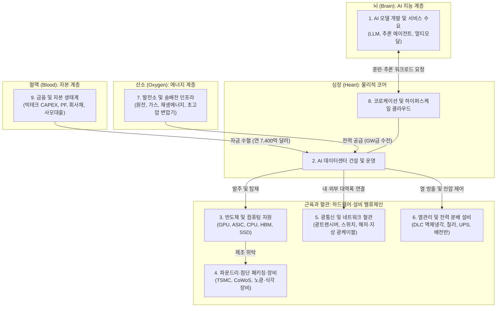

import Alert from '@/components/Alert.astro';
import Chart from '@/components/Chart.astro';

2026년 11월 5일 단 하루 만에 미국 증시에서 2조 5,000억 달러가 증발했다. 나스닥 종합지수는 5.5%, 필라델피아 반도체 지수(SOX)는 12.2% 폭락하며 시장을 얼어붙게 만들었다.

그날 가장 처참하게 무너진 종목은 화려한 생성형 AI 챗봇이나 소프트웨어 기업이 아니었다. 액체냉각·전력 설비 기업 **버티브**(Vertiv, -14.0%), 맞춤형 AI 칩과 네트워킹의 **브로드컴**(Broadcom, -10.4%), **엔비디아**(NVIDIA, -9.2%), 그리고 데이터센터에 원자력 전기를 공급하던 **콘스텔레이션 에너지**(Constellation Energy, -6.3%)까지 물리적 인프라 밸류체인이 일제히 직격탄을 맞았다. 지능이라는 거대한 '뇌'를 지탱하던 '심장'의 박동에 시장이 근본적인 의문을 품기 시작한 것이다.

<Alert type="info" title="칼럼을 읽기에 앞서: AI라는 거대한 유기체와 사실 구분 원칙">
이 글은 특정 주식이나 기업에 대한 매수·매도 추천이 아닙니다. AI 산업이 작동하는 물리적·경제적 구조를 해부하고, 그 한계가 지구 밖 어디까지 확장될지 탐구하는 기술·산업 분석 칼럼입니다.

본문에서는 AI 생태계를 하나의 생명체에 비유합니다. **AI 모델**이 생각하는 **뇌**라면, **데이터센터**는 피를 뿜어내는 **심장**이고, **자본**은 온몸을 순환하는 **혈액**, **전력**은 생존을 위한 **산소**, **네트워크와 광통신**은 이를 잇는 **혈관**입니다. 또한 독자의 정확한 판단을 돕기 위해 확인된 사실은 **`[FACT]`**, 사실에 기반한 산업적 해석은 **`[ANALYSIS]`**, 미래 기술과 장기 비전에 대한 전망은 [**HYPOTHESIS**]로 엄격히 구분해 서술합니다.
</Alert>

---

## PART 1. 나스닥 폭락, AI 산업의 무엇이 흔들렸나?

2026년 11월 초 미 증시를 덮친 투매는 AI 산업을 바라보는 월가의 시선이 '무한한 성장 서사'에서 '물리적·재무적 한계 검증'으로 이동했음을 보여주는 분기점이었다. 먼저 그날 시장에 찍힌 숫자와 그 이면의 복합적 원인을 분리해 보자.

### 2026년 11월 5일 시장 충격의 기록

* **`[FACT]` 주요 지수 급락 및 조정 국면 진입**: 2026년 11월 5일 나스닥 종합지수는 하루 만에 **-5.5%**(나스닥 100 지수 **-6.1%**) 급락하며 직전 고점 대비 10% 이상 밀려나는 공식 **조정 국면**(Correction)에 진입했다. 같은 날 S&P 500 지수는 **-4.4%**, 필라델피아 반도체 지수(SOX)는 **-12.2%** 추락했다.
* **`[FACT]` 인프라 섹터의 동반 투매**: AI 가속기 생태계의 핵심인 엔비디아(-9.2%)와 브로드컴(-10.4%)뿐 아니라, 열관리·전력 인프라 대장주인 버티브(-14.0%), 원전 유틸리티 기업 콘스텔레이션 에너지(-6.3%) 등 데이터센터 물리 인프라 관련주가 하락장을 주도했다.

왜 소프트웨어보다 콘크리트와 변압기, 냉각수 파이프를 다루는 기업들이 먼저 흔들렸을까? 이 급락을 단일 원인으로 재단하는 것은 위험하다. 당시 시장을 짓누른 것은 세 가지 압력이 동시에 맞물린 결과였다.

### 급락을 부른 3가지 복합 요인

1. **`[ANALYSIS]` 미국 중간선거가 촉발한 지역 규제 불확실성**
   데이터센터가 밀집한 버지니아, 텍사스, 오하이오, 조지아 등 주요 주에서 2026년 중간선거를 거치며 '전력망 과부하'와 '가정용 전기요금 인상'에 대한 지역 유권자들의 반발이 핵심 정치 쟁점으로 부상했다. 일부 카운티와 지자체 의회에서 신규 데이터센터 인허가 유예(Moratorium) 조례안과 냉각수 취수 제한, 환경영향평가 강화 논의가 급물살을 탔다.
   물론 이를 연방 차원의 '데이터센터 전면 건설 금지 법안 확정'으로 부풀려선 안 된다. 실제 확정된 연방·주 정부 정책과 지방 선거 과정에서 불거진 규제 불확실성은 구분해야 한다. 그러나 인허가 심사가 몇 달씩 미뤄지는 것만으로도 하이퍼스케일러의 **신규 데이터센터 증설 일정**이 지연될 수 있다는 공포가 시장을 덮쳤다.
2. **`[ANALYSIS]` 천문학적 설비투자**(CAPEX)와 **투자수익률**(ROI)의 **간극**
   빅테크 4개사(Amazon, Alphabet, Microsoft, Meta)의 합산 연간 설비투자는 2024년 약 2,222억 달러에서 2025년 약 4,100억 달러를 거쳐, 2026년 **7,200억～7,500억 달러**(추정치 약 7,400억 달러) 수준으로 불과 2년 만에 3배 이상 폭증했다. 반면 AI 소프트웨어와 에이전트 서비스가 벌어들인 현금흐름은 이 거대한 자본 지출의 감가상각비를 상쇄할 만큼 빠르게 올라오지 못했다.
3. **`[ANALYSIS]` 산업 붕괴가 아닌 '지속 가능성'의 재평가**
   여기서 분명히 짚고 넘어갈 점이 있다. 데이터센터 **신규 증설 지연**(건설 병목)과 **기존 데이터센터의 운영 중단**은 전혀 다른 이야기다. 지금 이 순간에도 전 세계 기존 데이터센터의 GPU 클러스터는 쉼 없이 돌아가고 있으며 AI 연산 수요는 여전히 견조하다. 11월의 폭락은 AI 기술의 실패 선언이 아니라, **"지금처럼 매년 수천억 달러씩 부채와 현금을 쏟아붓는 물리적 확장 속도가 과연 지속 가능한가?"**에 대한 자본시장의 냉정한 **재평가**(Re-rating)였다.

---

## PART 2. AI 산업의 심장, 데이터센터

우리는 흔히 AI를 클라우드 어딘가에 떠다니는 무형의 코드로 상상한다. 하지만 챗GPT나 클로드에게 질문 하나를 던질 때마다, 지구 어딘가의 변전소에서는 고압 전류가 흐르고 실리콘 칩 위에서 발생한 열기를 식히기 위해 수십 리터의 냉각수가 파이프를 타고 돈다. AI 산업은 첨단 소프트웨어 산업인 동시에, 철강·전력·화학·건설이 총동원되는 **초거대 중후장대 물리 인프라 산업**이다.

데이터센터는 서버를 쌓아두는 창고가 아니다. 원유를 정제해 에너지를 만들듯, **전력**(산소)과 **실리콘**(컴퓨팅 자원)을 투입해 **지능**(토큰)을 생산하는 현대의 **컴퓨팅 생산 공장**이자 AI 생태계의 **심장**이다.



위 다이어그램이 보여주듯, 데이터센터는 **9개 핵심 가치사슬**이 교차하는 유일한 허브다.

1. **AI 모델 개발 및 서비스 수요**(뇌)
2. **데이터센터 건설 및 운영**(심장)
3. **GPU, CPU, HBM, DRAM, SSD 등 반도체 및 컴퓨팅 자원**
4. **파운드리**(TSMC 등), **첨단 패키징**(CoWoS), **반도체 소부장**
5. **광통신 및 네트워크**(혈관)
6. **액체냉각**(DLC), **공조, 전력 분배 설비**
7. **발전소**(원전·가스·재생에너지), **송배전 및 에너지 공급**(산소)
8. **데이터센터 운영사**(코로케이션) 및 **클라우드 사업자**(하이퍼스케일러)
9. **프로젝트 파이낸싱**(PF), **회사채, 사모대출**(Private Credit) 등 **금융 생태계**(혈액)

### 신규 증설이 지연될 때 벌어지는 도미노 연쇄 반응

만약 전력망 연결이 막히거나 자금 조달 비용이 치솟아 **데이터센터 신규 착공과 증설이 6～12개월 지연**된다면 어떤 일이 벌어질까?

`[ANALYSIS]` 당장 우리가 쓰는 AI 서비스가 멈추지는 않는다. 이미 지어진 데이터센터는 계속 가동되기 때문이다. 또한 AI 컴퓨팅 수요가 늘어난다고 해서 모든 반도체 기업의 매출이 똑같이 오르는 것도 아니듯, 증설 지연의 충격파 역시 밸류체인의 위치에 따라 시차를 두고 비대칭적으로 전달된다.

첫 번째 타격은 **차세대 시설 설비와 수변전·냉각 인프라**(6번·7번 사슬)가 받는다. 데이터센터 골조가 올라가지 않으면 액체냉각 매니폴드(CDU)와 배전반이 납품될 공간이 사라진다. 두 번째로, 클라우드 사업자(8번)가 넣을 상면(Space)과 전력이 준비되지 않으면 이미 주문해 둔 **차세대 GPU와 HBM 모듈**(3번)의 인도 일정을 뒤로 미루게 된다. 이는 곧바로 **광트랜시버와 네트워크 스위치**(5번) 발주 둔화로 이어지고, 수개월 뒤에는 **파운드리의 CoWoS 패키징 라인 증설 속도 및 반도체 장비 발주**(4번)까지 연쇄적으로 브레이크를 밟게 만든다. 끝에 가서는 차세대 프론티어 모델(1번)의 훈련 클러스터 구축이 늦어지며 AI 지능의 진화 속도 자체가 물리적 한계에 갇히게 된다.

결국 모든 길은 데이터센터라는 심장으로 통한다.

---

## PART 3. 데이터센터는 심장, 자본은 혈액

심장이 아무리 튼튼한 근육을 가졌더라도, 그 안을 채울 **혈액**(자본)이 마르면 박동은 멈춘다. 2026년 가을, 반도체 업계 한복판에서 이 문제를 가장 날카롭게 경고한 인물이 바로 브로드컴(Broadcom)의 CEO **혹 탄**(Hock Tan)이다.

### 브로드컴 CEO 혹 탄의 경고: "최종 병목은 실리콘이 아니라 자본이다"

* **`[FACT]` 발언 일시 및 출처**: 2026년 10월 12일, 싱가포르에서 열린 제1회 **DBS Asia Future Forward Conference**의 *"Where will the next trillion dollars in AI come from?"*(AI의 다음 1조 달러는 어디서 오는가?) 세션에서 혹 탄 브로드컴 CEO는 립부 탄(Lip-Bu Tan) 및 탄수샨(Tan Su Shan) DBS CEO와 대담을 나눴다.
* **`[FACT]` 핵심 진단**: 혹 탄은 현재 AI 업계를 괴롭히는 물리적 공급망 병목들이 시간이 지나면 순차적으로 풀릴 것으로 보았다. **고대역폭메모리**(HBM) 공급 부족은 향후 1년 이내(2027년 초)에 완화되고, 파운드리 **웨이퍼 및 첨단 패키징** 부족 역시 신규 팹(Fab)들이 본격 가동되는 **2028～2029년**이면 해소될 것이며, 전력 인프라도 점진적으로 확충될 것이라는 진단이다. 그러나 그는 **"그 다음 단계에서 AI 확장을 가로막을 진정한 최종 병목은 기술이 아니라 자본과 부채 조달 비용이 될 것"**(Ultimate Bottleneck is Capital and Cost of Debt)이라고 못 박았다.

최첨단 AI 반도체를 설계하는 수장이 왜 기술이 아닌 '돈'을 최대 위협으로 꼽았을까? 데이터센터 1 기가와트(GW)를 짓는 데 들어가는 영수증을 열어보면 그 이유가 단번에 드러난다.

### 1 GW당 400억 달러의 청구서와 사모대출의 등장

* **`[FACT]` 초고밀도 AI 데이터센터 구축 단가 폭증**: 과거 일반 클라우드용 데이터센터는 1 GW 용량을 구축하는 데 약 **80억～100억 달러**가 들었다. 반면 최신 AI 가속기 클러스터와 액체냉각, 고성능 광네트워크, 이중화 전력 설비를 채워 넣은 초고밀도 AI 데이터센터는 **1 GW당 350억～400억 달러**(한화 약 48조～55조 원)라는 천문학적 자본을 집어삼킨다.
* **`[FACT]` 빅4 하이퍼스케일러의 CAPEX 폭발**: 2026년 기준 글로벌 빅4 클라우드 기업의 연간 설비투자(CAPEX) 규모는 **Amazon 약 2,200억 달러, Alphabet 약 2,000억 달러, Microsoft 약 1,800억 달러, Meta 약 1,400억 달러**로, 네 기업의 합산 투자액만 **약 7,400억 달러**(약 1,000조 원)에 달한다.

<Chart
  type="bar"
  height={320}
  caption="[FACT/추정] 글로벌 빅4 하이퍼스케일러(Amazon, Alphabet, Microsoft, Meta) 합산 연간 CAPEX 추이 및 전망 (단위: 억 달러)"
  data={{
    labels: ['2024년', '2025년', '2026년(추정)'],
    datasets: [
      {
        label: '빅4 합산 설비투자(CAPEX, 억 달러)',
        data: [2222, 4100, 7400],
      },
    ],
  }}
/>

아무리 현금 창출력이 뛰어난 빅테크라도 매년 7,400억 달러를 영업현금흐름만으로 감당할 수는 없다. 잉여현금흐름(FCF)이 빠르게 줄어들자, 기업들은 회사채 발행과 프로젝트 파이낸싱(PF)을 넘어 월가의 그림자 금융이라 불리는 **사모대출**(Private Credit) 시장까지 손을 뻗었다.

* **`[FACT]` 350억 달러 규모 'AI XPV Platform' 출범**: 실제로 2026년 6월, 브로드컴이 주도하고 글로벌 대체투자 거물인 **아폴로**(Apollo Global Management)와 **블랙스톤**(Blackstone)이 앵커 투자자로 참여한 **350억 달러 규모의 특수목적기구 'AI XPV Platform'**(SPV)이 공식 출범했다. 이 펀드는 앤트로픽(Anthropic) 등 막대한 연산 자원이 필요한 AI 기업들의 컴퓨팅 클러스터 확충을 파이낸싱하기 위해 설계된 구조화 금융 차량이다.

`[ANALYSIS]` 여기서 우리는 두 가지 서로 다른 제약을 구분해야 한다. 하나는 변압기와 발전소, 땅이 모자라는 **물리적 병목**이고, 다른 하나는 이자율을 감당하고 투자 원금을 회수해야 하는 **금융적 병목**이다. 사모대출의 자본 비용(요구수익률)은 일반 국채나 우량 회사채보다 훨씬 높다. 만약 AI 모델이 만들어내는 매출 증가 속도가 사모펀드와 채권자들이 요구하는 이자 비용을 웃돌지 못한다면 어떻게 될까? 발전소가 지어지고 GPU가 공장에서 쏟아져 나와도, 금융시장이 데이터센터 건설 프로젝트의 자금줄(혈액)을 잠그는 순간 증설 사이클은 급제동이 걸릴 수밖에 없다.

---

## PART 4. AI 산업의 다음 병목은 무엇인가? (3대 구조적 한계)

자본이라는 혈액이 공급된다고 해서 지상의 데이터센터가 무한정 커질 수 있는 것은 아니다. 현재 지구 표면의 AI 인프라는 **전력**(산소), **공간과 냉각**(체온 조절), **감가상각**(노화)이라는 세 가지 구조적 벽에 동시에 부딪히고 있다.

### ① 전력: 산소 부족과 송전망의 동맥경화

AI 모델이 파라미터를 키우고 추론 시간 연산(Test-time Compute)을 늘릴수록 데이터센터는 무서운 속도로 전기를 빨아들인다.

* **`[FACT]` 글로벌 및 미국 전력 소비 전망**: 국제에너지기구(IEA)에 따르면 전 세계 데이터센터 전력 소비량은 2022년 415 TWh에서 2030년 **945 TWh**로 약 2.2배 급증한다. 미국 전력연구원(EPRI)은 2030년 데이터센터가 미국 전체 발전량의 **9%～17%**를 소비할 것으로 추산했다.
* **`[FACT]` 2,200 GW를 넘긴 전력망 접속 대기열과 리드타임 미스매치**: 발전소에서 전기를 만들어도 데이터센터까지 끌어올 혈관(송전망)이 막혀 있다. 2026년 현재 미국 전력망 접속 대기(Interconnection Queue) 용량은 **2,200 GW를 초과**(약 2,285 GW)했다.

더 치명적인 문제는 **구축 시간의 불일치**(Timeline Mismatch)다. 데이터센터 건물 자체는 착공 후 **1～2년**(12～24개월)이면 완공할 수 있다. 하지만 전압을 낮춰줄 **초고압 변압기**(LPT)를 주문해 인도받기까지 **24～48개월**이 걸리고, 고압 송전선로 인허가를 받아 전력 계통에 연계하는 데는 무려 **5～10년**(60～120개월)이 소요된다.

<Chart
  type="bar"
  height={300}
  caption="[FACT] AI 인프라 구축 단계별 소요 기간(개월) 비교 — 건물 완공과 전력 인입 사이의 심각한 타임라인 미스매치"
  data={{
    labels: [
      'AI 칩 아키텍처 교체 주기',
      '데이터센터 건물 시공',
      '초고압 변압기(LPT) 조달',
      '신규 송전선로 및 계통 연계',
    ],
    datasets: [
      {
        label: '최소 소요 기간 (개월)',
        data: [18, 12, 24, 60],
      },
      {
        label: '최대 소요 기간 (개월)',
        data: [24, 24, 48, 120],
      },
    ],
  }}
/>

심장(데이터센터 건물)은 2년 만에 다 지었는데, 산소를 공급할 폐와 동맥(변압기와 송전선로)을 연결하는 데 7년이 걸리는 기형적인 상황이다.

### ② 공간과 냉각: 끓어오르는 심장과 식수 전쟁

설령 전기를 끌어왔더라도, 그 전기가 좁은 랙(Rack) 안에서 100% 열에너지로 바뀐다는 물리 법칙이 두 번째 장벽을 만든다.

* **`[FACT]` 랙당 전력 밀도의 수직 상승**: 과거 범용 CPU 서버 랙은 랙당 **7～15 kW**의 전력을 소비해 차가운 바람을 불어넣는 공랭식(Air Cooling) 에어컨만으로 충분히 식힐 수 있었다. 그러나 72개의 블랙웰 GPU를 하나의 랙에 구겨 넣은 **NVIDIA GB200 NVL72**는 랙당 **120～132 kW**, 최신 블랙웰 울트라 기반의 **GB300 NVL72**는 무려 **132～142 kW**를 소모한다.
* **`[FACT]` 1.36톤의 하중과 필수불가결한 액체냉각**: GB200/GB300 NVL72 랙 1대의 무게는 약 **1.36톤**(3,000파운드)에 육박해 기존 데이터센터 바닥 슬래브로는 하중을 버티지 못한다. 또한 공기로는 이 열기를 절대 식힐 수 없어, 칩 표면에 냉각판(Cold Plate)을 직접 붙이는 **직접 칩 액체냉각**(Direct-to-Chip Liquid Cooling, DLC)으로 열의 90% 이상을 흡수해야 한다. 이를 위해 랙 1대당 **분당 59～177리터**의 냉각수가 쉼 없이 순환해야 한다.

| 구분 | 범용 클라우드 서버 랙 (과거) | NVIDIA GB200 NVL72 | NVIDIA GB300 NVL72 (최신) |
| :--- | :---: | :---: | :---: |
| **랙당 전력 소비량** | 7～15 kW | 120～132 kW | 132～142 kW |
| **랙 1대 중량** | 약 300～500 kg | 약 1,360 kg (1.36톤) | 약 1,360 kg 이상 |
| **주력 냉각 방식** | 공랭식 (CRAC/CRAH) | 직접 칩 액체냉각 (DLC) | 고밀도 직접 칩 액체냉각 (DLC) |
| **냉각수 유량 요구치** | 해당 없음 (공기 순환) | 분당 59～130리터 이상 | 분당 최대 177리터 |

`[ANALYSIS]` 최종적으로 데이터센터 밖으로 열을 버리는 냉각탑(Cooling Tower)에서는 매일 수백만 리터의 물이 증발한다. 가뭄에 시달리는 미국 남서부나 농업 중심 주에서 "빅테크가 지역 주민의 식수와 농업용수를 증발시켜 AI를 돌린다"는 격렬한 저항이 터져 나오는 이유가 바로 여기에 있다. 냉각 설비의 웅웅거리는 저주파 소음과 송전탑 경관 훼손까지 겹치며, 지상에서 대규모 데이터센터 부지를 확보하는 일은 갈수록 험난한 정치적 투쟁이 되고 있다.

### ③ 자본과 투자수익률: 감가상각이라는 시한폭탄

세 번째 병목은 회계장부 속에 숨어 있는 시간의 덫이다.

* **`[FACT]` 회계상 내용연수 연장과 칩 교체 주기의 충돌**: 마이크로소프트, 알파벳, 메타 등 주요 빅테크들은 최근 수년간 서버 및 네트워크 장비의 회계상 감가상각 내용연수를 기존 3～4년에서 **5～6년**으로 일제히 늘려 잡았다. 최신 AI 학습에 쓰던 칩을 3년 뒤에는 추론용이나 일반 클라우드 워크로드로 돌릴 수 있다는 이른바 **가치 폭포**(Value Cascade) 논리였다. 반면 엔비디아의 AI 가속기 아키텍처 교체 주기(Hopper → Blackwell → Rubin)는 **18～24개월**로 단축되었다.

`[ANALYSIS]` 이것이 왜 위험할까? 차세대 칩이 나올 때마다 와트당 토큰 생성 효율(Tokens/Watt, 전성비)이 수배씩 뛰어오른다. 전기가 부족한 데이터센터 입장에서 3년 지난 구형 GPU를 계속 켜두는 것은, 똑같은 산소(전력)를 먹이면서 신형 칩의 몇 분의 일밖에 안 되는 결과물을 내놓는 비효율을 감수한다는 뜻이다.

만약 구형 GPU의 실질적 경제 수명이 회계 장부상의 6년이 아니라 **2～3년**에 불과하다면, 빅테크들은 머지않아 수백억 달러 규모의 **자산 손상차손**(Impairment Loss)을 일시에 인식하거나 감가상각 주기를 다시 앞당겨야 한다. 2026년에 집행된 7,400억 달러의 CAPEX가 향후 수년간 매년 1,200억～1,500억 달러 이상의 감가상각비로 돌아올 때, AI 소프트웨어 매출이 이를 방어하지 못하면 빅테크의 영업이익률은 구조적으로 훼손될 수 있다.

---

## PART 5. 다음 데이터센터는 우주에 있을까?

지구의 전력망은 포화 상태고, 변압기는 4년을 기다려야 하며, 땅과 물을 둘러싼 지역 갈등은 극에 달했다. 그렇다면 시선을 지구 대기권 밖으로 돌려보면 어떨까?

최근 실리콘밸리와 우주항공 업계에서 **우주 데이터센터**(Orbital Data Center, 궤도 컴퓨팅)가 진지한 대안으로 논의되고 실제 위성 발사로 이어지는 배경에는, 지상이 겪고 있는 물리적 병목을 근본적으로 우회할 수 있다는 매력이 자리 잡고 있다.

### 왜 우주인가? 우주 데이터센터의 5대 이점

1. **24시간 끊기지 않는 우주 태양광 발전**: 황혼 궤도(Dawn-Dusk Sun-Synchronous Orbit) 등 특정 태양동기궤도에 위성을 올리면 밤이나 흐린 날씨, 계절 변화 없이 1년 내내 거의 24시간 태양 에너지를 직접 받을 수 있다. 대기권의 빛 흡수가 없어 단위 면적당 태양광 발전 효율도 지상보다 훨씬 높다.
2. **지상 전력망 및 변압기 병목으로부터의 독립**: 5～10년이 걸리는 지상 송전선로 인허가나 전력망 접속 대기열(Interconnection Queue), 변압기 조달 지연을 기다릴 필요가 없다. 발전(태양광 패널)과 소비(GPU 서버)가 위성 하나에서 직결된다.
3. **부지 갈등·용수 고갈·환경 규제 해방**: 식수를 증발시키는 냉각탑도, 주민들이 반대하는 고압 송전탑이나 디젤 비상발전기도 필요하지 않다.
4. **우주 생성 데이터의 궤도 현지 추론**(Edge Inference): 위성은 지상국 상공을 지나는 짧은 시간 동안만 데이터를 내려보낼 수 있어 다운링크(Downlink) 대역폭 병목이 극심하다. 지구 관측 위성이나 기상·국방 센서가 매일 우주에서 찍어내는 페타바이트(PB)급 원시 데이터를 지상으로 다 내려보내지 않고, 궤도 위에서 AI로 즉시 분석해 필요한 결과값(킬로바이트 단위)만 지상으로 전송하면 통신 병목을 단숨에 해소할 수 있다.
5. **진공 레이저 광통신을 통한 초저지연 네트워크**(ISL): 빛은 유리 매질인 지상 광섬유 속에서보다 우주 **진공 상태**에서 약 **47% 더 빠르게** 이동한다. 위성 간 레이저 광통신(Inter-Satellite Link)으로 묶인 궤도 클러스터는 대륙 간 데이터 전송 지연을 획기적으로 줄일 수 있다.

여기까지만 들으면 당장이라도 모든 데이터센터를 우주로 쏘아 올려야 할 것처럼 보인다. 하지만 물리학의 법칙은 공짜 점심을 허락하지 않는다. 우주 데이터센터가 기가와트(GW)급 상용 인프라로 가기 위해선 지상의 병목 못지않게 가혹한 **3대 물리적 난제**를 넘어야 한다.

---

### 우주 데이터센터의 치명적 난제 ①: '우주 냉각의 역설'

대중이 가장 흔히 빠지는 착각이 있다. *"우주 공간은 영하 270°C(약 3K)의 극저온이니, 뜨거운 GPU를 우주에 갖다 놓으면 에어컨 없이도 저절로 얼음장처럼 식지 않을까?"*

**정반대다. 우주는 거대한 보온병(단열재)이다.**

지구에서는 공기나 물이라는 물질(매질)이 칩 표면을 스쳐 지나가며 열을 빼앗아 가는 **대류**(Convection)와 **전도**(Conduction)가 작동한다. 반면 우주는 물질이 없는 **진공**(Vacuum) 상태다. 뜨거운 GPU를 진공 속에 그냥 두면 열이 빠져나가지 못해 순식간에 녹아내린다. 보온병이 내부 벽 사이를 진공으로 만들어 커피가 식지 않게 막는 것과 정확히 같은 원리다.

진공 상태인 우주에서 열을 밖으로 버리는 유일한 방법은 물체가 스스로 적외선(빛)을 뿜어내 열을 방출하는 **복사 냉각**(Radiative Cooling)뿐이다. 그리고 복사 냉각의 한계는 물리학의 **스테판-볼츠만 법칙**(Stefan-Boltzmann Law, `P = ε · σ · A · T⁴`)에 의해 엄격하게 지배된다.

<Alert type="warning" title="물리 법칙으로 본 우주 방열판(Radiator)의 한계">
스테판-볼츠만 법칙에 따르면, 반도체가 정상 작동할 수 있는 상온(약 30°C, 절대온도 303K) 근처의 냉각수를 순환시켜 방열판 양면으로 우주의 심연에 열을 복사할 때, **방열판 1㎡당 뿜어낼 수 있는 열량은 양면 합산 약 600～860 W**에 불과합니다(태양 복사열 역흡수 및 지구 적외선 간섭 고려 시 실효 방열량은 더 낮아짐).
</Alert>

이를 실제 AI 클러스터 규모에 대입해 보면 얼마나 거대한 구조물이 필요한지 간단한 파이썬 코드로 계산해 볼 수 있다.

```python
# 스테판-볼츠만 법칙 기반 1 MW급 우주 AI 데이터센터 방열판 면적 계산
sigma = 5.670374419e-8  # 스테판-볼츠만 상수 (W / m^2 K^4)
epsilon = 0.90          # 우주용 고방사율 방열 코팅 방사율 (Emissivity)
temp_kelvin = 303.15    # 방열판 표면 온도 (섭씨 30도 = 303.15K)

# 단면 복사열 및 양면(2 sides) 유효 방열 능력 (태양열 간섭 등 열손실 계수 0.8 가정)
single_side_flux = epsilon * sigma * (temp_kelvin ** 4)
effective_both_sides_flux = single_side_flux * 2 * 0.8  # 약 690 W/m^2

# 1 MW (1,000,000 W = NVIDIA GB200 NVL72 랙 약 8대 분량) 열 방출에 필요한 면적
cluster_power_watts = 1_000_000
required_area_m2 = cluster_power_watts / effective_both_sides_flux

print(f"양면 유효 방열 능력: {effective_both_sides_flux:.1f} W/m²")
print(f"1 MW 클러스터 냉각에 필요한 방열판 면적: {required_area_m2:,.0f} m²")
# 출력 결과:
# 양면 유효 방열 능력: 690.1 W/m²
# 1 MW 클러스터 냉각에 필요한 방열판 면적: 1,449 m²
```

계산 결과가 말해주듯, **불과 1 MW급 AI 클러스터**(지상 데이터센터 기준으로 GB200 NVL72 랙 딱 8대 분량)에서 나오는 열을 식히는 데만 **약 1,160～1,500㎡**(축구장 면적의 약 5분의 1에서 4분의 1 크기)에 달하는 거대한 방열판 날개를 우주 공간에 펼쳐야 한다. 만약 지상 하이퍼스케일급인 100 MW나 1 GW 클러스터를 우주로 올린다면? 수백만 제곱미터의 방열판과 이를 순환시킬 거대한 유체 루프를 미세중력 상태에서 전개하고 미세 운석 충돌로부터 지켜내야 한다는 뜻이다.

### 우주 데이터센터의 치명적 난제 ②: 우주 방사선과 3nm 반도체의 취약성

두 번째 적은 눈에 보이지 않는 총알, **우주 방사선**이다.

지상 데이터센터는 지구의 자기장과 두꺼운 대기권이 우주 방사선을 막아주지만, 궤도 위에서는 고에너지 **은하우주선**(GCR)과 **태양양성자**(SEP)가 반도체를 직접 타격한다. 특히 TSMC 3nm, 4nm 같은 초미세 공정으로 제작된 최신 AI GPU와 HBM은 트랜지스터 선폭이 극도로 좁아 방사선 입자 하나만 스쳐도 메모리의 0과 1이 뒤집히는 **단일사건 반전**(SEU, Single Event Upset)이 일어나거나, 칩 내부에 과전류가 흘러 영구적으로 타버리는 **래치업**(SEL, Single Event Latch-up) 현상이 발생한다.

그렇다고 기존 우주선이나 탐사선에 쓰는 **내방사선**(Rad-Hard) 전용 칩을 쓸 수도 없다. 내방사선 칩은 구형 공정으로 제작되어 연산 성능이 최신 상용 AI 가속기(COTS)의 1%에도 미치지 못하기 때문이다. 결국 상용 GPU를 무거운 금속 차폐재로 감싸거나, 똑같은 연산을 세 번 수행해 다수결로 오류를 잡는 **삼중 모듈 중복**(TMR) 및 빈번한 체크포인팅 소프트웨어로 방어해야 하는데, 이는 곧 위성 무게 증가와 유효 연산 효율 저하로 직결된다.

### 우주 데이터센터의 치명적 난제 ③: 수리 불가와 케슬러 신드롬

지상 데이터센터에서는 HBM 모듈 하나에 불량이 나거나 광트랜시버, 냉각 펌프가 고장 나면 엔지니어가 통로로 걸어 들어가 10분 만에 교체(Hot-swap)한다. 하지만 고도 500～800km 궤도를 초속 7.5km로 날아가는 위성 안에서는 부품 하나가 고장 나도 우주비행사가 가서 갈아끼울 수 없다. 로봇 팔을 이용한 궤도상 유지보수(OSAM) 기술은 아직 걸음마 단계다.

게다가 수명이 다한 수만 개의 대형 연산 위성과 거대한 태양광·방열판 구조물이 궤도에 밀집할 경우, 작은 충돌 하나가 연쇄 폭발을 일으켜 지구 저궤도 전체를 파편 지대로 만드는 **케슬러 신드롬**(Kessler Syndrome)과 우주 쓰레기 규제 문제도 피할 수 없다.

---

### 2026년 현재, 어디까지 와 있나? (실증 팩트 vs 장기 가설)

이러한 물리적 난제에도 불구하고, 인류는 이미 궤도 위에서 AI 칩을 부팅하는 첫걸음을 뗐다. 여기서 우리는 **이미 성공한 초기 프로토타입 실증**(`[FACT]`)과 **향후 달성하려는 기가와트급 상용화 비전**(`[HYPOTHESIS]`)을 엄격히 분리해서 검증해야 한다.

| 프로젝트 / 기업 | 현재 달성된 실증 성과 (`[FACT]`) | 장기 목표 및 한계 (`[HYPOTHESIS]` / `[ANALYSIS]`) |
| :--- | :--- | :--- |
| **Starcloud**<br/>(구 Lumen Orbit) | • YC 출신 스타트업으로 백서 *"Why we should train AI in space"* 발표<br/>• **2025년 11월 60kg급 'Starcloud-1' 위성에 사상 최초로 NVIDIA H100 GPU를 탑재해 저궤도 발사 및 궤도상 LLM 추론 구동 성공**(LEO 실증)<br/>• 2026년 엔비디아·시스코 등으로부터 후속 투자 유치 | • 향후 수 기가와트(GW)급 초대형 궤도 AI 학습 클러스터 구축 목표 (`[HYPOTHESIS]`)<br/>• 60kg 소형 위성 내 단일 칩 구동과 수만 톤급 방열판이 필요한 GW급 상용화는 기술적 난이도 차원이 다름 (`[ANALYSIS]`) |
| **Google**<br/>(*Project Suncatcher*) | • 구글 리서치(Google Research)의 문샷 프로젝트<br/>• 플래닛 랩스(Planet Labs)와 협력해 발사한 프로토타입 위성에서 **우주 최초로 Google TPU를 부팅하고, 온보드에서 Gemma 4 모델로 하이쿠 시 생성 추론을 수행해 지상으로 전송 성공** | • 태양광 소형 위성 편대를 초고속 레이저 광통신(DWDM ISL)으로 묶어 분산형 우주 클라우드를 구현한다는 구상 (`[HYPOTHESIS]`)<br/>• 현재는 지상 클라우드 대체가 아닌 **초기 개념 증명** 단계 (PoC, `[FACT]`) |
| **SpaceX**<br/>(Starship & Starlink) | • 팰컨9(Falcon 9) 재사용으로 발사 단가를 $2,500～$3,300/kg 수준으로 절감<br/>• 스타링크 위성군에 테라비트급 레이저 위성 간 광통신(ISL) 백본망 상용 가동 중 | • **스타십**(Starship) 완전 재사용을 통해 발사 단가를 **$200/kg 이하**로 낮추는 목표 추진 (`[HYPOTHESIS]`)<br/>• SpaceX가 직접 상용 데이터센터 임대업을 공식 선언한 것은 아니나, 모든 우주 데이터센터 기업의 필수 수송선이자 네트워크 혈관 역할을 수행 (`[ANALYSIS]`) |
| **유럽 ASCEND & Lonestar** | • EU 집행위원회와 탈레스 알레니아 스페이스가 궤도 데이터센터 탄소 감축 및 타당성을 검증하는 **ASCEND** 프로젝트 수행<br/>• **Lonestar Data Holdings**가 인튜이티브 머신스 달 착륙선(IM-1, IM-2)을 통해 달 궤도·표면 데이터 스토리지 실증 | • 초기에는 대규모 연산보다 **우주 기반 재해복구 스토리지**(RaaS, Recovery as a Service)로 니치 마켓 형성 중 (`[ANALYSIS]`) |

### 현실적인 초기 상용화 시나리오

`[ANALYSIS]` 팩트와 물리 법칙을 종합하면 결론은 명확하다. 향후 5～10년 내에 우주 데이터센터가 지상의 마이크로소프트나 아마존 하이퍼스케일 데이터센터를 대체할 것이라는 주장은 과장에 가깝다. 1 GW당 150만㎡의 방열판과 방사선 차폐 비용을 감안하면, 일반 챗봇 추론이나 범용 클라우드 워크로드를 우주에서 돌리는 것은 지상보다 경제성이 현저히 떨어진다.

대신 우주 데이터센터는 지상 인프라가 도저히 해낼 수 없는 **3대 특수 영역**에서부터 단계적으로 시장을 열어젖힐 것이다.

1. **궤도 엣지 컴퓨팅**(Orbital Edge Computing): 지구 관측·정찰·기상 위성이 우주에서 수집한 방대한 원시 영상 데이터를 지상국 통신 대역폭 병목 없이 궤도 위 GPU/TPU로 즉시 필터링하고 추론하는 영역이다.
2. **오프플래닛 재해복구 금고**(Off-planet Disaster Recovery): 전쟁, 대규모 자연재해, EMP 공격이나 지상 해킹으로부터 인류의 핵심 금융·정부·지식재산 데이터를 물리적으로 격리해 보존하는 우주 금고 역할이다.
3. **우주-지상 하이브리드 특수 연산**: 극저지연 대륙 간 레이저 광통신망과 결합하여 글로벌 금융 거래나 국방 지휘통제 등 밀리초(ms) 단위의 지연 단축과 보안이 생명인 특수 목적 분산 컴퓨팅을 분담하는 구조다.

---

## PART 6. AI의 미래는 지구 밖으로 확장될까?

다시 2026년 11월 5일, 나스닥 전광판이 붉게 물들던 날로 돌아가 보자. 시장은 AI라는 거대한 지능이 사실은 땅과 물, 구리 전선과 변압기, 그리고 천문학적인 부채라는 지극히 물리적이고 현실적인 토대 위에 서 있음을 뒤늦게 자각하며 몸살을 앓았다.

하지만 역설적이게도, 지상의 한계가 선명해질수록 인류의 엔지니어링은 그 경계선 너머를 향해 영토를 넓혀 왔다.

`[HYPOTHESIS]` 앞으로 다가올 2030년대 이후의 우주는 단순히 위성이 사진을 찍어 지구로 보내는 공간에 머물지 않을 것이다. 민간 우주 정거장이 떠다니고, 미세중력 환경을 활용한 **궤도상 제조업**(In-Space Manufacturing) 공장이 바이오 신약과 특수 광섬유를 뽑아내며, 아르테미스 프로젝트를 통해 건설될 **달 기지**(Lunar Base)와 심우주 탐사선이 실시간으로 데이터를 주고받는 거대한 **우주 경제 생태계**가 열리고 있다.

달 표면을 탐사하는 로버와 우주 공장의 로봇 팔이 매 순간 수십만 건의 판단을 내리기 위해 수초씩 걸리는 지구 지상 데이터센터의 응답을 하염없이 기다릴 수는 없다. 우주 산업 자체가 팽창할수록, 지구 안의 데이터센터를 대체하기 위해서가 아니라 **지구 밖으로 확장되는 인류 문명의 전초기지를 지탱하기 위해** 궤도 위의 데이터센터는 선택이 아닌 필수가 될 것이다.

결국 AI의 미래는 실리콘밸리의 연구실에서 더 정교한 알고리즘과 더 큰 파라미터의 **뇌**(모델)를 설계하는 것만으로 완성되지 않는다. 그 뇌가 숨 쉴 수 있도록 **산소**(전력)를 불어넣고, **혈관**(광통신)을 잇고, **혈액**(자본)을 순환시켜 쉼 없이 뛰게 만드는 **심장**(데이터센터)이 함께 진화해야만 비로소 한 시대의 기술 혁명이 완결된다.

지금 지구의 전력망과 자본시장이 겪고 있는 진통은 AI 시대의 종말이 아니라, 지능을 담는 그릇이 지상의 콘크리트 건물을 넘어 새로운 차원으로 진화하는 과정의 성장통에 가깝다. 어쩌면 다음 세대의 가장 거대한 데이터센터는 강변의 변전소 옆이 아니라, 푸른 지구를 조용히 내려다보는 궤도 위에서 태양 빛을 받아 반짝이고 있을지도 모른다.
