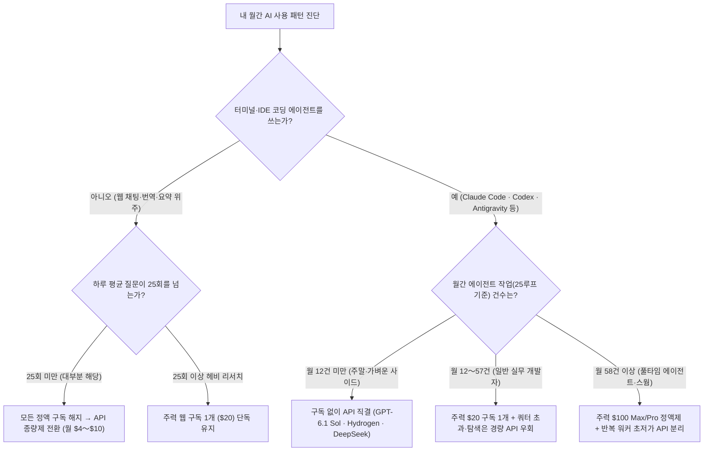

import AiCostCalculator from '@/components/AiCostCalculator.astro';
import Alert from '@/components/Alert.astro';
import Chart from '@/components/Chart.astro';
import LinkInline from '@/components/LinkInline.astro';
import GitHubRepoCard from '@/components/GitHubRepoCard.astro';

카드 명세서를 열었다가 매달 빠져나가는 **AI 구독제** 내역을 보고 한숨부터 나온 적 있으실 겁니다. ChatGPT Plus `$20`, Claude Pro `$20`, Google AI Pro `$19.99`, 여기에 에디터용 Cursor `$30`까지 얹으면 부가세 포함 매달 13만 원이 넘게 고정비로 증발하는데요. 정작 배포 마감이 몰린 오후 3시에는 야속한 `5시간 사용 한도 도달` 메시지에 손발이 묶이고, 바빠서 한 주 내내 채팅창 한 번 못 연 달에는 생돈을 허공에 태우게 됩니다.

그렇다고 무턱대고 구독을 다 끊고 **API 종량제**로 넘어가는 게 정답일까요? 결론부터 말하면 **웹 채팅 위주 사용자와 터미널 코딩 에이전트 사용자의 손익분기점은 최소 20배에서 최대 80배까지 완전히 반대로 갈립니다.** 내가 매달 몇백만 토큰을 쓰는지 몰라도 괜찮습니다. 평소 질문 횟수나 하루 코딩 작업 건수만 넣으면 즉시 본전 구간이 나오는 시뮬레이터부터 직접 돌려보세요.

---

## ⚡ 10초 판별 요약표 & 실시간 손익분기점 계산기

세부 수식을 뜯어보기 전에, 사용 패턴별 유불리 결론부터 한눈에 정리했습니다. 아래 표에서 본인 유형을 확인한 뒤 바로 밑 계산기에서 모델과 횟수를 조절해 보세요.

| 사용자 유형 | 대표 사용 패턴 | 월 예상 API 원가 | 최적 선택지 | 핵심 이유 |
| :--- | :--- | :--- | :--- | :--- |
| **라이트 웹 챗봇 유저** | 번역·요약·단문 질문 일 10회 내외 | **$4～$9** | **API 종량제**(BYOK) | `$20` 구독료의 절반도 못 씀 (구독 시 매달 2만 원 손해) |
| **사이드·파트타임 개발자** | 주말·퇴근 후 코딩 에이전트 월 10～15건 | **$9～$26** | **경계 구간**(성향 선택) | 요금 눈치 안 보는 심리적 안정감(`$20` 구독) vs 쿼터 없는 자유(API) |
| **풀타임 에이전트 개발자** | 매일 터미널 에이전트 3～8건 이상 구동 | **$90～$350+** | **$100 Max 또는 하이브리드** | 순수 API 사용 시 월 15만～50만 원 청구서 폭탄 직격 |
| **3～4개 중복 구독자** | 벤더별 `$20` 구독을 동시에 유지 중 | 고정비 **$80+** | **주력 구독 1개 + 보조 API** | 안 쓰는 서브 구독만 API로 돌려도 고정비 50% 이상 즉시 절감 |

<AiCostCalculator />

---

## 웹 채팅 vs 코딩 에이전트: 왜 똑같은 모델인데 손익분기점이 20배 갈릴까?

주변을 보면 "나는 ChatGPT나 Claude를 하루 열 번 넘게 쓰니까 무조건 `$20` 구독이 이득이야"라고 믿는 분이 꽤 많습니다. 하지만 실제 토큰 계산기를 두드려 보면 정반대의 숫자가 튀어나오죠.

일반적인 **웹 채팅·번역·문서 요약** 1턴은 시스템 프롬프트와 질문, 이전 맥락을 합쳐 평균 입력 `2K` 토큰, 모델 답변 출력 `1.5K` 토큰 내외에서 끝납니다. 세전 정가(`1,400원/$` 기준)로 환산하면 실전 가성비 주력인 `GPT-6.1 Sol`(`$2 / $10`)은 질문 한 번에 `$0.019`, 우리 돈으로 **약 27원**밖에 안 합니다. 단가가 두 배인 `Claude Opus 5.5`(`$4 / $20`)로 물어봐도 1턴에 `$0.038`, **약 53원** 수준이에요. 출근하는 22일 내내 하루 10번씩 꼬박꼬박 질문해 봐야 한 달 누적 API 요금은 세전 **$4.05～$8.11**(부가세·수수료 포함 `$4.51～$9.02`, 약 6,300～12,600원)에서 멈춥니다. 웹 채팅만으로 `$20` 구독 본전을 뽑으려면 `Opus 5.5` 기준 월 **543회**(하루 25회), `GPT-6.1 Sol` 기준으로는 무려 월 **1,086회**(하루 49회)를 쉬지 않고 물어봐야 한다는 계산이 나옵니다.

반면 `Claude Code`, `Codex CLI`, `Antigravity` 같은 **코딩 에이전트**에 똑같은 모델을 물리면 얘기가 완전히 달라집니다. 기능 구현이나 버그 수정 지시 한 줄을 던졌을 때 에이전트는 단답으로 끝나지 않고 파일 검색(`grep`) → 코드 읽기(`read`) → 수정(`edit`) → 테스트 실행(`bash`) → 에러 수정까지 평균 **25회의 도구 호출 루프**(Loop)를 스스로 돌립니다.

문제는 LLM API가 기본적으로 무상태(Stateless)라는 점입니다. 에이전트가 2번째, 3번째, 25번째 루프를 돌 때마다 이전까지 읽은 시스템 지침(`CLAUDE.md`), 레포지토리 구조, 파일 본문, 터미널 에러 로그 전체를 **매 턴 처음부터 끝까지 다시 실어 보내야** 합니다. 초기 베이스 컨텍스트 `29K`에서 시작해 루프마다 도구 실행 결과와 패치 내역이 `4K`씩만 불어나도, `K`회 루프 동안 누적 입력 토큰은 `O(K²)` 곡선을 그리며 폭발합니다. 25루프 기준 신규로 쌓인 고유 컨텍스트는 `125K`뿐인데, 매 턴 반복 전송된 프리픽스(`1,800K`)가 합쳐져 **태스크 딱 1건에 누적 입력 1.925M 토큰**(192만 5천 토큰)과 **출력·사고 토큰 25K**가 찍히게 되죠.

만약 할인 장치 없이 이 `1.925M` 토큰을 정가로 다 내면 어떻게 될까요? `Claude Opus 5.5` 기준 작업 1건당 입력 `$7.70` + 출력 `$0.50`을 합쳐 **`$8.20`**(약 11,500원)이 날아갑니다. 다행히 여기서 개발자의 지갑을 구원하는 핵심 기술이 바로 **프롬프트 캐싱**(Prompt Caching)입니다. 직전 루프에서 이미 읽은 `1,800K` 구간을 서버 메모리에서 재사용해 입력 단가를 95%(`$4.00` → `$0.20`) 깎아주는 덕분인데요. 무중단 연속 루프(실효 적중률 93.5%) 기준으로 신규 캐시 쓰기 `125K`(`$0.625`) + 캐시 읽기 `1,800K`(`$0.360`) + 출력 `25K`(`$0.500`)를 합산하면 **`$8.20`짜리 태스크가 `$1.49`로 81.9%나 압축**됩니다(서브에이전트 분기 등 미스를 감안해 위 계산기 기본값인 적중률 90%로 보수적으로 잡아도 `$1.74` 수준입니다).

<Chart
  type="bar"
  height={360}
  caption="코딩 에이전트 표준 1태스크(25루프 · 누적 입력 1.925M / 출력 25K) 모델별 캐시 미적용 원가 vs 무중단 프롬프트 캐시 적용 실효 원가 비교 (세전 USD, 2026.12 정규가 기준)"
  data={{
    labels: [
      'Claude Fable 5.2',
      'Claude Opus 5.5',
      'Gemini 4 Carbon',
      'Gemini 4 Neon',
      'Claude Sonnet 5.5',
      'GPT-6.1 Sol',
      'Gemini 4 Hydrogen',
      'DeepSeek V4.1 Flash',
    ],
    datasets: [
      {
        label: '캐시 미적용 원가 ($ / 태스크)',
        data: [16.4, 8.2, 8.2, 6.15, 4.1, 4.1, 3.08, 0.61],
        backgroundColor: 'rgba(148, 163, 184, 0.55)',
        borderColor: '#64748b',
        borderWidth: 1,
      },
      {
        label: '프롬프트 캐시 적용 실효 원가 ($ / 태스크)',
        data: [2.61, 1.49, 1.36, 1.02, 0.74, 0.74, 0.51, 0.09],
        backgroundColor: 'rgba(6, 182, 212, 0.88)',
        borderColor: '#0891b2',
        borderWidth: 1,
      },
    ],
  }}
/>

프롬프트 캐싱이 원가를 80% 넘게 깎아줬는데도, 코딩 에이전트에서는 여전히 구독제의 가성비가 압도적입니다. 1태스크에 `$1.49～$1.74`씩 나가니 한 달에 **딱 12～14건**(이틀에 한 건꼴)만 시켜도 벌써 `$20` 구독료를 넘어서거든요. 실제로 <LinkInline href="https://docs.anthropic.com/en/docs/claude-code/costs" label="Anthropic 공식 Claude Code 비용 통계" />를 보면 API 직결 개발자의 일평균 지출은 **약 $13**, 월평균 지출은 **$150～$250**에 달하며 전체 개발자의 90%가 하루 `$30` 미만을 기록하고 있습니다. 본인의 평소 작업 스타일이 실제로 몇 달러어치 토큰을 태우는지 궁금하다면, 지난번 공유해 드린 [클로드 코드 1주일 무료 게스트 패스 가이드](/tools/claude-code-guest-pass)로 먼저 체험 세션을 연 뒤 터미널에서 `/usage`(또는 API 연결 시 `/cost`) 명령어를 찍어 일주일 치 실측 데이터를 확인해 보시는 걸 권합니다.

---

## 2026년 하반기 3대 벤더 구독제 vs API 요금 구조와 결정적 차이

프론티어 3사 모두 소비자·개인 개발자용 정액제를 **`$20` 엔트리 — `$100` 헤비 — `$200` 울트라**(기본 1x · 5x · 상위 10x～20x 쿼터) 3단 구조로 수렴시켰습니다. 하지만 약관과 과금 디테일을 열어보면 에이전트 연결 방식과 크레딧 함정이 제각각입니다(모델별 벤치마크 성적과 추론 특성은 [코딩 AI 모델 선택 가이드](/dev/coding-ai-model-selection-guide)에서 자세히 다뤘습니다).

| 벤더 | 구독 티어 (월 정가) | 에이전트 구독 연동 (OAuth) | 주력 API 정규가 (입력/출력, $/1M) | 실무자가 꼭 알아야 할 과금 디테일 |
| :--- | :--- | :--- | :--- | :--- |
| **Anthropic** | Pro `$20` · Max `$100` · Ultra `$200` | `Claude Code` 직결 지원 (5시간 롤링 + 주간 쿼터) | `Opus 5.5` **$4 / $20** `Fable 5.2` **$8 / $40** | Max·Ultra 포함 API 크레딧은 구독 한도 자동 연장이 아닌 **별도 콘솔 API 풀** |
| **OpenAI** | Plus `$20` · Pro 100 `$100` · Pro 200 `$200` | `Codex CLI` ChatGPT 계정 로그인 지원 | `GPT-6.1 Sol` **$2 / $10** `Astra` **$10 / $50** | 입력 **272K 초과 시 요청 전체 입력 2배·출력 1.5배** 할증 절벽 주의 |
| **Google** | AI Pro `$19.99` · Ultra 5x `$99.99` · 20x `$199.99` | `Antigravity` 연동 및 스토리지(5TB～30TB) 결합 | `Neon` **$3 / $15** · `Carbon` **$4 / $20** `Hydrogen` **$1.5 / $7.5** | **12/1부터 Carbon·Argon $4/$20 정규가 인상**, `Hydrogen` 유일 무료 티어 |

각 진영에서 결제를 누르기 전에 가장 많이 착각하는 포인트 네 가지만 짚어보죠.

1. **Anthropic Max·Ultra의 보너스 API 크레딧 착시**: <LinkInline href="https://claude.ai/pricing" label="Claude 공식 구독 요금표" />에서 `$100 Max`나 `$200 Ultra`(주간 10x + 5시간 롤링 제한 해제) 플랜 혜택으로 적혀 있는 플랫폼 API 크레딧을 보고 "구독 쿼터가 막히면 알아서 이 크레딧이 차감되며 계속 돌아가겠지"라고 오해하기 쉽습니다. 이 크레딧은 `Claude Code`의 OAuth 구독 세션 쿼터를 자동으로 늘려주는 용도가 아니라, `platform.claude.com` 개발자 콘솔을 연결해 별도 API 키(`ANTHROPIC_API_KEY`)로 써야 하는 독립된 당월 소멸성 API 예치금입니다.
2. **OpenAI Codex CLI의 로그인 모드 분리**: `Codex CLI`는 ChatGPT Plus·Pro 계정으로 브라우저 OAuth 로그인을 하면 구독 쿼터 안에서 돌아가지만, 환경 변수에 `OPENAI_API_KEY`가 함께 잡혀 있으면 의도치 않게 종량제 크레딧이 먼저 차감될 수 있습니다. 구독 모드로 쓸 때는 쉘 프로필(`~/.zshrc`)에 남아 있는 키 충돌 여부부터 점검해야 해요.
3. **Google Gemini 4의 12월 1일 정규가 전환**: 지난 [Gemini 4 모델 선택 가이드](/dev/gemini-4-model-selection-guide)에서도 강조했듯, 11월 말까지 `$2 / $10` 프로모션가로 풀렸던 `Gemini 4 Carbon`과 `Argon`이 **12월 1일부로 `$4 / $20` 정규가로 두 배 인상**됩니다. 따라서 12월 이후 예산 시뮬레이션은 무조건 `$3 / $15`인 `Neon`과 `$1.50 / $7.50`인 `Hydrogen`(4종 중 유일하게 무료 API 티어 보유) 중심으로 짜야 안전합니다.
4. **종말을 고한 서드파티 IDE의 '$20 무제한 보조금' 시대**: 작년까지만 해도 "Cursor `$20` 하나만 끊으면 Claude와 GPT 최신 모델을 본사 구독보다 후하게 쓴다"는 공식이 통했습니다. 하지만 <LinkInline href="https://www.cursor.com/docs/models-and-pricing" label="Cursor 2026년 10월 개편 요금제" />에서는 벤더 보조금이 완전히 폐지되어 기본 플랜 사용량 풀은 자체 모델(`Composer`·`Grok`) 전용으로 묶였고, 상위 `Premium ($30)` 이상을 끊더라도 서드파티 프론티어 모델(Claude·GPT·Gemini) 호출분은 **별도 선불 크레딧에서 각 모델의 공식 API 정가 그대로 차감**됩니다(레거시 `$20 Pro` 유지 계정 역시 월 크레딧 풀에서 API 정가로 빠져나가 무거운 에이전트 루프를 돌리면 며칠 만에 한도가 바닥납니다).

---

## 계산기 숫자를 흔드는 4가지 숨은 비용 함정과 방어법

표면 단가표만 보고 API 종량제를 세팅했다가 월말에 예상치 못한 청구서를 받게 만드는 실무 함정 네 가지입니다. 위 계산기의 `전문가 세부 변수 조정` 탭을 열어 체크박스를 하나씩 켜보면 타격감이 바로 체감됩니다.

### 1. 커피 한 잔 값보다 비싼 '5분 캐시 TTL 만료'

프롬프트 캐싱이 만능 방패처럼 보이지만, 캐시에는 엄연한 **유효 수명**(TTL, Time-To-Live)이 있습니다. <LinkInline href="https://platform.claude.com/docs/en/build-with-claude/prompt-caching" label="Anthropic 프롬프트 캐싱 명세" />를 보면 기본 캐시 수명은 **마지막 적중 시점으로부터 딱 5분**(연장 옵션 사용 시 1시간이나 별도 쓰기 할증 부과)이며, 처음 캐시를 구울 때 기본 입력 단가의 **`1.25배`** 할증을 받습니다.

이게 실무에서 왜 무서울까요? 에이전트와 한창 코드를 고쳐 컨텍스트가 `125K` 토큰까지 쌓인 상태에서, 커피 한 잔을 타 오거나 슬랙 답장을 하느라 **6분 뒤에 다음 지시를 입력하면 기존 캐시가 증발**해 버립니다. 원래대로라면 캐시 읽기(`$0.20/1M`)로 **`$0.025`**(약 35원)만 내고 넘어갈 턴인데, `125K` 전체를 다시 `1.25배` 캐시 쓰기로 구워야 해서 `Opus 5.5`에서는 **`$0.625`**(약 875원), 플래그십 `Fable 5.2`에서는 무려 **`$1.25`**(약 1,750원)가 그 자리에서 증발합니다. 하루에 서너 번만 흐름이 끊겨도 아메리카노 한 잔 값이 날아가는 셈이죠.

반면 <LinkInline href="https://ai.google.dev/gemini-api/docs/caching" label="Gemini 4 암묵적 캐싱" />은 별도 설정 없이도 4,096 토큰 이상 반복 프리픽스에 자동 발동하며 **초기 캐시 쓰기 할증이 아예 없고**(`1.0×`), OpenAI 역시 자동 캐싱에 기본 유지 시간이 최대 30분 수준으로 넉넉해 자리 비움 페널티가 훨씬 덜합니다. Anthropic API를 종량제로 쓸 때는 작업을 잠시 멈추기 전에 세션을 깔끔히 매듭짓고 새 태스크는 `/clear`로 가볍게 시작하는 습관이 필수입니다.

### 2. 장문 컨텍스트 할증 절벽(Pricing Cliff)과 보이지 않는 Thinking 토큰

모든 모델이 1M 컨텍스트를 외치지만 요금 곡선은 평평하지 않습니다. 가장 매서운 절벽은 OpenAI의 `GPT-6` 라인업(`GPT-6.1 Sol`·`Astra`)에 걸려 있는 **`272K` 기준선**입니다. 입력 프롬프트가 `272,000` 토큰을 단 1토큰이라도 초과하는 순간, 초과분만 비싸지는 게 아니라 **해당 요청 전체의 입력 단가가 2배, 출력 단가가 1.5배**로 껑충 뜁니다. `Claude Haiku 5.5` 역시 `100K` 초과 시 단가가 `$0.10/$0.50`에서 `$0.50/$2.50`으로 **5배** 점프하죠. 따라서 `300K` 이상의 거대 모노레포 통째 분석이나 빌드 로그 덤프는 처음부터 1M 전 구간 단일 평탄 요금제인 `Gemini 4`나 `Claude Sonnet·Opus 5.5`로 보내야 합니다.

여기에 눈에 보이지 않는 **사고 토큰**(Thinking Tokens)도 복병입니다. 모든 추론 모델은 화면에 찍히는 최종 코드 몇십 줄을 뱉기 전에 내부에서 수천 토큰의 추론 과정을 거치는데, 이 내부 토큰이 입력 단가가 아닌 **5배 비싼 출력 단가**로 합산 청구됩니다. 단순 오타 수정이나 보일러플레이트 생성에 `effort="max"`나 `thinking_level="xhigh"`를 고정해 두는 건 고속도로 통행료를 내고 동네 편의점에 가는 격입니다.

### 3. 한국 결제의 숨은 고정비 11.25%와 사업자 부가세 면제 팁

해외 AI 서비스 결제창에 적힌 `$20`를 환율 `1,400원`으로만 곱해 28,000원이라고 생각하면 오산입니다. 대한민국 국세청에 간편사업자로 등록된 해외 빅테크가 국내 개인 소비자에게 전자적 용역을 공급할 때는 10%의 부가가치세가 의무 부과됩니다 <LinkInline href="https://www.law.go.kr/법령/부가가치세법/제53조의2" label="부가가치세법 제53조의2" variant="badge" />. 여기에 비자·마스터카드 등 국제브랜드 수수료와 국내 카드사 해외이용 수수료(합산 약 `1.1%～1.4%`, 평균 `1.25%`)가 얹히면 실제 원화 청구액은 표시 가격의 **`1.1125배`**, 즉 `$20` 구독이 **`$22.25`**(약 31,150원), `$100` 구독은 **`$111.25`**(약 155,750원)가 됩니다.

여기서 개인사업자나 법인사업자(사이드 프로젝트 수익화 사업자 포함)가 당장 써먹을 수 있는 합법적 절세 팁이 있습니다. 같은 제53조의2 제1항 단서에 따라 부가가치세 과세사업자에게 공급하는 B2B 용역은 **국외사업자 부가세 징수 대상에서 제외**되거든요. OpenAI, Anthropic, Google Cloud, Cursor의 결제 프로필(`Billing` → `Tax ID`)에서 국가를 한국으로 두고 **`KR BRN`**(Korean Business Registration Number) 항목에 하이픈을 뺀 사업자등록번호 10자리를 입력한 뒤 저장하면, 다음 결제일부터 **10% 부가세가 즉시 `$0.00`으로 면제**됩니다. 연 단위로 따지면 `$100` 구독자 기준 1년에 17만 원 가까이 아끼는 셈이니 사업자등록증이 있다면 결제 전에 무조건 등록해 두세요.

### 4. 소비자 구독제 vs 유료 API의 보안·학습 약관 차이

비용 계산만큼이나 치명적인 기준선이 바로 사내 코드 보안입니다.

<Alert type="warning" title="사내 업무 코드 투입 전 데이터 학습(Training) 기본값 확인 필수">
- **소비자용 웹·에이전트 구독제**(`Plus`, `Pro`, `Max` 개인 플랜): 엔터프라이즈(`Team`·`Enterprise`) 플랜이 아닌 개인 구독 계정은 설정 메뉴의 `모델 개선을 위한 데이터 공유` 토글을 **수동으로 직접 끄지 않으면**(Opt-out) 대화와 코드 스니펫이 학습 파이프라인에 활용될 수 있습니다.
- **Google Gemini API 무료 티어의 함정**: `Gemini 4 Hydrogen` 무료 티어는 개인 사이드 프로젝트엔 축복이지만, <LinkInline href="https://ai.google.dev/gemini-api/docs/terms" label="Gemini API 공식 약관" />상 무료 티어(Unpaid Services)로 전송된 프롬프트와 코드는 **Google 제품 개선 및 모델 학습에 사용**됩니다. 회사 레포지토리나 고객 데이터를 다룰 때는 반드시 결제 계정이 연결된 **유료 티어**(Paid Services — 기본 미학습 보장) 키나 엔터프라이즈 플랜만 사용하세요.
</Alert>

---

## 구독 피로감을 끝내는 실전 '하이브리드 조합' 아키텍처

네 가지 숨은 비용까지 계산에 넣고 나면, 2026년 연말 가장 현명한 지출 전략은 '전부 구독'도 '전부 API'도 아닌 **단일 베이스캠프 구독 + 경량 BYOK API 하이브리드**로 귀결됩니다.

ChatGPT, Claude, Gemini에 각각 `$20`씩 바치던 중복 구독을 과감히 정리하고, 본인이 가장 손에 익은 터미널·코딩 에이전트 진영 딱 한 곳만 `$20`(풀타임 헤비 유저라면 `$100`) 구독을 남기세요. 그리고 가끔 타사 모델의 시각이 필요할 때(예: Claude 구독자가 `GPT-6.1 Sol`이나 `Gemini 4 Neon`에게 교차 코드 리뷰를 맡길 때), 혹은 오후 피크타임에 5시간 롤링 쿼터 한도에 걸렸을 때만 **API 키 연동**(BYOK)으로 우회하는 구조입니다.

이때 여러 벤더 콘솔에 각각 `$10`씩 선불 크레딧을 쪼개 충전해 두면 잔액 관리가 번거로운데, 통합 게이트웨이인 `OpenRouter`에 카드나 본인 키를 묶어 두면 단일 엔드포인트로 전 모델을 바꿔 끼울 수 있습니다. 특히 <LinkInline href="https://openrouter.ai/pricing" label="OpenRouter BYOK 요금 정책" />상 본인 벤더 API 키를 연결해 쓰는 모드는 월 호출량 `$25,000`까지 중개 수수료 `0%`가 유지되어 사실상 공짜 라우터처럼 활용할 수 있어요.

내 상황에 딱 맞는 최종 세팅을 아래 의사결정 트리로 점검해 보세요.

실제 하이브리드 세팅에 바로 투입할 수 있는 공식·오픈소스 코딩 에이전트 저장소 3종입니다. 모두 구독 계정 로그인 또는 자유로운 API 엔드포인트 교체를 지원해 위 전략을 그대로 구현할 수 있습니다.

  <GitHubRepoCard
    repo="anthropics/claude-code"
    class="!my-0"
    comment="Claude Pro·Max 구독 쿼터와 Anthropic 호환 API(DeepSeek 직결 포함)를 오가며 쓸 수 있는 대표 터미널 에이전트."
  />
  <GitHubRepoCard
    repo="openai/codex"
    class="!my-0"
    comment="ChatGPT Plus·Pro 계정 로그인과 프로필별 모델 분리(GPT-6.1 Sol 데일리 · Astra 감사)를 지원하는 공식 CLI 에이전트."
  />

<GitHubRepoCard
  repo="cline/cline"
  comment="특정 IDE 구독료에 종속되지 않고 OpenRouter·Gemini·Claude·로컬 모델 API 키(BYOK)를 작업 단계별로 나눠 꽂기 좋은 오픈소스 에이전트."
/>

이번 주말에는 관성처럼 자동결제되던 AI 구독 목록부터 한 번 열어보세요. 지난 한 달간 5시간 쿼터 제한 창을 두 번도 못 본 구독이 있다면 미련 없이 해지 버튼을 누르고 API 키 하나로 갈아타는 것만으로도, 내년 한 해 치 개발 장비 기변 예산이 가볍게 모일 겁니다.

---

## 참고 자료

- [Claude 구독 플랜 및 요금 안내 — Anthropic](https://claude.ai/pricing)
- [Manage costs effectively (Claude Code 공식 비용 통계) — Anthropic Docs](https://docs.anthropic.com/en/docs/claude-code/costs)
- [Claude API Models & Pricing — Anthropic Platform](https://platform.claude.com/docs/en/about-claude/pricing)
- [Prompt caching — Anthropic Platform Docs](https://platform.claude.com/docs/en/build-with-claude/prompt-caching)
- [ChatGPT Pricing — OpenAI](https://chatgpt.com/pricing)
- [OpenAI API Pricing — OpenAI Platform](https://platform.openai.com/docs/pricing)
- [Prompt Caching Guide — OpenAI Platform](https://platform.openai.com/docs/guides/prompt-caching)
- [Google Antigravity Pricing — Google](https://antigravity.google/pricing)
- [Gemini Developer API Pricing — Google AI for Developers](https://ai.google.dev/gemini-api/docs/pricing)
- [Context caching | Gemini API — Google AI for Developers](https://ai.google.dev/gemini-api/docs/caching)
- [Gemini API Additional Terms of Service (무료·유료 데이터 학습 구분) — Google AI for Developers](https://ai.google.dev/gemini-api/docs/terms)
- [Models & Pricing — Cursor Docs](https://www.cursor.com/docs/models-and-pricing)
- [OpenRouter Pricing & BYOK Policy — OpenRouter](https://openrouter.ai/pricing)
- [부가가치세법 제53조의2 (국외사업자의 용역 등 공급에 관한 특례) — 국가법령정보센터](https://www.law.go.kr/법령/부가가치세법/제53조의2)
