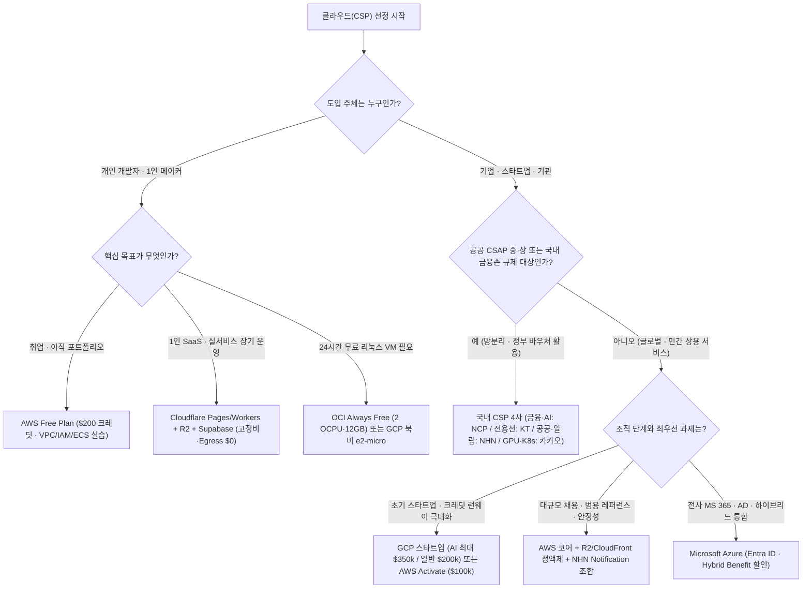

import Alert from '@/components/Alert.astro';
import Chart from '@/components/Chart.astro';
import GitHubRepoCard from '@/components/GitHubRepoCard.astro';
import LinkInline from '@/components/LinkInline.astro';

습관적으로 AWS 서울 리전 EC2부터 띄웠다가 방문자 한 명 없는 토이 프로젝트에서 매달 퍼블릭 IPv4 고정비와 스냅샷 청구서를 받아본 경험, 한 번쯤 있으실 겁니다. 클라우드 서비스 제공자(CSP) 선택은 더 이상 "무조건 점유율 1위"로 끝나는 문제가 아니라, 트래픽 과금 구조·보안 규제·크레딧 런웨이가 맞물린 재무적 아키텍처 결정에 가깝습니다.

바쁜 실무자와 1인 개발자를 위해 주체와 목적별 1순위 클라우드 조합부터 표로 압축했어요.

| 주체 · 목적 | 1순위 추천 조합 | 핵심 선택 이유 | 가장 주의할 함정 |
| :--- | :--- | :--- | :--- |
| **취업·이직 포트폴리오** | **AWS** (`Free Plan`) | 국내 채용 공고·실무 레퍼런스 압도적 표준, 자동 과금 차단 지원 | 공인 IPv4·NAT 시간당 크레딧 조기 소진 및 `Paid Plan` 전환 후 방치 리소스 |
| **1인 SaaS · 사이드 프로젝트** | **Cloudflare** (Pages/Workers + R2) + **Supabase** | 아웃바운드 전송료(Egress) 영구 `$0`, 유휴 서버 고정비 제거 | Workers CPU 실행 시간 제한(무거운 동기 연산 부적합) |
| **무료 상시 리눅스 실습 서버** | **Oracle Cloud** (OCI Always Free) 또는 **GCP** (`e2-micro`) | OCI 상시 `2 OCPU · 12GB` ARM + 월 10TB 전송 무료 제공 | OCI 7일 유휴 인스턴스 강제 회수 · GCP 서울 리전 제외 |
| **AI·데이터 중심 초기 스타트업** | **Google Cloud** (GCP) | 2년간 최대 **$350,000** AI 스타트업 크레딧, BigQuery·GKE 완성도 | 크레딧 소진 시점의 정가 전환 쇼크와 국내 엔지니어 채용 풀 |
| **MS 오피스·AD 연동 중견·대기업** | **Microsoft Azure** | Microsoft 365·Entra ID·Windows Server 하이브리드 라이선스 할인 | 테넌트·구독 권한 계층 복잡도와 리전별 GPU 쿼터 확보 지연 |
| **공공·행정·금융 규제 사업** | **네이버 · KT · NHN · 카카오** (국내 CSP 4사) | **CSAP 중·상 등급** 물리적 망분리 충족, 전용 금융존 및 정부 바우처 | 글로벌 리전 확장성 한계와 테라폼 프로바이더 성숙도 편차 |
| **미디어·알림 혼합 스케일업** | **AWS/GCP 코어** + **Cloudflare R2** + **NHN Notification** | 트랜잭션 코어 안정성 + 전송료 방어 + 카카오 알림톡/SMS 가성비 | 멀티 클라우드 간 인증 키 관리 분산 및 데이터 왕복 지연 |

---

## 글로벌 클라우드 빅3 비교 (AWS · Azure · Google Cloud)

생성형 AI 워크로드와 GPU 클러스터 수요가 폭발하면서 글로벌 인프라 지형도도 빠르게 재편되고 있습니다. <LinkInline href="https://www.srgresearch.com/articles/cloud-market-growth-rate-surges-to-well-over-50-per-year-q3-revenues-reach-168-billion" label="Synergy Research Group 2026년 3분기 리포트" />에 따르면 전 세계 클라우드 인프라 분기 매출은 **1,680억 달러**(`$168B`)로 전년 동기 대비 **55%** 급증했습니다. **AWS**(26%)가 선두를 지키는 가운데 **Azure**(19%)와 **Google Cloud**(16%)가 바짝 추격하고 있고, Oracle·CoreWeave 같은 AI 특화 네오클라우드 및 기타 사업자가 나머지 **39%** 파이를 차지하는 다극 체제죠.

<Chart
  type="doughnut"
  height={290}
  caption="2026년 3분기 글로벌 클라우드 인프라 시장 점유율 (분기 총매출 $168B, YoY +55% — 출처: Synergy Research Group)"
  data={{
    labels: ['AWS (26%)', 'Microsoft Azure (19%)', 'Google Cloud (16%)', '기타 · 네오클라우드 (39%)'],
    datasets: [
      {
        label: '시장 점유율 (%)',
        data: [26, 19, 16, 39],
        backgroundColor: ['#f59e0b', '#3b82f6', '#10b981', '#64748b']
      }
    ]
  }}
/>

서비스 개수를 단순 나열하는 비교는 실무에서 큰 의미가 없습니다. 세 벤더는 조직의 채용 환경과 주력 워크로드에 따라 명확히 다른 선택 트리거를 가집니다.

- **AWS — 채용 시장의 공용어이자 레퍼런스 표준**: 국내외 백엔드·데브옵스 엔지니어를 채용할 때 재교육 없이 즉시 투입할 수 있는 인력 풀이 가장 넓습니다. 세분화된 IAM 권한 통제, 검증된 VPC 네트워킹, Aurora·ECS·EKS 생태계 덕분에 장애 대응 사례를 찾기가 압도적으로 수월해요.
- **Microsoft Azure — 엔터프라이즈 거버넌스와 오피스 생태계 결합**: 전사 임직원이 Microsoft 365와 Entra ID(구 Azure AD)를 쓰고 있다면 사내 계정·보안 정책을 인프라 권한과 하나로 묶을 수 있습니다. 기존 Windows Server·SQL Server 라이선스를 이관하는 **Azure Hybrid Benefit** 할인 폭이 크고 엔터프라이즈 OpenAI 연동이 매끄럽습니다.
- **Google Cloud — 쿠버네티스 원조와 데이터·AI 파이프라인**: 쿠버네티스 창시자가 직접 다듬은 **GKE**(특히 노드 관리 부담을 던 Autopilot 모드)의 운영 편의성은 빅3 중 가장 쾌적합니다. **BigQuery** 서버리스 분석 창고와 TPU·Gemini 기반 **Vertex AI** 생태계가 탄탄해 데이터·AI 비중이 높은 팀에서 점유율이 가파르게 오르고 있죠.

### 2025～2026 달라진 프리티어 정책과 퍼블릭 IPv4 고정비 함정

예전 블로그 후기만 믿고 계정을 열었다가 낭패를 보는 대표 구간이 **프리티어 개편**과 **공인 IPv4 유료화**입니다.

가장 큰 변화는 AWS에서 일어났습니다. 2025년 7월 15일 시행된 <LinkInline href="https://aws.amazon.com/blogs/aws/aws-free-tier-update-new-customers-can-get-started-and-explore-aws-with-up-to-200-in-credits/" label="AWS Free Tier 전면 개편안" />부터 기존의 '12개월 `t2.micro` 750시간 무료' 공식이 크레딧 체제로 바뀌었습니다. 가입 시 기본 **$100**에 온보딩 미션 5종(EC2, RDS, Lambda, Bedrock, Budgets) 완료 시 추가 **$100**를 더해 **최대 $200 크레딧**을 받습니다. 특히 최대 6개월간 크레딧 소진 시 자동 유료 과금이 원천 차단되는 **Free Plan**과 전체 기능을 여는 **Paid Plan** 중 선택할 수 있어 입문자의 과금 사고 위험이 크게 줄었어요(Lambda 월 100만 요청, CloudFront 월 1TB 등 상시 무료는 유지).

반면 **GCP**는 90일 **$300 크레딧**과 상시 무료 `e2-micro` 월 1대(표준 디스크 30GB 포함)를 제공하지만, 북미 3개 리전(`us-central1`, `us-west1`, `us-east1`)에만 무료가 적용됩니다. 서울 리전(`asia-northeast3`)에 띄우면 첫날부터 정상 과금되니 주의해야 합니다. **Azure**는 30일 **$200 크레딧**과 12개월 인기 서비스 무료를 지원하되, 2025년 9월 30일 Basic SKU 공인 IP 은퇴로 **Standard SKU IPv4**가 기본화됐습니다.

여기에 빅3 모두가 부과하는 숨은 고정비가 있습니다. 바로 인스턴스에 달아두거나 예약만 해두어도 붙는 **퍼블릭 IPv4 시간당 $0.005**(월 730시간 기준 **약 $3.65**, GCP 미연결 예약 고정 IP는 시간당 $0.01) 요금입니다 <LinkInline href="https://aws.amazon.com/vpc/pricing/" label="AWS VPC Pricing" variant="badge" />. GCP 북미 상시 무료 리전 `e2-micro`에 연결된 1개만 예외일 뿐, 무료 사양 VM이라도 공인 IPv4를 달아두면 매달 5천 원 안팎의 청구서가 날아옵니다.

---

## 개인·소규모 팀이 빅3만 고집하면 손해 보는 이유: 엣지·가성비 대안

컴퓨팅 단가만 비교하던 소규모 팀이 실서비스 오픈 직후 가장 크게 데이는 지점은 **네트워크 송신 요금**(Egress)입니다. 특히 AWS 서울 리전(`ap-northeast-2`)은 북미보다 훨씬 비싼 망 단가가 적용됩니다.

AWS S3 서울 리전에서 인터넷으로 데이터를 직접 내보내면 월 100GB 무료 이후 첫 10TB 구간 단가가 **GB당 $0.126**에 달합니다. 북미(`us-east-1`, `$0.09/GB`) 대비 **40% 비싼 가격**이죠. 앞단에 CloudFront를 두면 상시 무료 월 1TB가 적용되지만, 종량제 기준 한국·아시아 엣지 초과 구간은 약 `$0.120/GB`가 과금됩니다(단, 2025년 11월 도입된 CloudFront 정액제 **Flat-Rate Plans** — Free `$0`(월 100GB) · Pro `$15`(월 50TB·WAF 포함) · Business `$200`을 쓰면 초과 과금을 원천 방어할 수 있습니다).

이 비용 구조를 무너뜨린 대안이 **Cloudflare R2 + Workers/Pages**입니다. <LinkInline href="https://developers.cloudflare.com/r2/pricing/" label="Cloudflare R2 요금 정책" />은 스토리지 보관료(월 10GB 무료 후 `$0.015/GB-월`)만 받을 뿐 **전 구간 인터넷 송신 전송료를 영구 $0**로 책정했고, Workers/Pages 정적 대역폭도 무제한 무료입니다. 미디어·정적 파일 서빙이 월 5TB～10TB로 늘어나면 매달 수십만～백만 원 이상의 비용 격차가 벌어지죠.

<Chart
  type="bar"
  height={310}
  caption="월간 인터넷 송신(Egress) 트래픽 규모별 전송료 비교 (단위: USD, 1TB=1,024GB 기준·요청 요금 제외 — AWS S3 서울 직접 송신 vs CloudFront 한국/아시아 종량제 vs Cloudflare R2)"
  data={{
    labels: ['월 1TB 전송', '월 5TB 전송', '월 10TB 전송'],
    datasets: [
      {
        label: 'AWS S3 서울 직접 송신 ($)',
        data: [116, 633, 1278],
        backgroundColor: '#ef4444'
      },
      {
        label: 'AWS CloudFront 종량제 ($)',
        data: [0, 492, 1106],
        backgroundColor: '#3b82f6'
      },
      {
        label: 'Cloudflare R2 + Workers ($)',
        data: [0, 0, 0],
        backgroundColor: '#10b981'
      }
    ]
  }}
/>

### Oracle Cloud (OCI) Always Free: 2026년 7월 한도 축소와 운영 함정

24시간 돌아가는 넉넉한 사양의 무료 리눅스 VM이 필요할 때 개발자들이 단골로 찾는 곳이 **Oracle Cloud Infrastructure**(OCI)입니다. 월 **10TB 아웃바운드 전송 무료** 혜택은 여전히 독보적이지만, 과거 커뮤니티 후기만 보고 진입하면 사양 계산이 틀어집니다.

<Alert type="warning" title="OCI Always Free 도입 전 반드시 확인할 2026년 최신 제약 4가지">
**① 2026년 7월 Ampere A1 무료 한도 반토막 개편**: 예전의 '상시 4 OCPU · 24GB RAM 무료' 공식은 종료됐습니다. 2026년 7월 문서 개편으로 월간 무료 제공량이 **1,500 OCPU시간 · 9,000 GB시간**으로 축소되어, 24시간 상시 가동 기준 최대 **2 OCPU · 12GB RAM**까지만 무료로 유지됩니다.

**② 7일 유휴 인스턴스 강제 회수**: 최근 7일간 CPU·네트워크·메모리 사용률(95백분위수)이 **20% 미만**이면 유휴 자원으로 판정되어 인스턴스가 임의 중지·회수됩니다.

**③ 고질적인 `Out of host capacity` 재고 부족**: 무료 등급 계정에서는 ARM 인스턴스 생성이 수주씩 막히는 일이 흔해, **종량제**(Pay As You Go)로 등급만 올린 뒤 예산 알람을 무료 한도 안으로 잠가 우회하곤 합니다.

**④ 홈 리전 영구 변경 불가**: 가입 시 선택한 홈 리전(서울·춘천 등)은 추후 절대 바꿀 수 없으며 Always Free 컴퓨팅 자원도 홈 리전에서만 생성됩니다.
</Alert>

---

## 국내 주요 CSP 4사 비교 (네이버 · KT · NHN · 카카오) — 언제 국산 클라우드가 정답일까?

글로벌 빅3가 기능 폭에서 앞서는데도 수많은 공공기관, 금융사, 국내 기업이 **네이버클라우드 · KT Cloud · NHN Cloud · 카카오클라우드**를 채택하는 데는 명확한 실리적 이유가 세 가지 있습니다.

첫째는 **CSAP**(클라우드 보안인증제) 등급제의 현실적 장벽입니다 <LinkInline href="https://isms.kisa.or.kr/main/csap/intro/" label="KISA CSAP 안내" variant="badge" />. Azure(2024년 12월), GCP(2025년 2월), AWS(2025년 4월)가 잇달아 CSAP **하 등급** 인증을 땄지만, 하 등급은 **개인정보가 없는 공개 행정 데이터**에만 허용됩니다. 개인정보나 비공개 행정자료를 다루는 **중·상 등급** 사업은 물리적 망분리 요건 때문에 여전히 국내 CSP 영역이에요. **국가 망보안체계**(N2SF) 전면 전환도 2027년 하반기 목표의 과도기라 당장 공공 입찰을 뛰려면 국산 인프라가 필수입니다.

둘째는 **정부 클라우드 바우처**와 예산 효율입니다. 과기정통부·NIPA의 클라우드 서비스 보급·확산 사업(`cloudsup.or.kr`)을 활용하면 **자부담금 20% 조건**으로 일반지원 **최대 1,000만 원**, 집중지원 **최대 8,000만 원**까지 이용료를 보전받습니다. 셋째로 환율 변동 없는 **원화 세금계산서 정산**(KRW)과 한국어 전담 기술지원이 전담 데브옵스 인력이 부족한 기업에 큰 안정감을 줍니다.

국내 4사 역시 모두 똑같은 범용 클라우드가 아닙니다. 각 사업자가 가장 날카로운 경쟁력을 발휘하는 실전 영역을 비교해 보면 조합 포인트가 뚜렷해집니다.

| 사업자 | 핵심 강점 영역 | 대표 킬러 서비스 · 인프라 | 추천 채택 시나리오 |
| :--- | :--- | :--- | :--- |
| **네이버클라우드** (NCP) | 금융 규제 대응 · 소버린 AI | 전용 **금융존**(`fin-ncloud`), **HyperCLOVA X**, 풍부한 관리형 PaaS | 전자금융감독규정 준수가 필수인 핀테크·금융권, 한국어 특화 LLM 구축 |
| **KT Cloud** | 하이브리드 망 연동 · 공공/국방 | 국내 1위 **IDC 코로케이션 + 전용회선** 직결, 공공 G-Cloud | 레거시 전산실 물리 서버와 클라우드를 전용선으로 묶는 기관·국방 사업 |
| **NHN Cloud** | 공공 네이티브 전환 · 메시징/게임 | 광주 국가 AI 데이터센터, **NHN Notification**(알림톡/SMS), **Gamebase** | 지자체·공공 클라우드 전환 사업, AWS 코어 팀의 알림톡·문자 발송 모듈 |
| **카카오클라우드** | 고성능 GPUaaS · K8s 가성비 | 대규모 GPU 클러스터, 쿠버네티스 엔진 및 **Kubeflow** 네이티브 통합 | 합리적 단가로 AI 학습·추론 파이프라인과 컨테이너 환경을 굴리는 기술팀 |

실무에서는 "전체 인프라를 한 곳에 몰아넣기"보다 강점만 발라 쓰는 하이브리드 전략이 흔합니다. 예컨대 메인 API와 DB는 AWS 서울 리전에서 돌리더라도, 국내 사용자에게 보내는 카카오톡 알림톡·친구톡·문자 발송 계층만큼은 발송 성공률과 관리 콘솔이 검증된 **NHN Notification** API를 연동해 쓰는 식입니다.

---

## 주체별 최종 선택 가이드: 개인 개발자 vs 기업 의사결정 트리

앞선 비용·규제·생태계 변수를 하나의 의사결정 흐름도로 묶으면 우리 팀과 내 프로젝트가 갈 길이 선명해집니다.



### 개인 개발자라면: '이력서용'과 '내 지갑 방어용'을 철저히 분리하세요

개인 프로젝트에서 가장 흔한 실수는 **포트폴리오 학습용 스택**과 **수익형 사이드 프로젝트 스택**을 혼동하는 일입니다.

백엔드·인프라 취업이나 이직이 목적이라면 조금 번거롭더라도 시장 표준인 **AWS**를 직접 만져보는 편이 유리합니다. 면접관이 묻는 건 "클릭 한 번으로 배포했나요?"가 아니라 "프라이빗 서브넷과 NAT 구간을 어떻게 격리했나요?"이기 때문이죠. 개편된 AWS `Free Plan`으로 과금 사고를 잠근 뒤, [CIDR IP 대역 표기법 완벽 가이드](/dev/what-is-cidr)를 참고해 퍼블릭·프라이빗 서브넷부터 손수 쪼개며 VPC·IAM·ECS 파이프라인을 구축해 보는 경험이 그대로 이력서의 무기가 됩니다.

반대로 손익분기점을 넘기기 전까지 수개월～수년간 버텨야 하는 **1인 SaaS나 실서비스 운영**이라면 빅3의 상시 구동형 VM·RDS는 독입니다. 숨만 쉬어도 나가는 IPv4·로드밸런서 고정비를 없애려면 **Cloudflare Pages/Workers + R2**에 관리형 PostgreSQL 기반 BaaS를 얹는 구성이 훨씬 유리합니다. 인증·DB·스토리지를 묶는 구체적인 설계는 [1인 개발자·초기 SaaS 백엔드 기술 스택 가이드](/dev/vibe-coding-saas-backend-stack)에서 자세히 다뤘고, 해외 구독 결제를 붙일 계획이라면 법인 설립 전 세금 처리까지 대행해 주는 [글로벌 인디 SaaS 해외 결제 MoR 비교(Lemon Squeezy·Paddle·Polar)](/dev/lemon-squeezy-paddle-polar-korea)를 함께 챙겨보세요. 만약 매일 새벽 데이터를 긁어오거나 정산 배치를 돌려야 한다면 상시 VM을 띄우는 대신 [GitHub Actions 무료 러너로 크롤링·배치 봇 서버비 0원 만들기](/dev/dereel-1a-github-actions-crawling-bot) 패턴으로 서버 비용을 아예 지워버릴 수 있습니다.

### 기업이라면: 초기 스타트업의 본질은 '크레딧 런웨이' 전쟁입니다

시드～시리즈 A 단계 스타트업에게 빅3 선정 기준 1순위는 기술 취향이 아니라 **누가 현금 지출 없이 버틸 수 있는 크레딧을 가장 길게 쥐여주느냐**입니다. 제휴 벤처캐피털(VC)·액셀러레이터 추천 코드 보유 여부에 따라 지원 한도가 열 배 이상 벌어지므로 법인 설립 직후부터 전략적으로 신청해야 합니다.

| 프로그램명 | 초기 셀프서브 (무투자/부트스트랩) | 파트너 VC · 액셀러레이터 연계 최대 한도 | 실무 핵심 특징 |
| :--- | :--- | :--- | :--- |
| **AWS Activate** | Founders **$1,000** | Portfolio 최대 **$100,000** | 국내외 거의 모든 VC가 기관 코드를 보유해 승인 예측 가능성이 가장 높음 |
| **Google for Startups Cloud** | Start **$2,000** | Scale 일반 최대 **$200,000** / **AI-first 최대 $350,000** (2년 합산) | 빅3 중 최대 금액 지원, GPU·TPU 및 Vertex AI·BigQuery 비용 방어에 압도적 유리 |
| **Microsoft for Startups** | 법인 인증 후 최대 **$5,000** 시작 | Investor Network 추천 코드 보유 시 최대 **$150,000** | 초기 셀프서브 진입 장벽이 낮고 사용량·텔레메트리 심사 기반으로 단계적 증액 |

실제로 최근 AI 에이전트나 버티컬 LLM 서비스를 만드는 초기 팀들이 AWS 대신 **GCP**로 대거 출발하는 가장 결정적인 이유가 최대 **$350,000**(약 4억 8천만 원 상당) 규모의 Google for Startups 크레딧입니다. 이후 트래픽이 본궤도에 올라 크레딧이 소진되는 스케일업 시점이 오면, 코어 트랜잭션은 주력 클라우드에 두되 대용량 미디어 서빙은 Cloudflare R2나 CloudFront 정액제로 빼고 국내 메시징은 NHN Notification으로 분리해 마진율을 지키는 멀티 아키텍처로 진화하는 흐름이 정석이에요.

---

## 계약 도장 찍기 전 3분 실무 체크리스트 (숨은 비용 & 락인 방어)

어느 클라우드를 골랐든 첫 리소스를 배포하기 전에 세 가지 안전장치만 걸어두면 예상치 못한 청구서와 벤더 종속(Vendor Lock-in) 사고의 90%를 막을 수 있습니다.

첫째, **결제 한도 알람 설정과 미연결·방치 퍼블릭 IPv4 전수 점검**입니다. 계정 생성 직후 결제 대시보드에서 월 예산의 50%·80%·100% 임계치 알림을 슬랙이나 이메일로 연결하세요. 이미 운영 중인 AWS 계정이라면 아래 CLI 명령어로 인스턴스 종료 후에도 남아 과금 중인 탄력적 IP(Elastic IP)와 공인 IP 할당 현황부터 즉시 걸러낼 수 있습니다.

```bash
# 1) 어떤 네트워크 인터페이스(AssociationId)에도 연결되지 않은 방치 Elastic IP 조회
aws ec2 describe-addresses \
  --query 'Addresses[?AssociationId == `null`].{PublicIp:PublicIp,AllocationId:AllocationId,Name:Tags[?Key==`Name`]|[0].Value}' \
  --output table

# 2) 실행 중인 EC2 인스턴스에 부여된 퍼블릭 IPv4 목록 일괄 점검
aws ec2 describe-instances \
  --filters "Name=instance-state-name,Values=running" \
  --query 'Reservations[].Instances[] | [?PublicIpAddress != `null`].{InstanceId:InstanceId,Type:InstanceType,PublicIp:PublicIpAddress}' \
  --output table
```

둘째, 콘솔 수동 클릭 대신 **OpenTofu/Terraform 코드로 인프라를 선언하고 PR 단계에서 예상 청구액을 검증**하세요. 크레딧 풍년기에 고사양 NAT Gateway와 멀티 AZ 리소스를 남발했다가 크레딧 만료 달에 수천 달러 청구서를 받는 일을 막으려면 CI 파이프라인에 비용 계산기를 붙이는 편이 가장 확실하죠.

<GitHubRepoCard
  repo="infracost/infracost"
  comment="Terraform·OpenTofu 코드 변경분을 분석해 Pull Request 댓글로 다음 달 클라우드 예상 요금 증감액을 자동으로 찍어주는 오픈소스 FinOps 도구입니다."
/>

셋째, **컴퓨팅 바깥 계층의 비용과 런타임 최적화를 함께 설계**하세요. 클라우드 이관을 가로막는 진짜 락인은 컨테이너가 아니라 상태가 쌓이는 데이터베이스와 스토리지에서 발생합니다. 클라우드 위에 올릴 주력 DB 엔진과 스토리지 I/O 손익분기점 계산은 [MSA·클라우드 오픈소스 RDBMS 선택 가이드(MySQL·MariaDB·Aurora·PostgreSQL)](/dev/msa-rdbms-mysql-mariadb-aurora)를 참고해 초기에 기준선을 잡고, JVM 기반 백엔드라면 벤더별 기술지원과 메모리 효율이 검증된 [클라우드 환경별 최적 JDK 배포판 선택 가이드](/dev/cloud-jdk-guide)까지 맞춰 두어야 같은 vCPU 사양에서도 월간 인스턴스 대수를 한 단계 줄일 수 있습니다.

---

## 참고 자료

- [Cloud Market Growth Rate Surges to Well Over 50% Per Year; Q3 Revenues Reach $168 Billion — Synergy Research Group](https://www.srgresearch.com/articles/cloud-market-growth-rate-surges-to-well-over-50-per-year-q3-revenues-reach-168-billion)
- [AWS Free Tier Update: Explore AWS with Up to $200 in Credits — AWS Official Blog](https://aws.amazon.com/blogs/aws/aws-free-tier-update-new-customers-can-get-started-and-explore-aws-with-up-to-200-in-credits/)
- [Google Cloud Free Program Features & Limits — Google Cloud Documentation](https://cloud.google.com/free/docs/free-cloud-features)
- [Amazon S3 Pricing & Data Transfer — Amazon Web Services](https://aws.amazon.com/s3/pricing/)
- [Amazon CloudFront Pricing & Flat-Rate Plans — Amazon Web Services](https://aws.amazon.com/cloudfront/pricing/)
- [Oracle Cloud Infrastructure Always Free Resources — Oracle Help Center](https://docs.oracle.com/en-us/iaas/Content/FreeTier/freetier_topic-Always_Free_Resources.htm)
- [Google for Startups Cloud Program — Google Cloud](https://cloud.google.com/startup)
- [클라우드 서비스 보급·확산 사업(클라우드 바우처) 포털 — 과기정통부·정보통신산업진흥원(NIPA)](https://www.cloudsup.or.kr/)
