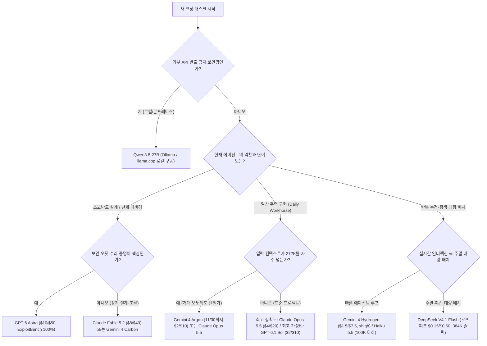

import Alert from '@/components/Alert.astro';
import Chart from '@/components/Chart.astro';

출근길에 터미널 에이전트나 에디터의 **코딩 AI** 모델 선택 드롭다운을 열었다가 순간 손이 멈칫하셨을 겁니다. 익숙하던 `Pro`와 `Flash` 자리에 느닷없이 **Gemini 4**의 주기율표 원소 이름(`Carbon`, `Argon`, `Hydrogen`)이 들어차 있고, 바로 옆에는 `Claude Fable 5.2`와 `GPT-6.1 Sol`이 나란히 떠 있으니까요. "일단 제일 윗줄에 있는 최신 플래그십이 제일 잘 짜겠지" 하고 무심코 기본값으로 걸어뒀다가는, 점심시간도 되기 전에 한 달 치 API 예산이 반 토막 나는 참사를 겪기 딱 좋은 시기입니다.

불과 석 달 전인 8월 [코딩 에이전트 열국지](/dev/coding-agent-warring-states)에서 `Claude Fable 5`, `GPT-5.6 Sol`, `Grok 4.6`, `Kimi K3`의 4파전을 다뤘고, 10월에는 구글의 [Gemini 4 Argon](/dev/gemini-4-argon-google-ai-strategy)을 단독으로 해부했는데요. 9월부터 11월 12일 사이 구글·앤트로픽·OpenAI는 물론 오픈웨이트 진영까지 일제히 세대교체와 네이밍 개편을 단행하면서 기존의 **코딩 AI 모델 선택 가이드** 기준표가 완전히 백지화됐습니다. 무엇보다 2026년 하반기 실무의 핵심은 '단일 최고 모델 몰빵'이 아니라 **설계(Orchestrator/Advisor) — 구현(Workhorse) — 탐색(Explorer) 3계층 멀티 에이전트 라우팅**으로 완전히 넘어왔거든요.

---

## 한눈에 보는 2026년 11월 코딩 AI 라인업·단가·성능

개별 벤더의 세부 특징을 뜯어보기 전에, 현재 실무에서 가장 많이 맞붙는 주요 모델 13종의 포지션과 가격표부터 한판에 펼쳐 놓고 시작하죠.

| 진영 | 모델명 (`API ID`) | 컨텍스트 / 최대 출력 | 표준 단가 (입력 / 출력, $/1M) | 과금 특이사항 및 프로모션 | 권장 배치 계층 |
|---|---|---|---|---|---|
| **Google** | `Gemini 4 Carbon` (`gemini-4-carbon`) | 1M / — | **$2.00 / $10.00** (12/1부터 $4/$20) | 1M 전 구간 단일가 · Thinking 과금 높음 | 고난도 설계 · 심층 검증 |
| **Google** | `Gemini 4 Argon` (`gemini-4-argon`) | 1M / — | **$2.00 / $10.00** (12/1부터 $4/$20) | 1M 전 구간 단일가 · 실체감 비용 낮음 | 모노레포 리팩토링 주력 |
| **Google** | `Gemini 4 Hydrogen` (`gemini-4-hydrogen`) | 1M / — | **$1.50 / $7.50** (상시 단일가) | 유일하게 `xhigh` 추론 지원 · 무료 티어 제공 | 고속 반복 편집 · 스웜 워커 |
| **Anthropic** | `Claude Fable 5.2` (`claude-fable-5-2`) | 1M / 128K | **$8.00 / $40.00** (캐시 읽기 $0.20) | Batch $4/$20 · Fast 모드 $16/$80 | 난제 해결 Advisor · 코디네이터 |
| **Anthropic** | `Claude Opus 5.5` (`claude-opus-5-5`) | 1M / 128K | **$4.00 / $20.00** | Fast 모드 $8/$40 | **데일리 주력 코딩 (1순위)** |
| **Anthropic** | `Claude Sonnet 5.5` (`claude-sonnet-5-5`) | 1M / 128K | **$2.00 / $10.00** | 명확한 단위 태스크 가성비 구간 | 단위 구현 · 테스트 작성 워커 |
| **Anthropic** | `Claude Haiku 5.5` (`claude-haiku-5-5`) | 1M / — | **$0.10 / $0.50** (100K 이하) | **100K 초과 시 $0.50 / $2.50 (5배 점프)** | 단문 코드 탐색 · 로그 요약 |
| **OpenAI** | `GPT-6 Astra` (`gpt-6-astra`) | 1.05M / 128K | **$10.00 / $50.00** (캐시 $1.00) | **입력 272K 초과 시 입력 2배·출력 1.5배** | 보안 취약점 오딧 · 수리 검증 |
| **OpenAI** | `GPT-6.1 Sol` (`gpt-6.1-sol`) | 1.05M / 128K | **$2.00 / $10.00** (캐시 $0.10) | **입력 272K 초과 시 입력 2배·출력 1.5배** | **실전 가성비 주력 코딩** |
| **OpenAI** | `GPT-6 Luna` (`gpt-6-luna`) | 1.05M / 128K | **$0.10 / $0.50** (캐시 $0.01) | 초저가 고속 응답 | 보일러플레이트 · 빠른 검색 |
| **DeepSeek** | `DeepSeek V4.1 Flash` | 1M / **384K** | **$0.30 / $1.20** (피크 기준) | **UTC 오프피크·주말 $0.15 / $0.60** · 1M 단일가 | 대량 배치 · 주말 자율 작업 |
| **Alibaba** | `Qwen 3.8` (`27B` / `Flash-Next`) | — | 로컬 무료 / API **$0.15 / $0.47** | Apache 2.0 · Mac Studio 로컬 구동 가능 | 사내 폐쇄망 · 보안 레포 |
| **Moonshot** | `Kimi K3.1 Pro` | 1M / — | **$2.00 / $10.00** | 전작 대비 33% 인하 · 2.8T MoE | 프론트엔드 UI · 거대 레포 분석 |

단가 격차가 얼마나 극적인지 차트로 나란히 세워 보면 감이 훨씬 빨리 옵니다.

<Chart
  type="bar"
  height={420}
  options={{ indexAxis: 'y' }}
  caption="2026년 11월 주요 코딩 AI 모델 1M 토큰당 표준 API 입출력 단가 비교 (272K 이하 구간 기준 · Gemini 4 Carbon 및 Argon은 11월 30일 프로모션 종료 후 12월 1일부터 $4 / $20 정규가로 전환)"
  data={{
    labels: [
      'GPT-6 Astra',
      'Claude Fable 5.2',
      'Claude Opus 5.5',
      'Gemini 4 Carbon (프로모션)',
      'Gemini 4 Argon (프로모션)',
      'GPT-6.1 Sol',
      'Claude Sonnet 5.5',
      'Kimi K3.1 Pro',
      'Gemini 4 Hydrogen',
      'DeepSeek V4.1 Flash',
    ],
    datasets: [
      {
        label: '입력 단가 ($ / 1M 토큰)',
        data: [10.0, 8.0, 4.0, 2.0, 2.0, 2.0, 2.0, 2.0, 1.5, 0.3],
        backgroundColor: 'rgba(59, 130, 246, 0.85)',
        borderColor: '#3b82f6',
        borderWidth: 1,
      },
      {
        label: '출력 단가 ($ / 1M 토큰)',
        data: [50.0, 40.0, 20.0, 10.0, 10.0, 10.0, 10.0, 10.0, 7.5, 1.2],
        backgroundColor: 'rgba(249, 115, 22, 0.85)',
        borderColor: '#f97316',
        borderWidth: 1,
      },
    ],
  }}
/>

그렇다면 가격이 5배 비싸면 코딩 실력도 5배 뛰어날까요? 에이전틱 터미널 실전 능력을 재는 `Terminal-Bench 4.0/4.1`과 종합 추론 지표인 `AA Intelligence Index v5.0`를 겹쳐 보면 정반대의 급소가 드러납니다.

<Chart
  type="bar"
  height={350}
  caption="프론티어 모델 에이전틱 코딩(Terminal-Bench 4.0/4.1) 및 종합 지능 지수(AA Intelligence Index v5.0) 비교"
  data={{
    labels: [
      'Claude Fable 5.2',
      'Claude Opus 5.5',
      'Gemini 4 Carbon',
      'GPT-6.1 Sol',
      'GPT-6 Astra',
      'Gemini 4 Argon',
      'Gemini 4 Hydrogen (xhigh)',
    ],
    datasets: [
      {
        label: 'Terminal-Bench 4.0/4.1 (%)',
        data: [65.8, 65.8, 64.5, 60.9, 60.3, 57.4, 57.0],
        backgroundColor: 'rgba(16, 185, 129, 0.85)',
        borderColor: '#10b981',
        borderWidth: 1,
      },
      {
        label: 'AA Intelligence Index v5.0 (점)',
        data: [65, 59, 60, 55, 57, 53, 54],
        backgroundColor: 'rgba(139, 92, 246, 0.85)',
        borderColor: '#8b5cf6',
        borderWidth: 1,
      },
    ],
  }}
/>

두 차트를 나란히 놓고 보면 이번 세대 모델 선택의 핵심 힌트 세 가지가 바로 읽힙니다.
- **절반 가격의 동률 1위**: `Claude Opus 5.5`(`$4/$20`)는 터미널 에이전트 실전 능력(`65.8%`)에서 두 배 비싼 `Claude Fable 5.2`(`$8/$40`)와 완벽한 동률을 찍습니다.
- **하극상을 일으킨 가성비 에이스**: OpenAI 진영에서는 1/5 가격인 `GPT-6.1 Sol`(`$2/$10`)이 `Terminal-Bench`에서 상위 플래그십 `GPT-6 Astra`(`60.3%`)를 `60.9%`로 오히려 제쳤습니다.
- **구글의 터미널 약점 극복**: 지난 10월 `Argon`(`57.4%`)에서 아쉬움을 남겼던 구글의 쉘 실행력이 11월 10일 출시된 `Gemini 4 Carbon`(`64.5%`)에서 선두권 턱밑까지 치고 올라왔습니다.

---

## Google Gemini 4: 주기율표 3원소 체제와 서열 착시 주의

구글은 오랫동안 써오던 `Ultra / Pro / Flash` 명명법을 과감히 폐기하고, 11월 12일부로 원소 기호 기반의 3종 라인업을 모두 정식 출시(GA)했습니다. 세 모델 모두 **1M(1,000,000) 토큰 통합 컨텍스트 윈도우**를 지원하며, 컨텍스트를 끝까지 채워도 구간 할증이 붙지 않는 단일 요금제를 공유합니다.

여기서 가장 많은 개발자가 속는 함정이 바로 **출시 순서로 인한 서열 착시**입니다. 10월 13일에 `Argon`이 가장 먼저 단독 등판하다 보니 "Argon이 Gemini 4의 최상위 모델이구나"라고 알고 계신 분이 정말 많은데요. 11월 10일 `Carbon`과 11월 12일 `Hydrogen`이 합류하면서 완성된 진짜 서열은 **Carbon**(최상위 심층 추론) > **Argon**(고효율 밸런스 추론) > **Hydrogen**(초고속 에이전틱 실행, 구 Flash 계승) 순서입니다.

### 1. Gemini 4 Carbon: 가설 검증에 특화된 최상위 플래그십

2026년 11월 10일 유료 티어 전용으로 정식 출시된 **Gemini 4 Carbon**(`gemini-4-carbon`)은 구글의 진정한 최상위 추론 카드입니다. 속도 스타일 자체가 `Deliberate`로 분류되며 `low | medium(기본) | high` 3단계 추론 레벨을 제공해요.

코드를 성급하게 뱉기보다 가설 수립과 엣지 케이스 검증에 대량의 추론 토큰을 쏟아붓는 성향 덕분에, 1M 장문 검색 정확도 96% 이상을 달성했고 **Terminal-Bench 4.0/4.1 64.5%** (Antigravity CLI High 기준 전체 3위), **AA Intelligence Index v5.0 60점**, **FrontierSWE 2 61.2%**, **OSWorld-2.1 81.5%**, 그리고 CursorBench 4.0 1위까지 휩쓸었습니다. 한 달 전 `Argon`이 터미널 파이프라인 조작에서 보였던 보수적인 거부(Refusal)와 쉘 대응 약점을 `Carbon`이 정면으로 돌파한 셈이죠.

### 2. Gemini 4 Argon & Hydrogen: 실속 추론과 xhigh 반전 카드

그렇다고 먼저 나온 **Gemini 4 Argon**(`gemini-4-argon`, 10월 13일 GA)의 자리가 사라진 건 아닙니다. 속도 스타일 `Moderate`인 Argon은 표면적인 1M 토큰당 단가는 Carbon과 같지만, **한 턴당 내부에서 태우는 Thinking 토큰량이 Carbon보다 훨씬 적어 실제 태스크당 청구 비용과 응답 지연이 눈에 띄게 낮습니다.** DeepSWE v1.1 **77.9%** 및 Vibe Code Bench **91.90%** 기록이 증명하듯 거대 모노레포의 문맥 오염을 막아내는 능력은 여전합니다(옥텟 어텐션 게이팅 등 아키텍처 상세는 지난 [Gemini 4 Argon 분석 글](/dev/gemini-4-argon-google-ai-strategy)을 참고하세요).

한편 11월 12일 마지막 퍼즐로 합류한 **Gemini 4 Hydrogen**(`gemini-4-hydrogen`)은 기존의 Gemini 3.8 Flash를 대체하며 무료·유료 티어 모두에 열렸습니다. Carbon에서 파생·경량화된 `Fast` 모델인데 스펙표를 뜯어보면 꽤 매서운 반전이 숨어 있습니다. 기본 추론 레벨이 아예 `high`로 설정돼 있고, **Gemini 4 삼형제 중 유일하게 `xhigh` 추론 레벨(`low | medium | high | xhigh`)을 지원**하거든요.

실제로 `Hydrogen`에 `xhigh`를 걸어주면 종합 지능 지수(AA v5.0)가 기본 `high` 51점에서 **54점**으로 뛰어오르며 상위 체급인 `Argon`의 기본치(53점)를 추월해 버립니다(Terminal-Bench **57.0%**, SWE-sweep **13.5%**). 가격도 프로모션 변동 없이 상시 **Input $1.50 / Output $7.50**(캐시 읽기 $0.075)으로 고정돼 있어, 수백 번 도는 테스트·린트 수정 루프의 워커로 쓰기에 더할 나위 없습니다.

<Alert type="warning" title="Gemini 4 Carbon·Argon 11월 30일 프로모션 종료 및 Thinking 과금 주의">
`Gemini 4 Carbon`과 `Argon`의 **Input $2.00 / Output $10.00**(캐시 읽기 $0.10) 가격은 **2026년 11월 30일까지 적용되는 출시 프로모션 단가**입니다. **2026년 12월 1일부터는 정규가인 Input $4.00 / Output $20.00**(캐시 읽기 $0.20)으로 두 배 인상됩니다. 또한 출력 과금에 내부 Thinking 토큰이 고스란히 포함되므로, 단순 CRUD 구현에 `Carbon`을 `high` 추론으로 고정해 두면 단가표 숫자보다 훨씬 가파르게 비용이 불어날 수 있습니다.
</Alert>

---

## Anthropic Claude: Fable 5.2라는 괴물과 진짜 주력 Opus 5.5

지난 [7월 Claude Opus 5·Fable 5 활용 팁](/dev/claude-opus-5-fable-5-usage-tips)에서 짚었던 투톱 체제는 9월 `Opus 5.5`(9월 22일)와 `Sonnet 5.5`(9월 28일) 업그레이드를 거친 뒤, 일주일 전인 **2026년 11월 9일 `Claude Fable 5.2` 정식 출시**와 함께 정교한 4계층 분업 구도로 재편됐습니다.

### 1. Claude Fable 5.2: 데일리 드라이버로 쓰지 말라는 현존 1위 모델

새로 등판한 **Claude Fable 5.2**(`claude-fable-5-2`)는 현시점 상용 AI 지능의 천장을 다시 뚫어 놓은 모델입니다. 1M 컨텍스트와 128K 최대 출력(Batch 베타 시 300K)을 갖추고, 상시 Adaptive Thinking에 5단계 `effort`(`low`, `medium`, `high`, `xhigh`, `max`) 파라미터를 세밀하게 조절할 수 있죠.

가장 반가운 소식은 가격과 속도 개선입니다. 기존 Fable 5(`$8/$50`)나 Fable 5.1(`$10/$50`)의 살인적인 출력 단가를 **Input $8.00 / Output $40.00**으로 20% 낮췄고, 프롬프트 캐시 읽기는 **$0.20**으로 무려 97.5% 할인됩니다(비동기 Batch API는 `$4/$20`, 최대 2.5배 빠른 Fast Mode는 `$16/$80`). 생성 속도 역시 최대 30% 빨라졌어요.

벤치마크 성적표는 말 그대로 압도적입니다.
- **AA Intelligence Index v5.0**: **65점** (현존 상용 모델 단독 1위)
- **Terminal-Bench 4.0/4.1**: **65.8%** (`Opus 5.5`와 공동 1위)
- **FrontierSWE v2**: **69.9%** (1위)
- **FrontierCode 2.0**: **49.1%** (전작 5.1의 32.4% 대비 16.7%p 수직 상승) · **PCB Gym**: **69%**

앤트로픽 내부 실증에서는 아예 텅 빈 디렉터리 하나만 던져줬는데 **8일 동안 1,000개 이상의 서브에이전트를 스스로 조율하며 프로토타입 OS를 자율 구현해 실제 부팅까지 성공**시켰을 정도로 초장기 자율성이 무르익었습니다(참고로 사이버보안·바이오 안전 제한을 해제한 쌍둥이 연구 모델 `claude-mythos-5-2`는 인증 기관 전용으로 별도 분리됐습니다).

그런데 역설적이게도 **Anthropic 공식 문서조차 "Fable 5.2를 기본 데일리 드라이버로 쓰지 말라"고 직접 만류**합니다. 일상적인 코딩에 쓰기엔 여전히 단가가 무겁고 과도한 추론 비용이 발생하기 때문에, 시스템 아키텍처 초기 설계나 하위 모델이 서너 번 시도해도 못 뚫는 악성 버그 해결용 **Advisor 또는 Orchestrator**로만 아껴 호출하는 것이 정석입니다.

### 2. Opus 5.5 · Sonnet 5.5 · Haiku 5.5 실무 분업 공식

그렇다면 매일 손에 쥐고 뛸 주전 선수는 누구일까요? 앤트로픽이 공식 지목한 정답은 **Claude Opus 5.5**(`claude-opus-5-5`, **Input $4.00 / Output $20.00**, Fast 모드 `$8/$40`)입니다. Fable 5.2의 정확히 절반 가격인데도 실전 터미널 코딩 지표인 **Terminal-Bench 4.0/4.1에서 65.8%로 Fable 5.2와 동률 공동 1위**를 찍고 AA 지수도 **59점**에 달하거든요. 체감 응답 템포도 훨씬 경쾌합니다.

여기에 하위 두 모델까지 맞물리면 빈틈없는 분업 라인이 완성됩니다.
- **Claude Sonnet 5.5** (`claude-sonnet-5-5`, **Input $2.00 / Output $10.00**, 1M 컨텍스트): 인터페이스가 이미 확정된 API 엔드포인트 추가나 단위 테스트 작성처럼 범위가 명확히 쪼개진 서브에이전트 워커용으로 최적입니다.
- **Claude Haiku 5.5**: 프롬프트 **100K 토큰 이하 구간에서 Input $0.10 / Output $0.50**이라는 초저가를 자랑합니다. 읽기 전용으로 코드베이스에서 심볼 위치를 찾거나 에러 로그만 빠르게 요약해 오는 탐색기 역할에 딱 맞습니다. 단, **입력 프롬프트가 100K 토큰을 넘는 순간 단가가 $0.50 / $2.50으로 5배 점프**하므로 탐색 에이전트의 컨텍스트 상한선은 반드시 묶어둬야 합니다.

---

## OpenAI GPT-6 체제: Astra보다 무서운 가성비 에이스 6.1 Sol

OpenAI 역시 지난 9월 `GPT-6` 세대로 간판을 전면 교체하면서, 그동안 경쟁사 대비 아킬레스건이었던 400K 컨텍스트 한계를 **1.05M(1,050,000) 토큰**(최대 출력 128K)으로 시원하게 넓혔습니다. 지난 [다시 삼국지](/dev/kimi-k3-fable-5-gpt-5-6) 시절부터 이어온 천체 네이밍을 계승해 3티어로 돌아갑니다.

1. **GPT-6 Astra** (`gpt-6-astra`, 2026년 9월 3일 GA): **Input $10.00 / Output $50.00**(Cached $1.00)의 최상위 플래그십입니다. FrontierMath Tier 4 **98%**, 보안 취약점 실증 벤치마크인 ExploitBench **100%**, FrontierSWE v2 약 **65.5%**, Terminal-Bench **60.3%**, AA 지수 **57점**을 기록했습니다. 암호학 로직 검증이나 제로데이 보안 감사, 고난도 알고리즘 수리 증명에서는 대체하기 어려운 위력을 발휘합니다.
2. **GPT-6.1 Sol** (`gpt-6.1-sol`, 2026년 9월 29일 DevDay 출시): 일반 개발자가 가장 눈여겨봐야 할 **실전 코딩 가성비 에이스**입니다. 단가가 **Input $2.00 / Output $10.00**(Cached $0.10)으로 상위 모델인 Astra의 1/5 수준이자 전작 `GPT-5.6 Sol`(`$5/$30`) 대비 60% 이상 내려갔는데요. 에이전틱 코딩 특화 튜닝을 집중적으로 거친 덕에 **Terminal-Bench 4.0/4.1에서 60.9%를 기록하며 오히려 5배 비싼 형님 모델 Astra(60.3%)를 근소하게 앞섰습니다**(AA 지수 55점). 일반적인 풀스택·백엔드 구현에서 굳이 비싼 Astra를 부를 이유가 완전히 사라진 셈이죠.
3. **GPT-6 Luna** (`gpt-6-luna`, 2026년 9월 22일 GA): **Input $0.10 / Output $0.50**(Cached $0.01)의 초경량 워커로, 반복 보일러플레이트 생성이나 단순 파일 탐색에 투입하기 좋습니다.

다만 GPT-6 시리즈로 대규모 레포지토리를 다룰 때는 청구서 폭탄을 피하기 위한 한 가지 함정을 꼭 기억하셔야 합니다.

<Alert type="tip" title="컨텍스트 요금 절벽(Pricing Cliff) 주의: 100K · 272K vs 1M 평탄 요금">
스펙시트에 적힌 '1M 컨텍스트 지원'만 믿고 파일을 무작정 밀어 넣으면 낭패를 봅니다.
- **GPT-6 Astra & GPT-6.1 Sol**: 입력 프롬프트가 **272K 토큰을 초과하는 순간**, 초과분만 비싸지는 게 아니라 **전체 요청 요금이 입력 2배·출력 1.5배로 할증**됩니다.
- **Claude Haiku 5.5**: 프롬프트 **100K 토큰 초과 시 입출력 단가가 5배**(`$0.10/$0.50` → `$0.50/$2.50`)로 뜁니다.
- **실무 비용 방어 팁**: 300K～900K 토큰 규모의 거대 모노레포 통째 분석이나 대용량 빌드 로그 덤프 작업은 처음부터 1M 전 구간 단일 평탄 요금(Flat Pricing)을 유지하는 **Gemini 4**(`Argon`·`Hydrogen`) 또는 **DeepSeek V4.1**로 라우팅하는 것이 훨씬 경제적입니다.
</Alert>

---

## 상용 빅3 너머: 실무 병행 필수 오픈웨이트·특화 모델 3선

상용 프론티어 모델만으로 팀 전체의 자동화 파이프라인을 돌리다 보면 CI/CD 에이전트 호출 비용이 부담스럽거나, 사내 정보보안 규정에 가로막히는 순간이 꼭 찾아옵니다. 이때 즉시 전력감으로 투입할 수 있는 오픈웨이트·특화 모델 3선입니다.

### 1. DeepSeek V4.1 Flash & V4 Pro: 주말 반값 할인과 Claude 생태계 직결

지난 9월 출시(10월 17일 스냅샷)된 `DeepSeek V4.1 Flash`와 `V4 Pro`는 552B MoE 구조(활성 파라미터 8B/16B)에 MIT 라이선스를 달고 나왔습니다. 1M 컨텍스트 전 구간 단일가에 **최대 출력이 무려 384K 토큰**이라 거대한 마이그레이션 패치를 한 호흡에 끊김 없이 뽑아내죠.

개발자들 사이에서 특히 호평받는 대목은 공식 엔드포인트(`https://api.deepseek.com/anthropic`) 자체가 Anthropic API 규격을 기본 지원한다는 점입니다. 별도 변환 프록시를 띄울 필요 없이 환경 변수 두 줄만 바꾸면 Claude 기반 에이전트 도구에 바로 물려 쓸 수 있어요. `V4.1 Flash` 기준 피크 시간대 단가도 **$0.30 / $1.20**에 불과한데, **UTC 오프피크 시간대(주말 전체 포함)에는 50% 할인이 들어가 $0.15 / $0.60**(캐시 히트 시 `$0.003～$0.006`)으로 떨어집니다. 이 가격에 DeepSWE 약 **74.2%** 성능을 내주니 금요일 퇴근 전에 걸어두는 주말 대규모 테스트 보강이나 레거시 주석·문서화 배치 작업에는 사실상 적수가 없습니다.

### 2. Qwen 3.8 (`27B` / `Flash-Next`): 사내 폐쇄망 레포지토리의 구원투수

금융권, 방산, 대기업 코어 서버처럼 외부 클라우드 API로 코드 한 줄도 내보낼 수 없는 폐쇄망 환경이라면 지난 8월 Apache 2.0 라이선스로 풀린 **Qwen 3.8**이 가장 든든한 대안입니다.

핵심은 27B 규모의 Dense 모델인 **Qwen3.8-27B**(`Qwen3.8-27B`)입니다. 수조 파라미터 MoE 모델과 달리 Apple Silicon 기반 Mac Studio나 듀얼 GPU 워크스테이션의 로컬 런타임(`Ollama`, `llama.cpp`)에 온전히 올라가는데도, 데이터 오염 방지 처리가 된 까다로운 SWE-bench Pro에서 **61.7%** 점수를 찍었습니다(클라우드 API용인 `Qwen3.8-Flash-Next`는 62.5%, 단가 `$0.15 / $0.47`). 사내 망 분리 환경에서 로컬 코딩 에이전트를 구축할 때 가장 먼저 검증해 볼 1순위 웨이트입니다.

### 3. Kimi K3.1 Pro: 프론트엔드 UI 구현과 거대 레포 장악력 계승

10월 23일 업데이트된 Moonshot AI의 **Kimi K3.1 Pro**(1M 컨텍스트, 2.8T MoE)는 전작 `Kimi K3`의 `$3.00 / $15.00` 단가를 **Input $2.00 / Output $10.00**으로 33% 인하하며 다시 한번 가격 경쟁력을 끌어올렸습니다. FrontierSWE 약 **81.2%** 수준의 탄탄한 엔지니어링 기본기는 물론, 특유의 미려한 프론트엔드 컴포넌트 스타일링 감각과 거대 레포지토리 구조 파악 능력을 그대로 이어받아 디자인 시안 기반 UI 프로토타이핑 워커로 여전히 매력적입니다.

---

## 내 작업에 맞는 코딩 AI 모델 즉시 선택 트리

모델이 너무 많아 매번 고민된다면 아래 의사결정 트리를 기준으로 팀의 라우팅 룰을 고정해 보세요. 작업의 보안 제약, 난이도, 컨텍스트 크기에 따라 정답이 명쾌하게 갈립니다.



---

## CLI 에이전트 3대장 실전 3계층 라우팅 세팅법

지난 5월 [코딩 에이전트 삼국지](/dev/coding-agent-three-kingdoms)에서 다뤘던 3대 터미널·에이전트 환경(`Claude Code`, `Google Antigravity`, `Codex CLI`)에서 위 모델들을 **설계자 — 구현 워커 — 탐색기** 3계층으로 엮어 쓰는 실전 설정 패턴입니다.

### 1. Claude Code: Opus 5.5 기본 고정 + Fable 5.2 핀셋 호출

`Claude Code`에서는 평소 주력 모델을 `claude-opus-5-5`로 고정해 최고 수준의 터미널 정확도(65.8%)를 절반 가격에 누리고, 아키텍처 결정이 막힐 때만 `/model` 전환이나 Advisor 호출로 `claude-fable-5-2`를 부르는 구성이 가장 이상적입니다. 읽기 전용 탐색 서브에이전트는 `haiku` 별칭으로 분리해 메인 컨텍스트 소모를 줄여주세요.

```bash
# 일상 주력 세션은 Opus 5.5로 시작 (Fable 5.2 기본 고정 지양)
claude --model claude-opus-5-5

# 주말 사이드 프로젝트나 대량 테스트 생성 시 DeepSeek V4.1 Flash 직결 활용
# (기존 쉘에 ANTHROPIC_API_KEY가 잡혀 있다면 unset 후 실행)
ANTHROPIC_BASE_URL="https://api.deepseek.com/anthropic" \
ANTHROPIC_AUTH_TOKEN="$DEEPSEEK_API_KEY" \
claude --model deepseek-flash
```

프로젝트 내 `.claude/agents/repo-explorer.md`처럼 탐색 전용 서브에이전트를 정의해 두면 비용 절감 효과가 극대화됩니다(`model: haiku`로 지정하면 향후 마이너 업데이트는 물론 DeepSeek `/anthropic` 엔드포인트 전환 시에도 자동 매핑됩니다).

```markdown
---
name: repo-explorer
description: 코드베이스 심볼 추적 및 로그 요약 전용 읽기 서브에이전트 (프롬프트 100K 미만 유지)
model: haiku
tools: Read, Grep, Glob
---

요청받은 모듈의 호출 경로와 핵심 파일 위치만 간결하게 요약해 반환하세요.
컨텍스트 100K 토큰 초과 할증을 막기 위해 거대 빌드 산출물이나 락파일 전체 읽기는 건너뜁니다.
```

### 2. Google Antigravity: Carbon 코디네이터와 Hydrogen 워커 스웜

구글의 에이전트 플랫폼 `Antigravity`는 Gemini 4 3원소 라인업이 완성되면서 자체 라우팅 시너지가 본궤도에 올랐습니다. 기본 **Orchestrator 모드**를 켜두면 요구사항 모호성 해소와 초기 설계는 `Gemini 4 Carbon`(또는 모노레포 문맥 유지에 강한 `Argon`)이 맡고, 이후 반복적인 파일 편집과 테스트 실행 루프는 고속 모델인 `Gemini 4 Hydrogen`으로 자동 전환됩니다.

여러 모듈을 동시에 고쳐야 할 때는 `/swarm` **프리뷰 기능** 조합이 특히 강력합니다. `Carbon`이 중앙 코디네이터를 맡고, 격리된 Git worktree 위에서 여러 `Hydrogen` 병렬 워커가 동시에 코드를 작성한 뒤 적대적 검증(Adversarial Verification) 에이전트가 교차 리뷰를 수행하는 구조죠. 사내 GCP Vertex AI 크레딧을 연동한다면 아래 환경 변수로 바로 붙일 수 있습니다.

```bash
# Vertex AI 엔터프라이즈 과금 및 Gemini 4 원소 라인업 연동
export GOOGLE_GENAI_USE_VERTEXAI=true
export GOOGLE_CLOUD_PROJECT="my-prod-engineering"
export GOOGLE_CLOUD_LOCATION="global"
```

### 3. Codex CLI: GPT-6.1 Sol 데일리 고정과 Astra 보안 감사 프로필

OpenAI의 `Codex CLI`를 쓴다면 기본 모델을 무조건 `gpt-6.1-sol`로 내려 잡는 것이 첫 번째 할 일입니다. 전작보다 훨씬 저렴해졌으면서 터미널 코딩 점수는 상위 모델 `Astra`보다 높기 때문이죠. 대신 결제·인증 모듈 배포 전 보안 취약점 감사나 복잡한 동시성 수리 검증 때만 `codex --profile audit`으로 `gpt-6-astra`를 꺼내 쓰도록, 최신 Codex CLI(v0.134.0+) 규격에 맞춰 `~/.codex/<프로필명>.config.toml` 파일을 분리해 두세요(구버전의 인라인 `[profiles.*]` 블록은 폐기되었습니다).

```toml
# 1) ~/.codex/config.toml — 일상 데일리 기본값 (272K 초과 할증 주의)
model = "gpt-6.1-sol"
model_provider = "openai"
```

```toml
# 2) ~/.codex/audit.config.toml — 보안 감사·수리 검증 시 `codex --profile audit`으로 호출
model = "gpt-6-astra"
model_reasoning_effort = "high"
```

```toml
# 3) ~/.codex/quick.config.toml — 단순 탐색·보일러플레이트 시 `codex --profile quick`으로 호출
model = "gpt-6-luna"
```

---

## 당장 내일 아침 세팅을 바꾼다면

석 달 만에 모델 이름표가 죄다 바뀌어 정신없어 보이지만, 실무자가 챙겨야 할 의사결정 원칙은 오히려 전보다 훨씬 선명해졌습니다. 내일 출근해서 에이전트 설정 파일을 열 때 딱 세 가지만 점검해 보세요.

1. **기본 슬롯에서 최상위 플래그십 내리기**: `Claude Fable 5.2`(`$8/$40`)와 `GPT-6 Astra`(`$10/$50`)를 데일리 기본값에서 빼고, 그 자리에 **Claude Opus 5.5**(`$4/$20`)나 **GPT-6.1 Sol**(`$2/$10`)을 앉히세요. 코딩 통과율은 그대로인데 월말 청구서 앞자리가 달라집니다.
2. **11월 30일 캘린더 알림 맞추기**: 지금 **Gemini 4 Carbon**과 **Argon**을 프로모션 단가(`$2/$10`)로 알차게 뽑아 쓰고 계신다면, **12월 1일 정규가 인상 전**(`$4/$20` 전환)에 단순 반복 워커 비중을 상시 `$1.50/$7.50`인 **Gemini 4 Hydrogen**(`xhigh` 활용)으로 옮겨 타는 파이프라인 조정을 미리 마쳐 두시는 게 좋습니다.
3. **컨텍스트 크기로 라우팅 가르기**: 100K(`Haiku 5.5`)와 272K(`GPT-6`) 할증 절벽을 넘는 거대 레포지토리 분석은 평탄 요금제인 **Gemini 4**와 **DeepSeek V4.1**에 전담시키고, 외부 반출이 막힌 코드는 로컬 **Qwen3.8-27B**로 돌리는 투트랙 구성이면 2026년 연말 개발 생산성과 비용 방어 두 마리 토끼를 모두 잡으실 수 있을 겁니다.
