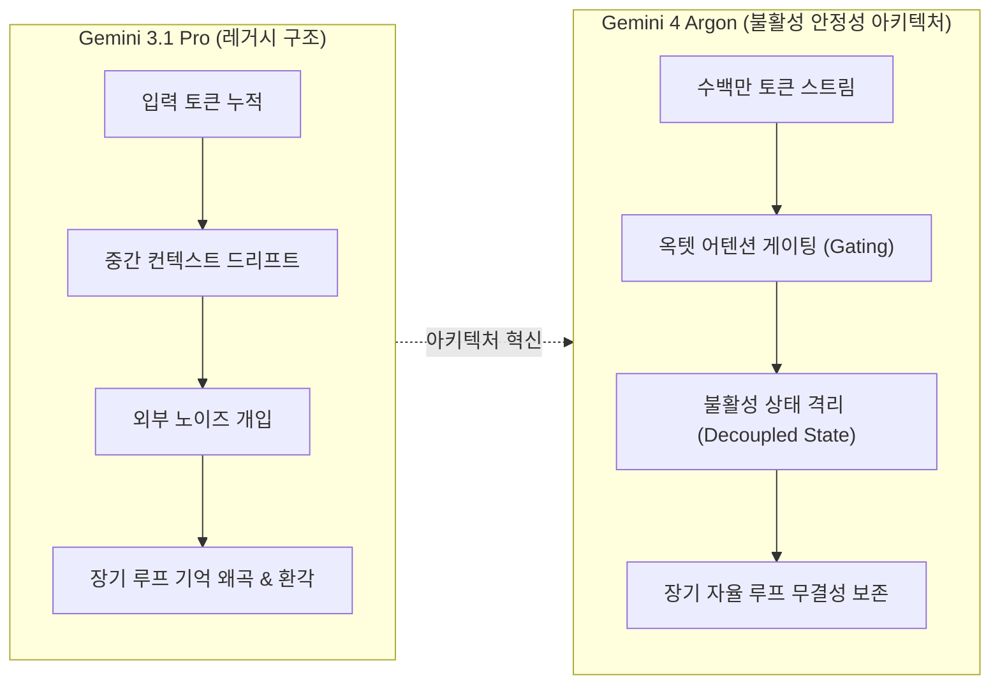
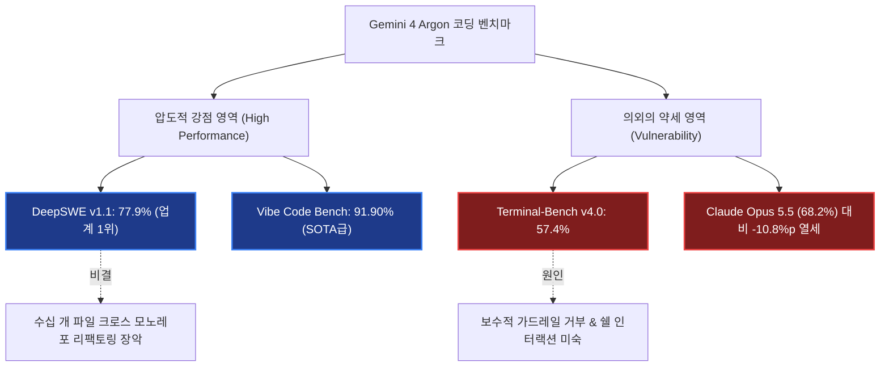
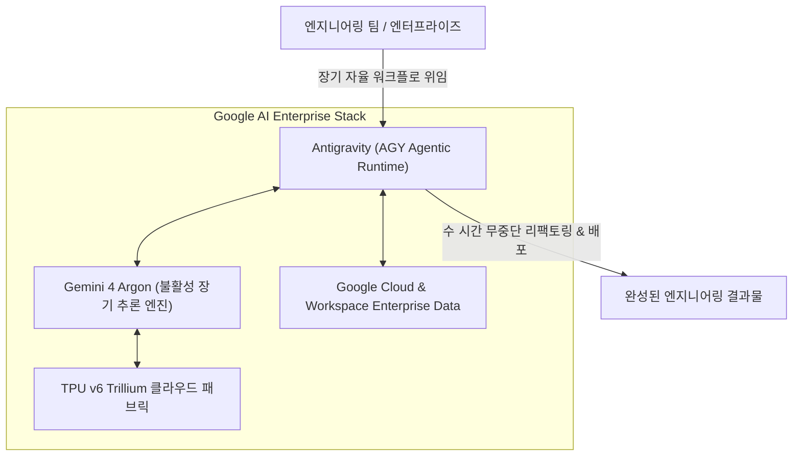

import Alert from '@/components/Alert.astro';

2026년 2월 Gemini 3.1 Pro가 모습을 드러낸 뒤, 무려 8개월 동안 구글의 차세대 플래그십 소식은 감감무소식이었습니다. 실리콘밸리 엔지니어들 사이에서는 "TPU 클러스터가 과열로 버티지 못한다", "연구진이 죄다 앤트로픽으로 엑소더스했다"는 흉흉한 소문만 돌았죠.

그 긴 침묵을 깨고 마침내 베일을 벗은 모델이 바로 **Gemini 4 Argon**입니다. 코드네임부터 심상치 않은 이 모델은 DeepSWE v1.1에서 77.9%를 찍으며 코딩 에이전트 벤치마크 1위를 갈아치웠지만, 동시에 터미널 환경에서는 당혹스러운 약점을 노출했습니다. 8개월 동안 구글 내부에서는 대체 무슨 일이 벌어졌던 걸까요?

## 8개월의 침묵: Trillium TPU 클러스터 병목과 Flash 우회로

Gemini 3.1 Pro 공개 직후, 구글 클라우드 인프라는 사실상 한계점에 도달해 있었습니다. 차세대 가속기인 **TPU v6 Trillium**(트릴리움) 클러스터가 대규모로 배치됐지만, 전력 밀도 급증과 액체–공기 복합 냉각 병목으로 인해 데이터센터 단위의 열 관리에 심각한 난항을 겪었기 때문입니다.

그 여파는 고스란히 개발자들에게 전해졌습니다. 2026년 봄부터 초여름까지 Vertex AI와 Gemini API에서는 간헐적인 `503 Service Unavailable` 서빙 에러가 쏟아졌고, 플래그십 모델의 본격적인 스케일업 학습은 수차례 지연되었습니다.

```text
[클러스터 과열 이슈 발생]
TPU v6 Trillium 노드 전력 밀도 한계 도달
  ├── 액체-공기(Liquid-to-Air) 쿨링 루프 지연
  ├── 학습 파이프라인 체크포인트 인터럽트 빈발
  └── Vertex AI 프로덕션 환경 503 에러 급증
```

구글 리더십은 전면전을 피하고 우회로를 택했습니다. 인프라가 안정될 때까지 무거운 플래그십 모델 런칭을 미루고, 서빙 단가를 1/10 수준으로 압축한 **Gemini 3.5 Flash**와 **Gemini 3.8 Flash**에 화력을 집중한 것이죠. 

도구 호출(Tool Calling) 지연시간을 200ms 안쪽으로 끌어내리며 개발자들의 이탈을 틀어막는 동안, 백그라운드에서는 차세대 아키텍처를 완전히 갈아엎는 비밀 프로젝트가 진행되고 있었습니다.

<Alert type="warning" title="인프라 병목의 교훈">
거대 모델 경쟁의 승패는 이제 순수한 알고리즘이 아니라, 수만 장의 가속기 클러스터에서 뿜어져 나오는 열을 실시간으로 식혀내는 데이터센터 공조 엔지니어링에 달려 있습니다. 구글의 8개월 공백은 그 하드웨어적 한계를 체감한 시간이었습니다.
</Alert>

## 전설들의 퇴사: 구글 브레인의 해체와 단독 사령탑 체제

하드웨어 병목보다 구글 내부를 더 세차게 뒤흔든 것은 유례없는 **핵심 인재 엑소더스**였습니다. 실리콘밸리 주요 테크 매체와 내부 소식통을 통해 전해진 연구진 이탈의 파장은 심각했습니다.

가장 먼저 충격을 안긴 것은 노암 샤지어(Noam Shazeer)였습니다. Character.AI 인수 과정에서 수십억 달러 규모의 딜로 화려하게 구글에 복귀했던 그가 연구 방향성과 자율성 갈등 끝에 경쟁사인 OpenAI로 전격 이적했습니다.

뒤이어 2024년 노벨 화학상을 수상한 알파폴드의 주역 **존 점퍼**(John Jumper) 박사와 연구팀 핵심 멤버 14명이 통째로 앤트로픽(Anthropic)으로 자리를 옮겼습니다. 앤트로픽의 바이오메디컬 연구 부문 신설에 맞춰 단체 이직을 감행한 것입니다.

```text
[구글 딥마인드 주요 인력 변동]
- 노암 샤지어 (Noam Shazeer) ───> OpenAI 복귀 및 핵심 연구팀 합류
- 존 점퍼 (John Jumper) & 14인 ──> Anthropic 바이오메디컬 랩 이적
- 제프 딘 / 오리올 비냘스 ──────> 뉴로모픽·추론 스타트업 공동 창업
- 산제이 게마와트 / 꾸옥 레 ────> 시스템·분산학습 신규 스타트업 합류
```

여기에 구글의 시스템 인프라 전설인 제프 딘(Jeff Dean)과 산제이 게마와트(Sanjay Ghemawat), 그리고 시퀀스-투-시퀀스의 선구자 오리올 비냘스(Oriol Vinyals)와 꾸옥 레(Quoc Le)마저 구글을 떠나 새로운 뉴로모픽·추론 전용 아키텍처 스타트업을 공동 창업했다는 소식이 전해졌습니다. 출시 일정 단축 압박에 반발한 얼라인먼트(Safety) 연구 그룹의 연쇄 사임까지 겹쳤죠.

이 전대미문의 지각변동 속에서 데미스 하사비스(Demis Hassabis)는 대외 전략 및 알파벳 전사 AI 거버넌스로 한 발 물러섰고, 딥마인드 연구 부사장이었던 **코라이 카부크추올루**(Koray Kavukcuoglu)가 단독 CTO로 전권을 쥐며 Gemini 사령탑을 재편했습니다.

Argon은 카부크추올루 단독 체제에서 파편화된 브레인 조직을 일사불란하게 정비해 내놓은 첫 번째 증명서인 셈입니다.

## 왜 'Argon'인가? 비활성 기체에 담긴 아키텍처 철학

구글은 이번 세대부터 내부 코드네임 규칙을 전면 수정했습니다. 과거 동물이나 천체 이름을 붙이던 방식에서 벗어나, 주기율표 원소(Barium, Carbon, Helium 등) 체계를 채택했는데요. 그 첫 번째 주자가 18족 비활성 기체인 **Argon**(아르곤)입니다.

아르곤은 그리스어 *argos*(게으른, 불활성의, 반응하지 않는)에서 유래했습니다. 화학적으로 최외각 전자가 8개로 꽉 찬 옥텟 규칙(Octet Rule)을 만족하기 때문에 다른 원소와 반응하지 않고 완벽하게 안정된 상태를 유지하죠.

구글이 이 이름을 선택한 이유는 명확합니다. 수백만 토큰이 실시간으로 교환되는 장기 자율 에이전트 루프(Long-horizon Autonomous Loop)에서 **컨텍스트 감쇠**(Context Decay)와 노이즈 오염에 완벽히 저항하는 아키텍처를 구현했기 때문입니다.



기존 거대 모델들은 자율 에이전트 환경에서 20～30단계 이상의 복합 툴 호출이 이어지면 앞서 내린 지시나 파일 구조를 망각하는 현상이 잦았습니다. 불필요한 시스템 로그와 중간 툴 결과물이 컨텍스트 윈도우를 오염시켰기 때문입니다.

Argon은 어텐션 레이어마다 '불활성 차단 필터'를 두어, 장기 실행 중 축적되는 중간 노이즈가 핵심 추론 가중치를 오염시키지 못하도록 화학적 차단벽을 세웠습니다.

## 코딩 벤치마크 실전 검증: 환호와 굴욕의 교차

그렇다면 엔지니어링 실전 성능은 어떨까요? 이번에 공개된 주요 코딩 벤치마크 결과를 보면 환호와 당혹감이 극명하게 엇갈립니다.



### 빛: DeepSWE 77.9%와 거대 모노레포 장악력

가장 돋보이는 지표는 소프트웨어 엔지니어링 실무 벤치마크인 **DeepSWE v1.1**(77.9%)입니다. 경쟁 모델들을 여유 있게 따돌리며 업계 1위를 기록했습니다.

특히 빛을 발한 영역은 단일 파일 함수 작성이 아니라, 수십 개 파일에 걸친 모노레포의 크로스 디펜던시(Cross-dependency) 리팩토링이었습니다. 
- 패키지 의존성 버전 업그레이드에 따른 브레이킹 체인지 일괄 수정
- AST(추상 구문 트리) 기반 심볼 전역 추적 및 레거시 데이터베이스 ORM 계층 전면 마이그레이션
- 분산 서비스 간 gRPC 프로토콜 인터페이스 동기화 및 깨진 단위 테스트 자율 복구

이처럼 전체 맥락을 한 번에 들이마시고 수 시간에 걸쳐 끈질기게 코드를 뜯어고쳐야 하는 작업에서 Argon의 불활성 아키텍처는 컨텍스트 망각 없이 경이로운 집중력을 보여줍니다. UI 프로토타이핑을 측정하는 **Vibe Code Bench**에서도 91.90%로 최상위권 성능을 입증했습니다.

### 그림자: Terminal-Bench 57.4%의 굴욕

그러나 터미널을 열고 직접 명령어를 실행하는 환경으로 넘어가면 분위기가 급변합니다. **Terminal-Bench v4.0**에서 Argon은 57.4%에 머물렀습니다. 경쟁작인 Claude Opus 5.5(68.2%)와 비교하면 무려 10.8%p나 뒤처지는 수치입니다.

실제 디버깅 로그를 분석해 보면 두 가지 치명적인 결함이 드러납니다.

1. **지나치게 보수적인 안전성 가드레일 거부**(Refusal):  
   인재 엑소더스 이후 강화된 내부 안전성 기준 탓인지, `rm -rf`, 디스크 마운트, 백그라운드 데몬 프로세스 종료, 파일 권한(`chmod`) 변경 같은 시스템성 명령어가 포함되면 작업을 지나치게 엄격하게 거부합니다.
2. **동적 쉘**(Shell) **파이프라인 판단력 부족**:  
   stderr로 출력되는 복합 에러 로그를 보고 즉각적인 파이프라인 조작(`grep`, `awk`, 인터랙티브 프롬프트 입력 등)으로 유연하게 대처하기보다, 기존에 세운 고정 플랜만 고집하다가 타임아웃에 빠지는 패턴이 반복됩니다.

<Alert type="tip" title="실무 권장 활용법">
Gemini 4 Argon을 개발에 도입한다면, 터미널 명령어를 자율적으로 치게 두는 CLI 실행 에이전트로 쓰기보다는 **프로젝트 전체 컨텍스트를 읽고 대규모 코드를 리팩토링하는 기획·설계·코드 생성기**로 배치하는 것이 훨씬 현명합니다.
</Alert>

## 구글의 진짜 노림수: 챗봇을 넘어선 Antigravity 플랫폼 락인

Gemini 4 Argon의 출시를 보며 많은 이들이 웹 브라우저의 챗봇 창에서 질문을 던져보고 평가하려 합니다. 하지만 그것은 구글이 파놓은 본질이 아닙니다. 챗봇 UI 시장은 이미 벤더 간 기능 차이가 무의미해진 레드오션입니다.

구글의 시선은 이미 **Antigravity**(AGY) 기반의 에이전트 OS 생태계로 향해 있습니다.



구글이 그리는 그림은 명확합니다.
- 개발자가 복잡한 요구사항이나 모노레포 마이그레이션 이슈를 Antigravity에 던져놓으면,
- Argon이 밤새 수백 번의 파일 수정과 빌드 검증을 노이즈 오염 없이 비동기로 수행하고,
- 이 모든 과정이 구글 클라우드와 내부 패브릭 위에서 빈틈없이 돌아가도록 묶어두는 것입니다.

8개월간의 진통 끝에 나온 Argon은 단순한 벤치마크용 모델이 아닙니다. 엔터프라이즈 개발 조직이 다른 생태계로 빠져나가지 못하도록, 수 시간짜리 복합 엔지니어링 태스크를 안정적으로 끝마칠 수 있는 **장기 지속형 에이전트의 심장**을 마침내 완성한 것입니다.

## 엔지니어가 지금 취해야 할 태도

Gemini 4 Argon은 완벽한 만능 모델이 아닙니다. 터미널 환경에서 가드레일이 걸려 멈칫거리거나 파이프라인 조작에서 허둥대는 모습을 보면 여전히 Claude나 소형 로컬 모델의 날렵함이 그리워지기도 합니다.

하지만 수십만 줄의 코드가 얽힌 거대 레포지토리를 마이그레이션하거나, 패키지 간 복잡한 의존성을 일괄 정리할 때 Argon이 보여주는 침착함과 컨텍스트 유지력은 현존하는 어떤 모델보다 단단합니다.

결국 도구의 승패는 내 워크플로의 어디에 꽂아 넣느냐에 달려 있습니다. 쉘 스크립트 작성과 민첩한 디버깅은 가벼운 도구에 맡기더라도, 프로젝트 전체의 뼈대를 갈아엎는 중장기 작업에는 Argon을 조용히 등 뒤에 올려둘 만합니다. 비활성 기체처럼 어떤 노이즈에도 반응하지 않고 묵묵히 버텨줄 테니까요.
