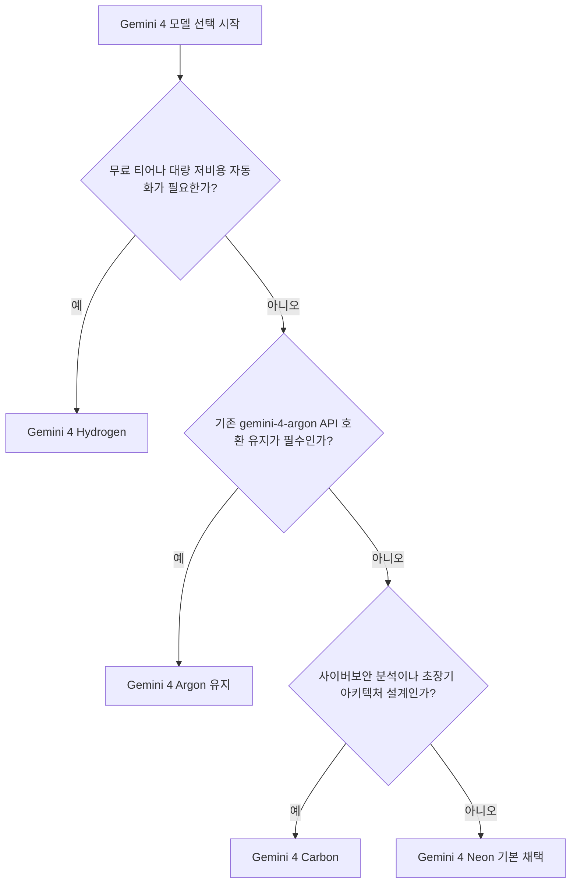

import Alert from '@/components/Alert.astro';
import Chart from '@/components/Chart.astro';
import LinkPreviewCard from '@/components/LinkPreviewCard.astro';

예전에는 빠른 응답이 필요하면 Flash, 똑똑한 추론이 필요하면 Pro를 고르면 끝이었습니다. 그런데 Gemini 4부터 Argon, Carbon, Hydrogen, Neon까지 주기율표 원소 이름이 네 개나 쏟아지면서 모델 선택창 앞에서 잠시 멈칫하게 되죠. 고민할 시간이 없다면 **Gemini 4 모델 선택 가이드**의 핵심 결론부터 짚고 넘어갈게요. 대부분의 개발·프로덕션 기본값은 **Neon**, 무료 티어나 대량 자동화 파이프라인은 **Hydrogen**, 사이버보안이나 초장기 설계처럼 한 방의 깊이가 필요할 때는 **Carbon**, 그리고 **Argon**은 기존 API 호환 유지용으로만 남겨두면 됩니다.

구글이 익숙한 `Pro`/`Flash`/`Flash-Lite` 체계를 버리고 원소 네이밍으로 전환한 데는 현실적인 이유가 있습니다. 세대가 바뀔 때마다 신형 Flash가 구형 Pro의 성능을 추월하는 역전 현상이 반복되면서, 단순한 일렬 계층만으로는 모델 성격을 설명하기 어려워졌거든요. 이제는 추론 깊이, 생성 속도, 단가, 멀티 에이전트 역할 분담(지휘자 + 고속 실행기)이라는 다차원 특성을 각 원소에 매핑하는 구조로 재편됐습니다. 기존 Flash 라인업은 **Gemini 4 Hydrogen**이 공식적으로 이어받았습니다.

## Gemini 4 4종 스펙과 가격 한눈에 비교

2026년 11월 20일 기준으로 네 모델 모두 정식 출시(GA) 상태입니다. 바닥 스펙은 4종이 동일합니다. 입력·사고·출력을 합쳐 통합 1,048,576(1M) 토큰 컨텍스트를 제공하고, 동기 기본 최대 출력은 사고 토큰 포함 65,536 토큰(백그라운드 장문 디코딩 시 최대 1M)까지 지원해요. 네이티브 멀티모달(텍스트·이미지·오디오·비디오·PDF/스프레드시트), Google Search 그라운딩, 코드 실행, Function Calling, Structured Outputs 역시 공통으로 들어갑니다. 컨텍스트 캐싱도 4종 모두 명시적 캐싱(`cachedContents`)은 미지원이며, 4,096 토큰 이상 반복 입력 시 자동 적용되는 암묵적 캐싱(95% 할인)만 제공합니다.

실제 선택을 가르는 건 출시 시점, 가격 구조, 추론 단계(`Thinking Level`), 그리고 무료 티어 지원 여부입니다.

| 모델 | 출시일 (GA) | 포지션 | 11/30까지 프로모션가 (입력/출력) | 12/1 정규가 (입력/출력) | Thinking Level | 무료 티어 | 추천 용도 |
| :--- | :--- | :--- | :--- | :--- | :--- | :--- | :--- |
| **Hydrogen** (`gemini-4-hydrogen`) | 2026-11-12 | 기존 Flash 계승·고속 실행기 | $1.50 / $7.50 | $1.50 / $7.50 | `low`, `medium`, `high`(기본), `xhigh` | **지원** (유일) | 무료 개발, 대량 파이프라인, 에이전트 실행기 |
| **Neon** (`gemini-4-neon`) | 2026-11-18 | 속도·지능 파레토 기본 모델 | $3.00 / $15.00 | $3.00 / $15.00 | `low`, `medium`, `high`(기본), `xhigh` | 미지원 | 프로덕션 코딩 에이전트, ML, 범용 기본값 |
| **Carbon** (`gemini-4-carbon`) | 2026-11-10 | 최상위 중량급 추론·보안 특화 | $2.00 / $10.00 | **$4.00 / $20.00** | `low`, `medium`(기본), `high` (`xhigh` 미지원) | 미지원 | 대형 아키텍처 설계, 연구, 사이버보안 |
| **Argon** (`gemini-4-argon`) | 2026-10-13 | Gemini 4 최초 출시 모델 | $2.00 / $10.00 | **$4.00 / $20.00** | `low`, `medium`, `high` | 미지원 | 기존 `gemini-4-argon` API 호환 유지 |

*단가는 1M 토큰당 USD 기준이며 출력 단가에는 Thinking(사고) 토큰이 포함됩니다. 캐시 입력 단가는 정규가 기준 Hydrogen $0.075, Neon $0.15, Carbon·Argon $0.20(11/30까지 $0.10)이며 Batch API 이용 시 50% 할인이 별도 적용됩니다.*

<Alert type="warning" title="2026년 11월 30일 프로모션 종료 전 가격 역전 주의">
글을 쓰는 11월 20일 시점에 API 가격표만 훑어보면 Carbon과 Argon이 입력 $2.00 / 출력 $10.00이라 Neon($3.00 / $15.00)보다 오히려 싸 보입니다. 하지만 이 가격은 **11월 30일 종료되는 출시 프로모션 단가**입니다. 12월 1일부터 Carbon과 Argon이 $4.00 / $20.00 정규가로 전환되면 Neon이 25% 더 저렴해집니다. 프로덕션 비용 추산과 기본 모델 선정은 반드시 12월 1일 정규가 기준으로 잡아야 12월 청구서 폭탄을 피할 수 있습니다.
</Alert>

## 속도·지능·가격으로 본 4종의 진짜 포지션

스펙표만 보면 네 모델이 비슷해 보이지만, 출력 속도와 추론 지능을 2차원 평면에 올려놓으면 각 원소의 역할이 또렷하게 갈립니다. Artificial Analysis Intelligence Index와 초당 출력 속도(tok/s)를 함께 배치해 보면 **Neon**이 왜 기본 추천으로 꼽히는지 한눈에 드러납니다.

<figure class="not-prose my-6">
  <div class="overflow-x-auto rounded-xl border border-border bg-card p-4">
    <svg viewBox="0 0 720 340" class="h-auto w-full min-w-[540px]" role="img" aria-label="Gemini 4 모델 4종의 출력 속도와 지능 지수 2D 포지셔닝 맵">
      <defs>
        <linearGradient id="g4-pareto-zone" x1="0%" y1="100%" x2="100%" y2="0%">
          <stop offset="0%" stop-color="#3b82f6" stop-opacity="0.03" />
          <stop offset="100%" stop-color="#10b981" stop-opacity="0.14" />
        </linearGradient>
      </defs>
      <rect x="76" y="28" width="604" height="248" rx="8" fill="url(#g4-pareto-zone)" />

      {/* Grid lines */}
      <g stroke="currentColor" stroke-opacity="0.12" stroke-width="1">
        <line x1="76" y1="276" x2="680" y2="276" />
        <line x1="76" y1="226" x2="680" y2="226" stroke-dasharray="4 4" />
        <line x1="76" y1="177" x2="680" y2="177" stroke-dasharray="4 4" />
        <line x1="76" y1="127" x2="680" y2="127" stroke-dasharray="4 4" />
        <line x1="76" y1="78" x2="680" y2="78" stroke-dasharray="4 4" />
        <line x1="76" y1="28" x2="680" y2="28" stroke-dasharray="4 4" />

        <line x1="76" y1="28" x2="76" y2="276" />
        <line x1="197" y1="28" x2="197" y2="276" stroke-dasharray="4 4" />
        <line x1="318" y1="28" x2="318" y2="276" stroke-dasharray="4 4" />
        <line x1="438" y1="28" x2="438" y2="276" stroke-dasharray="4 4" />
        <line x1="559" y1="28" x2="559" y2="276" stroke-dasharray="4 4" />
        <line x1="680" y1="28" x2="680" y2="276" stroke-dasharray="4 4" />
      </g>

      {/* Pareto Frontier Line: Neon (110, 61) -> Hydrogen (170, 54) */}
      <path d="M 358 65 L 600 152" fill="none" stroke="#10b981" stroke-width="2" stroke-dasharray="6 4" stroke-opacity="0.85" />
      <text x="504" y="54" fill="#10b981" font-size="11.5" font-weight="600">속도·지능 파레토 프론티어</text>

      {/* Y-axis ticks (Intelligence Index: 44 to 64) */}
      <g class="fill-muted-foreground" font-size="11" text-anchor="end">
        <text x="68" y="280">44</text>
        <text x="68" y="230">48</text>
        <text x="68" y="181">52</text>
        <text x="68" y="131">56</text>
        <text x="68" y="82">60</text>
        <text x="68" y="32">64</text>
      </g>

      {/* X-axis ticks (Output Speed tok/s: 40 to 190) */}
      <g class="fill-muted-foreground" font-size="11" text-anchor="middle">
        <text x="76" y="296">40</text>
        <text x="197" y="296">70</text>
        <text x="318" y="296">100</text>
        <text x="438" y="296">130</text>
        <text x="559" y="296">160</text>
        <text x="680" y="296">190</text>
      </g>

      {/* Axis labels */}
      <text x="378" y="324" class="fill-foreground" font-size="12" font-weight="600" text-anchor="middle">출력 속도 (tok/s, 높을수록 빠름) →</text>
      <text x="22" y="152" class="fill-foreground" font-size="12" font-weight="600" text-anchor="middle" transform="rotate(-90 22 152)">Intelligence Index (높을수록 지능 우수)</text>

      {/* Argon: 66 tok/s, Index 50 -> x=181, y=202 */}
      <circle cx="181" cy="202" r="8" fill="#94a3b8" class="stroke-card" stroke-width="2" />
      <text x="196" y="198" class="fill-foreground" font-size="12.5" font-weight="700">Argon</text>
      <text x="196" y="214" class="fill-muted-foreground" font-size="11">66 tok/s · 지수 50 (기존 호환)</text>

      {/* Carbon: 57 tok/s, Index 60 -> x=144, y=78 */}
      <circle cx="144" cy="78" r="9" fill="#8b5cf6" class="stroke-card" stroke-width="2" />
      <text x="156" y="98" class="fill-foreground" font-size="12.5" font-weight="700">Carbon</text>
      <text x="156" y="113" class="fill-muted-foreground" font-size="11">57 tok/s · 지수 60 (보안·장기)</text>

      {/* Neon: 110 tok/s, Index 61 -> x=358, y=65 */}
      <circle cx="358" cy="65" r="11" fill="#10b981" class="stroke-card" stroke-width="2.5" />
      <text x="376" y="61" class="fill-foreground" font-size="13" font-weight="700">Neon (기본 추천)</text>
      <text x="376" y="77" class="fill-muted-foreground" font-size="11">110 tok/s · 지수 61 (xhigh 기준)</text>

      {/* Hydrogen: 170 tok/s, Index 54 -> x=600, y=152 */}
      <circle cx="600" cy="152" r="9" fill="#3b82f6" class="stroke-card" stroke-width="2" />
      <text x="586" y="146" class="fill-foreground" font-size="12.5" font-weight="700" text-anchor="end">Hydrogen</text>
      <text x="586" y="162" class="fill-muted-foreground" font-size="11" text-anchor="end">170 tok/s · 지수 54 (무료·대량)</text>
    </svg>
  </div>
  <figcaption class="mt-2 text-center text-xs text-muted-foreground">
    Gemini 4 4종의 출력 속도(tok/s) 대비 Artificial Analysis Intelligence Index 포지셔닝. Neon은 Carbon 대비 약 2배 빠른 속도로 최고 수준의 지능 구간에 자리합니다.
  </figcaption>
</figure>

막대 그래프로 속도와 정규가를 따로 떼어 보면 체감 차이가 더 선명합니다. Hydrogen은 초당 약 170 토큰으로 압도적인 처리량을 뽑아내고, Neon은 초당 약 110 토큰으로 Carbon(약 57 tok/s)보다 두 배 가까이 빠르게 응답을 끝냅니다. 에이전트가 도구를 수십 번 호출하는 루프에서는 이 속도 차이가 곧 개발자 대기 시간으로 직결됩니다.

<Chart
  type="bar"
  height={260}
  caption="Gemini 4 모델별 평균 출력 속도 비교 (tok/s, 높을수록 빠름)"
  data={{
    labels: ['Hydrogen', 'Neon', 'Argon', 'Carbon'],
    datasets: [
      {
        label: '출력 속도 (tok/s)',
        data: [170, 110, 66, 57],
        backgroundColor: ['#3b82f6', '#10b981', '#94a3b8', '#8b5cf6'],
        borderRadius: 6,
      },
    ],
  }}
/>

여기에 12월 1일 정규가 기준 API 단가를 겹쳐 보면 선택 기준이 거의 완성됩니다. Neon은 Carbon·Argon 정규가 대비 입력·출력 모두 25% 저렴하면서 속도는 두 배 수준이고, Hydrogen은 Neon의 정확히 절반 가격으로 돌아갑니다.

<Chart
  type="bar"
  height={280}
  caption="2026년 12월 1일 정규가 기준 1M 토큰당 API 입력·출력 단가 (USD, 낮을수록 저렴)"
  data={{
    labels: ['Hydrogen', 'Neon', 'Carbon', 'Argon'],
    datasets: [
      {
        label: '입력 단가 ($ / 1M)',
        data: [1.5, 3.0, 4.0, 4.0],
        backgroundColor: '#38bdf8',
        borderRadius: 5,
      },
      {
        label: '출력 단가 ($ / 1M, 사고 토큰 포함)',
        data: [7.5, 15.0, 20.0, 20.0],
        backgroundColor: '#6366f1',
        borderRadius: 5,
      },
    ],
  }}
/>

## 상황별 모델 선택 기준: 4종 핵심 특징과 한계

내 워크로드에 어떤 원소를 꽂아야 할지 헷갈린다면 아래 의사결정 트리부터 따라가 보세요.



### Gemini 4 Neon: 대부분의 개발자가 기본값으로 두면 되는 모델

2026년 11월 18일 가장 늦게 GA로 합류한 **Neon**(네온)은 Carbon 아키텍처에서 파생됐지만 실무 체감은 완전히 다릅니다. `xhigh` 추론 기준 Artificial Analysis Intelligence Index **61점**으로 글로벌 최상위 3위권에 올라서면서도, 초당 약 110 토큰을 밀어내는 빠른 속도를 유지하거든요.

코딩 에이전트 지표도 탄탄합니다. Coding Agent Index 58.6, Terminal-Bench 4.1 65.2%, FrontierCode 2.0 46.2%(`high` 기준)를 기록했습니다. Antigravity처럼 여러 서브에이전트를 병렬로 띄워 코드를 수정·검증하는 환경이나 ML 엔지니어링, 고빈도 전문 문서 분석에서 지능과 응답 지연 사이의 균형이 가장 좋습니다. Google AI Pro 구독자용 Gemini 앱에서도 기존 Argon을 Neon이 공식 대체했으니, 신규 프로젝트라면 일단 Neon을 기본 모델로 깔고 시작하는 편이 합리적입니다.

### Gemini 4 Hydrogen: 무료 티어와 대량 처리, 고속 실행기

**Hydrogen**(수소)은 기존 Flash의 정식 후속입니다. 1M 토큰당 입력 $1.50 / 출력 $7.50이라는 단가도 매력적이지만, 실무에서 가장 먼저 눈에 띄는 강점은 **4종 중 유일하게 Google AI Studio와 Gemini API 무료 티어를 제공**한다는 점입니다. 프로토타입 제작이나 사이드 프로젝트, CI 테스트 자동화에서는 사실상 대안이 없습니다.

단순히 싸고 빠르기만 한 경량 모델도 아닙니다. 초당 145～188 토큰(평균 약 170 tok/s)으로 응답하면서도 `xhigh` 추론 단계까지 열어 두어 지능 지수를 51(`high`)에서 54(`xhigh`)까지 끌어올릴 수 있습니다. 특히 멀티 에이전트 환경에서 **Carbon이 전체 계획을 지휘하고 Hydrogen이 개별 실행을 맡는 구조**로 묶으면 효율이 크게 올라갑니다. Antigravity의 Terminal-Bench 검증 결과, 이 페어링만으로 할당량 소모는 24% 줄고 작업 완료 시간은 19% 단축됐습니다.

### Gemini 4 Carbon: 사이버보안·초장기 설계에 쓰는 중량급 추론기

여기서 자연스럽게 의문이 생깁니다. "Neon이 지능 지수도 61점으로 더 높고 속도도 두 배나 빠른데, 12월부터 더 비싸지는 Carbon을 굳이 써야 할까요?"

Neon이 모든 영역에서 Carbon을 대체하는 건 아닙니다. **Carbon**(카본)은 `xhigh` 옵션을 지원하지 않는 대신 기본(`medium`)과 `high` 단계에서 호흡이 긴 복합 추론과 심층 보안 워크플로에 강점을 보입니다. 취약점 탐지 벤치마크인 SEC-bench Pro에서는 후발 주자 Neon이 90.5%로 Carbon(88.2%)을 앞섰지만, Carbon 역시 ExploitGym 54.8%, CWE-bench 71.0% 같은 고난도 보안 평가와 대규모 레거시 리팩토링, 시스템 전체 아키텍처 설계, 과학 연구처럼 응답이 수십 초 더 걸리더라도 단 한 번에 맥락을 끝까지 밀고 나가야 하는 작업에서 여전히 든든한 중량급 추론기입니다.

### Gemini 4 Argon: 신규 도입 대신 기존 API 호환 유지용

**Argon**(아르곤)은 2026년 9월 30일 발표·10월 13일 GA로 Gemini 4 시대를 연 첫 모델입니다. DeepSWE v1.1 77.9%, 약 4.3%의 낮은 환각률, MuJoCo 로보틱스 시뮬레이션 연동 등 굵직한 이력을 남겼죠.

다만 11월 18일 Neon이 출시되면서 포지션이 빠르게 정리됐습니다. Gemini 앱(Google AI Pro)에서는 이미 Neon으로 교체됐고, API 엔드포인트(`gemini-4-argon`)만 기존 프로덕션 워크로드 호환을 위해 남아 있는 상태입니다. 12월 1일 정규가($4.00 / $20.00)가 적용되면 가격·속도·지능 어느 축에서도 Neon보다 나은 지점을 찾기 어렵습니다. 이미 Argon 프롬프트에 맞춰 튜닝된 기존 파이프라인을 유지해야 하는 상황이 아니라면, 신규 작업은 Neon이나 Carbon으로 바로 넘어가는 게 낫습니다.

## API 실무 설정과 Gemini 앱 구독자 선택 팁

### Python SDK에서 Thinking Level 제어하기

Gemini 4 API를 쓸 때 가장 신경 써야 할 파라미터는 `thinking_level`입니다. 출력 단가에 사고 토큰이 그대로 합산되기 때문에, 단순 분류 작업에 `xhigh`를 걸어 두면 응답 시간과 비용이 불필요하게 불어납니다. 공식 `google-genai` Python SDK에서는 `ThinkingConfig`로 요청마다 추론 강도를 세밀하게 조절할 수 있어요.

```python
import os
from google import genai
from google.genai import types

client = genai.Client(api_key=os.environ["GEMINI_API_KEY"])

# 1. 프로덕션 기본 분석·코딩: Gemini 4 Neon + high/xhigh
neon_response = client.models.generate_content(
    model="gemini-4-neon",
    contents="멀티 리전 PostgreSQL 읽기 복제본 지연 문제를 진단하는 체크리스트를 작성해 줘.",
    config=types.GenerateContentConfig(
        thinking_config=types.ThinkingConfig(thinking_level="xhigh"),
    ),
)

# 2. 대량 로그 분류·에이전트 고속 실행: Gemini 4 Hydrogen + low
hydrogen_response = client.models.generate_content(
    model="gemini-4-hydrogen",
    contents="아래 웹훅 페이로드에서 에러 코드와 재시도 가능 여부만 JSON으로 추출해 줘.",
    config=types.GenerateContentConfig(
        thinking_config=types.ThinkingConfig(thinking_level="low"),
        response_mime_type="application/json",
    ),
)

print(neon_response.text)
```

<Alert type="tip" title="API 개발자 실무 체크포인트 두 가지">
1. **Gemini 4 전 모델 명시적 캐싱 미지원**: Hydrogen뿐 아니라 Neon·Carbon·Argon 모두 `cachedContents`(`caches.create`) API로 수동 캐시를 생성할 수 없습니다(호출 시 `400 INVALID_ARGUMENT`). 대신 4,096 토큰 이상 반복 입력 시 자동 발동하는 암묵적 캐싱(95% 할인)을 타도록 공통 시스템 프롬프트와 참조 문서를 입력 앞쪽에 안정적으로 배치하세요.
2. **Carbon은 `xhigh` 미지원**: 라우터 코드에서 모델 이름만 동적으로 교체할 때 `thinking_level="xhigh"`를 그대로 넘기면 Carbon 호출 시 오류가 발생합니다. Carbon으로 라우팅할 때는 반드시 `low`, `medium`, `high` 중 하나로 클램핑하세요.
</Alert>

### 일반 사용자용 Gemini 앱 모델 피커 매핑

API가 아니라 웹이나 모바일 Gemini 앱을 쓰는 분이라면 원소 이름 대신 용도별 메뉴가 보일 겁니다. 2026년 11월 18일 개편 기준으로 앱 메뉴와 실제 구동 모델, 필요한 구독 티어는 아래처럼 매칭됩니다.

| Gemini 앱 메뉴 | 실제 백엔드 모델 | 필요 구독 티어 |
| :--- | :--- | :--- |
| `Auto` | 프롬프트 난이도에 따라 자동 라우팅 | 전 티어 |
| `Everyday help` | **Gemini 4 Hydrogen** | 무료 포함 전 티어 |
| `Deeper analysis` | **Gemini 4 Neon** | Google AI Pro (월 $19.99 이상) |
| `Code & complex work` | **Gemini 4 Carbon** | Google AI Ultra 전용 (월 $99.99 5x·20TB / 월 $199.99 20x·30TB) |

11월 30일 프로모션이 끝나기 전까지 Carbon을 저렴하게 테스트해 보고 싶다면 지금이 좋은 타이밍입니다. 다만 12월 이후까지 안정적으로 운영할 서비스라면 처음부터 **Neon을 메인 엔진으로 두고, 대량·반복 실행을 Hydrogen으로 오프로드하는 2단 구성**을 잡아 두는 편이 비용과 속도 양쪽에서 가장 덜 흔들립니다.

<LinkPreviewCard
  url="https://ai.google.dev/gemini-api/docs/models"
  title="Gemini models | Gemini API | Google AI for Developers"
  description="Gemini 4 Hydrogen, Neon, Carbon, Argon 모델 ID, 컨텍스트 한도, 지원 기능 및 Thinking Level 공식 기술 문서."
  comment="모델 ID와 최신 리비전 스펙 확인용 1차 공식 레퍼런스."
/>

<LinkPreviewCard
  url="https://ai.google.dev/gemini-api/docs/pricing"
  title="Gemini Developer API pricing | Google AI for Developers"
  description="Gemini 4 모델별 무료 티어 여부, 1M 토큰당 입력·출력·캐시 단가 및 Batch API 할인 정책 안내."
  comment="12월 1일 정규가 전환 및 프로모션 단가 확인용 공식 가격표."
/>
