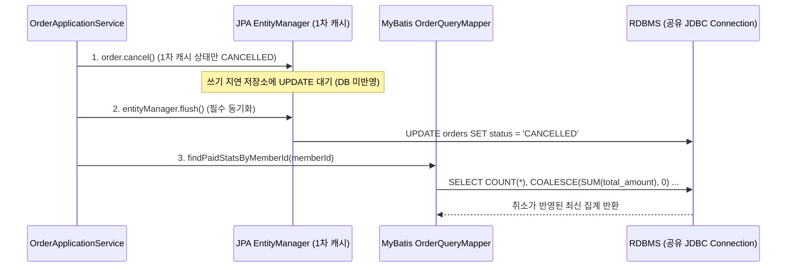

import Alert from '@/components/Alert.astro';
import BookCard from '@/components/BookCard.astro';
import GitHubRepoCard from '@/components/GitHubRepoCard.astro';

실무 코드 리뷰나 이직 면접에서 유독 평행선을 달리는 주제가 자바 객체 용어입니다. 누군가는 `@Setter`가 잔뜩 붙은 DB 매핑 클래스를 `UserVO`라 부르고, 다른 누군가는 불변 값 객체만 VO라고 부르죠. 30년 자바 역사에서 첫 단추가 어디서 잘못 끼워졌는지 짚어보고, **Java 25 LTS**와 **Spring Boot 4.1** 환경의 JPA·MyBatis 하이브리드 설계 표준을 정리합니다.

| 용어 | 탄생·정립 배경 | 핵심 책임 | 동등성·가변성 | 2026년 표준 구현체 |
| :--- | :--- | :--- | :--- | :--- |
| **JavaBean** | Sun *JavaBeans 1.01* (1997) | GUI 빌더 시각 컴포넌트 조작·직렬화 | 참조 동등성 · 가변(`get/set`) | 레거시 규약 (도메인·DTO 지양) |
| **POJO** | 마틴 파울러 외 (2000) | 프레임워크 종속 없는 순수 자바 객체 | 역할에 따라 설계 | 도메인 모델·일반 비즈니스 클래스 |
| **Spring Bean** | Spring IoC (2003～) | 컨테이너가 생명주기·의존성을 관리 | 무상태 싱글턴 · `final` 생성자 주입 | `@Service`, `@Repository`, `@Component` |
| **DAO** | *Core J2EE 1판* (2001) | 테이블·SQL 쿼리 단위 접근 캡슐화 | 무상태 데이터 접근 인터페이스 | MyBatis `@Mapper`(`*QueryMapper`) |
| **Repository** | 에릭 에반스 *DDD* (2003) | 애그리거트 루트의 컬렉션 은유 보관소 | 객체 그래프 단위 영속성 관리 | Spring Data JPA `JpaRepository` |
| **DTO** | 파울러 *PoEAA* (2002) | 계층·네트워크 경계 간 순수 데이터 전달 | 로직 없음 · 불변 전달 권장 | Java `record`(`*Request`, `*QueryDto`) |
| **VO** | Smalltalk · *DDD* (2003) | 도메인 고유 값 표현 및 자가 유효성 검증 | 식별자 없음 · **속성 전체 값 동등성** · 불변 | `@Embeddable record`(`Money`) |
| **Entity** | *DDD* / Jakarta Persistence | 고유 식별자와 생명주기를 가진 도메인 객체 | **`@Id` 식별자 동등성** · 상태 전이 메서드 | `@Entity class`(`protected` 생성자) |

---

## 왜 이렇게 헷갈릴까? 시대로 읽는 Bean·DAO·DTO·VO 탄생사 (1997～2026)

한국 실무 현장에는 2000년대 초반 J2EE 서적과 공공 프레임워크의 흔적이 도메인 주도 설계(DDD) 용어와 뒤섞여 남아 있습니다. 연대기 순으로 맥락을 따라가 보면 혼란의 원인이 단번에 드러납니다.

<figure class="not-prose my-6">
  <svg viewBox="0 0 840 330" class="w-full h-auto rounded-lg border border-border bg-card p-4" role="img" aria-label="1997년 JavaBeans부터 2026년 Java Record와 Spring Boot 4까지 자바 객체 용어 계보 타임라인">
    <defs>
      <marker id="arrow-flow" viewBox="0 0 10 10" refX="8" refY="5" markerWidth="6" markerHeight="6" orient="auto-start-reverse">
        <path d="M 0 1 L 10 5 L 0 9 z" fill="var(--muted-foreground)" />
      </marker>
    </defs>
    <rect x="18" y="18" width="250" height="128" rx="10" fill="rgba(59, 130, 246, 0.10)" stroke="#3b82f6" stroke-width="1.5" />
    <text x="34" y="44" font-size="13" font-weight="700" class="fill-blue-700 dark:fill-blue-400">1997 · JavaBeans 1.01</text>
    <text x="34" y="68" font-size="12" font-weight="600" fill="var(--foreground)">GUI 빌더용 시각 컴포넌트 규약</text>
    <text x="34" y="90" font-size="11" fill="var(--muted-foreground)">• 리플렉션용 public 기본 생성자</text>
    <text x="34" y="108" font-size="11" fill="var(--muted-foreground)">• 속성창 바인딩용 getter / setter</text>
    <text x="34" y="126" font-size="11" fill="var(--muted-foreground)">• 서버 모델 이식 후 가변 관행 고착</text>
    <line x1="268" y1="82" x2="291" y2="82" stroke="var(--muted-foreground)" stroke-width="1.5" marker-end="url(#arrow-flow)" />
    <rect x="295" y="18" width="250" height="128" rx="10" fill="rgba(14, 165, 233, 0.10)" stroke="#0ea5e9" stroke-width="1.5" />
    <text x="311" y="44" font-size="13" font-weight="700" class="fill-sky-700 dark:fill-sky-400">2000 · POJO &amp; Spring Bean</text>
    <text x="311" y="68" font-size="12" font-weight="600" fill="var(--foreground)">중량 EJB 종속 탈피 선언</text>
    <text x="311" y="90" font-size="11" fill="var(--muted-foreground)">• 프레임워크 침투 없는 순수 자바 객체</text>
    <text x="311" y="108" font-size="11" fill="var(--muted-foreground)">• IoC 컨테이너가 관리하는 Spring Bean</text>
    <text x="311" y="126" font-size="11" fill="var(--muted-foreground)">• final 생성자 주입 기반 무상태 설계</text>
    <line x1="545" y1="82" x2="568" y2="82" stroke="var(--muted-foreground)" stroke-width="1.5" marker-end="url(#arrow-flow)" />
    <rect x="572" y="18" width="250" height="128" rx="10" fill="rgba(239, 68, 68, 0.11)" stroke="#ef4444" stroke-width="1.8" />
    <text x="588" y="44" font-size="13" font-weight="700" class="fill-red-600 dark:fill-red-400">2001 · Core J2EE 1판 (오명)</text>
    <text x="588" y="68" font-size="12" font-weight="600" fill="var(--foreground)">DAO 정립 &amp; 전송 객체 VO 오명</text>
    <text x="588" y="90" font-size="11" fill="var(--muted-foreground)">• SQL 캡슐화 계층 DAO 패턴 공식화</text>
    <text x="588" y="108" font-size="11" fill="var(--muted-foreground)">• 네트워크 전송 객체를 VO로 잘못 명명</text>
    <text x="588" y="126" font-size="11" fill="var(--muted-foreground)">{'• 국내 SI·전자정부 *VO 관행의 출발점'}</text>
    <path d="M 697 146 L 697 164 L 210 164 L 210 180" fill="none" stroke="var(--muted-foreground)" stroke-width="1.5" stroke-dasharray="4 3" marker-end="url(#arrow-flow)" />
    <rect x="18" y="184" width="386" height="128" rx="10" fill="rgba(16, 185, 129, 0.10)" stroke="#10b981" stroke-width="1.5" />
    <text x="34" y="210" font-size="13" font-weight="700" class="fill-emerald-700 dark:fill-emerald-400">2002～2003 · PoEAA &amp; DDD 개념 재정립</text>
    <text x="34" y="234" font-size="12" font-weight="600" fill="var(--foreground)">DTO 분리와 도메인 모델 3요소 확립</text>
    <text x="34" y="256" font-size="11" fill="var(--muted-foreground)">• 파울러 PoEAA(2002): 전송 객체를 DTO로 명명, 값 객체(VO)와 분리</text>
    <text x="34" y="274" font-size="11" fill="var(--muted-foreground)">• Core J2EE 2판(2003): 초판의 VO를 Transfer Object(TO)로 공식 정정</text>
    <text x="34" y="292" font-size="11" fill="var(--muted-foreground)">• 에반스 DDD(2003): Entity(식별자) · VO(불변 값) · Repository(컬렉션) 정립</text>
    <line x1="404" y1="248" x2="432" y2="248" stroke="var(--muted-foreground)" stroke-width="1.5" marker-end="url(#arrow-flow)" />
    <rect x="436" y="184" width="386" height="128" rx="10" fill="rgba(139, 92, 246, 0.11)" stroke="#8b5cf6" stroke-width="1.6" />
    <text x="452" y="210" font-size="13" font-weight="700" class="fill-violet-700 dark:fill-violet-400">2021～2026 · Java Record &amp; Boot 4 표준</text>
    <text x="452" y="234" font-size="12" font-weight="600" fill="var(--foreground)">불변 record 통합과 역할 기반 영속성 분리</text>
    <text x="452" y="256" font-size="11" fill="var(--muted-foreground)">{'• DTO(*Request, *Response, *QueryDto) → 불변 Java record로 일원화'}</text>
    <text x="452" y="274" font-size="11" fill="var(--muted-foreground)">• 도메인 VO → JPA 3.2 @Embeddable record 정식 지원</text>
    <text x="452" y="292" font-size="11" fill="var(--muted-foreground)">• 도메인 Entity → 프록시·더티체킹 스펙상 @Entity class 유지</text>
  </svg>
  <figcaption class="mt-2 text-center text-sm text-muted-foreground">1997년 JavaBeans부터 2026년 Java 25·Spring Boot 4까지 객체 용어의 분화와 역할 재정립 흐름</figcaption>
</figure>

### 1) JavaBeans(1997) vs POJO(2000) vs Spring Bean

1997년 썬의 *JavaBeans 1.01 Specification*은 서버 모델이 아니라 **GUI 빌더 툴에서 마우스로 조작하는 시각 컴포넌트 규약**이었습니다. BeanBox나 JBuilder 팔레트에서 컴포넌트를 끌어다 놓으려면 세 가지 조건이 필요했거든요.

- **`public` 기본 생성자**: 클래스 이름만으로 리플렉션 인스턴스를 생성하기 위함.
- **`getXxx` / `setXxx` 명명 규칙**: `Introspector`가 속성 편집창(Property Sheet)을 자동 구성하기 위함.
- **`Serializable` 구현**: 화면에서 편집한 UI 상태를 `.ser` 파일로 얼려 저장(freeze-dry)하기 위함.

문제는 JSP(`<jsp:useBean>`)와 초기 바인딩 프레임워크가 이 규약을 서버로 그대로 이식하면서 불거졌습니다. 도메인 객체까지 모든 필드에 `setter`를 열어두는 관행이 퍼졌고, 비즈니스 규칙 없이 상태만 조작당하는 **빈약한 도메인 모델**(Anemic Domain Model)을 낳았죠.

2000년 9월 마틴 파울러 일행은 무거운 EJB 상속에 지친 개발자들을 위해 순수 자바 객체를 **POJO**(Plain Old Java Object)라 명명했습니다([JVM 생태계 15년사](/dev/jvm-ecosystem-15-years) 참고). 이후 등장한 **Spring Bean**은 IoC 컨테이너가 관리하는 컴포넌트일 뿐 JavaBeans 규약과는 무관하며, `private final` 생성자 주입 기반의 무상태 설계가 표준입니다.

### 2) DTO와 VO 대혼란의 범인: Core J2EE Patterns 초판 해프닝 (2001～2003)

가변 데이터 객체를 `BoardVO`, `UserVO`라 부르는 습관은 2001년 Sun Java Center가 펴낸 *Core J2EE Patterns* **1판**에서 비롯됐습니다. 당시 저자진은 원격 EJB의 네트워크 왕복 비용을 줄이려고 여러 속성을 묶어 직렬화 전송하는 객체를 소개하며 **Value Object**(VO)라는 이름을 붙였습니다.

하지만 Smalltalk 시절부터 객체지향 진영에서는 이미 `금액`이나 `좌표`처럼 값 자체로 동등성을 판단하는 불변 객체를 Value Object라 부르고 있었습니다. 혼선이 커지자 마틴 파울러가 2002년 *PoEAA*에서 전송 전용 객체를 **DTO**(Data Transfer Object)로 분리해 정리했고, Sun 역시 2003년 출간한 **2판**에서 패턴명을 **Transfer Object**(TO)로 공식 개칭하며 초판의 오명을 바로잡았습니다.

<Alert type="info" title="한국 실무에 '*VO = 가변 DTO' 공식이 굳어진 이유">
Sun이 2판에서 이름을 정정했을 때 국내 SI 현장에는 이미 초판 용어가 퍼진 뒤였습니다. 결정적으로 2009년 배포된 **전자정부 표준프레임워크**(eGovFrame)가 검색·페이징 기반 클래스(`DefaultVO`)와 iBATIS·MyBatis 매핑 클래스를 일괄 `*VO`로 명명하면서, 공공·금융권 프로젝트를 거치며 "DB 결과를 담는 가변 객체 = VO"라는 구세대 관습이 굳어졌습니다.
</Alert>

<BookCard
  title="엔터프라이즈 애플리케이션 아키텍처 패턴"
  isbn13="9791158390174"
  comment="마틴 파울러가 J2EE 초판의 Value Object 오명을 바로잡아 DTO(Data Transfer Object)를 정립하고, 도메인 모델과 데이터 매퍼 패턴의 근간을 체계화한 고전입니다."
/>

### 3) DAO(2001) vs Repository(2003), 그리고 Entity vs VO의 결정적 기준

- **DAO vs Repository**: 2001년 정립된 **DAO**(Data Access Object)는 테이블과 SQL 쿼리를 캡슐화하는 저장소 중심 계층으로, SQL을 직접 매핑하는 MyBatis `@Mapper`와 결이 같습니다. 반면 에릭 에반스가 2003년 *DDD*에서 정의한 **Repository**는 애그리거트 루트(Aggregate Root)를 **인메모리 컬렉션**(`Collection`)처럼 조회하고 보관하는 도메인 중심 인터페이스입니다.
- **Entity vs VO**: 판단 기준은 **식별자**(`@Id`)의 유무입니다. `주문`(`Order`)은 상태나 배송지가 바뀌어도 주문번호가 같으면 같은 주문이지만(**Entity**), `10,000원`(`Money`)은 지폐 일련번호와 무관하게 통화와 숫자가 같으면 동일한 값입니다(**VO**). 따라서 VO는 식별자 없이 **전체 속성 값**(`equals`/`hashCode`)으로 동등성을 비교하고, 절대 불변이어야 하며, 생성 시 자가 검증과 값 연산(`add`)을 책임집니다.

<BookCard
  title="도메인 주도 설계"
  isbn13="9788992939850"
  comment="에릭 에반스가 Entity(식별자 기반 생명주기), Value Object(불변 값 동등성), Aggregate와 Repository(컬렉션 은유)의 경계를 확립한 원전입니다."
/>

---

## Java Record와 Jakarta Persistence 3.2가 바꾼 현대적 구현 공식

Java 16 정식 도입 이후 Java 21·25 LTS에서 완전히 정착한 [Java Record 클래스](/dev/java-record-class)는 불변 DTO와 VO의 보일러플레이트를 언어 차원에서 끝냈습니다([자바 LTS 버전별 변화와 Spring Boot 호환성 가이드](/dev/java-lts-spring-boot-guide) 참고).

그렇다면 JPA `@Entity`까지 `record`로 선언할 수 있을까요? Spring Boot 4.1의 기반 스펙인 *Jakarta Persistence 3.2*(Hibernate ORM 7)에서도 `@Entity`에는 `record`를 **절대 사용할 수 없습니다**. 스펙 Section 2.1이 명시하는 이유는 세 가지입니다.

1. **무인자 생성자 부재**: 리플렉션 인스턴스화를 위한 `public`·`protected` 기본 생성자가 필수지만, `record`는 전체 필드를 받는 표준 생성자만 강제합니다.
2. **`final` 클래스와 프록시 충돌**: 지연 로딩(`FetchType.LAZY`)용 런타임 서브클래스 프록시를 만들 수 없도록 `record`가 상속을 차단합니다.
3. **변경 감지와 가변 상태 전이**: 엔티티는 트랜잭션 내 상태 변화를 스냅샷과 비교해 `UPDATE`를 수행하는 가변 객체라, 모든 필드가 `final`인 `record`와 목적이 정반대입니다.

반대로 엔티티 바깥에서는 `record`가 1급 시민입니다. *Jakarta Persistence 3.2*부터 도메인 VO인 `@Embeddable`과 복합키(`@IdClass`, `@EmbeddedId`)에 `record`가 정식 지원되며, Spring Data JPA 프로젝션과 MyBatis 생성자 매핑도 완벽히 호환됩니다.

---

## 실전 아키텍처: Spring Boot 4.x + JPA + MyBatis 하이브리드 모범 사례

### 1) 왜 둘을 섞어 쓸까? 경량 CQRS 관점의 역할 분담

정산이나 대시보드처럼 CTE(`WITH` 절), 윈도우 함수, 실행계획 힌트가 얽힌 수십 줄짜리 통계 쿼리를 억지로 JPQL에 우겨 넣으면 생산성과 성능이 모두 떨어집니다. 물리 DB를 나누지 않더라도 애플리케이션 내부에서 명령(Command)과 조회(Query)의 도구만 나누는 **경량 CQRS** 방식이 훨씬 실용적이에요.

- **JPA 전담**(Command + 단건 조회): 도메인 비즈니스 규칙 검증, 상태 변경 더티체킹, 낙관적·비관적 락.
- **MyBatis 전담**(복잡한 Read): 다중 테이블 조인 집계, 동적 검색 페이징, 네이티브 SQL 튜닝(`*QueryDto` 직행 매핑).

### 2) Spring Boot 4.1 의존성 및 record 자동 매핑 설정

Spring Boot 4.0+부터는 모듈화에 따라 기존 `spring-boot-starter-web` 대신 `spring-boot-starter-webmvc`를 쓰며, 슬라이스 테스트 의존성도 기술별로 분리됐습니다. 여기에 Spring Boot 4.x를 공식 지원하는 `mybatis-spring-boot-starter:4.1.0`을 추가합니다.

<GitHubRepoCard
  repo="mybatis/spring-boot-starter"
  comment="Spring Boot 4.x(Spring Framework 7)를 정식 지원하는 4.1.0 릴리스부터 Java 21·25 환경의 자동 설정과 분리된 슬라이스 테스트 구성을 깔끔하게 제공합니다."
/>

```groovy
// build.gradle (Java 25 LTS + Spring Boot 4.1 기준)
dependencies {
    // Spring Boot 4.0+ 모듈화: web 대신 webmvc 사용
    implementation 'org.springframework.boot:spring-boot-starter-webmvc'
    implementation 'org.springframework.boot:spring-boot-starter-validation'
    implementation 'org.springframework.boot:spring-boot-starter-data-jpa'
    implementation 'org.mybatis.spring.boot:mybatis-spring-boot-starter:4.1.0'
    runtimeOnly 'org.postgresql:postgresql'

    // 분리된 슬라이스 테스트 스타터 명시
    testImplementation 'org.springframework.boot:spring-boot-starter-webmvc-test'
    testImplementation 'org.springframework.boot:spring-boot-starter-data-jpa-test'
    testImplementation 'org.mybatis.spring.boot:mybatis-spring-boot-starter-test:4.1.0'
}
```

`application.yml`에서는 `arg-name-based-constructor-auto-mapping: true`를 반드시 켜둡니다. `SELECT` 절 컬럼 순서가 바뀌어도 파라미터 이름을 기준으로 `record` 생성자에 안전하게 매핑해 주는 핵심 옵션이거든요. Spring Boot Gradle 플러그인은 바이트코드에 파라미터명을 남기는 `-parameters` 컴파일 플래그를 자동 적용하지만, IntelliJ 빌드 실행 주체를 `Gradle`이 아닌 `IntelliJ IDEA` 내장 빌더로 바꿨다면 컴파일러 옵션에 `-parameters`가 빠져 `BindingException`이 날 수 있으니 함께 확인해 두세요.

```yaml
spring:
  jpa:
    open-in-view: false
    hibernate:
      ddl-auto: validate

mybatis:
  mapper-locations: classpath:mapper/**/*.xml
  configuration:
    map-underscore-to-camel-case: true
    arg-name-based-constructor-auto-mapping: true
```

### 3) 패키지 구조와 네이밍 컨벤션 표준안

기술(`jpa`, `mybatis`)이 아니라 **도메인 기능 단위**(Feature)로 최상위 패키지를 묶고, `infrastructure` 아래에서만 두 영속성 구현체를 분리해야 도메인 응집도가 유지됩니다.

<figure class="not-prose my-6">
  <svg viewBox="0 0 840 340" class="w-full h-auto rounded-lg border border-border bg-card p-4" role="img" aria-label="Spring Boot 4 JPA와 MyBatis 하이브리드 계층 구조 및 객체 전달 경계 도식">
    <defs>
      <marker id="arrow-arch" viewBox="0 0 10 10" refX="8" refY="5" markerWidth="6" markerHeight="6" orient="auto-start-reverse">
        <path d="M 0 1 L 10 5 L 0 9 z" fill="var(--muted-foreground)" />
      </marker>
    </defs>
    <rect x="18" y="22" width="186" height="296" rx="10" fill="rgba(59, 130, 246, 0.09)" stroke="#3b82f6" stroke-width="1.5" />
    <text x="34" y="48" font-size="13" font-weight="700" class="fill-blue-700 dark:fill-blue-400">Presentation 계층</text>
    <text x="34" y="68" font-size="11" fill="var(--muted-foreground)">order.presentation</text>
    <rect x="32" y="88" width="158" height="64" rx="7" fill="var(--background)" stroke="var(--border)" />
    <text x="44" y="112" font-size="12" font-weight="600" fill="var(--foreground)">OrderController</text>
    <text x="44" y="132" font-size="11" fill="var(--muted-foreground)">HTTP 검증 · 상태코드 변환</text>
    <rect x="32" y="172" width="158" height="126" rx="7" fill="var(--background)" stroke="var(--border)" />
    <text x="44" y="196" font-size="11" font-weight="700" fill="var(--foreground)">전용 웹 DTO (record)</text>
    <text x="44" y="218" font-size="11" fill="var(--muted-foreground)">• CreateOrderRequest</text>
    <text x="44" y="238" font-size="11" fill="var(--muted-foreground)">• OrderResponse</text>
    <text x="44" y="266" font-size="10.5" class="fill-red-600 dark:fill-red-400">Entity 외부 직접 노출 금지</text>
    <line x1="204" y1="120" x2="230" y2="120" stroke="var(--muted-foreground)" stroke-width="1.5" marker-end="url(#arrow-arch)" />
    <rect x="234" y="22" width="204" height="296" rx="10" fill="rgba(14, 165, 233, 0.09)" stroke="#0ea5e9" stroke-width="1.5" />
    <text x="250" y="48" font-size="13" font-weight="700" class="fill-sky-700 dark:fill-sky-400">Application 계층</text>
    <text x="250" y="68" font-size="11" fill="var(--muted-foreground)">order.application</text>
    <rect x="248" y="88" width="176" height="78" rx="7" fill="var(--background)" stroke="var(--border)" />
    <text x="260" y="112" font-size="12" font-weight="600" fill="var(--foreground)">OrderApplicationService</text>
    <text x="260" y="132" font-size="11" fill="var(--muted-foreground)">@Transactional 경계 조율</text>
    <text x="260" y="150" font-size="11" fill="var(--muted-foreground)">Command / Query 경로 분기</text>
    <rect x="248" y="184" width="176" height="114" rx="7" fill="var(--background)" stroke="var(--border)" />
    <text x="260" y="208" font-size="11" font-weight="700" fill="var(--foreground)">유스케이스 입출력 (record)</text>
    <text x="260" y="230" font-size="11" fill="var(--muted-foreground)">• CreateOrderCommand</text>
    <text x="260" y="250" font-size="11" fill="var(--muted-foreground)">• OrderResult</text>
    <text x="260" y="276" font-size="10.5" fill="var(--muted-foreground)">동일 트랜잭션 혼용 시 flush 주의</text>
    <line x1="438" y1="100" x2="466" y2="100" stroke="var(--muted-foreground)" stroke-width="1.5" marker-end="url(#arrow-arch)" />
    <line x1="438" y1="246" x2="466" y2="246" stroke="var(--muted-foreground)" stroke-width="1.5" marker-end="url(#arrow-arch)" />
    <rect x="470" y="22" width="352" height="138" rx="10" fill="rgba(16, 185, 129, 0.10)" stroke="#10b981" stroke-width="1.5" />
    <text x="486" y="48" font-size="13" font-weight="700" class="fill-emerald-700 dark:fill-emerald-400">Command &amp; 도메인 경로 (Domain + JPA)</text>
    <text x="486" y="72" font-size="11.5" font-weight="600" fill="var(--foreground)">Order (@Entity class) + Money (@Embeddable record VO)</text>
    <text x="486" y="94" font-size="11" fill="var(--muted-foreground)">• OrderRepository (Spring Data JPA) → 애그리거트 저장·단건 조회</text>
    <text x="486" y="114" font-size="11" fill="var(--muted-foreground)">• 비즈니스 상태 전이 메서드, 더티체킹, 낙관적·비관적 락 전담</text>
    <text x="486" y="134" font-size="11" fill="var(--muted-foreground)">• 패키지: order.domain / order.infrastructure.jpa</text>
    <rect x="470" y="180" width="352" height="138" rx="10" fill="rgba(139, 92, 246, 0.10)" stroke="#8b5cf6" stroke-width="1.5" />
    <text x="486" y="206" font-size="13" font-weight="700" class="fill-violet-700 dark:fill-violet-400">Complex Query 경로 (MyBatis Read DAO)</text>
    <text x="486" y="230" font-size="11.5" font-weight="600" fill="var(--foreground)">{'OrderQueryMapper (@Mapper) + *QueryDto (record)'}</text>
    <text x="486" y="252" font-size="11" fill="var(--muted-foreground)">• 영속성 컨텍스트 우회 → 읽기 전용 평탄화 record 직접 생성</text>
    <text x="486" y="272" font-size="11" fill="var(--muted-foreground)">• 다중 조인 통계, 윈도우 함수, CTE, 대용량 동적 검색 전담</text>
    <text x="486" y="292" font-size="11" fill="var(--muted-foreground)">{'• 패키지: order.infrastructure.mybatis (+ mapper/*.xml)'}</text>
  </svg>
  <figcaption class="mt-2 text-center text-sm text-muted-foreground">경량 CQRS 기반 계층별 객체 경계 — 상태 변경은 JPA Entity·VO가, 복잡 통계 조회는 MyBatis QueryMapper·QueryDto가 전담한다</figcaption>
</figure>

```text
com.example.commerce.order
├── presentation
│   ├── OrderController.java
│   └── dto (CreateOrderRequest.java, OrderResponse.java)
├── application
│   ├── OrderApplicationService.java
│   └── dto (CreateOrderCommand.java, OrderResult.java)
├── domain
│   ├── Order.java                      // @Entity class (Aggregate Root)
│   ├── Money.java                      // @Embeddable record (순수 VO)
│   └── OrderRepository.java
└── infrastructure
    ├── jpa/SpringDataOrderRepository.java
    └── mybatis
        ├── OrderQueryMapper.java       // @Mapper (조회 전용 DAO)
        └── dto/MemberOrderStatsQueryDto.java
```

네이밍 컨벤션은 다섯 가지 원칙으로 통일합니다.

1. **DTO에 `*VO` 접미사 금지**: 전송·매핑 객체에 `VO`를 붙이는 관행을 끊어냅니다.
2. **도메인 VO는 접미사 없는 명사**: `Money`, `ShippingAddress`처럼 도메인 언어를 그대로 쓰고 `@Embeddable record`로 구현합니다.
3. **계층별 DTO 역할 명시**: 웹 계층은 `*Request`·`*Response`(엔드포인트 설계 기준은 [REST API URI 설계 원칙과 Spring Boot 실무 예제](/dev/rest-api-uri-naming-spring-boot-fastapi) 참고), 애플리케이션 계층은 `*Command`·`*Result`로 구분합니다.
4. **MyBatis 조회 전용 모델은 `*QueryDto`**: 엔티티와 혼동되지 않게 읽기 전용 프로젝션임을 드러냅니다.
5. **데이터 접근 인터페이스 구분**: JPA는 `OrderRepository`, MyBatis는 `OrderQueryMapper`로 역할을 분리합니다.

### 4) 코드 예제 및 단일 트랜잭션 flush·clear 치명적 함정 방어

`@Embeddable record`로 작성한 VO(`Money`)와 이를 포함한 `@Entity`(`Order`), 그리고 MyBatis 조회 매퍼 코드입니다.

```java
package com.example.commerce.order.domain;

import jakarta.persistence.Column;
import jakarta.persistence.Embeddable;
import java.math.BigDecimal;
import java.util.Objects;

@Embeddable
public record Money(
    @Column(name = "total_amount", nullable = false, precision = 15, scale = 2)
    BigDecimal amount
) {
    public Money {
        Objects.requireNonNull(amount, "금액은 필수입니다.");
        if (amount.compareTo(BigDecimal.ZERO) < 0) {
            throw new IllegalArgumentException("금액은 0원 이상이어야 합니다: " + amount);
        }
    }

    public Money add(Money other) {
        return new Money(this.amount.add(other.amount));
    }
}
```

```java
package com.example.commerce.order.domain;

import jakarta.persistence.Embedded;
import jakarta.persistence.Entity;
import jakarta.persistence.EnumType;
import jakarta.persistence.Enumerated;
import jakarta.persistence.GeneratedValue;
import jakarta.persistence.GenerationType;
import jakarta.persistence.Id;
import jakarta.persistence.Table;

@Entity
@Table(name = "orders")
public class Order {

    public enum OrderStatus { PAID, SHIPPED, CANCELLED }

    @Id
    @GeneratedValue(strategy = GenerationType.IDENTITY)
    private Long id;

    private Long memberId;

    @Embedded
    private Money totalAmount;

    @Enumerated(EnumType.STRING)
    private OrderStatus status;

    protected Order() {}

    public Order(Long memberId, Money totalAmount) {
        this.memberId = memberId;
        this.totalAmount = totalAmount;
        this.status = OrderStatus.PAID;
    }

    public void cancel() {
        if (this.status == OrderStatus.SHIPPED) {
            throw new IllegalStateException("배송 시작 후에는 취소할 수 없습니다.");
        }
        this.status = OrderStatus.CANCELLED;
    }
}
```

```java
package com.example.commerce.order.domain;

import java.util.Optional;

public interface OrderRepository {
    Order save(Order order);
    Optional<Order> findById(Long id);
}
```

```java
package com.example.commerce.order.infrastructure.jpa;

import com.example.commerce.order.domain.Order;
import com.example.commerce.order.domain.OrderRepository;
import org.springframework.data.jpa.repository.JpaRepository;

public interface SpringDataOrderRepository
    extends JpaRepository<Order, Long>, OrderRepository {
}
```

상위 패키지에 `@MapperScan`을 넓게 지정하면 MyBatis가 `OrderRepository`까지 매퍼로 오인 스캔해 빈 등록 충돌을 일으킬 수 있어요. 아래처럼 매퍼 인터페이스마다 `@Mapper`를 직접 붙이거나, `@MapperScan(basePackages = "...", annotationClass = Mapper.class)`로 스캔 대상을 명확히 제한하는 편이 안전합니다.

```java
package com.example.commerce.order.infrastructure.mybatis;

import com.example.commerce.order.infrastructure.mybatis.dto.MemberOrderStatsQueryDto;
import org.apache.ibatis.annotations.Mapper;
import org.apache.ibatis.annotations.Param;
import org.apache.ibatis.annotations.Select;

@Mapper
public interface OrderQueryMapper {

    @Select("""
        SELECT #{memberId} AS member_id,
               COUNT(*) AS paid_order_count,
               COALESCE(SUM(total_amount), 0) AS paid_total_amount
          FROM orders
         WHERE member_id = #{memberId} AND status = 'PAID'
        """)
    MemberOrderStatsQueryDto findPaidStatsByMemberId(@Param("memberId") Long memberId);
}
```

```java
package com.example.commerce.order.infrastructure.mybatis.dto;

import java.math.BigDecimal;

public record MemberOrderStatsQueryDto(
    Long memberId,
    long paidOrderCount,
    BigDecimal paidTotalAmount
) {}
```

단일 `@Transactional` 안에서 두 기술을 함께 호출할 때 트랜잭션 자체는 안전하게 묶입니다. 기본 등록되는 `JpaTransactionManager`가 `DataSourceUtils`에 바인딩한 물리 JDBC `Connection`을 MyBatis의 `SpringManagedTransaction`이 그대로 공유하기 때문이죠.

진짜 함정은 롤백이 아니라 **영속성 컨텍스트**(1차 캐시)의 **쓰기 지연**에서 발생합니다.



<Alert type="warning" title="동일 트랜잭션 내 JPA + MyBatis 혼용 시 필수 방어 수칙">
**① JPA 상태 변경 직후 MyBatis 조회**: JPA는 MyBatis 쿼리 실행을 감지하지 못해 자동 `flush`를 수행하지 않습니다. 직전에 `entityManager.flush()`를 호출하지 않으면 MyBatis가 변경 전 구버전 데이터를 읽어오는 Stale Read 버그가 터집니다.

**② MyBatis 벌크 수정 직후 JPA 조회**: MyBatis로 `UPDATE`·`DELETE`를 직접 실행하면 DB만 바뀌고 1차 캐시에는 옛 스냅샷이 남습니다. 실행 전 `entityManager.flush()`, 실행 직후 `entityManager.clear()`로 영속성 컨텍스트를 비워야 정합성이 유지됩니다.
</Alert>

```java
package com.example.commerce.order.application;

import com.example.commerce.order.domain.Order;
import com.example.commerce.order.domain.OrderRepository;
import com.example.commerce.order.infrastructure.mybatis.OrderQueryMapper;
import com.example.commerce.order.infrastructure.mybatis.dto.MemberOrderStatsQueryDto;
import jakarta.persistence.EntityManager;
import org.springframework.stereotype.Service;
import org.springframework.transaction.annotation.Transactional;

@Service
public class OrderApplicationService {

    private final OrderRepository orderRepository;
    private final OrderQueryMapper orderQueryMapper;
    private final EntityManager entityManager;

    public OrderApplicationService(
        OrderRepository orderRepository,
        OrderQueryMapper orderQueryMapper,
        EntityManager entityManager
    ) {
        this.orderRepository = orderRepository;
        this.orderQueryMapper = orderQueryMapper;
        this.entityManager = entityManager;
    }

    @Transactional
    public MemberOrderStatsQueryDto cancelAndRecalculate(Long orderId, Long memberId) {
        Order order = orderRepository.findById(orderId)
            .orElseThrow(() -> new IllegalArgumentException("주문이 없습니다: " + orderId));

        order.cancel();
        entityManager.flush(); // 생략 시 MyBatis가 취소 전 금액을 합산함

        return orderQueryMapper.findPaidStatsByMemberId(memberId);
    }
}
```

가장 깔끔한 해법은 애초에 상태 변경 트랜잭션과 통계 조회(`@Transactional(readOnly = true)`) 호출을 분리해 수동 `flush()`에 의존하지 않는 구조를 잡는 것입니다.

---

## 팀 컨벤션 문서(ADR)에 바로 옮기는 의사결정 체크리스트

신규 프로젝트 킥오프나 레거시 코드 컨벤션 정비 시 아래 다섯 줄을 팀 위키의 기준선으로 삼아보세요.

- **명칭 정상화**: DTO나 매핑 객체에 `*VO`를 붙이는 관습을 폐기하고, 계층 목적에 따라 `*Request`·`*Response`·`*Command`·`*Result`·`*QueryDto`를 사용한다.
- **`record` 기본화**: 모든 DTO와 도메인 VO(`@Embeddable`), JPA 복합키는 불변 `record`로 작성하며, VO는 생성자에서 도메인 유효성을 스스로 검증한다.
- **`@Entity` 캡슐화**: JPA 엔티티만 일반 `class`(`protected` 기본 생성자)로 선언하되, 무분별한 `setter`를 닫고 비즈니스 상태 전이 메서드만 공개한다.
- **경량 CQRS 분담**: 애그리거트 상태 변경과 단건 조회는 **Spring Data JPA**(`*Repository`), 다중 조인 집계·윈도우 함수·동적 검색은 **MyBatis**(`*QueryMapper`)에 맡긴다.
- **트랜잭션 수칙**: Command와 Query 트랜잭션 분리를 원칙으로 삼고, 단일 `@Transactional`에서 JPA 수정 후 MyBatis를 호출할 때는 `EntityManager.flush()`(벌크 수정 시 `clear()` 포함)를 명시한다.
