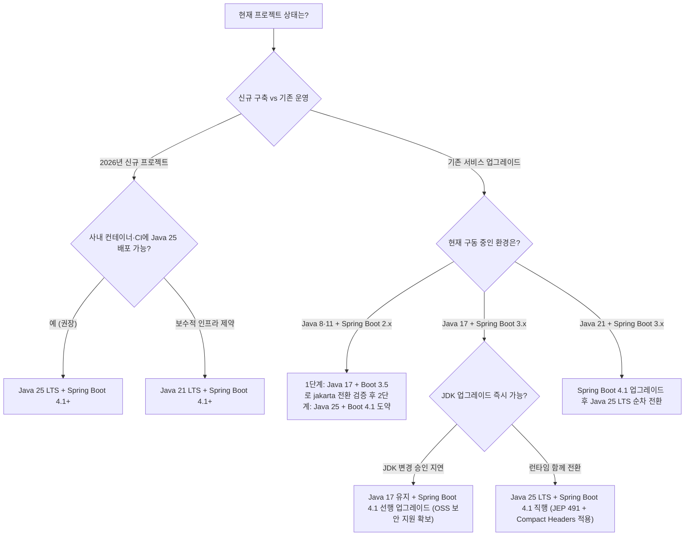

import Alert from '@/components/Alert.astro';
import Chart from '@/components/Chart.astro';

신규 백엔드 프로젝트를 생성하거나 레거시 업그레이드 회의를 열면 `build.gradle`의 `languageVersion` 한 줄 앞에서 꼭 논쟁이 벌어집니다. 검색창에 자바 버전을 쳐봐도 여전히 2～3년 전 기준인 Java 17과 21 비교 글이 상단을 차지하고 있지만, **Java 25 LTS**와 **Spring Boot 4.1**이 자리 잡은 2026년 하반기의 선택 기준은 그때와 완전히 달라졌거든요.

특히 2026년 6월을 기점으로 **Spring Boot 3.5의 무료 오픈소스 지원까지 종료**되면서, 이제 자바 버전과 스프링 부트 버전을 따로 떼어놓고 결정하기가 어렵습니다. Java 8부터 최신 Java 25 LTS까지 실제로 버전을 올렸을 때 코드와 인프라에서 체감되는 차이를 짚어보고, 지금 팀 상황에 맞는 버전 조합을 정리해 봅니다.

## 자바 릴리스 주기는 왜 이렇게 빨라졌을까? (LTS와 Feature Release)

예전에는 자바 메이저 버전 하나가 나오는 데 3～4년이 걸렸습니다. Java 8(2014년 3월) 이후 모듈 시스템을 도입한 Project Jigsaw 일정이 길어지면서 Java 9(2017년 9월)까지 무려 3년 반의 공백이 생겼죠. 이 병목을 겪은 뒤 OpenJDK 진영은 "기능이 완성될 때까지 릴리스를 미루는 방식"을 버리고, **매년 3월과 9월에 무조건 새 버전을 내놓는 6개월 고정 릴리스**(Feature Release) 체제로 전환했습니다.

여기에 한 가지 변화가 더 있었습니다. Java 11(2018년 9월)에서 Java 17(2021년 9월)까지는 **장기 지원 버전**(LTS, Long-Term Support) 간격이 3년이었지만, 엔터프라이즈 현장의 도입 주기를 앞당기기 위해 **Java 17 이후부터는 LTS 주기가 2년으로 단축**됐어요. 그 결과 Java 21(2023년 9월)에 이어 2025년 9월에 **Java 25 LTS**가 출시됐고, 2026년에는 비-LTS인 JDK 26(3월)과 JDK 27(9월)이 나왔으며 차기 LTS인 **Java 29**는 2027년 9월에 예정되어 있습니다.

| 구분 | 출시 시기 | 성격 | Oracle Extended 지원 | Eclipse Temurin 지원 | 2026년 하반기 실무 포지션 |
| :--- | :--- | :--- | :--- | :--- | :--- |
| **Java 8** | 2014.03 | LTS | 2030년 12월 | 2030년 12월 | 생태계 고립, 탈출 필수 레거시 |
| **Java 11** | 2018.09 | LTS | 2032년 1월 | 2027년 10월 | Spring Boot 3+ 진입 불가, 교체 대상 |
| **Java 17** | 2021.09 | LTS | 2029년 9월 이후 | 2027년 10월 이상 | Spring Boot 3.x·4.x 최소 기준선 |
| **Java 21** | 2023.09 | LTS | 2031년 9월 | 2029년 12월 | 현재 점유율 1위, 검증된 주력 런타임 |
| **Java 25** | 2025.09 | **최신 LTS** | 2033년 9월 예정 | 2031년 9월 이상 | **신규 프로젝트 1순위 권장 버전** |
| **JDK 26 / 27** | 2026.03 / 09 | 비-LTS | 6개월 단기 종료 | 6개월 단기 종료 | 신기능 테스트용, 상용 서버 비권장 |

비-LTS 버전(JDK 22, 23, 24, 26, 27 등)이 불안정한 베타판이라는 뜻은 아닙니다. 똑같은 프로덕션 품질로 출시되지만 **지원 기간이 딱 6개월**이라 다음 숫자가 나오는 순간 보안 패치가 끊깁니다. 6개월마다 전사 서버 JDK를 교체할 파이프라인이 없다면 상용 서비스 런타임은 반드시 **LTS 버전**(17, 21, 25) 위에서 고르는 것이 원칙입니다.

### 숫자로 보는 자바 세대교체 속도

"그래도 현업은 아직 다들 Java 8이나 17 쓰지 않나요?"라고 반문할 수 있습니다. 불과 2년 전만 해도 맞던 말이지만, 최근 생태계 지형도는 꽤 가파르게 바뀌었어요.

<Chart
  type="bar"
  height={320}
  caption="개발자 정기 사용 Java LTS 버전 비중 추이 (단위: %, 복수 응답 허용 — 출처: JetBrains State of Developer Ecosystem 2024·2025)"
  data={{
    labels: ['Java 8', 'Java 17', 'Java 21'],
    datasets: [
      {
        label: '2024년 (%)',
        data: [44, 46, 28],
        backgroundColor: 'rgba(148, 163, 184, 0.75)',
        borderRadius: 6,
      },
      {
        label: '2025년 (%)',
        data: [31, 39, 40],
        backgroundColor: 'rgba(59, 130, 246, 0.85)',
        borderRadius: 6,
      },
    ],
  }}
/>

JetBrains의 연례 개발자 생태계 조사 결과를 보면, 2024년까지만 해도 44%에 달하던 Java 8 사용률이 1년 만에 **31%** 수준으로 13%p 급감했습니다. 반대로 Java 21은 28%에서 **40%** 고지로 뛰어오르며 Java 17(39%)까지 근소하게 제치고 가장 많이 쓰이는 버전 자리에 올랐죠. New Relic의 *State of the Java Ecosystem* 리포트에서도 Java 21의 출시 후 첫 6개월 프로덕션 도입 속도는 Java 17 초기보다 **287%** 더 빨랐던 것으로 집계됐습니다. 새 LTS가 나오면 3～4년씩 관망하던 관성이 깨지고, 가상 스레드와 컨테이너 효율이라는 확실한 보상 때문에 최신 LTS 전환 주기가 훨씬 짧아진 셈입니다.

---

## LTS 버전별 핵심 특징과 실무 체감 차이 (Java 8 ～ 25)

릴리스 노트에 적힌 수백 개의 JEP(JDK Enhancement Proposal)를 다 외울 필요는 없습니다. 실제로 팀에서 JDK 버전을 올렸을 때 **코드 작성 방식, 서버 메모리·처리량, 마이그레이션 난이도**에서 무엇이 달라지는지 다섯 개 LTS를 기준으로 하나씩 짚어봅니다.

### Java 8 (2014.03) — 모던 자바의 출발점이자 이제는 놓아줘야 할 유산

람다 표현식, `Stream API`, `Optional<T>`, 불변 날짜·시간 API(`java.time`), 그리고 `PermGen`을 걷어낸 `Metaspace`까지 오늘날 우리가 당연하게 쓰는 자바 코딩 스타일은 대부분 Java 8에서 완성됐습니다. Oracle과 Adoptium(Temurin) 모두 **2030년 12월**까지 보안 패치를 약속하고 있어 당장 내일 서버가 멈추지는 않아요.

문제는 JDK 바깥의 생태계입니다. 초기 빌드들은 도커·쿠버네티스 컨테이너(`cgroups`)의 메모리 제한을 인식하지 못해 호스트 물리 메모리를 기준으로 힙을 잡았다가 OOMKilled를 당하곤 했고(8u191 이후에야 백포트), 기본 GC도 처리량 위주의 **Parallel GC**라 힙이 커지면 Stop-The-World 지연이 부담스럽습니다. 무엇보다 **Spring Boot 3.x와 4.x, Hibernate 6+, 최신 테스트 및 관측성 라이브러리가 일제히 Java 17 이상을 요구**하면서 Java 8에 머문 서비스는 보안 취약점이 터진 서드파티 라이브러리를 올리려 해도 올릴 수 없는 고립 상태에 놓여 있습니다.

### Java 11 (2018.09) — 컨테이너 시대의 기반과 Java EE의 결별

Java 8에서 11로 올라가면 애플리케이션 코드보다 인프라 운영 지표에서 먼저 차이가 납니다. Java 9부터 기본 GC가 **G1GC**로 바뀌면서 대용량 힙에서의 응답 지연 편차가 줄었고, 컨테이너 CPU·메모리 리소스 인식이 기본 동작으로 안착했거든요. 언어와 표준 라이브러리 쪽에서는 지역 변수 타입 추론 `var`(Java 10 도입 후 JEP 323으로 람다 파라미터까지 확장), `isBlank()`·`lines()`·`strip()` 같은 `String` 메서드, 그리고 외부 라이브러리 없이 HTTP/2와 비동기 호출을 지원하는 표준 `HttpClient`(JEP 321)가 들어왔습니다.

다만 Java 8 서비스를 11 이상으로 처음 올릴 때 가장 많이 터지는 빌드 에러가 바로 **JEP 320**입니다. JDK 안에 기본으로 들어 있던 `javax.xml.bind`(JAXB), `javax.activation` 등 Java EE 및 CORBA 모듈이 JDK 11에서 완전히 삭제됐기 때문이죠. XML 파싱이나 구형 SOAP/보안 모듈을 쓰던 프로젝트라면 Gradle이나 Maven에 별도 아티팩트를 직접 선언해 줘야 컴파일이 통과됩니다.

### Java 17 (2021.09) — 문법의 세대교체와 Spring Boot 3+ 최소 기준선

Java 17은 백엔드 개발자가 코드를 짤 때 손끝에서 체감하는 생산성이 확 달라진 분기점입니다.

- **[Record 클래스](/dev/java-record-class)** (JEP 395): `getter`, `equals`, `hashCode`, `toString`을 위해 Lombok 어노테이션을 도배하던 불변 DTO와 응답 객체를 한 줄로 정의합니다.
- **패턴 매칭과 Switch 표현식**(JEP 394, JEP 361): `instanceof` 검사 후 일일이 캐스팅하던 코드를 없애고, `switch`가 값을 직접 반환하며 분기 누락을 컴파일 타임에 잡아줍니다.
- **Sealed Classes**(JEP 409): `permits` 키워드로 상속·구현 가능한 하위 타입을 명시적으로 제한해 도메인 상태를 안전하게 모델링할 수 있습니다.
- **Text Blocks**(JEP 378): `"""` 삼중 따옴표 덕분에 줄바꿈마다 `+ "\n"`과 이스케이프 문자를 이어 붙이던 다중행 SQL, JSON 테스트 픽스처가 깔끔해졌습니다.
- **저지연 GC 안정화**: 수 밀리초 이하의 정지 시간을 목표로 하는 **ZGC**와 **Shenandoah GC**가 실험 딱지를 떼고 프로덕션 기능을 갖췄습니다.

Java 8이나 11에서 17로 직행할 때 마주치는 대표적인 복병은 **JDK 내부 API 강력 캡슐화**(JEP 403)입니다. `sun.misc.*`나 `java.lang` 내부 필드에 리플렉션으로 접근하던 구버전 Lombok, 구형 직렬화·모킹 라이브러리가 `InaccessibleObjectException`을 뿜으며 멈추거든요. 임시방편으로 `--add-opens` JVM 플래그를 붙이기도 하지만, 근본적으로는 해당 라이브러리들을 Java 17 호환 버전으로 함께 끌어올려야 해결됩니다.

### Java 21 (2023.09) — 가상 스레드 혁명과 데이터 지향 프로그래밍 완성

2년 주기 LTS의 첫 주자인 Java 21은 **가상 스레드**(Virtual Threads, JEP 444) 하나로 백엔드 아키텍처의 공식을 바꿨습니다. 기존 플랫폼 스레드는 OS 커널 스레드와 1:1로 매핑되어 스레드 하나당 수 MB의 스택 메모리를 차지했고, DB 조회나 외부 API 응답을 기다리는 동안 스레드가 통째로 블로킹됐죠. 처리량을 쥐어짜려고 Spring WebFlux 같은 리액티브 스택을 도입하면 코드의 가독성과 디버깅 난이도가 급격히 올라가는 대가를 치러야 했습니다.

가상 스레드는 JVM이 수백만 개까지 가볍게 생성·스케줄링하는 유저 모드 스레드입니다. 익숙한 동기식(`Imperative`) 코드를 그대로 유지하면서도 블로킹 I/O를 만나는 순간 JVM이 가상 스레드를 잠시 내려놓고 OS 스레드(캐리어 스레드)를 다른 요청에 빌려줍니다. 여기에 `switch` 패턴 매칭(JEP 441, `when` 가드 지원)과 **Record Patterns**(JEP 440)가 결합해 중첩된 데이터 구조를 분해하기 좋아졌고, 오랜 숙원이던 `list.getFirst()`·`list.getLast()`·`reversed()`를 제공하는 **Sequenced Collections**(JEP 431)와 객체 수명 세대별로 수집 효율을 높인 **Generational ZGC**(JEP 439)까지 더해졌습니다.

하지만 Java 21의 가상 스레드에는 실무팀을 괴롭히던 한 가지 아킬레스건이 있었습니다. 바로 `synchronized` 블록이나 메서드 안에서 블로킹 I/O(구형 JDBC 드라이버 내부 락, 레거시 라이브러리 등)가 실행되면 가상 스레드가 캐리어 스레드에서 내려오지 못하고 그대로 묶여버리는 **Pinning 현상**이었죠.

### Java 25 (2025.09) — 완성형 가상 스레드, AOT 가속, 런타임 다이어트

2026년 현재 가장 최신 LTS인 **Java 25**는 새로운 패러다임을 어설프게 벌여놓기보다, Java 21에서 시작된 변화의 걸림돌을 제거하고 클라우드 비용과 직결되는 런타임 효율을 끌어올린 '완성형' 릴리스에 가깝습니다. Java 22부터 25 사이에 정식(`Final`) 기능으로 확정된 핵심 변화들을 짚어보면 왜 신규 프로젝트에 Java 25를 바로 써도 되는지 명확해집니다.

<Alert type="warning" title="오래된 블로그 가이드를 주의하세요: 가상 스레드 Pinning 해결 (JEP 491)">
2023～2024년에 작성된 기술 블로그들을 보면 "가상 스레드를 쓰려면 프로젝트의 모든 `synchronized`를 `ReentrantLock`으로 고쳐야 한다"는 조언이 단골로 등장합니다. 이는 Java 21 기준의 이야기입니다. Java 24에서 정식 도입되어 **Java 25 LTS에 기본 반영된 JEP 491**은 JVM 모니터 락 메커니즘 자체를 재설계해, `synchronized` 내부에서 블로킹 I/O가 발생해도 가상 스레드가 캐리어 스레드에서 안전하게 언마운트(Unmount)되도록 해결했습니다. 더 이상 Pinning 회피만을 목적으로 멀쩡한 동기화 코드를 억지로 뜯어고칠 필요가 없습니다.
</Alert>

Java 25에서 실무 백엔드 팀이 바로 체감할 수 있는 정식 기능들은 다음과 같습니다.

1. **Scoped Values 정식 도입**(JEP 506): 수십만 개의 가상 스레드가 생성·소멸하는 환경에서 기존 `ThreadLocal`은 값 변경 위험, 데이터 복제 오버헤드, `remove()` 누락에 따른 메모리 누수 문제를 안고 있었습니다. `ScopedValue`는 호출 스택 범위 안에서만 살아 있는 불변(Immutable) 컨텍스트를 안전하고 가볍게 공유하는 표준 대안입니다.
2. **Project Leyden AOT 가속 3종**(JEP 483·514·515): GraalVM Native Image처럼 리플렉션 제약과 긴 빌드 시간을 감수하지 않고도 일반 JVM 위에서 기동 속도를 단축합니다. 사전 실행으로 클래스 로딩·링킹 정보와 메서드 프로파일링 데이터를 캐시 파일(`-XX:AOTCacheOutput` → `-XX:AOTCache`)로 구워두면, 쿠버네티스 스케일 아웃 시 Spring 컨테이너 기동 시간과 초기 JIT 컴파일 웜업 지연을 크게 줄일 수 있어요.
3. **Compact Object Headers 정식 제품 플래그 승격**(JEP 519, Project Lilliput): 64비트 JVM에서 모든 객체마다 붙던 96～128비트 헤더 크기를 64비트로 압축합니다. Java 25에서는 기본값이 비활성화 상태이므로 JVM 실행 옵션에 `-XX:+UseCompactObjectHeaders`를 명시해야 동작하며, 도메인 객체가 많은 백엔드 워크로드에서 코드 수정 한 줄 없이 **힙 메모리를 약 10～20% 절감**하고 CPU 캐시 적중률까지 개선해 줍니다.
4. **코드의 군더더기를 덜어내는 문법들**: 생성자에서 `super()`나 `this()`를 호출하기 전에 인자 유효성 검증·사전 계산을 허용하는 **Flexible Constructor Bodies**(JEP 513)가 Java 25에서 최종 확정됐습니다. 여기에 스트림 파이프라인에 고정/슬라이딩 윈도우 같은 커스텀 중간 연산을 끼워 넣는 **Stream Gatherers**(Java 24 정식, JEP 485), 쓰지 않는 람다·예외 변수를 `_`로 비워두는 **Unnamed Variables & Patterns**(Java 22 정식, JEP 456)처럼 직전 버전들에서 정식화된 실용 문법들이 Java 25 LTS에 안정적으로 통합되었습니다. 스크립트성 코드나 입문용에 유용한 `void main()` 기반 **Compact Source Files**(JEP 512)와 **Module Import Declarations**(JEP 511)도 정식화됐고요.
5. **네이티브 연동과 GC 고도화**: 위험하고 까다롭던 JNI를 대체하는 **Foreign Function & Memory API**(JEP 454)가 정식 안착했고, **Generational Shenandoah**(JEP 521)가 정식 기능으로 승격되었으며 ZGC는 비세대 단일 모드를 완전히 걷어내고(JEP 490) 세대별(Generational) 모드로 일원화됐습니다.

실제 Java 25 코드에서 이 문법들이 어떻게 맞물리는지 간단한 주문 배치 처리 예시로 확인해 볼까요?

```java
import java.math.BigDecimal;
import java.util.List;
import java.util.stream.Gatherers;

public class OrderProcessor {

    // JEP 506: ThreadLocal을 대체하는 불변 컨텍스트 공유
    public static final ScopedValue<String> TRACE_ID = ScopedValue.newInstance();

    public static class BaseOrder {
        private final BigDecimal amount;
        protected BaseOrder(BigDecimal amount) { this.amount = amount; }
        public BigDecimal amount() { return amount; }
    }

    public static class DiscountedOrder extends BaseOrder {
        public DiscountedOrder(BigDecimal rawAmount, BigDecimal rate) {
            // JEP 513: super() 호출 전에 인자 검증과 사전 연산 허용!
            if (rawAmount.signum() < 0) {
                throw new IllegalArgumentException("주문 금액은 음수일 수 없습니다.");
            }
            BigDecimal finalAmount = rawAmount.multiply(BigDecimal.ONE.subtract(rate));
            super(finalAmount);
        }
    }

    public List<List<Long>> chunkOrderIds(List<Long> orderIds) {
        // JEP 485: 별도 유틸 없이 스트림에서 3개씩 묶는 고정 윈도우 연산
        return orderIds.stream()
                .gather(Gatherers.windowFixed(3))
                .toList();
    }

    public void runWithTrace(String traceId, Runnable task) {
        ScopedValue.where(TRACE_ID, traceId).run(() -> {
            try {
                task.run();
            } catch (NumberFormatException _) {
                // JEP 456: 사용하지 않는 예외 변수를 '_'로 깔끔하게 생략
                System.err.println("잘못된 숫자 포맷 요청 — traceId=" + TRACE_ID.get());
            }
        });
    }
}
```

생성자 첫 줄에 무조건 `super(...)`부터 적느라 억지로 `private static` 헬퍼 메서드를 빼던 불편함이나, 리스트를 N개씩 끊어 처리하려고 Guava `Lists.partition`을 끌어오던 자잘한 보일러플레이트가 표준 JDK만으로 말끔히 정리됩니다.

<Alert type="warning" title="Java 25에서도 아직 프리뷰(Preview)인 기능 구분하기">
온라인 아티클 중에는 Java 25에 포함된 모든 기능을 마치 정식 출시된 것처럼 묶어 소개하는 글이 적지 않습니다. **Structured Concurrency**(구조적 동시성, JEP 505 — 5차 프리뷰)와 **원시 타입 패턴 매칭**(Primitive Types in Patterns, JEP 507 — 3차 프리뷰)은 Java 25에서도 여전히 프리뷰 상태입니다. 프리뷰 기능은 `--enable-preview` 플래그를 강제로 켜야만 동작하고 향후 버전에서 API 시그니처가 바뀔 수 있으므로, 일반 상용 프로덕션 코드에 성급히 도입하는 것은 피해야 합니다.
</Alert>

---

## Spring Boot 버전별 Java 호환성과 2026년 지원 현황

실무에서 자바 버전을 결정할 때 가장 강력한 강제력을 발휘하는 변수는 결국 **Spring Boot의 지원 수명주기**입니다. 2026년 11월 시점에서 많은 팀이 놓치고 있는 가장 큰 함정이 바로 Spring Boot 3.x 라인의 지원 상태예요.

<Alert type="danger" title="체크 필수: Spring Boot 3.5 무료 OSS 지원은 이미 종료됐습니다">
3.x 세대의 마지막 마이너 릴리스인 **Spring Boot 3.5**(2025년 5월 출시)의 무료 오픈소스(OSS) 보안·버그 패치 지원은 **2026년 6월 30일부로 종료**됐습니다(유료 엔터프라이즈 상용 구독만 2032년 6월까지 유지). 또한 **Spring Boot 4.0** 역시 **2026년 12월 31일**에 OSS 지원 종료를 앞두고 있으므로, 현재 신규 프로젝트를 시작하거나 업그레이드를 계획한다면 **Spring Boot 4.1 이상**을 타깃으로 잡아야 합니다.
</Alert>

세대별 Spring Boot와 Java 호환성 매트릭스를 한눈에 비교해 보면 다음과 같습니다.

| Spring Boot 버전 | 기반 Framework / EE | 지원 Java 범위 | 무료 OSS 지원 기한 | 핵심 비고 |
| :--- | :--- | :--- | :--- | :--- |
| **2.7.x** | Framework 5.3 / Java EE 8 (`javax.*`) | Java 8 ～ 21 | **종료** (2023.11) | 무료 패치 완전 중단, 보안 감사 취약 |
| **3.0 ～ 3.4** | Framework 6.x / Jakarta EE 9·10 | Java 17 이상 | **종료** | 3.2부터 가상 스레드 공식 옵션 도입 |
| **3.5.x** | Framework 6.2 / Jakarta EE 10 (`jakarta.*`) | Java 17 ～ 25 | **종료** (2026.06.30) | 3.x 마지막 버전, 상용 유료 지원만 유지 |
| **4.0.x** | Framework 7.0 / Jakarta EE 11 | Java 17 ～ 25 | 2026.12.31 (종료 임박) | 4.1로 마이너 업그레이드 권장 |
| **4.1.x** | Framework 7.x / Jakarta EE 11 | **Java 17 ～ 25+** | **2027.07.31** | **2026년 하반기 신규·전환 표준 타깃** |

### 의외의 반전: Spring Boot 4의 최소 요구 버전은 여전히 Java 17

초기 커뮤니티에서는 Spring Boot 4(Spring Framework 7)가 최소 기준을 Java 21로 끌어올릴 것이라는 전망이 우세했습니다. 하지만 스프링 팀은 **최소 요구 버전**(Baseline)을 **Java 17로 유지**하는 실용적인 결정을 내렸습니다.

이 결정이 주는 실무적 이점은 상당합니다. 당장 인프라 제약이나 사내 표준 이미지 문제로 JDK를 21이나 25로 올리지 못하고 **Java 17에 묶여 있는 팀이라도, 프레임워크부터 Spring Boot 4.1로 먼저 업그레이드해 OSS 보안 지원 기간을 확보할 수 있기 때문**이죠. 물론 프레임워크의 최신 기능과 런타임 최적화는 **Java 25 LTS**를 1급 타깃으로 설계되었기 때문에, 여건이 허락한다면 `Java 25 + Spring Boot 4.1` 조합을 택하는 편이 이득이 큽니다.

### Spring Boot 4.x + Java 25 조합에서 달라지는 네 가지

1. **Jakarta EE 11 스택 전면 적용**: 내장 웹 서버와 영속성 계층이 Servlet 6.1, Tomcat 11, JPA 3.2, **Hibernate ORM 7** 기반으로 올라갔습니다. 3.x에서 이미 `javax.*` → `jakarta.*` 네임스페이스 이관을 마쳤다면 2→3 때만큼 대규모 임포트 수정은 발생하지 않지만, Hibernate 7의 쿼리 생성 규칙과 폐기된 구형 API는 꼼꼼히 테스트해야 합니다.
2. **JSpecify 기반 표준 Null-safety**: 프레임워크 전반의 null 가능성 어노테이션이 `org.jspecify.annotations`(`@Nullable`, `@NullMarked`) 표준으로 통일됐습니다. Kotlin 백엔드 프로젝트는 물론이고 Java 프로젝트에서도 정적 분석기와 IDE가 훨씬 정교하게 `NullPointerException` 위험을 잡아냅니다.
3. **외부 라이브러리 없이 쓰는 코어 내장 복원력**(Native Resilience): 예전에는 간단한 재시도 처리 하나를 넣으려고 `spring-retry`와 AOP 의존성을 따로 추가해야 했죠. Spring Framework 7부터는 코어 패키지(`org.springframework.resilience.annotation`)에 재시도와 동시성 제한 기능이 기본 내장됐습니다.
4. **내장 API 버저닝과 Leyden AOT 시너지**: 컨트롤러 매핑 어노테이션에서 곧바로 API 버전을 분기할 수 있고, 잘게 모듈화된 Auto-configuration 구조가 Java 25의 Project Leyden AOT 캐시(`-XX:AOTCache`)와 맞물려 컨테이너 콜드 스타트를 크게 앞당깁니다.

주의할 점은 Spring Framework 7의 내장 `@Retryable`을 쓸 때 과거 `spring-retry` 시절의 속성명을 습관적으로 적으면 안 된다는 점입니다. 구버전의 `maxAttempts`나 `backoff` 대신 직관적인 `maxRetries`, `delay`, `multiplier` 속성을 사용합니다.

```java
import org.springframework.context.annotation.Configuration;
import org.springframework.resilience.annotation.ConcurrencyLimit;
import org.springframework.resilience.annotation.EnableResilientMethods;
import org.springframework.resilience.annotation.Retryable;
import org.springframework.stereotype.Service;

@Configuration
@EnableResilientMethods
class ResilienceConfig {
}

@Service
public class PaymentGatewayClient {

    // 구 spring-retry의 maxAttempts(최초 실행 포함)가 아니라 '재시도 횟수(maxRetries)' 기준!
    // 최초 1회 실패 시 200ms -> 400ms -> 800ms 간격으로 최대 3번 재시도합니다.
    @Retryable(
        includes = TransientGatewayException.class,
        maxRetries = 3,
        delay = 200,
        multiplier = 2.0
    )
    @ConcurrencyLimit(50) // 가상 스레드 환경에서 외부 레거시 API 과부하를 막는 세마포어 역할
    public PaymentResult requestApprove(PaymentCommand command) {
        return externalApi.call(command);
    }
}
```

특히 가상 스레드(`spring.threads.virtual.enabled=true`)를 켠 상태에서는 스레드 풀 크기가 더 이상 동시 요청 수를 제한하는 방파제 역할을 하지 못합니다. 수천 개의 가상 스레드가 동시에 외부 결제사나 하위 DB를 때려 장애가 전파되기 쉬운데, 이때 `@ConcurrencyLimit`을 메서드 단위로 걸어두면 별도 서킷 브레이커 라이브러리 없이도 깔끔하게 동시 호출 상한을 제어할 수 있어요.

---

## 2026년 프로젝트 상황별 버전 선택 가이드

지금 우리 팀이 처한 상황에 따라 어떤 경로를 밟는 것이 가장 리스크가 적고 실익이 큰지 의사결정 흐름도로 정리했습니다.



### 시나리오 1: 2026년 하반기 신규 백엔드 프로젝트 → Java 25 LTS + Spring Boot 4.1

새로 파는 저장소라면 주저 없이 **Java 25 LTS**와 **Spring Boot 4.1**로 시작하는 편이 가장 깔끔합니다. Java 21을 골라도 당장 문제는 없지만, 1～2년 뒤 어차피 다시 메이저 런타임 업그레이드 일정을 잡아야 하고 무엇보다 Java 25에서는 `synchronized` Pinning 이슈(JEP 491)가 해결되어 서드파티 JDBC 드라이버나 사내 공통 모듈과의 가상 스레드 궁합을 의심할 필요가 없거든요.

신규 프로젝트의 `build.gradle`과 기본 설정은 아래와 같이 잡아두면 충분합니다.

```groovy
plugins {
    id 'java'
    id 'org.springframework.boot' version '4.1.2'
    // Gradle 8.x 후반·9.x에서는 내장 BOM(platform) 사용 시 아래 플러그인 생략 가능
    id 'io.spring.dependency-management' version '1.1.7'
}

java {
    toolchain {
        languageVersion = JavaLanguageVersion.of(25)
    }
}
```

```properties
# application.properties — Java 25에서는 Pinning 부담 없이 가상 스레드 활성화 가능
spring.threads.virtual.enabled=true
```

여기에 컨테이너 이미지의 `JAVA_TOOL_OPTIONS`에 `-XX:+UseCompactObjectHeaders` 플래그를 추가해 스테이징 부하 테스트를 돌려보세요. 별도 코드 변경 없이 파드당 메모리 점유율이 10～20%가량 내려가는 효과를 바로 검증할 수 있습니다.

### 시나리오 2: Java 17·21 + Spring Boot 3.x 운영 중 → Spring Boot 4.1 우선 진입

이미 `jakarta.*` 네임스페이스 전환이라는 가장 큰 산을 넘은 팀입니다. 다만 Spring Boot 3.5의 무료 OSS 지원이 2026년 6월 말에 끝났기 때문에, 보안 패치 공백을 방치하지 않으려면 **Spring Boot 4.1 업그레이드를 먼저 실행**하는 것이 안전합니다.

앞서 확인했듯 Spring Boot 4.1은 Java 17 위에서도 그대로 돌아갑니다. 한 번의 배포에 JDK 메이저 변경과 Hibernate 7·Tomcat 11 변경을 동시에 섞으면 장애 원인을 좁히기 까다로우니, **1차로 현재 JDK 버전을 유지한 채 Spring Boot 4.1로 올리고, 안정화가 확인된 뒤 2차로 컨테이너 베이스 이미지를 Java 25로 교체**하는 투스텝 전략을 권합니다.

### 시나리오 3: Java 8·11 + Spring Boot 2.7 레거시 → OpenRewrite 활용 단계적 탈출

가장 손이 많이 가는 구간입니다. Java 8에서 Java 25 + Spring Boot 4.1로 한 번에 점프하려 하면 ① JAXB 등 제거된 Java EE 모듈 의존성 에러(Java 11), ② 리플렉션 내부 캡슐화 차단 및 구형 Lombok 충돌(Java 17), ③ `javax.*` → `jakarta.*` 패키지 전면 교체와 Spring Security 설정 DSL 개편(Boot 3.0), ④ Hibernate 6 → 7 쿼리 동작 변경(Boot 4.0)이 한꺼번에 쏟아져 컴파일 에러만 수천 줄을 마주하게 됩니다.

수작업으로 패키지를 치환하기보다는 **OpenRewrite** 레시피를 빌드 플러그인으로 걸어 자동 변환 가능한 코드(패키지명, JUnit 4→5, 구형 Security 설정 등)를 먼저 일괄 정리하세요. 그다음 1차 중간 기착지([Spring Boot 3.x + Java 17 업그레이드 체크리스트](/dev/java17-spring-boot3-upgrade) 참고)에서 통합 테스트를 한 번 통과시킨 뒤, 곧바로 Spring Boot 4.1과 Java 25로 마무리 도약하는 방식이 실무 사고 확률을 가장 낮춰 줍니다.

---

## 배포판 선택과 로컬 멀티 JDK 세팅 팁

목표 버전을 Java 21이나 25로 정했다면 다음 질문은 **어느 벤더의 OpenJDK 빌드를 쓸 것인가**입니다. 로컬과 프로덕션 컨테이너의 JDK 배포판을 맞춰두면 미묘한 폰트·SSL 인증서·컨테이너 옵션 차이를 예방할 수 있는데요. AWS(Amazon Corretto), Azure(Microsoft Build of OpenJDK / Azul Zulu), GCP(Eclipse Temurin) 등 인프라 환경별 공식 지원 정책과 선택 기준은 [클라우드별 최적 JDK 선택 가이드 (AWS·Azure·GCP)](/dev/cloud-jdk-guide)에 자세히 비교해 두었으니 배포 파이프라인 구성 전에 함께 확인해 보세요.

한편 레거시 유지보수용 Java 17 프로젝트와 신규 Java 25 프로젝트를 한 맥북에서 오가며 개발해야 한다면 시스템 환경변수를 수동으로 고치는 대신 **SDKMAN**이나 Gradle Toolchain을 활용하는 것이 정신 건강에 이롭습니다.

```bash
# SDKMAN으로 Temurin 17과 25를 나란히 설치하고 프로젝트 폴더별로 자동 전환(.sdkmanrc)
sdk install java 25.0.1-tem
sdk install java 17.0.13-tem
sdk env init
```

macOS에서 Homebrew Cask(`brew install --cask temurin@25`)로 JDK를 관리하려는 경우, 아직 초기 세팅 전이라면 패키지 매니저 설치와 Apple Silicon PATH 구성은 [Homebrew 설치 가이드](/tools/install-homebrew-2026)를 먼저 참고해 설정해 두면 됩니다.

<Alert type="tip" title="실무 업그레이드 전 마지막 점검 리스트">
JDK 버전을 올릴 때는 내 코드보다 **빌드 도구와 바이트코드 조작 라이브러리 버전**이 먼저 발목을 잡습니다. Java 25 타깃으로 올리기 전 **Gradle 9.0 이상**(또는 최신 8.14+), **Lombok 최신 버전**, **ByteBuddy / Mockito / MapStruct** 버전을 먼저 최신화해 두면 불필요한 클래스 파일 버전 에러(`Unsupported class file major version 69`)로 반나절을 허비하는 일을 막을 수 있습니다.
</Alert>

지금 당장 모든 레거시 서버를 하루아침에 바꿀 수는 없더라도, 최소한 새로 만드는 서비스에 관성적으로 구버전 설정을 복사해 넣는 일만 멈춰도 기술 부채의 절반은 줄어듭니다. 이번 주에 새 모듈을 올리거나 정기 패치 일정을 잡는다면, 먼저 `Spring Boot 4.1` 호환성 체크와 스테이징 환경의 `Java 25` 컨테이너 이미지 교체부터 가볍게 테스트해 보시길 권합니다.
