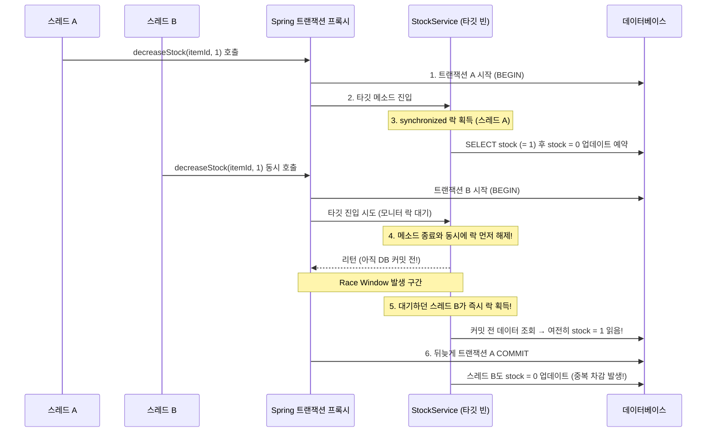
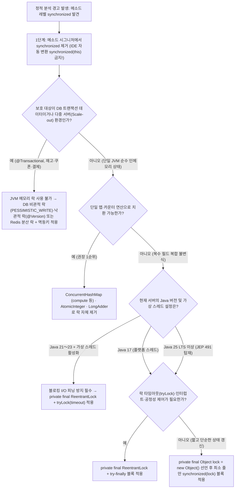

import Alert from '@/components/Alert.astro';
import CloudinaryImage from '@/components/CloudinaryImage.astro';

동시성 버그를 급히 막으려고 서비스 메소드에 `public synchronized`를 붙여 PR을 올렸더니, CI의 SonarQube나 PMD, 전자정부 표준프레임워크 품질 점검기에서 `"메소드 레벨의 synchronized 사용 금지"`(`AvoidSynchronizedAtMethodLevel`) 경고가 떨어집니다. 메시지에 가상 스레드나 피닝 언급조차 없다 보니, Java 17 팀에서는 "가상 스레드도 안 쓰는데 오탐 아닌가?" 싶고 Java 25 팀에서는 "피닝이 해결됐다던데 옛날 규칙 아닌가?"라는 의문이 들기 쉽죠.

결론부터 말하면 이 경고는 **자바 버전이나 가상 스레드 여부와 무관한 100% 정탐**입니다. 다만 현재 구동 중인 **Java·Spring Boot 버전 조합**과 **트랜잭션 유무**에 따라 실제 장애 양상과 고쳐야 할 정답 코드가 완전히 다릅니다. 환경별 핵심 해법부터 표로 정리했습니다.

| 운영 환경 / 상황 | 메소드 `synchronized` 유지 시 핵심 위험 | 권장 해결책 (정답 코드) |
| :--- | :--- | :--- |
| **공통** (전 버전) | `this`·`Class` 모니터 외부 노출, 불필요한 전후 로직까지 직렬화 | 메소드 시그니처에서 `synchronized` 즉시 제거 |
| **Spring `@Transactional` / 다중 서버** | **락 해제 → DB 커밋** 순서 역전으로 정합성 붕괴, 다중 파드 제어 불가 | DB 비관적 락(`PESSIMISTIC_WRITE`)·낙관적 락(`@Version`)·Redis 분산 락 |
| **Spring Boot 3.x + Java 17** | 락 보유 시간 증가로 플랫폼 워커 스레드 대기열 적체 | 1순위 `ConcurrentHashMap`·`Atomic*`, 차선책 `private final Object lock` 블록 |
| **Spring Boot 4.x + Java 21** (VT 활성) | 블록 내 블로킹 I/O 시 캐리어 스레드 **Pinning 병목**으로 서버 마비 | `private final ReentrantLock` + `tryLock(timeout)` 필수 전환 |
| **Spring Boot 4.x + Java 25 LTS** (JEP 491) | 피닝은 해소됐으나 모니터 노출·임계 영역 비대화·트랜잭션 역전은 동일 | 일반 동기화는 간결한 `synchronized (lock)` 복권, 타임아웃·공정성은 `ReentrantLock` |

---

## 가상 스레드를 안 써도 위험하다: `AvoidSynchronizedAtMethodLevel`의 진짜 정체

국내 공공·금융·대기업 현장에서 자주 마주치는 `"메소드 레벨의 synchronized 사용 금지"` 문구의 원형은 정적 분석기 **PMD 3.0**부터 존재한 `AvoidSynchronizedAtMethodLevel` 규칙(`category/java/multithreading.xml/AvoidSynchronizedAtMethodLevel`)입니다. 전자정부 표준프레임워크(eGovFrame) 코드 진단 룰셋과 SonarQube(PMD 연동 프로파일), IntelliJ IDEA의 `'synchronized' method` 인스펙션에 기본 포함되어 있죠.

즉, 가상 스레드가 등장하기 훨씬 전부터 메소드 시그니처에 직접 붙이는 동기화는 안티패턴이었습니다. *Effective Java* 3판(아이템 82)과 SEI CERT 자바 보안 코딩 표준인 **`LCK00-J`** (*Use private final lock objects to synchronize classes that may interact with untrusted code*) 규칙은 두 가지 근본 결함을 지목합니다.

### 1. 암묵적 모니터(`this` / `Class`) 외부 노출

인스턴스 메소드에 `public synchronized`를 걸면 JVM은 **해당 객체 자신**(`this`)을 락으로 잡습니다(`static` 메소드는 `ClassName.class`를 잠급니다). Spring에서 `@Service` 빈은 전역에 공개된 싱글톤 객체이기 때문에, 외부 코드가 실수나 악의로 같은 빈 참조에 `synchronized (couponService)`를 걸어버리면 내부 로직과 외부 락이 정면충돌하며 예상치 못한 경합 지연·**데드락**(Deadlock)·**서비스 거부**(DoS) 위험을 만듭니다.

### 2. 임계 영역(Critical Section) 비대화

동기화 락은 공유 상태를 변경하는 **최소 몇 줄**만 감싸야 합니다. 메소드 전체를 잠그면 파라미터 검증, DTO 변환, 로깅처럼 공유 상태와 무관한 작업까지 일렬로 줄을 세우게 됩니다. 나중에 동료가 메소드 끝에 감사 로그 몇 줄만 추가해도 전체 스레드의 락 대기 시간이 그대로 늘어납니다.

<CloudinaryImage
  publicId="posts/dev/2026/java-synchronized-method-warning/fig-01-lock-scope-exposure"
  width={1376}
  height={768}
  alt="메소드 전체를 잠그고 외부에 모니터를 노출한 구조와 비공개 락으로 핵심 임계 영역만 보호하는 구조의 흐름 대비"
/>

<Alert type="warning" title="코드 리뷰 단골 함정: IDE 자동 수정의 synchronized (this) 우회">
경고를 빨리 지우려고 IntelliJ 자동 수정(`Replace 'synchronized' modifier with 'synchronized' statement`)을 실행해 본문 전체를 그대로 `synchronized (this) { ... }`로 감싸는 PR이 흔합니다. 정적 분석기의 단순 문법 체크만 우회할 뿐, `this` 모니터 노출과 넓은 임계 영역이라는 **두 가지 결함은 그대로 남는 반쪽짜리 수정**이므로 반드시 비공개 락이나 동시성 컬렉션으로 고쳐야 합니다.
</Alert>

---

## 환경 ①: Spring Boot 3.x + Java 17 — 비공개 락 객체와 `@Transactional`의 배신

2021년 9월 출시된 **Java 17**은 자바 스레드가 OS 스레드와 1:1로 매핑되는 **플랫폼 스레드** 전용 환경입니다(`spring.threads.virtual.enabled=true`는 Java 21 이상에서만 동작합니다). **Spring Boot 3.5의 무료 오픈소스 지원이 2026년 6월 30일에 종료**되었지만 여전히 국내 운영 시스템 비중이 높은 조합이죠(마이그레이션 기준은 [Spring Boot 3.x + Java 17 업그레이드 가이드](/dev/java17-spring-boot3-upgrade)와 [자바 LTS 및 Spring Boot 버전 선택 가이드](/dev/java-lts-spring-boot-guide)를 참고하세요).

이 환경에서는 보호 대상이 **단일 JVM 인메모리 상태**인지, **DB 트랜잭션 데이터**인지부터 가려내야 합니다.

### 순수 인메모리 상태 보호: Lock-free 우선, 불가피할 땐 `private final Object lock`

단일 맵이나 카운터라면 `ConcurrentHashMap`(`compute`, `computeIfAbsent`), `AtomicInteger`, `LongAdder` 같은 `java.util.concurrent` 클래스로 `synchronized` 자체를 없애는 것이 1순위입니다. 여러 필드를 하나의 원자적 불변식으로 묶어야 할 때만 **비공개 불변 락 객체**(`private final Object lock = new Object();`)를 선언하고 핵심 2～3줄만 잠급니다.

```java
package com.example.ratelimit;

import java.util.ArrayDeque;
import java.util.Deque;
import java.util.HashMap;
import java.util.Map;
import java.util.concurrent.TimeUnit;
import org.slf4j.Logger;
import org.slf4j.LoggerFactory;
import org.springframework.stereotype.Service;

@Service
public class ApiQuotaTracker {

    private static final Logger log = LoggerFactory.getLogger(ApiQuotaTracker.class);
    private static final long WINDOW_NANOS = TimeUnit.MINUTES.toNanos(1);

    // 외부 노출을 차단하는 전용 비공개 불변 모니터 객체 (LCK00-J 준수)
    private final Object lock = new Object();
    // 고정된 파트너·테넌트 clientId 기준 예시 (불특정 다수 키 환경에서는 Caffeine 등 만료 정책 필요)
    private final Map<String, Deque<Long>> requestWindows = new HashMap<>();
    private long totalRejectedCount = 0L;

    public boolean tryConsume(String clientId, int maxRequestsPerMinute) {
        if (clientId == null || clientId.isBlank()) {
            throw new IllegalArgumentException("clientId must not be blank");
        }
        if (maxRequestsPerMinute <= 0) {
            throw new IllegalArgumentException("maxRequestsPerMinute must be positive");
        }

        boolean allowed;
        long rejectedSnapshot = 0L;

        // 복수 필드를 원자적으로 갱신하는 최소 구간만 동기화 (큐 정렬 불변식 유지를 위해 단조 시계도 락 내부에서 측정)
        synchronized (lock) {
            long nowNanos = System.nanoTime();
            Deque<Long> timestamps = requestWindows.computeIfAbsent(clientId, k -> new ArrayDeque<>());
            while (!timestamps.isEmpty() && nowNanos - timestamps.peekFirst() >= WINDOW_NANOS) {
                timestamps.pollFirst();
            }
            if (timestamps.size() < maxRequestsPerMinute) {
                timestamps.addLast(nowNanos);
                allowed = true;
            } else {
                totalRejectedCount++;
                rejectedSnapshot = totalRejectedCount;
                allowed = false;
            }
        }

        // 로깅 I/O는 반드시 락 해제 후 바깥에서 수행
        if (!allowed) {
            log.warn("API 호출 한도 초과 - clientId={}, 누적 거절={}", clientId, rejectedSnapshot);
        }
        return allowed;
    }
}
```

### 실무 최다 장애 원인: `@Transactional` + `synchronized` 동시 사용의 함정

선착순 쿠폰 발급이나 재고 차감 메소드에 `@Transactional`과 `synchronized`를 함께 붙이면 상용 트래픽에서 여지없이 중복 차감 사고가 터집니다. Spring 선언적 트랜잭션은 **AOP 프록시가 타깃 메소드 바깥을 감싸 동작**하기 때문입니다.



타깃 메소드가 끝나는 순간 **`synchronized` 락이 먼저 풀리고**, 그 뒤 프록시가 **DB `COMMIT`을 수행**합니다. 이 찰나의 틈(Race Window)에 대기하던 스레드 B가 진입해 커밋 전 데이터를 읽어버리는 것이죠. 게다가 다중 파드·서버로 확장된 **Scale-out 환경**에서는 JVM 내부 메모리 락이 옆 서버의 요청을 전혀 막지 못합니다.

단일 서버에서 굳이 애플리케이션 락을 쓴다면 트랜잭션 바깥 **Facade 계층**에서 락을 잡아야 순서가 맞지만, 실무 정석은 JVM 락을 걷어내고 **DB 비관적 락**(`@Lock(LockModeType.PESSIMISTIC_WRITE)`)이나 **낙관적 락**(`@Version`), 혹은 **Redis 분산 락과 멱등키 설계**([REST API 멱등성과 분산 잠금 실전 가이드](/dev/rest-api-idempotency-async-202) 참조)로 해결하는 것입니다.

```java
// Stock.java
package com.example.stock;

import jakarta.persistence.Entity;
import jakarta.persistence.GeneratedValue;
import jakarta.persistence.GenerationType;
import jakarta.persistence.Id;

@Entity
public class Stock {

    @Id
    @GeneratedValue(strategy = GenerationType.IDENTITY)
    private Long id;

    private int quantity;

    protected Stock() {}

    public void decrease(int amount) {
        if (amount <= 0) {
            throw new IllegalArgumentException("차감 수량은 1 이상이어야 합니다.");
        }
        if (this.quantity < amount) {
            throw new IllegalStateException("재고가 부족합니다. 남은 수량: " + this.quantity);
        }
        this.quantity -= amount;
    }
}
```

```java
// StockRepository.java
package com.example.stock;

import jakarta.persistence.LockModeType;
import jakarta.persistence.QueryHint;
import java.util.Optional;
import org.springframework.data.jpa.repository.JpaRepository;
import org.springframework.data.jpa.repository.Lock;
import org.springframework.data.jpa.repository.Query;
import org.springframework.data.jpa.repository.QueryHints;
import org.springframework.data.repository.query.Param;

public interface StockRepository extends JpaRepository<Stock, Long> {

    @Lock(LockModeType.PESSIMISTIC_WRITE)
    @QueryHints(@QueryHint(name = "jakarta.persistence.lock.timeout", value = "3000"))
    @Query("select s from Stock s where s.id = :id")
    Optional<Stock> findByIdWithPessimisticLock(@Param("id") Long id);
}
```

```java
// StockCommandService.java
package com.example.stock;

import org.springframework.stereotype.Service;
import org.springframework.transaction.annotation.Transactional;

@Service
public class StockCommandService {

    private final StockRepository stockRepository;

    public StockCommandService(StockRepository stockRepository) {
        this.stockRepository = stockRepository;
    }

    // DB Row Lock으로 다중 서버에서도 트랜잭션 커밋 시점까지 안전하게 직렬화
    @Transactional
    public void decrease(Long stockId, int quantity) {
        Stock stock = stockRepository.findByIdWithPessimisticLock(stockId)
                .orElseThrow(() -> new IllegalArgumentException("재고 정보를 찾을 수 없습니다: " + stockId));
        stock.decrease(quantity);
    }
}
```

---

## 환경 ②: Spring Boot 4.x + Java 21 — 가상 스레드 Pinning과 `ReentrantLock` 전환

Spring Framework 7.0(2025년 11월 13일 출시) 기반의 **Spring Boot 4.0**(2025년 11월 20일 출시, 현재 주력은 **Spring Boot 4.1**)은 최소 요구 버전을 Java 17로 유지하되, **Java 21 이상**에서 `spring.threads.virtual.enabled=true` 한 줄로 Tomcat·Jetty 요청 스레드와 `@Async`, `@Scheduled`를 가상 스레드로 전환합니다(기초 개념은 [Java 21 핵심 신기능 정리](/dev/java-21-new-features)를 참고하세요).

문제는 Java 17에서 잘 쓰던 `synchronized (lock)` 블록 코드를 **Java 21 가상 스레드 환경**에 그대로 올렸을 때 터집니다.

### 왜 Java 21에서는 `private final Object lock`으로 줄여도 서버가 멈출까?

가상 스레드의 핵심은 블로킹 지점마다 기반 OS 스레드인 **캐리어 스레드**(Carrier Thread)에서 **스스로 언마운트**(Unmount)되어 CPU를 양보하는 데 있습니다. 하지만 Java 21～23(JEP 444)에서는 JVM `ObjectMonitor`(`synchronized`)의 소유권이 가상 스레드가 아닌 **기반 캐리어 스레드에 묶여** 있습니다.

따라서 `synchronized (lock)`으로 블록을 아무리 좁혔더라도 그 안에서 JDBC 쿼리, 외부 HTTP 호출(`RestClient`), 소켓·파일 I/O 같은 **블로킹 작업이 단 한 번이라도 일어나면** 가상 스레드가 캐리어 스레드에 고정되는 **피닝**(Pinning)이 발생합니다(SonarQube에서는 **`java:S6906`** 규칙으로 별도 탐지합니다). 가상 스레드 스케줄러(`ForkJoinPool`)의 기본 병렬성(`jdk.virtualThreadScheduler.parallelism`)은 **CPU 코어 수**(4 vCPU 컨테이너면 단 4개!)이고 최대 풀 크기(`maxPoolSize`)도 기본 256개뿐이라, 피닝이 겹치면 순식간에 서버 전체 스레드 풀이 마비됩니다.

<CloudinaryImage
  publicId="posts/dev/2026/java-synchronized-method-warning/fig-02-virtual-thread-pinning-vs-unmount"
  width={1376}
  height={768}
  alt="Java 21 synchronized 블록에서 가상 스레드가 캐리어 스레드에 고정되는 피닝 현상과 ReentrantLock 사용 시 언마운트되어 처리량을 유지하는 모습 비교"
/>

### 실전 교체 코드: `ReentrantLock`과 `tryLock` 타임아웃 방어

Java 21 가상 스레드에서 I/O나 대기 가능성이 있는 임계 영역은 반드시 `ReentrantLock`으로 교체해야 합니다. `ReentrantLock`은 자바 레벨의 `LockSupport.park()`를 사용하므로 대기 시 **가상 스레드를 힙으로 대피시키고 캐리어 스레드를 즉시 반환**합니다. 이때 `tryLock(timeout)`까지 걸어두면 외부 장애 시 무한 대기 전파도 함께 차단할 수 있어요.

```java
package com.example.auth;

import java.time.Instant;
import java.util.concurrent.TimeUnit;
import java.util.concurrent.locks.ReentrantLock;
import org.springframework.stereotype.Component;
import org.springframework.web.client.RestClient;

@Component
public class OAuthTokenCoordinator {

    private final ReentrantLock refreshLock = new ReentrantLock();
    private final RestClient restClient;
    private volatile CachedToken currentToken;

    public OAuthTokenCoordinator(RestClient restClient) {
        this.restClient = restClient;
    }

    public String getValidAccessToken() {
        CachedToken snapshot = this.currentToken;
        if (snapshot != null && !snapshot.isExpiringSoon()) {
            return snapshot.accessToken();
        }

        try {
            // 대기 중 캐리어 스레드를 양보하며, 3초 타임아웃으로 장애 전파 차단
            if (!refreshLock.tryLock(3, TimeUnit.SECONDS)) {
                throw new IllegalStateException("토큰 갱신 락 획득 타임아웃이 발생했습니다.");
            }
        } catch (InterruptedException e) {
            Thread.currentThread().interrupt();
            throw new IllegalStateException("토큰 갱신 대기 중 인터럽트가 발생했습니다.", e);
        }

        try {
            snapshot = this.currentToken;
            if (snapshot != null && !snapshot.isExpiringSoon()) {
                return snapshot.accessToken();
            }

            // 외부 HTTP 블로킹 호출 중에도 Pinning 없이 안전하게 언마운트됨
            TokenResponse response = restClient.post()
                    .uri("/oauth2/token")
                    .retrieve()
                    .body(TokenResponse.class);

            if (response == null || response.accessToken() == null || response.accessToken().isBlank()) {
                throw new IllegalStateException("유효하지 않은 OAuth 토큰 응답입니다.");
            }
            if (response.expiresIn() <= 0) {
                throw new IllegalStateException("만료 시간(expiresIn)은 양수여야 합니다: " + response.expiresIn());
            }

            // 단기 만료 토큰(expiresIn <= 30초)에서도 즉시 만료되지 않도록 안전 마진 조정
            long safetyMarginSeconds = Math.min(30L, response.expiresIn() / 2);
            Instant refreshAt = Instant.now().plusSeconds(response.expiresIn() - safetyMarginSeconds);

            CachedToken refreshed = new CachedToken(response.accessToken(), refreshAt);
            this.currentToken = refreshed;
            return refreshed.accessToken();
        } finally {
            refreshLock.unlock();
        }
    }

    public record TokenResponse(String accessToken, long expiresIn) {}

    private record CachedToken(String accessToken, Instant refreshAt) {
        boolean isExpiringSoon() {
            return !Instant.now().isBefore(refreshAt);
        }
    }
}
```

만약 배타적 상태 보호가 아니라 외부 API **동시 호출 개수 제한**(Bulkhead)이 목적이라면 배타 락 대신 `Semaphore`나 Spring Framework 7 내장 `@ConcurrencyLimit`(`org.springframework.resilience.annotation.ConcurrencyLimit`, `@EnableResilientMethods` 활성화 필요)을 쓰는 편이 훨씬 깔끔합니다. 또한 Java 21에서 서드파티 라이브러리 내부의 피닝 지점을 찾을 때는 `-Djdk.tracePinnedThreads=short`(또는 `full`) 플래그와 JFR `jdk.VirtualThreadPinned` 이벤트(기본 20ms 초과 시 기록)로 추적할 수 있습니다.

---

## 환경 ③: Java 25 LTS (JEP 491) — Pinning 해방, 그래도 메소드 `synchronized`는 금지다

2025년 9월 16일 정식 출시된 **Java 25 LTS**에는 JDK 24에서 도입된 **JEP 491**(*Synchronize Virtual Threads without Pinning*)이 기본 탑재되었습니다. JVM `ObjectMonitor`가 전면 재설계되어 모니터 소유권과 대기열(`Object.wait()` 포함)이 캐리어 스레드가 아닌 **가상 스레드 자체에 매핑**되면서, 이제 `synchronized` 블록 안에서 DB·네트워크 블로킹 I/O를 만나도 **피닝 없이 깔끔하게 언마운트**됩니다.

단, JEP 491 이후에도 피닝이 남는 두 가지 예외는 기억해 두어야 합니다.
1. JNI 네이티브 메소드나 **Foreign Function & Memory API**(FFM) 호출로 콜 스택에 네이티브 프레임이 얹힌 상태
2. 클래스 초기화자(`<clinit>`, `static { ... }` 블록)를 실행하거나 완료를 대기하는 도중 블로킹되는 상태

<Alert type="info" title="Java 25 업그레이드 시 주의: -Djdk.tracePinnedThreads 옵션 삭제">
Java 21 시절 단골 옵션이던 `-Djdk.tracePinnedThreads` 시스템 프로퍼티는 JDK 24(JEP 491)부터 **완전히 제거**(Removed)되었습니다. Java 25에서는 이 플래그가 동작하지 않으므로, 네이티브 프레임이나 `<clinit>` 구간의 잔여 피닝은 반드시 **JFR의 `jdk.VirtualThreadPinned` 이벤트**로만 확인해야 합니다.
</Alert>

### Java 25에서 달라진 `synchronized (lock)`과 `ReentrantLock`의 역할 분담

그렇다면 Java 25에서는 정적 분석 경고를 무시해도 될까요? **절대 아닙니다.** JEP 491은 오직 **캐리어 스레드 피닝만 해결**했을 뿐, 메소드 레벨 `synchronized`가 가진 `this`·`Class` 락 노출, 과도한 임계 영역 직렬화, `@Transactional` 커밋 타이밍 불일치는 Java 25에서도 100% 똑같이 터집니다.

대신 **락을 고르는 기준이 본래의 설계 원칙으로 깔끔하게 회귀**했습니다. 피닝을 피하려고 단순한 코드까지 장황한 `try-finally` + `ReentrantLock`으로 도배할 필요가 사라진 것이죠.

| 비교 항목 | `synchronized (lock)` (`private final Object`) | `private final ReentrantLock` |
| :--- | :--- | :--- |
| **Java 21 가상 스레드 피닝** | 내부 블로킹 I/O 시 **피닝 발생** (위험) | 언마운트 정상 동작 (안전) |
| **Java 25 피닝** (JEP 491) | **언마운트 정상 동작** (해결됨) | 언마운트 정상 동작 (안전) |
| **작성 안전성** | 블록 종료 시 JVM 자동 해제 (`unlock` 실수 불가) | `try-finally` 필수, 누락 시 영구 데드락 위험 |
| **고급 제어 기능** | 미지원 | `tryLock(timeout)`, `lockInterruptibly()`, 공정성(`fair=true`), 다중 `Condition` |
| **Java 25 권장 역할** | **일반적인 짧은 동기화 블록의 기본값** | **타임아웃·인터럽트·공정 큐가 꼭 필요한 구간** |

즉, Java 25에서는 메소드 레벨 동기화는 변함없이 금지하되, 일반적인 짧은 동기화 구간은 실수 위험이 없는 `private final Object lock = new Object();` + `synchronized (lock)`을 **기본 선택지로 복권**시키고, 타임아웃(`tryLock`)이나 공정성 제어가 필요한 곳에만 `ReentrantLock`을 쓰면 됩니다.

---

## 우리 팀 코드에 바로 적용하는 의사결정 트리와 리팩토링 기준

세 가지 런타임 환경과 트랜잭션 조건을 PR 리뷰에 바로 대입할 수 있도록 의사결정 흐름도로 정리했습니다.



정적 분석기가 띄운 경고 한 줄을 단순히 빌드 통과용 수정 대상으로만 보지 마세요. 습관적으로 적어 넣은 메소드 `synchronized`를 걷어내는 과정에서 숨어 있던 `@Transactional` 커밋 타이밍 버그나 Java 21 가상 스레드의 피닝 지뢰를 장애가 터지기 전에 잡아낼 수 있습니다. 오늘 올리는 PR부터는 `synchronized (this)` 임시방편 대신, 우리 팀의 JDK 버전과 데이터 경계에 맞는 정확한 락 전략을 코드 컨벤션으로 정착시켜 보시길 권합니다.
