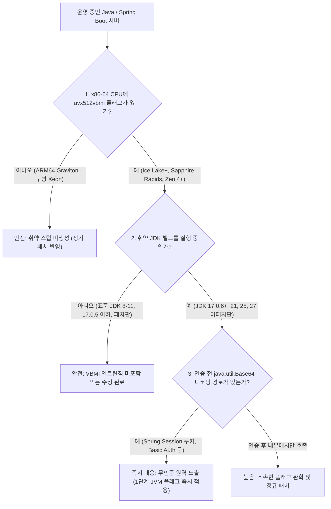

import Alert from '@/components/Alert.astro';
import CloudinaryImage from '@/components/CloudinaryImage.astro';
import Chart from '@/components/Chart.astro';

지난 10월 말 업계를 뒤흔든 **PHP2Shell**(`CVE-2026-109618`·`109619`) 패치를 끝내고 한숨 돌린 지 딱 4주 만입니다. 어제(2026년 11월 17일), 이번에는 엔터프라이즈 백엔드의 심장부인 OpenJDK 한복판에서 **Java4Shell**(`CVE-2026-114938`, CVSS 4.0 **9.2점**)이 긴급 공개됐습니다.

지난달 [2026 백엔드 프레임워크 선택 가이드](/dev/backend-framework-guide)에서 "특정 언어를 버린다고 보안 위협이 사라지지 않는다"고 짚었던 현실이 한 달 만에 자바 진영을 덮쳤죠. 당장 운영 서버 영향도부터 판별해야 하는 분들을 위해 핵심 기준을 먼저 추렸습니다.

| 점검 항목 | 즉시 확인 및 실행 기준 |
| :--- | :--- |
| **발동 조건 3박자** | ① `x86-64` + `avx512vbmi` CPU, ② 취약 JDK 빌드, ③ 인증 전 `java.util.Base64` 디코딩 경로 교집합 |
| **10초 진단 명령** | `grep -o -w -m1 'avx512vbmi' /proc/cpuinfo` 출력 시 노출 (`avx512f`만 있는 구형 Xeon·ARM64 안전) |
| **1순위 무중단 완화** | 재빌드 없이 `JAVA_TOOL_OPTIONS="-XX:-UseBASE64Intrinsics"` 주입 후 롤링 재기동 (`-XX:UseAVX=2` 금물) |
| **패치 완료 버전** | OpenJDK·Temurin **`17.0.21.1`** / **`21.0.13.1`** / **`25.0.5.1`** / **`27.0.1.1`** (Corretto 17·21·25는 **`*.1.2+`**, 27은 **`27.0.1.1.4+`**) |

---

## PHP2Shell에 이어 왜 또 런타임 코어인가: Java4Shell의 정체

과거 대형 RCE 사태들과 비교하면 침투 계층이 점점 바닥으로 내려가고 있습니다. **Log4Shell**(`CVE-2021-44228`)이 로깅 라이브러리, **Spring4Shell**(`CVE-2022-22965`)이 프레임워크 계층이었다면, 최근 연달아 터진 **PHP2Shell**과 **Java4Shell**은 애플리케이션 코드를 아무리 안전하게 짜도 **언어 런타임과 JVM 엔진 코어에서 메모리가 깨진다**는 공통점을 갖습니다.

<Chart
  type="bar"
  height={270}
  caption="주요 백엔드 원격 코드 실행(RCE) 사태의 발생 계층 및 CVSS 기본 점수 비교"
  data={{
    labels: [
      'Log4Shell (라이브러리)',
      'Spring4Shell (프레임워크)',
      'PHP2Shell (런타임 엔진)',
      'Java4Shell (JVM JIT 스텁)',
    ],
    datasets: [
      {
        label: 'CVSS 점수 (10점 만점)',
        data: [10.0, 9.8, 9.2, 9.2],
        backgroundColor: [
          'rgba(100, 116, 139, 0.75)',
          'rgba(100, 116, 139, 0.75)',
          'rgba(249, 115, 22, 0.85)',
          'rgba(239, 68, 68, 0.9)',
        ],
        borderRadius: 6,
      },
    ],
  }}
/>

다만 두 취약점 사이에는 대응 우선순위를 가르는 결정적 차이가 있습니다. 바로 **하드웨어 명령어 셋 의존성**이에요.

| 비교 항목 | PHP2Shell (`CVE-2026-109618`·`109619`) | Java4Shell (`CVE-2026-114938`) |
| :--- | :--- | :--- |
| **결함 위치** | PHP Zend 엔진 메모리 할당·해제 코어 | HotSpot C2 JIT 어셈블리 인트린직 스텁 |
| **영향 버전** | PHP 5.4～8.5 전 계열 | JDK 17(`17.0.6+`), 21, 25, 27 및 Oracle Java 8 Perf Pack |
| **CPU 조건** | CPU 무관 (`x86-64`·`ARM64` 모두 취약) | **`AVX-512 VBMI` 지원 `x86-64` CPU에서만 발동** |
| **임시 우회** | `session.upload_progress.enabled = Off` 등 일부 벡터만 제한 가능 (완전 차단 난해) | `-XX:-UseBASE64Intrinsics` 플래그로 즉시 차단 |

### 왜 `try-catch (IllegalArgumentException e)`로도 막을 수 없나

"비정상 Base64 입력은 예외를 잡아 `400 Bad Request`를 주니 괜찮다"는 방어 논리는 통하지 않습니다. 버그가 바이트코드가 아닌 C2 JIT 컴파일러의 `StubGenerator::generate_base64_decodeBlock()` 어셈블리 스텁에 있기 때문입니다.

이 스텁은 `AVX-512 VBMI` 명령으로 대량 바이트를 병렬 디코딩하는데, **128바이트를 초과하는 입력 끝에 4바이트 미만의 비정상 패딩·잔여 조각**이 들어오면 길이 연산에서 **정수 언더플로**(Integer Underflow)가 터집니다.

<CloudinaryImage
  publicId="posts/dev/2026/java4shell-spring-boot-guide/fig-01-avx512-heap-overflow"
  width={1376}
  height={768}
  alt="AVX-512 VBMI 고속 벡터 디코딩 파이프라인에서 비정상 패딩 입력으로 인해 목적지 버퍼 경계를 넘어 인접 JVM 힙 메모리가 침범되는 개념도"
/>

문제는 순서입니다. 스텁이 오류를 감지해 자바 레이어로 `IllegalArgumentException`을 던지기 **직전에**, 마스킹이 꼬인 512비트 스토어 명령이 이미 목적지 `byte[]` 배열 뒤쪽 **인접 Java Heap 62～63바이트를 덮어씁니다**(Out-of-Bounds Heap Write). 침범당한 인접 객체에 따라 `SIGSEGV` 프로세스 즉사(DoS)에서 시작해 타 세션 힙 메모리 유출, 나아가 인접 객체 포인터 변조를 통한 **무인증 RCE**까지 이어집니다.

---

## 우리 서버도 뚫릴까? 10초 자가 진단 (CPU · 클라우드 · JDK 버전)

Java4Shell은 아래 세 조건이 모두 겹칠 때만 발동합니다. 의사결정 흐름도로 노출 여부부터 좁혀보세요.



### 1. 하드웨어 & 클라우드 인스턴스 판별 (`grep avx512`의 함정)

단순히 `grep avx512`만 쳐보고 놀라는 오판이 많습니다. AWS `c5`·`m5` 주력인 인텔 Cascade Lake는 기본 `avx512f`만 있고 문제의 **`avx512vbmi` 명령어**가 없어 안전하거든요. 아래 명령어로 정확히 판별하세요.

```bash
# avx512vbmi 지원 여부 1줄 확인 (출력 없으면 하드웨어 안전) 및 JVM 인트린직 활성화 확인
grep -o -w -m1 'avx512vbmi' /proc/cpuinfo
java -XX:+PrintFlagsFinal -version 2>&1 | grep -E "UseBASE64Intrinsics|UseAVX"
```

`avx512vbmi`와 함께 `UseBASE64Intrinsics = true`, `UseAVX = 3`이 찍히면 노출 대상입니다.

| 클라우드 | 취약 인스턴스 (`avx512vbmi` 탑재) | 안전 인스턴스 (`avx512vbmi` 미탑재 / ARM64) |
| :--- | :--- | :--- |
| **AWS EC2** | `c6i`/`m6i`(Ice Lake), `c7i`/`m7i`(Sapphire·Emerald Rapids), `c7a`/`m7a`(Zen 4 Genoa), `c8i`/`c8a` | Graviton `c6g`/`c7g`/`c8g`(ARM64), `c5`/`m5`/`t3`(Cascade Lake·Skylake), `c6a`/`m6a`(Zen 3) |
| **GCP** | `c3`/`c3d`/`c4`, Ice Lake 기반 `n2` | `t2a`/`c4a`(ARM64), `n2d`(Zen 3), Cascade Lake `n2`(`n2`는 혼재되어 직접 확인 필수) |
| **Azure** | `Dv5`/`Ev5`(Ice Lake), `Dv6`/`Ev6`, `Dasv6`(Zen 4+) | `Dpsv5`/`Dpsv6`(ARM64), `Dv4`/`Dasv5`(구형 Xeon·Zen 3) |
| **국내 CSP** | NCP·KT·NHN 최신 고성능 x86 스펙 | 세대 표기가 가려져 있어 **게스트 OS `/proc/cpuinfo` 직접 확인 필수** |

### 2. JDK 버전별 영향 및 패치 버전 매트릭스

해당 인트린직은 JDK 18 도입 후 `17.0.6`에 백포트됐기 때문에 **표준 OpenJDK 8·11과 JDK `17.0.0`～`17.0.5`는 안전**합니다. 단, 유료 구독용 **Oracle Java SE 8 Enterprise Performance Pack**(`8u511b33-perf` 이하)만은 성능 백포트 때문에 **예외적으로 취약**하다는 점을 반드시 챙겨야 합니다.

| JDK 구분 | 취약 버전 범위 | 패치 완료 버전 (Temurin·Oracle) | Amazon Corretto 패치판 |
| :--- | :--- | :--- | :--- |
| **OpenJDK 8 / 11** | 표준 빌드 해당 없음 (안전) | 불필요 (**Oracle 8 Perf Pack은 `8u513-perf+` 필수**) | 해당 없음 (안전) |
| **JDK 17 LTS** | `17.0.6` ～ `17.0.21.0.3` | **`17.0.21.1`** 이상 (`17.0.0`～`17.0.5` 미해당) | **`17.0.21.1.2+`** |
| **JDK 21 LTS** | `21.0.13.0.3` 이하 전 버전 | **`21.0.13.1`** 이상 | **`21.0.13.1.2+`** |
| **JDK 25 LTS** | `25.0.5.0.3` 이하 전 버전 | **`25.0.5.1`** 이상 | **`25.0.5.1.2+`** |
| **JDK 27** (비-LTS) | `27.0.1.0.3` 이하 전 버전 | **`27.0.1.1`** 이상 | **`27.0.1.1.4+`** |
| **종료된 비-LTS** | Java 18～20, 22～24, 26 | **무료 패치 없음** (LTS 전환 또는 플래그 고정) | **무료 패치 없음** |

지원 종료된 비-LTS(Java 18～20, 22～24, 26)는 무료 공개 패치가 없습니다. LTS 정렬 기준과 클라우드 배포판 선택법은 [자바 LTS 및 Spring Boot 버전 선택 가이드](/dev/java-lts-spring-boot-guide)와 [클라우드별 최적 JDK 선택 가이드](/dev/cloud-jdk-guide)를 참고해 정비하시기 바랍니다.

---

## 국내 Spring Boot 시스템의 진짜 뇌관: 어디서 Base64가 터지나

"우린 JWT만 쓰니 위험하겠다"거나 반대로 "코드에 `Base64`를 직접 안 쓰니 안전하다"는 추측 모두 실제 구현과는 다릅니다.

### 의외로 안전한 구간 (자체 순수 Java Base64 구현 사용)

아래 라이브러리들은 `java.util.Base64` 대신 자체 순수 Java 배열 파서를 내장해 취약 스텁을 타지 않습니다.
- **Spring Security OAuth2 기본 `NimbusJwtDecoder` 구현**: `nimbus-jose-jwt`의 자체 `Base64URL`을 씁니다.
- **`io.jsonwebtoken:jjwt` 라이브러리** (`0.11+`): 자체 `Decoders.BASE64URL`로 디코딩합니다.
- **Jackson `ObjectMapper`의 `byte[]` 역직렬화**: JSON 문자열을 `byte[]` 필드로 바인딩할 때는 고유 `Base64Variant` 파서가 동작합니다.

### 인증 전(Pre-Auth) 바로 뚫리는 4대 치명적 경로

반면 비로그인 요청이 인증 필터를 거치기도 전에 표준 `java.util.Base64`를 직격하는 경로들이 진짜 뇌관입니다.

1. **Spring Session 기본 쿠키**(`DefaultCookieSerializer`) — **국내 실무 최대 복병**
   `spring-session-data-redis` 사용 시 기본값(`useBase64Encoding = true`) 때문에 Security 필터보다 앞단에서 모든 요청의 `Cookie: SESSION=...`을 `Base64.getDecoder().decode()`로 파싱합니다. 익명 요청에 기형 `SESSION` 쿠키 하나만 실어 보내도 곧바로 힙이 깨지거든요.
2. **Spring Security HTTP Basic**(`BasicAuthenticationConverter`) **및 Remember-Me / SAML2**
   어드민·Swagger·Actuator 등에 열어둔 `.httpBasic()`은 자격증명 검증 전에 `Authorization: Basic ...` 헤더를 표준 디코더로 깝니다. 자동 로그인 쿠키와 SAML2 응답 파싱도 동일합니다.
3. **`com.auth0:java-jwt` 및 직접 구현한 커스텀 `JwtAuthenticationFilter` 코드**
   `auth0`의 `java-jwt`는 내부에서 `Base64.getUrlDecoder()`를 직접 부릅니다. 서명 검증 전에 로깅·테넌트 분기를 위해 토큰을 잘라 `Base64.getUrlDecoder().decode()`로 페이로드부터 열어보는 실무 필터 역시 무인증 표적이 됩니다.
4. **비즈니스 API의 숨은 호출과 커서 페이징**
   DTO를 `String`으로 받아 서비스에서 `Base64.getDecoder().decode()`를 호출하는 파일 업로드, 결제·본인인증 암호문 파라미터, 비로그인 공개 목록 API의 Base64 커서 페이징([REST API Offset vs Cursor 페이징 설계](/dev/rest-api-pagination-offset-cursor) 참고)이 대표적입니다.

저장소 내 위험 호출부와 의존성은 루트에서 `rg` 한 줄로 5초 만에 스캔할 수 있습니다.

```bash
rg -n "java\.util\.Base64|Base64\.get(Url|Mime)?Decoder|DefaultCookieSerializer|spring-session|java-jwt|httpBasic"
```

<CloudinaryImage
  publicId="posts/dev/2026/java4shell-spring-boot-guide/fig-02-spring-boot-shield"
  width={1376}
  height={768}
  alt="컨테이너와 Spring Boot 클러스터 앞단에서 취약한 하드웨어 가속 경로를 차단하고 안전하게 패치 이미지를 롤링 배포하는 아키텍처 일러스트"
/>

---

## 서비스 중단 없는 2단계 실전 대응 (긴급 JVM 플래그 → 정규 패치)

전사 이미지를 재빌드하기 전이라도 환경변수 한 줄이면 취약 어셈블리 스텁만 즉시 차단할 수 있어요.

### 1단계: 이미지 재빌드 없는 긴급 완화 (`-XX:-UseBASE64Intrinsics` vs `-XX:UseAVX=2`)

일각에서 회자되는 `-XX:UseAVX=2`를 무턱대고 전사 배포 설정에 넣으면 대형 장애가 납니다.

<Alert type="danger" title="주의: ARM64(Graviton·Apple Silicon) 혼용 환경 기동 실패 함정">
`-XX:UseAVX=2`는 **x86 전용 플래그**입니다. Intel 노드와 Graviton(`c7g`, ARM64) 노드를 섞어 쓰는 EKS 클러스터에 공통 주입하면 ARM64 파드들이 `Unrecognized VM option` 에러로 기동에 실패하며 **`CrashLoopBackOff` 상태**에 빠집니다. x86에서도 `AES-GCM` 암호화 가속까지 깎아 먹으니 쓰지 마세요.
</Alert>

1순위 표준 완화책은 **`-XX:-UseBASE64Intrinsics` 옵션**입니다. 표준 `product` 플래그라 `UnlockDiagnosticVMOptions` 없이 `x86-64`·`ARM64` 모두 정상 기동되고 다른 AVX-512 성능도 보존됩니다. 대용량 파일 응답 때문에 Base64 인코딩 가속까지 살려야 할 때만 `-XX:+UnlockDiagnosticVMOptions -XX:DisableIntrinsic=_base64_decodeBlock` 조합을 쓰세요.

**Kubernetes 및 GitOps 매니페스트**

```bash
# 재빌드 없이 환경변수 주입으로 무중단 롤링 재시작 및 반영 확인
kubectl set env deployment/order-api -n prod JAVA_TOOL_OPTIONS="-XX:-UseBASE64Intrinsics"
kubectl logs -n prod deployment/order-api --tail=20 | grep "JAVA_TOOL_OPTIONS"
```

```yaml
# Deployment YAML env 고정
env:
  - name: JAVA_TOOL_OPTIONS
    value: "-XX:-UseBASE64Intrinsics"
```

**온프레미스 서버 및 Spring Boot `bootBuildImage` 환경**

```bash
# 1) 외장 Tomcat (공공·금융 전자정부프레임워크 등) — $CATALINA_BASE/bin/setenv.sh
export CATALINA_OPTS="$CATALINA_OPTS -XX:-UseBASE64Intrinsics"

# 2) systemd 서비스 유닛 — /etc/systemd/system/app.service 의 [Service] 블록
Environment="JAVA_TOOL_OPTIONS=-XX:-UseBASE64Intrinsics"

# 3) Paketo Buildpacks (런타임 무재빌드 시에는 위와 동일하게 JAVA_TOOL_OPTIONS 주입,
#    bootBuildImage 빌드 타임 environment에 굽는다면 공백 구분자 동반 필수!)
BPE_DELIM_JAVA_TOOL_OPTIONS=" "
BPE_APPEND_JAVA_TOOL_OPTIONS="-XX:-UseBASE64Intrinsics"
```

### 2단계: JDK 정규 패치 적용 및 2026 Spring 보안 체크리스트

완화 플래그로 급한 불을 끈 뒤에는 패치된 베이스 이미지로 교체해 정규 배포합니다. 도커 허브의 `eclipse-temurin:21-jre` 같은 유동 태그만 믿고 빌드하면 워커 노드의 로컬 캐시 시차 때문에 구버전이 말려 들어갈 수 있으니, 정확한 패치 빌드 태그(`21.0.13.1+2` → `21.0.13.1_2`)나 이미지 다이제스트(`@sha256:...`)를 지정하고 빌드 단계에서 버전을 검증하세요. 만약 사내 미러나 공식 허브에 신규 태그 전파가 지연 중이라면 기존 이미지에 `ENV JAVA_TOOL_OPTIONS="-XX:-UseBASE64Intrinsics"`를 우선 유지합니다.

```dockerfile
FROM eclipse-temurin:21.0.13.1_2-jre-noble
RUN java -version 2>&1 | grep -q "21.0.13.1"
COPY build/libs/app.jar /app/app.jar
ENTRYPOINT ["java", "-jar", "/app/app.jar"]
```

전 서버 교체가 끝난 뒤 `JAVA_TOOL_OPTIONS`의 임시 플래그를 걷어내면 하드웨어 가속이 복원됩니다. 이왕 배포 파이프라인을 여는 김에 올해 [Spring Boot 4 마이그레이션](/dev/spring-boot-4-migration-guide) 이후 초기 마이너 버전에 머물러 있는 서비스가 있다면 무인증 노출 결함인 `CVE-2026-40976`(Spring Boot **`4.0.6` 이상** 해결)도 함께 점검해 털어내세요. 지금 바로 터미널을 열어 운영 노드의 `avx512vbmi` 유무와 `Spring Session` 쿠키 경로 두 가지부터 찍어보시길 권합니다.
