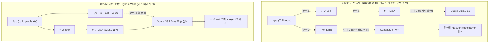
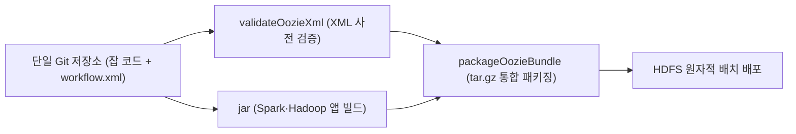

import Alert from '@/components/Alert.astro';
import Chart from '@/components/Chart.astro';
import GitHubRepoCard from '@/components/GitHubRepoCard.astro';
import LinkInline from '@/components/LinkInline.astro';

수십 개의 Hadoop·Spark 배치를 **Apache Oozie**(2025년 봄 Apache Attic으로 공식 은퇴한 워크플로 엔진)로 운영하던 시절, 가장 아찔했던 장애는 코드 버그가 아니었습니다. 정작 DAG 안에서 도는 Spark·Hadoop 애플리케이션 코드는 Git으로 버전 관리가 잘 되는데, 워크플로를 정의하는 Oozie `workflow.xml` 파일들은 별도 체계 없이 수작업으로 배포되다 보니 관리 비용이 치솟았고 급기야 **운영 중인 DAG XML 파일 유실 사고**까지 터졌거든요.

당시 [빅데이터 잔혹사: 구글 논문 한 장에서 AI 시대의 레이크하우스까지](/dev/bigdata-history-hadoop-to-ai)에서도 짚었듯 하둡 생태계 특유의 장황한 `pom.xml`과 전이 의존성(Transitive Dependency) 충돌에도 지쳐 있던 터라, **Oozie DAG 정의와 잡 코드를 한 프로젝트로 묶어 Git에서 통합 관리·패키징하는 Gradle 커스텀 플러그인**을 직접 만들어 제안했습니다. 그런데 돌아온 첫 반응은 "Maven으로도 다 되는데 왜 굳이 다른 JVM 빌드 도구를 도입하냐"는 반대였죠.

그 질문에 감정이 아닌 **엔지니어링 근거**로 답하기 위해 정리했던 JVM 빌드 도구의 변천사, `Maven vs Gradle`의 구조적 차별점, 그리고 2026년 현재 프로젝트 유형별 선택 기준을 공유합니다. 먼저 주요 빌드 도구 5종의 현주소를 10초 요약표로 정리했습니다.

| 빌드 도구 (2026 기준) | 핵심 철학 | 설정 방식 | 대표 강점 | 최적 프로젝트 유형 |
| :--- | :--- | :--- | :--- | :--- |
| **Maven** (`3.9/3.10` · `4 RC`) | 엄격한 규약과 고정 생명주기 | 선언형 XML (`pom.xml`) | 낮은 진입 장벽, 표준화된 프로젝트 구조 | 단일～소규모 모듈 표준 Spring Boot 서비스 |
| **Gradle** (`9.x`) | 작업 그래프(DAG)와 유연한 확장 | 코드형 DSL (`build.gradle.kts`) | `Highest-Wins` 중재, 캐시 가속, `build-logic` 확장 | 5개 이상 멀티모듈, Kotlin 주력, 비표준 패키징 |
| **Mill** (`1.0+`) | 빠르고 직관적인 객체지향·선언형 빌드 | Scala (`build.mill`) · YAML | 약 100ms 네이티브 콜드 스타트, 직관적 타입 탐색 | Gradle 복잡도에 지친 중규모 Java·Kotlin·Scala 팀 |
| **Kotlin Toolchain** (`Alpha`) | 선언형 설정과 내부 엔진 은닉 (구 Amper) | 선언형 YAML (`module.yaml`) | 보일러플레이트 최소화, KMP·Spring 빠른 구성 | JetBrains 생태계 초기 프로토타입·실험 프로젝트 |
| **Bazel** (`8/9`) | 결정론적(Hermetic) 샌드박스 빌드 | Starlark (`MODULE.bazel`, `BUILD`) | 언어 무관 대규모 분산 캐시·원격 실행 | Java·Go·C++·Python이 섞인 빅테크 폴리글랏 모노레포 |

---

## JVM 빌드 도구의 변천사: 왜 새 도구가 계속 나왔을까?

지난 25년간 새 빌드 도구가 등장할 때마다 개발자들은 학습 피로감을 호소했지만, 모든 세대교체 뒤에는 이전 도구가 해결하지 못한 명확한 병목이 있었습니다.

출발점인 **Apache Ant**(2000년)는 C/C++ 진영 `make`의 OS 종속성을 자바로 탈피했지만, 표준 디렉터리 구조도 의존성 관리기도 없었습니다. 컴파일 경로와 JAR 패키징 절차를 `build.xml`에 일일이 명령형으로 적어야 했죠. 나중에 Apache Ivy를 덧붙여 썼어도 프로젝트마다 빌드 스크립트가 제각각 파편화되는 문제는 막지 못했습니다.

이 혼란을 평정한 주인공이 2004～2005년에 등장한 **Apache Maven**입니다. **규약 중심**(Convention over Configuration) 철학으로 `src/main/java` 디렉터리 표준과 고정 생명주기(`compile` → `test` → `package` → `deploy`), 그리고 **Maven Central** 저장소를 확립하며 JVM 생태계를 통일했죠. 누구든 저장소를 클론 받아 `mvn package`만 치면 동일하게 빌드된다는 예측 가능성은 거대한 혁신이었습니다.

하지만 프로젝트가 복잡해지자 고정된 생명주기를 조금만 벗어나는 작업도 수백 줄의 XML 플러그인 설정으로 우회해야 하는 경직성이 발목을 잡았습니다. 이를 넘어서기 위해 2008년 나란히 시작된 **sbt**와 **Gradle**(2012년 `1.0` 출시)은 코드 기반 DSL과 **방향성 비순환 그래프**(Task DAG) 시대를 열었습니다. 특히 sbt가 확립한 **Zinc 증분 컴파일러**는 변경된 클래스의 참조 관계만 정밀 재컴파일하는 기반이 되어 오늘날 Gradle과 Mill까지 내부 엔진으로 채택하고 있죠.

이후 [오라클의 인수부터 자바의 역습까지: JVM 생태계 15년사](/dev/jvm-ecosystem-15-years)처럼 다언어 공존이 자리 잡고 [Java 17·25 LTS 전환](/dev/java-lts-spring-boot-guide)이 가속화되면서, 2025년 8월 출시된 `Gradle 9.0`은 **Kotlin DSL 기본화**와 데몬 Java 17+ 필수로 체질을 바꿨고 2026년 6월 정식 출시된 `sbt 2.0` 역시 Scala 3 기반 전환과 원격 캐시 내장을 마쳤습니다(IDE 내장 빌더와 Gradle 위임 실행의 차이는 [Intellij IDEA Java Build System 비교](/tools/intellij-java-build-system-comparison)를 참고하세요).

그렇다면 현업 점유율은 완전히 뒤집혔을까요? 데이터를 보면 언어별로 극명하게 갈립니다.

<Chart
  type="bar"
  height={320}
  caption="JVM 주력 언어별 빌드 도구 사용 비중 비교 (단위: %, 복수 응답 허용 — 출처: JetBrains State of Developer Ecosystem)"
  data={{
    labels: ['Java 생태계', 'Kotlin 생태계'],
    datasets: [
      {
        label: 'Maven (%)',
        data: [74, 19],
        backgroundColor: 'rgba(249, 115, 22, 0.85)',
        borderRadius: 6,
      },
      {
        label: 'Gradle (%)',
        data: [46, 90],
        backgroundColor: 'rgba(16, 185, 129, 0.85)',
        borderRadius: 6,
      },
      {
        label: 'Ant / Bazel 등 기타 (%)',
        data: [7, 1],
        backgroundColor: 'rgba(148, 163, 184, 0.75)',
        borderRadius: 6,
      },
    ],
  }}
/>

<LinkInline href="https://www.jetbrains.com/lp/devecosystem-2023/" label="JetBrains 개발자 생태계 설문" />의 언어별 교차 통계를 보면 Kotlin 생태계는 **Gradle**(90%)이 압도적 표준이지만, 표준 백엔드 중심의 Java 생태계는 **Maven**(74%)이 Gradle(46%)을 크게 앞섭니다. 최신 조사에서도 Java 개발자의 67%가 여전히 Maven을 1위로 쓰고 있죠 <LinkInline href="https://devecosystem-2025.jetbrains.com/java" label="JetBrains" source="2025 Java Report" variant="badge" />. 현업에서 도구를 바꾸려 할 때 "Maven으로도 다 되는데 왜?"라는 반문이 나오는 배경입니다.

---

## "Maven으로도 다 되는데"에 답하는 Gradle의 결정적 차이 3가지

동료들을 설득할 때 저는 문법 취향 대신 우리가 매주 겪던 **설정 유지보수, 런타임 의존성 충돌, 수작업 배포 사고**라는 세 가지 비용을 두 도구가 어떻게 다르게 다루는지 보여줬습니다.

### 1. 장황한 XML 태그 숲 vs 타입 안전한 Kotlin DSL과 Version Catalog

의존성 하나에 `<dependency>`, `<groupId>`, `<artifactId>`, `<version>` 5줄씩 태그를 반복하는 `pom.xml`은 멀티모듈로 갈수록 가독성이 급격히 무너집니다. 반면 Gradle의 `build.gradle.kts`는 정적 타입 코틀린 코드라 IDE 자동완성과 리팩토링이 그대로 작동하고, `gradle/libs.versions.toml`(**Version Catalog**)로 전 모듈 버전을 한곳에서 통제합니다.

```toml
# gradle/libs.versions.toml — 멀티모듈 버전을 중앙에서 선언
[versions]
spark = "3.5.3"
jackson = "2.18.2"

[libraries]
spark-sql = { module = "org.apache.spark:spark-sql_2.13", version.ref = "spark" }
jackson-kotlin = { module = "com.fasterxml.jackson.module:jackson-module-kotlin", version.ref = "jackson" }
```

```kotlin
// subproject/build.gradle.kts — 오타를 컴파일 타임에 잡는 타입 안전 접근자
dependencies {
    compileOnly(libs.spark.sql)
    implementation(libs.jackson.kotlin)
}
```

단순 문자열 치환(`${spark.version}`)과 달리 `libs.spark.sql`은 실제 타입 객체이므로 IDE에서 참조 모듈 추적이 즉시 가능합니다.

### 2. 의존성 충돌 해결: Nearest-Wins의 함정과 Highest-Wins

가장 설득력이 컸던 대목은 전이 의존성 중재 규칙입니다. <LinkInline href="https://maven.apache.org/guides/introduction/introduction-to-dependency-mechanism.html" label="Apache Maven 공식 의존성 메커니즘 가이드" />에 명시된 기본 규칙은 **Nearest Definition**, 곧 **Nearest-Wins**(최단 경로 우선)입니다. 버전의 높고 낮음이 아니라 **`pom.xml` 루트에서 트리 경로 깊이가 가장 짧은 버전**(Depth 기준), 깊이가 같다면 **먼저 선언된 순서**가 이깁니다.

이게 왜 위험할까요? 신규 `Lib A`가 `Guava 33.2.0`의 새 메서드를 호출하는데, 다른 경로(더 얕은 깊이 혹은 앞선 선언)에 낀 구형 `Lib B` 때문에 `Guava 20.0`이 최종 채택되면 **빌드는 멀쩡히 성공하고 운영 런타임에 `java.lang.NoSuchMethodError`가 터집니다**.

반면 <LinkInline href="https://docs.gradle.org/current/userguide/dependency_resolution.html" label="Gradle 공식 의존성 해결 가이드" />는 그래프 전체에서 가장 높은 버전을 고르는 **Highest-Wins**로 기본 동작합니다. 여기에 `strictly`·`require`·`reject`(CVE 취약 버전 차단) 같은 **Rich Versions**와, 좌표가 달라도 같은 기능 충돌(`commons-logging` 대 `spring-jcl` 등)을 잡아내는 **Capability Conflict** 감지를 기본 제공합니다.



```kotlin
dependencies {
    constraints {
        implementation("com.google.guava:guava") {
            version {
                require("33.2.0-jre")
                reject("[14.0, 32.0.1-jre]") // 직렬화 CVE 취약 버전 유입 시 빌드 즉시 차단
            }
            because("하둡 커넥터 경로의 구버전 Guava 유입 방지")
        }
    }
}
```

<Alert type="info" title="시니어 팁: Maven에서도 방어 수단은 존재합니다">
공정하게 짚자면 Maven에서도 `<dependencyManagement>`로 버전을 수동 고정하거나 `maven-enforcer-plugin`의 `requireUpperBoundDeps` 규칙을 걸어 방어할 수 있습니다. 최신 Maven Resolver(`3.9+`)에서는 `-Daether.conflictResolver.versionSelector.selectionStrategy=highest` 옵션을 켜서 전략 자체를 바꿀 수도 있고요. 다만 아무 부가 설정을 하지 않았을 때의 **안전한 기본값**(Safe Default)에서 두 도구의 철학이 극명하게 갈립니다.
</Alert>

### 3. 커스텀 플러그인과 확장성: Oozie DAG 유실 사고를 끝낸 통합 패키징

도입부에서 꺼낸 Oozie 사고를 해결한 방식이 결정타였습니다. <LinkInline href="https://oozie.apache.org/docs/5.2.1/WorkflowFunctionalSpec.html" label="Apache Oozie 공식 워크플로 배포 명세" />에 따르면 HDFS 배포 경로 루트에는 `workflow.xml`이, 하위 `lib/` 디렉터리에는 Spark·MapReduce 앱 JAR와 서드파티 의존성 JAR들이 한 세트로 묶여 올라가야 합니다.

Maven에서 이를 자동화하는 커스텀 플러그인(**Mojo**)을 만들려면 별도 저장소로 분리해 사내 Nexus에 배포한 뒤 각 프로젝트 `pom.xml`에 수십 줄의 `<execution>` XML을 바인딩해야 해서 배보다 배꼽이 커집니다. 반면 Gradle에서는 복합 빌드(`includeBuild("build-logic")`) 기반 **Convention Plugin**으로 프로젝트 안에서 즉시 `mycorp.oozie-workflow` 플러그인을 정의해 해결했습니다.

```kotlin
// build-logic/src/main/kotlin/mycorp.oozie-workflow.gradle.kts
import org.gradle.api.DefaultTask
import org.gradle.api.file.DirectoryProperty
import org.gradle.api.file.RegularFileProperty
import org.gradle.api.tasks.*
import org.gradle.api.tasks.bundling.Compression
import org.gradle.api.tasks.bundling.Tar
import javax.xml.parsers.DocumentBuilderFactory

plugins { id("java") }

@CacheableTask
abstract class ValidateOozieXmlTask : DefaultTask() {
    @get:InputDirectory @get:PathSensitive(PathSensitivity.RELATIVE)
    abstract val workflowDir: DirectoryProperty
    @get:OutputFile
    abstract val reportFile: RegularFileProperty

    @TaskAction
    fun validate() {
        val factory = DocumentBuilderFactory.newInstance().apply { isNamespaceAware = true }
        val xmlFiles = workflowDir.asFileTree.matching { include("**/*.xml") }.files
        check(xmlFiles.any { it.name == "workflow.xml" }) { "필수 workflow.xml 누락!" }
        xmlFiles.forEach { factory.newDocumentBuilder().parse(it) }
        reportFile.get().asFile.writeText("Validated ${xmlFiles.size} DAG files")
    }
}

val oozieLib by configurations.creating { isCanBeConsumed = false; isCanBeResolved = true }

val validateOozieXml = tasks.register<ValidateOozieXmlTask>("validateOozieXml") {
    workflowDir.set(layout.projectDirectory.dir("src/main/oozie"))
    reportFile.set(layout.buildDirectory.file("reports/oozie/validation.txt"))
}

tasks.named("check") { dependsOn(validateOozieXml) }

tasks.register<Tar>("packageOozieBundle") {
    dependsOn(validateOozieXml)
    archiveExtension.set("tar.gz")
    compression = Compression.GZIP
    from(layout.projectDirectory.dir("src/main/oozie"))
    into("lib") {
        from(tasks.named("jar"))
        from(oozieLib) // 클러스터 기본 제공분 제외, HDFS lib/ 전용 의존성만 동봉
    }
}
```

이 플러그인은 ① `src/main/oozie`의 XML 구문과 필수 파일 유무를 사전 검증(`@CacheableTask`)하고 ② 컴파일된 잡 JAR와 전용 스코프(`oozieLib`) 의존성을 `lib/` 폴더로 모아 단일 배포 번들(`.tar.gz`)로 구워냅니다. 덕분에 DAG XML과 앱 코드가 하나의 Git PR에서 함께 리뷰·버전 관리되며 유실 사고가 완전히 사라졌습니다.



여기에 입출력 해시가 같으면 태스크를 건너뛰는 `UP-TO-DATE` 증분 빌드, 팀원·CI 간 산출물을 공유하는 원격 **Build Cache**, Gradle 9에서 핵심 실행 모드로 자리 잡은 **Configuration Cache**(태스크 그래프 계산 캐싱), 그리고 `Gradle 9.7+`에서 공식 `Incubating`으로 승격된 **Isolated Projects**(모듈별 구성 단계 병렬 격리)가 맞물리며 멀티모듈 CI 대기 시간까지 크게 줄여줍니다.

---

## 2026년 최신 트렌드: Gradle의 그림자와 차세대 빌드 도구들

물론 Gradle도 은탄환은 아닙니다. 자유도가 너무 높아 팀 컨벤션 없이 방치하면 빌드 스크립트가 스파게티 코드가 되기 쉽고, 상주 데몬의 메모리 점유율과 메이저 버전 업그레이드 비용이라는 그림자가 뚜렷하죠. 2026년 현재 이 빈틈을 파고드는 네 가지 흐름을 짚어봅니다.

1. **Apache Maven의 반격** (`Maven 3.10` 정식 & `Maven 4` RC): 2026년 하반기 현재 프로덕션 GA는 `3.9.x`·`3.10.x`이며, 차기 메이저 버전은 릴리스 후보 막바지 단계입니다 <LinkInline href="https://maven.apache.org/whatsnewinmaven4.html" label="Maven 4" source="4.0.0-rc-7" variant="badge" />. `modelVersion="4.1.0"`으로 **Build POM과 Consumer POM을 분리**해 하위 모듈의 부모 버전 중복 기입을 없애고 전용 `packaging="bom"`을 도입하며 XML 피로도를 크게 덜어냈습니다.
2. **Mill** (`1.0+` GA): 2025년 여름 정식 `1.0`을 출시하며 스칼라를 넘어 Java·Kotlin 1급 지원 도구로 부상했습니다. GraalVM 네이티브 런처 덕분에 콜드 스타트가 약 100ms로 즉각적이며, 직관적인 객체지향 스크립트(`build.mill`)와 경량 선언형 `build.mill.yaml`을 모두 지원해 "Gradle의 속도는 원하지만 복잡함은 싫은" 팀들의 대안으로 꼽힙니다.
3. **JetBrains Kotlin Toolchain** (구 Amper, `Alpha`): 실험 프로젝트였던 Amper가 2026년 하반기 스탠드얼론 기반의 **Kotlin Toolchain**(`Alpha` 단계)으로 통합 진화했습니다. `module.yaml` 선언만으로 Spring Boot나 Kotlin Multiplatform을 구성하지만 아직 Alpha 단계라 상용 코어 도입보다는 동향 주시 대상입니다.
4. **Bazel** (`Bazel 8/9` & `MODULE.bazel`): 레거시 `WORKSPACE`를 완전히 걷어내고 **Bzlmod**(`MODULE.bazel`)로 일원화했습니다. Java·Go·C++·Python이 한 저장소에 섞인 빅테크급 폴리글랏 모노레포에서는 대체 불가지만, 일반 백엔드 팀에겐 Starlark 유지보수 비용이 과합니다.

<div class="my-6 grid gap-4 md:grid-cols-2">
  <GitHubRepoCard class="!my-0" repo="gradle/gradle" comment="유연한 Kotlin DSL과 캐시 가속 엔진을 갖춘 현대 JVM 멀티모듈 표준 빌드 시스템." />
  <GitHubRepoCard class="!my-0" repo="apache/maven" comment="규약 중심 철학의 원조이자 Maven 4(Build/Consumer POM 분리)로 진화 중인 엔터프라이즈 표준." />
  <GitHubRepoCard class="!my-0" repo="com-lihaoyi/mill" comment="약 100ms 네이티브 반응성과 직관적인 빌드 그래프로 Java·Kotlin까지 아우르는 차세대 빌드 도구." />
  <GitHubRepoCard class="!my-0" repo="JetBrains/kotlin-toolchain" comment="구 Amper에서 통합 진화한 JetBrains의 YAML 기반 차세대 선언형 빌드·툴체인(Alpha)." />
</div>

---

## 프로젝트 유형별 빌드 도구 선택 가이드

[Spring Boot 개발자가 본 2026 백엔드 프레임워크 선택 가이드](/dev/backend-framework-guide)에서도 짚었듯 도구 선택의 기준은 유행이 아니라 팀이 감당할 복잡도의 총량이어야 합니다. 세 가지 시나리오로 선택 기준을 정리합니다.

- **Maven에 남는 것이 현명한 경우**: 단일 모듈 혹은 2～3개 이하 소규모 표준 Java + Spring Boot 서비스이고 비표준 패키징 요구가 없다면 굳이 옮길 이유가 없습니다. 엄격히 고정된 생명주기가 오히려 빌드 파편화를 막는 안전장치 역할을 합니다(단, `maven-enforcer-plugin`의 `requireUpperBoundDeps` 적용은 권장합니다).
- **Gradle을 선택해야 하는 경우** (`build.gradle.kts` + `build-logic`): 5개 이상 멀티모듈 백엔드, Kotlin 주력 프로젝트, 전이 의존성 충돌 제어가 필수인 환경에 적합합니다. 특히 Oozie 사례처럼 **코드 바깥의 설정·스키마·인프라 산출물까지 빌드 파이프라인 안으로 끌어들여 휴먼 에러를 없애야 할 때** 확실한 위력을 발휘합니다.
- **Mill · Bazel · Kotlin Toolchain을 검토할 시점**: Gradle의 무거운 데몬과 DSL 학습 곡선에 지친 중규모 JVM 팀이라면 정식 궤도에 오른 **Mill**(`1.0+`)을 파일럿으로 검토할 만합니다. 수백 개 다언어 모듈이 얽힌 전사 모노레포라면 **Bazel**(`MODULE.bazel`)이 적합하고, **Kotlin Toolchain**은 베타 이후까지 토이 프로젝트에서 지켜보는 편이 안전합니다.

돌이켜보면 "Maven으로도 다 되는데 왜?"라는 질문의 본질은 새 도구가 주는 문법적 세련됨이 아니라, **그 도구가 우리 팀의 어떤 운영 비용과 새벽 장애 리스크를 없애주는지 엔지니어링으로 증명하라**는 요구였습니다. 빌드 도구를 고민 중이라면 문법 비교표보다 먼저 지금 우리 배포 파이프라인에서 사람의 손끝에 의존해 사고가 나는 지점이 어디인지부터 짚어보시길 권합니다.

---

## 참고 자료

- [Introduction to the Dependency Mechanism — Apache Maven Official Documentation](https://maven.apache.org/guides/introduction/introduction-to-dependency-mechanism.html)
- [What's New in Maven 4 — Apache Maven Project](https://maven.apache.org/whatsnewinmaven4.html)
- [Understanding Dependency Resolution & Rich Versions — Gradle User Manual](https://docs.gradle.org/current/userguide/dependency_resolution.html)
- [Gradle 9.0 Release Notes & Configuration Cache Guide — Gradle Documentation](https://docs.gradle.org/current/release-notes.html)
- [Oozie Workflow Functional Specification (v5.2.1) — Apache Oozie Documentation](https://oozie.apache.org/docs/5.2.1/WorkflowFunctionalSpec.html)
- [The State of Developer Ecosystem 2025: Java — JetBrains](https://devecosystem-2025.jetbrains.com/java)
- [Mill Build Tool 1.0 Documentation — Mill Official Docs](https://mill-build.org/mill/index.html)
- [Bzlmod (External Dependencies with MODULE.bazel) — Bazel Official Documentation](https://bazel.build/external/overview)
