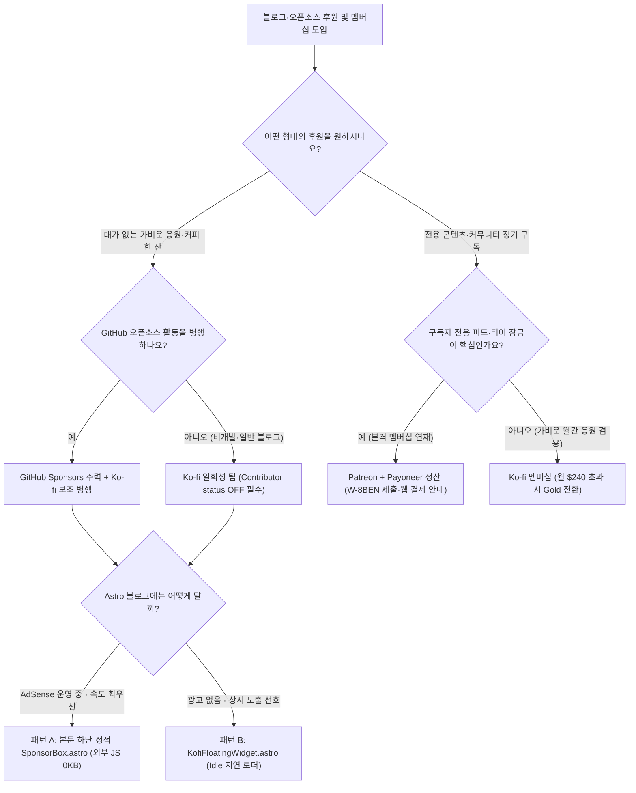

import Alert from '@/components/Alert.astro';
import Chart from '@/components/Chart.astro';

후원 계정을 다 열어놓고 정작 내 기술 블로그에 공식 **Ko-fi 위젯** 스크립트를 복붙했다가, Lighthouse 성능 점수가 뚝 떨어지거나 모바일 하단 AdSense 광고와 **블로그 후원 버튼**이 겹쳐 당황한 적 없으신가요? 일회성 커피 후원을 넘어 유료 뉴스레터나 정기 멤버십으로 넓혀보려 **패트리온 한국 정산**을 검색해 봐도 폐지된 옛날 5%·8%·12% 요금제 글만 수두룩해 계산기를 두드리기 막막하죠.

앞선 `개발자 후원 시스템` 시리즈에서는 수수료 0%인 [GitHub Sponsors 신청과 W-8BEN 설정](/dev/github-sponsors-setup), PayPal로 우회 수령하는 [Ko-fi와 Buy Me a Coffee 비교](/dev/buymeacoffee-kofi-developer-sponsorship), 현재는 종료된 [토스·카카오페이 송금 링크 기록](/dev/toss-kakaopay-developer-sponsorship-korea), 그리고 SaaS·디지털 상품 판매용 [MoR 3대장 비교](/dev/lemon-squeezy-paddle-polar-korea)까지 차례로 짚어봤습니다. 시리즈 대미를 장식하는 이번 5편에서는 Astro 같은 정적 블로그에 성능 저하와 광고 정책 위반 없이 후원 창구를 심는 실전 컴포넌트 코드와, 단일 10% 수수료로 개편된 **패트리온**(Patreon)의 한국 출금·세무 구조까지 합쳐 3대 후원 플랫폼의 통장 실수령액을 최종 결산합니다.

---

## ⚡ 10초 요약: GitHub Sponsors vs Ko-fi vs Patreon 최종 선택 판별표

세부 코드와 정산 계산식을 뜯어보기 전에, 한국 거주 개발자·블로거가 대가 없는 순수 응원이나 정기 멤버십을 받을 때 고를 수 있는 3대 플랫폼의 최신 스펙을 한눈에 대조했습니다.

| 비교 항목 | GitHub Sponsors | Ko-fi (코파이) | Patreon (패트리온) |
|---|---|---|---|
| **플랫폼 기본 수수료** | **0%** (개인 계정 후원 기준) | 일회성 팁 **0%** / 정기 멤버십·숍 **5%** (월 $12 Gold 구독 시 0%) | **단일 10%** (2025.08.04 이후 신규 공개 페이지 전원) |
| **결제 처리 수수료 (USD)** | **0%** (GitHub 전액 부담) | 해외 PayPal 수취 약 `4.4% + $0.30` | 카드·Apple Pay `2.9% + $0.30` / 글로벌 PayPal `3.9% + $0.30` |
| **한국 출금 경로** | 국내 은행 원화 계좌 직행 (`Stripe Express`) | PayPal 수취 → 국내 은행 원화 인출 | **Payoneer** (권장) 또는 PayPal → 국내 은행 인출 |
| **출금·환전 부대 비용** | 최소 출금액 도달 시 무료 송금 (환율 스프레드 소폭) | 국내 인출 시 PayPal 환전 스프레드 **약 3～4%** (15만 원 미만 1,500원) | Payoneer Wallet 건당 **$1** + 원화 환전 마크업 **약 1.5～2%** |
| **미국 세무 서류** | `W-8BEN` 온라인 제출 필수 | PayPal 비즈니스·개인 계정 정책 따름 | 출금 전 `W-8BEN` (주민등록번호 기재) 제출 필수 |
| **최적 추천 용도** | 오픈소스 메인테이너·개발 블로그 1순위 | 가입 즉시 여는 가벼운 커피 한 잔 후원 | 전용 커뮤니티·유료 연재물·다단계 멤버십 운영 |

---

## Ko-fi 공식 위젯 3종 스펙과 숨은 수수료 함정 점검

블로그에 코드를 심기 전에 Ko-fi 대시보드에서 반드시 먼저 꺼둬야 할 스위치가 하나 있습니다. [2편](/dev/buymeacoffee-kofi-developer-sponsorship)에서 Ko-fi 무료 플랜의 일회성 후원 수수료가 0%라고 소개했는데요, 최근 가입 흐름에서는 자발적 팁 설정 하나 때문에 5%가 조용히 빠져나가는 사례가 잦습니다.

<Alert type="warning" title="필수 체크: Ko-fi Contributor status 5% 기본 활성화 주의">
Ko-fi 무료 플랜에서 일회성 팁(One-time Tips) 수수료는 공식적으로 **0%** 맞습니다. 다만 신규 가입 시 Ko-fi 운영을 돕는 자발적 기여 옵션인 **Contributor status**(5%)가 기본 `ON`으로 켜져 있는 경우가 많아요. 대시보드의 `Settings > Payment` 메뉴에 들어가 이 토글을 `OFF`로 **직접 꺼야** 완전한 0% 혜택이 적용됩니다. 한편 정기 멤버십·월간 팁·숍 판매에는 무료 플랜 기준 **5% 플랫폼 수수료**가 붙으며, 개편된 **Ko-fi Gold**(월 **$12**)를 구독하면 0%로 면제됩니다(월 멤버십·숍 매출 **$240** 초과 시 손익분기).
</Alert>

수수료 설정을 마쳤다면 Ko-fi가 제공하는 공식 임베드 방식 3가지의 기술적 특성을 구분해 골라야 합니다.

1. **Floating Chat / Overlay 위젯 (`overlay-widget.js`)**: 화면 구석에 커피 아이콘 버튼을 띄우고, 클릭 시 페이지 이탈 없이 모달 `iframe` 안에서 결제까지 유도하는 방식입니다. 이때 엔트리 스크립트 URL은 반드시 `https://storage.ko-fi.com/cdn/scripts/overlay-widget.js`를 호출해야 합니다(내부 래퍼 파일인 `floating-chat-wrapper.js`를 직접 로드하려다 초기화 에러를 겪는 오해가 흔합니다). 또한 기본 위치가 **좌측 하단 고정**이며 JS 옵션 객체에는 우측 정렬이나 하단 여백 파라미터가 아예 없어서, 위치를 옮기려면 생성된 DOM 클래스(`.floatingchat-container-wrap` 등)를 CSS로 직접 덮어써야 해요.
2. **Inline Tip Panel (`iframe`)**: 결제 폼 전체를 페이지 안에 통째로 박아 넣는 방식입니다. 글마다 넣으면 스크롤이 너무 길어지므로 `/about`이나 `/support` 같은 전용 후원 안내 페이지에만 단독으로 배치할 때 깔끔합니다.
3. **Classic Button (`Widget_2.js`)**: 초창기에 쓰이던 레거시 인라인 스크립트 버튼입니다. 내부적으로 동기식 DOM 조작에 의존해 비동기 로딩이나 Astro의 `<ClientRouter />`(View Transitions) 환경에서 렌더링이 깨지기 쉬우므로, 외부 스크립트 대신 순수 HTML `<a>` 버튼으로 직접 마크업하는 편이 모든 면에서 낫습니다.

`/support` 전용 페이지에 인라인 팁 패널을 넣고 싶다면 별도 JS 없이 아래 `iframe` 코드만 지연 로딩(`loading="lazy"`)으로 얹어주면 충분합니다.

```html
<!-- /support 또는 /about 전용 페이지용 Ko-fi 인라인 팁 패널 -->
<iframe
  id="kofiframe"
  src="https://ko-fi.com/YOUR_KOFI_ID/?hidefeed=true&widget=true&embed=true"
  style="border:none;width:100%;padding:4px;background:#f9f9f9;"
  height="712"
  title="Ko-fi로 커피 한 잔 후원하기"
  loading="lazy"
></iframe>
```

---

## Astro 정적 블로그 후원 버튼 탑재 2대 실전 패턴 (성능·AdSense 방어)

정적 사이트 생성기(SSG)인 Astro를 쓰는 가장 큰 이유는 군더더기 없는 초기 로딩 속도입니다. 본문 하나 읽으러 온 독자에게 처음부터 서드파티 결제 스크립트 수백 KB를 강제로 내려받게 할 이유는 없죠. 실무에서는 **포스트 하단 Zero-JS 정적 카드**를 기본으로 삼고, 플로팅 버튼이 꼭 필요할 때만 **유휴 시간 지연 로더**를 적용하는 두 가지 패턴을 추천합니다.

### 패턴 A (가장 권장): 외부 JS 0KB `SponsorBox.astro` 정적 카드

포스트 본문이 끝나는 지점은 독자가 글에서 도움을 얻고 후원 의사가 가장 높아지는 자리입니다. 여기에 Tailwind CSS 기반의 정적 컴포넌트를 배치하면 외부 자바스크립트가 **0KB**라 LCP(최대 콘텐츠 렌더링 시간)와 TBT(총 차단 시간)에 영향을 전혀 주지 않고, 블로그의 다크모드 컬러 토큰(`bg-card`, `border-border`)과도 자연스럽게 어우러집니다.

```astro
---
// src/components/SponsorBox.astro
interface Props {
  kofiId: string;
  githubId?: string;
}

const { kofiId, githubId } = Astro.props;
---

<aside
  aria-label="글 작성자 후원 안내"
  class="not-prose my-8 rounded-xl border border-border bg-card p-5 shadow-sm"
>
  <div class="flex flex-col gap-4 sm:flex-row sm:items-center sm:justify-between">
    <div>
      <p class="text-base font-semibold text-foreground">
        이 글이 실무 시간을 아껴주었나요?
      </p>
      <p class="mt-1 text-sm text-muted-foreground">
        커피 한 잔 후원은 다음 검증 가이드를 꾸준히 연재하는 데 큰 힘이 됩니다.
      </p>
    </div>
    <div class="flex shrink-0 flex-wrap items-center gap-2.5">
      <a
        href={`https://ko-fi.com/${kofiId}`}
        target="_blank"
        rel="noopener noreferrer"
        class="inline-flex items-center gap-2 rounded-lg bg-[#13C3FF] px-4 py-2 text-sm font-semibold text-slate-950 transition hover:opacity-90"
      >
        <span>☕ 커피 한 잔 후원</span>
      </a>
      {githubId && (
        <a
          href={`https://github.com/sponsors/${githubId}`}
          target="_blank"
          rel="noopener noreferrer"
          class="inline-flex items-center gap-2 rounded-lg border border-border bg-background px-4 py-2 text-sm font-medium text-foreground transition hover:bg-muted"
        >
          <span>💖 Sponsor</span>
        </a>
      )}
    </div>
  </div>
</aside>
```

만약 GitHub 공식 하트 아이콘이 들어간 버튼 규격을 그대로 쓰고 싶다면, 스크립트가 없는 공식 임베드 엔드포인트인 `<iframe src="https://github.com/sponsors/YOUR_GITHUB_ID/button" title="Sponsor" height="32" width="114" style="border: 0; border-radius: 6px;" loading="lazy"></iframe>`을 나란히 배치해도 깔끔합니다.

### 패턴 B: `KofiFloatingWidget.astro` 지연 로더와 우측 하단 오버라이드

페이지 어디서든 눈에 띄는 `overlay-widget.js` 플로팅 버튼을 꼭 달고 싶다면 두 가지 기술적 함정을 직접 막아줘야 합니다. 첫째, 초기 렌더링 경로를 막지 않도록 `requestIdleCallback`(Safari 구버전 등 미지원 환경은 `setTimeout` 폴백)으로 브라우저가 한가해졌을 때 스크립트를 불러와야 합니다. 둘째, Astro에서 `<ClientRouter />`로 페이지 전환 애니메이션을 켜둔 경우 라우트가 바뀔 때마다 위젯이 중복 생성되지 않도록 싱글톤(Singleton) 가드를 걸어야 해요.

여기에 기본 좌측 하단 위치를 한국 사용자에게 익숙한 우측 하단으로 옮기고 모바일 안전 영역까지 확보한 완성형 컴포넌트 코드는 다음과 같습니다.

```astro
---
// src/components/KofiFloatingWidget.astro
interface Props {
  kofiId: string;
  label?: string;
}

const { kofiId, label = '커피 한 잔 후원' } = Astro.props;
---

<div id="kofi-widget-config" data-kofi-id={kofiId} data-label={label} hidden></div>

<script>
  declare global {
    interface Window {
      kofiWidgetOverlay?: {
        draw: (id: string, options: Record<string, string>) => void;
      };
    }
  }

  function mountKofiOverlay() {
    const config = document.getElementById('kofi-widget-config');
    if (!config) return;

    // 이미 플로팅 컨테이너가 마운트되어 있으면 중복 실행 차단 (Singleton 가드)
    if (document.querySelector('.floatingchat-container-wrap')) return;

    const kofiId = config.dataset.kofiId;
    const label = config.dataset.label || '커피 한 잔 후원';
    if (!kofiId) return;

    const drawWidget = () => {
      if (!window.kofiWidgetOverlay || document.querySelector('.floatingchat-container-wrap')) {
        return;
      }
      window.kofiWidgetOverlay.draw(kofiId, {
        'type': 'floating-chat',
        'floating-chat.donateButton.text': label,
        'floating-chat.donateButton.background-color': '#13C3FF',
        'floating-chat.donateButton.text-color': '#0f172a',
      });
    };

    // 1) 이미 전역 객체가 로드된 상태라면(View Transitions 전환 후 등) 즉시 재렌더링만 수행
    if (window.kofiWidgetOverlay) {
      drawWidget();
      return;
    }

    // 2) 스크립트 태그가 다운로드 중인 경우 load 이벤트에 연결
    const existingScript = document.getElementById('kofi-overlay-script') as HTMLScriptElement | null;
    if (existingScript) {
      existingScript.addEventListener('load', drawWidget, { once: true });
      return;
    }

    // 3) body 스왑 시 태그가 유실되지 않도록 document.head에 마운트
    const script = document.createElement('script');
    script.id = 'kofi-overlay-script';
    script.src = 'https://storage.ko-fi.com/cdn/scripts/overlay-widget.js';
    script.async = true;
    script.addEventListener('load', drawWidget, { once: true });
    document.head.appendChild(script);
  }

  function scheduleKofiMount() {
    if ('requestIdleCallback' in window) {
      window.requestIdleCallback(() => mountKofiOverlay(), { timeout: 3000 });
    } else {
      globalThis.setTimeout(mountKofiOverlay, 1500);
    }
  }

  scheduleKofiMount();
  document.addEventListener('astro:page-load', scheduleKofiMount);
</script>

<style is:global>
  /* Ko-fi 기본 좌측 하단 고정 스타일을 우측 하단 + 안전 여백으로 오버라이드 */
  .floatingchat-container-wrap,
  .floatingchat-container-wrap-mobi {
    left: auto !important;
    right: 20px !important;
    bottom: calc(env(safe-area-inset-bottom, 0px) + 76px) !important;
  }

  .floating-chat-kofi-popup-iframe,
  .floating-chat-kofi-popup-iframe-mobi {
    left: auto !important;
    right: 20px !important;
    bottom: calc(env(safe-area-inset-bottom, 0px) + 132px) !important;
  }
</style>
```

위 스타일 블록에서 `bottom` 값을 단순 `16px`이 아니라 `76px` 이상 띄워둔 데에는 수익화 블로그 운영자가 절대 놓치면 안 될 이유가 있습니다.

<Alert type="danger" title="경고: Google AdSense 하단 앵커 광고와 플로팅 버튼 중첩 금지">
모바일 웹에서 Google AdSense 자동 광고의 적응형 하단 앵커 배너(높이 `50～100px`)는 최상위 레이어(`z-index: 2147483647`)를 점유합니다. 플로팅 후원 버튼이나 맨 위로 가기(FAB) 버튼을 광고 배너와 맞닿게 두거나 억지로 위에 겹쳐 띄우면, 사용자가 후원 버튼을 누르려다 광고를 잘못 터치하는 **우발적 클릭 유도**(Accidental Clicks)로 판정되어 Google 게시자 정책 위반 및 광고 게재 제한을 당할 수 있습니다. AdSense를 함께 운영하는 블로그라면 가급적 본문 내부에 정적으로 들어가는 **패턴 A**(`SponsorBox.astro`)를 사용하고, 플로팅 위젯을 쓸 때는 가장 안전하게 AdSense 설정에서 하단 앵커 광고를 끄거나 실기기 배너 높이에 맞춰 `bottom: calc(env(safe-area-inset-bottom, 0px) + 96px)` 이상으로 물리적 안전 여백을 넉넉히 분리하세요.
</Alert>

---

## 패트리온(Patreon) 10% 단일 요율 개편과 한국 정산·세무 가이드

일회성 커피 후원은 고마운 응원이지만 매달 예측 가능한 수익을 만들기는 어렵습니다. 심층 기술 아티클, 강의 영상, 비공개 디스코드 커뮤니티를 묶어 월 정기 구독 멤버십을 운영할 때 전 세계에서 가장 널리 쓰이는 플랫폼이 **패트리온**(Patreon)인데요. 한국 거주자가 지금 패트리온을 시작한다면 개편된 수수료와 정산 경로 3가지를 정확히 짚고 들어가야 합니다.

### 1. 2025년 8월 4일 요금제 단일화 (10%)와 iOS 인앱결제 함정

예전 블로그 글에는 패트리온 요금제가 Lite(5%)·Pro(8%)·Premium(12%) 3단계로 나뉜다고 적혀 있지만, **2025년 8월 4일**부로 이 구분은 완전히 폐지되었습니다. 해당 날짜 이후 크리에이터 페이지를 공개한 신규 가입자에게는 예외 없이 **단일 10% 표준 플랫폼 수수료**가 적용됩니다.

여기에 결제 수단별 **결제 처리 수수료**(USD 통화, $3 초과 결제 기준)가 별도로 차감됩니다.

- **신용카드 · Apple Pay**: `2.9% + $0.30`
- **미국 외 글로벌 PayPal 결제**: `3.9% + $0.30`

특히 주의할 대목이 **Patreon iOS 앱 내 결제**입니다. 아이폰 사용자가 공식 iOS 앱(한국 등 미국 외 글로벌 앱스토어 기준) 안에서 신규 유료 멤버십에 가입하면 Apple 인앱결제 **30% 수수료**가 붙습니다. 패트리온은 크리에이터의 손실을 막기 위해 iOS 앱 결제가를 자동으로 약 43% 올려 받아 크리에이터 몫을 보전해 주는 옵션을 기본값으로 켜두는데요. 만약 크리에이터가 팬들의 가격 부담을 걱정해 'iOS 가격 동결(수수료 직접 흡수)' 설정을 선택하면 Apple 30% 수수료가 크리에이터 정산금에서 고스란히 깎여 실수령액이 급감합니다. 공지글이나 소개란에 "**모바일·PC 웹 브라우저에서 결제하시면 추가 수수료 없이 원래 가격으로 가입됩니다**"라고 한 줄 안내해 두는 것이 서로에게 이득입니다.

### 2. 한국 출금 수단 비교: Payoneer vs PayPal

패트리온에 쌓인 달러를 한국으로 가져오는 출금 수단은 **Payoneer**(페이오니아)와 **PayPal** 두 가지입니다. 실수령액 기준으로 비교하면 **Payoneer 쪽이 확실히 유리합니다.**

- **Payoneer (권장)**: Payoneer 계정(Wallet)으로 수취할 때 최소 출금액은 **$25**이며 패트리온 출금 수수료는 금액과 무관하게 건당 **$1** 정액입니다. 이후 Payoneer에서 한국 시중은행 원화 계좌로 인출할 때 환전 마크업이 **약 1.5～2%** 수준으로 붙습니다(패트리온 설정에서 Payoneer 경유 다이렉트 현지 은행 송금을 연결하면 최소 **$10**, 수수료 `$0.25 + 1.55%`가 적용됩니다).
- **PayPal**: 패트리온에서 내보낼 때(최소 출금액 **$10**)부터 출금액의 **1%**(`$0.25`～`$20` 상한)가 먼저 빠지고, PayPal 잔액을 한국 은행 원화 계좌로 인출할 때 자체 환전 스프레드 **약 3～4%**(15만 원 미만 인출 시 건당 1,500원 별도)가 이중으로 차감됩니다.

월 정산액이 커질수록 환전 스프레드 격차(`1.5～2%` vs `3～4%`)가 그대로 순이익 차이로 벌어지므로, 이미 PayPal 계정이 있더라도 패트리온 정산용으로는 Payoneer 계정을 연결해 두는 편이 낫습니다.

### 3. 미국 세무 서류 `W-8BEN` 필수 제출과 원천징수 기준

첫 출금을 요청하기 전에 패트리온 대시보드의 `Settings > Payouts and Taxes > Tax settings` 메뉴에서 비미국 거주자 세무 확인 서류인 `W-8BEN` 양식을 **반드시 온라인으로 제출**해야 합니다. 이때 `Foreign TIN`(해외 납세자 식별번호) 칸에 하이픈을 뺀 한국 **주민등록번호 13자리**를 정확히 입력해 한미 조세조약 혜택을 신청하면 됩니다.

만약 `W-8BEN`을 제출하지 않으면 정산금 출금 자체가 보류되거나, 미국 거주 후원자로부터 발생한 수익에 대해 **최대 30% 원천징수** 불이익을 받게 됩니다. 한미 조세조약 혜택을 청구하더라도 무조건 전액 0%가 되는 것은 아니며, 패트리온 내 활동과 소득의 법적 성격(대가 없는 단순 후원·인적용역 성격인지, 디지털 창작물 제공에 따른 저작권 사용료로서 **10% 상한**이 적용되는지 등)과 전체 후원자 중 **미국 거주 후원자가 차지하는 비중**에 따라 감면·면제 폭이 달라집니다. 또한 미국 측 원천징수 여부와 관계없이 한국 계좌로 입금된 연간 수익은 국내 거주자의 외화 소득이므로 매년 5월 **종합소득세 신고** 대상에 포함된다는 점도 함께 챙겨두세요.

---

## 월 $100 후원 시 한국 통장 실수령액 결산 & 최종 선택 트리

앞서 확인한 플랫폼 수수료, 건당 고정 결제 수수료(`$0.30`), 그리고 한국 원화 계좌로 뽑을 때 빠지는 출금·환전 스프레드까지 모두 반영하면 실제로 내 통장에 얼마가 남을까요?

해외 후원자로부터 **월 총액 $100 USD**가 결제되었다고 가정하고, 객단가가 낮은 **`$5 × 20명` 소액 다건 후원**과 **`$10 × 10명` 중액 후원** 두 시나리오의 최종 실수령액(USD 환산 추정치)을 나란히 비교해 봤습니다.

<Chart
  type="bar"
  height={340}
  caption="월 $100 USD 후원 발생 시 한국 원화 계좌 최종 실수령액 비교 (결제·플랫폼·출금·환전 비용 차감 후 USD 환산 추정)"
  data={{
    labels: [
      'GitHub Sponsors (개인)',
      'Ko-fi 일회성 팁 (PayPal)',
      'Ko-fi 멤버십 (PayPal)',
      'Patreon + Payoneer',
    ],
    datasets: [
      {
        label: '$5 × 20명 소액 후원 ($)',
        data: [98.5, 86.5, 81.6, 78.5],
        backgroundColor: 'rgba(59, 130, 246, 0.85)',
        borderRadius: 6,
      },
      {
        label: '$10 × 10명 중액 후원 ($)',
        data: [98.5, 89.4, 84.5, 81.4],
        backgroundColor: 'rgba(16, 185, 129, 0.85)',
        borderRadius: 6,
      },
    ],
  }}
/>

수치를 직접 대조해 보면 의외의 포인트가 선명하게 드러납니다.

1. **순수 후원의 절대 강자는 단연 GitHub Sponsors(`$98.5`)입니다.** 개인 후원자 결제는 건당 `$0.30` 고정 수수료까지 GitHub이 대신 내주기 때문에 `$5`씩 20명이 쪼개 보내든 `$10`씩 10명이 보내든 수수료 손실이 없고, `Stripe Express` 원화 입금 시의 소폭 환율 스프레드만 반영됩니다.
2. **소액 다건 결제(`$5 × 20명`)에서는 건당 `$0.30` 고정 수수료가 생각보다 매섭습니다.** Ko-fi 일회성 팁은 플랫폼 수수료가 0%인데도 결제 20건마다 `$0.30`씩 총 `$6.00`가 먼저 날아가고 PayPal 수취율(`4.4%`)과 원화 환전 스프레드(`3～4%`)가 겹치면서 실수령액이 `$86.5` 수준으로 내려앉습니다. 기본 커피 단가를 `$3` 대신 `$5` 이상으로 두거나 `$10` 티어를 함께 열어둬야(`$89.4`) 수수료 누수를 줄일 수 있어요.
3. **정기 멤버십 구간에서는 Ko-fi 무료 플랜(`$81.6` / `$84.5`)과 Patreon + Payoneer(`$78.5` / `$81.4`)의 격차가 약 `$3` 안팎으로 좁혀집니다.** 표면적인 플랫폼 수수료는 패트리온(`10%`)이 Ko-fi 멤버십(`5%`)의 두 배지만, 패트리온의 카드 결제 수수료(`2.9%`)와 Payoneer 환전 비용(`$1 + 1.5～2%`)이 Ko-fi의 PayPal 경로보다 훨씬 저렴해 격차를 상당 부분 상쇄하기 때문입니다. 따라서 티어별 게시물 잠금, 전용 피드, 커뮤니티 관리 기능이 중요하다면 월 $100 기준 `$3` 차이를 감수하고 패트리온을 선택할 가치가 충분합니다.

마지막으로 내 콘텐츠 성향과 블로그 환경에 맞춰 어떤 조합을 채택하면 좋을지 의사결정 트리로 정리했습니다.



총 5편에 걸쳐 한국 거주 개발자가 해외 후원부터 글로벌 SaaS 결제까지 막힘없이 뚫는 현실적인 경로를 모두 짚어봤습니다. 처음부터 모든 플랫폼을 다 열어 관리 포인트를 늘릴 필요는 없어요. 오늘 당장 블로그 포스트 하단에 외부 스크립트 없는 가벼운 `SponsorBox.astro` 카드 하나를 얹어 [GitHub Sponsors](/dev/github-sponsors-setup)와 **Ko-fi** 링크를 연결해 두고, 독자층이 두터워져 정기 연재나 소프트웨어 판매가 필요해질 때 **패트리온**이나 [4편에서 다룬 Polar·Paddle](/dev/lemon-squeezy-paddle-polar-korea)을 한 단계씩 덧붙여 보세요.
