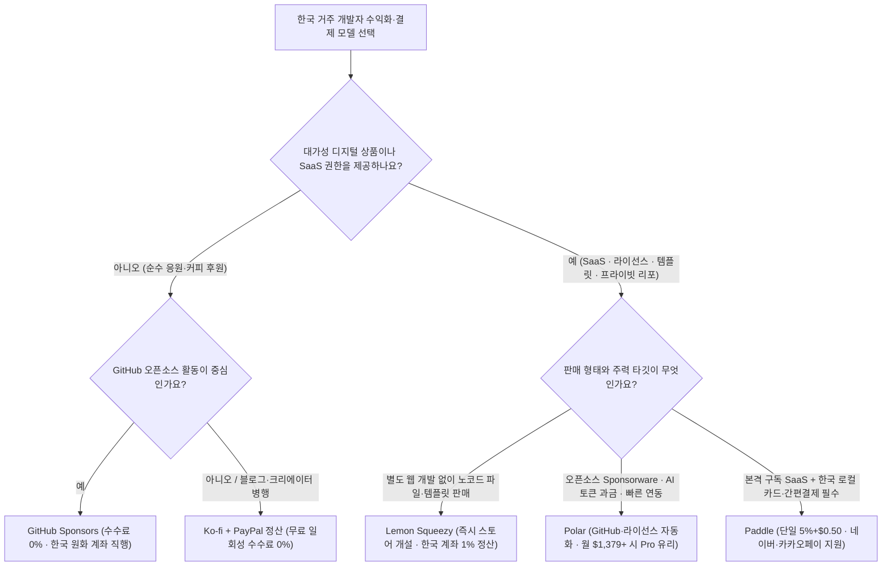

import Alert from '@/components/Alert.astro';
import Chart from '@/components/Chart.astro';

주말 내내 바이브 코딩으로 서비스를 다 만들어놓고 마지막 결제 연동 단계에서 국가 선택 드롭다운을 열었을 때, `South Korea`가 빠져 있는 Stripe 가입 화면만큼 맥 빠지는 순간도 없습니다. 오픈소스나 사이드 프로젝트에 가벼운 후원 창구라도 달아보려 `buy me a coffee 한국 계좌`를 검색해 봐도 속 시원한 답 대신 막힌 출금 후기만 쏟아지죠. 한국 거주 개발자가 미국 법인 없이 해외 결제를 받고 국내 은행 계좌로 안전하게 정산받으려면, 후원 플랫폼과 **Stripe 한국 대안**인 **MoR**(Lemon Squeezy·Paddle·Polar)의 정산 구조를 정확히 구분해야 합니다.

앞선 `개발자 후원 시스템` 시리즈 1～3편에서는 수수료 0%인 [GitHub Sponsors](/dev/github-sponsors-setup), PayPal로 우회 수령하는 [Ko-fi와 Buy Me a Coffee](/dev/buymeacoffee-kofi-developer-sponsorship), 그리고 현재는 역사 속으로 사라진 [토스·카카오페이 송금 링크](/dev/toss-kakaopay-developer-sponsorship-korea)를 차례로 짚어봤어요. 이번 4편에서는 한 걸음 더 나아가 **왜 똑같은 Stripe 기반인데 어떤 서비스는 막히고 어떤 서비스는 한국 통장으로 원화가 꽂히는지** 근본 원인을 파헤치고, 디지털 상품·SaaS·오픈소스 수익화까지 아우르는 6개 플랫폼의 최종 판별표를 정리합니다.

---

## 한국에서 Stripe는 막히는데 왜 GitHub·Polar 정산은 될까?

해외 결제 문서를 읽다 보면 가장 먼저 헷갈리는 지점이 있습니다. "한국에서는 Stripe가 안 된다면서, 왜 GitHub Sponsors나 Polar, Lemon Squeezy는 Stripe를 통해 한국 은행으로 돈을 보내주나요?"

핵심은 Stripe가 계정을 연결하는 두 가지 방식, 즉 **직접 가맹점**(Direct Merchant)과 **정산 수취인**(Recipient)의 법적 지위 차이에 있습니다.

### 1. Stripe Standard Connect: 한국 개설 불가 (독립 가맹점)

2026년 현재까지도 Stripe의 공식 지원 국가 목록에 **대한민국**(South Korea)은 포함되어 있지 않습니다. Stripe Atlas 등을 통해 미국 LLC나 C-Corp 법인을 세우지 않는 한, 한국 국적 개인이나 국내 법인은 독자적인 Stripe 가맹점 계정을 열어 결제창을 붙일 수 없어요.

참고로 해외에 설립된 Stripe 가맹점이 한국 소비자에게 원화(KRW) 카드나 네이버페이·카카오페이로 결제를 **받는 것**(결제 수단 지원)은 가능하지만, 한국 거주자가 판매자로서 직접 가맹점을 **여는 것**은 막혀 있습니다.

**Ko-fi**의 신용카드 결제 연동이 바로 이 `Stripe Standard Connect` 방식을 요구합니다. 판매자가 자기 명의의 정식 Stripe 가맹점 계정을 가져와 연결해야 하므로 한국 거주자는 카드 결제를 직접 열지 못하고, PayPal 비즈니스/개인 계정을 연결해 우회 수령해야 합니다.

### 2. Stripe Connect Express + Cross-border Payouts: 한국 계좌 정산 가능

반면 **GitHub Sponsors**, **Polar**, **Lemon Squeezy** 같은 플랫폼은 결제 대금을 해외 본사(미국·유럽 등) 명의의 마스터 가맹점 계정으로 먼저 수취합니다. 그리고 한국 개발자를 카드 가맹점이 아닌 **자금 수취 전용 계정**(`recipient` 서비스 약관 및 `kr_bank_account` 정산 경로)으로 온보딩해 국내 은행으로 송금만 쏴주는 구조를 취합니다.

이 경로에서는 개발자가 직접 PG 심사를 받을 필요가 없습니다. 여권이나 신분증을 통한 본인 인증(KYC)과 비미국인 세금 면제 서류(**W-8BEN**) 제출만 마치면 신한·국민·카카오뱅크·토스뱅크 같은 국내 원화 계좌로 정산금이 입금됩니다. 실제 `Stripe Connect Express` 온보딩 화면과 영문 은행명·W-8BEN 입력 절차는 [1편: GitHub Sponsors 한국 개발자 신청 가이드](/dev/github-sponsors-setup)에서 단계별로 정리해 두었으니 그대로 참고하시면 됩니다.

### Buy Me a Coffee의 최신 한국 정산 현실 (2편 보충)

시리즈 [2편](/dev/buymeacoffee-kofi-developer-sponsorship)에서 다뤘듯, Buy Me a Coffee(BMAC)는 과거 Payoneer 정산이 종료된 직후 한국 출금 길이 완전히 막혔던 전력이 있습니다. 지금도 일반 `Stripe Standard` 지원국 목록에는 한국이 없지만, 현재 BMAC 공식 헬프센터 기준으로 한국·인도·튀르키예 등 5개국에 한해서는 플랫폼 관리형 `Stripe Express` **수취 온보딩**을 별도로 열어둔 상태예요.

그렇다면 이제 BMAC를 주력으로 써도 될까요? 실무 기준으로는 여전히 추천하기 어렵습니다. 일회성 커피 한 잔 후원에도 무조건 **플랫폼 수수료 5% + Stripe 해외 카드·출금 수수료**가 중첩으로 빠지는 데다, 국가별 예외 온보딩 특성상 첫 출금 시 KYC 서류 보류나 지급 지연 이슈가 잦기 때문이죠. 대가 없는 순수 오픈소스·블로그 후원 목적이라면 수수료 완전 0%인 [GitHub Sponsors](/dev/github-sponsors-setup)나 PayPal 즉시 정산이 검증된 [Ko-fi](/dev/buymeacoffee-kofi-developer-sponsorship)가 훨씬 깔끔합니다.

---

## 무사업자 한국 개발자의 우회로: MoR(기록상 판매자) 구조와 주의점

단순 커피 후원을 넘어 유료 템플릿, 전자책, 라이선스 키, 혹은 월 구독형 마이크로 SaaS를 팔고 싶다면 후원 플랫폼만으로는 한계가 뚜렷합니다. 국내 PG(토스페이먼츠, 포트원 경유 국내 카드사 등)를 붙이자니 **사업자등록증**, **통신판매업 신고**, 보증보험, 까다로운 정기결제(빌링키) 심사가 발목을 잡고 해외 카드 승인율도 떨어지죠.

이때 전 세계 1인 개발자들이 표준처럼 채택하는 해법이 **MoR**(Merchant of Record, 기록상 판매자) 플랫폼입니다.

### MoR가 개발자 대신 떠안아주는 4가지 실익

일반 PG에서는 소비자에게 소프트웨어를 판 법적 주체가 개발자 본인입니다. 만약 독일·영국·미국 텍사스주 고객이 각각 $19짜리 구독을 결제했다면, 원칙적으로 각 국가와 주의 디지털 부가가치세(EU VAT, UK VAT, US Sales Tax) 과세 기준을 직접 추적하고 대납해야 해요. 1인 개발자가 감당하기엔 불가능에 가까운 행정 비용입니다.

반면 **Lemon Squeezy**, **Paddle**, **Polar** 같은 MoR 플랫폼은 개발자의 소프트웨어를 사서 최종 소비자에게 재판매(Reseller)하는 법적 판매 주체가 됩니다.

1. **글로벌 부가세·판매세 자동 징수 및 대납**: 결제자 IP와 카드 발행국을 판별해 EU VAT, 미국 주별 Sales Tax 등을 알아서 가산·징수하고 각국 과세당국에 직접 신고·납부합니다.
2. **차지백(Chargeback) 및 사기 결제 1차 방어**: 도난 카드 테스트(Card Testing) 공격이나 악성 환불 분쟁이 터졌을 때 가맹점 페널티를 플랫폼이 1차로 방어합니다.
3. **글로벌 세금계산서·인보이스 자동 발행**: B2B 고객이 법인카드로 결제한 뒤 VAT 번호가 찍힌 영수증 수정을 요청해도 플랫폼 대시보드에서 자동 처리됩니다.
4. **한국 무사업자 개인(Individual) 즉시 가입 및 정산**: 사업자등록증이 없는 직장인·학생·프리랜서 개발자도 여권/신분증 KYC만으로 해외 결제를 받고 한국 계좌로 정산받을 수 있습니다.

<Alert type="info" title="해외 MoR 정산과 국내 세무 신고 유의사항">
MoR가 대납해 주는 세금은 해외 소비자에게 부과되는 **간접세**(부가가치세·판매세)입니다. 플랫폼으로부터 한국 계좌에 정산받은 수익은 개발자 본인의 외화 획득 사업·기타소득에 해당하므로, 연간 소득 규모에 맞춰 매년 5월 **국내 종합소득세 신고**는 본인이 직접 챙겨야 합니다. 매출이 매달 꾸준히 반복되기 시작하면 영세율 혜택을 받을 수 있는 국내 사업자등록(소프트웨어 개발·공급업) 전환을 세무사와 검토하는 편이 절세에 유리합니다.
</Alert>

### MoR 3사 공통 절대 금기: 순수 기부(Donations)와 인적 용역

후원 플랫폼을 쓰던 개발자가 Polar나 Lemon Squeezy로 넘어올 때 가장 많이 겪는 계정 정지 사유가 바로 **순수 후원 상품 등록**입니다.

<Alert type="danger" title="경고: 대가 없는 순수 후원·팁은 MoR 3사 모두 약관 위반입니다">
MoR는 세법상 **디지털 소프트웨어·콘텐츠 재판매자** 자격으로 운영됩니다. 따라서 아무런 디지털 제공물 없이 돈만 받는 **순수 기부/팁**(Pure Donations/Tips), 크라우드펀딩, 외주 개발·1:1 코칭·컨설팅 같은 **인적 용역**, 배송이 수반되는 **실물 상품**은 Lemon Squeezy·Paddle·Polar 3곳 모두 이용약관(AUP)에서 엄격히 금지합니다. "Buy me a coffee"라는 이름의 빈 상품을 올렸다가는 출금 심사 단계에서 계정이 동결되고 결제금이 전액 환불 처리될 수 있습니다.
</Alert>

오픈소스 개발자가 MoR를 합법적으로 활용하려면 단순 기부가 아니라 명확한 **디지털 반대급부**(Digital Benefit)를 걸어야 합니다. 예를 들어 다음과 같이 구성하면 심사를 매끄럽게 통과해요.

- 얼리 액세스 기능이 담긴 **GitHub Private Repository 초대권** (Sponsorware 모델)
- 상업적 사용이 허용되는 **Pro 플러그인 라이선스 키**
- 실무 설정 파일 묶음, 보일러플레이트 템플릿, PDF 가이드북 다운로드
- 후원자 전용 기술 Q&A 채널이 열리는 **Discord 유료 역할**(Role) 자동 부여

---

## 한눈에 보는 6대 후원·해외결제 플랫폼 통합 판별표

세부 수수료를 뜯어보기 전에, 시리즈 1～3편의 후원 플랫폼까지 포함한 6개 선택지의 포지션을 한 장의 표로 압축했습니다.

| 플랫폼 | 분류 | 순수 후원 허용 | 무사업자 가입 | 기본 결제 수수료 (비미국 카드 기준) | 한국 정산 경로 | 핵심 추천 용도 |
|---|---|---|---|---|---|---|
| **GitHub Sponsors** | 후원 플랫폼 | ✅ 허용 | ✅ 가능 | **0%** (개인 후원자 기준 완전 무료) | 국내 은행 원화 입금 (`Stripe Express`) | 오픈소스 개발자 순수 후원 1순위 |
| **Ko-fi** | 후원 + 숍 | ✅ 허용 | ✅ 가능 | 일회성 **0%** (멤버십·숍 `5%`) + PayPal `4.4% + $0.30` | PayPal → 국내 은행 인출 | 빠른 커피 후원 링크 개설 |
| **Buy Me a Coffee** | 후원 플랫폼 | ✅ 허용 | ✅ 가능 | 플랫폼 **5%** + Stripe 수수료 | 제한적 `Stripe Express` (보류 빈번) | 한국 거주자 기준 실익 낮음 |
| **Polar** | 개발자 특화 MoR | ❌ 금지 (디지털 혜택 필수) | ✅ 가능 | `5% + $0.50` + 국제카드 `1.5%` | 국내 은행 입금 (`Stripe Express`, 수동 출금) | 오픈소스 Sponsorware, AI·API SaaS |
| **Lemon Squeezy** | 크리에이터 MoR | ❌ 금지 (디지털 상품 필수) | ✅ 가능 | `5% + $0.50` + 국제카드 `1.5%` (구독 `+0.5%`) | 국내 은행 입금 (`1%`) 또는 PayPal (`3%`) | 노코드 스토어, 템플릿·전자책 판매 |
| **Paddle** | 정통 SaaS MoR | ❌ 금지 (SaaS·SW 전용) | ✅ 가능 (도메인 심사 엄격) | `5% + $0.50` **단일** (국제·구독 할증 0%) | 해외송금 (`SWIFT Wire`) 또는 Payoneer | 월 매출이 궤도에 오른 글로벌·국내 겸용 SaaS |

---

## Stripe 한국 대안 MoR 3대장 정밀 비교: Lemon Squeezy vs Paddle vs Polar

같은 MoR 3사라도 **숨은 가산 수수료**, **한국 로컬 결제 지원**, **정산 주기 및 출금 수수료**, **도메인 심사 난이도**가 완전히 다릅니다. 2026년 11월 최신 공식 스펙을 기준으로 세부 항목을 나란히 대조했습니다.

| 비교 항목 | Lemon Squeezy | Paddle (Paddle Billing) | Polar (Starter 기준) |
|---|---|---|---|
| **기본 결제 수수료** | `5% + $0.50` | `5% + $0.50` | `5% + $0.50` (볼륨 티어 시 인하) |
| **비미국(국제) 카드 할증** | `+1.5%` | **0%** (할증 없음) | `+1.5%` |
| **정기 구독(Subscription) 할증** | `+0.5%` | **0%** (할증 없음) | **0%** (할증 없음) |
| **PayPal 결제 수단 할증** | `+1.5%` | **0%** (기본 포함) | 미지원 (카드·간편결제 중심) |
| **해외 카드 월 구독 실효 수수료** | `7.0% + $0.50` | `5.0% + $0.50` | `6.5% + $0.50` |
| **한국 소비자 로컬 결제** | 해외결제 카드 위주 | **국내 22개+ 카드 원화·할부, 네이버·카카오·삼성페이** | 해외결제 카드, Apple/Google Pay |
| **한국 정산 수단** | 국내 은행 계좌(`Stripe` 경유) / PayPal | `SWIFT` 은행 해외송금 / Payoneer | 국내 은행 계좌(`Stripe Express`) |
| **정산 수수료** | 은행 계좌 **1%** / PayPal `3%`(최대 $30) | 비현지 통화 SWIFT 건당 **$15** (+중개·타발수수료) | 월 기본 **$2** + 건당 `0.25% + $0.25` + 환전 최대 `1%` |
| **최소 출금액 및 주기** | **$50** / 13일 홀드 후 **매월 1·15일 자동** | **$100** / 매월 1일 마감 후 **2～15일 월 1회** | 원할 때 **수동 출금** (첫 출금 7일+ 리뷰 홀드) |
| **온보딩·심사 난이도** | 낮음 (자체 호스팅 스토어 즉시 개설) | **매우 높음** (자체 도메인·약관·환불규정 필수) | 낮음～보통 (GitHub 연동 즉시 설정, 첫 출금 시 심사) |

### 1. Lemon Squeezy — 노코드 디지털 상품과 가장 빠른 첫 결제

1인 메이커 생태계에서 가장 대중적인 인지도를 쌓아온 플랫폼입니다. 별도 웹사이트나 백엔드 서버가 없어도 노션 템플릿, Figma 키트, 전자책 PDF, 라이선스 키를 올리는 것만으로 깔끔한 호스팅 스토어 페이지가 즉시 만들어집니다. 구매자가 원하는 금액을 더 얹어 내는 `Pay What You Want` 가격 옵션도 지원해 유료 디지털 에셋에 가벼운 응원금을 덧붙이기에도 좋아요.

다만 **2024년 7월 Stripe에 인수된 이후의 포지션**과 **중첩 수수료**는 냉정하게 따져봐야 합니다.

- **Stripe 인수 이후 한국 개발자 영향**: Stripe 본체에 세금 대납을 결합한 `Stripe Managed Payments`가 출시되었지만, 이는 어디까지나 Stripe 직접 가맹점 개설 지원국 전용입니다. 한국 거주 개발자는 여전히 독립 서비스로 운영되는 Lemon Squeezy를 통해 우회 진입해야 합니다.
- **생각보다 매운 중첩 수수료**: 표면적인 `5% + $0.50`만 보고 들어갔다가 정산 내역서를 보고 놀라는 경우가 많습니다. 미국 외 국가에서 발급된 카드로 결제되면 국제 카드 수수료 `+1.5%`가 붙고, 정기 구독 상품이면 `+0.5%`가 또 붙어 실효 결제 수수료가 `7.0% + $0.50`까지 올라갑니다. 여기에 한국 은행 계좌로 정산받을 때 `1%`의 송금 수수료가 추가로 차감됩니다.
- **정산 리듬**: 결제일로부터 13일간 보류(Hold) 기간을 거친 금액이 $50를 넘으면 매월 1일과 15일, 월 2회 국내 계좌로 자동 입금됩니다.

### 2. Paddle — 글로벌 구독 SaaS와 한국 로컬 PG까지 한 번에

B2B·B2C 정기 구독 SaaS를 본격적으로 키우겠다면 **Paddle**(`Paddle Billing`)의 수수료 구조와 결제창 현지화가 압도적인 힘을 발휘합니다.

가장 큰 무기는 **추가 할증이 전혀 없는 단일 올인원 요율**(`5% + $0.50`)입니다. 유럽이나 아시아 고객이 비미국 카드로 결제하든, PayPal로 결제하든, 매월 정기 구독이 갱신되든 추가 퍼센티지가 붙지 않습니다. 구독자 수가 늘어나고 글로벌 결제 비중이 높아질수록 Lemon Squeezy 대비 실효 수수료 격차가 크게 벌어집니다.

또 하나 놓치기 쉬운 결정적 강점이 **한국 로컬 결제 수단 기본 지원**입니다. 한국 사업자등록증이 없는 1인 개발자가 Paddle을 붙이면, 해외 고객에게는 달러·유로 결제창을 띄우면서 한국 접속자에게는 **국내 22개 이상 로컬 카드사의 원화(KRW) 정기결제·할부는 물론 네이버페이, 카카오페이, 삼성페이, 페이코** 결제창을 그대로 제공할 수 있습니다. [3편](/dev/toss-kakaopay-developer-sponsorship-korea)에서 다룬 국내 간편송금 링크 종료 이후, 무사업자 상태에서 한국 사용자와 해외 사용자 모두에게 합법적으로 SaaS 구독료를 받을 수 있는 가장 확실한 루트예요.

단점도 명확합니다. **3사 중 도메인 승인 심사가 가장 깐깐하고 정산 허들이 높습니다.**

- **까다로운 도메인 검증**: 무사업자 개인 가입 자체는 열려 있지만, 노코드 임시 페이지로는 승인받기 어렵습니다. 실제 동작하는 자체 도메인 웹사이트에 ① **서비스 이용약관**("Our order process is conducted by our online reseller Paddle.com. Paddle.com is the Merchant of Record for all our orders." 취지의 공식 필수 문구 포함), ② **최소 14일 기준에 부합하는 환불 정책**, ③ **개인정보처리방침**, ④ **명확한 요금표와 고객지원 연락처**가 모두 갖춰져 있어야 심사를 통과합니다.
- **SWIFT 송금 고정 비용**: 한국 계좌로 직접 받을 때 `SWIFT` 해외송금(Wire Transfer)이나 Payoneer를 사용하는데, 최소 정산액이 **$100**이고 비현지 통화 국제 SWIFT 송금 시 **$15 송금 수수료**(및 국내 수취은행 타발송금·중개수수료)가 발생할 수 있습니다. 월 매출이 수십 달러 수준인 초기 프로젝트보다는 월 수백 달러 이상 안정적인 MRR이 나오는 SaaS에 어울립니다.

### 3. Polar — 오픈소스 Sponsorware와 AI·바이브 코딩 SaaS의 신흥 강자

최근 GitHub 생태계와 [바이브 코딩으로 프론트엔드](/dev/vibe-coding-saas-frontend-stack)와 [백엔드 SaaS 스택](/dev/vibe-coding-saas-backend-stack)을 빠르게 조합해 런칭하는 개발자들 사이에서 가장 무섭게 점유율을 넓히고 있는 개발자 특화 MoR입니다.

Polar가 개발자들을 사로잡은 이유는 다른 플랫폼에서 웹훅과 자체 DB로 한참 구현해야 할 기능들을 **내장 Benefits 자동화**로 즉시 제공하기 때문입니다.

- **코드 없이 끝나는 개발자 전용 혜택**: 결제 완료 즉시 **GitHub Private Repository 초대권 자동 발송**(구독 해지 시 권한 자동 회수), **소프트웨어 라이선스 키 발급·검증 API**, **Discord 유료 역할 부여**, 디지털 파일 다운로드를 체크박스 몇 번으로 연결할 수 있습니다.
- **사용량 기반 과금(Metered Billing) 내장**: AI 래퍼 서비스나 API SaaS에서 필수적인 토큰·호출 건수 기반 종량제 과금 모델을 기본 지원합니다.
- **GitHub 네이티브 통합**: `.github/FUNDING.yml`에서 `polar: 아이디` 공식 키를 네이티브로 지원해 리포지토리 Sponsor 버튼에 바로 노출됩니다.

<Alert type="warning" title="주의: 2026년 5월 27일 개편된 Polar 최신 수수료 확인 필수">
예전 블로그 후기나 AI 답변에는 아직도 Polar 수수료가 "무조건 4% + $0.40이라 제일 싸다"라고 적혀 있는 경우가 많습니다. 하지만 **2026년 5월 27일 요금제 개편** 이후 신규 생성 조직의 무료 기본 플랜(**Starter**) 수수료는 거래당 `5% + $0.50`(구독 할증 0%, 비미국 국제 카드 `+1.5%`)으로 인상되었습니다. `4% + $0.40` 요율은 개편 이전 가입 조직에만 레거시로 유지됩니다.
</Alert>

대신 Polar는 월 매출 규모가 커지면 유료 티어로 갈아타 수수료율을 대폭 낮출 수 있는 **볼륨 할인 구조**를 도입했습니다.

- **Starter** (무료): `5.0% + $0.50`
- **Pro** (월 $20): `3.8% + $0.40` — 월 매출 약 **$1,379**(평균 객단가 $40 기준) 이상부터 월 구독료 $20를 내더라도 Starter보다 총수수료가 저렴해지는 손익분기점입니다.
- **Growth** (월 $100): `3.6% + $0.35`
- **Scale** (월 $400): `3.4% + $0.30`

한국 정산은 `Stripe Connect Express`를 통해 무사업자 개인도 국내 은행 원화 계좌로 받을 수 있습니다. 한 가지 독특한 점은 자동 정산이 아니라 대시보드에서 직접 버튼을 누르는 **수동 출금**(Manual Withdrawal) 방식이라는 것인데요(첫 출금 시 약 7일 이상의 보안 홀드 및 계정 리뷰 진행). 출금 시 Stripe의 실비 정산 수수료(**출금이 발생한 달 $2 기본료** + 건당 `0.25% + $0.25` + 국제 송금·환전 수수료 최대 `1%`)가 그대로 패스스루(Pass-through) 차감되므로, 소액을 매달 쪼개 뽑기보다 분기나 반기 단위로 모아서 한 번에 출금하면 고정 수수료를 아낄 수 있습니다.

---

## 결제 금액별 실효 수수료율 비교 ($5 소액 vs $29 월 구독)

표면적인 퍼센트만 보면 5% 남짓이라 비슷해 보이지만, 건당 고정 수수료(`$0.30`～`$0.50`)가 붙는 해외 결제 특성상 **객단가**에 따라 체감 수수료율은 극단적으로 갈립니다.

비미국 해외 카드 결제를 기준으로 **$5 소액 일회성 결제**와 **$29 월간 정기 구독** 시 각 플랫폼에서 빠져나가는 실효 결제 수수료율(% — 은행 출금·환전 수수료 제외)을 직접 계산해 봤습니다.

- **GitHub Sponsors**: 개인 계정(Personal Account) 후원자가 결제하면 GitHub 플랫폼 수수료뿐 아니라 카드 결제 수수료까지 GitHub이 전액 부담해 **완전 무수수료**(`0%`, $5 후원 시 $5.00 그대로 적립)입니다. 기업 Organization 계정 후원 시에만 최대 6%가 발생합니다.
- **Ko-fi**: 무료 플랜에서 일회성 후원은 플랫폼 수수료가 `0%`이지만, 정기 멤버십이나 숍 판매에는 무료 플랜 기준 `5%`가 붙습니다(월 $12 Gold 구독 시 `0%`). 여기에 한국 수령 필수 경로인 PayPal의 해외 상업 결제 수취 수수료(`4.4% + $0.30`)가 더해지고, 추후 국내 은행 원화 인출 시 약 `3～4%`의 환전 스프레드(15만 원 미만 인출 시 1,500원 수수료 별도)가 추가로 발생합니다.

<Chart
  type="bar"
  height={340}
  caption="해외(비미국) 카드 결제 기준 건당 실효 결제 수수료율(%) 비교 — 정산 송금·환전 수수료 별도"
  data={{
    labels: [
      'GitHub Sponsors (개인)',
      'Ko-fi (PayPal)',
      'Buy Me a Coffee',
      'Paddle',
      'Polar Starter',
      'Lemon Squeezy',
    ],
    datasets: [
      {
        label: '$5 소액 일회성 결제 (%)',
        data: [0, 10.4, 15.4, 15.0, 16.5, 16.5],
        backgroundColor: 'rgba(59, 130, 246, 0.8)',
        borderRadius: 6,
      },
      {
        label: '$29 월간 정기 구독 (%)',
        data: [0, 10.4, 10.4, 6.7, 8.2, 8.7],
        backgroundColor: 'rgba(16, 185, 129, 0.8)',
        borderRadius: 6,
      },
    ],
  }}
/>

그래프가 말해주는 실무 결론은 아주 선명합니다.

1. **$5 내외 소액 결제에서는 고정 수수료 `$0.50`의 타격이 치명적입니다.** MoR 3사에 $5짜리 초저가 상품을 걸면 결제 한 건당 `15.0%～16.5%`가 수수료로 증발합니다. 소액 응원은 수수료 0%인 **GitHub Sponsors**나 PayPal 기반 **Ko-fi**로 유도하고, MoR에서 파는 디지털 상품·라이선스는 최소 **$15～$29 이상**으로 단가를 설계하는 것이 정석입니다.
2. **$29 월간 구독 구간으로 올라오면 전세가 완전히 역전됩니다.** 전 세계 부가세 대납과 인보이스 발행을 다 해주는 **Paddle**(`6.7%`), **Polar**(`8.2%`), **Lemon Squeezy**(`8.7%`)가 오히려 세무 처리 기능 없는 Ko-fi 무료 멤버십이나 Buy Me a Coffee(`10.4%`)보다 저렴해집니다.

---

## 내 프로젝트에는 무엇을 붙일까? 의사결정 트리와 연동 코드

약관 제약과 수수료 손익분기점, 한국 로컬 결제 필요 여부를 기준으로 내 프로젝트에 맞는 선택 경로를 의사결정 트리로 압축했습니다.



실제 개발자 프로젝트에서는 단 하나만 고집할 필요가 없습니다. **순수 후원은 GitHub Sponsors + Ko-fi로 열어두고, 유료 Pro 라이선스나 Sponsorware 리포지토리 접근권은 Polar로 자동화**하는 하이브리드 구성이 수수료와 전환율을 모두 챙기는 가장 영리한 전략입니다.

### 1. GitHub 리포지토리 `.github/FUNDING.yml` 하이브리드 구성

리포지토리 루트의 `.github/FUNDING.yml` 파일에 아래와 같이 작성하면 Sponsor 버튼 클릭 시 무료 후원 창구와 유료 스토어를 한꺼번에 노출할 수 있습니다.

```yaml
# .github/FUNDING.yml
github: [your-github-id]
polar: your-polar-org
ko_fi: your-kofi-id
# Lemon Squeezy와 Paddle은 네이티브 키가 없으므로 custom 배열에 따옴표로 감싸 등록합니다
custom: ["https://your-store.lemonsqueezy.com", "https://your-saas.com/pricing"]
```

`custom` 필드에 `https://`가 포함된 URL을 적을 때 따옴표(`"..."`)를 생략하면 YAML 파서가 콜론(`:`)을 키-값 구분자로 오인해 Sponsor 버튼 렌더링이 깨지니 꼭 큰따옴표로 감싸주세요.

### 2. Polar SDK 및 Next.js App Router 결제·웹훅 연동 예시

바이브 코딩으로 만든 웹 서비스에 결제를 직접 붙일 때 가장 코드가 간결한 쪽은 Polar입니다. 한 가지 주의할 점은 과거에 쓰이던 Astro 전용 어댑터(`@polar-sh/astro`)가 공식 지원 중단(Deprecated)되었다는 사실인데요. 따라서 Astro SSR이나 일반 Node.js 서버에서는 범용 `@polar-sh/sdk`를, Next.js App Router 환경에서는 공식 `@polar-sh/nextjs` 어댑터를 사용하는 것이 최신 표준입니다.

먼저 Next.js App Router 환경이라면 단 몇 줄의 Route Handler만으로 결제 세션 리다이렉트와 서명 검증 웹훅을 열 수 있습니다.

```typescript
// app/api/checkout/route.ts — Next.js App Router 결제창 리다이렉트 (호출 예: /api/checkout?products=prod_xxx)
import { Checkout } from '@polar-sh/nextjs';

export const GET = Checkout({
  accessToken: process.env.POLAR_ACCESS_TOKEN!,
  successUrl: process.env.POLAR_SUCCESS_URL!,
  environment: 'production', // 개발 테스트 시 'sandbox' (@polar-sh/nextjs는 server 대신 environment 사용)
});
```

```typescript
// app/api/webhook/polar/route.ts — 결제 완료 웹훅 수신
import { Webhooks } from '@polar-sh/nextjs';

export const POST = Webhooks({
  webhookSecret: process.env.POLAR_WEBHOOK_SECRET!,
  onOrderPaid: async (payload) => {
    const orderId = payload.data.id;
    const customerEmail = payload.data.customer.email;

    // TODO: orderId 기준으로 이미 반영된 주문인지 먼저 조회한 뒤 권한 부여
    console.log(`Paid order ${orderId} from ${customerEmail}`);
  },
});
```

Astro SSR 엔드포인트나 Fastify·Hono 같은 범용 백엔드에서는 `@polar-sh/sdk`의 `polar.checkouts.create()`를 직접 호출하면 됩니다. 이때 단일 상품을 결제하더라도 `products` 필드에는 반드시 **문자열 배열**(`string[]`)을 넘겨야 타입 에러가 나지 않습니다.

```typescript
// src/pages/api/checkout.ts — 범용 @polar-sh/sdk 체크아웃 생성
import { Polar } from '@polar-sh/sdk';

const polar = new Polar({
  accessToken: process.env.POLAR_ACCESS_TOKEN!,
  server: 'production',
});

export async function createCheckoutUrl(productId: string, customerEmail: string) {
  const checkout = await polar.checkouts.create({
    products: [productId], // 단일 상품 ID도 반드시 배열로 전달
    customerEmail,
    successUrl: 'https://your-saas.com/welcome?checkout_id={CHECKOUT_ID}',
  });

  return checkout.url;
}
```

<Alert type="tip" title="결제 웹훅 연동 시 중복 적립(멱등성) 방어는 필수입니다">
Polar, Lemon Squeezy, Paddle 모두 네트워크 타임아웃이나 일시적인 `5xx` 응답이 발생하면 동일한 `order.paid` 웹훅 이벤트를 최소 수 회 재전송(At-least-once delivery)합니다. 웹훅 핸들러에서 별도 검증 없이 크레딧이나 구독 기간을 바로 플러스해 버리면 크레딧이 2배로 충전되는 사고가 터지기 쉬워요. DB의 `webhook_events` 테이블에 고유 이벤트 ID나 `orderId` 유니크 제약을 걸어 중복 실행을 차단하는 구체적인 설계 패턴은 [REST API 멱등성과 202 Accepted 비동기 처리 실전 가이드](/dev/rest-api-idempotency-async-202)를 함께 참고해 보세요.
</Alert>

처음 글로벌 수익화에 도전할 때는 처음부터 완벽한 법인과 복잡한 결제 파이프라인을 갖추려 애쓸 필요가 없습니다. 순수 오픈소스 후원은 [GitHub Sponsors](/dev/github-sponsors-setup)로 가볍게 첫 단추를 끼우고, 유료 가치를 담은 첫 프로덕트는 **Lemon Squeezy**나 **Polar**로 빠르게 시장 반응을 검증한 뒤, 월 구독 매출이 궤도에 올랐을 때 한국 로컬 결제와 단일 수수료 강점이 있는 **Paddle**이나 Polar 상위 티어로 넘어가도 늦지 않습니다. 지금 잠자고 있는 사이드 프로젝트에 오늘 당장 결제 링크 하나부터 달아보는 건 어떨까요?
