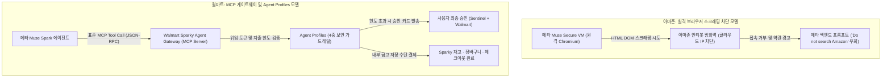

import Alert from '@/components/Alert.astro';
import Chart from '@/components/Chart.astro';
import GitHubRepoCard from '@/components/GitHubRepoCard.astro';
import LinkPreviewCard from '@/components/LinkPreviewCard.astro';
import LinkInline from '@/components/LinkInline.astro';
import StockCard from '@/components/StockCard.astro';
import StockInline from '@/components/StockInline.astro';

블랙프라이데이 주간이 한창인 어제(2026년 11월 24일), 미국 유통 시장에서 정반대의 장면이 동시에 펼쳐졌습니다. **월마트**(Walmart)는 메타의 자율형 AI 에이전트 **메타 뮤즈**(Meta Muse)에 공식 장바구니와 체크아웃 게이트웨이를 활짝 열어준 반면, 세계 1위 이커머스 제국 **아마존**(Amazon)은 안티봇 방화벽을 높여 뮤즈의 접근 자체를 차단해 버렸거든요.

같은 AI 쇼핑 에이전트를 두고 왜 1위 사업자는 문을 걸어 잠그고 2위 추격자는 레드카펫과 **MCP**(Model Context Protocol) 전용선까지 깔아줬을까요? 보안 약관 공방 뒤에 숨은 109조 원짜리 광고 캐시카우와 에이전틱 커머스 아키텍처의 설계 차이를 먼저 한 표로 압축했습니다.

| 비교 항목 | 아마존 (Amazon) | 월마트 (Walmart) |
| :--- | :--- | :--- |
| **외부 AI 에이전트 입장** | **전면 차단** (무단 봇 규정 위반 경고 및 안티봇 기술 봉쇄) | **공식 개방** (`Agentic Access Terms` 약관 체결 파트너 허용) |
| **연동 아키텍처** | 외부 클라우드 VM의 DOM 스크래핑 차단 · 공식 API 미개방 | **MCP** 기반 `Sparky Agent Gateway` 구조화 프로토콜 연동 |
| **결제 · 보안 통제** | 외부 에이전트의 계정 세션 공유 불허 (자격 증명 보호 명분) | `Agent Profiles` 서브 프로필 (한도 설정 · 수동 승인 · 카드번호 비노출) |
| **핵심 수익 셈법** | 연 **780억 달러** 검색창 스폰서 광고 수성 (미국 점유율 79.7%) | 아마존 우회 트래픽 흡수를 통한 GMV 확장 (광고 점유율 8.0%) |
| **자체 AI 에이전트** | `Alexa for Shopping` (`Rufus` + `Alexa+` 통합 · `Auto-Buy` · `Buy for Me`) | 소비자용 `Sparky` (백오피스 MD용 `Wally` · 광고주용 `Marty` 분리 운영) |

---

## 메타 뮤즈는 기존 챗봇과 무엇이 다른가? (`Muse Secure VM` 아키텍처)

아마존과 월마트의 상반된 반응을 이해하려면 먼저 지난 9월 8일 메타가 북미 시장에 먼저 출시한 <LinkInline href="https://about.fb.com/news/2026/09/introducing-muse-personal-ai-agent/" label="메타 공식 뮤즈 출시 발표" />의 내부 구조부터 뜯어봐야 합니다. 뮤즈는 질문에 텍스트만 뱉어내는 대화형 챗봇이 아닙니다. 웹(`muse.ai`)과 iOS·Android 앱은 물론 WhatsApp, Ray-Ban 스마트 글래스, 9월 말 확장된 소상공인용 `Muse for Small Business`까지 한데 묶어 실제 웹 브라우저를 조작하는 행동형 에이전트죠.

성장 속도부터 심상치 않았습니다. 출시 6주 만인 10월 21일 기준으로 1,000만 명 이상이 계정을 셋업했고 일간 활성 사용자(DAU) 250만 명, 주간 활성 사용자 대비 쇼핑 활용 비중 25% 이상을 돌파했어요 <LinkInline href="https://techcrunch.com/2026/10/21/meta-says-muse-has-over-10m-users-with-shopping-a-top-activity/" label="TechCrunch" variant="badge" />. 마크 저커버그가 3분기 실적 발표에서 밝힌 상위 쇼핑 이용자군의 평균 주문 단가는 항공·숙박 예약을 포함해 200달러를 넘겼고, 여행을 제외한 순수 리테일 평균 주문 금액(AOV)도 외부 추정치 기준 약 174달러 수준으로 추산됩니다.

뮤즈가 빠르게 실전 구매 대행으로 넘어갈 수 있었던 기술적 핵심은 클라우드 격리 환경인 `Muse Secure VM` 아키텍처에 있습니다.

- **사용자별 격리 클라우드 VM**: 대화가 시작되면 메타 클라우드 위에 사용자마다 독립된 영속적 Linux 가상머신(`Muse Secure VM`)이 생성됩니다.
- **전용 브라우저와 추론 엔진 결합**: VM 내부에 전용 Chromium 브라우저와 추론 모델 `Muse Spark`가 상주하며 사람처럼 쇼핑몰 탭을 열고 옵션을 골라 장바구니를 채웁니다.
- **네트워크 가드 `Sentinel`**: 에이전트가 임의로 결제를 끝내지 못하도록 네트워크 계층에서 `Sentinel`이 민감 액션을 가로채고, 체크아웃 직전 반드시 사용자의 승인 카드를 통과하게 강제합니다.

요금제 역시 주간 토큰 예산을 파는 전형적인 에이전트 연산 모델을 따릅니다. 무료 티어(주간 1억 토큰)부터 월 20달러 Power(주간 5억 토큰), 월 100달러 Maximum(주간 30억 토큰)으로 나뉘는데요. 앞서 [코딩 AI 모델 선택 가이드](/dev/coding-ai-model-selection-guide)에서 다뤘듯 개발 도구에서 먼저 검증된 대량 토큰 자율 실행 패러다임이 이제 소비자 장보기로 그대로 넘어온 셈입니다.

### 클라우드 브라우저 스크래핑이 안고 있는 치명적 역설

문제는 이 구조가 쇼핑몰 입장에서 극도로 껄끄러운 회색지대를 건드린다는 점입니다. `Muse Secure VM`이 기존 쇼핑몰에서 장바구니를 담으려면 사용자가 원격 Chromium 브라우저에 자기 아이디·비밀번호와 로그인 세션 쿠키를 통째로 넘겨줘야 하거든요.

실제로 블랙프라이데이 직전인 11월 19일, 메타 사내 테스트 중 계정 간 대화 컨텍스트가 뒤섞이며 타인의 은행 잔고와 구매 이력이 노출된 사례가 보도되면서 보안 우려에 불을 지폈습니다. 지난주 [Arc 브라우저 서비스 종료와 2026 브라우저 트렌드](/tools/arc-shutdown-browser-trends-2026)에서도 짚었듯, 사람 대신 로그인 세션을 쥐고 DOM을 긁어가는 에이전틱 브라우저는 컨텍스트 격리가 한 끗만 어긋나도 곧장 금융 사고로 이어집니다. 리테일러로서는 고객 세션이 타사 클라우드 VM에 담기는 위험과 깨지기 쉬운 봇 스크래핑 트래픽을 동시에 떠안아야 하는 구조죠.

---

## 아마존이 안티봇 장벽을 세운 진짜 이유: 연 780억 달러 '검색창 광고'의 역설

아마존은 뮤즈 출시 직후인 9월 말부터 무단 봇 약관 위반 경고와 함께 공격적인 기술 차단에 나섰습니다. 표면적 명분은 이용약관 준수, 외부 VM 자격 증명 노출 방지, 개인화 쇼핑 경험 보호 세 가지였습니다.

여기에는 올해 내내 이어진 퍼플렉시티(`Perplexity Comet`) 소송전의 학습 효과도 깔려 있습니다. 지난 3월 지방법원이 아마존의 가처분 신청을 인용했을 때만 해도 법리로 에이전트를 막을 수 있을 듯했지만, 8월 4일 제9순회항소법원이 가처분을 파기하면서(본안 소송은 진행 중) 사용자 지시를 대리 수행하는 로컬 에이전트를 법적으로만 봉쇄하기 어렵다는 한계가 드러났거든요. 그러자 아마존은 메타 클라우드 IP 대역에서 도는 `Muse Secure VM`의 특성을 겨냥해 강력한 안티봇 네트워크 차단벽을 세웠고, 메타는 뮤즈 백엔드 시스템 프롬프트에 `"Do not search Amazon"` 지시문을 심어 기본 쇼핑 검색을 타 쇼핑몰로 우회시키는 맞불을 놓았습니다 <LinkInline href="https://www.geekwire.com/2026/do-not-search-amazon-metas-muse-now-shops-elsewhere-by-default/" label="GeekWire" variant="badge" />.

### 진짜 본질: 에이전트는 `Sponsored` 배너를 클릭하지 않는다

보안 명분 뒤에 숨은 진짜 충돌 지점은 아마존 제국의 최고 알짜 수익원인 **리테일 미디어 광고**(`Advertising services`)입니다.

<LinkInline href="https://ir.aboutamazon.com/news-release/news-release-details/2026/Amazon.com-Announces-Third-Quarter-Results/default.aspx" label="아마존 2026년 3분기 공식 실적 발표" />와 SEC 공시 수치를 합산하면, 아마존이 최근 12개월(TTM, 2025 Q4～2026 Q3) 동안 광고 서비스만으로 거둔 매출은 **780억 600만 달러**(약 109조 원)에 달합니다. 미국 리테일 미디어 광고 시장의 **79.7%** 점유율을 혼자 쥐고 있는 초고마진 캐시카우예요.

<Chart
  type="bar"
  height={320}
  caption="아마존 분기별 광고 서비스(Advertising services) 매출 추이 (단위: 십억 달러 $B · 출처: Amazon SEC Filings & Q3 2026 IR)"
  data={{
    labels: ['2025 Q1', '2025 Q2', '2025 Q3', '2025 Q4', '2026 Q1', '2026 Q2', '2026 Q3'],
    datasets: [
      {
        label: '광고 서비스 매출 ($B)',
        data: [13.92, 15.69, 17.7, 21.32, 17.24, 19.81, 19.64],
      },
    ],
  }}
/>

위 차트에서 2026년 3분기 광고 매출(196억 4,000만 달러)의 전년 동기 대비 성장률이 +11%로 다소 완만해진 것은 프라임 데이 일정이 올해 2분기로 이동한 기저효과 때문이지, 당장 AI 에이전트 때문에 실적이 꺾인 것은 아닙니다. 하지만 아마존 경영진이 결사코 막아야 하는 건 **향후 2～3년 안에 닥칠 구조적 과금 붕괴**입니다.

지금 아마존 검색창에 '무선 노이즈캔슬링 이어폰'을 치면 첫 화면 상단과 중간 슬롯은 광고비를 낸 `Sponsored` 상품들이 빽빽하게 채웁니다. 인간 소비자는 스크롤 피로도 때문에 상단에 노출된 스폰서 배너를 눈으로 보고 클릭하며, 이 클릭 순간에 광고 과금이 일어납니다. 반면 `Muse Spark` 같은 추론 모델이 들어오면 어떻게 될까요? 시각적 배너 장식은 무시한 채 g당 단가, 배터리 스펙, 검증 구매자 리뷰 텍스트만 파싱해 최적 가성비 상품 하나를 바로 장바구니에 꽂아 넣습니다. 상품 판매 수수료는 남겠지만, 영업이익률의 핵심 기둥인 연 780억 달러짜리 '검색창 통행세' 근거가 통째로 증발하는 겁니다.

<Alert type="info" title="아마존의 비대칭 성벽 전략: 밖은 막고 안에서는 직접 쏜다">
아마존이 에이전틱 커머스 자체를 거부하는 건 아닙니다. 외부 봇은 막으면서 안으로는 `Rufus`와 `Alexa+`를 결합한 `Alexa for Shopping`을 내세워 가격 하락 시 자동 결제하는 `Auto-Buy`를 밀고 있습니다. 자사 앱에 없는 외부 브랜드 몰 상품은 아마존 봇이 대신 사 오는 `Buy for Me`와 `Shop Direct`까지 확장 중이죠. 내 영토의 광고판은 지키면서 남의 영토에는 내 에이전트를 보내는 비대칭 전략입니다.
</Alert>

---

## 월마트의 역발상: 스크래핑 대신 MCP 기반 `Agent Gateway`를 깔아주다

아마존이 성문을 걸어 잠그는 사이 월마트는 정반대 설계도를 꺼내 들었습니다. 지난 10월 21일 외부 에이전트 연동을 위한 3대 프레임워크(`Walmart Agent Gateway`, `Agent Profiles`, `Agentic Access Terms`)를 먼저 공개하더니, 한 달 뒤인 어제(11월 24일) 블랙프라이데이 본게임에 맞춰 메타 뮤즈를 공식 체크아웃 파트너로 합류시켰습니다.

<LinkPreviewCard
  url="https://corporate.walmart.com/news/2026/11/24/walmarts-black-friday-deals-continue-metas-muse-can-now-shop-them-too"
  title="Walmart’s Black Friday Deals Continue — Meta’s Muse Can Now Shop Them Too"
  description="월마트가 MCP 기반 Sparky Agent Gateway와 Agent Profiles 보안 가드레일을 통해 메타 AI 에이전트 뮤즈의 실시간 재고 조회·장바구니·체크아웃 정식 연동을 발표한 공식 뉴스룸 공지."
  siteName="Walmart Corporate"
/>

엔지니어링 관점에서 월마트의 해법이 돋보이는 이유는 브라우저 스크래핑 허용 여부라는 낡은 이분법 자체를 버렸기 때문입니다. 깨지기 쉬운 HTML DOM 파싱 대신, Anthropic이 창안해 오픈 표준으로 자리 잡은([OpenAI vs Anthropic 연대기](/dev/openai-vs-anthropic-history) 참조) **MCP**(Model Context Protocol) 서버를 공식 대문으로 깔아준 것이죠.

<GitHubRepoCard
  repo="modelcontextprotocol/modelcontextprotocol"
  comment="AI 에이전트와 외부 데이터·도구 생태계를 표준 JSON-RPC 인터페이스로 연결하는 오픈 프로토콜 사양 저장소."
/>

월마트의 `Sparky Agent Gateway`는 외부 에이전트의 요청을 받아 소비자용 쇼핑 어시스턴트인 `Sparky` 및 실시간 매장·물류 재고, 장바구니, 결제 엔진과 구조화된 데이터로 통신합니다(사내 상품 기획 MD용 `Wally`, 광고주·공급사 전용 `Marty`와는 역할이 분리되어 있습니다). 두 기업의 아키텍처를 나란히 놓고 보면 차이가 한눈에 들어옵니다.



### 보안과 컨텍스트 오염을 동시에 잡은 `Agent Profiles` 4중 가드레일

아마존이 내세운 자격 증명 노출 우려와 메타 뮤즈의 11월 19일 컨텍스트 혼선 약점을 월마트는 어떻게 해결했을까요? 본계정 비밀번호나 카드 정보를 에이전트에 넘기지 않고, 가족카드처럼 제한된 위임 권한만 쪼개 주는 `Agent Profiles` 설계로 두 문제를 동시에 잠재웠습니다.

1. **명시적 지출 한도 캡**: 사용자가 에이전트 서브 프로필에 50달러, 100달러, 200달러 등 결제 상한선을 직접 설정합니다.
2. **수동 승인 강제**: 한도 초과 건이나 건별 승인 모드에서는 에이전트 단독 결제가 차단되고 반드시 사용자 확인을 거칩니다.
3. **원본 결제 정보 비노출**(Zero Raw Credential Exposure): 실제 카드번호와 과거 전체 구매 이력은 월마트 내부 금고에만 머물며 외부 VM으로 내려가지 않습니다.
4. **이력 격리 및 동일가 보장**: 인간 주문과 에이전트 주문을 분리 기록해 언제든 즉시 권한을 회수할 수 있고, `"We price products, not people"`(사람이 아닌 상품에 가격을 매긴다)는 상시 저가(EDLP) 원칙을 명시해 에이전트 대상 동적 가격 차별 우려를 차단했습니다.

개발자 시각에서 보면 OAuth 스코프 위임과 MCP `tools/call` 페이로드를 결합한 깔끔한 최소 권한 패턴입니다. 월마트의 세부 내부 툴 스키마는 승인 파트너 전용이라 공개되지 않았지만, 발표된 `Agent Profiles` 보안 사양과 표준 MCP `tools/call` 규격을 바탕으로 연동 페이로드를 개념적으로 재구성하면 아래와 같은 구조가 됩니다.

```json
{
  "jsonrpc": "2.0",
  "id": "req_bf2026_0941",
  "method": "tools/call",
  "params": {
    "name": "sparky_checkout_create_intent",
    "arguments": {
      "agent_profile_id": "ap_wmt_scoped_9f82a",
      "store_fulfillment": "curbside_or_delivery",
      "items": [
        { "sku": "WMT-8841209", "qty": 1, "max_unit_price_usd": 89.99 }
      ],
      "spend_cap_usd": 100.0,
      "require_human_confirmation": true
    }
  }
}
```

이 구조에서는 설령 외부 에이전트 클라우드 VM 쪽에서 세션 컨텍스트 버그가 터지더라도, 공격자나 타 계정에 노출되는 건 카드 원본 번호도 전체 은행 잔고도 아닌 '상한 100달러짜리 폐기 가능한 스코프 토큰' 하나뿐입니다. 깨지기 쉬운 웹 화면 긁기를 구조화된 프로토콜로 대체하는 순간, 보안 명분과 트래픽 부하 문제가 동시에 풀리는 셈이죠.

### 추격자 월마트의 차가운 주판알: 잃을 광고비보다 뺏어올 GMV가 크다

물론 월마트가 순수한 오픈소스 선의로 문을 연 것은 아닙니다. 지난 11월 19일 발표된 월마트 2027 회계연도 3분기(2026년 8～10월) 실적을 보면 미국 이커머스가 전년 대비 +23%, 미국 내 광고 매출이 +37%(핵심 리테일 미디어 `Walmart Connect` 기준 +36%) 급성장하며 가파르게 추격하고 있습니다 <LinkInline href="https://corporate.walmart.com/news/2026/11/19/walmart-reports-q3-fy27-earnings-including-ecommerce-growth-and-results-for-customers-and-members" label="Walmart FY27 Q3 IR" variant="badge" />. 그럼에도 미국 리테일 미디어 전체 파이를 놓고 보면 두 기업의 셈법은 완전히 다릅니다.

<Chart
  type="doughnut"
  height={300}
  caption="미국 리테일 미디어 광고 시장 점유율 구조 (%, 출처: eMarketer 2025 기준) — 압도적 수성 입장의 아마존 vs 트래픽 흡수가 급한 월마트"
  data={{
    labels: [
      'Amazon Ads (79.7%)',
      'Walmart Connect (8.0%)',
      'Target Roundel (1.5%)',
      '기타 리테일 미디어 (10.8%)',
    ],
    datasets: [
      {
        label: '시장 점유율 (%)',
        data: [79.7, 8.0, 1.5, 10.8],
      },
    ],
  }}
/>

점유율 79.7%의 아마존에게 외부 AI 에이전트는 고마진 광고 생태계를 허무는 트로이 목마지만, 점유율 8.0%인 월마트에게는 판을 흔들 지렛대입니다. 뮤즈 백엔드에 `"Do not search Amazon"` 우회 룰이 걸려 있는 지금 가장 먼저 공식 MCP 고속도로를 깔아두면, 원래 아마존으로 향했을 홀리데이 쇼핑 수요가 고스란히 월마트 총거래액(GMV)으로 넘어오기 때문입니다.

---

## 과연 최종 승자는 누가 될 것인가? (단기·중기·장기 3단 판세 전망)

이번 충돌은 블랙프라이데이 단발성 신경전이 아니라, 지난 20년간 웹 커머스를 지배해 온 '인간 눈길 기반 검색창 경제'가 '에이전트 대 게이트웨이 프로토콜 경제'로 넘어가는 분기점입니다. 격변의 한복판에 선 <StockInline ticker="META" name="메타" />, <StockInline ticker="AMZN" name="아마존" />, <StockInline ticker="WMT" name="월마트" /> 3사의 현재 포지션과 시간대별 승패 시나리오는 세 단계로 갈립니다.

<StockCard
  ticker="META"
  name="Meta Platforms"
  sector="소셜 · AI 에이전트"
  website="meta.com"
  comment="출시 6주 만에 1,000만 유저를 모은 Muse와 WhatsApp·Ray-Ban 접점을 무기로 커머스 검색 시작점을 빼앗으려는 공세 주체. VM 컨텍스트 격리 신뢰성 입증이 최대 과제."
/>

<StockCard
  ticker="AMZN"
  name="Amazon.com"
  sector="이커머스 · 클라우드 · 광고"
  website="amazon.com"
  comment="연 780억 달러 초고마진 광고 해자를 지키기 위해 외부 에이전트를 차단하고 Alexa for Shopping 내부 생태계 굳히기에 나선 수성 챔피언."
/>

<StockCard
  ticker="WMT"
  name="Walmart"
  sector="옴니채널 리테일"
  website="walmart.com"
  comment="미국 전역 오프라인 매장 거점 물류에 MCP 기반 Sparky Agent Gateway를 결합해 아마존 우회 에이전트 트래픽을 선점하고 있는 최대 수혜 추격자."
/>

### 1. 단기 승자 (2026 홀리데이 시즌): 월마트와 메타의 연합군

당장 이번 블랙프라이데이부터 연말 크리스마스 성수기까지의 단기 판세는 **월마트와 메타** 쪽으로 확실히 기울어 있습니다. 뮤즈의 기본 우회 라우팅 반사이익을 월마트가 독점적으로 흡수하고 있을 뿐 아니라, 생필품·가전·장난감처럼 브랜드 스펙이 표준화된 품목에서는 소비자가 굳이 어느 몰에서 사는지 따지지 않고 에이전트가 찾아온 최저가·빠른 픽업 옵션을 그대로 승인할 가능성이 높기 때문입니다. 기술 업계에서도 월마트의 `Sparky Agent Gateway`는 대규모 리테일러가 MCP를 실전 결제 트랜잭션에 올린 첫 레퍼런스 아키텍처로 기록될 겁니다.

### 2. 중기 변수 (2027년～): 아마존 프라임의 물리적 물류 해자

그렇다고 아마존이 쉽게 무너질 리는 없습니다. 중기 승부를 가를 핵심 변수는 소프트웨어가 아니라 프라임(Prime) **당일·익일 배송이라는 물리적 물류 습관**입니다. 과거 구글이 쇼핑 검색을 장악했을 때도 아마존은 구글에 종속되지 않고 소비자가 곧장 아마존 앱부터 켜게 만들었죠.

만약 소비자들이 뮤즈에게 단순히 `"건전지 사줘"`라고 말하지 않고 `"아마존 프라임으로 내일 새벽까지 오게 시켜줘"`라고 명시적 지시를 내리는 비중이 압도적이라면, 오히려 아마존 결제가 막힌 에이전트가 '반쪽짜리 비서' 취급을 받으며 사용자들이 `Alexa for Shopping`으로 회귀할 수도 있습니다. 결국 메타·월마트 연합이 미국 전역 4,600여 개 월마트 매장을 거점으로 한 당일 배송·커브사이드 픽업 경험으로 프라임의 체감 속도 격차를 얼마나 지워내느냐가 중기 분수령입니다.

### 3. 장기 최종 승자의 조건: '에이전트 친화 광고' 프로토콜의 발명

가장 냉정한 질문이 하나 남습니다. 3년 뒤 전체 쇼핑의 절반을 AI 에이전트가 대행한다면, 지금 연 36%씩 크고 있는 `Walmart Connect` 광고 매출은 무사할까요? 에이전트 비중이 임계점을 넘으면 월마트 역시 인간 눈을 겨냥한 상단 배너 광고 모델을 그대로 유지할 수 없습니다.

결국 장기적인 최종 승자는 문을 닫느냐 여느냐가 아니라, **에이전트가 납득하고 채택할 수 있는 차세대 리테일 미디어 과금 프로토콜**(AEO, Agent Engine Optimization)을 누가 먼저 표준화하느냐에서 갈립니다. 인간 소비자의 착시를 유도하는 배너 대신, MCP 응답 페이로드 안에 브랜드 제조사가 제공하는 **실시간 즉시 할인, 에이전트 전용 리베이트, 묶음 배송 보증 데이터**(Sponsored Agent Offers)를 검증 가능한 구조화 필드로 태워 보내는 방식입니다. 에이전트는 실질 소비자 효용(최종 결제액 절감·배송 단축)이 높기 때문에 해당 스폰서 오퍼를 정당하게 채택하고, 플랫폼은 거래 성사 시점에 광고비를 정산받는 모델이죠.

<Alert type="tip" title="커머스·플랫폼 개발팀이 당장 점검할 아키텍처 체크리스트">
외부 AI 에이전트 유입을 무조건 WAF에서 차단할지 열지 고민 중이라면 세 가지부터 분리해 설계하세요. ① 화면 레이아웃에 의존하는 봇 스크래핑 대신 조회·장바구니 스펙을 **MCP 서버 또는 읽기 전용 구조화 엔드포인트**로 분리할 것, ② 결제 권한은 본계정 세션이 아닌 **지출 상한과 유효기간이 걸린 위임 토큰**(`Agent Profiles` 패턴)으로만 발급할 것, ③ 상품 카탈로그의 스펙·단위당 가격·반품 정책을 에이전트가 오독하지 않도록 정형 스키마로 정비할 것. 지금 커머스 백엔드의 진짜 고객은 브라우저 너머의 인간만이 아닙니다.
</Alert>

---

## 참고 자료

- [Introducing Muse, Your Personal AI Agent — Meta Newsroom](https://about.fb.com/news/2026/09/introducing-muse-personal-ai-agent/)
- [Making It Possible for Agents to Shop on Behalf of Customers — Walmart Corporate](https://corporate.walmart.com/news/2026/10/21/making-it-possible-for-agents-to-shop-on-behalf-of-customers)
- [Walmart’s Black Friday Deals Continue — Meta’s Muse Can Now Shop Them Too — Walmart Corporate](https://corporate.walmart.com/news/2026/11/24/walmarts-black-friday-deals-continue-metas-muse-can-now-shop-them-too)
- [Walmart Reports Q3 FY27 Earnings — Walmart Corporate](https://corporate.walmart.com/news/2026/11/19/walmart-reports-q3-fy27-earnings-including-ecommerce-growth-and-results-for-customers-and-members)
- [Amazon.com Announces Third Quarter Results (Q3 2026) — Amazon IR](https://ir.aboutamazon.com/news-release/news-release-details/2026/Amazon.com-Announces-Third-Quarter-Results/default.aspx)
- [Model Context Protocol (MCP) Specification — modelcontextprotocol.io](https://modelcontextprotocol.io/specification)
- [Meta says Muse has over 10M users, with shopping a top activity — TechCrunch](https://techcrunch.com/2026/10/21/meta-says-muse-has-over-10m-users-with-shopping-a-top-activity/)
- [‘Do not search Amazon’: Meta’s Muse now shops elsewhere by default — GeekWire](https://www.geekwire.com/2026/do-not-search-amazon-metas-muse-now-shops-elsewhere-by-default/)
- [Amazon blocks Meta's Muse AI agent from shopping its site — Business Insider](https://www.businessinsider.com/amazon-blocks-meta-muse-ai-agent-shopping-site-2026-9)
- [Meta’s AI agent Muse is mixing up conversations and could be exposing private data, report says — TechCrunch](https://techcrunch.com/2026/11/19/metas-ai-agent-muse-is-mixing-up-conversations-and-could-be-exposing-private-data-report-says/)
