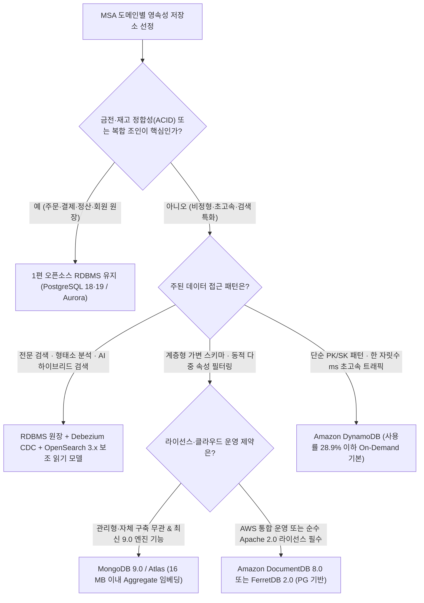

import Alert from '@/components/Alert.astro';
import Chart from '@/components/Chart.astro';
import GitHubRepoCard from '@/components/GitHubRepoCard.astro';
import LinkInline from '@/components/LinkInline.astro';
import LinkPreviewCard from '@/components/LinkPreviewCard.astro';

[1편에서 정리한 PostgreSQL·Aurora](/dev/msa-rdbms-mysql-mariadb-aurora)로 핵심 원장을 탄탄하게 잡아놓고도, 카테고리마다 수백 개씩 달라지는 상품 속성·초당 수만 건 장바구니 트래픽·한국어 형태소 검색(`LIKE '%키워드%'`)까지 RDBMS 하나에 우겨넣다 슬로우 쿼리와 샤딩 지옥에 빠지는 팀이 많습니다. 정합성이 생명인 원장과 과감히 분리해야 할 비정형·초고속 영역을 가르고, MSA 영속성 계층의 나머지 축인 **MongoDB**·**Amazon DynamoDB**·**OpenSearch**의 선택 공식을 정리합니다.

| 구분 | MongoDB (8.0 / 9.0) | Amazon DynamoDB | OpenSearch 3.x (vs Elasticsearch 9.x) |
| :--- | :--- | :--- | :--- |
| **데이터 모델** | 도큐먼트 (`BSON` 계층 문서) | 키-밸류 & 와이드 컬럼 (`PK` + `SK`) | 역색인(Inverted Index) + `k-NN` 벡터 |
| **라이선스·거버넌스** | **SSPL v1** (벤더 단독 · OSI 미인증) | AWS 완전관리형 독점 서비스 | **Apache 2.0** (Linux Foundation 중립 재단) |
| **내부 엔진·강점** | `WiredTiger` · 9.0 단건 읽기 35% 가속 | 3 AZ `Paxos` 리더 합의 · `MRSC` (`RPO=0`) | `Lucene 10` · `BM25` + 벡터 하이브리드 Fusion |
| **치명적 물리 제약·함정** | 도큐먼트 **16 MB** 상한 · 다중 TX 60초 제한 | 아이템 **400 KB** · 단일 파티션 **1,000 WCU** 한도 | 트랜잭션 부재 · `1s` 리프레시 지연 (원본 DB 불가) |
| **MSA 최적 도메인** | 다형성 카탈로그 · CMS · 게임 유저 상태 | 초고속 장바구니 · 세션 · 타임라인 · IoT 수집 | 한국어 형태소 상품·로그 검색 · AI RAG 보조 읽기 |

---

## RDBMS 샤딩의 고통과 폴리글랏 퍼시스턴스 원칙

트래픽이 단일 RDBMS 마스터 체급을 넘어서면 흔히 애플리케이션 레벨 수평 샤딩부터 떠올립니다. 하지만 주문 번호나 회원 ID로 RDBMS를 쪼개는 순간 관계형 DB의 핵심 무기들이 무력화됩니다.

- **분산 조인과 외래키 붕괴**: 샤드 간 `JOIN`과 외래키 제약이 깨져 애플리케이션 메모리에서 결과를 병합(Scatter-Gather)하는 무거운 코드가 늘어납니다.
- **리밸런싱 비용**: 샤드 증설 시 데이터 재분배와 이중 쓰기 검증에 막대한 운영 공수와 다운타임 위험이 따릅니다.
- **가변 스키마와 검색 병목**: 카테고리마다 속성이 판이한 상품을 정규화하면 기형적인 EAV(Entity-Attribute-Value) 조인이 발생하고, `LIKE '%무선청소기%'` 검색은 B-Tree 인덱스를 못 타 버퍼 풀을 풀스캔으로 고갈시킵니다.

이 한계를 넘으려 웹 스케일 기업들이 전용 분산 저장소를 개척한 흐름은 [빅데이터 잔혹사](/dev/bigdata-history-hadoop-to-ai)에서 짚었듯 오늘날 NoSQL 생태계의 뿌리가 되었습니다. 여기서 <LinkInline href="https://martinfowler.com/bliki/PolyglotPersistence.html" label="마틴 파울러의 폴리글랏 퍼시스턴스" /> 원칙이 출발합니다. **폴리글랏 퍼시스턴스**(Polyglot Persistence)란 단일 DB 만능주의를 버리고 마이크로서비스별 접근 패턴에 최적화된 저장소를 조합하는 전략이죠. 다만 반대 극단으로 치달을 때 터지는 두 가지 안티패턴은 반드시 피해야 합니다.

<Alert type="warning" title="실무에서 가장 비싼 대가를 치르는 2대 NoSQL 안티패턴">
① **이력서 주도 설계**(Resume-Driven)로 결제·정산·재고 원장까지 NoSQL에 넣는 실수: 단 1원의 오차도 허용되지 않는 원장을 결과적 일관성 NoSQL에 올렸다가 정합성이 깨져 애플리케이션 분산 락과 보상 로직을 덧대게 됩니다. 핵심 원장은 1편의 PostgreSQL·Aurora가 정답입니다.

② **검색 엔진**(OpenSearch·Elasticsearch)을 **단독 원본 DB**(Source of Truth)로 삼는 실수: 검색 엔진에는 트랜잭션 롤백이 없고 문서 색인 후 기본 리프레시 지연(`refresh_interval: 1s`)이 존재합니다. 형태소 사전이나 매핑 변경 시 전체 재색인(`Reindex`)이 필수라 원본 DB 없이 단독 운영하면 장애·재색인 중 영구 데이터 유실 사고를 겪습니다.
</Alert>

---

## 라이선스 전쟁과 탄생 계보: SSPL 쇼크부터 AGPLv3·Linux 재단 이관까지

오픈소스 RDBMS가 인수합병으로 갈라섰다면 NoSQL 지형도를 뒤흔든 건 **클라우드 매니지드 재판매를 둘러싼 라이선스 전쟁**이었습니다.

### 1) MongoDB: SSPL 전환 파장과 MongoDB 9.0 진화

2009년 AGPLv3로 출발한 **MongoDB**는 클라우드 벤더의 무임승차 매니지드 판매를 막으려 **2018년 10월 SSPL v1**(Server Side Public License, OSI 미인증)으로 전격 전환했습니다. DBaaS 제공 시 관리 스택 전체 소스 공개를 요구한 이 조치 직후, AWS는 호환 서비스 **Amazon DocumentDB**(현재 8.0 호환)를 출시했고 오픈소스 진영에선 PostgreSQL 위에서 동작하는 Apache 2.0 대안 **FerretDB**(2.0)가 등장했죠. 일반 기업이 자체 백엔드 DB로 쓰거나 공식 **MongoDB Atlas**를 쓰는 데는 SSPL 공개 의무가 발생하지 않습니다.

<GitHubRepoCard
  repo="mongodb/mongo"
  comment="MongoDB 코어 저장소. SSPL v1 기반으로 운영되며 8.0 엔진 개편에 이어 2026년 9월 9.0 GA로 성능과 암호화 검색을 크게 끌어올렸습니다."
/>

코어 엔진은 8.0에 이어 **2026년 9월 출시된 MongoDB 9.0**에서 단건 읽기 **35%**, 갱신 **30%** 추가 가속을 달성했습니다 <LinkInline href="https://www.mongodb.com/docs/manual/release-notes/9.0/" label="MongoDB 9.0 Release Notes" variant="badge" />. 암호화 상태 그대로 부분 문자열을 찾는 **Queryable Encryption 부분 문자열 검색** GA와 자율 트래픽 제어 기능인 **Intelligent Workload Management**까지 더해 본가의 기술 격차를 유지하고 있습니다(기본 문법은 [MongoDB 기초 가이드](/dev/mongodb-basics) 참고).

### 2) Amazon DynamoDB: 리더리스 논문에서 Paxos 합의와 MRSC까지

2007년 SOSP 학회에 발표된 아마존의 `Dynamo` 논문은 리더리스 링(Leaderless Ring)과 Vector Clock 기반 설계였지만, 운영 복잡도를 겪은 뒤 **2012년 1월 출시된 상용 Amazon DynamoDB**는 전혀 다른 구조로 태어났습니다.

<LinkPreviewCard
  url="https://www.amazon.science/publications/amazon-dynamodb-a-scalable-predictably-performant-and-fully-managed-nosql-database-service"
  title="Amazon DynamoDB: A Scalable, Predictably Performant, and Fully Managed NoSQL Database Service (USENIX ATC 2022)"
  siteName="Amazon Science"
  comment="상용 DynamoDB가 2007년 리더리스 논문과 달리 파티션별 3개 AZ Paxos 리더 합의 구조로 어떻게 한 자릿수 ms 응답과 강력한 일관성을 보장하는지 밝힌 USENIX ATC 2022 논문입니다."
/>

USENIX ATC 2022 논문이 밝혔듯 상용 DynamoDB는 파티션마다 3개 AZ에 걸친 **`Paxos` 리더 합의 그룹**을 두어 한 자릿수 ms의 일정한 응답과 **강력한 일관성 읽기**(Strongly Consistent Read)를 보장합니다. 나아가 **2025년 6월 말 Global Tables 다중 리전 강력한 일관성**(`Multi-Region Strong Consistency`, MRSC · `RPO=0`)까지 정식 지원하며 멀티 리전 무손실 원장 영역까지 발을 넓혔습니다 <LinkInline href="https://docs.aws.amazon.com/amazondynamodb/latest/developerguide/V2globaltables_HowItWorks.html" label="AWS DynamoDB MRSC" variant="badge" />.

### 3) Elasticsearch vs OpenSearch: 2024년 9월 Linux 재단 이관 대반전

2010년 Apache 2.0으로 출발한 **Elasticsearch**가 **2021년 1월** `SSPL/ELv2`로 전환하자, **2021년 4월** AWS 등이 마지막 Apache 2.0 버전(7.10.2)을 포크해 **OpenSearch**를 출범시켰습니다. 이후 2024년 하반기 단 18일 간격으로 극적인 반전이 일어납니다.

- **2024년 8월 29일**: Elastic이 8.16+ 버전부터 OSI 공인 **AGPLv3** 옵션을 추가하며 오픈소스 복귀를 선언했습니다.
- **2024년 9월 16일**: 불과 18일 뒤 AWS·SAP·Uber가 OpenSearch를 **Linux Foundation 산하 `OpenSearch Software Foundation`으로 전격 이관**해 단일 벤더 종속 없는 영구 **Apache 2.0** 중립 거버넌스를 확정했습니다 <LinkInline href="https://www.linuxfoundation.org/press/linux-foundation-announces-opensearch-software-foundation" label="Linux Foundation 발표" variant="badge" />.

<GitHubRepoCard
  repo="opensearch-project/OpenSearch"
  comment="2024년 9월 Linux Foundation 산하 중립 재단으로 이관된 Apache 2.0 검색·벡터 엔진. 보안·알림·벡터 검색까지 조건 없이 개방합니다."
/>

2026년 11월 현재 두 엔진은 **Apache Lucene 10**과 **JVM 21+**(Virtual Threads 등, [JVM 생태계 15년사](/dev/jvm-ecosystem-15-years) 참고) 위에서 **OpenSearch 3.10**(쿼리 내장 하이브리드 검색 Fusion, GPU 벡터 빌드)과 **Elasticsearch 9.6**으로 경쟁 중입니다. 다만 Elasticsearch는 코어에 네트워크 카피레프트 **AGPLv3**가 걸려 있고 고급 보안·일부 벡터/ML 기능이 유료 **ELv2** 계층으로 분리된 반면, OpenSearch는 보안(RBAC·감사 로그)·벡터·알림까지 **전체 기능을 Apache 2.0**으로 개방해 온프레미스·멀티클라우드 도입 장벽이 없습니다.

---

## 3대 엔진 내부 구조·물리 한도와 DynamoDB 비용 손익분기

### 1) MongoDB (`BSON + WiredTiger`): 16 MB 상한과 단일 도큐먼트 원자성

MongoDB의 단일 BSON 도큐먼트는 **16 MB 물리 상한**이 고정되어 있습니다. 무한히 늘어나는 댓글·이력을 배열로 임베딩하면 한도 초과 장애가 터지므로 원소 수가 제한된 하위 엔티티만 품고 이력은 별도 컬렉션이나 Bucket 패턴으로 분리해야 합니다. 또한 4.0+ 다중 도큐먼트 트랜잭션(기본 **60초 제한**)을 남용하면 WiredTiger 캐시가 과거 스냅샷을 붙잡아 Eviction 스톨을 부릅니다. **DDD Aggregate 단위로 한 도큐먼트에 임베딩해 단일 도큐먼트 원자성**으로 끝내고, 외부 전파는 Oplog 기반 **Change Streams**(`$changeStream`)에 맡기는 것이 정석입니다.

### 2) DynamoDB: Single-Table Design 물리 한도와 `28.9%` 손익분기

DynamoDB는 Partition Key 해싱과 Sort Key B-Tree 정렬(`PK = CUSTOMER#c_901`, `SK = ORDER#2026-11-25#ord_882`)로 이종 엔티티를 묶어 조인 없이 단일 `Query`로 꺼내는 **단일 테이블 설계**(Single-Table Design)를 씁니다. 목록 조회 역시 `OFFSET` 없이 `LastEvaluatedKey` 토큰 기반 커서 페이징만 지원하죠([REST API Offset vs Cursor 페이징](/dev/rest-api-pagination-offset-cursor) 참고).

반드시 외워야 할 물리 한도는 세 가지입니다. ① **아이템 최대 400 KB**(대용량 본문은 S3 분리), ② **단일 물리 파티션 1,000 WCU / 3,000 RCU 상한**(테이블 전체 여유가 남아도 특정 핫키에 몰리면 Hot Partition 스로틀링 발생 → 난수 접미사 **Write Sharding**이나 `WarmThroughput` 사전 분할로 방어), ③ **GSI 처리량 부족 시 역압력 전파**(GSI 쓰기 큐가 막히면 원본 테이블 쓰기까지 함께 스로틀링).

비용 공식도 바뀌었습니다. **2024년 11월 On-Demand 요금 50% 파격 인하**(`us-east-1` 백만 WRU당 `$1.25 → $0.625`)로 과거 기술 블로그의 14% 손익분기 공식은 완전히 깨졌어요. 1,000 WCU를 한 달 내내 켜두는 고정비(`$475`)와 비교할 때, **평균 사용률 28.9%**(약 29%) **이하인 변동성 트래픽에서는 용량 예측 없이도 On-Demand가 무조건 더 저렴**합니다. 낮과 새벽 편차가 큰 커머스·모바일 서비스는 `OnDemandThroughput`(`MaxReadRequestUnits`·`MaxWriteRequestUnits`) 상한만 걸어 둔 On-Demand로 출발하고, 24시간 내내 사용률이 35% 이상 평탄하게 유지되는 파이프라인에서만 Provisioned + 예약 용량으로 전환하는 편이 유리합니다.

<Chart
  type="line"
  height={310}
  caption="DynamoDB Provisioned(1,000 WCU 월 $475 고정) vs On-Demand(50% 인하 단가 적용) 사용률별 월 비용 비교 (us-east-1 기준 — 평균 사용률 28.9%에서 교차)"
  data={{
    labels: ['10%', '20%', '28.9% (손익분기)', '50%', '80%'],
    datasets: [
      {
        label: 'On-Demand 모드 (월 $ · 50% 인하 단가)',
        data: [164, 329, 475, 821, 1314],
        borderColor: '#10b981',
        backgroundColor: 'rgba(16, 185, 129, 0.12)',
        tension: 0.2
      },
      {
        label: 'Provisioned 1,000 WCU 고정 (월 $475)',
        data: [475, 475, 475, 475, 475],
        borderColor: '#6366f1',
        backgroundColor: 'rgba(99, 102, 241, 0.12)',
        borderDash: [6, 4],
        tension: 0
      }
    ]
  }}
/>

### 3) OpenSearch + RDBMS 동기화 표준: Transactional Outbox + Debezium CDC

애플리케이션에서 RDBMS 저장 직후 OpenSearch API를 직접 호출하는 **Dual Write**는 타임아웃·재시작·동시 수정 역전(Race Condition) 시 영구 데이터 불일치를 낳습니다. 정석 해법은 **CQRS + Transactional Outbox + Debezium CDC** 아키텍처입니다.

<figure class="not-prose my-6">
  <svg viewBox="0 0 860 420" class="w-full h-auto rounded-lg border border-border bg-card p-4" role="img" aria-label="애플리케이션 Dual Write 안티패턴과 Transactional Outbox 및 Debezium CDC 기반 OpenSearch 3.x CQRS 동기화 파이프라인 비교 도식">
    <defs>
      <marker id="dw-red" viewBox="0 0 10 10" refX="8" refY="5" markerWidth="6" markerHeight="6" orient="auto-start-reverse">
        <path d="M 0 1 L 10 5 L 0 9 z" fill="#ef4444" />
      </marker>
      <marker id="dw-emerald" viewBox="0 0 10 10" refX="8" refY="5" markerWidth="6" markerHeight="6" orient="auto-start-reverse">
        <path d="M 0 1 L 10 5 L 0 9 z" fill="#10b981" />
      </marker>
    </defs>
    <rect x="16" y="16" width="828" height="158" rx="10" fill="rgba(239, 68, 68, 0.06)" stroke="#ef4444" stroke-width="1.5" />
    <text x="32" y="42" font-size="13.5" font-weight="700" class="fill-red-600 dark:fill-red-400">안티패턴: 애플리케이션 이중 쓰기 (Dual Write — 부분 실패 시 영구 데이터 불일치)</text>
    <rect x="32" y="60" width="186" height="96" rx="8" fill="var(--background)" stroke="var(--border)" />
    <text x="46" y="84" font-size="12" font-weight="700" fill="var(--foreground)">상품·주문 서비스 (App)</text>
    <text x="46" y="106" font-size="10.5" fill="var(--muted-foreground)">① RDBMS 트랜잭션 커밋</text>
    <text x="46" y="124" font-size="10.5" fill="var(--muted-foreground)">② OpenSearch 직접 호출</text>
    <text x="46" y="142" font-size="10" class="fill-red-600 dark:fill-red-400">원자성 묶음 불가 (분산 상태)</text>
    <line x1="218" y1="84" x2="332" y2="84" stroke="#10b981" stroke-width="1.8" marker-end="url(#dw-emerald)" />
    <text x="234" y="75" font-size="10" font-weight="600" class="fill-emerald-700 dark:fill-emerald-400">① COMMIT 성공</text>
    <rect x="336" y="56" width="214" height="48" rx="7" fill="var(--background)" stroke="var(--border)" />
    <text x="350" y="76" font-size="11.5" font-weight="700" fill="var(--foreground)">PostgreSQL 원본 원장</text>
    <text x="350" y="94" font-size="10.5" class="fill-emerald-700 dark:fill-emerald-400">할인가 29,000원 정상 반영</text>
    <line x1="218" y1="136" x2="332" y2="136" stroke="#ef4444" stroke-width="1.8" stroke-dasharray="4 3" marker-end="url(#dw-red)" />
    <text x="221" y="127" font-size="9.5" font-weight="600" class="fill-red-600 dark:fill-red-400">② 타임아웃·OOM 실패!</text>
    <rect x="336" y="112" width="214" height="48" rx="7" fill="var(--background)" stroke="#ef4444" />
    <text x="350" y="132" font-size="11.5" font-weight="700" fill="var(--foreground)">OpenSearch 검색 인덱스</text>
    <text x="350" y="150" font-size="10.5" class="fill-red-600 dark:fill-red-400">구 가격 35,000원 영구 방치</text>
    <rect x="572" y="56" width="256" height="104" rx="8" fill="var(--card)" stroke="#ef4444" stroke-dasharray="4 3" />
    <text x="586" y="79" font-size="11.5" font-weight="700" class="fill-red-600 dark:fill-red-400">실무 장애 3대 발생 지점</text>
    <text x="586" y="100" font-size="10.5" fill="var(--muted-foreground)">• 네트워크 순단·재배포 시 이벤트 증발</text>
    <text x="586" y="120" font-size="10.5" fill="var(--muted-foreground)">• 동시 수정 시 도착 순서 역전(Race)</text>
    <text x="586" y="140" font-size="10.5" fill="var(--muted-foreground)">• 동기 결합 시 검색 장애가 원장 전이</text>
    <rect x="16" y="190" width="828" height="214" rx="10" fill="rgba(16, 185, 129, 0.07)" stroke="#10b981" stroke-width="1.6" />
    <text x="32" y="216" font-size="13.5" font-weight="700" class="fill-emerald-700 dark:fill-emerald-400">표준 아키텍처: Transactional Outbox + Debezium CDC + OpenSearch 3.x CQRS 파이프라인</text>
    <rect x="32" y="236" width="124" height="122" rx="8" fill="var(--background)" stroke="var(--border)" />
    <text x="44" y="260" font-size="11.5" font-weight="700" fill="var(--foreground)">명령 서비스</text>
    <text x="44" y="278" font-size="10" fill="var(--muted-foreground)">(Write Model)</text>
    <text x="44" y="302" font-size="10.5" fill="var(--muted-foreground)">단일 로컬 TX로</text>
    <text x="44" y="320" font-size="10.5" fill="var(--muted-foreground)">원장 + Outbox</text>
    <text x="44" y="338" font-size="10.5" class="fill-emerald-700 dark:fill-emerald-400">원자적 커밋</text>
    <line x1="156" y1="297" x2="188" y2="297" stroke="#10b981" stroke-width="2" marker-end="url(#dw-emerald)" />
    <text x="159" y="287" font-size="9.5" font-weight="600" fill="var(--muted-foreground)">ACID</text>
    <rect x="192" y="236" width="168" height="122" rx="8" fill="var(--background)" stroke="#10b981" />
    <text x="204" y="258" font-size="11.5" font-weight="700" fill="var(--foreground)">PostgreSQL / Aurora</text>
    <rect x="204" y="268" width="144" height="36" rx="5" fill="var(--card)" stroke="var(--border)" />
    <text x="212" y="290" font-size="10.5" fill="var(--foreground)">products (원본 원장)</text>
    <rect x="204" y="310" width="144" height="38" rx="5" fill="rgba(16, 185, 129, 0.12)" stroke="#10b981" />
    <text x="212" y="333" font-size="10.5" font-weight="600" class="fill-emerald-700 dark:fill-emerald-400">outbox_events 테이블</text>
    <line x1="360" y1="297" x2="398" y2="297" stroke="#10b981" stroke-width="2" marker-end="url(#dw-emerald)" />
    <text x="365" y="287" font-size="9.5" font-weight="600" fill="var(--muted-foreground)">WAL</text>
    <rect x="402" y="236" width="164" height="122" rx="8" fill="var(--background)" stroke="var(--border)" />
    <text x="414" y="258" font-size="11.5" font-weight="700" fill="var(--foreground)">Debezium + Kafka</text>
    <text x="414" y="280" font-size="10.5" fill="var(--muted-foreground)">Outbox Event Router</text>
    <text x="414" y="300" font-size="10.5" fill="var(--muted-foreground)">WAL 스트리밍 캡처</text>
    <text x="414" y="320" font-size="10" fill="var(--muted-foreground)">key = aggregate_id</text>
    <text x="414" y="338" font-size="10" class="fill-emerald-700 dark:fill-emerald-400">동일 상품 순서 보장</text>
    <line x1="566" y1="297" x2="604" y2="297" stroke="#10b981" stroke-width="2" marker-end="url(#dw-emerald)" />
    <text x="568" y="287" font-size="9.5" font-weight="600" fill="var(--muted-foreground)">Upsert</text>
    <rect x="608" y="236" width="220" height="122" rx="8" fill="var(--background)" stroke="#10b981" />
    <text x="620" y="258" font-size="11.5" font-weight="700" fill="var(--foreground)">OpenSearch 3.10 (Read)</text>
    <text x="620" y="280" font-size="10.5" fill="var(--muted-foreground)">문서 _id = aggregate_id 지정</text>
    <text x="620" y="300" font-size="10.5" fill="var(--muted-foreground)">• BM25 (nori 한국어 형태소)</text>
    <text x="620" y="318" font-size="10.5" fill="var(--muted-foreground)">• k-NN 벡터 하이브리드 검색</text>
    <text x="620" y="338" font-size="10.5" font-weight="600" class="fill-emerald-700 dark:fill-emerald-400">수백 ms 내 무손실 동기화</text>
    <text x="32" y="384" font-size="10.5" font-weight="600" class="fill-emerald-700 dark:fill-emerald-400">핵심 원리: 최소 1회(At-Least-Once) 로그 발행 + 엔티티 ID 기반 멱등 덮어쓰기 → 검색 엔진 점검·장애 시에도 핵심 원장 트랜잭션 100% 보호</text>
  </svg>
  <figcaption class="mt-2 text-center text-sm text-muted-foreground">Dual Write 안티패턴과 Transactional Outbox + Debezium CDC 파이프라인 비교 — 로컬 트랜잭션 원자성과 WAL 스트리밍으로 원장 보호와 검색 동기화를 함께 해결한다</figcaption>
</figure>

<GitHubRepoCard
  repo="debezium/debezium"
  comment="PostgreSQL WAL·MySQL Binlog·MongoDB Oplog를 실시간 캡처하는 오픈소스 CDC 표준. Outbox Event Router SMT를 기본 제공합니다."
/>

1편 RDBMS의 단일 로컬 트랜잭션 안에서 원본 테이블과 `outbox_events`를 원자적으로 커밋하면, **Debezium CDC**(`Outbox Event Router`)가 폴링 부하 없이 WAL/Binlog를 읽어 `aggregateid`를 파티션 키로 Kafka에 발행합니다. 이어서 컨슈머가 엔티티 ID를 OpenSearch 문서 `_id`로 지정하고 원장 버전(`_doc` 색인 API + `version_type=external_gte`)을 대조하며 **멱등 덮어쓰기**([REST API 멱등성 가이드](/dev/rest-api-idempotency-async-202) 참고)를 수행하면 재시도로 중복·역전 메시지가 들어와도 정합성이 흔들리지 않아요. 이렇게 갱신된 읽기 모델 위에서 **BM25**(`nori` 한국어 형태소) 키워드 일치와 **`knn` 벡터 하이브리드 검색**을 단일 파이프라인으로 결합해 수백 ms 내 응답하게 됩니다.

PostgreSQL 18+ Outbox 트랜잭션과 `POST /products_v3/_search?search_pipeline=korean-hybrid-rrf`로 호출하는 OpenSearch 3.10 `hybrid` 검색 본문 예시는 다음과 같습니다.

```sql
-- PostgreSQL 18+: 원본 수정과 Outbox 이벤트 적재를 단일 로컬 트랜잭션으로 커밋
CREATE TABLE outbox_events (
    id UUID PRIMARY KEY DEFAULT uuidv7(),
    aggregatetype VARCHAR(64) NOT NULL,
    aggregateid VARCHAR(64) NOT NULL,
    type VARCHAR(64) NOT NULL,
    payload JSONB NOT NULL,
    created_at TIMESTAMPTZ NOT NULL DEFAULT now()
);

BEGIN;

UPDATE products
   SET price = 29000, version = version + 1, updated_at = now()
 WHERE id = 'prod_9042';

INSERT INTO outbox_events (aggregatetype, aggregateid, type, payload)
VALUES (
    'product',
    'prod_9042',
    'ProductUpserted',
    jsonb_build_object(
        'productId', 'prod_9042',
        'title', '초경량 무선 진공청소기 프로',
        'price', 29000,
        'version', 12
    )
);

COMMIT;
```

```json
{
  "size": 20,
  "query": {
    "hybrid": {
      "queries": [
        {
          "bool": {
            "must": [
              {
                "multi_match": {
                  "query": "원룸 조용한 무선청소기",
                  "fields": ["title.nori^3", "description.nori"],
                  "operator": "and"
                }
              }
            ],
            "filter": [{ "range": { "price": { "lte": 50000 } } }]
          }
        },
        {
          "knn": {
            "embedding_vector": {
              "vector": [0.0214, -0.0481, 0.0892, 0.0135],
              "k": 50,
              "filter": { "range": { "price": { "lte": 50000 } } }
            }
          }
        }
      ]
    }
  }
}
```

---

## 최종 폴리글랏 조합 의사결정 트리와 다음 단계

도메인별 정합성 수준과 쿼리 패턴에 따라 아래 의사결정 트리로 영속성 저장소를 조합해 보세요.



폴리글랏 퍼시스턴스의 성패는 저장소 개수가 아니라 **역할 경계의 명확성**에서 갈립니다. 돈과 계약의 진실 공급원(Source of Truth)은 PostgreSQL·Aurora가 지키고, 가변 스키마 카탈로그는 **MongoDB 9.0**, 초고속 키-밸류 워크로드는 `28.9%` 손익분기를 반영한 **DynamoDB**, 한국어 형태소·벡터 결합 검색은 Outbox + CDC로 동기화한 **OpenSearch 3.10**에 맡길 때 비로소 샤딩 지옥 없는 수평 확장이 완성됩니다.

디스크 기반 영속성 계층을 모두 정리했다면 이제 마이크로초 단위로 응답 속도를 당기고 동시성 경합을 제어할 차례입니다. 이어지는 [**시리즈 3편: Redis vs Valkey, JWT 세션과 분산 락 실전**](/dev/msa-redis-valkey-session-lock)에서는 인메모리 데이터 계층의 라이선스 분화와 실무 동시성 패턴을 마저 완성합니다.

## 참고 자료

- [PolyglotPersistence — Martin Fowler](https://martinfowler.com/bliki/PolyglotPersistence.html)
- [Release Notes for MongoDB 9.0 — MongoDB Manual](https://www.mongodb.com/docs/manual/release-notes/9.0/)
- [Amazon DynamoDB: A Scalable, Predictably Performant, and Fully Managed NoSQL Database Service — USENIX ATC 2022](https://www.amazon.science/publications/amazon-dynamodb-a-scalable-predictably-performant-and-fully-managed-nosql-database-service)
- [Global Tables: How It Works (Multi-Region Strong Consistency) — Amazon DynamoDB Developer Guide](https://docs.aws.amazon.com/amazondynamodb/latest/developerguide/V2globaltables_HowItWorks.html)
- [Linux Foundation Announces OpenSearch Software Foundation — The Linux Foundation](https://www.linuxfoundation.org/press/linux-foundation-announces-opensearch-software-foundation)
- [Outbox Event Router SMT — Debezium Documentation](https://debezium.io/documentation/reference/stable/transformations/outbox-event-router.html)
