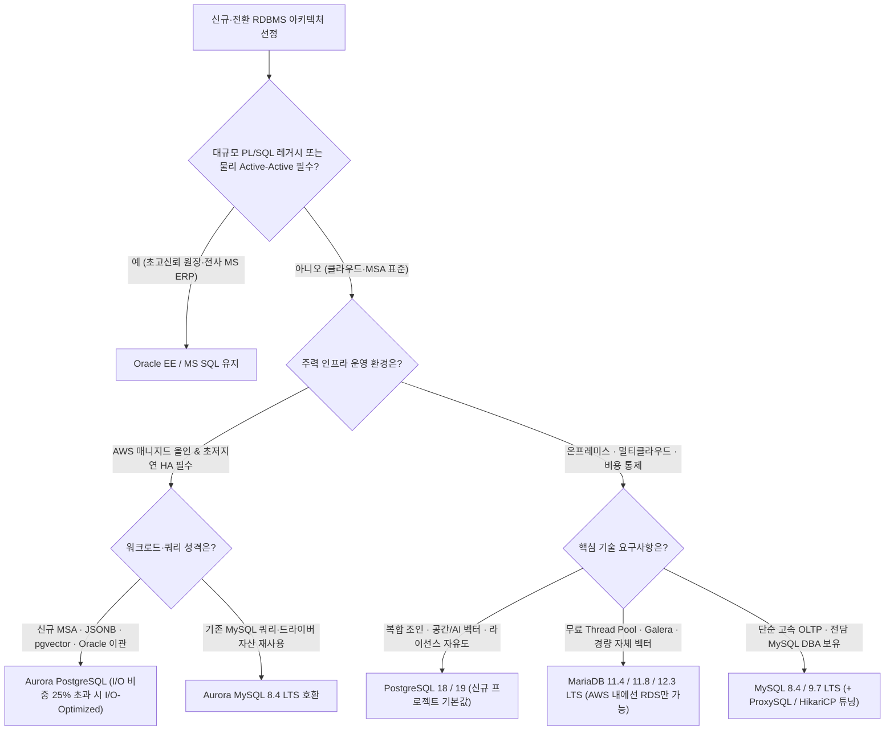

import Alert from '@/components/Alert.astro';
import Chart from '@/components/Chart.astro';
import GitHubRepoCard from '@/components/GitHubRepoCard.astro';
import LinkPreviewCard from '@/components/LinkPreviewCard.astro';

신규 마이크로서비스(MSA)를 설계하거나 클라우드 전환 프로젝트를 열면 Oracle과 MS SQL Server는 대개 첫 아키텍처 회의 전에 후보에서 빠집니다. 그 자리를 채우는 건 **MySQL**, **MariaDB**, **Amazon Aurora**, 그리고 **PostgreSQL** 네 가지죠. 왜 상용 RDBMS 거인들이 클라우드 네이티브 현장에서 밀려났는지, 한 뿌리에서 갈라진 오픈소스 DB들이 2026년 현재 어떻게 전혀 다른 엔진이 되었는지 실전 의사결정 기준으로 정리합니다.

| 구분 | MySQL (8.4 / 9.7 LTS) | MariaDB (11.4 / 11.8 / 12.3 LTS) | Amazon Aurora (MySQL / PG 호환) | PostgreSQL (18 / 19) |
| :--- | :--- | :--- | :--- | :--- |
| **라이선스** | GPLv2 + 상용 듀얼 | GPLv2 (커뮤니티 기능 개방) | AWS 매니지드 독점 서비스 | **PostgreSQL License** (MIT·BSD급) |
| **스토리지·HA** | 단일 InnoDB + Group Replication | 멀티 엔진(Aria·MyRocks) + Galera | **분산 로그 스토리지**(3 AZ 6벌 복제) | Heap MVCC + 스트리밍·논리 복제 |
| **JSON 처리** | **이진 JSON** + 부분 갱신·멀티밸류 인덱스 | `LONGTEXT` 별칭 + `JSON_VALID` | 호환 엔진(MySQL / PG) 스펙 추종 | **`JSONB` 이진 저장** + GIN 고속 인덱스 |
| **AI 벡터 검색** | 9.x `VECTOR` (HNSW는 HeatWave 전용) | **11.8+ `MariaDB Vector`** (무료 HNSW) | Aurora PostgreSQL `pgvector` 최적화 | **`pgvector`** (오픈소스 RAG 표준) |
| **핵심 강점** | 풍부한 단순 OLTP 레퍼런스 | 무료 Thread Pool, 온프레미스 자립성 | 복제 지연 10～20ms 미만, 30초 승격 | 복잡 조인 옵티마이저, `uuidv7()` |
| **2026 권장처** | 검증된 대규모 단순 OLTP 워크로드 | 온프레미스·프라이빗 클라우드 구축 | AWS 올인 조직의 무중단 핵심 DB | **신규 MSA 기본값**, Oracle 이관, AI |

---

## 왜 클라우드·MSA에서는 Oracle·MS SQL 대신 오픈소스 RDBMS가 표준이 되었나?

"핵심 원장은 무조건 상용 DB에 넣는다"던 오랜 공식은 기술 한계보다 **라이선스 과금 체계와 수평 확장**(Scale-out)의 충돌에서 먼저 깨졌습니다.

### 1) 코어 라이선스와 Database per Service의 정면충돌

상용 RDBMS의 가격표는 대형 물리 서버 한두 대를 수직 확장하던 시대에 머물러 있습니다.

- **Oracle EE**: 프로세서당 정가 **$47,500**에 RAC 옵션 **$23,000**, 매년 정가의 **22%** 규모 유지보수비가 붙습니다. 특히 AWS(EC2·RDS)·Azure 등 공인 클라우드에서는 온프레미스 x86의 **Core Factor**(0.5) 할인이 배제되어 하이퍼스레딩 활성 시 `2 vCPU = 1 라이선스`로 계산되므로 체감 코어 단가가 **2배**로 뜁니다. RDS License Included 모델은 SE2만 가능하고 EE는 BYOL이 필수죠.
- **MS SQL Server EE**: 2코어 팩 정가가 **$15,123**인데, VM이나 컨테이너에 1～2 vCPU만 할당해도 **인스턴스당 최소 4코어 라이선스**($30,246 상당)를 강제합니다. API 게이트웨이와 커넥션 풀을 거치는 웹 환경 특성상 접속 사용자 수(CAL) 산정이 불가능해 코어 라이선스를 피할 수 없거든요.

결국 서비스마다 독립 DB를 쪼개는 **Database per Service** 패턴과 오토스케일링을 도입하면 라이선스 비용이 기하급수적으로 폭발합니다.

### 2) 비즈니스 로직의 이동과 매니지드 HA

모놀리식 시절엔 네트워크 왕복을 줄이려 `PL/SQL`·`T-SQL` 프로시저에 로직을 몰아넣었지만, MSA에서 여러 서비스가 한 DB에 묶이면 배포가 마비되는 *Integration Database* 안티패턴에 빠집니다. 현대 백엔드는 도메인 규칙을 [Spring Boot 애플리케이션 계층의 Entity·VO](/dev/java-dto-vo-spring-hybrid)로 옮기고 DB는 순수 상태 저장과 단순 OLTP 쿼리에 집중시킵니다. 과거 Oracle RAC를 쓰던 주된 이유였던 무중단 HA 역시 클라우드 Multi-AZ와 스토리지 쿼럼 복제가 대체했죠.

실제로 아마존 소비자 사업부는 2019년 10월 완료한 **Project Rolling Stone**을 통해 약 **7,500개 Oracle DB**(75 PB)를 Aurora·DynamoDB·RDS로 이전하며 **DB 운영비 60% 이상 절감과 지연 시간 40% 단축**을 입증했습니다.

<Alert type="info" title="상용 RDBMS가 여전히 유효한 3가지 예외 현장">
① **제1금융권 코어 원장·증권 체결계**: 물리적 Active-Active(Exadata/RAC) 구조와 장애 시 벤더 엔지니어 상주 보증이 절대적인 영역.

② **초대형 PL/SQL 레거시**(Brownfield): 수십만 줄에 달하는 `PL/SQL` 패키지 재작성 리스크와 비용이 라이선스 절감액을 웃도는 시스템.

③ **전사 MS 스택 강결합 ERP**: `.NET`, Active Directory, SSIS, Power BI가 단일 생태계로 맞물려 돌아가는 사내 기간계.
</Alert>

---

## 탄생 배경과 계보: MySQL → MariaDB → Amazon Aurora

오픈소스 RDBMS 선택지들이 왜 지금처럼 분화됐는지 이해하려면 스웨덴에서 출발해 인수합병과 클라우드 재설계로 이어진 계보를 봐야 합니다.

### 1) MySQL(1995)에서 MariaDB(2009) 하드 포크까지

1995년 5월 스웨덴 `MySQL AB`의 **Michael "Monty" Widenius**는 첫째 딸 **My**의 이름을 딴 **MySQL**을 공개하며 LAMP 스택의 전성기를 열었습니다. 그러나 2008년 1월 Sun Microsystems가 10억 달러에 MySQL을 인수한 뒤, 2009년 4월 **Oracle이 74억 달러 규모 Sun 인수를 발표**(2010년 1월 완료)하며 운명이 요동쳤습니다([오라클의 인수부터 자바의 역습까지: JVM 생태계 15년사](/dev/jvm-ecosystem-15-years) 참고).

최대 상용 DB 경쟁사 손에 코드가 넘어간 직후인 2009년 10월, 오픈소스 폐쇄를 우려한 Monty는 MySQL 5.1을 기반으로 둘째 딸 **Maria**의 이름을 딴 **MariaDB**를 하드 포크하고 2012년 비영리 MariaDB Foundation을 세웠습니다. 이후 **2014년 MariaDB 10.0**부터 MySQL 버전 번호 추종을 멈추고 독자 노선으로 완전히 갈라섰죠.

### 2) Amazon Aurora(2014～): "The Log is the Database"

클라우드 초기의 일반 RDS(EBS 마운트)는 트랜잭션 1건마다 16KB 데이터 페이지, Doublewrite 버퍼, Redo 로그, Binlog 등이 네트워크를 중복 통과하는 **쓰기 증폭**(Write Amplification) 병목이 심했습니다. 이를 해결하려고 AWS가 2014년 공개한 클라우드 네이티브 RDBMS가 **Amazon Aurora**(2015년 7월 MySQL 호환 GA, 2017년 10월 PostgreSQL 호환 GA)입니다.

<LinkPreviewCard
  url="https://www.amazon.science/publications/amazon-aurora-design-considerations-for-high-throughput-cloud-native-relational-databases"
  title="Amazon Aurora: Design Considerations for High Throughput Cloud-Native Relational Databases (SIGMOD 2017)"
  siteName="Amazon Science"
  comment="Verbitski 외 저자진이 발표한 SIGMOD 2017 논문. 네트워크에 Redo 로그만 흘려보내 쓰기 증폭을 제거한 Aurora 스토리지 엔진의 핵심 설계 원전입니다."
/>

SIGMOD 2017 논문이 제시한 핵심 원리는 `"The Log is the Database"`입니다.

- **Redo 로그 전용 전송**: 컴퓨팅 노드는 16KB 더티 페이지나 Doublewrite 버퍼를 네트워크로 쓰지 않고 **오직 가벼운 Redo 로그 레코드만 분산 스토리지 계층으로 전송**합니다. 페이지 합성은 스토리지가 백그라운드에서 직접 수행하므로 네트워크 I/O가 **약 7.7배 절감**되고, 동일 사양 대비 **최대 5배 처리량**과 즉각적인 크래시 리커버리를 달성합니다.
- **3개 AZ 6벌 복제와 4/6 쿼럼**: 볼륨은 10GB 세그먼트 단위로 **3개 AZ에 각 2벌씩 총 6벌**(`V=6`) 복제됩니다. **쓰기 쿼럼 4/6**(`Vw=4`), **읽기 쿼럼 3/6**(`Vr=3`)으로 동작해 `AZ + 1` 장애에도 데이터를 지켜내며 최대 **256 TiB**까지 자동 확장됩니다.
- **공유 스토리지 Read Replica**: 최대 **15개 Read Replica**가 디스크 복제 없이 동일 스토리지 볼륨을 마운트하고 메모리 갱신용 Redo 스트림만 받습니다. 덕분에 **복제 지연이 통상 10～20ms 미만**이고 페일오버는 **30초 이내**에 끝납니다.

<figure class="not-prose my-6">
  <svg viewBox="0 0 860 390" class="w-full h-auto rounded-lg border border-border bg-card p-4" role="img" aria-label="기존 EBS 기반 클라우드 RDS의 쓰기 증폭 구조와 Amazon Aurora의 Redo 로그 기반 공유 스토리지 아키텍처 비교 도식">
    <defs>
      <marker id="arr-red" viewBox="0 0 10 10" refX="8" refY="5" markerWidth="6" markerHeight="6" orient="auto-start-reverse">
        <path d="M 0 1 L 10 5 L 0 9 z" fill="#ef4444" />
      </marker>
      <marker id="arr-emerald" viewBox="0 0 10 10" refX="8" refY="5" markerWidth="6" markerHeight="6" orient="auto-start-reverse">
        <path d="M 0 1 L 10 5 L 0 9 z" fill="#10b981" />
      </marker>
      <marker id="arr-muted" viewBox="0 0 10 10" refX="8" refY="5" markerWidth="6" markerHeight="6" orient="auto-start-reverse">
        <path d="M 0 1 L 10 5 L 0 9 z" fill="var(--muted-foreground)" />
      </marker>
    </defs>
    <rect x="16" y="16" width="392" height="358" rx="10" fill="rgba(239, 68, 68, 0.06)" stroke="#ef4444" stroke-width="1.5" />
    <text x="32" y="42" font-size="13.5" font-weight="700" class="fill-red-600 dark:fill-red-400">기존 클라우드 RDS (EBS 기반 쓰기 증폭)</text>
    <rect x="32" y="62" width="168" height="84" rx="8" fill="var(--background)" stroke="var(--border)" />
    <text x="46" y="86" font-size="12" font-weight="700" fill="var(--foreground)">Primary 인스턴스</text>
    <text x="46" y="106" font-size="10.5" fill="var(--muted-foreground)">InnoDB Buffer Pool</text>
    <text x="46" y="124" font-size="10.5" fill="var(--muted-foreground)">더티 페이지 직접 플러시</text>
    <rect x="224" y="62" width="168" height="84" rx="8" fill="var(--background)" stroke="var(--border)" />
    <text x="238" y="86" font-size="12" font-weight="700" fill="var(--foreground)">Read Replica</text>
    <text x="238" y="106" font-size="10.5" fill="var(--muted-foreground)">Binlog 수신 후 SQL 재실행</text>
    <text x="238" y="124" font-size="10.5" class="fill-red-600 dark:fill-red-400">고부하 시 수 초～수 분 지연</text>
    <line x1="200" y1="104" x2="220" y2="104" stroke="#ef4444" stroke-width="1.5" marker-end="url(#arr-red)" />
    <text x="184" y="56" font-size="10" fill="var(--muted-foreground)">Binlog 전송</text>
    <line x1="76" y1="146" x2="76" y2="246" stroke="#ef4444" stroke-width="1.8" marker-end="url(#arr-red)" />
    <line x1="116" y1="146" x2="116" y2="246" stroke="#ef4444" stroke-width="1.8" marker-end="url(#arr-red)" />
    <line x1="156" y1="146" x2="156" y2="246" stroke="#ef4444" stroke-width="1.8" marker-end="url(#arr-red)" />
    <rect x="34" y="168" width="164" height="58" rx="6" fill="var(--card)" stroke="#ef4444" stroke-dasharray="3 2" />
    <text x="42" y="187" font-size="10.5" font-weight="600" class="fill-red-600 dark:fill-red-400">다중 중복 네트워크 I/O</text>
    <text x="42" y="204" font-size="10" fill="var(--muted-foreground)">16KB 페이지 + Doublewrite</text>
    <text x="42" y="219" font-size="10" fill="var(--muted-foreground)">+ Redo + Binlog 중복 기록</text>
    <line x1="308" y1="146" x2="308" y2="246" stroke="#ef4444" stroke-width="1.8" marker-end="url(#arr-red)" />
    <text x="316" y="198" font-size="10" fill="var(--muted-foreground)">중복 디스크 쓰기</text>
    <rect x="32" y="252" width="168" height="104" rx="8" fill="var(--background)" stroke="var(--border)" />
    <text x="46" y="276" font-size="11.5" font-weight="700" fill="var(--foreground)">Primary 전용 EBS</text>
    <text x="46" y="296" font-size="10.5" fill="var(--muted-foreground)">스토리지 미러링 추가 증폭</text>
    <text x="46" y="314" font-size="10.5" fill="var(--muted-foreground)">용량 사전 프로비저닝 필요</text>
    <text x="46" y="334" font-size="10" class="fill-red-600 dark:fill-red-400">쓰기 병목 및 복구 지연</text>
    <rect x="224" y="252" width="168" height="104" rx="8" fill="var(--background)" stroke="var(--border)" />
    <text x="238" y="276" font-size="11.5" font-weight="700" fill="var(--foreground)">Replica 독립 EBS</text>
    <text x="238" y="296" font-size="10.5" fill="var(--muted-foreground)">리플리카 수만큼 볼륨 복제</text>
    <text x="238" y="314" font-size="10.5" fill="var(--muted-foreground)">노드 추가 시 데이터 복사 시간</text>
    <text x="238" y="334" font-size="10" fill="var(--muted-foreground)">스토리지 비용 중복 과금</text>
    <rect x="426" y="16" width="418" height="358" rx="10" fill="rgba(16, 185, 129, 0.07)" stroke="#10b981" stroke-width="1.6" />
    <text x="442" y="42" font-size="13.5" font-weight="700" class="fill-emerald-700 dark:fill-emerald-400">Amazon Aurora (로그 전용 전송 + 공유 스토리지)</text>
    <rect x="442" y="62" width="184" height="84" rx="8" fill="var(--background)" stroke="var(--border)" />
    <text x="456" y="86" font-size="12" font-weight="700" fill="var(--foreground)">Primary Writer</text>
    <text x="456" y="106" font-size="10.5" fill="var(--muted-foreground)">16KB 페이지·Doublewrite 생략</text>
    <text x="456" y="124" font-size="10.5" class="fill-emerald-700 dark:fill-emerald-400">네트워크 I/O 약 7.7배 절감</text>
    <rect x="644" y="62" width="184" height="84" rx="8" fill="var(--background)" stroke="var(--border)" />
    <text x="658" y="86" font-size="12" font-weight="700" fill="var(--foreground)">Read Replicas (최대 15대)</text>
    <text x="658" y="106" font-size="10.5" fill="var(--muted-foreground)">메모리 캐시 갱신 스트림 수신</text>
    <text x="658" y="124" font-size="10.5" class="fill-emerald-700 dark:fill-emerald-400">복제 지연 10～20ms · 승격 30초</text>
    <line x1="626" y1="104" x2="640" y2="104" stroke="#10b981" stroke-width="1.5" marker-end="url(#arr-emerald)" />
    <text x="602" y="56" font-size="10" fill="var(--muted-foreground)">Redo 캐시 갱신</text>
    <line x1="534" y1="146" x2="534" y2="232" stroke="#10b981" stroke-width="2.4" marker-end="url(#arr-emerald)" />
    <rect x="444" y="166" width="180" height="46" rx="6" fill="var(--card)" stroke="#10b981" />
    <text x="454" y="185" font-size="10.5" font-weight="700" class="fill-emerald-700 dark:fill-emerald-400">가벼운 Redo 로그만 전송</text>
    <text x="454" y="202" font-size="10" fill="var(--muted-foreground)">동일 사양 최대 5배 처리량</text>
    <line x1="726" y1="146" x2="726" y2="232" stroke="var(--muted-foreground)" stroke-width="1.5" stroke-dasharray="4 3" marker-end="url(#arr-muted)" />
    <text x="736" y="186" font-size="10" fill="var(--muted-foreground)">복제 쓰기 없이</text>
    <text x="736" y="201" font-size="10" fill="var(--muted-foreground)">동일 볼륨 공유 읽기</text>
    <rect x="442" y="238" width="386" height="118" rx="8" fill="var(--background)" stroke="#10b981" stroke-width="1.4" />
    <text x="456" y="260" font-size="11.5" font-weight="700" fill="var(--foreground)">분산 공유 스토리지 계층 (10GB 세그먼트 · 최대 256 TiB 자동 확장)</text>
    <rect x="456" y="272" width="112" height="52" rx="6" fill="rgba(16, 185, 129, 0.10)" stroke="#10b981" />
    <text x="470" y="292" font-size="11" font-weight="700" fill="var(--foreground)">AZ-a (2벌)</text>
    <text x="470" y="310" font-size="10" fill="var(--muted-foreground)">로그 → 페이지 합성</text>
    <rect x="579" y="272" width="112" height="52" rx="6" fill="rgba(16, 185, 129, 0.10)" stroke="#10b981" />
    <text x="593" y="292" font-size="11" font-weight="700" fill="var(--foreground)">AZ-b (2벌)</text>
    <text x="593" y="310" font-size="10" fill="var(--muted-foreground)">로그 → 페이지 합성</text>
    <rect x="702" y="272" width="112" height="52" rx="6" fill="rgba(16, 185, 129, 0.10)" stroke="#10b981" />
    <text x="716" y="292" font-size="11" font-weight="700" fill="var(--foreground)">AZ-c (2벌)</text>
    <text x="716" y="310" font-size="10" fill="var(--muted-foreground)">로그 → 페이지 합성</text>
    <text x="456" y="344" font-size="10.5" font-weight="600" class="fill-emerald-700 dark:fill-emerald-400">총 6벌 복제 · 쓰기 쿼럼 4/6 · 읽기 쿼럼 3/6 (AZ 전체 + 추가 1노드 장애 내성)</text>
  </svg>
  <figcaption class="mt-2 text-center text-sm text-muted-foreground">일반 EBS 기반 RDS와 Amazon Aurora의 I/O 경로 비교 — Aurora는 16KB 더티 페이지 전송을 없애고 Redo 로그 스트림만으로 3개 AZ 6벌 쿼럼 스토리지를 구동한다</figcaption>
</figure>

<Alert type="warning" title="AWS 설계 시 흔한 오해: 'Aurora MariaDB'는 존재하지 않습니다">
AWS에 **Aurora MariaDB는 없습니다.** Aurora는 오직 **MySQL 호환**과 **PostgreSQL 호환** 2종만 제공됩니다. AWS에서 순정 MariaDB를 쓰려면 일반 EBS 기반 **Amazon RDS for MariaDB**만 선택할 수 있고, Aurora의 분산 스토리지를 쓰려면 Aurora MySQL이나 Aurora PostgreSQL로 엔진을 전환해야 합니다.
</Alert>

---

## MySQL vs MariaDB: 더 이상 '쌍둥이'가 아닌 5가지 결정적 차이

아직도 두 엔진을 설정만 바꾸면 호환되는 대체재(Drop-in Replacement)로 오해하곤 하지만, 2026년 11월 현재 두 DB는 내부 구조가 완전히 다른 별개 제품입니다.

버전 지형도부터 다릅니다. **MySQL 8.0은 2026년 4월 공식 종료**(EOL)되었고 현재 **MySQL 8.4 LTS**와 **9.7 LTS**(이후 `26.7` 캘린더 버저닝 도입)가 주력입니다. MariaDB는 마지막 5년 지원 버전인 **11.4 LTS**와 3년 주기로 전환된 **11.8 LTS**(오픈소스 벡터 검색 도입)·최신 **12.3 LTS**가 공존하죠.

<GitHubRepoCard
  repo="mysql/mysql-server"
  comment="Oracle 주도 공식 MySQL 저장소. 8.0 EOL 이후 8.4·9.7 LTS 체제로 운영되며 단일 InnoDB 고도화에 집중합니다."
/>

<GitHubRepoCard
  repo="MariaDB/server"
  comment="MariaDB Foundation 중심 오픈소스 저장소. 무료 Thread Pool, Galera 통합, 11.8 LTS+ 오픈소스 HNSW 벡터 검색을 제공합니다."
/>

### ① JSON 저장 구조와 인덱싱

**MySQL**은 `JSON`을 **이진 객체**(Binary)로 저장해 특정 필드만 고치는 부분 업데이트(Partial Update)와 배열 내부 요소를 색인하는 **멀티밸류 인덱스**(`CAST(... AS ... ARRAY)`)를 지원합니다. 반면 **MariaDB**는 `JSON`이 `LONGTEXT`의 별칭(Alias)에 `CHECK (JSON_VALID(...))`를 건 텍스트 구조라 매 조회 시 문자열 파싱이 일어나고 Row 기반 이종 복제가 깨집니다.

### ② GTID 복제 체계 비호환

MySQL(`source_uuid:transaction_id`)과 MariaDB(`domain_id-server_id-seq_no`)는 GTID 식별 체계가 완전히 달라 네이티브 GTID 교차 복제가 불가능합니다. 무중단 이관 시 AWS DMS 같은 외부 CDC 도구가 필수입니다.

### ③ 데이터 딕셔너리·백업·콜레이션 이관 함정

MySQL 8.0+의 InnoDB 단일 데이터 딕셔너리 도입으로 물리 파일 교체 업그레이드가 원천 차단됐고, 물리 백업도 **Percona XtraBackup** 대 **`mariadb-backup` 전용 도구**로 갈라졌습니다. 구버전 MariaDB 10.x로 덤프 이관할 때 악명 높던 `utf8mb4_0900_ai_ci` 콜레이션 에러는 **MariaDB 11.4.5+ 및 11.8 LTS부터 호환 별칭 매핑이 추가되어 완화**됐지만, 기본 인증 플러그인(`caching_sha2_password` vs `ed25519`·`unix_socket`)과 JSON·시스템 테이블 차이 탓에 단순 교차 덤프 복원은 여전히 위험합니다.

### ④ Thread Pool 라이선스 격차

수천 개 파드가 몰릴 때 스레드 폭주를 막는 Thread Pool이 **MariaDB는 커뮤니티 코어에 무료 내장**(`pool-of-threads`)되어 있지만, 공식 **MySQL은 상용 Enterprise Edition 전용**입니다. 커뮤니티 MySQL은 HikariCP 적정 풀링이나 RDS Proxy·ProxySQL로 보완해야 합니다.

### ⑤ 엔진 철학과 AI 벡터 검색

MySQL은 단일 InnoDB 집중 + Group Replication 노선이며 9.x Community에 `VECTOR` 타입을 넣었지만, 고속 **HNSW 벡터 인덱스는 Oracle Cloud 상용 `MySQL HeatWave` 전용**입니다. 반면 MariaDB는 Aria·MyRocks·ColumnStore 멀티 엔진과 Galera Cluster를 품었고, **11.8 LTS+ 오픈소스 `MariaDB Vector` 엔진**으로 HNSW 인덱스를 무료 개방해 온프레미스 자립성을 높였습니다.

---

## 최종 선택 가이드: PostgreSQL 18·19의 약진과 Aurora 비용 함정

### 1) 왜 신규 MSA의 기본값이 PostgreSQL(18 / 19)로 기우는가?

**Stack Overflow 2026 설문**에서 PostgreSQL은 점유율 **57.9%** 기록으로 전체 1위에 올랐습니다(MySQL **35.1%**, MS SQL **27.1%**, MariaDB **20.3%**, Oracle **9.4%**). 신규 프로젝트가 PostgreSQL로 수렴하는 이유는 네 가지입니다.

<GitHubRepoCard
  repo="postgres/postgres"
  comment="글로벌 개발자 선호도 1위 오픈소스 RDBMS 공식 미러. 18·19 버전에서 비동기 I/O, 네이티브 uuidv7(), 온라인 REPACK을 완성했습니다."
/>

1. **라이선스 자유도**: GPLv2 듀얼 라이선스 부담이 없는 **MIT·BSD급 PostgreSQL License**라 SaaS·패키지 배포 제약이 없습니다.
2. **옵티마이저와 `JSONB`**: 성숙한 비용 기반 옵티마이저(Hash·Merge Join)와 **`JSONB` + GIN 역색인** 조합으로 복합 통계 쿼리부터 반정형 문서까지 처리하며, Oracle 탈피 시 문법 이질감이 가장 적습니다.
3. **공간·AI 생태계**: PostGIS와 AI RAG 표준인 **`pgvector`** 생태계가 독보적이라 [2026 백엔드 프레임워크 선택 가이드](/dev/backend-framework-guide)에서 다룬 주류 백엔드 스택과 즉시 결합됩니다.
4. **PostgreSQL 18·19 혁신**: **PG 18**에서 도입된 비동기 I/O(`io_uring`)와 분산 DB 기본키에 최적인 타임스탬프 정렬형 네이티브 **`uuidv7()`** 함수([UUID 하이픈 제거·소문자 저장 이유](/dev/uuid-lowercase-no-hyphens) 참고)에 이어, **PG 19**에서는 외부 확장이나 배타적 테이블 락 없이 무중단으로 테이블 블로트를 회수하는 **`REPACK (CONCURRENTLY)` 명령어**가 더해져 과거 MVCC 블로트 약점까지 크게 줄었습니다.

세 엔진의 JSON 인덱싱과 최신 기본키 문법 차이를 실제 SQL로 비교해 보면 차이가 선명합니다.

```sql
-- 1) MySQL 8.4 / 9.7 LTS: 이진 JSON + 배열 멀티밸류 인덱스
CREATE TABLE orders_mysql (
    id BIGINT UNSIGNED NOT NULL AUTO_INCREMENT PRIMARY KEY,
    payload JSON NOT NULL,
    INDEX idx_payload_tags ((CAST(payload->'$.tags' AS CHAR(32) ARRAY)))
) ENGINE=InnoDB;

SELECT id FROM orders_mysql
 WHERE 'urgent' MEMBER OF(payload->'$.tags');


-- 2) MariaDB 11.4 / 11.8 LTS: LONGTEXT + JSON_VALID 별칭 (가상 컬럼 우회 색인)
CREATE TABLE orders_mariadb (
    id BIGINT UNSIGNED NOT NULL AUTO_INCREMENT PRIMARY KEY,
    payload LONGTEXT CHARACTER SET utf8mb4 COLLATE utf8mb4_bin NOT NULL CHECK (JSON_VALID(payload)),
    priority_code VARCHAR(20) AS (JSON_VALUE(payload, '$.priority')) PERSISTENT,
    INDEX idx_priority_code (priority_code)
) ENGINE=InnoDB;

SELECT id FROM orders_mariadb
 WHERE priority_code = 'HIGH';


-- 3) PostgreSQL 18 / 19: 시간순 정렬 uuidv7() PK + JSONB GIN 인덱스
CREATE TABLE orders_pg (
    id UUID PRIMARY KEY DEFAULT uuidv7(),
    payload JSONB NOT NULL
);

-- jsonb_path_ops는 용량이 작고 @>, @?, @@ 포함·경로 검색에 최적화됨 (?, ?|, ?& 키 존재 조회가 필요하면 기본 jsonb_ops 사용)
CREATE INDEX idx_orders_pg_gin ON orders_pg USING GIN (payload jsonb_path_ops);

SELECT id FROM orders_pg
 WHERE payload @> '{"tags": ["urgent"], "priority": "HIGH"}';
```

### 2) Aurora 도입 전 반드시 계산할 비용 함정: Standard vs I/O-Optimized

Aurora 도입 시 예산 사고가 가장 잦은 지점이 스토리지 요금제 선택입니다.

- **`Aurora Standard`**: 스토리지는 `$0.10/GB-월`로 저렴해 보이지만 **백만 I/O당 `$0.20` 과금**이 붙어, 풀스캔이나 대량 배치가 돌면 배보다 배꼽이 큰 요금 폭탄이 터집니다.
- **`Aurora I/O-Optimized`**: 인스턴스(+30%)와 스토리지(`$0.225/GB-월`) 단가를 높이는 대신 **I/O 요금을 전면 무료**(`$0`)로 만듭니다.

전체 Aurora 월 청구액 중 **I/O 비중이 약 25%를 넘기면** `I/O-Optimized` 전환(표준 비-NVMe 인스턴스 기준 무중단 온라인 전환 가능, 30일당 1회 제한) 시 최대 **30～40% 비용 절감**이 가능합니다.

<Chart
  type="line"
  height={310}
  caption="Aurora Standard vs I/O-Optimized 월간 비용 시뮬레이션 (us-east-1, 컴퓨팅 $1,000 + 스토리지 500GB 기준 — 약 18억 I/O 지점에서 I/O 비중이 25.5%를 넘기며 비용이 교차한다)"
  data={{
    labels: ['5억 I/O', '10억 I/O', '18억 I/O (손익분기)', '30억 I/O', '50억 I/O', '70억 I/O'],
    datasets: [
      {
        label: 'Aurora Standard (월 $)',
        data: [1150, 1250, 1410, 1650, 2050, 2450],
        borderColor: '#ef4444',
        backgroundColor: 'rgba(239, 68, 68, 0.12)',
        tension: 0.2
      },
      {
        label: 'Aurora I/O-Optimized (월 $ 고정)',
        data: [1413, 1413, 1413, 1413, 1413, 1413],
        borderColor: '#10b981',
        backgroundColor: 'rgba(16, 185, 129, 0.12)',
        borderDash: [6, 4],
        tension: 0
      }
    ]
  }}
/>

### 3) 상황별 추천 의사결정 트리

팀의 인프라 제약과 쿼리 특성에 따라 아래 흐름도로 최종 후보를 좁혀보세요.



레거시 종속이 없는 2026년 신규 MSA 백엔드라면 **PostgreSQL 18·19**(AWS 매니지드 핵심계라면 **Aurora PostgreSQL**)를 기본값으로 두고 출발하는 편이 가장 안전합니다. 기존 노하우 때문에 MySQL 계열을 선택하더라도 JSON 내부 포맷, 무료 Thread Pool 유무, AWS Aurora 지원 여부까지 완전히 갈라진 MySQL과 MariaDB를 별개 엔진으로 보고 의사결정서를 작성해야 오픈 이후의 마이그레이션 재작업과 요금 폭탄을 피할 수 있습니다.

관계형 DB의 기준선을 잡았다면 다음 과제는 RDBMS만으로 감당하기 버거운 초고속 키-밸류 조회와 비정형 검색 영역입니다. 이어지는 **[시리즈 2편](/dev/msa-nosql-mongodb-dynamodb-opensearch)**에서는 MSA 영속성 계층의 나머지 퍼즐인 **MongoDB · DynamoDB · OpenSearch**의 내부 구조와 적재적소 배치 공식을 다룹니다.
