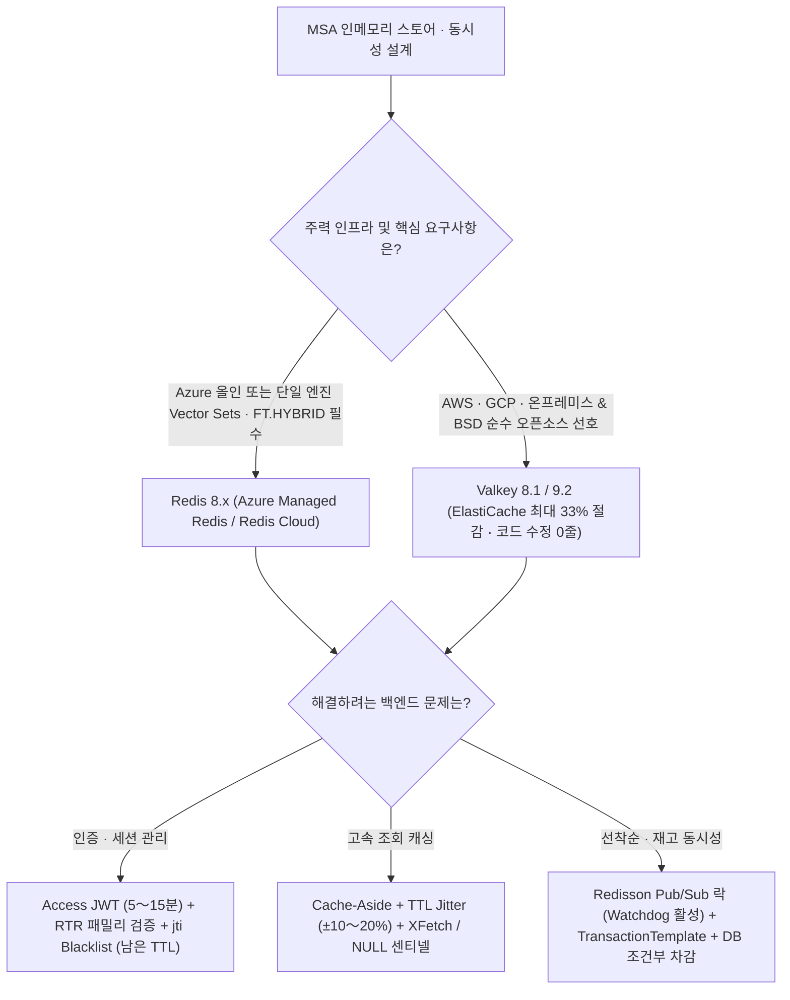

import Alert from '@/components/Alert.astro';
import Chart from '@/components/Chart.astro';
import GitHubRepoCard from '@/components/GitHubRepoCard.astro';
import LinkInline from '@/components/LinkInline.astro';
import LinkPreviewCard from '@/components/LinkPreviewCard.astro';

무상태(Stateless) 서버를 만든다며 JWT를 도입했는데도 아키텍처 리뷰마다 결국 인메모리 스토어가 다시 붙고, Redis 분산 락을 걸었는데도 선착순 쿠폰 재고가 음수로 뚫리는 사고가 현업에서 끊이지 않습니다. 토큰 즉시 폐기 수명주기와 DB 커밋 타이밍, 그리고 프로세스 일시 정지 현상을 설계에서 놓쳤기 때문이죠. 시리즈 [1편 오픈소스 RDBMS 선택 가이드](/dev/msa-rdbms-mysql-mariadb-aurora)와 [2편 영속성 NoSQL 선택 가이드](/dev/msa-nosql-mongodb-dynamodb-opensearch)에 이어, 3부작 완결편에서는 MSA의 속도와 동시성을 책임지는 **Valkey**와 **Redis**의 실전 설계 패턴 및 2026년 선택 기준을 정리합니다.

| 구분 | Valkey 8.1 / 9.2 (Linux Foundation) | Redis 8.x — 8.0～8.12 (Redis Inc.) |
| :--- | :--- | :--- |
| **라이선스** | **3-Clause BSD** (영구 순수 오픈소스, 제약 없음) | **RSALv2 · SSPLv1 · AGPLv3** 트라이 라이선스 |
| **거버넌스** | Linux Foundation 중립 재단 (AWS·Google·Oracle 등) | Redis Inc. 단일 벤더 주도 (`antirez` 복귀) |
| **아키텍처·성능** | 비동기 멀티코어 I/O · 단일 노드 **210만 RPS** (`9.1+`) | 코어 엔진 통합 + 신규 멀티스레드 쿼리 엔진 |
| **핵심 최신 기능** | **Forkless Snapshots**(CoW OOM 제거), Sorted Set **36～43% 절감**, `HEXPIRE`, `DELEX` | JSON·TimeSeries 기본 내장, **`Vector Sets`**, **`FT.HYBRID`** 하이브리드 검색, `DELEX` |
| **클라우드 매니지드** | **AWS ElastiCache**(최대 33% 할인) · **GCP Memorystore** 주력 | **Azure Managed Redis**(최대 99.999% SLA) · Redis Cloud |
| **2026 권장처** | **AWS·GCP·온프레미스 기본값**, 라이선스 리스크 제로 환경 | **Azure 올인 조직**, 인메모리 단일 엔진 AI 벡터·전문 검색 |

---

## Stateless MSA와 인증·세션: 왜 JWT를 써도 결국 Redis·Valkey가 필요한가?

모놀리식 시절의 인메모리 `HttpSession`이나 L4·ALB **Sticky Session**은 쿠버네티스 HPA 오토스케일링과 롤링 배포 환경에서 곧장 장애 원인이 됩니다. 파드 종료와 함께 로그인 상태가 증발하고, 트래픽이 몰린 특정 파드만 과열되는 **Hot Spot**과 모바일 앱·웹 간 멀티 디바이스 세션 불일치가 겹치기 때문이죠. 이를 해결하는 1차 정석은 `Spring Session Data Redis`로 세션 상태를 외부 인메모리 클러스터로 분리하는 것입니다. 그렇다면 아예 세션을 없애려 도입한 **JWT**(JSON Web Token) 환경에서는 왜 또다시 Valkey나 Redis를 찾게 될까요?

### 순수 Stateless JWT의 치명상과 RFC 9700 하이브리드 해법

순수 Stateless JWT는 서명 검증만으로 인증이 끝나지만, 만료 시각(`exp`) 전까지 **서버가 토큰을 강제 폐기할 수 없다**(No Revocation)는 치명상을 안고 있습니다. 관리자 페이지에서 악성 계정을 정지하거나 전체 기기 로그아웃을 실행해도 남은 유효기간 동안 탈취된 토큰이 API 게이트웨이를 그대로 통과하죠. <LinkInline href="https://www.rfc-editor.org/rfc/rfc9700" label="IETF RFC 9700" source="OAuth 2.0 Security BCP" />과 OWASP 인증 가이드가 권고하는 실무 표준은 무상태 검증의 속도와 중앙 통제력을 결합한 **3단계 하이브리드 아키텍처**입니다.

1. **단기 수명 Access JWT**(5～15분): 수명을 짧게 끊어 일반 API 호출은 인메모리 조회 없이 게이트웨이 서명 검증만으로 통과시킵니다.
2. **Refresh Token Rotation**(RTR): 수명이 긴 Refresh Token은 Valkey/Redis에 `TTL`과 함께 저장하고, 재발급 요청마다 기존 토큰을 즉시 폐기·교체합니다. 만약 **이미 폐기된 구버전 Refresh Token이 재사용되면 탈취로 간주**해 해당 사용자의 토큰 패밀리(`familyId`) 전체를 즉시 무효화합니다.
3. **선택적 `jti` Blacklist**(Denylist): 강제 로그아웃·권한 박탈 이벤트 시에만 Access JWT의 고유 식별자(`jti`)를 추출해 남은 수명(`exp - now`)만큼만 `PX` 밀리초 만료 시간으로 **블랙리스트에 단기 등록**합니다. 수백만 개의 정상 토큰 대신 폐기 대상만 잠깐 기록하므로 메모리 점유율이 극도로 낮습니다.

```bash
# 1) Refresh Token 패밀리 저장 (7일 TTL) — 재발급 시 버전 갱신으로 구 토큰 재사용 감지
SET auth:rt:user-8492:fam-01 "v3:sha256-hashed-token" PX 604800000

# 2) 강제 로그아웃 시 Access JWT의 jti만 남은 만료 시간(예: 4분 12초 = 252000ms) 동안 차단
SET auth:bl:jti:550e8400-e29b-41d4-a716-446655440000 "revoked" PX 252000
```

---

## RDBMS를 지키는 캐싱 패턴과 3대 실무 캐시 장애 방어법

인메모리 스토어의 두 번째 본업은 영속성 DB 앞단의 충격 흡수입니다. 일반 조회 API는 캐시 미스 시 DB를 읽어 채우는 **Cache-Aside**(Look-Aside)를 기본으로 쓰고, 원장과의 동기식 쓰기 일관성이 필요하면 **Write-Through**를, 게시글 조회수·실시간 랭킹처럼 초당 수만 번 갱신되는 데이터를 모았다가 배치로 반영할 때는 **Write-Behind**(Write-Back)를 배치합니다. 다만 평소 적중률 99%를 유지하던 캐시도 특정 순간 대량 미스가 터지면 [1편에서 다룬 코어 RDBMS](/dev/msa-rdbms-mysql-mariadb-aurora)까지 연쇄 다운되므로, 3대 캐시 장애 방어 공식을 세트로 구현해야 합니다.

### 1) Cache Stampede (Thundering Herd · 캐시 스탬피드)

특가 상품이나 메인 배너 같은 **핫키**(Hot Key)가 만료되는 찰나 수백 개 파드의 요청이 동시에 캐시 미스를 맞고 RDBMS로 쇄도해 커넥션 풀을 고갈시키는 현상입니다. 실무에서는 세 가지 기법 중 하나로 방어합니다.

- **분산 뮤텍스**(Singleflight): 짧은 락을 잡은 단 1개 스레드만 DB를 조회해 캐시를 갱신하고, 나머지 요청은 수십 ms 대기 후 채워진 캐시를 읽습니다.
- **논리적 만료**(Logical Expiration): 물리적 TTL은 넉넉히 두고 값 내부에 `logicalExpireAt` 필드를 함께 저장합니다. 논리적 만료 발견 시 비동기 스레드에 백그라운드 갱신만 위임하고 기존 값을 즉시 반환해 응답 지연 튀김을 막습니다.
- **확률적 조기 재계산**(PER, XFetch): <LinkInline href="https://www.vldb.org/pvldb/vol8/p886-vattani.pdf" label="VLDB 2015 XFetch 논문" />이 정립한 방식으로, 직전 재계산 소요 시간(`delta`)과 가중치(`beta`, 통상 `1.0`)를 대입한 `now - beta * delta * ln(rand()) >= expiry` 수식이 참일 때 만료 전에 한 스레드가 선제 갱신해 락 대기조차 없앱니다.

### 2) Cache Avalanche (캐시 눈사태)

초기 워밍업이나 자정 배치에서 상품 10만 개에 똑같이 `TTL = 3600초`를 부여하면 1시간 뒤 키가 동시 증발하며 DB가 마비됩니다. 기본 만료 시간에 **±10～20% 난수 편차**(TTL Jitter, 예: `3600 + random(-360, 360)`)를 더해 만료 시점을 시간축으로 분산시켜야 합니다.

### 3) Cache Penetration (캐시 관통)

악성 봇이 `productId = -999`처럼 **DB에도 없는 키**를 반복 조회하면 캐시를 매번 관통해 디스크를 타격합니다. 조회 결과가 비어 있을 때도 `"NULL"` 센티넬 문자열을 **30～120초** 짧은 TTL로 캐싱하거나, 키 공간이 넓다면 앞단 **Bloom Filter**로 존재 가능성이 0%인 요청을 메모리에서 즉시 차단합니다.

---

## MSA 동시성 제어와 분산 락의 3가지 실무 함정

다중 파드로 확장된 MSA에서는 단일 JVM 내부 모니터만 잠그는 `synchronized`가 옆 파드의 요청을 전혀 막지 못합니다([메소드 레벨의 synchronized 사용 금지 경고](/dev/java-synchronized-method-warning) 참고). 동일 사용자의 재시도 중복 결제는 [REST API 멱등성 설계 가이드](/dev/rest-api-idempotency-async-202)의 멱등키(`Idempotency-Key`)로 걸러내더라도, **수천 명의 사용자가 한정 수량 쿠폰이나 좌석 1개를 동시에 차감하는 경합**에는 외부 인메모리 분산 락이 필요합니다.

### 1) 원자적 락 프로토콜과 Lettuce vs Redisson

분산 락 획득은 `SET lock:coupon:101 <unique_token> NX PX 30000` 단일 원자 명령으로 수행하고, 해제할 때는 내 스레드가 지연되는 사이 만료 후 **다른 스레드가 새로 잡은 락을 오삭제하지 않도록** 고유 토큰 일치 여부를 반드시 검증해야 합니다. 전 버전 호환 표준은 **Lua 스크립트**이며, **Valkey 9.2+**(Valkey 9.0+의 `DELIFEQ` 계승) 및 **Redis 8.4+** 환경에서는 네이티브 **`DELEX lock:coupon:101 IFEQ <token>` 명령** 한 줄로 처리할 수 있습니다.

Spring Boot 4 기본 클라이언트인 **Lettuce**로 직접 락을 구현하면 주기적 재시도에 따른 **스핀 락**(Spin Lock) 폴링 부하가 발생합니다. 반면 **Redisson**은 **Pub/Sub 채널 구독 대기**로 네트워크 낭비를 없애고, 로직이 길어질 때 락 만료를 막는 **Watchdog**(기본 30초 만료, 10초마다 자동 연장)을 내장해 실무 표준으로 쓰입니다.

<GitHubRepoCard
  repo="redisson/redisson"
  comment="Pub/Sub 기반 분산 락, Watchdog 자동 연장, RFencedLock 등 Java/Spring 환경의 고급 분산 동기화 객체를 제공하는 표준 클라이언트입니다."
/>

### 2) 장애 부검 리포트 단골인 분산 락 3대 함정

Redisson을 쓰고도 운영에서 재고가 음수로 뚫리는 팀들은 대부분 아래 세 가지 함정에 걸려듭니다.

#### ① `leaseTime` 명시로 Watchdog을 직접 꺼버리는 함정

`lock.tryLock(3, 10, TimeUnit.SECONDS)`처럼 두 번째 인자인 **`leaseTime`에 양수 값을 직접 지정하면 Watchdog 자동 연장이 즉시 꺼지고** 정확히 10초 뒤 락이 강제 해제됩니다. 외부 API나 쿼리 지연 시에도 안전하게 연장을 받으려면 `lock.tryLock(3, TimeUnit.SECONDS)`처럼 **`leaseTime`을 생략**(또는 `-1` 전달)해야 합니다.

#### ② `@Transactional`과 락 해제 타이밍 역전 함정

같은 메서드에 `@Transactional`과 분산 락을 나란히 걸면 Spring 프록시 구조상 **`finally 블록 unlock 실행 → 프록시 바깥 DB 트랜잭션 COMMIT`** 순서로 역전되기 쉽습니다. 커밋 확정 직전 수 ms 틈새에 다음 스레드가 락을 잡고 아직 차감되지 않은 재고(`remaining = 1`)를 읽어가며 초과 발급이 터지죠. 반드시 **`TransactionTemplate`**(또는 하위 `Propagation.REQUIRES_NEW` 분리 / 최상위 `@Order` Aspect)으로 **`락 획득 → TX 시작 및 COMMIT 완료 → finally 락 해제`** 순서를 강제해야 합니다.

```java
package one.eone.coupon.application;

import java.util.concurrent.TimeUnit;
import org.redisson.api.RLock;
import org.redisson.api.RedissonClient;
import org.springframework.stereotype.Service;
import org.springframework.transaction.support.TransactionTemplate;

@Service
public class CouponIssueFacade {

    private final RedissonClient redissonClient;
    private final TransactionTemplate transactionTemplate;
    private final CouponRepository couponRepository;
    private final CouponIssueHistoryRepository historyRepository;

    public CouponIssueFacade(
            RedissonClient redissonClient,
            TransactionTemplate transactionTemplate,
            CouponRepository couponRepository,
            CouponIssueHistoryRepository historyRepository) {
        this.redissonClient = redissonClient;
        this.transactionTemplate = transactionTemplate;
        this.couponRepository = couponRepository;
        this.historyRepository = historyRepository;
    }

    public void issueCoupon(Long couponId, Long userId) {
        RLock lock = redissonClient.getLock("lock:coupon:" + couponId);
        boolean acquired = false;
        try {
            // 1) leaseTime 생략 → Watchdog 활성화 (기본 30초 TTL, 10초마다 자동 연장)
            acquired = lock.tryLock(3, TimeUnit.SECONDS);
            if (!acquired) {
                throw new IllegalStateException("접속자가 많아 처리가 지연되고 있습니다. 잠시 후 다시 시도해 주세요.");
            }

            // 2) 반드시 락 내부에서 트랜잭션을 시작하고 DB COMMIT까지 끝낸 뒤 빠져나옴
            transactionTemplate.executeWithoutResult(status -> {
                // 3) DB 최종 방어선: WHERE remaining > 0 원자적 조건부 차감 + (coupon_id, user_id) UNIQUE 제약
                int updated = couponRepository.decreaseRemainingIfAvailable(couponId);
                if (updated == 0) {
                    throw new IllegalStateException("준비된 선착순 쿠폰이 모두 소진되었습니다.");
                }
                historyRepository.save(new CouponIssueHistory(couponId, userId));
            });
        } catch (InterruptedException e) {
            Thread.currentThread().interrupt();
            throw new IllegalStateException("쿠폰 발급 대기 중 인터럽트가 발생했습니다.", e);
        } finally {
            // 4) DB 커밋이 완전히 끝난 뒤, 현재 스레드가 보유 중인 경우에만 안전하게 해제
            if (acquired && lock.isHeldByCurrentThread()) {
                lock.unlock();
            }
        }
    }
}
```

#### ③ Martin Kleppmann의 Redlock 비판과 RDBMS 이중 방어

분산 시스템 석학 Martin Kleppmann이 증명했듯, 멀티 노드 과반수 락인 `Redlock`조차 정합성(Correctness) 목적의 **상호 배제를 100% 보장하지 못합니다**. 애플리케이션이 긴 **Stop-the-World GC Pause**나 네트워크 단절에 빠져 락 TTL이 만료된 뒤 깨어나 뒤늦은 쓰기를 밀어 넣으면 원장이 덮어써지기 때문이죠. 이 비판을 수용해 Redisson 역시 기존 `RedissonRedLock`을 공식 `@Deprecated` 처리하고 단조 증가 번호를 발급하는 **`RFencedLock`**(Fencing Token)을 도입했습니다.

<LinkPreviewCard
  url="https://martin.kleppmann.com/2016/02/08/how-to-do-distributed-locking.html"
  title="How to do distributed locking — Martin Kleppmann"
  siteName="martin.kleppmann.com"
  comment="Stop-the-World GC Pause와 클럭 드리프트 환경에서 펜싱 토큰(Fencing Token) 없는 분산 락이 어떻게 깨지는지 분석한 분산 시스템 필독 아티클입니다."
/>

<figure class="not-prose my-6">
  <svg viewBox="0 0 860 404" class="w-full h-auto rounded-lg border border-border bg-card p-4" role="img" aria-label="GC Pause 발생 시 단순 분산 락 만료로 인한 덮어쓰기 장애와 Fencing Token 및 RDBMS 조건부 쿼리 이중 방어 시퀀스 비교 도식">
    <defs>
      <marker id="lock-red" viewBox="0 0 10 10" refX="8" refY="5" markerWidth="6" markerHeight="6" orient="auto-start-reverse">
        <path d="M 0 1 L 10 5 L 0 9 z" fill="#ef4444" />
      </marker>
      <marker id="lock-emerald" viewBox="0 0 10 10" refX="8" refY="5" markerWidth="6" markerHeight="6" orient="auto-start-reverse">
        <path d="M 0 1 L 10 5 L 0 9 z" fill="#10b981" />
      </marker>
      <marker id="lock-muted" viewBox="0 0 10 10" refX="8" refY="5" markerWidth="6" markerHeight="6" orient="auto-start-reverse">
        <path d="M 0 1 L 10 5 L 0 9 z" fill="var(--muted-foreground)" />
      </marker>
    </defs>
    <rect x="16" y="16" width="402" height="372" rx="10" fill="rgba(239, 68, 68, 0.06)" stroke="#ef4444" stroke-width="1.5" />
    <text x="32" y="42" font-size="13" font-weight="700" class="fill-red-600 dark:fill-red-400">단순 분산 락 단독 의존 (GC Pause 덮어쓰기 사고)</text>
    <rect x="32" y="56" width="104" height="32" rx="6" fill="var(--background)" stroke="var(--border)" />
    <text x="84" y="76" text-anchor="middle" font-size="11" font-weight="700" fill="var(--foreground)">Pod A (선행)</text>
    <rect x="156" y="56" width="104" height="32" rx="6" fill="var(--background)" stroke="var(--border)" />
    <text x="208" y="76" text-anchor="middle" font-size="11" font-weight="700" fill="var(--foreground)">Pod B (후행)</text>
    <rect x="280" y="56" width="122" height="32" rx="6" fill="var(--background)" stroke="var(--border)" />
    <text x="341" y="76" text-anchor="middle" font-size="11" font-weight="700" fill="var(--foreground)">Valkey · RDBMS</text>
    <line x1="84" y1="88" x2="84" y2="312" stroke="var(--border)" stroke-width="1.3" stroke-dasharray="4 3" />
    <line x1="208" y1="88" x2="208" y2="312" stroke="var(--border)" stroke-width="1.3" stroke-dasharray="4 3" />
    <line x1="341" y1="88" x2="341" y2="312" stroke="var(--border)" stroke-width="1.3" stroke-dasharray="4 3" />
    <rect x="108" y="96" width="208" height="18" rx="4" fill="var(--card)" />
    <text x="212" y="109" text-anchor="middle" font-size="10" fill="var(--foreground)">1. 락 획득 (고정 leaseTime 10s)</text>
    <line x1="84" y1="118" x2="335" y2="118" stroke="var(--muted-foreground)" stroke-width="1.5" marker-end="url(#lock-muted)" />
    <rect x="28" y="132" width="112" height="50" rx="6" fill="var(--card)" stroke="#ef4444" stroke-dasharray="3 2" />
    <text x="84" y="152" text-anchor="middle" font-size="10.5" font-weight="700" class="fill-red-600 dark:fill-red-400">STW GC 멈춤 (12s)</text>
    <text x="84" y="170" text-anchor="middle" font-size="9.5" fill="var(--muted-foreground)">10초 시점 락 강제 만료</text>
    <rect x="214" y="188" width="122" height="18" rx="4" fill="var(--card)" />
    <text x="275" y="201" text-anchor="middle" font-size="10" fill="var(--foreground)">2. 새 락 획득 · 차감</text>
    <line x1="208" y1="210" x2="335" y2="210" stroke="var(--muted-foreground)" stroke-width="1.5" marker-end="url(#lock-muted)" />
    <rect x="214" y="226" width="122" height="18" rx="4" fill="var(--card)" />
    <text x="275" y="239" text-anchor="middle" font-size="10" fill="var(--muted-foreground)">3. Pod B 정상 커밋</text>
    <line x1="208" y1="248" x2="335" y2="248" stroke="var(--muted-foreground)" stroke-width="1.5" marker-end="url(#lock-muted)" />
    <rect x="100" y="268" width="226" height="18" rx="4" fill="var(--card)" />
    <text x="213" y="281" text-anchor="middle" font-size="10" font-weight="700" class="fill-red-600 dark:fill-red-400">4. 깨어난 Pod A가 만료 모른 채 덮어쓰기!</text>
    <line x1="84" y1="290" x2="335" y2="290" stroke="#ef4444" stroke-width="2" marker-end="url(#lock-red)" />
    <rect x="32" y="320" width="370" height="54" rx="7" fill="var(--background)" stroke="#ef4444" />
    <text x="46" y="341" font-size="10.5" font-weight="700" class="fill-red-600 dark:fill-red-400">결과: 상호 배제 붕괴 — 초과 발급 · 재고 음수(-1) 발생</text>
    <text x="46" y="360" font-size="10" fill="var(--muted-foreground)">원인: 고정 leaseTime 조기 만료 + DB 계층 최종 검증 부재</text>
    <rect x="434" y="16" width="410" height="372" rx="10" fill="rgba(16, 185, 129, 0.07)" stroke="#10b981" stroke-width="1.6" />
    <text x="450" y="42" font-size="13" font-weight="700" class="fill-emerald-700 dark:fill-emerald-400">실무 이중 방어 (Fencing Token + DB 조건부 차감)</text>
    <rect x="450" y="56" width="108" height="32" rx="6" fill="var(--background)" stroke="var(--border)" />
    <text x="504" y="76" text-anchor="middle" font-size="11" font-weight="700" fill="var(--foreground)">Pod A (token 33)</text>
    <rect x="576" y="56" width="108" height="32" rx="6" fill="var(--background)" stroke="var(--border)" />
    <text x="630" y="76" text-anchor="middle" font-size="11" font-weight="700" fill="var(--foreground)">Pod B (token 34)</text>
    <rect x="702" y="56" width="126" height="32" rx="6" fill="var(--background)" stroke="var(--border)" />
    <text x="765" y="76" text-anchor="middle" font-size="11" font-weight="700" fill="var(--foreground)">Valkey · RDBMS</text>
    <line x1="504" y1="88" x2="504" y2="312" stroke="var(--border)" stroke-width="1.3" stroke-dasharray="4 3" />
    <line x1="630" y1="88" x2="630" y2="312" stroke="var(--border)" stroke-width="1.3" stroke-dasharray="4 3" />
    <line x1="765" y1="88" x2="765" y2="312" stroke="var(--border)" stroke-width="1.3" stroke-dasharray="4 3" />
    <rect x="528" y="96" width="212" height="18" rx="4" fill="var(--card)" />
    <text x="634" y="109" text-anchor="middle" font-size="10" fill="var(--foreground)">1. 락 획득 (Watchdog + token=33)</text>
    <line x1="504" y1="118" x2="759" y2="118" stroke="#10b981" stroke-width="1.6" marker-end="url(#lock-emerald)" />
    <rect x="448" y="132" width="112" height="50" rx="6" fill="var(--card)" stroke="var(--border)" stroke-dasharray="3 2" />
    <text x="504" y="152" text-anchor="middle" font-size="10.5" font-weight="600" fill="var(--foreground)">장시간 네트워크 단절</text>
    <text x="504" y="170" text-anchor="middle" font-size="9.5" fill="var(--muted-foreground)">30초 초과 만료 가정</text>
    <rect x="636" y="188" width="122" height="18" rx="4" fill="var(--card)" />
    <text x="697" y="201" text-anchor="middle" font-size="10" fill="var(--foreground)">2. token=34 차감 커밋</text>
    <line x1="630" y1="210" x2="759" y2="210" stroke="#10b981" stroke-width="1.6" marker-end="url(#lock-emerald)" />
    <rect x="692" y="226" width="138" height="28" rx="5" fill="var(--background)" stroke="#10b981" />
    <text x="761" y="244" text-anchor="middle" font-size="9.5" font-weight="700" class="fill-emerald-700 dark:fill-emerald-400">remaining=0 · maxToken=34</text>
    <rect x="518" y="268" width="232" height="18" rx="4" fill="var(--card)" />
    <text x="634" y="281" text-anchor="middle" font-size="10" font-weight="700" class="fill-emerald-700 dark:fill-emerald-400">3. 지연 쓰기 즉시 차단 (0 row · token 역전)</text>
    <line x1="504" y1="290" x2="759" y2="290" stroke="#10b981" stroke-width="1.8" stroke-dasharray="5 3" marker-end="url(#lock-emerald)" />
    <rect x="450" y="320" width="378" height="54" rx="7" fill="var(--background)" stroke="#10b981" />
    <text x="464" y="341" font-size="10.5" font-weight="700" class="fill-emerald-700 dark:fill-emerald-400">결과: 원장 무결성 100% 사수 (초과 발급 · 중복 차감 0건)</text>
    <text x="464" y="360" font-size="10" fill="var(--muted-foreground)">방어선: TX 종료 후 unlock + WHERE remaining &gt; 0 · UNIQUE 제약</text>
  </svg>
  <figcaption class="mt-2 text-center text-sm text-muted-foreground">단순 분산 락의 GC Pause 덮어쓰기 시나리오(좌)와 Fencing Token·RDBMS 원자적 조건 검증을 결합한 이중 방어 구조(우)</figcaption>
</figure>

실무 정석은 명확한 역할 분담입니다. 앞단 트래픽 직렬화와 DB 부하 보호는 **효율성 방패**(Efficiency)인 분산 락에 맡기고, 최종 **원장 무결성**(Safety)은 RDBMS의 **복합 `UNIQUE` 제약조건, `@Version` 낙관적 락, 그리고 `UPDATE coupon SET remaining = remaining - 1 WHERE id = ? AND remaining > 0` 원자적 조건부 차감 쿼리**로 반드시 이중 방어해야 합니다.

<Alert type="warning" title="운영 배포 전 분산 락 필수 점검표">
① **Watchdog 활성 여부**: `tryLock(waitTime, leaseTime, unit)`에서 양수 `leaseTime`을 넘기면 자동 연장이 꺼집니다. 처리 시간을 100% 통제할 수 없다면 `leaseTime`을 비워두세요.

② **커밋 후 언락 보장**: `@Transactional`과 분산 락을 같은 메서드에 포개지 말고, `TransactionTemplate`이나 최상위 `@Order` Aspect로 DB 커밋 완료 이후에 `unlock()`이 호출되도록 강제하세요.

③ **DB 원장 최후 방어선**: 인메모리 클러스터 장애나 GC 멈춤이 겹쳐도 재고와 잔액이 틀어지지 않도록 RDBMS 테이블에 `UNIQUE` 제약과 `WHERE remaining > 0` 조건부 차감을 함께 배치하세요.
</Alert>

---

## 탄생 배경 시즌 2: Redis 라이선스 사태와 Valkey 9.2 대세 등극

패턴과 코드 구조를 잡았다면 마지막 선택이 남습니다. "2026년 신규 인메모리 클러스터에 Redis와 Valkey 중 무엇을 올려야 할까?" 1편의 MySQL→MariaDB 분기나 [오라클의 인수부터 자바의 역습까지: JVM 생태계 15년사](/dev/jvm-ecosystem-15-years)와 판박이인 최근 오픈소스 분화사를 보면 기준이 선명해집니다.

### 1) 2024년 3월의 분기점과 Redis 8의 AGPLv3 반전

2009년 Salvatore Sanfilippo(`antirez`)가 **3-Clause BSD**로 공개한 Redis는 **2024년 3월 20일** Redis 7.4부터 클라우드 사업자의 매니지드 제공을 금지하는 소스 가용 라이선스(**RSALv2** · **SSPLv1**) 전환을 전격 발표했습니다. 업계는 즉각 움직였고, 불과 **8일 뒤인 2024년 3월 28일** AWS·Google·Oracle·Ericsson 등이 **Linux Foundation** 산하에 모여 마지막 순수 오픈소스 버전인 Redis 7.2.4를 포크한 영구 **3-Clause BSD 오픈소스 Valkey**를 출범시켰습니다.

이후 **2025년 5월** 또 한 번의 반전이 일어납니다. 창시자 `antirez`가 복귀한 Redis Inc.가 **Redis 8.0**에 OSI 승인 라이선스인 **AGPLv3**를 추가(`RSALv2` · `SSPLv1` · `AGPLv3` 트라이 라이선스)하고, 과거 유료 모듈이던 JSON·TimeSeries·확률형 자료구조와 신규 **`Vector Sets` 기능**, 나아가 8.4+ **`FT.HYBRID` 하이브리드 검색**까지 코어에 기본 통합하며 화해 제스처를 취한 것입니다. 하지만 네트워크 서비스 제공 시 전체 소스 공개 의무가 얽히는 **네트워크 카피레프트**(AGPLv3)의 사내 컴플라이언스 장벽 때문에 Fedora·Debian·Ubuntu 등 주요 리눅스 배포판과 AWS·GCP의 표준은 이미 **Valkey**로 굳어졌습니다.

<GitHubRepoCard
  repo="valkey-io/valkey"
  comment="Linux Foundation 산하 영구 3-Clause BSD 오픈소스 인메모리 스토어. 멀티코어 비동기 I/O와 9.2 Forkless Snapshots로 독자 진화를 이어가고 있습니다."
/>

<GitHubRepoCard
  repo="redis/redis"
  comment="Redis Inc. 주도 공식 저장소. 8.x부터 AGPLv3를 포함한 트라이 라이선스와 Vector Sets·FT.HYBRID 통합 인메모리 검색 엔진 노선을 걷고 있습니다."
/>

### 2) Valkey 8.0 → 9.2 독자 혁신과 Spring Boot 무수정 전환

Valkey는 단순 클론에 머물지 않고 클라우드 엔지니어들의 숙원 과제를 코어에 빠르게 반영했습니다.

- **Valkey 8.0 · 8.1**: 비동기 멀티코어 I/O 스레딩으로 처리량 **120만 RPS**를 돌파(`8.0`)했고, 새 해시 테이블 설계로 키당 약 **20바이트**·캐시 메모리를 최대 **20% 절감**(`8.1`)했습니다.
- **Valkey 9.0 · 9.1**: 무중단 클러스터 확장용 **Atomic Slot Migration**과 해시 필드별 만료 명령 **`HEXPIRE` 도입**(`9.0`)에 이어 단일 노드 **210만 RPS**(`9.1`)를 달성했습니다.
- **2026년 11월 최신 `Valkey 9.2`**: 대용량 노드 `BGSAVE` 시 `fork()`의 Copy-on-Write 메모리 폭증(OOM)을 뿌리 뽑은 **Forkless Snapshots**, B+ Tree 기반 인코딩을 통한 Sorted Set 메모리 **36～43% 절감**, 그리고 **조건부 삭제**(`DELEX`)를 완성했습니다 <LinkInline href="https://valkey.io/blog/" label="Valkey 공식 릴리스 블로그" variant="badge" />. **RESP 프로토콜 100% 호환** 덕분에 Spring Boot(`Lettuce`·`Redisson`) 애플리케이션은 코드 수정 0줄로 엔드포인트만 바꾸면 즉시 전환됩니다.

### 3) 클라우드 3사 매니지드 전략과 비용 시뮬레이션

**AWS**(`Amazon ElastiCache for Valkey`)는 Redis OSS 대비 **Serverless 33% 할인**(최소 과금 용량도 1GB → **100MB**로 대폭 인하) 및 **노드 기반 20% 할인**을 앞세워 전환을 유도하고 있으며 <LinkInline href="https://aws.amazon.com/elasticache/pricing/" label="AWS ElastiCache 요금표" variant="badge" />, **GCP** 역시 `Memorystore for Valkey`를 기본 주력으로 채택했습니다. 반면 **Microsoft Azure**는 Redis Inc.와 전략적 제휴를 맺고 퍼스트파티 **`Azure Managed Redis` 서비스**(최대 **99.999% SLA**, Active Geo-Replication, 네이티브 `Vector Sets`·`FT.HYBRID`)를 제공하므로, Azure 올인 조직이거나 별도 검색 엔진 없이 인메모리 단일 노드로 초저지연 하이브리드 벡터 검색을 구현할 때는 **Redis 8**이 유리합니다.

<Chart
  type="bar"
  height={310}
  caption="AWS ElastiCache 구성별 월간 비용 비교 (us-east-1 온디맨드 730시간 기준, 단위: USD — Valkey 선택 시 노드형 20%, 서버리스형 33%가 즉시 절감된다)"
  data={{
    labels: [
      'Serverless 소형 (5GB)',
      '노드형 HA (r7g.large ×3)',
      'Serverless 중형 (20GB)',
      '3샤드 클러스터 (r7g.xlarge ×6)'
    ],
    datasets: [
      {
        label: 'ElastiCache for Redis OSS ($)',
        data: [457, 480, 1828, 1918],
        backgroundColor: 'rgba(239, 68, 68, 0.75)'
      },
      {
        label: 'ElastiCache for Valkey ($)',
        data: [307, 384, 1229, 1535],
        backgroundColor: 'rgba(16, 185, 129, 0.8)'
      }
    ]
  }}
/>

### 4) 2026 인메모리 스토어 & 동시성 전략 의사결정 트리

팀의 인프라 환경과 백엔드 과제를 아래 흐름도에 대입해 최종 구성을 확정해 보세요.



세 편에 걸친 **클라우드·MSA 데이터베이스 선택 가이드**의 모든 퍼즐이 맞춰졌습니다. 정교한 트랜잭션과 원장 무결성의 최후 보루는 [1편의 오픈소스 RDBMS(PostgreSQL·Aurora·MySQL·MariaDB)](/dev/msa-rdbms-mysql-mariadb-aurora)가 맡고, 스키마 유연성과 초거대 트래픽 수평 확장·전문 검색은 [2편의 영속성 NoSQL(MongoDB·DynamoDB·OpenSearch)](/dev/msa-nosql-mongodb-dynamodb-opensearch)이 분담하며, 그 앞단의 인증 생명주기·캐시 방어막·분산 동시성 직렬화는 **Valkey 9.2**와 **Redis 8**이 책임집니다. 특정 엔진 하나에 모든 역할을 떠넘기기보다 각 저장소의 강점과 물리적 한계를 선명하게 나눠 엮어내는 폴리글랏(Polyglot) 설계가 장애 없는 MSA 백엔드의 출발점입니다.

---

## 참고 자료

- [RFC 9700: Best Current Practice for OAuth 2.0 Security — IETF](https://www.rfc-editor.org/rfc/rfc9700)
- [Optimal Probabilistic Cache Stampede Prevention (XFetch, PVLDB Vol. 8) — VLDB Endowment](https://www.vldb.org/pvldb/vol8/p886-vattani.pdf)
- [How to do distributed locking — Martin Kleppmann](https://martin.kleppmann.com/2016/02/08/how-to-do-distributed-locking.html)
- [Valkey Official Documentation & Release Notes — Linux Foundation / Valkey Project](https://valkey.io/docs/)
- [Amazon ElastiCache Pricing (Valkey vs Redis OSS) — AWS](https://aws.amazon.com/elasticache/pricing/)
- [Azure Managed Redis Overview — Microsoft Learn](https://learn.microsoft.com/en-us/azure/redis/overview)
