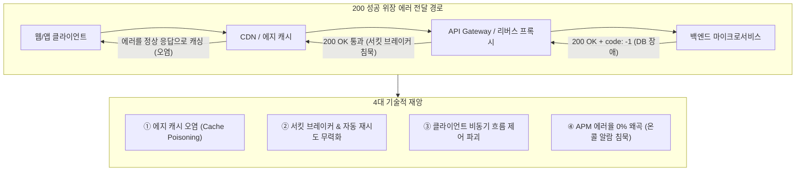
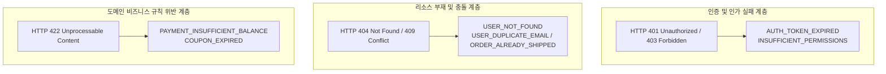

import Alert from '@/components/Alert.astro';

API 연동 작업을 하다가 분명 HTTP 상태 코드는 `200 OK`인데 JSON 본문에 `{"code": -1, "message": "잔액이 부족합니다"}`가 찍혀 있는 것을 보고 깊은 한숨을 내쉬어본 경험, 다들 한 번쯤 있으실 겁니다. 프론트엔드와 백엔드, 그리고 인프라 네트워크 전체를 혼란에 빠뜨리는 이른바 '200 성공 위장 에러' 안티패턴의 전형입니다.

앞선 [1편: REST API URI 설계 원칙](/dev/ko/2026/rest-api-uri-naming-spring-boot-fastapi), [2편: HTTP 메서드와 상태 코드 설계](/dev/ko/2026/rest-api-http-methods-status-codes), 그리고 [3편: 대용량 페이징 최적화](/dev/ko/2026/rest-api-pagination-offset-cursor)를 통해 정상 요청에 대한 API 아키텍처를 탄탄하게 세웠습니다. 하지만 프로덕션 환경의 실무 백엔드 시스템은 정상적인 흐름보다 **예기치 못한 실패와 비즈니스 예외 상황**을 어떻게 처리하느냐에서 완성도와 안정성이 판가름 납니다.

많은 개발팀이 에러 응답을 만들 때 사내 자체 규격(예: `{ "success": false, "code": "E001", "error": "..." }`)을 임의로 고안해 사용합니다. 그러나 마이크로서비스 환경에서 팀마다 제각각인 포맷을 고집하면 클라이언트는 서비스마다 서로 다른 에러 파싱 코드를 중복 작성해야 하고, 게이트웨이나 APM 도구와의 유기적인 연동도 불가능해집니다.

이번 4편에서는 200 OK 에러 래핑이 초래하는 4가지 기술적 재앙을 짚어보고, 2023년 IETF 공식 표준으로 확정된 **RFC 9457 Problem Details** 규격을 명쾌하게 파헤칩니다. 나아가 프로토콜 상태 코드와 도메인 비즈니스 에러 코드의 이원화 전략, 프로덕션 보안을 위한 민감 정보 마스킹, 그리고 Spring Boot 4와 FastAPI에서의 실전 구현 핸들러까지 한 번에 정리합니다.

---

## 1. "200 OK로 에러를 감싸면 왜 재앙이 되는가?" — 4대 악영향

과거 레거시 RPC 스타일이나 프론트엔드-백엔드 간의 소통 부족으로 인해 "모든 HTTP 요청은 무조건 200으로 떨구고, 비즈니스 성공 여부는 본문 JSON의 `code`나 `success` 불리언 값으로 판단하자"는 합의가 내려진 프로젝트들이 제법 많습니다.

```http
# 전형적인 200 성공 위장 에러 안티패턴
HTTP/1.1 200 OK
Content-Type: application/json

{
  "success": false,
  "code": -1,
  "message": "일시적인 데이터베이스 연결 오류가 발생했습니다."
}
```

언뜻 보면 클라이언트가 HTTP 에러로 인해 브라우저 콘솔에 빨간 줄이 뜨지 않아 깔끔해 보일지 모르지만, 웹 인프라 관점에서 이는 시스템 전체를 마비시키는 치명적인 시한폭탄입니다.



### ① CDN 및 에지 캐시 오염 (Cache Poisoning)

Cloudflare, AWS CloudFront, Fastly 같은 CDN과 NGINX 리버스 프록시는 기본적으로 **HTTP 상태 코드**를 기준으로 캐싱 여부를 판단합니다. 만약 상품 상세 정보나 공지사항 조회 엔드포인트에 `Cache-Control: public, max-age=3600` 헤더가 설정되어 있다고 가정해 보겠습니다.

일시적인 DB 네트워크 순단이나 레디스 타임아웃으로 인해 백엔드가 에러 메시지를 담은 JSON을 `200 OK`로 응답하는 순간, CDN 에지 서버는 이 응답을 완벽히 유효한 정상 데이터로 인식하고 1시간 동안 전 세계 에지 캐시에 저장합니다. 백엔드 DB가 1초 만에 정상 복구되더라도, 수만 명의 사용자에게는 향후 1시간 동안 "DB 연결 오류"라는 에러 JSON 화면이 고스란히 서비스되는 대형 참사가 벌어집니다.

### ② 리버스 프록시와 API Gateway의 장애 격리 무력화

Envoy, Kong, Spring Cloud Gateway 같은 모던 게이트웨이 인프라는 업스트림 서비스의 이상 징후를 감지하기 위해 **서킷 브레이커**(Circuit Breaker)와 헬스 체크 메커니즘을 구동합니다.

특정 백엔드 인스턴스에 장애가 발생해 연속해서 500, 502, 503 에러를 뿜어내면, 게이트웨이는 서킷을 열어 트래픽을 차단하고 정상 노드로 우회하거나 자동 재시도(Retry)를 수행해야 합니다. 그러나 백엔드가 장애 상황에서도 꾸준히 `200 OK`를 내려주면 게이트웨이는 해당 인스턴스가 아주 건강하게 동작하고 있다고 오판합니다. 결과적으로 장애가 발생한 인스턴스로 계속해서 사용자 트래픽을 밀어 넣어 서비스 다운을 가속화합니다.

### ③ 클라이언트 라이브러리의 제어 흐름 파괴

프론트엔드 생태계의 사실상 표준 라이브러리인 Axios, Fetch API, TanStack Query(React Query)는 HTTP 상태 코드를 기반으로 Promise의 이행(Resolve)과 거부(Reject)를 결정합니다.

```typescript
// 200 성공 위장 에러로 인해 모든 컴포넌트가 지저분해지는 사례
const { data, isError } = useQuery({
  queryKey: ['order', orderId],
  queryFn: async () => {
    const res = await axios.get(`/api/v1/orders/${orderId}`);
    // 200 OK이므로 Axios는 성공으로 처리함.
    // 결국 모든 API 호출부마다 이 끔찍한 분기문을 직접 넣어야 함!
    if (!res.data.success || res.data.code !== 0) {
      throw new Error(res.data.message);
    }
    return res.data.data;
  }
});
```

상태 코드가 정상적으로 4xx나 5xx로 내려왔다면 Axios 인터셉터나 TanStack Query의 전역 `onError` 핸들러에서 공통 모달을 띄우거나 에러 바운더리(Error Boundary)로 자연스럽게 위임할 수 있습니다. 200 위장 에러는 프론트엔드 비즈니스 로직마다 방어적인 `if (!res.data.success)` 검증 코드를 강제하여 코드베이스를 복잡하게 만들고 타입 안정성을 훼손합니다.

### ④ APM 및 옵저버빌리티 모니터링 무력화

Datadog, Prometheus, Grafana, New Relic 같은 인프라 모니터링 시스템은 골든 시그널(RED: Rate, Errors, Duration) 중 에러율(Error Rate)을 HTTP 5xx 및 4xx 상태 코드의 비율로 집계합니다.

백엔드에서 치명적인 NullPointerException이나 결제 모듈 통신 장애가 발생해도 상태 코드가 200이면 모니터링 대시보드의 에러율 그래프는 완벽한 0%를 유지합니다. 엔지니어링 팀의 슬랙 온콜 알람(PagerDuty)은 고요하게 침묵하는데, 고객센터에는 결제가 안 된다는 고객들의 항의 전화가 빗발치는 최악의 상황이 연출됩니다.

<Alert type="danger" title="핵심 원칙">
HTTP 상태 코드는 프로토콜 계층의 통신 결과이자 인프라 라우팅의 기준입니다. 비즈니스 실패든 시스템 장애든, 클라이언트의 요청이 기대한 결과를 온전히 달성하지 못했다면 반드시 적절한 4xx 또는 5xx HTTP 상태 코드를 반환해야 합니다.
</Alert>

---

## 2. RFC 9457 Problem Details 표준 규격 완벽 해부

팀마다 제각각이던 에러 포맷 문제를 해결하기 위해 IETF는 2016년 **RFC 7807**(Problem Details for HTTP APIs)을 발표했고, 이를 개정 및 고도화하여 2023년 7월 **RFC 9457**을 최종 표준(Proposed Standard)으로 확정했습니다.

RFC 9457은 HTTP API에서 머신이 읽을 수 있는(Machine-readable) 일관된 에러 세부 정보를 표현하기 위한 범용 포맷을 정의합니다.

### 미디어 타입: `application/problem+json`

RFC 9457을 준수하는 에러 응답은 `Content-Type` 헤더로 기존의 단순 `application/json` 대신 전용 미디어 타입을 선언합니다:

```http
HTTP/1.1 403 Forbidden
Content-Type: application/problem+json
Content-Language: ko-KR

{
  "type": "https://api.example.com/errors/forbidden-ip-access",
  "title": "IP Access Restricted",
  "status": 403,
  "detail": "허용되지 않은 IP 대역(203.0.113.19)에서의 관리자 페이지 접근입니다.",
  "instance": "urn:uuid:6ba7b810-9dad-11d1-80b4-00c04fd430c8"
}
```

XML 기반 시스템을 지원해야 한다면 `application/problem+xml`을 사용할 수도 있습니다.

### RFC 9457의 5대 표준 루트 필드

RFC 9457 명세서는 다음과 같은 5가지 표준 최상위 멤버를 정의하고 있습니다.

| 필드명 | 데이터 타입 | 필수 여부 | 표준 정의 및 실무 가이드 |
| :--- | :--- | :---: | :--- |
| `type` | URI Reference | 권장 (SHOULD) | 발생한 문제의 유형을 고유하게 식별하는 URI. 생략 시 기본값은 `"about:blank"`(HTTP 상태 코드 자체를 의미). 실무에서는 개발자 문서의 해당 에러 설명 페이지 URL 또는 고유 URN을 사용합니다. |
| `title` | String | 권장 (SHOULD) | 해당 문제 유형에 대한 짧고 사람이 읽을 수 있는 요약. **에러 발생 건마다 변하지 않는 고정된 문구**여야 하며, 다국어 번역이나 인스턴스별 상세 설명이 들어가서는 안 됩니다. |
| `status` | Number (Integer) | 권장 (SHOULD) | 오리진 서버가 반환한 **HTTP 상태 코드와 반드시 일치**해야 하는 정수값. 게이트웨이나 프록시가 본문을 열어보지 않고도 일치 여부를 즉시 검증할 수 있도록 돕습니다. |
| `detail` | String | 권장 (SHOULD) | 이번 특정 에러 발생 건에 대한 사람이 읽을 수 있는 구체적인 원인 설명. 디버깅을 돕거나 사용자에게 노출할 수 있는 명확한 사유를 기술합니다. |
| `instance` | URI Reference | 선택 (MAY) | 이번 특정 문제 발생 건을 유일하게 식별하는 URI. 실무에서는 로그 트레이싱 ID(Correlation ID)를 UUID URN(`urn:uuid:...`) 형태로 담아 APM 분산 추적에 활용합니다. |

<Alert type="tip" title="title과 detail의 명확한 차이">
`title`은 문제의 **분류 명칭**이고, `detail`은 이번 요청에서 일어난 **구체적 사유**입니다.  
예를 들어 잔액 부족 에러의 경우 `title`은 `"Insufficient Balance"`라는 고정 문구이고, `detail`은 `"현재 출금 가능 잔액은 12,000원이며, 요청하신 결제 금액은 50,000원입니다."`처럼 동적인 수치가 포함된 설명이어야 합니다.
</Alert>

### 표준 확장 멤버(Extension Members) 설계

실무에서는 5대 표준 필드만으로 프론트엔드의 세밀한 폼 에러 처리나 비즈니스 분기를 전부 커버하기 어렵습니다. RFC 9457은 이러한 요구사항을 수용하기 위해 루트 레벨에 커스텀 확장 필드를 추가하는 것을 공식적으로 허용합니다.

가장 대표적인 확장 패턴은 **입력값 유효성 검증 실패 목록**(`invalidParams`)과 **내부 비즈니스 에러 코드**(`errorCode`)의 추가입니다.

```http
HTTP/1.1 422 Unprocessable Content
Content-Type: application/problem+json

{
  "type": "https://api.example.com/errors/validation-failed",
  "title": "Validation Failed",
  "status": 422,
  "detail": "입력값 검증 규칙을 만족하지 못하는 필드가 2건 존재합니다.",
  "instance": "urn:uuid:f47ac10b-58cc-4372-a567-0e02b2c3d479",
  "errorCode": "COMMON_INVALID_INPUT_VALUE",
  "timestamp": "2026-10-25T14:30:00Z",
  "invalidParams": [
    {
      "field": "email",
      "reason": "올바른 이메일 주소 형식이 아닙니다.",
      "rejectedValue": "invalid-email-format"
    },
    {
      "field": "age",
      "reason": "연령은 19세 이상이어야 합니다.",
      "rejectedValue": 15
    }
  ]
}
```

프론트엔드는 `invalidParams` 배열을 순회하며 폼 화면의 각 인풋 필드 하단에 빨간색 안내 메시지를 정확한 위치에 렌더링할 수 있습니다.

---

## 3. 비즈니스 에러 코드와 HTTP 상태 코드의 이원화 전략

많은 개발팀이 "HTTP 상태 코드만으로 모든 비즈니스 예외를 표현할 수 없을까?"라는 고민을 합니다. 하지만 이는 기술적으로 불가능할뿐더러, 시스템 아키텍처상 시도해서도 안 되는 안티패턴입니다.

HTTP 상태 코드는 전송 프로토콜(HTTP) 계층의 표준 규약이고, 비즈니스 에러 코드는 애플리케이션의 도메인 규칙입니다. 두 계층의 관심사를 깔끔하게 분리하는 이원화 전략이 필수적입니다.



### 프로토콜 계층: 표준 HTTP 상태 코드 (대분류)

HTTP 상태 코드는 네트워크 라우팅 장비, 게이트웨이, 클라이언트 HTTP 라이브러리가 공통으로 해석해야 하는 **거시적 처리 상태**를 나타냅니다:

- **400 Bad Request**: 클라이언트의 문법적 오류. JSON 문법 깨짐, 타입 불일치, DTO 역직렬화 실패 등.
- **401 Unauthorized**: 인증 실패. 토큰 누락, 토큰 만료, 잘못된 서명 등 신원 확인 불가.
- **403 Forbidden**: 인가(권한) 실패. 신원은 확인되었으나 해당 리소스에 접근할 권한이 없음 (예: 일반 사용자가 관리자 API 호출).
- **404 Not Found**: 요청한 URI에 매핑되는 자원이 존재하지 않음.
- **409 Conflict**: 리소스의 현재 상태와 충돌하여 요청을 수행할 수 없음 (예: 이미 등록된 이메일로 가입 시도, 동시성 낙관적 락 충돌, 이미 취소된 주문 상태에서 결제 시도).
- **422 Unprocessable Content** (RFC 9110): 문법적으로는 완벽한 JSON이지만, 비즈니스 도메인 제약조건을 만족하지 못함 (예: 필수 필드 누락, 잔액 부족, 재고 부족).
- **500 Internal Server Error**: 서버 내부의 버그, 처리되지 않은 런타임 예외, 외부 인프라 연동 실패.

### 도메인 계층: 세부 비즈니스 에러 코드 (소분류)

동일한 `409 Conflict`나 `422 Unprocessable Content` 상태 코드라 할지라도, 클라이언트 화면이 사용자에게 취해야 할 후속 액션은 천차만별입니다.

| HTTP 상태 코드 | 도메인 비즈니스 에러 코드 | 클라이언트 대응 및 사용자 경험 (UX) |
| :---: | :--- | :--- |
| **401** | `AUTH_TOKEN_EXPIRED` | 백그라운드에서 Refresh Token으로 재발급 시도 후 원래 요청 재전송 |
| **401** | `AUTH_INVALID_CREDENTIALS` | "아이디 또는 비밀번호가 일치하지 않습니다" 알림 후 로그인 화면 유지 |
| **409** | `USER_DUPLICATE_EMAIL` | "이미 가입된 이메일입니다. 비밀번호 찾기를 진행하시겠습니까?" 팝업 노출 |
| **409** | `ORDER_ALREADY_SHIPPED` | "이미 배송이 시작되어 주문을 취소할 수 없습니다" 모달 표시 |
| **422** | `PAYMENT_INSUFFICIENT_BALANCE` | "계좌 잔액이 부족합니다. 충전 후 다시 시도해 주세요" 충전 페이지 링크 제공 |
| **422** | `COUPON_EXPIRED` | 쿠폰 적용을 자동 해제하고 원래 결제 금액으로 재계산 유도 |

이처럼 HTTP 상태 코드는 인프라와 라이브러리가 이해할 수 있는 공통 규격으로 세우고, 응답 본문의 RFC 9457 `errorCode`에 정밀한 비즈니스 Enum 문자열을 내려줌으로써 프론트엔드가 명확한 조건 분기를 수행할 수 있도록 설계합니다.

---

### 민감 정보 은닉과 보안 (OWASP Top 10 & CWE-209 방어)

에러 응답을 설계할 때 가장 흔하면서도 치명적인 보안 취약점이 바로 **CWE-209**(민감한 정보가 포함된 에러 메시지 생성)입니다. 개발 편의를 위해 DB 쿼리 에러나 프레임워크 스택 트레이스를 클라이언트에게 그대로 노출하는 관행은 공격자에게 시스템 내부 구조를 훤히 보여주는 초대장과 같습니다.

```json
// 절대로 외부에 노출해서는 안 되는 위험한 에러 응답 예시
{
  "type": "about:blank",
  "title": "Internal Server Error",
  "status": 500,
  "detail": "org.postgresql.util.PSQLException: ERROR: relation \"tbl_user_credential\" does not exist\n  at org.postgresql.core.v3.QueryExecutorImpl.receiveErrorResponse...",
  "instance": "/api/v1/users"
}
```

공격자는 이 에러 메시지만 보고도 데이터베이스가 PostgreSQL이며, 내부 테이블명이 `tbl_user_credential`이라는 사실을 손쉽게 알아내고 SQL Injection 공격 지점을 좁혀나갑니다.

<Alert type="warning" title="프로덕션 에러 보안 수칙">
1. **스택 트레이스 전면 차단**: 프로덕션 환경의 `detail` 필드에 Java의 `Exception.printStackTrace()`나 Python의 `traceback` 문자열이 절대 포함되지 않도록 마스킹합니다.  
2. **500 에러 일반화**: 예상치 못한 시스템 에러는 `"서버 내부 처리 중 오류가 발생했습니다. 잠시 후 다시 시도해 주세요."`라는 안전한 공통 문구로 덮어씌웁니다.  
3. **추적성**(Traceability)은 `instance`로 해결: 에러의 진짜 원인과 상세 스택 트레이스는 내부 보안 로그(Datadog, CloudWatch 등)에만 기록하고, 해당 로그와 1:1 매핑되는 고유 식별자(`instance: urn:uuid:<requestId>`)만 클라이언트에 반환합니다. 고객이 문의할 때 이 ID만 전달받으면 개발자는 로그 시스템에서 당시의 스택 트레이스를 즉시 역추적할 수 있습니다.
</Alert>

---

## 4. Spring Boot 4 실전 구현: ProblemDetail과 글로벌 예외 처리

Spring Framework 6 및 Spring Boot 3부터 RFC 7807/9457을 지원하는 `ProblemDetail` 클래스가 코어 라이브러리로 공식 도입되었으며, Spring Boot 4(Java 21 가상 스레드 환경)에서는 웹 MVC의 표준 에러 응답 방식으로 확고히 자리 잡았습니다.

### 1) application.yml 활성화

Spring Boot에서 표준 RFC 9457 포맷을 활성화하려면 설정 파일에 다음 프로퍼티를 선언합니다:

```yaml
spring:
  mvc:
    problemdetails:
      enabled: true
```

이 옵션을 활성화하면 프레임워크 내부에서 발생하는 기본 예외(404 Not Found, 405 Method Not Allowed 등)가 기존의 화이트라벨(Whitelabel) HTML이나 비표준 JSON 대신 `application/problem+json` 규격으로 자동 반환됩니다.

### 2) 비즈니스 에러 코드 및 커스텀 예외 정의

도메인 로직에서 발생할 비즈니스 예외 규격을 정의합니다:

```java
package com.example.api.common.error;

import org.springframework.http.HttpStatus;

public enum ErrorCode {
    // 400
    INVALID_INPUT_VALUE(HttpStatus.BAD_REQUEST, "COMMON_001", "잘못된 입력값입니다."),
    
    // 401 & 403
    UNAUTHORIZED(HttpStatus.UNAUTHORIZED, "AUTH_001", "인증 자격 증명이 유효하지 않습니다."),
    ACCESS_DENIED(HttpStatus.FORBIDDEN, "AUTH_002", "해당 자원에 대한 접근 권한이 없습니다."),

    // 404
    RESOURCE_NOT_FOUND(HttpStatus.NOT_FOUND, "COMMON_002", "요청하신 리소스를 찾을 수 없습니다."),
    USER_NOT_FOUND(HttpStatus.NOT_FOUND, "USER_001", "존재하지 않는 사용자입니다."),

    // 409
    DUPLICATE_EMAIL(HttpStatus.CONFLICT, "USER_002", "이미 사용 중인 이메일 계정입니다."),

    // 422
    INSUFFICIENT_BALANCE(HttpStatus.UNPROCESSABLE_ENTITY, "PAYMENT_001", "계좌 잔액이 부족합니다."),

    // 500
    INTERNAL_SERVER_ERROR(HttpStatus.INTERNAL_SERVER_ERROR, "SYS_001", "서버 내부 오류가 발생했습니다.");

    private final HttpStatus httpStatus;
    private final String code;
    private final String message;

    ErrorCode(HttpStatus httpStatus, String code, String message) {
        this.httpStatus = httpStatus;
        this.code = code;
        this.message = message;
    }

    public HttpStatus getHttpStatus() { return httpStatus; }
    public String getCode() { return code; }
    public String getMessage() { return message; }
}
```

```java
package com.example.api.common.error;

public class BusinessException extends RuntimeException {
    private final ErrorCode errorCode;

    public BusinessException(ErrorCode errorCode) {
        super(errorCode.getMessage());
        this.errorCode = errorCode;
    }

    public BusinessException(ErrorCode errorCode, String detailMessage) {
        super(detailMessage);
        this.errorCode = errorCode;
    }

    public ErrorCode getErrorCode() {
        return errorCode;
    }
}
```

### 3) 글로벌 예외 처리 핸들러 (ResponseEntityExceptionHandler 확장)

`ResponseEntityExceptionHandler`를 상속받아 Spring MVC 표준 예외와 비즈니스 예외, 그리고 유효성 검증 예외를 RFC 9457 규격으로 일원화합니다:

```java
package com.example.api.common.error;

import jakarta.servlet.http.HttpServletRequest;
import org.slf4j.Logger;
import org.slf4j.LoggerFactory;
import org.slf4j.MDC;
import org.springframework.http.*;
import org.springframework.lang.Nullable;
import org.springframework.validation.FieldError;
import org.springframework.web.bind.MethodArgumentNotValidException;
import org.springframework.web.bind.annotation.ExceptionHandler;
import org.springframework.web.bind.annotation.RestControllerAdvice;
import org.springframework.web.context.request.ServletWebRequest;
import org.springframework.web.context.request.WebRequest;
import org.springframework.web.servlet.mvc.method.annotation.ResponseEntityExceptionHandler;

import java.net.URI;
import java.time.Instant;
import java.util.*;

@RestControllerAdvice
public class GlobalExceptionHandler extends ResponseEntityExceptionHandler {

    private static final Logger log = LoggerFactory.getLogger(GlobalExceptionHandler.class);
    private static final String ERROR_DOCS_URI = "https://api.example.com/errors/";

    /**
     * 1. Bean Validation 유효성 검증 실패 (@Valid, @Validated) -> 422 매핑
     */
    @Override
    protected ResponseEntity<Object> handleMethodArgumentNotValid(
            MethodArgumentNotValidException ex,
            HttpHeaders headers,
            HttpStatusCode status,
            WebRequest request) {

        String requestId = getOrGenerateRequestId(request);
        
        // RFC 9457 ProblemDetail 인스턴스 생성
        ProblemDetail problemDetail = ProblemDetail.forStatusAndDetail(
                HttpStatus.UNPROCESSABLE_ENTITY,
                "입력값 검증 규칙을 만족하지 못하는 필드가 " + ex.getBindingResult().getErrorCount() + "건 있습니다."
        );
        problemDetail.setType(URI.create(ERROR_DOCS_URI + "validation-failed"));
        problemDetail.setTitle("Validation Failed");
        problemDetail.setInstance(URI.create("urn:uuid:" + requestId));

        // 확장 멤버 (Extension Members) 구성
        List<Map<String, Object>> invalidParams = new ArrayList<>();
        for (FieldError fieldError : ex.getBindingResult().getFieldErrors()) {
            Map<String, Object> param = new LinkedHashMap<>();
            param.put("field", fieldError.getField());
            param.put("reason", fieldError.getDefaultMessage());
            param.put("rejectedValue", fieldError.getRejectedValue());
            invalidParams.add(param);
        }

        problemDetail.setProperty("errorCode", "COMMON_INVALID_INPUT_VALUE");
        problemDetail.setProperty("timestamp", Instant.now().toString());
        problemDetail.setProperty("invalidParams", invalidParams);

        return ResponseEntity
                .status(HttpStatus.UNPROCESSABLE_ENTITY)
                .contentType(MediaType.parseMediaType("application/problem+json"))
                .body(problemDetail);
    }

    /**
     * 2. 도메인 비즈니스 예외 처리
     */
    @ExceptionHandler(BusinessException.class)
    public ResponseEntity<ProblemDetail> handleBusinessException(
            BusinessException ex, HttpServletRequest request) {

        ErrorCode errorCode = ex.getErrorCode();
        String requestId = getOrGenerateRequestId(request);

        ProblemDetail problemDetail = ProblemDetail.forStatusAndDetail(
                errorCode.getHttpStatus(),
                ex.getMessage()
        );
        problemDetail.setType(URI.create(ERROR_DOCS_URI + errorCode.getCode().toLowerCase()));
        problemDetail.setTitle(errorCode.name());
        problemDetail.setInstance(URI.create("urn:uuid:" + requestId));

        problemDetail.setProperty("errorCode", errorCode.getCode());
        problemDetail.setProperty("timestamp", Instant.now().toString());

        log.warn("[BusinessException] requestId={}, code={}, message={}",
                requestId, errorCode.getCode(), ex.getMessage());

        return ResponseEntity
                .status(errorCode.getHttpStatus())
                .contentType(MediaType.parseMediaType("application/problem+json"))
                .body(problemDetail);
    }

    /**
     * 3. 최상위 미처리 예외 (Internal Server Error) -> 보안 마스킹 및 500 매핑
     */
    @ExceptionHandler(Exception.class)
    public ResponseEntity<ProblemDetail> handleAllUncaughtException(
            Exception ex, HttpServletRequest request) {

        String requestId = getOrGenerateRequestId(request);

        // 보안상 내부 스택 트레이스는 로그에만 남기고 클라이언트에는 일반화된 메시지만 전달
        log.error("[UnhandledException] requestId=" + requestId + ", error=" + ex.getMessage(), ex);

        ProblemDetail problemDetail = ProblemDetail.forStatusAndDetail(
                HttpStatus.INTERNAL_SERVER_ERROR,
                "서버 내부 처리 중 예기치 못한 오류가 발생했습니다. 문제가 지속되면 지원팀에 문의해 주세요."
        );
        problemDetail.setType(URI.create("about:blank"));
        problemDetail.setTitle("Internal Server Error");
        problemDetail.setInstance(URI.create("urn:uuid:" + requestId));

        problemDetail.setProperty("errorCode", "SYS_INTERNAL_SERVER_ERROR");
        problemDetail.setProperty("timestamp", Instant.now().toString());

        return ResponseEntity
                .status(HttpStatus.INTERNAL_SERVER_ERROR)
                .contentType(MediaType.parseMediaType("application/problem+json"))
                .body(problemDetail);
    }

    private String getOrGenerateRequestId(WebRequest request) {
        if (request instanceof ServletWebRequest servletWebRequest) {
            return getOrGenerateRequestId(servletWebRequest.getRequest());
        }
        return UUID.randomUUID().toString();
    }

    private String getOrGenerateRequestId(HttpServletRequest request) {
        String requestId = request.getHeader("X-Request-Id");
        if (requestId == null || requestId.isBlank()) {
            requestId = MDC.get("traceId");
        }
        return (requestId != null && !requestId.isBlank()) ? requestId : UUID.randomUUID().toString();
    }
}
```

Spring Boot의 `ProblemDetail.setProperty(key, value)` 메서드를 사용하면 RFC 9457의 확장 필드를 아주 유연하게 JSON 루트에 주입할 수 있습니다.

---

## 5. FastAPI 실전 구현: Pydantic v2와 전역 Exception Handler

FastAPI(Python 3.12+) 환경에서는 Pydantic v2의 강력한 직렬화 기능과 FastAPI의 `add_exception_handler`를 결합하여 완벽한 RFC 9457 준수 체계를 구축할 수 있습니다.

### 1) RFC 9457 Pydantic 스키마 정의

표준 5대 필드와 확장 필드를 담아낼 Pydantic 모델을 정의합니다:

```python
# app/core/errors.py
from datetime import datetime, timezone
from typing import Any, List, Optional
from pydantic import BaseModel, Field, HttpUrl

class InvalidParam(BaseModel):
    field: str = Field(..., description="유효성 검증에 실패한 필드 경로")
    reason: str = Field(..., description="실패 원인 메시지")
    rejectedValue: Any = Field(None, description="거부된 입력값")

class ProblemDetail(BaseModel):
    type: str = Field(default="about:blank", description="에러 유형 URI")
    title: str = Field(..., description="에러 제목 요약")
    status: int = Field(..., description="HTTP 상태 코드")
    detail: str = Field(..., description="구체적인 발생 원인 설명")
    instance: Optional[str] = Field(None, description="개별 에러 인스턴스 식별자 (URN/URI)")
    errorCode: Optional[str] = Field(None, description="내부 비즈니스 에러 코드")
    timestamp: str = Field(
        default_factory=lambda: datetime.now(timezone.utc).isoformat(),
        description="에러 발생 시각 (ISO 8601)"
    )
    invalidParams: Optional[List[InvalidParam]] = Field(
        default=None, 
        description="입력값 검증 상세 에러 목록"
    )

class BusinessException(Exception):
    def __init__(
        self,
        status_code: int,
        error_code: str,
        detail: str,
        title: Optional[str] = None,
        error_type: Optional[str] = None
    ):
        self.status_code = status_code
        self.error_code = error_code
        self.detail = detail
        self.title = title or error_code.replace("_", " ").title()
        self.error_type = error_type or "about:blank"
        super().__init__(detail)
```

### 2) 전역 예외 처리 핸들러 등록

FastAPI 앱 인스턴스에 Pydantic 검증 에러(`RequestValidationError`), 커스텀 도메인 에러(`BusinessException`), 그리고 미처리 예외(`Exception`)를 가로채는 핸들러를 등록합니다:

```python
# app/main.py
import logging
import uuid
from fastapi import FastAPI, Request, status
from fastapi.exceptions import RequestValidationError
from fastapi.responses import JSONResponse
from app.core.errors import ProblemDetail, InvalidParam, BusinessException

logger = logging.getLogger("api.error")
app = FastAPI(title="Production RFC 9457 API")

ERROR_MEDIA_TYPE = "application/problem+json"

def get_or_create_request_id(request: Request) -> str:
    request_id = request.headers.get("X-Request-Id")
    return request_id if request_id else str(uuid.uuid4())

# 1. Pydantic 요청 유효성 검증 실패 (422 Unprocessable Content)
@app.exception_handler(RequestValidationError)
async def validation_exception_handler(request: Request, exc: RequestValidationError):
    request_id = get_or_create_request_id(request)
    
    invalid_params = []
    for error in exc.errors():
        # loc 예시: ('body', 'user', 'email') -> 'user.email'
        field_path = ".".join(str(loc) for loc in error.get("loc", []) if loc != "body")
        invalid_params.append(
            InvalidParam(
                field=field_path,
                reason=error.get("msg", "유효하지 않은 값입니다."),
                rejectedValue=error.get("input", None)
            )
        )

    problem = ProblemDetail(
        type="https://api.example.com/errors/validation-failed",
        title="Validation Failed",
        status=status.HTTP_422_UNPROCESSABLE_ENTITY,
        detail=f"입력값 검증 규칙을 만족하지 못하는 필드가 {len(invalid_params)}건 있습니다.",
        instance=f"urn:uuid:{request_id}",
        errorCode="COMMON_INVALID_INPUT_VALUE",
        invalidParams=invalid_params
    )

    return JSONResponse(
        status_code=status.HTTP_422_UNPROCESSABLE_ENTITY,
        content=problem.model_dump(exclude_none=True),
        media_type=ERROR_MEDIA_TYPE
    )

# 2. 비즈니스 도메인 예외 핸들러
@app.exception_handler(BusinessException)
async def business_exception_handler(request: Request, exc: BusinessException):
    request_id = get_or_create_request_id(request)
    
    logger.warning(
        f"[BusinessException] requestId={request_id}, code={exc.error_code}, detail={exc.detail}"
    )

    problem = ProblemDetail(
        type=exc.error_type,
        title=exc.title,
        status=exc.status_code,
        detail=exc.detail,
        instance=f"urn:uuid:{request_id}",
        errorCode=exc.error_code
    )

    return JSONResponse(
        status_code=exc.status_code,
        content=problem.model_dump(exclude_none=True),
        media_type=ERROR_MEDIA_TYPE
    )

# 3. 최상위 미처리 예외 (500 Internal Server Error) 보안 마스킹
@app.exception_handler(Exception)
async def unhandled_exception_handler(request: Request, exc: Exception):
    request_id = get_or_create_request_id(request)
    
    # 내부 스택 트레이스는 서버 로그 파일에만 기록 (CWE-209 방어)
    logger.error(
        f"[UnhandledException] requestId={request_id}, path={request.url.path}", 
        exc_info=True
    )

    problem = ProblemDetail(
        type="about:blank",
        title="Internal Server Error",
        status=status.HTTP_500_INTERNAL_SERVER_ERROR,
        detail="서버 내부 처리 중 예기치 못한 오류가 발생했습니다. 잠시 후 다시 시도해 주세요.",
        instance=f"urn:uuid:{request_id}",
        errorCode="SYS_INTERNAL_SERVER_ERROR"
    )

    return JSONResponse(
        status_code=status.HTTP_500_INTERNAL_SERVER_ERROR,
        content=problem.model_dump(exclude_none=True),
        media_type=ERROR_MEDIA_TYPE
    )
```

FastAPI의 기본 `RequestValidationError` 응답은 자체 포맷(`{"detail": [...]}`)을 사용하지만, 위처럼 커스텀 핸들러를 오버라이드하면 전사 API 규격을 RFC 9457로 완벽히 일치시킬 수 있습니다.

---

## 6. 실무 에러 설계 5대 체크리스트

프로덕션 배포 전, 개발팀의 에러 응답 시스템이 표준 규격과 보안 수칙을 충족하고 있는지 다음 5가지 질문으로 점검해 보세요:

- [ ] **200 위장 에러 근절**: 비즈니스 실패나 시스템 오류 응답에 `200 OK` 상태 코드를 사용하는 레거시 안티패턴이 완전히 제거되었는가?
- [ ] **표준 미디어 타입 헤더**: 에러 응답 반환 시 `Content-Type` 헤더가 `application/problem+json`으로 올바르게 세팅되어 있는가?
- [ ] **RFC 9457 필수 5대 필드 검증**: `type`, `title`, `status`, `detail`, `instance` 필드가 표준 명세의 의도에 맞게 정확히 채워져 있는가?
- [ ] **입력 검증 에러 포맷 표준화**: DTO 검증 실패 시 `422 Unprocessable Content` 상태 코드와 함께 필드별 오류 목록(`invalidParams`)이 구조화되어 전달되는가?
- [ ] **민감 정보 마스킹 및 역추적성 확보**: 프로덕션 환경의 500 응답에서 SQL 에러와 스택 트레이스가 안전하게 마스킹되어 있으며, `instance` URN의 Request ID를 통해 로그 시스템에서 즉시 역추적할 수 있는가?

---

에러 응답은 단순한 실패 메시지 전달을 넘어, 인프라 라우팅과 옵저버빌리티, 그리고 클라이언트 안정성을 지탱하는 핵심 계약(Contract)입니다. 표준 RFC 9457 규격과 체계적인 비즈니스 에러 이원화 체계가 갖춰지면 프론트엔드는 예측 가능한 방어 로직을 구현할 수 있고, 인프라 엔지니어는 결함 없는 모니터링 메트릭을 확보할 수 있습니다.

다음 [5편: REST API 버전 관리 전략과 하위 호환성 유지 가이드](/dev/ko/2026/rest-api-versioning-backward-compatibility)에서는 비즈니스가 성장함에 따라 필연적으로 마주하는 API 변경 사항을 클라이언트 중단 없이 우아하게 배포하는 URI, 헤더, 쿼리 기반 버전 관리 전략을 다룹니다.
