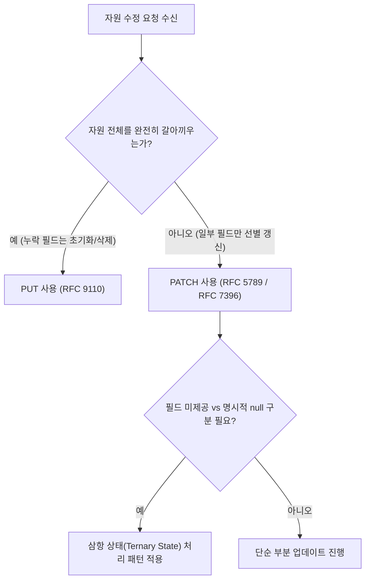

import Alert from '@/components/Alert.astro';

회원 정보 수정 API를 설계하다 보면 프론트엔드와 백엔드 개발자 사이에 미묘한 침묵이 흐르는 순간이 있습니다. "이거 `PUT`인가요 `PATCH`인가요?", "수정이 끝나면 200에 수정된 데이터를 담아주나요, 아니면 204로 끝내나요?" 같은 질문들입니다.

사소한 의견 차이처럼 보이지만, 이 질문들에 명확한 원칙 없이 임기응변으로 대응하기 시작하면 프론트엔드는 캐시 갱신을 위해 불필요한 재조회를 날리고, 백엔드는 누락된 필드가 DB에서 null로 덮어씌워지는 데이터 유실 사고를 겪습니다.

[1편: REST API URI 설계 원칙](/dev/ko/2026/rest-api-uri-naming-spring-boot-fastapi)에서 자원의 고유한 위치를 정의했다면, 이번 2편에서는 자원을 조작하는 표준 행동인 **HTTP 메서드**와 그 처리 결과를 클라이언트에게 명확히 알리는 **HTTP 상태 코드**(Status Code)의 실무 설계 기준을 정리합니다.

---

## 1. 안전성(Safe)과 멱등성(Idempotent)의 실무적 진실

HTTP 표준(RFC 9110)을 펼치면 모든 메서드를 설명할 때 가장 먼저 등장하는 두 가지 핵심 성질이 있습니다. 바로 **안전성**(Safety)과 **멱등성**(Idempotence)입니다.

이 두 개념은 정보처리기사 시험용 암기 과목이 아닙니다. 네트워크 순단이 일상인 분산 환경에서 "클라이언트나 게이트웨이가 요청 실패 시 마음 놓고 재시도(Retry)할 수 있는가?"를 결정하는 시스템 안정성의 절대적인 기준입니다.

| HTTP 메서드 | 안전성(Safe) | 멱등성(Idempotent) | 주요 실무 목적 | 재시도(Retry) 안전 여부 |
| :--- | :---: | :---: | :--- | :--- |
| **`GET`** | **O** | **O** | 자원 상태 조회 (서버 상태 불변) | 안전 (자동 재시도 권장) |
| **`HEAD`** | **O** | **O** | 메타데이터(헤더)만 조회 | 안전 (자동 재시도 권장) |
| **`OPTIONS`**| **O** | **O** | 지원 가능한 통신 옵션/CORS 확인 | 안전 (자동 재시도 권장) |
| **`PUT`** | X | **O** | 자원 전체 교체(Replace) 또는 생성 | 안전 (멱등 보장 시) |
| **`DELETE`** | X | **O** | 자원 삭제 | 안전 (멱등 보장 시) |
| **`POST`** | X | X | 자원 생성, 비즈니스 명령 처리 | **위험** (중복 처리 위험) |
| **`PATCH`** | X | X (조건부) | 자원 일부 수정 (증분 연산 시 비멱등) | 주의 (설계에 따라 다름) |

### 멱등성의 진짜 정의: 응답 코드가 아니라 '서버 리소스의 최종 상태'다

현업에서 가장 흔하게 터져 나오는 논쟁 중 하나가 바로 `DELETE` 메서드의 멱등성입니다.

> "첫 번째 `DELETE /orders/10` 요청은 `204 No Content`가 나왔는데, 바로 똑같이 한 번 더 보내면 이미 지워졌으니 `404 Not Found`가 떨어집니다. 반환되는 응답 코드가 다른데, 이게 어떻게 멱등한가요?"

결론부터 짚으면, 이 동작은 **완벽히 멱등**(Idempotent)합니다.

[RFC 9110 Section 9.2.2](https://www.rfc-editor.org/rfc/rfc9110#section-9.2.2)에서는 멱등성을 다음과 같이 규정합니다:
*"요청 메서드가 동일한 요청을 여러 번 수행했을 때 서버에 미치는 의도된 효과(Intended Effect on the Server)가 단일 요청의 효과와 동일하다면 멱등하다고 정의한다."*

멱등성의 판단 기준은 클라이언트가 받아보는 **HTTP 응답 상태 코드가 아니라, 요청 처리 후 남겨진 서버 리소스의 최종 상태**입니다.
첫 번째 호출로 10번 주문이 삭제되었고, 두 번째 호출에서도 10번 주문은 여전히 삭제된 상태입니다. 서버 데이터베이스 관점에서 부작용(Side Effect)의 변화는 0입니다. 따라서 응답 코드가 204에서 404로 바뀌더라도 `DELETE`는 표준상 명백한 멱등 메서드입니다.

### 네트워크 타임아웃과 데이터 사고 방지

클라이언트가 모바일 앱이든 API 게이트웨이든, 요청 도중 502 Bad Gateway나 504 Gateway Timeout을 마주했을 때 멱등성 여부는 동작을 완전히 갈라놓습니다.

- **멱등한 요청(`GET`, `PUT`, `DELETE`)**:
  네트워크 순단으로 응답을 수신하지 못했더라도 동일한 요청을 백오프(Backoff) 전략과 함께 즉시 자동 재전송할 수 있습니다. 이미 서버에 반영되었든 도중에 유실되었든 서버의 최종 상태는 변하지 않기 때문입니다.
- **비멱등한 요청(`POST`)**:
  `POST /payments` 요청 중 타임아웃이 발생했다고 클라이언트가 무심코 재시도하면 어떻게 될까요? 결제가 2번 승인되거나 계좌에서 이중 출금이 일어나는 참사가 발생합니다.

<Alert type="warning" title="POST 요청에 멱등성을 부여하는 Idempotency-Key">
결제 승인이나 주문 생성처럼 불가피하게 `POST`를 쓰면서도 중복 생성을 막아야 하는 비즈니스 API는, Stripe나 토스페이먼츠처럼 클라이언트가 생성한 고유 UUID를 `Idempotency-Key` HTTP 헤더에 실어 보내도록 강제해야 합니다. 서버는 Redis 등에 해당 키를 일정 시간 캐싱하여 중복 요청 시 이전 연산 결과를 그대로 반환해야 합니다.
</Alert>

---

## 2. PUT vs PATCH: 전체 대체와 부분 수정, 그리고 '삼항 상태' 딜레마

REST API를 구축할 때 가장 오용되기 쉬운 메서드가 바로 `PUT`과 `PATCH`입니다. 수많은 레거시 시스템이 데이터의 일부분만 수정하면서 습관적으로 `PUT`을 사용합니다.



### 1. 표준 규격의 엄격한 차이

- **`PUT` (RFC 9110 Section 9.3.4)**:
  자원의 **완전한 대체**(Complete Replacement)를 의미합니다. 페이로드에 포함되지 않은 기존 필드는 기본값으로 초기화되거나 삭제되어야 합니다. 즉, 클라이언트가 기존 데이터의 모든 필드를 완벽히 채워서 보내야 하는 무거운 연산입니다.
- **`PATCH` (RFC 5789 / RFC 7396 JSON Merge Patch)**:
  자원의 **부분 수정**(Partial Modification)을 의미합니다. 페이로드에 명시된 필드만 갱신하며, 전달되지 않은 나머지 필드는 기존 값을 그대로 유지합니다.

실무에서 사용자의 프로필 이미지만 변경하거나 닉네임 하나만 바꾸는 대다수의 API는 본질적으로 `PUT`이 아니라 `PATCH`여야 합니다.

### 2. 백엔드 개발자를 괴롭히는 삼항 상태(Ternary State) 딜레마

`PATCH` API를 구현할 때 실무에서 가장 위험한 버그가 발생하는 지점이 바로 **JSON 필드의 세 가지 상태**를 처리하는 문제입니다.

```json
// Case 1: 닉네임만 변경하고, 소개글은 기존 상태 유지
{"nickname": "hong_dev"}

// Case 2: 소개글(bio)을 완전히 지워서 빈 값(null)으로 초기화
{"bio": null}

// Case 3: 아무런 변경도 요청하지 않음
{}
```

클라이언트가 특정 필드를 전송할 때 백엔드는 다음 세 가지 상태를 반드시 구분할 수 있어야 합니다:

1. **Value**: 필드에 새로운 값이 제공됨 ➡️ 해당 값으로 갱신
2. **Null**: 필드가 명시적으로 `null`로 전달됨 ➡️ 데이터베이스 컬럼을 `null`로 초기화(Clear)
3. **Undefined / Unset (Omit)**: 필드 자체가 JSON에서 생략됨 ➡️ 기존 DB 값을 **절대 건드리지 않고 그대로 보존**

전통적인 Spring의 `@RequestBody` 바인딩이나 단순 DTO 매핑은 이 두 번째와 세 번째 상태를 구분하지 못합니다. DTO의 필드가 둘 다 Java `null`로 바인딩되기 때문입니다. 그 결과, 사용자가 닉네임만 바꾸려고 요청했는데 기존 소개글이 null로 날아가 버리는 치명적인 데이터 유실이 발생합니다.

<Alert type="danger" title="DTO 기본값 처리의 함정">
일부 프레임워크에서 DTO 클래스에 기본값을 할당해 두고(`String bio = "";`), 값이 없으면 무조건 덮어쓰는 방식을 쓰면 안 됩니다. 필드가 전달되지 않은 것과 빈 문자열이 전달된 것은 엄연히 다른 비즈니스 의도입니다.
</Alert>

---

## 3. 실무에서 가장 헷갈리는 HTTP 상태 코드 4대 결투

API 설계 회의에서 자주 격돌하는 4가지 상태 코드 선택 문제를 실무 관점에서 정리합니다.

### 결투 1: 200 OK vs 201 Created vs 204 No Content

새로운 데이터를 생성하거나 기존 자원을 수정했을 때 어떤 상태 코드를 주어야 할까요?

```http
# 1. 신규 자원 생성 성공: 201 Created
HTTP/1.1 201 Created
Location: /api/v1/users/42
Content-Type: application/json

{
  "id": 42,
  "nickname": "gildong",
  "createdAt": "2026-10-25T10:00:00Z"
}
```

- **`201 Created`**:
  새로운 자원이 성공적으로 생성되었음을 보장합니다. 이때 반드시 **`Location` 응답 헤더**에 방금 생성된 자원에 직접 접근할 수 있는 절대 경로 URI(`/api/v1/users/42`)를 함께 내려주는 것이 표준(RFC 9110 Section 15.3.2)입니다.

- **`204 No Content` vs `200 OK` (수정/삭제 시)**:
  - 교과서적인 관점: "수정이나 삭제 후 클라이언트에게 돌려줄 본문이 없다면 헤더만 있는 가벼운 `204 No Content`가 이상적이다."
  - **현대 프론트엔드 실무 관점**: "단순 204보다는 수정된 최신 엔티티를 본문에 담은 **`200 OK`**를 훨씬 선호한다."

왜 프론트엔드 개발팀은 204보다 200을 환영할까요?
React Query(TanStack Query)나 SWR 같은 최신 상태 관리 라이브러리는 서버에서 응답받은 최신 객체로 클라이언트 캐시를 즉시 동기화(Optimistic Cache Update)합니다. 만약 백엔드가 204를 내려주면, 프론트엔드는 화면을 최신 상태로 갱신하기 위해 `GET /users/42`를 추가로 한 번 더 호출해야 합니다.

또한 서버 내부에서 자동으로 계산되는 파생 필드(예: `updatedAt`, 자동 증가된 버전 번호, 상태 플래그 등)는 클라이언트가 알 수 없으므로, 수정 API(`PATCH`/`PUT`)에서는 갱신된 최종 자원 본문을 `200 OK`로 반환하는 것이 왕복 네트워크 비용(RTT)을 아끼는 실무 모범 사례입니다. 단, 자원이 완전히 사라진 `DELETE`의 경우 반환할 본문이 없으므로 `204 No Content`가 정답입니다.

---

### 결투 2: 400 Bad Request vs 422 Unprocessable Content

클라이언트의 요청이 잘못되었을 때 습관적으로 `400 Bad Request`만 쏟아내고 있지는 않나요?

과거에는 WebDAV 확장 규격(RFC 4918)에 머물렀던 **`422 Unprocessable Content`**가 최신 HTTP 핵심 표준인 [RFC 9110 Section 15.5.21](https://www.rfc-editor.org/rfc/rfc9110#section-15.5.21)에 코어 상태 코드로 정식 편입되었습니다.

| 구분 | 400 Bad Request | 422 Unprocessable Content |
| :--- | :--- | :--- |
| **핵심 성격** | 구문상 오류 (Syntax Error) | 의미론적 오류 (Semantic Error) |
| **서버 분석 단계** | 요청 파싱 자체가 불가능함 | 파싱은 성공했으나 비즈니스 규칙 위반 |
| **실제 발생 사례** | • 깨진 JSON 문법 (`{"name": }`)<br/>• 정수 필드에 알파벳 전달 (`"age": "abc"`)<br/>• 지원하지 않는 Content-Type 전송 | • 이메일 정규식 불일치<br/>• 비밀번호 최소 8자 미달<br/>• 시작일이 종료일보다 미래인 경우 |
| **클라이언트 대응** | 요청 페이로드 직렬화 코드 자체를 점검 | 사용자에게 폼 입력값 오류 안내 메시지 표시 |

FastAPI를 비롯해 최신 백엔드 프레임워크들이 DTO 유효성 검증(Validation) 실패 시 기본값으로 `422`를 반환하도록 설계된 이유가 바로 이 표준 구분에 있습니다.

---

### 결투 3: 401 Unauthorized vs 403 Forbidden

영단어 그대로 해석해서 "권한이 없으니 401을 주자"라고 생각하면 표준을 정면으로 위반하게 됩니다.

- **`401 Unauthorized`**: 실제 의미는 **"인증 실패"**(Unauthenticated)입니다.
  클라이언트가 자신이 누구인지 증명하지 못했거나(토큰 누락, 만료된 토큰, 서명 불일치), 인증 자격 증명이 유효하지 않은 경우입니다.
  RFC 9110 규격상 401 응답에는 클라이언트가 어떤 방식으로 인증해야 하는지 알려주는 **`WWW-Authenticate` 헤더**가 반드시 포함되어야 합니다.

```http
HTTP/1.1 401 Unauthorized
WWW-Authenticate: Bearer error="invalid_token", error_description="The access token expired"
```

- **`403 Forbidden`**: 실제 의미는 **"인가 실패"**(Unauthorized)입니다.
  서버는 클라이언트가 누구인지 정확히 알고 있습니다. 하지만 해당 클라이언트의 역할(Role)이나 권한(Permission)으로는 요청한 자원에 접근할 수 없습니다(예: 일반 회원이 관리자 전용 API 호출).
  재인증을 거치더라도 동일한 계정이라면 결과는 계속 거부됩니다.

<Alert type="tip" title="보안을 위한 403 대신 404 반환 기법">
비공개 저장소나 극비 문서는 존재 여부 자체가 외부에 노출되어서는 안 됩니다. 공격자가 자원 ID를 무차별 대입(Brute Force)할 때 403을 응답하면 "해당 ID의 리소스가 존재는 하는구나"라는 힌트를 주게 됩니다. GitHub 등 유수의 테크 기업들은 권한이 없는 비공개 자원 접근 시 403 대신 `404 Not Found`를 반환하여 자원의 존재 자체를 은폐합니다.
</Alert>

---

### 결투 4: 409 Conflict

`409 Conflict`는 자원의 현재 상태와 클라이언트의 요청이 충돌(Conflict)을 일으켰을 때 사용합니다.

대표적인 두 가지 실무 시나리오:
1. **유니크 제약조건**(Unique Constraint) 위반:
   이미 가입된 이메일 주소로 신규 가입을 시도할 때. 단순 400보다는 409를 주어 "현재 DB에 동일한 데이터가 이미 존재함"을 명확히 알려줍니다.
2. **동시성 제어 및 낙관적 락**(Optimistic Lock) 충돌:
   두 사용자가 동일한 게시글을 동시에 수정하려고 할 때, 먼저 수정된 버전 번호(또는 ETag)와 일치하지 않는 두 번째 요청은 `409 Conflict`로 튕겨내어 덮어쓰기 사고를 방지합니다.

---

## 4. Spring Boot 4 & FastAPI 실전 구현 비교

앞서 정리한 `PATCH` 삼항 상태 처리와 RFC 9457 표준 에러 응답(`ProblemDetail`)을 두 프레임워크에서 실제로 구현한 패턴을 코드로 비교합니다.

### 1. Spring Boot 4 (Java 21): `JsonNullable`과 `ProblemDetail`

Java는 언어 특성상 `null`과 `미전송(undefined)`을 문법적으로 구분하기 어렵습니다. 이를 완벽하게 해결하기 위해 실무에서는 OpenAPI Generator 생태계의 표준 도구인 `jackson-databind-nullable` 라이브러리의 `JsonNullable<T>` 컨테이너를 DTO에 적용합니다.

```xml
<!-- pom.xml 의존성 -->
<dependency>
    <groupId>org.openapitools</groupId>
    <artifactId>jackson-databind-nullable</artifactId>
    <version>0.2.6</version>
</dependency>
```

#### DTO 및 컨트롤러 구현

Java 21의 Compact Record 문법과 `JsonNullable`을 결합한 프로필 수정 DTO입니다:

```java
package com.example.api.user.dto;

import org.openapitools.jackson.nullable.JsonNullable;
import jakarta.validation.constraints.Size;

public record UpdateUserProfileRequest(
    JsonNullable<@Size(min = 2, max = 20) String> nickname,
    JsonNullable<@Size(max = 200) String> bio
) {
}
```

컨트롤러에서는 `isPresent()`(필드 전송 여부)와 `get()`(실제 값)을 통해 명확한 비즈니스 분기를 태웁니다:

```java
package com.example.api.user.controller;

import com.example.api.user.dto.UpdateUserProfileRequest;
import com.example.api.user.dto.UserResponse;
import com.example.api.user.service.UserService;
import jakarta.validation.Valid;
import org.springframework.http.ResponseEntity;
import org.springframework.web.bind.annotation.*;

@RestController
@RequestMapping("/api/v1/users")
public class UserController {

    private final UserService userService;

    public UserController(UserService userService) {
        this.userService = userService;
    }

    @PatchMapping("/{userId}")
    public ResponseEntity<UserResponse> updateUserProfile(
            @PathVariable Long userId,
            @Valid @RequestBody UpdateUserProfileRequest request) {
        
        // 1. 요청 처리 및 최신 엔티티 반환
        UserResponse updatedUser = userService.updateProfile(userId, request);
        
        // 2. 프론트엔드 캐시 갱신을 위해 최신 자원과 함께 200 OK 응답
        return ResponseEntity.ok(updatedUser);
    }
}
```

서비스 레이어에서의 삼항 상태 처리 로직:

```java
@Transactional
public UserResponse updateProfile(Long userId, UpdateUserProfileRequest request) {
    User user = userRepository.findById(userId)
        .orElseThrow(() -> new ResourceNotFoundException("사용자를 찾을 수 없습니다: " + userId));

    // nickname 필드가 페이로드에 명시적으로 포함되어 전달된 경우만 처리
    if (request.nickname().isPresent()) {
        String newNickname = request.nickname().get();
        if (newNickname == null) {
            throw new IllegalArgumentException("닉네임은 null로 설정할 수 없습니다.");
        }
        user.changeNickname(newNickname);
    }

    // bio 필드가 전달된 경우: null이면 소개글 비우기, 문자열이면 새 소개글 저장
    if (request.bio().isPresent()) {
        String newBio = request.bio().get(); // null 허용 (소개글 초기화)
        user.changeBio(newBio);
    }

    return UserResponse.from(user);
}
```

#### RFC 9457 `ProblemDetail` 기반 글로벌 에러 핸들러

Spring Boot 3/4부터는 HTTP API 에러의 인터넷 표준 규격인 [RFC 9457 Problem Details](https://www.rfc-editor.org/rfc/rfc9457)가 코어 프레임워크에 내장되었습니다.
유효성 검증 실패 시 `422 Unprocessable Content`를 표준 JSON 포맷으로 매핑합니다.

```java
package com.example.api.common.exception;

import org.springframework.http.HttpStatus;
import org.springframework.http.ProblemDetail;
import org.springframework.validation.FieldError;
import org.springframework.web.bind.MethodArgumentNotValidException;
import org.springframework.web.bind.annotation.ExceptionHandler;
import org.springframework.web.bind.annotation.RestControllerAdvice;

import java.net.URI;
import java.util.HashMap;
import java.util.Map;

@RestControllerAdvice
public class GlobalExceptionHandler {

    @ExceptionHandler(MethodArgumentNotValidException.class)
    public ProblemDetail handleValidationException(MethodArgumentNotValidException ex) {
        // RFC 9110 코어 표준 상태 코드: 422 Unprocessable Content
        ProblemDetail problem = ProblemDetail.forStatusAndDetail(
            HttpStatus.UNPROCESSABLE_ENTITY, 
            "요청 본문의 유효성 검증에 실패했습니다."
        );
        problem.setType(URI.create("https://api.example.com/errors/validation-failed"));
        problem.setTitle("Unprocessable Content");

        // 필드별 세부 에러 내역 매핑
        Map<String, String> invalidParams = new HashMap<>();
        for (FieldError error : ex.getBindingResult().getFieldErrors()) {
            invalidParams.put(error.getField(), error.getDefaultMessage());
        }
        problem.setProperty("invalid_params", invalidParams);

        return problem;
    }
}
```

---

### 2. FastAPI (Python 3.12+): Pydantic v2와 `exclude_unset`

Python 생태계의 FastAPI와 Pydantic v2는 삼항 상태를 처리하는 가장 우아한 메커니즘을 기본 지원합니다. 바로 `model_dump(exclude_unset=True)`입니다.

```python
from typing import Annotated, Optional
from fastapi import FastAPI, HTTPException, Path, status
from pydantic import BaseModel, Field

app = FastAPI(title="User Management API")

class UserUpdate(BaseModel):
    # None 허용 여부와 필드 기본값 설정
    nickname: Optional[str] = Field(default=None, min_length=2, max_length=20)
    bio: Optional[str] = Field(default=None, max_length=200)

# Mock DB
fake_db = {
    1: {"id": 1, "nickname": "original_nick", "bio": "기존 소개글입니다."}
}

@app.patch(
    "/api/v1/users/{user_id}",
    response_model=dict,
    status_code=status.HTTP_200_OK,
    summary="사용자 프로필 부분 수정"
)
async def update_user(
    user_id: Annotated[int, Path(ge=1)],
    payload: UserUpdate
):
    if user_id not in fake_db:
        raise HTTPException(
            status_code=status.HTTP_404_NOT_FOUND,
            detail="사용자를 찾을 수 없습니다."
        )

    user_data = fake_db[user_id]

    # exclude_unset=True 핵심: 클라이언트가 실제로 전송한 키만 추출!
    update_data = payload.model_dump(exclude_unset=True)

    # 삼항 상태에 따른 자연스러운 갱신
    for field, value in update_data.items():
        if field == "nickname" and value is None:
            # 닉네임은 null 불가 비즈니스 검증
            raise HTTPException(
                status_code=status.HTTP_422_UNPROCESSABLE_ENTITY,
                detail="닉네임은 null로 비울 수 없습니다."
            )
        user_data[field] = value

    return user_data
```

Pydantic v2의 `payload.model_dump(exclude_unset=True)`가 동작하는 방식:
- 클라이언트가 `{"bio": null}`만 보낸 경우 ➡️ `{"bio": None}`만 딕셔너리로 반환되어 기존 닉네임은 안전하게 유지됩니다.
- 클라이언트가 `{"nickname": "new_nick"}`만 보낸 경우 ➡️ `bio` 키 자체가 딕셔너리에 포함되지 않으므로 DB의 기존 소개글이 날아가지 않습니다.

#### 클라이언트가 수신하는 RFC 9457 표준 422 에러 응답 예시

FastAPI나 Spring Boot의 커스텀 에러 핸들러를 거쳐 유효성 검증 실패 시 클라이언트에 전달되는 응답 본문입니다:

```http
HTTP/1.1 422 Unprocessable Content
Content-Type: application/problem+json

{
  "type": "https://api.example.com/errors/validation-failed",
  "title": "Unprocessable Content",
  "status": 422,
  "detail": "요청 본문의 유효성 검증에 실패했습니다.",
  "invalid_params": {
    "nickname": "크기가 2에서 20 사이여야 합니다"
  }
}
```

---

## 5. 실무 의사결정 요약 체크리스트

팀 내에서 API 스펙을 작성하거나 코드 리뷰를 진행할 때 흔들리지 않도록 점검표를 활용해 보세요.

| 점검 항목 | 권장 가이드 | 확인 |
| :--- | :--- | :---: |
| **재시도 안전성** | 네트워크 타임아웃 발생 시 클라이언트/프록시가 자동 재시도해도 안전한가? (`GET`, `PUT`, `DELETE`만 허용) | [ ] |
| **PUT vs PATCH** | 필드 일부분만 수정하면서 습관적으로 `PUT`을 쓰고 있지 않은가? 부분 수정은 무조건 `PATCH`인가? | [ ] |
| **삼항 상태 방어** | `PATCH` 구현 시 필드 생략(Omit)과 명시적 `null` 전송을 프레임워크 차원에서 명확히 구분했는가? | [ ] |
| **생성 성공 응답** | 자원 생성 성공 시 `201 Created`와 함께 신규 URI를 담은 `Location` 헤더를 내려주는가? | [ ] |
| **수정 후 응답 데이터** | 프론트엔드의 캐시 정합성을 위해 수정(`PATCH`/`PUT`) 성공 시 최신 엔티티를 담은 `200 OK`를 주는가? | [ ] |
| **유효성 검증 상태 코드** | 단순 문법 오류가 아닌 입력값 제약조건 위반 시 `400` 대신 표준 `422 Unprocessable Content`를 주는가? | [ ] |
| **인증 vs 인가 구분** | 토큰 누락/만료에는 `401`(헤더 포함), 권한 부족에는 `403`을 명확히 구분하여 응답하는가? | [ ] |
| **에러 포맷 표준화** | 임의의 커스텀 에러 객체 대신 RFC 9457 `application/problem+json` 표준 스펙을 따르는가? | [ ] |

---

## 마치며

HTTP 메서드와 상태 코드는 단순한 통신 규약 번호가 아닙니다. 프론트엔드와 백엔드, API 게이트웨이, 웹 캐시 계층이 서로의 내부 코드를 열어보지 않고도 가장 효율적이고 안전하게 대화할 수 있도록 전 세계 엔지니어들이 수십 년간 다듬어온 **공용 언어**입니다.

이 언어의 문법을 정확하게 구사할 때, 시스템은 불필요한 네트워크 왕복을 줄이고 예측 불가능한 데이터 덮어쓰기 사고로부터 안전해집니다.

다음 **3편**에서는 자원 조작을 넘어 방대한 양의 데이터를 효율적으로 서빙하기 위한 "REST API 대량 데이터 조회와 실전 페이징 설계(Offset vs Cursor 페이징, 딥 페이징 성능 최적화)"를 상세히 다루겠습니다.
