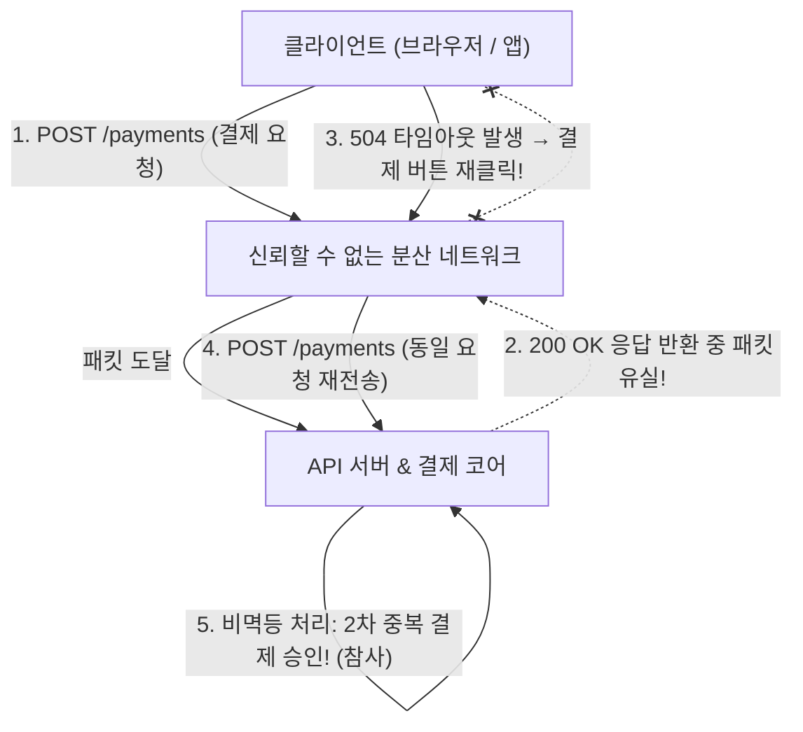
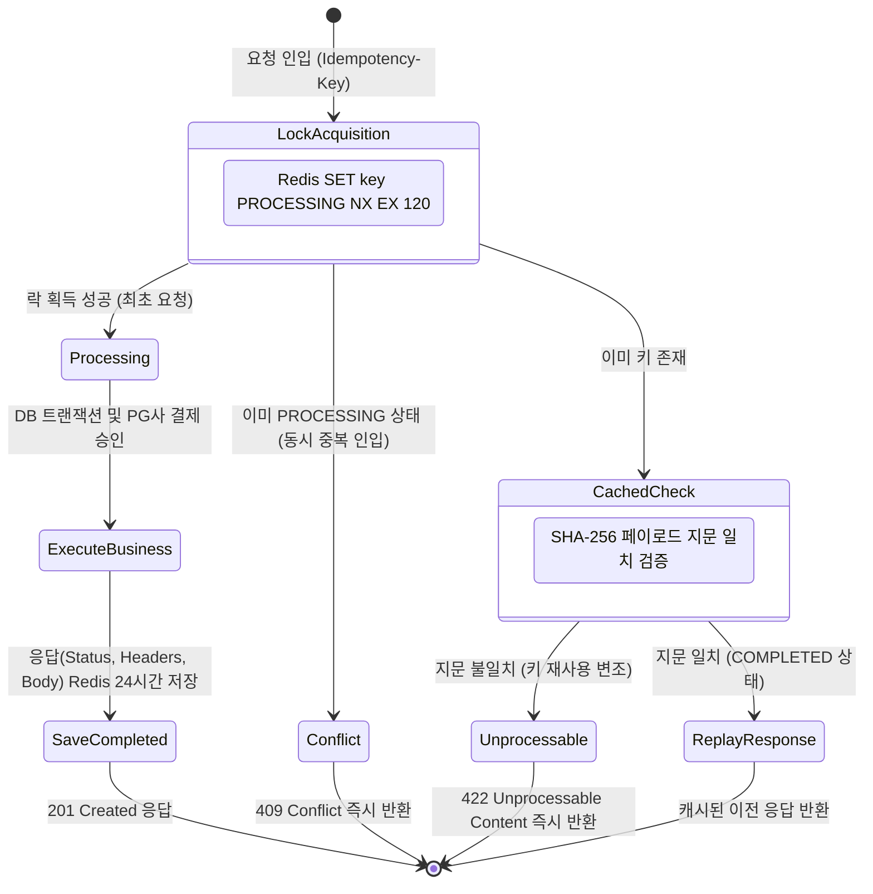
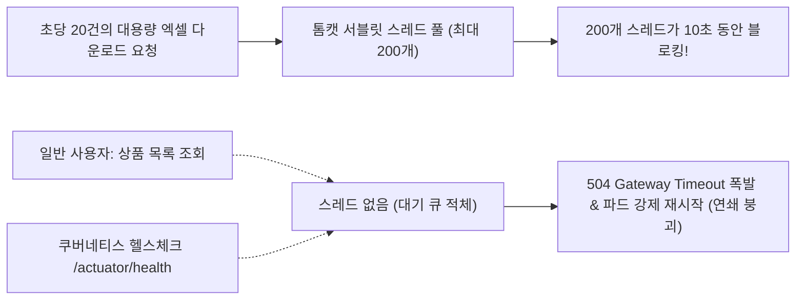
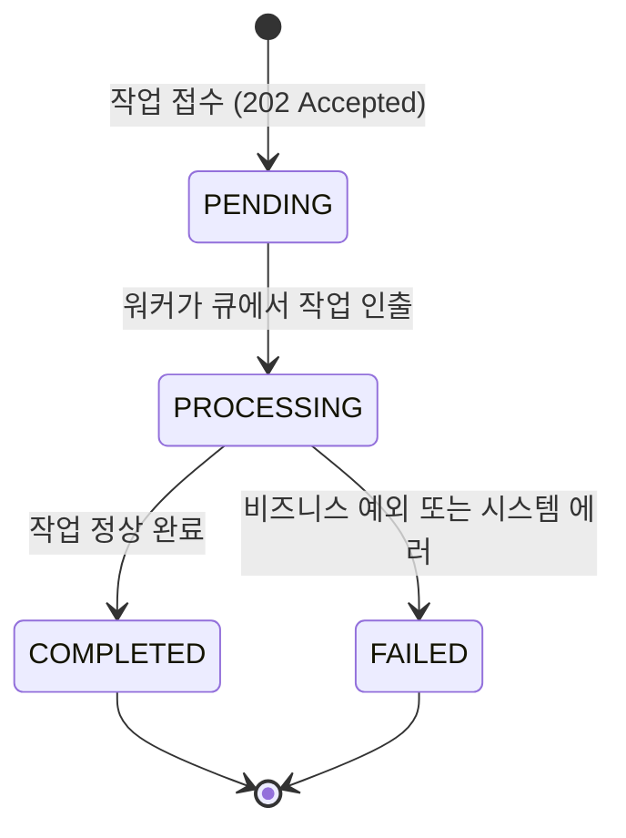
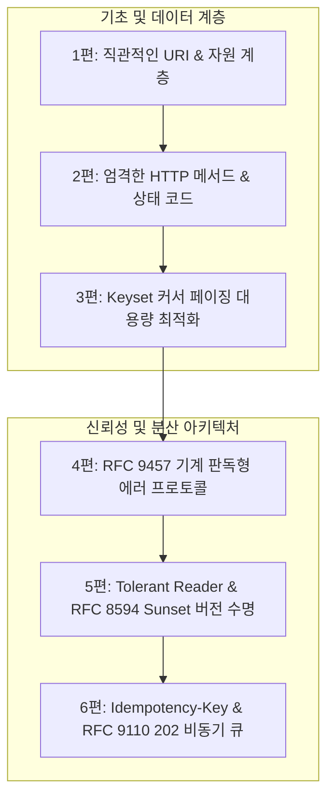

import Alert from '@/components/Alert.astro';

결제 요청 API를 호출했는데 브라우저 화면에 `504 Gateway Timeout`이 떨어집니다. 당황한 사용자가 결제 버튼을 한 번 더 누르는 순간, 카드사에서 결제 문자가 두 번 날아오는 끔찍한 사고가 벌어집니다. 분산 시스템에서 네트워크 단절과 타임아웃을 다루는 멱등성 설계가 결여되었을 때 발생하는 전형적인 참사입니다.

앞선 시리즈를 통해 우리는 견고한 엔터프라이즈 REST API의 토대를 다져왔습니다:
- [1편: REST API URI 설계 원칙](/dev/ko/2026/rest-api-uri-naming-spring-boot-fastapi) — 자원 중심 계층형 엔드포인트 설계
- [2편: HTTP 메서드와 상태 코드 설계](/dev/ko/2026/rest-api-http-methods-status-codes) — 안전성과 멱등성을 지킨 올바른 HTTP 스펙 매핑
- [3편: 대용량 페이징 최적화](/dev/ko/2026/rest-api-pagination-offset-cursor) — Keyset 커서 페이징을 통한 DB 부하 격리
- [4편: RFC 9457 표준 에러 처리](/dev/ko/2026/rest-api-error-handling-rfc9457) — Problem Details 기반의 기계 판독형 에러 프로토콜
- [5편: API 버전 관리와 하위 호환성 전략](/dev/ko/2026/rest-api-versioning-backward-compatibility) — Tolerant Reader와 RFC 8594 Sunset 수명주기

하지만 로컬 개발 환경이나 인메모리 테스트에서는 완벽하게 동작하던 API도, 통제 불가능한 네트워크와 외부 연동이 얽히는 실무 분산 환경에 배포되는 순간 거친 도전에 직면합니다. 패킷 유실로 인한 재시도 루프와 이중 결제, 그리고 수십 초가 소요되는 대용량 작업이 서블릿 스레드 풀 전체를 잠식하는 장애가 대표적입니다.

'실무 REST API 설계 가이드' 시리즈의 최종 완결편인 이번 6편에서는 분산 시스템의 신뢰성을 완성하는 두 가지 핵심 메커니즘을 다룹니다:
1. IETF `Idempotency-Key` 헤더 표준과 Redis 분산 잠금을 통한 **안전한 재시도 및 중복 방지 아키텍처**
2. 서블릿 스레드 고갈을 원천 차단하는 RFC 9110 `202 Accepted`와 작업 상태 리소스 기반의 **비동기 롱러닝 큐 설계**

---

## 1. 네트워크 타임아웃과 두 장군 문제(Two Generals' Problem)

단일 프로세스 내부의 함수 호출은 성공하거나 실패하는 2가지 상태(Binary State)만 가집니다. 그러나 물리적으로 분리된 네트워크 너머의 원격 API를 호출하는 순간, 컴퓨터 과학의 고전적 난제인 **두 장군 문제**(Two Generals' Problem)가 실무 현장에 그대로 재현됩니다.



### 1.1 분산 환경의 3대 불확정 상태(Tri-State)

클라이언트가 결제나 주문 API를 호출한 뒤 `504 Gateway Timeout`이나 소켓 단절(Connection Reset)을 만났을 때, 실제로 백엔드 서버에서 일어난 상황은 다음 세 가지 중 하나입니다:

1. **요청 도달 전 유실**(Request Lost): 요청 패킷이 로드밸런서나 웹 서버에 도달하기 전에 통신망 단절로 유실되었습니다. 서버에는 아무런 트랜잭션도 시작되지 않았습니다.
2. **응답 반환 중 유실**(Response Lost): 서버는 결제 승인과 DB 저장을 100% 정상 완료했습니다. 그러나 클라이언트로 응답을 돌려보내려는 찰나 라우터나 게이트웨이 타임아웃으로 패킷이 소멸했습니다.
3. **진행 중 지연**(In-Flight Execution): DB 락 경합이나 외부 PG사 연동 지연으로 인해 백엔드 스레드에서 여전히 트랜잭션이 한창 커밋 진행 중입니다.

중요한 점은 **클라이언트는 이 세 가지 상태 중 무엇이 일어났는지 절대로 알 수 없다**는 사실입니다.

### 1.2 POST 비멱등성과 지수 백오프 재시도의 위험한 결합

HTTP 스펙상 `GET`, `PUT`, `DELETE`는 멱등(Idempotent)합니다. 동일한 요청을 열 번 보내든 백 번 보내든 서버의 최종 리소스 상태는 한 번 실행한 것과 동일합니다. 따라서 타임아웃을 만나면 안심하고 재시도(Retry)할 수 있습니다.

반면 비즈니스 트랜잭션을 일으키고 신규 리소스를 생성하는 `POST`는 비멱등(Non-idempotent) 메서드입니다. 만약 클라이언트 라이브러리(OkHttp, Axios, Envoy 등)가 "일시적 네트워크 에러 발생 시 지수 백오프(Exponential Backoff)로 최대 3회 재시도"하도록 구성되어 있거나, 화면이 멈춘 사용자가 답답함에 버튼을 연타하면 2번(응답 유실)과 3번(진행 중 지연) 상황에서 여지없이 이중 결제와 중복 주문 데이터가 생성됩니다.

이 문제를 원천 해결하기 위해 전 세계 엔지니어링 표준으로 자리 잡은 장치가 바로 **IETF Idempotency-Key** 헤더입니다.

---

## 2. IETF Idempotency-Key 헤더 표준과 Redis 분산 잠금

멱등 키(Idempotency Key)는 클라이언트가 요청을 고유하게 식별하기 위해 발급하는 난수 문자열(일반적으로 UUID v4)입니다. IETF 드래프트 규격(`draft-ietf-httpapi-idempotency-key-header`)과 Stripe, Toss Payments 등 글로벌 결제 플랫폼의 실무 사실상 표준(De-facto Standard)입니다.

클라이언트는 결제나 주문과 같이 재시도 위험이 있는 `POST` 요청에 헤더를 동봉합니다:

```http
POST /api/v1/payments HTTP/1.1
Host: api.example.com
Content-Type: application/json
Idempotency-Key: e8b5f3a0-4f51-4c6e-9e7f-8d2a1b3c4d5e

{
  "orderId": "ORD-2026-1025-001",
  "amount": 50000,
  "currency": "KRW"
}
```

### 2.1 3단계 라이프사이클 상태 머신

백엔드 서버는 `Idempotency-Key`를 수신했을 때 무작정 비즈니스 로직을 실행하지 않고, Redis와 같은 인메모리 분산 저장소를 활용해 3단계 상태 머신을 거칩니다:



#### 1단계: Processing (원자적 잠금 획득)
요청이 들어오면 Redis의 `SET key "PROCESSING" NX EX 120` 명령을 통해 원자적 잠금(Atomic Lock)을 시도합니다.
- **성공 시**: 이 키를 처음 사용하는 최초 요청이므로 비즈니스 로직 실행으로 넘어갑니다.
- **실패 시**: 이미 키가 존재한다는 뜻입니다. 기존 키의 상태가 `PROCESSING`이라면 현재 다른 스레드나 인스턴스에서 동일한 요청을 처리 중이므로 즉시 **`409 Conflict`** 상태 코드를 반환하여 동시성 레이스 컨디션을 차단합니다.

#### 2단계: Completed & Cached (응답 영속화)
비즈니스 로직(결제 승인, DB 커밋)이 성공적으로 끝나면, 클라이언트에게 반환할 최종 HTTP 상태 코드(예: `201 Created`), 주요 응답 헤더, 응답 JSON 본문을 Redis에 통째로 직렬화하여 저장하고 상태를 `COMPLETED`로 갱신합니다.
- 캐시 유효 기간(TTL)은 금융/주문 비즈니스 정책에 맞춰 통상 **24～48시간** 동안 유지합니다.

#### 3단계: Replay (동일 응답 재생)
네트워크 타임아웃을 겪은 클라이언트가 동일한 `Idempotency-Key`를 달고 다시 요청을 보내왔을 때, Redis에 저장된 상태가 `COMPLETED`라면 **비즈니스 로직을 전혀 실행하지 않고 과거에 캐시해 둔 응답을 그대로 복원하여 반환**합니다.
- 이때 응답 헤더에 `Idempotency-Replayed: true`를 함께 실어주면, 클라이언트는 "이 응답이 새롭게 처리된 것이 아니라 이전에 성공한 결과를 안전하게 재현한 것"임을 명확히 인지할 수 있습니다.

### 2.2 페이로드 지문(SHA-256 Fingerprint) 검증

실무에서 자주 발생하는 심각한 보안 및 데이터 무결성 결함 중 하나는 **"동일한 멱등 키에 서로 다른 요청 바디가 전송되는 상황"**입니다:

- 첫 번째 요청: `Idempotency-Key: KEY-999`, 결제 금액: `10,000원`
- 두 번째 요청: `Idempotency-Key: KEY-999`, 결제 금액: `500,000원` (클라이언트 버그나 공격자의 키 재사용)

만약 단순히 키 일치 여부만 보고 이전의 10,000원 결제 결과를 재현(Replay)해 버린다면, 클라이언트는 500,000원 결제를 요청했음에도 10,000원 결제 완료 응답을 받게 되는 파멸적인 정합성 왜곡이 발생합니다.

따라서 멱등성 필터는 요청 URI, HTTP 메서드, 그리고 요청 바디(Body)의 바이트 스트림을 조합하여 **SHA-256 해시 지문**(Fingerprint)을 추출해야 합니다:

> **Fingerprint** = SHA-256(Method + URI + Request-Body)

Redis에 키를 저장할 때 이 지문을 함께 바인딩하고, 동일 키로 재요청이 들어왔을 때 지문이 단 1비트라도 일치하지 않는다면 비즈니스 로직 실행이나 캐시 재생을 단호히 거부하고 **`422 Unprocessable Content`**를 반환해야 합니다:

```http
HTTP/1.1 422 Unprocessable Content
Content-Type: application/problem+json

{
  "type": "https://api.example.com/errors/idempotency-payload-mismatch",
  "title": "Idempotency Key Payload Mismatch",
  "status": 422,
  "detail": "제공된 Idempotency-Key는 유효하지만, 이전 요청의 페이로드 지문과 일치하지 않습니다. 다른 요청에는 새로운 키를 발급하세요."
}
```

<Alert type="warning" title="주의: 프로세싱 중 서버 다운과 락 만료">
작업 처리 중(`PROCESSING`) 락의 만료 시간(TTL)은 비즈니스 로직의 최대 허용 타임아웃(통상 60～120초)으로 반드시 설정해야 합니다. 만약 `EX` 옵션 없이 무기한 락을 잡았다가 WAS 인스턴스가 OutOfMemoryError로 강제 종료되면, 해당 멱등 키는 영원히 `PROCESSING`으로 잠겨 클라이언트가 영구히 재시도하지 못하는 데드락에 빠지게 됩니다.
</Alert>

---

## 3. 10초 이상 걸리는 작업의 해법 — RFC 9110 202 Accepted 비동기 패턴

아무리 멱등성을 완벽하게 보장해도, 작업 자체가 10초, 30초, 수 분 이상 걸리는 대용량 배치성 API라면 동기식(Synchronous) HTTP 연결로는 서비스 장애를 막을 수 없습니다.

### 3.1 동기 커넥션의 치명적 한계: 서블릿 스레드 풀 고갈

Spring Boot의 기본 내장 서블릿 컨테이너인 Apache Tomcat의 최대 작업 스레드(Max Worker Threads)는 기본값이 200개입니다. 

만약 대용량 회계 정산 엑셀 생성이나 복잡한 AI 추론처럼 1건당 **10초**가 걸리는 무거운 API를 동기 방식으로 호출받는다면 어떻게 될까요? 리틀의 법칙(Little's Law)에 따라 동시 점유 스레드 수는 다음과 같이 계산됩니다:

> **필요 스레드 수** = 초당 요청 수(RPS) × 평균 처리 시간(초)  
> **20 RPS × 10초** = **200개 스레드 동시 점유**

놀랍게도 단 **20 RPS**의 가벼운 유입만으로 톰캣의 200개 스레드 풀 전체가 단 10초 만에 100% 고갈됩니다.



서블릿 스레드가 모두 잠기면 그 뒤로 유입되는 가벼운 단건 조회 API는 물론, 쿠버네티스 인그레스와 로드밸런서가 파드의 생존을 확인하는 `/actuator/health` 헬스체크 요청까지 대기 큐에서 타임아웃을 맞이합니다. 인프라는 파드가 비정상이라고 판단하여 강제 재시작(Restart)을 감행하고, 시스템 전체가 연쇄 붕괴(Cascading Failure)의 늪에 빠집니다.

### 3.2 RFC 9110 202 Accepted 표준 규약과 필수 헤더

이 파멸적인 스레드 고갈을 방지하는 유일한 해법은 **동기 HTTP 커넥션을 100ms 이내에 즉시 끊고 작업을 백그라운드 큐로 위임**하는 비동기 분리입니다.

RFC 9110 표준이 정의하는 상태 코드 **`202 Accepted`**는 바로 이 목적으로 설계되었습니다:

> *"The 202 (Accepted) status code indicates that the request has been accepted for processing, but the processing has not been completed."*
> (요청이 성공적으로 접수되었으나, 처리가 아직 완료되지 않았음을 나타냅니다.)

`202 Accepted` 응답을 반환할 때는 클라이언트가 진행 상황을 추적할 수 있도록 다음 2가지 HTTP 헤더를 반드시 동봉해야 합니다:

1. **`Location`**: 클라이언트가 작업의 진행 상태와 최종 결과를 폴링할 수 있는 상태 확인 엔드포인트 URI.
2. **`Retry-After`**: 클라이언트가 서버에 다음 폴링 요청을 보내기 전 대기해야 하는 권장 시간(초 단위 정수 또는 HTTP Date).

```http
HTTP/1.1 202 Accepted
Location: /api/v1/jobs/job_8f2d9e1a
Retry-After: 5
Content-Type: application/json

{
  "jobId": "job_8f2d9e1a",
  "status": "PENDING",
  "message": "리포트 생성 작업이 정상 접수되었습니다. 지정된 Location URI에서 상태를 확인하세요.",
  "createdAt": "2026-10-25T14:30:00Z"
}
```

### 3.3 상태 확인 리소스(Job Status Resource) 모델링

클라이언트가 `Location` 헤더에 적힌 URI(`GET /api/v1/jobs/{jobId}`)를 호출했을 때 반환되는 작업 상태 리소스는 다음과 같은 상태 머신을 가집니다:



작업 진행 상태를 나타내는 RESTful JSON 스펙은 다음과 같이 설계합니다:

```json
{
  "jobId": "job_8f2d9e1a",
  "status": "PROCESSING",
  "progress": 65,
  "createdAt": "2026-10-25T14:30:00Z",
  "updatedAt": "2026-10-25T14:30:15Z",
  "resultUrl": null,
  "error": null
}
```

작업이 성공적으로 끝나면 `status`가 `COMPLETED`로 변경되고, 최종 결과물을 획득할 수 있는 `resultUrl`이 제공됩니다:

```json
{
  "jobId": "job_8f2d9e1a",
  "status": "COMPLETED",
  "progress": 100,
  "createdAt": "2026-10-25T14:30:00Z",
  "completedAt": "2026-10-25T14:30:28Z",
  "resultUrl": "/api/v1/reports/rep_10293/download",
  "error": null
}
```

만약 작업 도중 복구 불가능한 에러가 발생했다면, `status`는 `FAILED`로 변경되고 앞선 4편에서 다룬 RFC 9457 호환 에러 명세를 `error` 객체에 담아 원인을 상세히 전달합니다.

### 3.4 비동기 결과 수신 3대 모델 트레이드오프 비교

비동기 작업의 완료 결과를 클라이언트가 받아보는 방식에는 크게 세 가지가 존재합니다. 시스템의 인프라 여건과 클라이언트 유형에 맞춰 최적의 패턴을 선택해야 합니다:

| 비교 항목 | ① 지수 백오프 폴링 (Polling) | ② 웹훅 알림 (Webhook) | ③ 서버 전송 이벤트 (SSE) |
| :--- | :--- | :--- | :--- |
| **통신 방향** | 클라이언트가 서버로 주기적 Pull | 서버가 클라이언트 URL로 Push | 서버가 단방향 스트림 Push |
| **실시간성** | 낮음～중간 (폴링 주기 의존) | 매우 높음 (작업 완료 즉시 전송) | 즉시 (실시간 밀리초 단위) |
| **네트워크 부하** | 반복 요청으로 상대적 부하 발생 | 단 1회의 HTTP POST 호출로 최소화 | 장시간 TCP 커넥션 점유 |
| **클라이언트 제약**| 없음 (순수 HTTP GET 지원) | **공개 고정 IP / 수신 서버 필수** | 브라우저 `EventSource` 지원 필요 |
| **구현 복잡도** | 매우 낮음 | 중간 (서명 검증, 재시도 큐) | 중간 (커넥션 유지, 재연결) |
| **최적 유스케이스**| 모바일 앱, 단발성 엑셀 다운로드 | **B2B 파트너사 연동, PG 결제 통보** | 웹 브라우저 대시보드 실시간 진행률 |

---

## 4. Spring Boot 4 & FastAPI 실전 구현 비교

프로덕션 분산 환경에서 동작 가능한 완성도 높은 코드로 멱등성과 202 비동기 아키텍처를 프레임워크별로 단계별 구현합니다.

### 4.1 Spring Boot 4 (Java 21): 원자적 Redis 멱등성 필터와 202 비동기 컨트롤러

Spring Boot 환경에서는 서블릿 레벨의 `OncePerRequestFilter`에서 멱등성을 투명하게 가로채 처리하고, Java 21 가상 스레드(Virtual Threads) 또는 비동기 태스크 실행기로 작업을 백그라운드에 위임합니다.

#### 1) SHA-256 지문 검증 및 Redis 원자적 멱등 필터

<Alert type="tip" title="서블릿 바디 스트림 다중 소비 주의">
서블릿 규격상 `HttpServletRequest`의 입력 스트림(`InputStream`)은 단 한 번만 읽을 수 있는 1회성 스트림입니다. 필터 선행 단계에서 SHA-256 해시를 계산하기 위해 스트림을 소비하면 컨트롤러의 `@RequestBody` 역직렬화 시 `HttpMessageNotReadableException`이 발생할 수 있습니다. 실무 프로덕션 환경에서는 `ContentCachingRequestWrapper`를 필터 체인 통과 후(post-processing)에 활용하거나, 바이트 배열을 캐싱하여 여러 번 `getInputStream()`을 열 수 있는 커스텀 `RepeatableReadRequestWrapper`를 구현하여 체인에 넘겨야 합니다.
</Alert>

```java
package com.example.api.idempotency;

import com.fasterxml.jackson.databind.ObjectMapper;
import jakarta.servlet.FilterChain;
import jakarta.servlet.ServletException;
import jakarta.servlet.http.HttpServletRequest;
import jakarta.servlet.http.HttpServletResponse;
import lombok.RequiredArgsConstructor;
import lombok.extern.slf4j.Slf4j;
import org.springframework.data.redis.core.StringRedisTemplate;
import org.springframework.http.HttpStatus;
import org.springframework.http.MediaType;
import org.springframework.stereotype.Component;
import org.springframework.web.filter.OncePerRequestFilter;
import org.springframework.web.util.ContentCachingRequestWrapper;
import org.springframework.web.util.ContentCachingResponseWrapper;

import java.io.IOException;
import java.nio.charset.StandardCharsets;
import java.security.MessageDigest;
import java.security.NoSuchAlgorithmException;
import java.time.Duration;
import java.util.HexFormat;

@Slf4j
@Component
@RequiredArgsConstructor
public class IdempotencyFilter extends OncePerRequestFilter {

    private static final String IDEMPOTENCY_HEADER = "Idempotency-Key";
    private static final String REDIS_PREFIX = "idempotency:";
    private static final Duration LOCK_TIMEOUT = Duration.ofSeconds(120);
    private static final Duration CACHE_TTL = Duration.ofHours(24);

    private final StringRedisTemplate redisTemplate;
    private final ObjectMapper objectMapper;

    @Override
    protected void doFilterInternal(HttpServletRequest request,
                                    HttpServletResponse response,
                                    FilterChain filterChain) throws ServletException, IOException {

        String idempotencyKey = request.getHeader(IDEMPOTENCY_HEADER);

        // 멱등 키가 없는 일반 요청이나 GET 조회는 그대로 통과
        if (idempotencyKey == null || "GET".equalsIgnoreCase(request.getMethod())) {
            filterChain.doFilter(request, response);
            return;
        }

        // 바디 다중 읽기를 위해 Caching Wrapper로 래핑
        ContentCachingRequestWrapper wrappedRequest = new ContentCachingRequestWrapper(request);
        ContentCachingResponseWrapper wrappedResponse = new ContentCachingResponseWrapper(response);

        // 첫 번째 청크를 읽어들이기 위해 체인 선행 실행 전 바디 강제 캐싱
        wrappedRequest.getInputStream().readAllBytes();
        String currentFingerprint = generateFingerprint(wrappedRequest);

        String redisKey = REDIS_PREFIX + idempotencyKey;

        // Step 1: SET key PROCESSING NX EX 120 원자적 잠금 시도
        Boolean lockAcquired = redisTemplate.opsForValue()
                .setIfAbsent(redisKey, "PROCESSING:" + currentFingerprint, LOCK_TIMEOUT);

        if (Boolean.FALSE.equals(lockAcquired)) {
            // 이미 키가 존재하는 경우: 캐시 데이터 조회
            String existingRecord = redisTemplate.opsForValue().get(redisKey);

            if (existingRecord != null && existingRecord.startsWith("PROCESSING:")) {
                // 현재 다른 스레드에서 처리 중인 동시 요청
                sendErrorResponse(response, HttpStatus.CONFLICT, 
                        "동일한 Idempotency-Key에 대한 요청이 현재 처리 중입니다.");
                return;
            }

            if (existingRecord != null && existingRecord.startsWith("COMPLETED:")) {
                IdempotentResponse cachedResponse = objectMapper.readValue(
                        existingRecord.substring("COMPLETED:".length()), IdempotentResponse.class);

                // 페이로드 지문 검증
                if (!cachedResponse.fingerprint().equals(currentFingerprint)) {
                    sendErrorResponse(response, HttpStatus.UNPROCESSABLE_ENTITY, 
                            "Idempotency-Key가 재사용되었으나 요청 본문(Payload) 지문이 일치하지 않습니다.");
                    return;
                }

                // Step 3: Replay - 과거 응답 그대로 복원 반환
                response.setStatus(cachedResponse.statusCode());
                response.setContentType(cachedResponse.contentType());
                response.setHeader("Idempotency-Replayed", "true");
                response.getWriter().write(cachedResponse.body());
                return;
            }
        }

        try {
            // 실제 비즈니스 로직 및 컨트롤러 실행
            filterChain.doFilter(wrappedRequest, wrappedResponse);

            // Step 2: Completed - 응답 캡처 후 Redis에 영속화
            byte[] responseBody = wrappedResponse.getContentAsByteArray();
            String responseBodyStr = new String(responseBody, StandardCharsets.UTF_8);

            IdempotentResponse responseRecord = new IdempotentResponse(
                    currentFingerprint,
                    wrappedResponse.getStatus(),
                    wrappedResponse.getContentType(),
                    responseBodyStr
            );

            redisTemplate.opsForValue().set(
                    redisKey,
                    "COMPLETED:" + objectMapper.writeValueAsString(responseRecord),
                    CACHE_TTL
            );

            wrappedResponse.copyBodyToResponse();
        } catch (Exception ex) {
            // 비즈니스 처리 중 에러 발생 시 락 해제
            redisTemplate.delete(redisKey);
            throw ex;
        }
    }

    private String generateFingerprint(ContentCachingRequestWrapper req) {
        try {
            MessageDigest digest = MessageDigest.getInstance("SHA-256");
            digest.update(req.getMethod().getBytes(StandardCharsets.UTF_8));
            digest.update(req.getRequestURI().getBytes(StandardCharsets.UTF_8));
            digest.update(req.getContentAsByteArray());
            return HexFormat.of().formatHex(digest.digest());
        } catch (NoSuchAlgorithmException e) {
            throw new IllegalStateException("SHA-256 알고리즘 사용 불가", e);
        }
    }

    private void sendErrorResponse(HttpServletResponse res, HttpStatus status, String detail) throws IOException {
        res.setStatus(status.value());
        res.setContentType(MediaType.APPLICATION_PROBLEM_JSON_VALUE);
        String body = String.format("{\"status\":%d,\"title\":\"%s\",\"detail\":\"%s\"}",
                status.value(), status.getReasonPhrase(), detail);
        res.getWriter().write(body);
    }

    public record IdempotentResponse(String fingerprint, int statusCode, String contentType, String body) {}
}
```

#### 2) RFC 9110 202 Accepted 비동기 작업 서비스 및 컨트롤러

대용량 리포트 생성을 접수하고 `202 Accepted`와 `Location`, `Retry-After` 헤더를 즉시 반환하며, 백그라운드 워커에 작업을 위임하는 구조입니다.

<Alert type="warning" title="Spring @Async 프록시 자가 호출(Self-Invocation) 주의">
스프링의 `@Async`, `@Transactional`은 AOP 프록시 래퍼로 동작합니다. 만약 컨트롤러 내부에서 `this.executeReportGeneration(...)` 형태로 직접 호출하면 스프링 프록시를 거치지 않고 순수 내부 메서드로 실행되어, 비동기 처리가 무시되고 서블릿 스레드가 15초 동안 블로킹됩니다. 반드시 별도의 `@Service` 빈(`AsyncReportWorker`)으로 분리 주입하여 프록시를 통해 호출해야 합니다.
</Alert>

```java
package com.example.api.service;

import com.example.api.dto.CreateReportRequest;
import com.example.api.dto.JobStatusDto;
import lombok.RequiredArgsConstructor;
import lombok.extern.slf4j.Slf4j;
import org.springframework.scheduling.annotation.Async;
import org.springframework.stereotype.Service;

import java.time.Instant;
import java.util.Map;
import java.util.concurrent.ConcurrentHashMap;

@Slf4j
@Service
@RequiredArgsConstructor
public class AsyncReportWorker {

    // 실무에서는 Redis나 분산 영속 DB에 작업 상태를 보관
    private static final Map<String, JobStatusDto> JOB_STORE = new ConcurrentHashMap<>();

    public void registerJob(String jobId, JobStatusDto initialJob) {
        JOB_STORE.put(jobId, initialJob);
    }

    public JobStatusDto getJobStatus(String jobId) {
        return JOB_STORE.get(jobId);
    }

    /**
     * 프록시 기반 AOP를 타기 위해 컨트롤러 외부 빈에서 @Async를 실행합니다.
     * Spring Boot 4에서 Virtual Threads(spring.threads.virtual.enabled=true)와 결합 시
     * 스레드 풀 고갈 없이 수만 개의 비동기 태스크를 가볍게 소화합니다.
     */
    @Async
    public void executeReportGeneration(String jobId, CreateReportRequest request) {
        try {
            log.info("[비동기 워커] 리포트 생성 착수: jobId={}, type={}", jobId, request.reportType());
            JOB_STORE.computeIfPresent(jobId, (k, v) -> v.withStatusAndProgress("PROCESSING", 30));

            // 15초가 소요되는 대규모 집계 및 파일 생성 시뮬레이션
            Thread.sleep(15000);

            JOB_STORE.computeIfPresent(jobId, (k, v) -> new JobStatusDto(
                    v.jobId(),
                    "COMPLETED",
                    100,
                    v.createdAt(),
                    Instant.now(),
                    "/api/v1/reports/" + jobId + "/download"
            ));
            log.info("[비동기 워커] 리포트 생성 완료: jobId={}", jobId);
        } catch (InterruptedException e) {
            Thread.currentThread().interrupt();
            JOB_STORE.computeIfPresent(jobId, (k, v) -> v.withStatusAndProgress("FAILED", v.progress()));
            log.error("[비동기 워커] 리포트 생성 중 인터럽트 에러: jobId={}", jobId, e);
        }
    }
}
```

비동기 서비스 워커를 호출하는 컨트롤러 계층입니다:

```java
package com.example.api.controller;

import com.example.api.dto.CreateReportRequest;
import com.example.api.dto.JobStatusDto;
import com.example.api.service.AsyncReportWorker;
import lombok.RequiredArgsConstructor;
import org.springframework.http.HttpHeaders;
import org.springframework.http.HttpStatus;
import org.springframework.http.ResponseEntity;
import org.springframework.web.bind.annotation.*;

import java.net.URI;
import java.time.Instant;
import java.util.UUID;

@RestController
@RequestMapping("/api/v1")
@RequiredArgsConstructor
public class AsyncReportController {

    private final AsyncReportWorker asyncReportWorker;

    @PostMapping("/reports/async")
    public ResponseEntity<JobStatusDto> createReportAsync(@RequestBody CreateReportRequest request) {
        String jobId = "job_" + UUID.randomUUID().toString().substring(0, 8);

        JobStatusDto initialJob = new JobStatusDto(
                jobId,
                "PENDING",
                0,
                Instant.now(),
                null,
                null
        );
        asyncReportWorker.registerJob(jobId, initialJob);

        // 프록시 객체를 통한 비동기 워커 호출 (서블릿 스레드는 대기 없이 즉시 202 반환)
        asyncReportWorker.executeReportGeneration(jobId, request);

        // RFC 9110 규약 준수: 202 Accepted + Location + Retry-After
        return ResponseEntity.status(HttpStatus.ACCEPTED)
                .location(URI.create("/api/v1/jobs/" + jobId))
                .header(HttpHeaders.RETRY_AFTER, "5")
                .body(initialJob);
    }

    @GetMapping("/jobs/{jobId}")
    public ResponseEntity<JobStatusDto> getJobStatus(@PathVariable String jobId) {
        JobStatusDto job = asyncReportWorker.getJobStatus(jobId);
        if (job == null) {
            return ResponseEntity.notFound().build();
        }
        return ResponseEntity.ok(job);
    }
}

// 레코드 DTO 정의
record CreateReportRequest(String reportType, String startDate, String endDate) {}

record JobStatusDto(
        String jobId,
        String status,
        int progress,
        Instant createdAt,
        Instant completedAt,
        String resultUrl
) {
    public JobStatusDto withStatusAndProgress(String newStatus, int newProgress) {
        return new JobStatusDto(jobId, newStatus, newProgress, createdAt, completedAt, resultUrl);
    }
}
```

---

### 4.2 FastAPI (Python 3.12+, Pydantic v2): 의존성 주입과 BackgroundTasks

Python의 FastAPI 프레임워크에서는 `Depends`를 활용하여 멱등성 검증 로직을 깔끔하게 모듈화하고, 내장된 `BackgroundTasks`로 가볍게 비동기 워커를 실행할 수 있습니다.

#### 1) `verify_idempotency` 의존성 모듈

```python
# app/dependencies/idempotency.py
import hashlib
import json
from typing import Optional
import redis.asyncio as aioredis
from fastapi import Request, Header, HTTPException, status
from fastapi.responses import JSONResponse

REDIS_URL = "redis://localhost:6379/0"
redis_client = aioredis.from_url(REDIS_URL, decode_responses=True)

LOCK_TIMEOUT = 120    # 2분 (Processing 락 만료)
CACHE_TTL = 86400     # 24시간 (결과 캐시 보관)

async def verify_idempotency(
    request: Request,
    idempotency_key: Optional[str] = Header(None, alias="Idempotency-Key")
):
    if not idempotency_key or request.method == "GET":
        return None

    # 요청 바디 읽기 및 SHA-256 지문 생성
    body_bytes = await request.body()
    hasher = hashlib.sha256()
    hasher.update(request.method.encode())
    hasher.update(request.url.path.encode())
    hasher.update(body_bytes)
    current_fingerprint = hasher.hexdigest()

    redis_key = f"idempotency:{idempotency_key}"

    # Step 1: Redis SET NX EX 원자적 잠금 시도
    lock_acquired = await redis_client.set(
        redis_key, f"PROCESSING:{current_fingerprint}", nx=True, ex=LOCK_TIMEOUT
    )

    if not lock_acquired:
        existing_data = await redis_client.get(redis_key)
        
        if existing_data and existing_data.startswith("PROCESSING:"):
            raise HTTPException(
                status_code=status.HTTP_409_CONFLICT,
                detail="동일한 Idempotency-Key로 요청이 현재 진행 중입니다."
            )

        if existing_data and existing_data.startswith("COMPLETED:"):
            payload = json.loads(existing_data[len("COMPLETED:"):])
            
            # 페이로드 지문 대조
            if payload["fingerprint"] != current_fingerprint:
                raise HTTPException(
                    status_code=status.HTTP_422_UNPROCESSABLE_ENTITY,
                    detail="Idempotency-Key는 일치하지만 전송된 페이로드 내용이 과거 요청과 다릅니다."
                )

            # Step 3: Replay - 이전 캐시 및 응답 헤더(Location 등) 즉시 복원 반환
            raise ReplayException(
                status_code=payload["status_code"],
                content=payload["body"],
                headers={"Idempotency-Replayed": "true", **payload.get("headers", {})}
            )

    return {"key": redis_key, "fingerprint": current_fingerprint}

class ReplayException(Exception):
    def __init__(self, status_code: int, content: dict, headers: dict):
        self.status_code = status_code
        self.content = content
        self.headers = headers
```

#### 2) `202 Accepted` 비동기 엔드포인트와 BackgroundTasks

```python
# app/routers/reports.py
import asyncio
import json
import uuid
from datetime import datetime, timezone
from typing import Optional
from fastapi import APIRouter, BackgroundTasks, Depends, Response, status
from pydantic import BaseModel, Field
from app.dependencies.idempotency import verify_idempotency, redis_client, CACHE_TTL

router = APIRouter(prefix="/api/v1", tags=["Reports"])

# 인메모리/Redis 작업 스토어
JOB_DB = {}

class CreateReportRequest(BaseModel):
    report_type: str = Field(..., example="ANNUAL_SALES")
    year: int = Field(..., example=2026)

class JobStatusResponse(BaseModel):
    job_id: str
    status: str
    progress: int
    created_at: str
    completed_at: Optional[str] = None
    result_url: Optional[str] = None

async def generate_report_worker(job_id: str):
    # 비동기 헤비 작업 수행 (10초 소요 시뮬레이션)
    JOB_DB[job_id]["status"] = "PROCESSING"
    JOB_DB[job_id]["progress"] = 40
    await asyncio.sleep(10)

    now_iso = datetime.now(timezone.utc).isoformat()
    completed_data = {
        "job_id": job_id,
        "status": "COMPLETED",
        "progress": 100,
        "created_at": JOB_DB[job_id]["created_at"],
        "completed_at": now_iso,
        "result_url": f"/api/v1/reports/{job_id}/download"
    }
    JOB_DB[job_id] = completed_data

@router.post(
    "/reports/async",
    status_code=status.HTTP_202_ACCEPTED,
    response_model=JobStatusResponse
)
async def create_report_async(
    payload: CreateReportRequest,
    background_tasks: BackgroundTasks,
    response: Response,
    idempotency_info: Optional[dict] = Depends(verify_idempotency)
):
    job_id = f"job_{uuid.uuid4().hex[:8]}"
    now_iso = datetime.now(timezone.utc).isoformat()

    initial_job = {
        "job_id": job_id,
        "status": "PENDING",
        "progress": 0,
        "created_at": now_iso,
        "completed_at": None,
        "result_url": None
    }
    JOB_DB[job_id] = initial_job

    # 백그라운드 태스크 기동
    background_tasks.add_task(generate_report_worker, job_id)

    # 멱등 키가 존재했다면 Redis에 202 응답 상태와 Location 헤더를 즉시 영속화
    if idempotency_info:
        record = {
            "fingerprint": idempotency_info["fingerprint"],
            "status_code": status.HTTP_202_ACCEPTED,
            "headers": {
                "Location": f"/api/v1/jobs/{job_id}",
                "Retry-After": "5"
            },
            "body": initial_job
        }
        await redis_client.set(
            idempotency_info["key"],
            f"COMPLETED:{json.dumps(record)}",
            ex=CACHE_TTL
        )

    # RFC 9110 표준 헤더 주입
    response.headers["Location"] = f"/api/v1/jobs/{job_id}"
    response.headers["Retry-After"] = "5"

    return initial_job

@router.get("/jobs/{job_id}", response_model=JobStatusResponse)
async def get_job_status(job_id: str):
    job = JOB_DB.get(job_id)
    if not job:
        raise HTTPException(status_code=404, detail="존재하지 않는 작업 ID입니다.")
    return job
```

FastAPI 애플리케이션 진입점(`main.py`)에 커스텀 예외 핸들러를 등록해 두면, 중복 재인입 시 컨트롤러 로직을 전혀 거치지 않고 저장된 캐시 응답이 초고속으로 반환됩니다:

```python
# app/main.py
from fastapi import FastAPI
from fastapi.responses import JSONResponse
from app.dependencies.idempotency import ReplayException
from app.routers.reports import router as reports_router

app = FastAPI(title="Async Idempotent API")

@app.exception_handler(ReplayException)
async def replay_exception_handler(request, exc: ReplayException):
    return JSONResponse(
        status_code=exc.status_code,
        content=exc.content,
        headers=exc.headers
    )

app.include_router(reports_router)
```

---

## 5. 시리즈 완결 — 실무 REST API 설계 마스터 체크리스트

총 6편에 걸쳐 단순한 CRUD 규약을 넘어 대규모 분산 환경에서 살아남는 엔터프라이즈 REST API의 모든 설계 축을 구축했습니다.



### 실무 REST API 10대 마스터 체크리스트

운영 배포 전, 개발팀의 모든 API 엔드포인트가 분산 네트워크의 장애로부터 견고하게 보호되고 있는지 다음 10가지 항목으로 최종 검증하세요:

- [ ] **1. 자원 중심 계층형 명사 URI**: 행위(동사)를 URI에 섞지 않고, 복수형 명사와 하위 컬렉션 관계를 직관적으로 설계했는가? (`/orders/{id}/items`)
- [ ] **2. HTTP 메서드 규약의 절대적 준수**: 조회(`GET`), 안전한 멱등 대체(`PUT`), 부분 수정(`PATCH`), 삭제(`DELETE`), 비멱등 생성(`POST`)의 스펙 특성을 엄격히 지켰는가?
- [ ] **3. 의미론적으로 정확한 HTTP 상태 코드 매핑**: 성공 시 `200`/`201`/`204`, 실패 시 `400`/`401`/`403`/`404`/`409`/`422`를 비즈니스 맥락에 맞게 분기했는가?
- [ ] **4. 대용량 데이터셋의 Keyset 커서 페이징**: 데이터 10만 건 이상 테이블에서 오프셋(`OFFSET`) 방식 대신 불변 인덱스 커서 페이징을 적용해 풀스캔 병목을 차단했는가?
- [ ] **5. RFC 9457 Problem Details 표준 에러 포맷**: 모든 실패 응답에 `type`, `title`, `status`, `detail`, `instance`를 준수하는 표준 JSON을 반환하고 내부 스택트레이스를 철저히 은닉했는가?
- [ ] **6. Tolerant Reader 및 하위 호환성 확보**: 모바일 앱과 협력사 클라이언트가 알 수 없는 필드를 만나도 크래시를 내지 않도록 역직렬화 방어선을 구축했는가?
- [ ] **7. RFC 8594 Sunset 헤더 기반의 우아한 API 은퇴**: 구버전 API 폐기 전 `Sunset` 날짜와 `Link; rel="deprecation"`을 고지하고, 브라운아웃(Brownout) 훈련을 거쳤는가?
- [ ] **8. IETF Idempotency-Key 및 SHA-256 지문 검증**: 금융 거래 및 중복 발생 위험이 있는 `POST` API에 Redis 분산 잠금과 페이로드 위변조 검증을 적용했는가?
- [ ] **9. RFC 9110 202 Accepted 비동기 작업 큐 분리**: 10초 이상 소요되는 헤비 트랜잭션에 `Location` 및 `Retry-After` 헤더를 발급하여 서블릿 스레드 고갈을 예방했는가?
- [ ] **10. 종단 간 네트워크 타임아웃 및 장애 전파 차단**: 인그레스, 게이트웨이, WAS, DB, 외부 서드파티 간 타임아웃 계층을 체계화하고 서킷브레이커를 배치했는가?

---

### 실무 REST API 설계 가이드 시리즈 전체 회고

| 회차 | 주제 | 핵심 키워드 | 바로가기 |
| :---: | :--- | :--- | :---: |
| **1편** | **URI 설계와 네이밍 원칙** | Resource URI, 복수형 명사, Kebab-case, Filter Query | [바로가기](/dev/ko/2026/rest-api-uri-naming-spring-boot-fastapi) |
| **2편** | **HTTP 메서드와 상태 코드** | RFC 9110, Safe & Idempotent, 204 No Content, 409 vs 422 | [바로가기](/dev/ko/2026/rest-api-http-methods-status-codes) |
| **3편** | **대용량 페이징 최적화** | Offset Paging, Keyset Cursor, 인덱스 커버링, 無 COUNT | [바로가기](/dev/ko/2026/rest-api-pagination-offset-cursor) |
| **4편** | **표준 에러 처리 (RFC 9457)** | Problem Details, Type URI, 필드 검증 에러, 스택트레이스 마스킹 | [바로가기](/dev/ko/2026/rest-api-error-handling-rfc9457) |
| **5편** | **버전 관리와 하위 호환성** | Breaking Change, Tolerant Reader, RFC 8594 Sunset, Brownout | [바로가기](/dev/ko/2026/rest-api-versioning-backward-compatibility) |
| **6편** | **멱등성과 202 비동기 아키텍처** | IETF Idempotency-Key, Redis SETNX, RFC 9110 202 Accepted, 스레드 고갈 방지 | *본 포스트* |

API는 두 시스템이 네트워크라는 불확실한 다리를 건너 소통하기 위해 맺는 가장 엄격한 엔지니어링 계약입니다. 이 6부작 시리즈에서 다룬 표준 스펙과 아키텍처 패턴들이 견고하고 우아한 분산 백엔드 시스템을 구축하는 데 든든한 나침반이 되기를 바랍니다.
