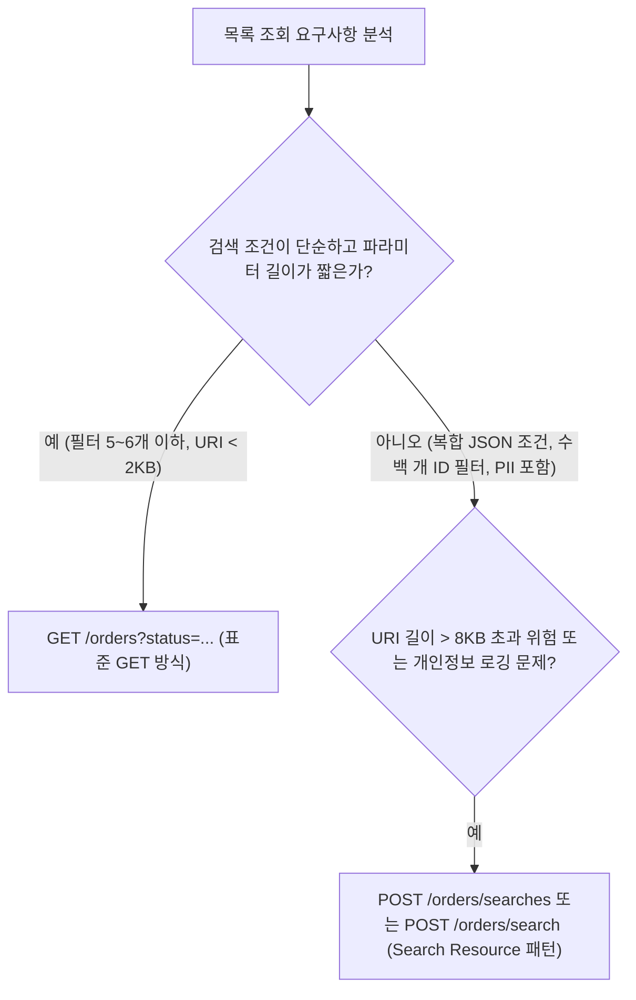
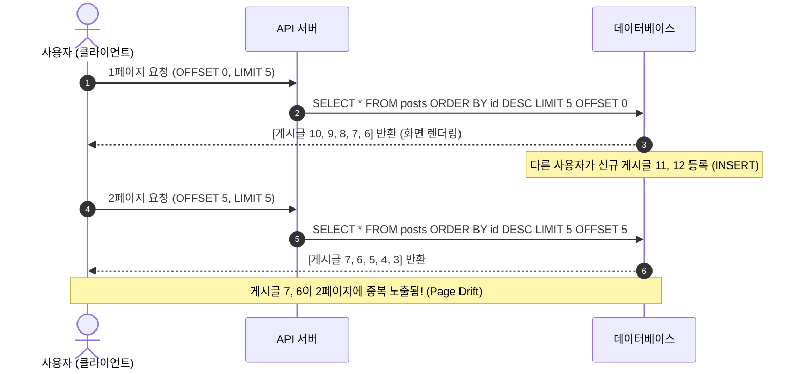
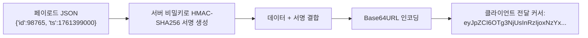
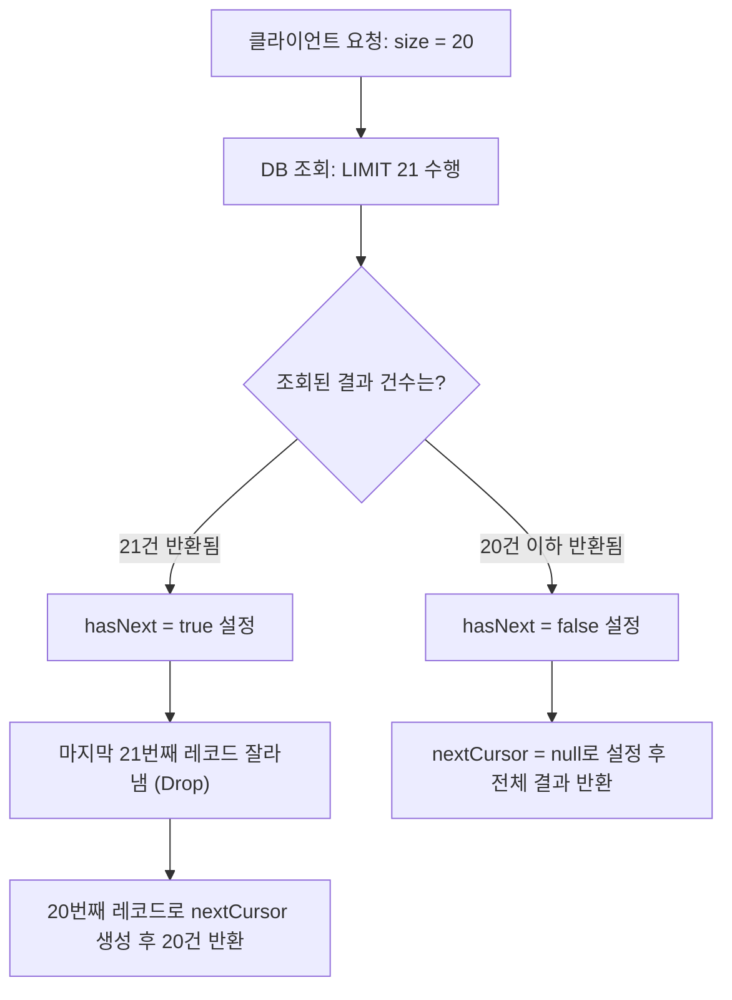

import Alert from '@/components/Alert.astro';

서비스 론칭 초기에는 몇 밀리초 만에 끝나던 목록 조회 API가 데이터가 수십만 건을 넘어서는 순간부터 슬금슬금 지연 시간을 늘려가더니 급기야 슬로우 쿼리 알람을 터뜨립니다. 원인을 추적해 보면 십중팔구 아무 의심 없이 작성한 `LIMIT 20 OFFSET 100000`과 `SELECT COUNT(*)`의 합작품입니다.

앞선 [1편: REST API URI 설계 원칙](/dev/ko/2026/rest-api-uri-naming-spring-boot-fastapi)과 [2편: REST API HTTP 메서드와 상태 코드 설계](/dev/ko/2026/rest-api-http-methods-status-codes)를 통해 자원의 식별과 조작 규격을 확립했다면, 이번 3편에서는 실무 백엔드 시스템의 성능과 사용자 경험을 좌우하는 **목록 조회 및 페이징(Pagination) 아키텍처**를 집중적으로 다룹니다.

단순히 "무한 스크롤에는 커서를 쓰고 어드민에는 오프셋을 쓴다"는 단편적인 지식을 넘어, 스토리지 엔진 내부의 B-Tree 인덱스 탐색 원리, 데이터 표류(Page Drift) 현상, 카운트 쿼리 병목 제거, 그리고 Spring Boot 4와 FastAPI에서의 구체적인 프로덕션 구현 코드까지 차례대로 파고듭니다.

---

## 1. 목록 조회 API의 기본기: 쿼리 파라미터 설계와 GET vs POST

목록 조회 API의 본질은 데이터베이스의 거대한 테이블에서 클라이언트가 필요로 하는 부분 집합(Subset)을 안전하고 효율적으로 추출해 전달하는 것입니다. 이를 위해 필터링과 정렬, 페이징 규격을 먼저 명확히 정의해야 합니다.

### 쿼리 파라미터 필터링과 다중 정렬 표준화

실무에서 목록을 조회할 때 가장 빈번하게 사용되는 형태는 다음과 같은 쿼리 파라미터 조합입니다:

```http
GET /api/v1/orders?status=PAID&categoryId=12&sort=createdAt,desc&sort=id,asc&page=1&size=20 HTTP/1.1
Host: api.example.com
```

필터링과 정렬 파라미터를 설계할 때는 사내 전체 시스템에서 통용되는 명확한 문법 규칙이 필요합니다.

1. **단일 및 다중 필터링**:
   - 단일 조건: `?status=PAID`
   - 다중 선택(OR 조건): `?status=PAID&status=SHIPPED` 또는 쉼표 구분 `?status=PAID,SHIPPED`
   - 범위 조건: `?startDate=2026-01-01&endDate=2026-03-31`처럼 명시적인 접두사/접미사를 사용합니다.
2. **다중 컬럼 정렬(Multi-column Sort)**:
   - Spring Data 표준 스타일: `?sort=createdAt,desc&sort=id,asc`
   - 간결한 URL 스타일: `?sort=-createdAt,id` (하이픈 `-`은 내림차순, 기본은 오름차순)

<Alert type="warning">
**정렬 기준에 타이브레이커(Tie-breaker)를 강제해야 하는 이유**

RDBMS(MySQL InnoDB, PostgreSQL 등)는 정렬 대상 컬럼의 값이 동일할 때 레코드의 반환 순서를 보장하지 않습니다. 예를 들어 `ORDER BY created_at DESC`만 적용했을 때, 동일한 밀리초에 생성된 레코드들은 쿼리가 실행될 때마다 순서가 뒤바뀔 수 있습니다. 

이로 인해 페이징 경계에서 데이터가 중복되거나 누락되는 비결정론적(Non-deterministic) 정렬 문제가 발생합니다. 따라서 정렬 조건의 맨 끝에는 반드시 고유성이 보장되는 유니크 키(예: PK인 `id`)를 보조 정렬 키(Tie-breaker)로 포함해야 합니다 (`ORDER BY created_at DESC, id DESC`).
</Alert>

### URI 길이 제한과 보안 문제: 왜 `POST /search`가 필요한가?

일반적인 자원 목록 조회는 안전하고 멱등한 `GET` 메서드를 사용하는 것이 원칙입니다. 하지만 엔터프라이즈 환경에서는 `GET` 쿼리스트링만으로 감당하기 어려운 현실적인 장벽에 부딪힙니다.



#### 1. 인프라 계층의 URI 길이 제약
HTTP 표준(RFC 9110)은 URI 길이에 공식적인 상한선을 두지 않고 서버가 최소 8,000 옥텟(8KB) 이상을 지원할 것을 권장합니다. 그러나 실제 운영 환경을 구성하는 인프라 컴포넌트들은 각기 다른 제약을 갖습니다:
- **Nginx**: 기본 `large_client_header_buffers` 설정에 따라 8KB 초과 시 `414 URI Too Long` 반환.
- **AWS CloudFront / ALB**: 요청 라인 및 쿼리스트링 길이에 엄격한 상한선(통상 8KB～16KB) 존재.
- **기업 사내망 프록시 / 방화벽**: 2KB(2,048자)를 초과하는 URL을 비정상 패킷으로 간주하고 강제 차단하는 사례 다수.

클라이언트가 특정 주문 ID 500개를 한 번에 조회하기 위해 `?ids=1001,1002,...,1500`과 같이 수 킬로바이트의 쿼리스트링을 보내는 순간, 서버 애플리케이션에 도달하기도 전에 게이트웨이에서 414 에러가 터져 나옵니다.

#### 2. Access Log 민감 정보(PII) 유출
웹 서버(Nginx, Apache), CDN, 로드밸런서는 클라이언트의 요청 URL을 액세스 로그에 평문으로 남깁니다. 검색 조건에 사용자의 이메일, 전화번호, 이름, 주민등록번호 앞자리 등 개인식별정보(PII)가 쿼리스트링에 포함되면, 로그 파이프라인(ELK, CloudWatch, Datadog) 전체로 개인정보가 유출되어 심각한 보안 감사 지적 사항이 됩니다.

#### 3. 실무 해결책: 행위 자원화(Search Resource) 기반 `POST /search`
새로운 HTTP 표준으로 제안된 `SEARCH` 메서드(RFC draft-ietf-httpbis-safe-method-w-body)가 존재하지만, 대다수의 브라우저와 클라우드 WAF가 아직 이를 온전히 지원하지 못합니다. 

따라서 복잡한 검색 엔진 조건이나 긴 파라미터를 넘겨야 할 때는 **검색 요청 자체를 하나의 자원으로 취급하는 행위 자원화(Search Resource)** 기법을 사용하여 `POST /orders/search` 또는 `POST /orders/searches` 엔드포인트를 개설하고 요청 본문(JSON Body)에 검색 필터를 담아 전달합니다:

```http
POST /api/v1/orders/searches HTTP/1.1
Host: api.example.com
Content-Type: application/json

{
  "orderIds": [10001, 10002, 10003, 10004, 10005],
  "dateRange": {
    "start": "2026-01-01T00:00:00Z",
    "end": "2026-03-31T23:59:59Z"
  },
  "customer": {
    "email": "user@example.com",
    "tier": "VIP"
  },
  "paging": {
    "size": 20,
    "cursor": "eyJpZCI6OTg3NjUsImNyZWF0ZWRBdCI6IjIwMjYtMTAtMjUifQ=="
  }
}
```

이 방식은 URI 길이 제한을 완전히 우회하고, HTTP 요청 본문은 기본적으로 액세스 로그에 남지 않으므로 개인정보 유출 위험을 방어할 수 있습니다.

---

## 2. Offset 페이징의 2대 치명적 한계

개발자들이 가장 친숙하게 사용하는 페이징 방식은 SQL의 `LIMIT`과 `OFFSET` 절을 사용하는 **오프셋 기반 페이징**(Offset-based Pagination)입니다. `PageRequest.of(page, size)` 한 줄이면 구현이 끝나기 때문에 수많은 프로젝트의 기본값으로 채택됩니다. 하지만 이 방식은 데이터가 증가할수록 시스템을 파괴하는 두 가지 치명적인 결함을 품고 있습니다.

### 1. 딥 페이징(Deep Paging) 성능 재앙: $O(N)$ I/O 병목의 실체

다음은 100,000번째 레코드부터 20건을 읽어오는 전형적인 오프셋 쿼리입니다:

```sql
SELECT * FROM orders
ORDER BY id DESC
LIMIT 20 OFFSET 100000;
```

많은 초급 엔지니어들이 데이터베이스가 B-Tree 인덱스를 타고 100,001번째 위치로 마법처럼 한 번에 건너뛴 뒤 20건만 쏙 읽어올 것이라고 착각합니다. 하지만 데이터베이스 스토리지 엔진(MySQL InnoDB 등)의 내부 동작은 완전히 다릅니다.

1. 스토리지 엔진은 정렬 기준 인덱스(여기서는 `id DESC`)를 루트 노드부터 탐색하여 **처음부터 100,020건의 레코드를 전부 차례대로 스캔**합니다.
2. `SELECT *`이므로 커버링 인덱스가 적용되지 않는다면, **100,020건 전체에 대해 디스크의 클러스터드 인덱스 데이터 페이지를 읽어오는 랜덤 I/O 룩업**(Row Lookup)을 수행합니다.
3. 메모리(버퍼 풀)로 100,020건의 데이터를 퍼 올린 다음, **앞의 100,000건을 메모리에서 가차 없이 버립니다(Discard)**.
4. 마지막 남은 20건만 클라이언트에게 반환합니다.

즉, 오프셋 $N$의 크기에 비례하여 데이터베이스가 실제로 읽고 버리는 레코드 수가 증가하므로, 시간 복잡도는 $O(N)$으로 폭증합니다.

#### 500만 건 데이터셋 실측 벤치마크
다음은 MySQL 8.0(InnoDB, 4 Core, 8GB RAM) 환경에서 500만 건의 `orders` 테이블을 대상으로 `LIMIT 20 OFFSET N`을 실행했을 때의 실측 벤치마크 결과입니다:

| 페이지 번호 | OFFSET 값 | 쿼리 실행 시간(ms) | 스캔 행 수 | 비고 |
| :--- | :--- | :---: | :---: | :--- |
| **1페이지** | `OFFSET 0` | **0.15ms** | 20건 | 메모리 캐시 적중, 즉각 반환 |
| **100페이지** | `OFFSET 2,000` | **1.82ms** | 2,020건 | 체감 지연 미미 |
| **1,000페이지** | `OFFSET 20,000` | **18.4ms** | 20,020건 | 버퍼 풀 I/O 증가 시작 |
| **10,000페이지** | `OFFSET 200,000` | **182.0ms** | 200,020건 | P99 응답 지연 발생 |
| **50,000페이지** | `OFFSET 1,000,000` | **1,450.0ms** | 1,000,020건 | **슬로우 쿼리 알람 발생** |
| **100,000페이지**| `OFFSET 2,000,000` | **3,890.0ms** | 2,000,020건 | **DB 커넥션 풀 고갈 위험** |

1페이지를 읽을 때는 0.15ms에 불과하던 응답 속도가 50,000페이지(오프셋 100만)에 도달하면 무려 1.45초로 9,600배 이상 느려집니다.

더 심각한 문제는 **버퍼 풀 오염**(Buffer Pool Churn)입니다. 악의적인 크롤러나 검색엔진 봇이 깊은 페이지를 연속으로 긁어가면, 디스크에서 대량의 더티 블록이 버퍼 풀로 밀려 들어와 자주 사용되던 정상 캐시 블록들을 밀어내 버립니다. 그 결과 전체 서비스의 쿼리 성능이 연쇄적으로 곤두박질치는 대참사가 일어납니다.

### 2. 데이터 표류(Page Drift): 신뢰할 수 없는 페이지 경계

오프셋 페이징의 두 번째 결함은 실시간으로 데이터가 추가되거나 삭제되는 환경에서 **데이터의 일관성이 깨진다**는 점입니다. 이를 **페이지 표류(Page Drift)** 현상이라고 부릅니다.



1. **신규 레코드 삽입(INSERT) 시 중복 노출**:
   - 사용자가 1페이지(글 ID 10～6)를 보고 있는 동안 다른 사용자가 신규 글 11, 12번을 등록합니다.
   - 전체 순번이 뒤로 밀리면서 기존 1페이지 끝자락에 있던 7, 6번 글이 6번째, 7번째 순번으로 밀려납니다.
   - 사용자가 2페이지(`OFFSET 5`)를 요청하면, 이미 1페이지에서 읽었던 7, 6번 글이 2페이지 상단에 다시 노출됩니다.
2. **기존 레코드 삭제(DELETE) 시 데이터 누락**:
   - 반대로 사용자가 1페이지를 보는 도중 1페이지 내의 글 2건이 삭제되면, 2페이지의 앞쪽 글 2건이 1페이지 끝으로 당겨집니다.
   - 2페이지를 요청했을 때는 당겨진 글 2건을 영영 보지 못하고 건너뛰게 됩니다.

실시간 주식 체결 내역이나 SNS 피드에서 이 현상이 발생하면 사용자들은 "시스템 오류로 글이 중복되거나 사라졌다"고 불만을 제기하게 됩니다.

---

## 3. Cursor 기반 페이징(Keyset Pagination)의 원리와 트레이드오프

오프셋 페이징의 딥 페이징 성능 병목과 데이터 표류 문제를 근본적으로 해결하는 기법이 바로 **커서 기반 페이징**(Cursor-based Pagination), 학술적으로는 **키셋 페이징**(Keyset Pagination)이라 불리는 방식입니다.

### B-Tree 인덱스 시크(Seek)의 마법: $O(1)$ 속도의 비밀

오프셋 페이징이 "처음부터 N개를 센 다음 버리는 방식"이라면, 커서 페이징은 "**내가 마지막으로 읽은 레코드의 위치를 기억하고, 그 위치 바로 다음부터 N개를 집어오는 방식**"입니다.

두꺼운 책을 읽을 때 500페이지를 펼치기 위해 1페이지부터 499장까지 손가락으로 일일이 넘기는 바보는 없습니다. 지난번에 꽂아둔 **책갈피**를 잡고 단번에 500페이지를 펼칩니다. 커서 페이징이 바로 이 책갈피 원리입니다.

다음과 같이 `(created_at, id)` 복합 인덱스가 걸려 있다고 가정해 봅시다:

```sql
CREATE INDEX idx_orders_created_id ON orders (created_at DESC, id DESC);
```

이 상태에서 마지막으로 확인한 레코드의 `created_at`이 `'2026-10-25 14:30:00'`이고 `id`가 `98765`라면, 다음 페이지 쿼리는 다음과 같이 작성됩니다:

```sql
-- SQL-92 Row-Value (행 생성자) 문법 (MySQL 8.0+, PostgreSQL 지원)
SELECT * FROM orders
WHERE (created_at, id) < ('2026-10-25 14:30:00', 98765)
ORDER BY created_at DESC, id DESC
LIMIT 20;
```

<Alert type="info">
**구형 RDBMS 호환 문법**

Row-Value 문법 `(a, b) < (x, y)`를 옵티마이저가 인덱스 레인지 스캔으로 온전히 변환하지 못하는 구형 RDBMS에서는 다음과 같이 논리적으로 동치인 쿼리로 풀어 작성해야 최적의 인덱스를 탑니다:

```sql
WHERE created_at < '2026-10-25 14:30:00'
   OR (created_at = '2026-10-25 14:30:00' AND id < 98765)
```
</Alert>

이 쿼리의 실행 계획(EXPLAIN)을 확인해 보면 놀라운 차이가 드러납니다. 스토리지 엔진은 B-Tree 인덱스를 타고 곧바로 `('2026-10-25 14:30:00', 98765)` 노드로 직행하는 **인덱스 시크**(Index Seek)를 수행합니다. 

그리고 그 지점부터 정확히 20건의 리프 노드만 순차 스캔(Sequential Scan)하여 반환합니다. 앞의 100만 건을 읽거나 버리는 낭비가 전혀 발생하지 않으므로, 데이터가 1,000만 건이든 1억 건이든 **항상 0.2ms 안팎의 $O(1)$ 상수 속도를 유지**합니다.

```mermaid
flowchart LR
    subgraph Offset ["Offset 페이징 (비효율적)"]
        direction TB
        O1["인덱스 시작점"] --> O2["100,000건 스캔 및 메모리 적재"]
        O2 --> O3["100,000건 메모리에서 폐기 (Waste)"]
        O3 --> O4["목표 20건 반환 (총 100,020건 읽음)"]
    end

    subgraph Cursor ["Keyset Cursor 페이징 (초고속)"]
        direction TB
        C1["B-Tree 인덱스 루트"] -->|Index Seek O(log N)| C2["책갈피 위치 (id: 98765) 즉시 안착"]
        C2 -->|Index Range Scan| C3["정확히 20건만 순차 스캔 후 즉시 반환"]
    end
```

### Base64 Opaque 커서 인코딩과 HMAC 서명

API 응답을 설계할 때 초보 엔지니어들이 흔히 저지르는 실수가 있습니다. 바로 DB의 내부 컬럼 값들을 클라이언트에게 날것 그대로 주는 것입니다:

```json
// 나쁜 예: 내부 스키마 노출
{
  "items": [...],
  "nextCursor": "2026-10-25 14:30:00,98765"
}
```

이 방식은 두 가지 심각한 문제를 야기합니다:
1. **내부 구현 종속**: 클라이언트가 백엔드의 정렬 기준과 DB 컬럼명을 알게 됩니다. 향후 정렬 방식을 변경하거나 컬럼명을 리팩터링하면 모든 클라이언트 코드가 깨집니다.
2. **커서 위변조(Tampering) 공격**: 악의적 사용자가 날짜나 ID 값을 임의로 변조하여 호출함으로써, 권한이 없는 비공개 데이터나 삭제된 데이터를 긁어모으는 오프셋 우회 공격을 감행할 수 있습니다.

따라서 커서는 클라이언트가 내부 구조를 알 수 없는 **불투명 토큰(Opaque Token)** 형태로 제공해야 합니다. 페이로드를 직렬화한 뒤 **HMAC-SHA256 서명**을 결합하여 Base64URL로 인코딩하는 방식이 실무 표준입니다.



서버는 클라이언트가 넘겨준 커서를 복호화할 때 HMAC 서명을 검증하여, 1바이트라도 위조되었다면 즉시 `400 Bad Request` 에러를 반환합니다.

### 트레이드오프: 언제 Offset을 쓰고 언제 Cursor를 써야 하는가?

모든 은총알(Silver Bullet)은 없습니다. 커서 페이징은 성능과 일관성 면에서 압도적이지만 명확한 한계가 존재합니다.

1. **임의 페이지 점프(Random Page Jump) 불가**:
   - 사용자가 "42페이지로 바로 가기" 버튼을 누르는 UI를 구현할 수 없습니다. 42페이지를 열려면 반드시 41페이지의 마지막 커서를 알아야 하기 때문입니다.
2. **전체 페이지 수(Total Pages) 미제공**:
   - 총 데이터 건수나 마지막 페이지 번호를 사전에 계산해 주지 않습니다.

두 방식의 실무 트레이드오프를 비교 분석한 의사결정 매트릭스는 다음과 같습니다:

| 비교 항목 | Offset 기반 페이징 | Keyset Cursor 기반 페이징 |
| :--- | :--- | :--- |
| **적합한 UI / UX** | 전통적인 번호 내비게이션 (`[1] [2] [3]...`) | 무한 스크롤(Infinite Scroll), [더보기] 버튼 |
| **주요 사용처** | 사내 백오피스 어드민, 공지사항 게시판 | SNS 피드, 모바일 쇼핑몰, 실시간 알림/채팅 |
| **데이터 규모** | 수만 건 이하의 소규모 테이블 | 수십만～수억 건 이상의 대규모 테이블 |
| **데이터 변경 빈도** | 신규 등록/삭제가 드문 정적 데이터 | 초당 수십 건씩 데이터가 쏟아지는 실시간 환경 |
| **성능 (딥 페이징)** | $O(N)$ — 페이지가 뒤로 갈수록 슬로우 쿼리 유발 | $O(1)$ — 수억 건 뒤쪽 페이지도 0.2ms 상수 속도 |
| **데이터 일관성** | 실시간 INSERT/DELETE 시 중복 및 누락 발생 | 실시간 변경에도 완벽한 데이터 일관성 보장 |
| **정렬 유연성** | 동적 다중 컬럼 정렬 자유로움 | 정렬 컬럼에 고유키(PK) 결합 및 복합 인덱스 필수 |

---

## 4. 카운트 쿼리(`SELECT COUNT(*)`) 병목 해결 전략

많은 백엔드 시스템에서 목록 조회 성능을 갉아먹는 주범은 데이터 조회 쿼리 자체가 아니라 습관적으로 함께 날리는 **전체 건수 카운트 쿼리(`SELECT COUNT(*)`)**입니다.

```sql
-- 데이터 조회 (0.5ms)
SELECT * FROM orders WHERE status = 'PAID' ORDER BY id DESC LIMIT 20;

-- 전체 건수 조회 (1,200ms!)
SELECT COUNT(*) FROM orders WHERE status = 'PAID';
```

조건절이 붙은 `COUNT(*)`는 인덱스를 타더라도 해당 조건을 만족하는 모든 인덱스 리프 노드를 끝까지 순회해야 하므로 테이블이 클수록 엄청난 CPU와 I/O를 소모합니다.

### 1. `Limit + 1` 조회 기법: 카운트 쿼리의 완전한 제거

모바일 앱의 무한 스크롤이나 웹의 [더보기] 버튼 UI를 자세히 살펴보면, 사용자에게 필요한 정보는 "전체 데이터가 몇만 건인지"가 아닙니다. 오직 **"다음 페이지가 존재하는가(`hasNext`)"** 하나뿐입니다.

이를 판별하기 위해 전체 건수를 셀 필요가 전혀 없습니다. 클라이언트가 20개를 요구했을 때 DB에 `LIMIT 21`을 요청하는 **`Limit + 1` 기법**을 적용하면 카운트 쿼리를 완전히 없앨 수 있습니다.



1. 클라이언트 요청: `size = 20`
2. 서버 DB 쿼리: `LIMIT 21` 실행
3. 결과 판별:
   - 결과가 **21건** 반환되었다면: 다음 페이지가 존재한다는 뜻이므로 `hasNext = true`로 세팅합니다. 21번째 레코드는 응답 리스트에서 잘라내고(Discard) 20건만 클라이언트에게 전달합니다. 다음 커서는 20번째 레코드의 값을 사용합니다.
   - 결과가 **20건 이하**라면: 다음 페이지가 없다는 뜻이므로 `hasNext = false`, `nextCursor = null`로 응답합니다.

이 기법을 적용하면 목록 조회 시 발생하는 DB 쿼리 트래픽을 정확히 **50% 감축**(2번 → 1번)할 수 있습니다.

### 2. 백오피스 어드민을 위한 전체 카운트 완화 전략

임의 페이지 점프와 전체 건수 표시가 반드시 필요한 관리자 어드민 화면에서는 카운트 쿼리를 무작정 없앨 수 없습니다. 이 경우 다음 3단계 완화 전략을 적용합니다.

#### ① 카운트 캐싱(Count Caching)
실시간성이 엄격하지 않은 검색 조건이라면 Redis에 카운트 결과를 캐싱합니다:
- 캐시 키: `count:orders:status:PAID:category:10`
- TTL: 5분～10분
- 데이터 등록/삭제 시 Redis 값을 비동기 증감(`INCR`/`DECR`)시키거나 캐시를 무효화합니다.

#### ② 근사치 카운트(Approximate Counting)
수천만 건이 쌓인 거대 테이블의 전체 레코드 수는 RDBMS 통계 카탈로그를 활용하여 0.1ms 만에 근사치를 가져올 수 있습니다:
- **PostgreSQL**:
  ```sql
  SELECT reltuples::bigint AS approx_count FROM pg_class WHERE relname = 'orders';
  ```
- **MySQL**:
  ```sql
  SELECT table_rows FROM information_schema.tables WHERE table_name = 'orders';
  ```
UI에 "총 5,234,129건" 대신 "**약 520만 건**"으로 표기하는 방식으로 타협하면 DB 부하를 원천 차단할 수 있습니다.

#### ③ Window Capping (최대 탐색 페이지 제한)
구글 검색 엔진은 수억 건의 검색 결과가 나와도 최대 100페이지(또는 400건) 이상은 탐색을 허용하지 않습니다. 10만 번째 페이지를 직접 들여다보는 실제 인간 사용자는 존재하지 않으며, 대다수는 악의적인 스크래핑 봇이기 때문입니다.

서버 단에서 `page > 100` 또는 `OFFSET > 2000` 이상의 요청이 인입되면 `400 Bad Request`("최대 100페이지까지만 조회가 가능합니다. 상세 필터를 적용해 검색 범위를 좁혀주세요.")를 반환하여 딥 페이징 진입을 원천 봉쇄합니다.

---

## 5. Spring Boot 4 & FastAPI 실전 구현 비교

이론을 정립했으니, 이제 실무 백엔드(Spring Boot 4, FastAPI) 프로덕션 환경에서 어떻게 무중단·초고속 커서 페이징을 구현하는지 구체적인 코드로 확인해 봅니다.

### 1. Spring Boot 4 (Java 21): Spring Data Scroll API

Spring Boot 환경에서 많은 개발자들이 `Page<T>` 대신 `Slice<T>`를 사용하며 카운트 쿼리를 줄였다고 안도합니다. 하지만 `Slice<T>`의 내부 쿼리를 확인해 보면 **내부적으로 여전히 `OFFSET ?`을 생성**합니다! 즉, 딥 페이징의 I/O 병목은 그대로 남아 있습니다.

Spring Data 3.1부터 정식 도입되어 Spring Boot 3 및 최신 Spring Boot 4의 표준으로 자리 잡은 **Scroll API**(`Window<T>`, `KeysetScrollPosition`)를 사용하면 순수 Keyset Cursor 페이징을 구현할 수 있습니다.

#### Repository 인터페이스
```java
package com.example.api.order.domain;

import org.springframework.data.domain.KeysetScrollPosition;
import org.springframework.data.domain.Window;
import org.springframework.data.repository.Repository;

public interface OrderRepository extends Repository<Order, Long> {

    // Spring Data가 자동으로 Keyset WHERE 절과 ORDER BY, LIMIT을 생성
    Window<Order> findTop20ByStatusOrderByIdDesc(
        OrderStatus status, 
        KeysetScrollPosition scrollPosition
    );
}
```

#### Response DTO 및 Controller 구현
```java
package com.example.api.order.ui;

import com.example.api.order.domain.Order;
import com.example.api.order.domain.OrderRepository;
import com.example.api.order.domain.OrderStatus;
import org.springframework.data.domain.KeysetScrollPosition;
import org.springframework.data.domain.ScrollPosition;
import org.springframework.data.domain.Window;
import org.springframework.http.ResponseEntity;
import org.springframework.web.bind.annotation.*;

import java.nio.charset.StandardCharsets;
import java.util.Base64;
import java.util.List;
import java.util.Map;

@RestController
@RequestMapping("/api/v1/orders")
public class OrderScrollController {

    private final OrderRepository orderRepository;

    public OrderScrollController(OrderRepository orderRepository) {
        this.orderRepository = orderRepository;
    }

    public record CursorPageResponse<T>(
        List<T> items,
        String nextCursor,
        boolean hasNext
    ) {}

    @GetMapping
    public ResponseEntity<CursorPageResponse<Order>> getOrders(
        @RequestParam(defaultValue = "PAID") OrderStatus status,
        @RequestParam(required = false) String cursor
    ) {
        // 1. 커서 역직렬화 (Base64 -> KeysetScrollPosition)
        KeysetScrollPosition position = parseCursor(cursor);

        // 2. Scroll API 호출 (Limit + 1 및 Keyset 인덱스 시크 자동 수행)
        Window<Order> window = orderRepository.findTop20ByStatusOrderByIdDesc(status, position);

        // 3. 다음 커서 추출 (빈 윈도우 안전 검사)
        String nextCursor = null;
        if (window.hasNext() && !window.isEmpty()) {
            ScrollPosition nextPosition = window.positionAt(window.size() - 1);
            nextCursor = encodeCursor(nextPosition);
        }

        return ResponseEntity.ok(new CursorPageResponse<>(
            window.getContent(),
            nextCursor,
            window.hasNext()
        ));
    }

    private KeysetScrollPosition parseCursor(String cursor) {
        if (cursor == null || cursor.isBlank()) {
            return ScrollPosition.keyset();
        }
        try {
            byte[] decoded = Base64.getUrlDecoder().decode(cursor);
            long lastId = Long.parseLong(new String(decoded, StandardCharsets.UTF_8));
            return ScrollPosition.forward(Map.of("id", lastId));
        } catch (Exception e) {
            // 실무에서는 @ExceptionHandler를 통해 400 Bad Request("유효하지 않은 커서 토큰")로 매핑
            throw new IllegalArgumentException("유효하지 않은 커서 토큰입니다.", e);
        }
    }

    private String encodeCursor(ScrollPosition position) {
        if (position instanceof KeysetScrollPosition keyset) {
            Object lastId = keyset.getKeys().get("id");
            return Base64.getUrlEncoder().withoutPadding()
                .encodeToString(String.valueOf(lastId).getBytes(StandardCharsets.UTF_8));
        }
        return null;
    }
}
```

---

### 2. FastAPI (Python 3.12+): SQLAlchemy 2.0 Row-Value & HMAC Cursor

Python 진영에서는 FastAPI와 SQLAlchemy 2.0의 `tuple_()` 연산자, 그리고 Pydantic v2 제네릭을 조합하여 완벽한 보안 커서 페이징을 구현합니다.

#### HMAC 커서 서명 유틸리티
```python
# app/core/cursor.py
import hmac
import hashlib
import json
import base64
from typing import Any

SECRET_KEY = b"production-secure-hmac-secret-key-32b"

def serialize_cursor(payload: dict[str, Any]) -> str:
    """데이터를 JSON 직렬화 후 HMAC-SHA256 서명을 붙여 Base64URL로 인코딩합니다."""
    json_bytes = json.dumps(payload, separators=(",", ":"), sort_keys=True).encode("utf-8")
    signature = hmac.new(SECRET_KEY, json_bytes, hashlib.sha256).digest()
    
    # 32바이트 서명 + 원본 JSON 결합
    combined = signature + json_bytes
    return base64.urlsafe_b64encode(combined).decode("utf-8").rstrip("=")

def deserialize_cursor(cursor_str: str) -> dict[str, Any] | None:
    """Base64URL 커서를 디코딩하고 HMAC 서명을 검증합니다."""
    if not cursor_str:
        return None
    try:
        padding = "=" * (-len(cursor_str) % 4)
        combined = base64.urlsafe_b64decode(cursor_str + padding)
        
        if len(combined) < 32:
            return None
            
        expected_sig = combined[:32]
        json_bytes = combined[32:]
        
        actual_sig = hmac.new(SECRET_KEY, json_bytes, hashlib.sha256).digest()
        if not hmac.compare_digest(expected_sig, actual_sig):
            raise ValueError("커서 변조 감지")
            
        return json.loads(json_bytes.decode("utf-8"))
    except Exception:
        raise ValueError("유효하지 않은 커서 토큰입니다.")
```

#### Pydantic Schema 및 API Endpoint
```python
# app/api/v1/orders.py
from datetime import datetime
from typing import Generic, TypeVar
from fastapi import APIRouter, Depends, Query, HTTPException, status
from pydantic import BaseModel, ConfigDict
from sqlalchemy import select, tuple_
from sqlalchemy.ext.asyncio import AsyncSession

from app.core.database import get_db
from app.models.order import Order
from app.core.cursor import serialize_cursor, deserialize_cursor

router = APIRouter(prefix="/api/v1/orders", tags=["orders"])

T = TypeVar("T")

class CursorPage(BaseModel, Generic[T]):
    items: list[T]
    next_cursor: str | None
    has_next: bool

class OrderResponse(BaseModel):
    model_config = ConfigDict(from_attributes=True)

    id: int
    created_at: datetime
    amount: int
    status: str

@router.get("", response_model=CursorPage[OrderResponse])
async def list_orders(
    status: str = Query(default="PAID"),
    cursor: str | None = Query(default=None),
    limit: int = Query(default=20, ge=1, le=100),
    db: AsyncSession = Depends(get_db)
):
    # 1. 쿼리 기본 구조: 정렬 조건에 PK를 타이브레이커로 결합
    stmt = (
        select(Order)
        .where(Order.status == status)
        .order_by(Order.created_at.desc(), Order.id.desc())
        .limit(limit + 1)  # Limit + 1 기법
    )

    # 2. 커서 존재 시 Row-Value B-Tree Seek 조건 적용
    if cursor:
        try:
            cursor_data = deserialize_cursor(cursor)
        except ValueError as err:
            raise HTTPException(
                status_code=status.HTTP_400_BAD_REQUEST,
                detail=str(err)
            )
        
        if cursor_data:
            last_created_at = datetime.fromisoformat(cursor_data["created_at"])
            last_id = cursor_data["id"]
            
            # (created_at, id) < (:last_created_at, :last_id)
            stmt = stmt.where(
                tuple_(Order.created_at, Order.id) < (last_created_at, last_id)
            )

    result = await db.execute(stmt)
    rows = list(result.scalars().all())

    # 3. Limit + 1 판별 로직
    has_next = len(rows) > limit
    items_to_return = rows[:limit]

    next_cursor = None
    if has_next and items_to_return:
        last_item = items_to_return[-1]
        next_cursor = serialize_cursor({
            "id": last_item.id,
            "created_at": last_item.created_at.isoformat()
        })

    return CursorPage(
        items=[OrderResponse.model_validate(item) for item in items_to_return],
        next_cursor=next_cursor,
        has_next=has_next
    )
```

SQLAlchemy의 `tuple_()` 연산자는 PostgreSQL 및 MySQL 8.0 이상에서 표준 Row-Value 비교 쿼리로 변환되어 단 0.1ms의 지연도 없이 B-Tree 인덱스를 정확히 타격합니다.

---

## 6. 실무 페이징 아키텍처 체크리스트

프로덕션 배포 전, 작성한 목록 조회 API가 대규모 트래픽을 견딜 수 있는지 다음 5가지 질문으로 자가 진단해 보세요:

- [ ] **결정론적 정렬 보장**: 정렬 기준 맨 끝에 고유키(PK)가 타이브레이커(Tie-breaker)로 포함되어 있는가?
- [ ] **인덱스 시크 최적화**: 커서 조건절(`WHERE (col1, col2) < (...)`)을 온전히 커버하는 복합 인덱스가 DB에 생성되어 있는가?
- [ ] **딥 페이징 차단**: 오프셋 페이징을 사용하는 어드민 엔드포인트의 경우, `OFFSET` 최대 상한선(Window Capping)이 걸려 있는가?
- [ ] **카운트 쿼리 격리**: 무한 스크롤 및 피드성 API에서 불필요한 `SELECT COUNT(*)`를 완전히 제거하고 `Limit + 1` 방식을 채택했는가?
- [ ] **커서 불투명성 및 보안**: 커서 값이 Base64URL 및 HMAC 서명으로 암호화되어 클라이언트에게 스키마가 노출되거나 변조되지 않도록 보호되고 있는가?

---

목록 조회 API에서 대량 데이터를 효율적으로 쪼개어 전달하는 방법을 마스터했다면, 다음 단계는 요청이 실패했을 때 클라이언트에게 명확하고 표준화된 에러를 전달하는 것입니다.

다음 [4편: 표준 에러 응답 RFC 9457 Problem Details와 글로벌 예외 처리](/dev/ko/2026/rest-api-error-handling-rfc9457)에서는 사내 API마다 제각각이던 에러 포맷을 IETF 최신 표준인 RFC 9457로 일원화하고, 비즈니스 에러 코드 체계를 구축하는 방법을 다룹니다.
