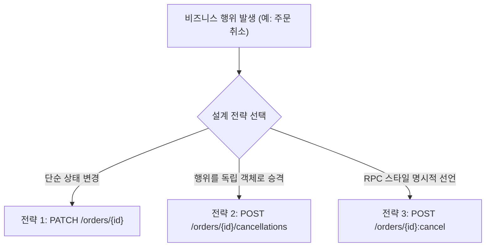
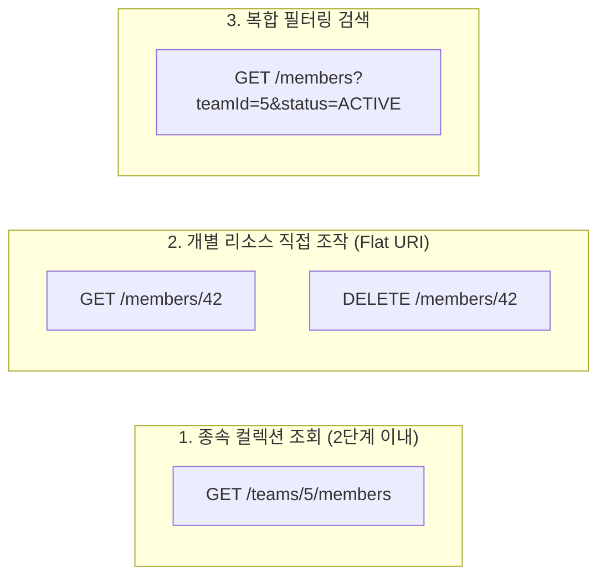

import Alert from '@/components/Alert.astro';

새로운 기능을 개발할 때마다 백엔드와 프론트엔드가 모인 회의실에서 어김없이 벌어지는 논쟁이 있습니다. "주문 취소 API는 `/orders/123/cancel`로 만들면 안 되나요?", "회원 상세 설정은 `/user-settings`인가요, 아니면 `/userSettings`인가요?" 같은 질문들입니다.

누군가는 "클라이언트와 약속만 맞추면 동작에는 아무 문제없지 않냐"며 가볍게 넘기려 합니다. 하지만 일관성 없는 URI는 시간이 흐를수록 시스템 전체의 유지보수 비용을 폭발시킵니다. 웹 캐시 프록시가 대소문자 차이로 캐시 미스를 내고, 계층 구조가 4～5단계씩 파고든 엔드포인트는 리팩터링조차 두렵게 만듭니다.

Roy Fielding이 2000년 박사 학위 논문에서 제시한 REST(Representational State Transfer)의 핵심과 인터넷 표준 RFC 문서들을 실무 관점에서 다시 읽어보아야 하는 이유가 바로 여기에 있습니다. 사내 API 규격을 수립할 때 흔들리지 않는 기준이 되어줄 핵심 URI 설계 원칙 4가지와 Spring Boot 4·FastAPI 실전 구현 코드를 차례대로 짚어갑니다.

---

## 원칙 1: 명사 복수형 컬렉션과 식별자 매핑

REST 아키텍처 스타일에서 URI는 행위(Action)가 아니라 오직 **자원**(Resource)의 고유한 위치만을 식별해야 합니다. 자원을 조작하는 행위는 URI 문자열에 적는 것이 아니라, HTTP 메서드(`GET`, `POST`, `PUT`, `PATCH`, `DELETE`)를 통해 서버에 전달하는 것이 HTTP 스펙(RFC 9110)의 기본 약속입니다.

자원은 크게 두 가지 형태로 나뉩니다. 여러 개의 자원이 모여 있는 '컬렉션'(Collection)과 그 컬렉션 안의 개별 객체인 '문서'(Document)입니다. 실무에서 가장 널리 쓰이는 표준적인 매핑 규칙은 컬렉션 자원에 **복수형 명사**(Plural Nouns)를 사용하는 것입니다.

```http
# 올바른 설계 (복수형 명사 + 고유 식별자)
GET    /orders          # 주문 목록 조회 (컬렉션)
POST   /orders          # 신규 주문 생성 (컬렉션에 새 문서 추가)
GET    /orders/1024     # 1024번 주문 상세 조회 (단일 문서)
PATCH  /orders/1024     # 1024번 주문 일부 수정
DELETE /orders/1024     # 1024번 주문 삭제
```

일부 개발팀에서는 영어 문법을 지나치게 의식해 단수형 명사(`/order/1024`)를 쓰기도 합니다. 단수형 자체가 기술적인 오류는 아니지만, 전체 컬렉션을 가리킬 때 문맥이 어색해집니다. `GET /order`가 "주문 전체 목록"인지 "단일 주문"인지 URI 자체만으로는 직관적으로 파악하기 어렵기 때문입니다.

### 흔히 저지르는 안티패턴 비교

| 안티패턴 URI | 문제점 | 올바른 RESTful URI |
| :--- | :--- | :--- |
| `GET /getOrderList` | URI에 동사(`get`)와 구현 명칭(`list`) 포함 | `GET /orders` |
| `POST /order/create` | HTTP 메서드(`POST`)의 목적과 중복되는 동사 표기 | `POST /orders` |
| `POST /users/delete/42` | 자원 삭제를 POST 메서드와 URI 동사로 우회 | `DELETE /users/42` |
| `GET /user/42/order` | 단수형과 복수형이 섞여 일관성 결여 | `GET /users/42/orders` |

자원 식별자 뒤에 또 다른 명사가 붙을 때는 반드시 상위 자원과 하위 자원의 소유 관계(Parent-Child Relationship)가 명확해야 합니다.

---

## 원칙 2: 소문자와 케밥케이스(kebab-case)를 고집해야 하는 진짜 이유

복합 단어로 구성된 자원을 표현할 때 `camelCase`나 `snake_case` 대신 왜 하이픈을 사용한 `kebab-case`를 전 세계 수많은 표준 가이드(Google Cloud API 가이드, Zalando REST API 가이드라인)에서 권장할까요? 여기에는 단순한 취향을 넘어선 두 가지 기술적 배경이 있습니다.

### 1. RFC 3986 표준과 리버스 프록시 캐시 파편화

인터넷 표준 규격인 [RFC 3986](https://www.rfc-editor.org/rfc/rfc3986) Section 3.2.2와 Section 3.3을 살펴보면 도메인을 나타내는 Host 영역과 경로를 나타내는 Path 영역의 대소문자 처리 규격이 완전히 다릅니다.

- **Host** (`scheme://domain:port`): 대소문자를 구분하지 않음 (Case-Insensitive). `EXAMPLE.COM`과 `example.com`은 동일한 호스트입니다.
- **Path** (`/path/to/resource`): 대소문자를 엄격히 구분함 (Case-Sensitive). RFC 3986 규격상 `/User-Profiles`와 `/user-profiles`는 완전히 다른 자원으로 정의됩니다.

Linux 기반의 Nginx, Caddy, Envoy 웹서버나 Cloudflare, Akamai, Varnish 같은 CDN 및 프록시 캐시 계층은 URI Path의 대소문자를 있는 그대로 해시하여 캐시 키(Cache Key)로 만듭니다.

클라이언트 개발자가 실수로 대소문자를 섞어 요청을 보내면(`GET /userProfiles` vs `GET /userprofiles`), 동일한 데이터임에도 캐시 미스(Cache Miss)가 발생하여 오리진 서버 부하가 가중되거나 예기치 못한 404 Not Found를 마주하게 됩니다. 따라서 URI 경로 전체를 영문 소문자로 강제 통일하는 것이 잠재적인 캐싱 장애를 방지하는 최선의 예방책입니다.

### 2. 검색엔진 크롤러(Googlebot)의 단어 구분 방식

공개 웹에 노출되는 B2C 서비스나 오픈 API 문서라면 검색엔진 최적화(SEO)도 무시할 수 없습니다.

Google 검색 센터 공식 가이드에 명시되어 있듯이, Googlebot 크롤러는 URL의 하이픈(`-`)을 단어 분리자(Word Separator)로 인식합니다. 반면 밑줄(`_`)은 분리자로 보지 않고 하나의 단어로 이어 붙여 처리합니다.

- `/user-profile` ➡️ `user`와 `profile` 두 단어로 분리 인식 (검색 노출 유리)
- `/user_profile` ➡️ `user_profile` 또는 `userprofile` 단일 토큰으로 결합 인식
- `/userProfile` ➡️ 크롤러에 따라 대소문자 토큰 분리 실패 가능성 존재

<Alert type="tip" title="쿼리 파라미터(Query Parameter)의 케이스 규칙">
URI Path에는 `kebab-case`가 글로벌 표준이지만, 필터링용 쿼리 스트링(`?user_id=1` or `?userId=1`)은 팀의 백엔드/프론트엔드 언어 컨벤션에 따라 달라지기도 합니다. 중요한 것은 **Path는 무조건 소문자 kebab-case**, 쿼리 파라미터는 프로젝트 내부에서 단 하나의 규칙(주로 `camelCase`나 `snake_case`)으로 엄격히 통일하는 일관성입니다.
</Alert>

---

## 원칙 3: "주문 취소는 어떻게 하죠?" — 행위 자원화(Resource Reification)

현업에서 REST API를 도입할 때 가장 심한 두통을 유발하는 지점이 바로 상태 변경이나 비즈니스 액션입니다.
"조회, 등록, 수정, 삭제는 알겠는데, 주문 취소나 이메일 인증 발송, 계정 일시정지는 URL에 동사를 쓸 수밖에 없지 않나요?"라는 질문이 쏟아집니다.

실무에서 비즈니스 행위를 다루는 설계 전략은 크게 세 가지로 나뉩니다.



### 1. 단순 상태 변경: `PATCH /orders/{id}`

가장 원론적인 방식으로, 주문 리소스의 `status` 필드를 수정하는 요청입니다.

```http
PATCH /orders/1024 HTTP/1.1
Content-Type: application/json

{
  "status": "CANCELLED",
  "reason": "단순 변심"
}
```

- **장점**: URI 구조가 단순하며 추가 엔드포인트를 설계할 필요가 없습니다.
- **한계**: 비즈니스 유효성 검증 규칙이 복잡해질 때 문제가 됩니다. '결제 완료' 상태에서만 취소가 가능한지, 취소 시 환불 트랜잭션이 동반되는지 등 복잡한 도메인 이벤트가 단순 필드 업데이트에 가려져 의도가 모호해집니다.

### 2. 행위의 자원화(Resource Reification): `POST /orders/{id}/cancellations`

유럽 최대 패션 이커머스 기업 Zalando의 [RESTful API 가이드라인](https://opensource.zalando.com/restful-api-guidelines/) 등 성숙한 엔지니어링 조직에서 가장 권장하는 우아한 해법입니다.

'취소하다'라는 동사 행위를 '취소 명세서' 또는 '취소 이력'이라는 **독립적인 자원**(Resource)으로 개념을 격상시키는 기법입니다.

```http
POST /orders/1024/cancellations HTTP/1.1
Content-Type: application/json

{
  "reason": "고객 단순 변심",
  "refundBank": "TossBank",
  "refundAccount": "1000-01-123456"
}
```

```http
HTTP/1.1 201 Created
Location: /orders/1024/cancellations/cn-9941
Content-Type: application/json

{
  "cancellationId": "cn-9941",
  "orderId": "1024",
  "status": "COMPLETED",
  "refundAmount": 45000,
  "cancelledAt": "2026-10-25T14:30:00Z"
}
```

- **장점**:
  - 취소 사유, 환불 계좌, 취소 요청자, 승인 시각 등의 메타데이터를 독립된 데이터 엔티티로 영속화할 수 있습니다.
  - `GET /orders/1024/cancellations`를 통해 취소 이력을 별도 컬렉션으로 조회할 수 있습니다.
  - HTTP `201 Created` 상태 코드와 함께 새로 생성된 취소 자원의 `Location` 헤더를 표준에 맞게 돌려줄 수 있습니다.

### 3. Google AIP-136 커스텀 메서드: `POST /orders/{id}:cancel`

구글의 [API Improvement Proposals (AIP-136)](https://google.aip.dev/136) 표준에서 정의하는 방식으로, 표준 REST HTTP 메서드로 매핑하기 난해한 복잡한 액션을 콜론(`:`) 구문을 통해 명시합니다.

```http
POST /orders/1024:cancel HTTP/1.1
```

- **장점**: 자원화하기 애매한 시스템 트리거(예: `:deploy`, `:sync`, `:batchVerify`)를 명료하게 드러냅니다.
- **주의점**: 프레임워크 라우터 설정에 따라 콜론 기호가 URL 경로 변수(Path Variable)와 충돌을 일으킬 수 있어 사전 인프라 점검이 필요합니다.

### 3대 전략 비교표

| 비교 항목 | 전략 1: PATCH 상태 수정 | 전략 2: 행위 자원화 (Zalando) | 전략 3: 커스텀 메서드 (Google AIP) |
| :--- | :--- | :--- | :--- |
| **URI 형태** | `PATCH /orders/1024` | `POST /orders/1024/cancellations` | `POST /orders/1024:cancel` |
| **권장 응답 코드** | `200 OK` | `201 Created` | `200 OK` |
| **히스토리 추적성** | 낮음 (기존 자원 덮어쓰기) | **매우 높음** (취소 엔티티 독립 보관) | 보통 (로그 의존) |
| **도메인 복잡도 대응** | 단순 상태 변경에 적합 | **환불/승인 등 복합 트랜잭션 최적** | 배치/트리거 액션에 적합 |
| **팀 컨벤션 난이도** | 낮음 | 보통 (자원화 추상화 사고 필요) | 프레임워크 라우터 호환 확인 필요 |

실무에서는 취소 시 사유 입력이나 환불 처리가 뒤따르는 도메인이라면 **전략 2**(행위 자원화)를, 단순히 플래그 값만 토글하는 수준이라면 **전략 1**(PATCH)을 택하는 것이 가장 합리적입니다.

---

## 원칙 4: 지옥의 4단계 중첩 방지 — 2단계 룰과 Flat URI 설계

서비스가 커지다 보면 데이터베이스의 부모–자식 관계를 URI에 그대로 투영하려는 유혹에 빠집니다.

```http
# 피해야 할 안티패턴 (깊은 계층 중첩)
/organizations/1/teams/5/projects/42/tasks/108/comments/9
```

이런 깊은 URI는 치명적인 문제들을 야기합니다.
첫째, 엔드포인트 URL이 지나치게 길어져 가독성이 떨어집니다. 둘째, 댓글 하나를 수정(`PATCH`)하거나 삭제(`DELETE`)하려고 해도 프론트엔드가 조직 ID, 팀 ID, 프로젝트 ID, 태스크 ID를 모두 알고 있어야 합니다. 셋째, 백엔드 인터셉터나 가드 계층에서 매 요청마다 상위 4개 자원이 실제로 유효한지 검증하느라 불필요한 DB 쿼리가 낭비됩니다.

### 2단계 룰(Depth 2 Rule)

현업에서 권장되는 URI 경로의 최대 깊이는 **2단계**입니다.

> `/자원컬렉션/{식별자}/하위컬렉션`



### Flat URI로 평탄화하는 실전 설계

1. **상위 자원에 종속된 목록을 조회할 때만 2단계 허용**:
   특정 팀에 속한 멤버 목록을 가져올 때는 부모의 맥락이 필수적이므로 중첩을 허용합니다.
   ```http
   GET /teams/5/members
   ```

2. **개별 자원을 직접 조작할 때는 최상위로 독립**(Flat URI):
   데이터베이스 설계상 멤버(Member) 엔티티가 고유한 ID(PK, UUID, Snowflake ID)를 지니고 있다면, 팀 ID를 URL에 주렁주렁 매달 이유가 없습니다.
   ```http
   GET    /members/42
   PATCH  /members/42
   DELETE /members/42
   ```

3. **다차원 관계는 쿼리 파라미터로 분리**(Flat URI + Query Parameter):
   계층이 복잡해질수록 URI Path에 밀어 넣지 말고 쿼리 스트링을 활용해 평탄화합니다.
   ```http
   # 지양: GET /organizations/1/teams/5/projects/42/tasks
   # 권장: Flat URI + 쿼리 스트링 필터
   GET /tasks?projectId=42&teamId=5
   ```

---

## 실전 구현 비교: Spring Boot 4 vs FastAPI

앞서 정리한 4가지 설계 원칙을 Spring Boot 4와 FastAPI 환경에서 각각 어떻게 구현하는지 코드로 직접 비교합니다. 주문 도메인을 기준으로 다음 4가지 핵심 엔드포인트를 구현합니다.

- 주문 생성: `POST /orders`
- 단일 주문 조회: `GET /orders/{orderId}`
- 주문 취소 (행위 자원화): `POST /orders/{orderId}/cancellations`
- 주문 상품 목록 조회 (하위 컬렉션): `GET /orders/{orderId}/items`

### 1. Spring Boot 4.x (Java 21/25)

Java 21의 표준 문법인 `record` DTO를 활용해 불변 객체를 구성하고, Jakarta Validation 어노테이션과 `ResponseEntity`의 `Location` 헤더 생성을 적용했습니다.

```java
package com.example.api.order;

import jakarta.validation.Valid;
import jakarta.validation.constraints.NotBlank;
import jakarta.validation.constraints.NotEmpty;
import jakarta.validation.constraints.NotNull;
import org.springframework.http.ResponseEntity;
import org.springframework.web.bind.annotation.*;
import org.springframework.web.servlet.support.ServletUriComponentsBuilder;

import java.net.URI;
import java.time.Instant;
import java.util.List;
import java.util.UUID;

@RestController
@RequestMapping("/orders")
public class OrderController {

    // 1. 주문 생성 (POST /orders -> 201 Created with Location)
    @PostMapping
    public ResponseEntity<OrderResponse> createOrder(@Valid @RequestBody CreateOrderRequest request) {
        String generatedOrderId = UUID.randomUUID().toString().substring(0, 8);
        OrderResponse response = new OrderResponse(
                generatedOrderId,
                request.items(),
                "RECEIVED",
                Instant.now()
        );

        URI location = ServletUriComponentsBuilder
                .fromCurrentRequest()
                .path("/{orderId}")
                .buildAndExpand(generatedOrderId)
                .toUri();

        return ResponseEntity.created(location).body(response);
    }

    // 2. 단일 주문 조회 (GET /orders/{orderId})
    @GetMapping("/{orderId}")
    public ResponseEntity<OrderResponse> getOrder(@PathVariable String orderId) {
        OrderResponse response = new OrderResponse(
                orderId,
                List.of(new OrderItemResponse("item-1", "무선 키보드", 1, 120000)),
                "PAID",
                Instant.now()
        );
        return ResponseEntity.ok(response);
    }

    // 3. 주문 취소 - 행위 자원화 (POST /orders/{orderId}/cancellations)
    @PostMapping("/{orderId}/cancellations")
    public ResponseEntity<CancellationResponse> cancelOrder(
            @PathVariable String orderId,
            @Valid @RequestBody CreateCancellationRequest request
    ) {
        String cancellationId = "cn-" + UUID.randomUUID().toString().substring(0, 6);
        CancellationResponse response = new CancellationResponse(
                cancellationId,
                orderId,
                request.reason(),
                "COMPLETED",
                Instant.now()
        );

        URI location = ServletUriComponentsBuilder
                .fromCurrentRequest()
                .path("/{cancellationId}")
                .buildAndExpand(cancellationId)
                .toUri();

        return ResponseEntity.created(location).body(response);
    }

    // 4. 하위 컬렉션 조회 (GET /orders/{orderId}/items)
    @GetMapping("/{orderId}/items")
    public ResponseEntity<List<OrderItemResponse>> getOrderItems(@PathVariable String orderId) {
        List<OrderItemResponse> items = List.of(
                new OrderItemResponse("item-1", "무선 키보드", 1, 120000),
                new OrderItemResponse("item-2", "마우스 패드", 2, 30000)
        );
        return ResponseEntity.ok(items);
    }

    // DTO 정의 (Java Record)
    public record CreateOrderRequest(
            @NotEmpty(message = "주문 항목은 필수입니다.") List<OrderItemDto> items
    ) {}

    public record OrderItemDto(
            @NotBlank String itemId,
            @NotNull Integer quantity
    ) {}

    public record CreateCancellationRequest(
            @NotBlank(message = "취소 사유는 필수입니다.") String reason
    ) {}

    public record OrderResponse(String orderId, List<OrderItemResponse> items, String status, Instant createdAt) {}
    public record OrderItemResponse(String itemId, String name, int quantity, long price) {}
    public record CancellationResponse(String cancellationId, String orderId, String reason, String status, Instant cancelledAt) {}
}
```

### 2. FastAPI (Python 3.12+)

Python 3.12의 최신 문법과 Pydantic v2 `BaseModel`, 그리고 `Annotated` 타입 힌트를 적용한 FastAPI 구현체입니다. `Response` 객체를 통해 `Location` 헤더를 엄격하게 부여합니다.

```python
from datetime import datetime, timezone
from typing import Annotated
from uuid import uuid4
from fastapi import APIRouter, Response, status, Path
from pydantic import BaseModel, Field

router = APIRouter(prefix="/orders", tags=["orders"])

# Pydantic Schemas
class OrderItem(BaseModel):
    item_id: str
    name: str
    quantity: int = Field(gt=0, description="수량은 1개 이상이어야 합니다.")
    price: int = Field(ge=0, description="단가는 0원 이상이어야 합니다.")

class CreateOrderRequest(BaseModel):
    items: list[OrderItem] = Field(min_length=1, description="최소 1개 이상의 상품이 필요합니다.")

class OrderResponse(BaseModel):
    order_id: str
    items: list[OrderItem]
    status: str
    created_at: datetime

class CreateCancellationRequest(BaseModel):
    reason: str = Field(min_length=2, max_length=200, description="취소 사유")

class CancellationResponse(BaseModel):
    cancellation_id: str
    order_id: str
    reason: str
    status: str
    cancelled_at: datetime


# 1. 신규 주문 생성 (POST /orders -> 201 Created with Location)
@router.post(
    "",
    response_model=OrderResponse,
    status_code=status.HTTP_201_CREATED,
    summary="주문 생성"
)
async def create_order(request: CreateOrderRequest, response: Response):
    new_order_id = str(uuid4())[:8]
    created_order = OrderResponse(
        order_id=new_order_id,
        items=request.items,
        status="RECEIVED",
        created_at=datetime.now(timezone.utc)
    )
    # 표준 Location 헤더 주입
    response.headers["Location"] = f"/orders/{new_order_id}"
    return created_order


# 2. 단일 주문 조회 (GET /orders/{order_id})
@router.get(
    "/{order_id}",
    response_model=OrderResponse,
    summary="주문 단건 조회"
)
async def get_order(
    order_id: Annotated[str, Path(description="주문 식별자")]
):
    return OrderResponse(
        order_id=order_id,
        items=[OrderItem(item_id="item-1", name="무선 키보드", quantity=1, price=120000)],
        status="PAID",
        created_at=datetime.now(timezone.utc)
    )


# 3. 주문 취소 - 행위 자원화 (POST /orders/{order_id}/cancellations)
@router.post(
    "/{order_id}/cancellations",
    response_model=CancellationResponse,
    status_code=status.HTTP_201_CREATED,
    summary="주문 취소 명세 생성 (행위 자원화)"
)
async def cancel_order(
    order_id: Annotated[str, Path(description="주문 식별자")],
    request: CreateCancellationRequest,
    response: Response
):
    cancellation_id = f"cn-{str(uuid4())[:6]}"
    cancellation_res = CancellationResponse(
        cancellation_id=cancellation_id,
        order_id=order_id,
        reason=request.reason,
        status="COMPLETED",
        cancelled_at=datetime.now(timezone.utc)
    )
    response.headers["Location"] = f"/orders/{order_id}/cancellations/{cancellation_id}"
    return cancellation_res


# 4. 하위 컬렉션 조회 (GET /orders/{order_id}/items)
@router.get(
    "/{order_id}/items",
    response_model=list[OrderItem],
    summary="주문 상품 목록 조회"
)
async def get_order_items(
    order_id: Annotated[str, Path(description="주문 식별자")]
):
    return [
        OrderItem(item_id="item-1", name="무선 키보드", quantity=1, price=120000),
        OrderItem(item_id="item-2", name="마우스 패드", quantity=2, price=30000),
    ]
```

두 언어와 프레임워크 모두에서 확인할 수 있듯이, URI 구조는 비즈니스 로직과 기술 스택에 종속되지 않고 동일한 규격을 유지합니다.

<Alert type="info" title="Location 응답 헤더를 빼놓지 마세요">
`POST` 요청으로 새로운 자원(주문 또는 취소 명세)을 생성했을 때 단순히 `201 Created` 코드와 응답 본문만 던지는 경우가 많습니다. 클라이언트가 새로 생성된 자원의 정확한 URI를 알 수 있도록 HTTP 규격(RFC 9110)에 따라 반드시 `Location: /orders/{id}` 헤더를 명시해 주는 습관을 들이는 것이 좋습니다.
</Alert>

---

## 사내 API 규격서 점검 체크리스트

팀 내에서 새로운 엔드포인트를 열거나 PR 리뷰를 진행할 때 다음 5가지 질문을 체크리스트로 활용해 보세요.

1. **모든 URI 경로에 동사가 배제되었는가?**  
   - `create`, `update`, `get` 등의 동사는 URI 대신 HTTP 메서드로 표현되어야 합니다.
2. **컬렉션 이름은 소문자 복수형 명사와 케밥케이스를 따르는가?**  
   - 대소문자 혼용으로 인한 프록시 캐시 파편화를 방지하기 위해 `/user-profiles` 형식을 준수합니다.
3. **리소스 경로 깊이가 2단계를 초과하지 않는가?**  
   - 3단계 이상의 깊은 중첩은 Flat URI(`GET /tasks/{id}`)와 쿼리 파라미터 필터링으로 풀어냅니다.
4. **비즈니스 행위가 상태 전이나 행위 자원화로 모델링되었는가?**  
   - `/orders/{id}/cancel` 대신 취소 이력 자체를 자원화(`POST /orders/{id}/cancellations`)하여 히스토리와 트랜잭션을 우아하게 관리합니다.
5. **자원 생성 시 201 상태 코드와 함께 Location 헤더를 반환하는가?**  
   - 클라이언트가 생성된 자원의 고유 경로를 즉시 식별할 수 있도록 지원합니다.

---

다음 2편에서는 URI 설계를 넘어 클라이언트와 안정적으로 소통하기 위한 **HTTP 상태 코드 선택 가이드와 RFC 9457 표준 에러 응답**(Problem Details) 구현 전략을 다룹니다.
