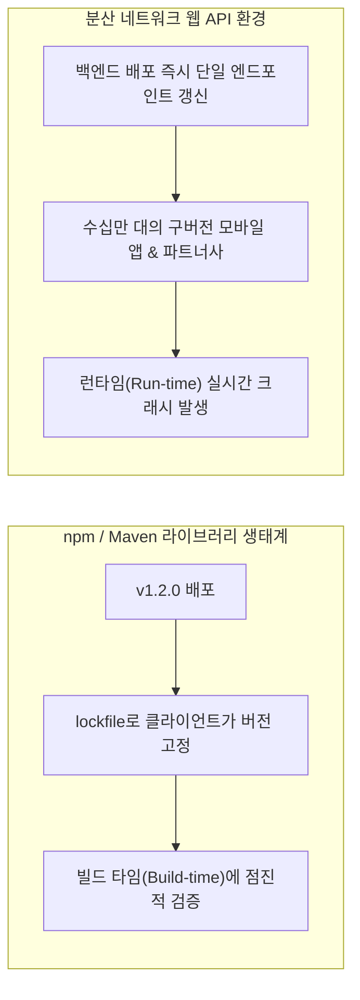
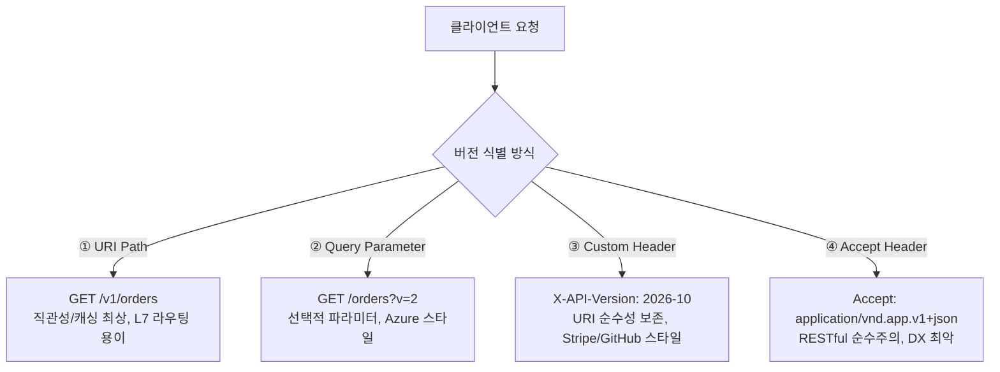
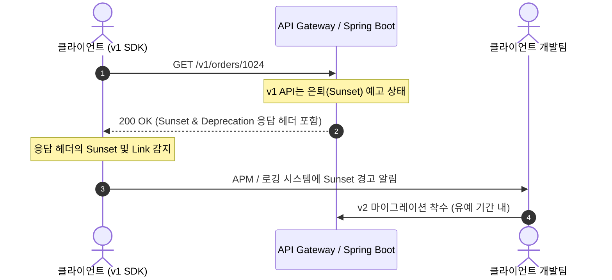
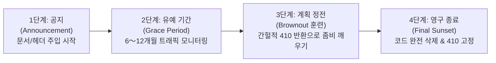

import Alert from '@/components/Alert.astro';

서비스를 라이브로 운영하다 보면 백엔드 개발자의 등골을 서늘하게 만드는 순간이 있습니다. 신규 필드를 수정하고 기분 좋게 배포 버튼을 눌렀는데, 업데이트를 미뤄둔 구버전 모바일 앱을 쓰는 사용자들의 화면이 일제히 튕기며 CS 인입이 폭발하는 순간입니다.

앞선 [1편: REST API URI 설계 원칙](/dev/ko/2026/rest-api-uri-naming-spring-boot-fastapi), [2편: HTTP 메서드와 상태 코드 설계](/dev/ko/2026/rest-api-http-methods-status-codes), [3편: 대용량 페이징 최적화](/dev/ko/2026/rest-api-pagination-offset-cursor), 그리고 [4편: RFC 9457 표준 에러 처리](/dev/ko/2026/rest-api-error-handling-rfc9457)를 통해 견고한 단일 API 인터페이스를 구축했습니다. 하지만 비즈니스는 멈추지 않고 진화하며, 데이터 구조와 비즈니스 요구사항은 필연적으로 바뀝니다.

코드는 빌드하고 배포하면 그만이지만, 네트워크 너머로 한 번 노출된 API는 살아 움직이는 공공재입니다. 이미 세상에 배포된 수십만 대의 스마트폰 앱, 계약을 맺고 우리 API를 호출하는 수백 개의 B2B 파트너사 서버, 그리고 사내 배치 스크립트까지 통제할 수 없는 클라이언트가 실시간으로 연결되어 있기 때문입니다.

이번 5편에서는 하위 호환성을 파괴하는 **Breaking Change**(파괴적 변경)의 엄격한 판별 기준과 모바일 파서를 폭파시키는 숨겨진 함정을 살펴봅니다. 이어서 실무에서 격렬하게 대립하는 **API 버전 표기 4대 방식**(URI Path, Query Parameter, Custom Header, Accept Header)의 인프라 트레이드오프를 6대 지표로 분석하고, IETF 표준 헤더인 **RFC 8594 Sunset**과 **RFC 9745 Deprecation**을 활용해 구버전 API를 우아하게 은퇴시키는 4단계 라이프사이클을 Spring Boot 4와 FastAPI 프로덕션 코드로 완성합니다.

---

## 1. "언제 버전을 올려야 하는가?" — Breaking vs Non-breaking Change

버전 번호를 올릴지 말지를 결정하기 전에, 가장 먼저 던져야 할 질문은 "이 변경이 기존 클라이언트의 런타임 코드를 중단시키는가?"입니다.

### 1.1 라이브러리 SemVer vs 분산 웹 API의 현실

개발자들에게 가장 친숙한 버전 관리 체계는 유의적 버전(Semantic Versioning, SemVer)입니다. `MAJOR.MINOR.PATCH` 규칙에 따라 기능 추가는 `MINOR`, 하위 호환성이 깨지는 변경은 `MAJOR`를 올리는 방식입니다.



라이브러리 환경에서는 새로운 Major 버전이 출시되어도 클라이언트가 `package.json`이나 `pom.xml`의 의존성을 직접 올리기 전까지는 아무런 문제가 발생하지 않습니다. 검증과 테스트가 온전히 클라이언트 개발자의 통제하에 빌드 타임에 일어납니다.

반면 웹 API는 백엔드 서버가 배포되는 즉시 단일 엔드포인트의 응답 스펙이 전 세계에 실시간 반영됩니다. 앱스토어 자동 업데이트를 꺼둔 사용자, 3년 전 배포된 안드로이드 단말기, 유지보수가 중단된 외부 협력사의 크론잡 스크립트가 여전히 구버전 스펙을 기대하며 요청을 보냅니다. 따라서 웹 API에서의 `MAJOR` 버전 변경은 엔지니어링 조직 전체에 엄청난 인프라 유지비와 클라이언트 마이그레이션 부담을 안기는 최후의 선택이어야 합니다.

### 1.2 하위 호환성 파괴(Breaking Change) vs 안전한 확장(Non-breaking Change)

백엔드 코드 수정 시 API 버전을 반드시 분리해야 하는 변경과, 기존 버전을 유지한 채 배포할 수 있는 변경을 명확히 구분해야 합니다.

| 구분 | 변경 유형 | 구체적 사례 | 하위 호환성 영향 |
| :--- | :--- | :--- | :--- |
| **Breaking** | 기존 응답 필드 삭제 | `user.phone_number` 필드 제거 | 클라이언트가 해당 키를 참조할 때 `NullPointerException` 또는 화면 누락 발생 |
| **Breaking** | 기존 응답 필드명 변경 | `userName` ➡️ `fullName` | 클라이언트 파서가 기존 키를 찾지 못해 역직렬화 실패 |
| **Breaking** | 데이터 타입 변경 | `price: 15000` ➡️ `price: { "amount": 15000, "currency": "KRW" }` | 정수형으로 파싱하던 클라이언트 런타임 타입 캐스팅 에러 크래시 |
| **Breaking** | 요청 필수(`required`) 파라미터 추가 | `POST /orders` 요청 바디에 `taxId` 필수값 추가 | 구버전 클라이언트는 해당 필드 없이 요청을 보내므로 일제히 `400 Bad Request` 실패 |
| **Breaking** | 유효성 검증 규칙 강화 | 문자열 길이 제한을 100자에서 50자로 축소 | 기존에 정상 결제되던 요청이 백엔드 유효성 검사에서 차단됨 |
| **Breaking** | HTTP 상태 코드 의미 변경 | 생성 성공 시 `200 OK` ➡️ `204 No Content`로 바디 제거 | 본문 응답을 전제로 응답을 파싱하던 레거시 SDK 동작 중단 |
| **Breaking** | Enum 상수 삭제 및 의미 변조 | 주문 상태 `CANCELLED` 삭제 또는 통합 | 구버전 클라이언트의 switch-case 분기문 누락으로 예외 발생 |
| **Non-breaking** | 새로운 엔드포인트 추가 | `POST /orders/bulk-cancel` 신설 | 기존 엔드포인트에 의존하는 클라이언트에게 영향 없음 |
| **Non-breaking** | 응답 본문에 새로운 선택적 필드 추가 | `user` 객체에 `nickname` 필드 추가 | 클라이언트가 모르는 필드를 무시한다면 안전 (단, 하단 주의사항 참고) |
| **Non-breaking** | 요청 본문에 기본값이 있는 선택적 필드 추가 | `pageSize` 파라미터 추가 (미전달 시 기본값 20 적용) | 기존 클라이언트가 값을 보내지 않아도 기본값으로 정상 동작 |
| **Non-breaking** | 요청 유효성 검증 조건 완화 | 허용 문자열 길이를 50자에서 100자로 확장 | 과거 규칙을 따르는 클라이언트 요청은 여전히 100% 정상 통과 |
| **Non-breaking** | 응답 HTTP 헤더 추가 | `X-Request-Id` 또는 `Cache-Control` 헤더 추가 | 표준 HTTP 클라이언트는 미인식 헤더를 무시하므로 안전 |

### 1.3 "새 필드 추가는 무조건 안전하다?"의 함정

실무에서 수많은 백엔드 개발자가 흔히 저지르는 치명적인 착각이 있습니다. 바로 *"기존 필드를 건드리지 않고 새로운 필드를 응답 JSON에 추가하는 것은 언제나 Non-breaking Change다"*라는 믿음입니다.

이 믿음은 마틴 파울러(Martin Fowler)가 제창한 **Tolerant Reader**(관대한 독자) 패턴이 전제되어 있을 때만 유효합니다.

> **Tolerant Reader 패턴**: "클라이언트는 서비스가 반환하는 전체 페이로드 중에서 자신이 실제로 필요로 하는 필드만 골라서 읽고, 자신이 알지 못하는 새로운 필드는 조용히 무시해야 한다."

하지만 현실의 모바일 앱 생태계는 하이럼의 법칙(Hyrum's Law)이 철저하게 지배합니다.

<Alert type="warning" title="하이럼의 법칙(Hyrum's Law)과 실무 모바일 크래시">
"시스템에 충분한 수의 사용자가 있다면, API 명세서에 적힌 공식 계약뿐만 아니라 **시스템의 관찰 가능한 모든 동작(응답 필드 순서, 추가 필드, 미등록 Enum 값 등)에 누군가는 의존하고 있다.**"
</Alert>

실제 모바일 클라이언트에서 빈번하게 터지는 3대 역직렬화 크래시 패턴은 다음과 같습니다:

```swift
// iOS Swift - 엄격한 Enum 역직렬화 크래시 안티패턴
enum OrderStatus: String, Codable {
    case pending = "PENDING"
    case paid = "PAID"
    case shipped = "SHIPPED"
    // 서버가 사전에 협의 없이 'CANCELLED'나 'REFUND_REQUESTED'를 추가하는 순간,
    // Swift의 Decodable은 DecodingError.dataCorrupted 예외를 던지며 전체 JSON 파싱을 포기하고 앱이 튕깁니다.
}
```

```kotlin
// Android Kotlin - kotlinx.serialization 기본 파서 설정 누락
@Serializable
data class UserProfile(
    val id: Long,
    val name: String
    // Json { ignoreUnknownKeys = true } 설정을 전역 선언하지 않은 경우,
    // 백엔드가 신규 필드 "grade": "VIP"를 추가하는 순간 kotlinx.serialization.SerializationException 발생!
)
```

Jackson ObjectMapper를 사용하는 구버전 Java 클라이언트에서도 `DeserializationFeature.FAIL_ON_UNKNOWN_PROPERTIES`가 `true`(레거시 기본 설정)로 켜져 있다면, 백엔드가 무심코 추가한 단 하나의 필드 때문에 파트너사의 결제 연동 데몬이 일제히 크래시를 일으킵니다.

따라서 클라이언트 팀과의 사전 인터페이스 규약에서 **Unknown Enum Fallback**(모르는 enum 값은 default 케이스로 처리)과 **Unknown Property Ignore**(모르는 필드 무시)를 아키텍처 필수 규칙으로 못 박아두어야 백엔드의 자유로운 필드 확장이 보장됩니다.

---

## 2. API 버전 표기 4대 방식의 기술적 트레이드오프 비교

API 버전을 나누기로 결정했다면, 버전 정보를 클라이언트와 서버 간에 어떻게 전달할 것인가를 선택해야 합니다. 실무에서 사용되는 방식은 크게 4가지입니다.



### 2.1 ① URI Path 방식 (`/v1/orders`)

리소스의 고유 경로 앞부분에 버전 식별자를 명시하는 방식입니다.

```http
GET /v1/orders/1024 HTTP/1.1
Host: api.example.com
```

- **장점**:
  - **압도적인 직관성과 DX**: 브라우저 주소창이나 cURL 명령어에서 별도 헤더 없이 즉시 호출 및 디버깅이 가능합니다.
  - **L7 인프라 라우팅 최적화**: Nginx, Envoy, AWS ALB 같은 리버스 프록시가 URL Prefix(`/v1/*`, `/v2/*`)만 보고 물리적으로 분리된 백엔드 클러스터로 트래픽을 손쉽게 라우팅할 수 있습니다.
  - **안전한 CDN 캐싱**: URL 자체가 고유 캐시 키(Cache Key)가 되므로 추가 헤더 설정 없이도 버전 간 캐시 오염이 원천 차단됩니다.
- **단점**:
  - **REST 철학 위배**: 동일한 주문 엔티티(1024번 주문 리소스)인데 버전에 따라 서로 다른 URI(`/v1/orders/1024`, `/v2/orders/1024`)를 가지므로 "URI는 고유 리소스를 가리켜야 한다"는 REST 철학에 반합니다.
  - **컨트롤러 및 코드 중복**: 버전이 올라갈 때마다 라우팅 엔드포인트와 컨트롤러 클래스가 늘어납니다.

### 2.2 ② Query Parameter 방식 (`/orders?version=1`)

쿼리 스트링을 통해 버전을 지정하는 방식입니다.

```http
GET /orders/1024?api-version=2.0 HTTP/1.1
Host: api.example.com
```

- **장점**:
  - **기본값(Default Version) 서빙 용이**: 파라미터가 생략되었을 때 기본 버전(예: 최신 안정 버전)으로 자연스럽게 폴백 처리할 수 있습니다.
  - **URI 리소스 경로 보존**: 엔티티의 핵심 경로(`/orders/1024`)는 변하지 않습니다.
- **단점**:
  - **CDN 캐시 키 복잡화**: 쿼리 파라미터 순서나 인코딩 차이로 인해 캐시 히트율이 떨어지거나, CDN 설정에서 Query String을 무시하도록 캐시 규칙을 잘못 구성하면 버전 간 응답이 뒤섞이는 대형 참사가 발생합니다.
  - **라우팅 규칙 난이도 상승**: 웹 서버나 인프라 레이어에서 쿼리 파라미터 값을 파싱하여 라우팅 대상을 분기해야 하므로 설정이 까다롭습니다.

### 2.3 ③ Custom Header 방식 (`X-API-Version` / `Stripe-Version`)

HTTP 요청 헤더에 커스텀 키를 정의하여 버전을 명시하는 방식입니다.

```http
GET /orders/1024 HTTP/1.1
Host: api.example.com
Stripe-Version: 2026-10-25
X-API-Version: 2
```

- **장점**:
  - **단일 URI 유지**: 엔드포인트 주소가 영구적으로 고정되어 REST 원칙에 부합합니다.
  - **날짜 기반 버전 관리(Date-based Versioning)에 최적화**: Stripe나 GitHub처럼 지속적인 무중단 배포를 진행하면서 클라이언트 계정별 고정 버전(예: 가입일 기준 날짜 버전)을 지원할 때 가장 강력합니다.
- **단점**:
  - **CORS Preflight 오버헤드**: 웹 브라우저 클라이언트가 비표준 커스텀 헤더를 포함해 요청을 보낼 때, 브라우저가 사전에 `OPTIONS` 프리플라이트 요청을 전송하므로 네트워크 왕복 시간(RTT)이 2배로 증가합니다.
  - **캐시 설정 누락 위험**: 서버 응답 헤더에 반드시 `Vary: X-API-Version`을 명시해야 합니다. 이를 누락하면 CDN이 헤더 차이를 인식하지 못해 구버전 클라이언트에게 신버전 캐시 응답을 내려보냅니다.
  - **테스트 불편**: 브라우저 주소창에 URL을 바로 붙여넣어 테스트할 수 없으며, 반드시 Postman이나 cURL 같은 도구로 헤더를 직접 주입해야 합니다.

### 2.4 ④ Accept Header Content Negotiation 방식 (`Accept: application/vnd...`)

HTTP 표준 콘텐츠 협상(Content Negotiation) 메커니즘을 사용하여 커스텀 벤더 미디어 타입을 정의하는 방식입니다.

```http
GET /orders/1024 HTTP/1.1
Host: api.example.com
Accept: application/vnd.mycompany.v2+json
```

- **장점**:
  - **가장 순수한 RESTful 아키텍처**: 리소스 식별자(URI)와 리소스의 표현(Representation)을 완벽히 분리하는 가장 학술적이고 순수한 방식입니다.
  - HATEOAS 링크 구조와 자연스럽게 어우러집니다.
- **단점**:
  - **극악의 개발자 경험(DX)**: 일반적인 웹 개발자나 모바일 엔지니어에게 `Accept: application/vnd.company.v1+json`을 올바르게 세팅하도록 요구하는 것은 매우 높은 진입 장벽입니다.
  - **인프라 라우팅 및 문서화 난이도 극상**: Swagger/OpenAPI UI에서 미디어 타입별로 스키마를 분리해 시각화하는 과정이 복잡하고 버그가 잦습니다.

---

### 2.5 6대 평가 지표 심층 비교 매트릭스

네 가지 방식을 실무 관점에서 6가지 핵심 엔지니어링 항목으로 평가하면 다음과 같습니다.

| 평가 기준 | ① URI Path (`/v1/orders`) | ② Query Parameter (`?v=1`) | ③ Custom Header (`X-Version: 1`) | ④ Accept Header (`vnd.v1+json`) |
| :--- | :---: | :---: | :---: | :---: |
| **CDN 에지 캐싱** | **최상 (기본 URL 키)** | 보통 (쿼리 정규화 필요) | 주의 (`Vary` 필수) | 주의 (`Vary` 필수) |
| **DX & 브라우저 테스트** | **최상 (URL 복사로 끝)** | **우수** | 불편 (헤더 주입 필수) | 극악 (복잡한 MIME 타입) |
| **L7 인프라 라우팅** | **최상 (Path Prefix)** | 보통 (Query 파싱) | 보통 (Header 분기) | 복잡 (Accept 파싱) |
| **Swagger/OpenAPI 분리** | **최상 (경로별 스펙 완벽 분리)** | 보통 | 복잡 | 극복잡 |
| **CORS Preflight 영향** | **없음 (Simple Request)** | **없음 (Simple Request)** | **발생 (Custom Header)** | 발생 가능 (Content-Type 연동 시) |
| **실무 주 채택 영역** | **공개 B2D API, 모바일 백엔드** | 클라우드 관리 API (Azure, AWS) | 결제/핀테크 SaaS (Stripe, GitHub) | 학술적 시스템, 특수 폐쇄망 |

<Alert type="tip" title="실무 아키텍처 의사결정 권장안">
불특정 다수의 개발자와 모바일 앱을 상대하는 **공개 B2D API나 일반적인 이커머스/소셜 백엔드라면 URI Path 방식이 사실상의 산업 표준**입니다. 개발자 경험, CDN 캐싱, API Gateway 라우팅의 단순함이 주는 이점이 RESTful 순수주의보다 실무 생산성에 훨씬 크게 기여합니다.
단, 매달 지속적으로 기능이 롤링 배포되고 테넌트별 맞춤 버전을 날짜 단위로 고정해야 하는 **엔터프라이즈 결제/구독 SaaS 환경이라면 Custom Header**(Stripe 방식)가 최선의 선택입니다.
</Alert>

---

## 3. 구버전 API의 우아한 은퇴(Sunset)와 4단계 라이프사이클

신규 버전(v2)을 배포했다고 해서 구버전(v1)을 즉시 꺼버리는 것은 자살행위입니다. 구버전 API의 은퇴는 명확한 표준 규격과 체계적인 유예 절차를 거쳐야 합니다.

### 3.1 IETF 공식 표준 헤더: RFC 8594, RFC 9745, RFC 8288

2019년 제정된 **RFC 8594 Sunset**과 2025년 제정된 최신 표준 **RFC 9745 Deprecation**, 그리고 **RFC 8288 Web Linking**을 결합하면 클라이언트에게 기계적으로 파싱 가능한 우아한 은퇴 신호를 보낼 수 있습니다.



실제 HTTP 응답에 실리는 표준 헤더의 구조입니다:

```http
HTTP/1.1 200 OK
Content-Type: application/json
Deprecation: @1767225600
Sunset: Wed, 11 Nov 2026 00:00:00 GMT
Link: <https://api.example.com/docs/v2-migration>; rel="deprecation"; type="text/html"
Link: <https://api.example.com/v2/orders/1024>; rel="successor-version"

{
  "orderId": 1024,
  "status": "PAID"
}
```

1. **`Sunset` (RFC 8594)**:
   - 해당 엔드포인트의 서비스 지원이 **영구적으로 중단되는 시점**을 명시합니다.
   - 반드시 HTTP 표준 날짜 형식(IMF-fixdate, GMT 기준)을 준수해야 합니다.
   - 예: `Sunset: Wed, 11 Nov 2026 00:00:00 GMT`
2. **`Deprecation` (RFC 9745)**:
   - 해당 API가 공식적으로 비권장(Deprecated)되었음을 알립니다.
   - RFC 9745 규격에 따라 비권장 처리된 시점의 유닉스 타임스탬프(`@1762819200`) 또는 불리언(`@true`) 값으로 표기합니다.
3. **`Link` (RFC 8288)**:
   - `rel="deprecation"`: 마이그레이션 안내 문서의 웹 링크를 제공합니다.
   - `rel="successor-version"`: 현재 리소스를 대체하는 차세대 API 엔드포인트의 URI를 알려줍니다.

### 3.2 은퇴 완료 후: 왜 404가 아니라 `410 Gone`이어야 하는가?

은퇴 일자(Sunset Date)가 지난 후 해당 엔드포인트로 들어오는 요청에 대해 `404 Not Found`를 반환하면 안 됩니다. 반드시 **`410 Gone`** 상태 코드를 내려주어야 합니다.

- **`404 Not Found`**: "요청한 URL을 서버에서 찾을 수 없습니다. 클라이언트가 경로에 오타를 냈거나 일시적인 장애일 수 있으니 나중에 다시 시도해 보세요."
- **`410 Gone` (RFC 9110)**: "이 리소스는 과거에 분명히 존재했으나 **의도적으로 영구 삭제**되었습니다. 리디렉션 주소도 존재하지 않습니다. 클라이언트는 모든 캐시와 링크를 즉시 폐기해야 하며, 재시도를 중단하십시오."

구버전 클라이언트의 라이브러리나 크롤러가 404를 받으면 버그나 네트워크 일시 오류로 판단하여 백오프(Backoff) 재시도를 계속 시도하지만, `410 Gone`을 수신하면 영구 결손으로 인지하고 재시도 루프를 즉시 중단합니다.

### 3.3 우아한 은퇴를 위한 4단계 라이프사이클

실무에서 구버전 API를 안전하게 걷어내는 라이프사이클은 다음 4단계를 거칩니다.



#### 1단계: 공지 (Announcement)
- 신규 API(v2) 정식 출시와 함께 v1의 은퇴 일정을 공식 발표합니다.
- 개발자 포털 공지, 변경 릴리스 노트 발행, B2B 파트너사 이메일 통보를 진행합니다.
- v1 API 응답에 `Deprecation`, `Sunset`, `Link` 헤더를 즉시 주입하기 시작합니다.

#### 2단계: 유예 기간 (Grace Period)
- 엔터프라이즈 환경에서는 최소 6～12개월의 마이그레이션 유예 기간을 보장합니다.
- APM과 로그 수집기를 통해 v1 엔드포인트를 호출하는 잔여 트래픽 점유율과 호출자 IP/User-Agent를 지속적으로 추적합니다.
- 마이그레이션 속도가 더딘 핵심 B2B 파트너사를 선별하여 1:1 기술 지원을 제공합니다.

#### 3단계: 계획 정전 훈련 (Brownout Testing)
- 유예 기간 종료 1～2달 전, 여전히 마이그레이션을 진행하지 않고 방치된 이른바 **좀비 클라이언트**를 깨우기 위한 카오스 엔지니어링 기법입니다.
- 평일 업무 시간 중 특정 시간대(예: 매주 화요일 14:00～14:30)를 지정하여, v1 엔드포인트 요청에 대해 의도적으로 `410 Gone` 또는 인위적인 지연(Latency)을 간헐적으로 주입합니다.
- 실제 셧다운 날 심야에 온콜 알람이 터지는 대형 사고를 방지하고, 방치된 클라이언트 개발팀이 낮 시간에 에러를 인지하여 긴급 마이그레이션을 완료하도록 유도합니다.

#### 4단계: 영구 종료 (Final Sunset)
- Sunset 예고 시점이 도래하면 v1 비즈니스 로직과 데이터베이스 매핑 코드를 완전히 제거합니다.
- API Gateway 레이어에서 `/v1/*` 경로로 인입되는 모든 요청에 대해 RFC 9457 Problem Details 규격의 `410 Gone` 정적 응답을 반환하도록 설정합니다.

---

## 4. Spring Boot 4 & FastAPI 실전 구현 비교

이론적 원칙을 실제 백엔드 프레임워크에서 프로덕션 코드로 직접 비교 구현합니다.

### 4.1 Spring Boot 4 (Spring Framework 7.0 신규 공식 기능)

Spring Framework 7.0과 Spring Boot 4에서는 과거 서드파티 라이브러리나 커스텀 `RequestCondition`을 일일이 구현해야 했던 번거로움을 끝내고, **공식 API Versioning 아키텍처**를 First-class 시민으로 도입했습니다.

`WebMvcConfigurer`를 통해 버전 전략을 등록하고, 컨트롤러에서 선언적으로 버전을 매핑하며, `StandardApiVersionDeprecationHandler`를 활용해 표준 Sunset 헤더를 자동 주입할 수 있습니다.

#### ① WebMvcConfigurer 버전 관리 및 Deprecation 설정

```java
package com.example.api.config;

import org.springframework.context.annotation.Configuration;
import org.springframework.web.servlet.config.annotation.ApiVersionConfigurer;
import org.springframework.web.servlet.config.annotation.WebMvcConfigurer;
import org.springframework.web.servlet.mvc.method.annotation.StandardApiVersionDeprecationHandler;

import java.net.URI;
import java.time.Instant;

@Configuration
public class WebVersioningConfig implements WebMvcConfigurer {

    @Override
    public void configureApiVersioning(ApiVersionConfigurer configurer) {
        // URI Path 기반 버전 관리 전략 활성화 (/v{version}/*)
        configurer.usePathSegment(1)
                  .defaultVersion("1.0");

        // v1.0 API의 은퇴 및 Sunset 헤더 핸들러 등록
        StandardApiVersionDeprecationHandler deprecationHandler = new StandardApiVersionDeprecationHandler();
        deprecationHandler.registerDeprecation("1.0", builder -> builder
                // RFC 9745 Deprecation 헤더 (비권장 시점: 2026-01-01T00:00:00Z)
                .deprecatedSince(Instant.parse("2026-01-01T00:00:00Z"))
                // RFC 8594 Sunset 헤더 (영구 폐기 시점: 2026-11-11T00:00:00Z)
                .sunsetDate(Instant.parse("2026-11-11T00:00:00Z"))
                // RFC 8288 Link 헤더 (마이그레이션 가이드 문서)
                .link(URI.create("https://api.example.com/docs/v2-migration"), "deprecation")
        );

        configurer.setDeprecationHandler(deprecationHandler);
    }
}
```

#### ② 버전별 컨트롤러 분리 구현

```java
package com.example.api.controller;

import org.springframework.http.ResponseEntity;
import org.springframework.web.bind.annotation.GetMapping;
import org.springframework.web.bind.annotation.PathVariable;
import org.springframework.web.bind.annotation.RequestMapping;
import org.springframework.web.bind.annotation.RestController;

import java.time.Instant;
import java.util.Map;

@RestController
@RequestMapping("/v{version}/orders")
public class OrderController {

    // v1.0 엔드포인트: 레거시 응답 구조 (Spring이 설정에 따라 Deprecation/Sunset 헤더를 자동 주입)
    @GetMapping(path = "/{id}", version = "1.0")
    public ResponseEntity<Map<String, Object>> getOrderV1(@PathVariable Long id) {
        return ResponseEntity.ok(Map.of(
                "orderId", id,
                "amount", 15000,           // 레거시: 통화 단위 구분 없음
                "status", "PAID"
        ));
    }

    // v2.0 엔드포인트: 신규 개선 구조 (화폐 단위 객체화 및 결제 시각 추가)
    @GetMapping(path = "/{id}", version = "2.0")
    public ResponseEntity<Map<String, Object>> getOrderV2(@PathVariable Long id) {
        return ResponseEntity.ok(Map.of(
                "orderId", id,
                "price", Map.of(
                        "amount", 15000,
                        "currency", "KRW"   // 개선: ISO 통화 코드 분리
                ),
                "status", "PAID",
                "paidAt", Instant.now().toString()
        ));
    }
}
```

Spring Boot 4 애플리케이션을 구동한 후 `curl -I http://localhost:8080/v1/orders/1024`를 실행하면 응답 헤더에 다음과 같이 표준 헤더가 정확히 주입되어 출력됩니다:

```http
HTTP/1.1 200 OK
Content-Type: application/json
Deprecation: @1767225600
Sunset: Wed, 11 Nov 2026 00:00:00 GMT
Link: <https://api.example.com/docs/v2-migration>; rel="deprecation"
```

---

### 4.2 FastAPI (Python 3.12+, Pydantic v2)

FastAPI에서는 `APIRouter`를 사용해 라우터 패키지를 물리적으로 분리하고, 전역 의존성(Dependencies)을 통해 RFC 8594/9745 헤더를 주입하며, 미들웨어를 통해 Brownout 정전 훈련을 우아하게 구현할 수 있습니다.

#### ① 디렉터리 구조 및 의존성 주입

```text
app/
├── main.py
├── middlewares/
│   └── brownout.py
└── routers/
    ├── v1/
    │   └── orders.py
    └── v2/
        └── orders.py
```

```python
# app/routers/v1/orders.py
from fastapi import APIRouter, Response
from pydantic import BaseModel, ConfigDict
from datetime import datetime, timezone

router = APIRouter(prefix="/v1/orders", tags=["Orders v1"])

# Tolerant Reader 지원: Pydantic v2에서 정의되지 않은 추가 키 무시 설정
class OrderResponseV1(BaseModel):
    model_config = ConfigDict(extra="ignore")
    
    order_id: int
    amount: int
    status: str

# v1 전용 의존성: RFC 8594, RFC 9745, RFC 8288 헤더 주입
def inject_sunset_headers(response: Response):
    # RFC 9745 Deprecation (@유닉스타임스탬프)
    deprecation_ts = int(datetime(2026, 1, 1, tzinfo=timezone.utc).timestamp())
    response.headers["Deprecation"] = f"@{deprecation_ts}"
    
    # RFC 8594 Sunset (IMF-fixdate 포맷)
    response.headers["Sunset"] = "Wed, 11 Nov 2026 00:00:00 GMT"
    
    # RFC 8288 Link 헤더 (문서 및 후속 버전 연결)
    response.headers["Link"] = (
        '<https://api.example.com/docs/v2-migration>; rel="deprecation"; type="text/html", '
        '</v2/orders>; rel="successor-version"'
    )

@router.get("/{order_id}", response_model=OrderResponseV1, dependencies=[inject_sunset_headers])
async def get_order_v1(order_id: int):
    return {
        "order_id": order_id,
        "amount": 15000,
        "status": "PAID"
    }
```

```python
# app/routers/v2/orders.py
from fastapi import APIRouter
from pydantic import BaseModel
from datetime import datetime, timezone

router = APIRouter(prefix="/v2/orders", tags=["Orders v2"])

class PriceVO(BaseModel):
    amount: int
    currency: str

class OrderResponseV2(BaseModel):
    order_id: int
    price: PriceVO
    status: str
    paid_at: datetime

@router.get("/{order_id}", response_model=OrderResponseV2)
async def get_order_v2(order_id: int):
    return {
        "order_id": order_id,
        "price": {
            "amount": 15000,
            "currency": "KRW"
        },
        "status": "PAID",
        "paid_at": datetime.now(timezone.utc)
    }
```

#### ② 계획 정전(Brownout) 카오스 미들웨어 구현

마이그레이션을 방치하는 구버전 클라이언트를 사전에 일깨우기 위해, 지정된 훈련 시간대에 v1 요청을 가로채어 RFC 9457 규격의 `410 Gone` 응답을 내려주는 미들웨어입니다.

```python
# app/middlewares/brownout.py
import random
from datetime import datetime, timezone
from starlette.middleware.base import BaseHTTPMiddleware
from starlette.requests import Request
from starlette.responses import JSONResponse

class BrownoutMiddleware(BaseHTTPMiddleware):
    def __init__(self, app, failure_rate: float = 0.5):
        super().__init__(app)
        self.failure_rate = failure_rate  # 훈련 시간대 차단 확률 (50%)

    def is_brownout_window(self) -> bool:
        """훈련 스케줄 판정: 매주 화요일 14:00~14:30 (UTC 기준)"""
        now = datetime.now(timezone.utc)
        # 화요일은 weekday() == 1
        return now.weekday() == 1 and now.hour == 14 and (0 <= now.minute < 30)

    async def dispatch(self, request: Request, call_next):
        # v1 경로로 들어오는 요청이면서 계획 정전 시간대인 경우
        if request.url.path.startswith("/v1") and self.is_brownout_window():
            if random.random() < self.failure_rate:
                # 410 Gone + RFC 9457 Problem Details 반환
                return JSONResponse(
                    status_code=410,
                    media_type="application/problem+json",
                    content={
                        "type": "https://api.example.com/errors/api-sunset",
                        "title": "API Version Retired (Brownout Drill)",
                        "status": 410,
                        "detail": "API v1은 2026-11-11부로 영구 종료됩니다. 현재는 계획 정전 훈련 시간대이므로 v2로 즉시 마이그레이션하세요.",
                        "instance": request.url.path,
                        "migrationGuide": "https://api.example.com/docs/v2-migration"
                    },
                    headers={
                        "Sunset": "Wed, 11 Nov 2026 00:00:00 GMT",
                        "Link": '<https://api.example.com/docs/v2-migration>; rel="deprecation"'
                    }
                )

        return await call_next(request)
```

```python
# app/main.py
from fastapi import FastAPI
from app.routers.v1 import orders as orders_v1
from app.routers.v2 import orders as orders_v2
from app.middlewares.brownout import BrownoutMiddleware

app = FastAPI(title="E-Commerce API Service", version="2.0.0")

# 미들웨어 등록
app.add_middleware(BrownoutMiddleware, failure_rate=1.0)

# 라우터 등록
app.include_router(orders_v1.router)
app.include_router(orders_v2.router)
```

이 미들웨어를 통해 유예 기간 막바지에 방치된 레거시 시스템을 안전하게 표면화하여 프로덕션 최종 셧다운 당일의 장애 위험을 0으로 수렴시킬 수 있습니다.

---

## 5. 실무 API 버전 관리 5대 체크리스트

새로운 기능 배포 전, 개발팀의 변경 사항이 기존 사용자에게 피해를 주지 않는지 다음 5가지 질문으로 자체 점검해 보세요:

- [ ] **Breaking Change 여부 전수 검증**: 기존 응답 필드 삭제, 필드명 변경, 필수 요청 파라미터 추가, enum 값 축소 등 하위 호환성을 파괴하는 변경이 기존 버전에 포함되어 있지 않은가?
- [ ] **Tolerant Reader 방어선 구축**: 모바일 앱과 파트너사 클라이언트가 알 수 없는 필드를 만나도 크래시를 내지 않도록 역직렬화 옵션(`ignoreUnknownKeys`, unknown enum fallback)이 사전 합의되어 있는가?
- [ ] **명확한 버전 분리 전략 채택**: 공개 B2D 서비스는 URI Path, 엔터프라이즈 SaaS는 Custom Header 등 조직과 시스템 요구사항에 최적화된 단일 버전 관리 방식을 일관되게 적용하고 있는가?
- [ ] **RFC 8594 Sunset & RFC 9745 Deprecation 헤더 주입**: 구버전 API 응답에 은퇴 예정 시점(Sunset), 비권장 시점(Deprecation), 마이그레이션 가이드 문서(Link) 헤더가 표준 규격에 맞게 반환되는가?
- [ ] **410 Gone 상태 코드와 Brownout 훈련 계획**: 만료된 엔드포인트에 404가 아닌 `410 Gone`을 반환하고 있으며, 완전 셧다운 전 방치된 클라이언트를 깨우기 위한 계획 정전(Brownout) 일정이 수립되어 있는가?

---

API 버전 관리는 단순히 코드 몇 줄을 분기하는 기술이 아니라, 시스템의 변경 속도와 클라이언트의 안정성 사이에서 균형을 잡는 조직적인 약속입니다. 잘 설계된 하위 호환성 전략과 우아한 Sunset 라이프사이클이 갖춰지면, 백엔드 엔지니어는 레거시 클라이언트의 크래시 공포에서 벗어나 당당하게 새로운 비즈니스 가치를 배포할 수 있습니다.

이어지는 최종회 [6편: 분산 시스템의 신뢰성을 완성하는 엔터프라이즈 REST API — 멱등성(Idempotency-Key)과 비동기 202 처리](/dev/ko/2026/rest-api-idempotency-async-202)에서는 네트워크 타임아웃 환경에서도 결제 중복 승인을 원천 차단하는 `Idempotency-Key` 메커니즘과 대용량 배치 처리를 위한 `202 Accepted` 비동기 작업 큐 설계 패턴을 다룹니다.
