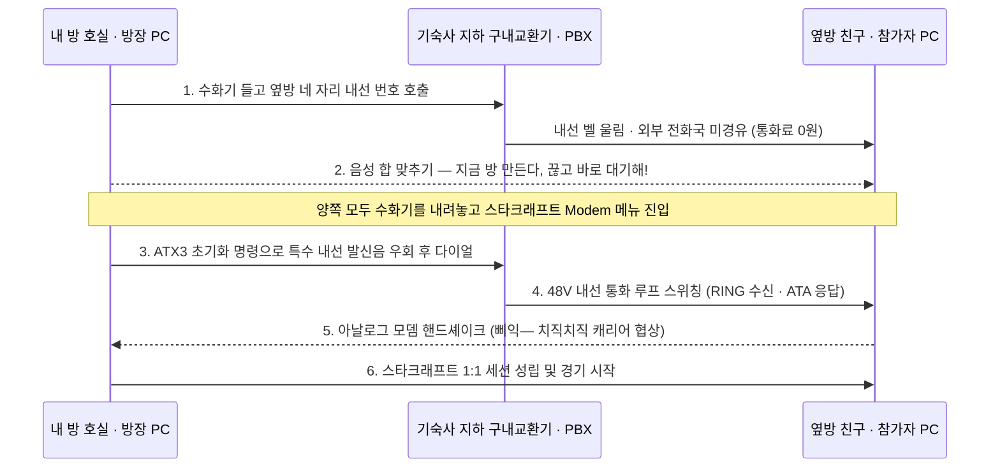

import Alert from '@/components/Alert.astro';
import PersonInline from '@/components/PersonInline.astro';
import GitHubRepoCard from '@/components/GitHubRepoCard.astro';

[지난 3편](/dev/retro-pc-history-386-486-soundblaster-yongsan)에서 용산 전자상가 계단을 발품 팔아 은박지에 고이 싸 온 비싼 삼성 금램을 486 메인보드 소켓에 꽂던 날을 기억합니다. 부팅 화면 좌측 상단에서 메모리 카운트가 `4096KB`, `8192KB`까지 경쾌하게 치솟는 모습을 보며 이제 세상에 못 돌릴 게임은 없으리라 확신했죠. 그런데 야심 차게 대작 게임을 실행한 순간, 까만 도스 프롬프트 위로 `"Insufficient memory"`라는 무심한 문장이 툭 떨어졌습니다. 분명 수 메가바이트의 램이 보드에 꽂혀 있는데 고작 수십 킬로바이트가 모자라 게임이 멈춰 서는 역설, 그 황당한 벽 앞에서 아련한 이름 **EMM386**과의 밤샘 씨름이 시작됐습니다.

| 시기 · 키워드 | 핵심 기술 · 하드웨어 | 그 시절 우리의 풍경 |
| :--- | :--- | :--- |
| **1993～1995 · 640KB 메모리 전쟁** | `CONFIG.SYS` · `HIMEM.SYS` · `EMM386.EXE` (`RAM` / `NOEMS`) | `MEM /C /P`로 여유 기본 메모리 1KB를 더 뽑아내려 멀티 부트 메뉴를 깎던 밤 |
| **1994～1996 · CD-ROM과 RTS 빅뱅** | 2～4배속 CD-ROM · `MSCDEX.EXE` · SVGA · 실사 FMV | 디스켓 450장 분량 은빛 원반 위에서 격돌한 《워크래프트 II》와 《커맨드 앤 컨커》 |
| **1998 · 기숙사 내선 모뎀 대전** | 대학 구내교환기(PBX) · `ATX3` · 33.6K/56K 모뎀 · `IPX` | 내선 전화로 신호를 맞춘 뒤 통화료 0원으로 연결하던 초기 《스타크래프트》 1:1 대전 |

## 8MB 램을 꽂아도 왜 640KB가 발목을 잡았을까 — EMM386과 CONFIG.SYS 장인정신

문제의 뿌리는 1981년 오리지널 IBM PC가 채택한 인텔 8088 프로세서의 **리얼 모드**(Real Mode) 설계에 있었습니다. 20비트 주소선으로 표현할 수 있는 전체 주소 공간은 정확히 `1MB`(`1,024KB`)뿐이었는데, 당시 설계자들은 하위 `0～640KB`를 프로그램이 쓰는 **기본 메모리**(Conventional Memory)로 배정하고 나머지 `640～1,024KB` 구간인 `384KB`를 비디오 카드 버퍼와 메인보드 ROM BIOS 등을 위한 **상위 메모리 영역**(UMA, Upper Memory Area)으로 못 박아 두었습니다.

세월이 흘러 CPU가 32비트 486으로 진화하고 램을 4MB, 8MB씩 꽂아도 MS-DOS는 하위 호환성을 지키기 위해 여전히 이 1MB 리얼 모드 위에서 부팅됐습니다. 설상가상으로 사운드블라스터 초기화 도구, 마우스 드라이버, CD-ROM 확장 프로그램까지 기본 메모리에 줄줄이 상주(TSR)하고 나면 정작 게임이 쓸 수 있는 공간은 `510～530KB` 언저리로 쪼그라들기 일쑤였죠. 대작 게임들이 요구하던 `580KB`, 때로는 `600KB` 이상의 여유 기본 메모리를 만들어내려면 운영체제와 드라이버를 1MB 장벽 안팎의 빈틈으로 대피시키는 외과 수술이 필요했습니다.

<figure class="not-prose my-6">
  <svg
    viewBox="0 0 760 340"
    class="w-full h-auto rounded-xl border border-border bg-card p-3 sm:p-4 text-foreground"
    role="img"
    aria-label="x86 리얼 모드 1MB 메모리 장벽과 HIMEM.SYS 및 EMM386.EXE RAM 대 NOEMS 메모리 배치 비교도"
  >
    <text x="380" y="24" text-anchor="middle" fill="currentColor" font-size="14" font-weight="700">MS-DOS 1MB 주소 장벽과 EMM386 메모리 확보 전략 비교</text>

    <line x1="92" y1="92" x2="742" y2="92" stroke="#94a3b8" stroke-width="1" stroke-dasharray="3 3" stroke-opacity="0.5" />
    <line x1="92" y1="130" x2="742" y2="130" stroke="#ef4444" stroke-width="1.5" stroke-dasharray="5 3" stroke-opacity="0.85" />
    <line x1="92" y1="214" x2="742" y2="214" stroke="#94a3b8" stroke-width="1" stroke-dasharray="3 3" stroke-opacity="0.5" />
    <line x1="92" y1="302" x2="742" y2="302" stroke="#94a3b8" stroke-width="1" stroke-opacity="0.4" />

    <text x="84" y="74" text-anchor="end" class="fill-muted-foreground" font-size="11" font-family="monospace">4MB/8MB+</text>
    <text x="84" y="96" text-anchor="end" class="fill-muted-foreground" font-size="11" font-family="monospace">1088 KB</text>
    <text x="84" y="134" text-anchor="end" class="fill-red-600 dark:fill-red-400" font-size="11" font-weight="700" font-family="monospace">1024 KB</text>
    <text x="84" y="218" text-anchor="end" class="fill-muted-foreground" font-size="11" font-family="monospace">640 KB</text>
    <text x="84" y="305" text-anchor="end" class="fill-muted-foreground" font-size="11" font-family="monospace">0 KB</text>

    <text x="198" y="46" text-anchor="middle" fill="currentColor" font-size="12" font-weight="700">① 기본 부팅 (튜닝 전)</text>
    <rect x="102" y="54" width="192" height="76" rx="6" fill="#64748b" fill-opacity="0.14" stroke="#64748b" stroke-width="1.2" />
    <text x="198" y="86" text-anchor="middle" fill="currentColor" font-size="11" font-weight="600">1MB 초과 연장 메모리</text>
    <text x="198" y="104" text-anchor="middle" class="fill-muted-foreground" font-size="10">리얼 모드 직접 접근 불가</text>

    <rect x="102" y="130" width="192" height="84" rx="6" fill="#f59e0b" fill-opacity="0.14" stroke="#f59e0b" stroke-width="1.2" />
    <text x="198" y="166" text-anchor="middle" fill="currentColor" font-size="11" font-weight="600">UMA 상위 영역 (384KB)</text>
    <text x="198" y="184" text-anchor="middle" class="fill-amber-700 dark:fill-amber-300" font-size="10">VGA · BIOS 외 빈 구멍 방치</text>

    <rect x="102" y="214" width="192" height="48" rx="4" fill="#ef4444" fill-opacity="0.08" stroke="#ef4444" stroke-width="1.2" />
    <text x="198" y="242" text-anchor="middle" class="fill-red-600 dark:fill-red-400" font-size="11" font-weight="700">여유 약 520KB (실행 실패)</text>
    <rect x="102" y="262" width="192" height="40" rx="4" fill="#ef4444" fill-opacity="0.22" stroke="#ef4444" stroke-width="1.2" />
    <text x="198" y="286" text-anchor="middle" fill="currentColor" font-size="10.5" font-weight="600">DOS 커널 + 마우스 + CD 드라이버</text>

    <text x="418" y="46" text-anchor="middle" fill="currentColor" font-size="12" font-weight="700">② EMM386.EXE RAM</text>
    <rect x="322" y="54" width="192" height="38" rx="6" fill="#3b82f6" fill-opacity="0.16" stroke="#3b82f6" stroke-width="1.2" />
    <text x="418" y="77" text-anchor="middle" fill="currentColor" font-size="10.5" font-weight="600">XMS + EMS 공유 메모리 풀</text>

    <rect x="322" y="92" width="192" height="38" rx="5" fill="#8b5cf6" fill-opacity="0.2" stroke="#8b5cf6" stroke-width="1.2" />
    <text x="418" y="115" text-anchor="middle" fill="currentColor" font-size="10.5" font-weight="600">HMA (64KB) · DOS=HIGH 커널</text>

    <rect x="322" y="130" width="192" height="42" rx="5" fill="#f59e0b" fill-opacity="0.24" stroke="#f59e0b" stroke-width="1.2" />
    <text x="418" y="155" text-anchor="middle" fill="currentColor" font-size="10.5" font-weight="600">64KB EMS 페이지 프레임 예약</text>
    <rect x="322" y="172" width="192" height="42" rx="5" fill="#0ea5e9" fill-opacity="0.18" stroke="#0ea5e9" stroke-width="1.2" />
    <text x="418" y="197" text-anchor="middle" fill="currentColor" font-size="10">남은 UMB에 드라이버 분산 적재</text>

    <rect x="322" y="214" width="192" height="88" rx="6" fill="#3b82f6" fill-opacity="0.14" stroke="#3b82f6" stroke-width="1.4" />
    <text x="418" y="255" text-anchor="middle" fill="currentColor" font-size="11" font-weight="700">여유 약 590～602KB</text>
    <text x="418" y="275" text-anchor="middle" class="fill-blue-700 dark:fill-blue-300" font-size="10">구형 EMS 필수 대작 게임 호환</text>

    <text x="638" y="46" text-anchor="middle" fill="currentColor" font-size="12" font-weight="700">③ EMM386.EXE NOEMS</text>
    <rect x="542" y="54" width="192" height="38" rx="6" fill="#10b981" fill-opacity="0.16" stroke="#10b981" stroke-width="1.2" />
    <text x="638" y="77" text-anchor="middle" fill="currentColor" font-size="10.5" font-weight="600">1088KB+ XMS 전용 (DOS/4GW)</text>

    <rect x="542" y="92" width="192" height="38" rx="5" fill="#8b5cf6" fill-opacity="0.2" stroke="#8b5cf6" stroke-width="1.2" />
    <text x="638" y="115" text-anchor="middle" fill="currentColor" font-size="10.5" font-weight="600">HMA (64KB) · DOS=HIGH 커널</text>

    <rect x="542" y="130" width="192" height="84" rx="6" fill="#10b981" fill-opacity="0.22" stroke="#10b981" stroke-width="1.3" />
    <text x="638" y="166" text-anchor="middle" fill="currentColor" font-size="10.5" font-weight="700">최대 UMB 확보 (프레임 반납)</text>
    <text x="638" y="185" text-anchor="middle" class="fill-emerald-700 dark:fill-emerald-300" font-size="10">MSCDEX · 마우스 모두 LH 적재</text>

    <rect x="542" y="214" width="192" height="88" rx="6" fill="#10b981" fill-opacity="0.18" stroke="#10b981" stroke-width="1.6" />
    <text x="638" y="255" text-anchor="middle" fill="currentColor" font-size="11.5" font-weight="700">여유 615～622KB+ 확보</text>
    <text x="638" y="275" text-anchor="middle" class="fill-emerald-700 dark:fill-emerald-300" font-size="10">기본 메모리 극대화 · 최신작 구동</text>

    <text x="380" y="326" text-anchor="middle" class="fill-muted-foreground" font-size="10.5">붉은 점선(1024KB)이 8086 리얼 모드 1MB 경계선 · HIMEM.SYS가 HMA를 열고 EMM386.EXE가 UMA 빈 공간을 UMB로 매핑</text>
  </svg>
  <figcaption class="mt-2 text-center text-sm text-muted-foreground">
    x86 리얼 모드 1MB 장벽을 우회하는 세 가지 상태 — EMS 페이지 프레임(64KB) 유지 여부가 UMB 가용량과 기본 메모리 확보량을 가른다.
  </figcaption>
</figure>

첫 단추는 `HIMEM.SYS`와 `DOS=HIGH,UMB`였습니다. A20 주소선 게이트를 제어해 1MB 바로 위 `64KB` 자투리 공간인 **HMA**(High Memory Area, `1,024～1,088KB`)를 열고 도스 커널 본체를 그곳으로 이주시켰죠. 그다음 등판하는 주인공이 바로 `EMM386.EXE`예요. 386 이상 CPU의 가상 8086 모드와 메모리 페이징 기능을 빌려, 1MB 너머 남아도는 연장 메모리(XMS)를 `640KB～1MB` 사이 비디오 램과 BIOS가 쓰지 않는 빈 구멍인 **UMB**(Upper Memory Block)에 조각조각 이어 붙여 주는 마법사였습니다. 이렇게 UMB가 열리면 `CONFIG.SYS`에서는 `DEVICEHIGH`로, `AUTOEXEC.BAT`에서는 `LH`(`LOADHIGH`) 명령으로 무거운 드라이버들을 기본 메모리 바깥으로 들어 올릴 수 있었거든요.

### RAM이냐 NOEMS냐, 밤마다 갈등 끝에 완성한 멀티 부트 메뉴

진짜 골칫거리는 `EMM386.EXE` 뒤에 붙이는 단 하나의 스위치였습니다. 구형 대작이나 코에이(KOEI) 역사 시뮬레이션처럼 **확장 메모리**(EMS) 규격을 요구하는 게임을 돌리려면 `EMM386.EXE RAM`을 적어 넣어야 했는데, 이러면 UMA 한복판에 `64KB`짜리 EMS 페이지 프레임을 통째로 내주어야 해서 정작 드라이버를 올릴 UMB 방이 좁아졌어요. 특히 덩치 큰 CD-ROM 확장 프로그램 `MSCDEX.EXE`가 UMB에 들어갈 자리를 못 찾고 기본 메모리로 미끄러져 내려오면 가용 메모리가 순식간에 `570KB`대로 주저앉았죠.

반대로 `EMM386.EXE NOEMS`를 선언하면 EMS 에뮬레이션을 포기하는 대신 `64KB` 프레임 자리까지 전부 UMB로 탈바꿈해 기본 메모리를 `615KB` 이상 널널하게 비울 수 있었습니다. 다만 이 상태로 부팅하면 EMS 전용 게임들이 곧바로 에러를 뿜었죠. 드라이버 적재 순서 한 줄만 바꿔도 연속된 빈 블록 크기가 달라져서, 밤마다 `EDIT CONFIG.SYS`와 재부팅, 그리고 메모리 성적표를 확인하는 `MEM /C /P`를 수십 번씩 반복하다 결국 MS-DOS 6.x의 **`[MENU]` 멀티 부트** 기능에 정착했습니다.

```ini
[MENU]
MENUITEM=NOEMS, Maximum Conventional Memory (NOEMS + CD-ROM)
MENUITEM=EMS,   EMS Compatible Games (EMM386 RAM + CD-ROM)
MENUITEM=CLEAN, Clean Boot (DOS/4GW Protected Mode Only)
MENUDEFAULT=NOEMS, 5

[COMMON]
DOS=HIGH,UMB
FILES=40
BUFFERS=20
LASTDRIVE=Z

[NOEMS]
DEVICE=C:\DOS\HIMEM.SYS /TESTMEM:OFF
DEVICE=C:\DOS\EMM386.EXE NOEMS
DEVICEHIGH=C:\CDROM\OAKCDROM.SYS /D:MSCD001

[EMS]
DEVICE=C:\DOS\HIMEM.SYS /TESTMEM:OFF
DEVICE=C:\DOS\EMM386.EXE 2048 RAM
DEVICEHIGH=C:\CDROM\OAKCDROM.SYS /D:MSCD001

[CLEAN]
DEVICE=C:\DOS\HIMEM.SYS /TESTMEM:OFF
```

이렇게 `CONFIG.SYS`에서 메뉴 틀을 잡아 두면, 선택된 항목 이름이 `AUTOEXEC.BAT`의 `%CONFIG%` 환경변수로 넘어갔습니다. 지루한 부팅 램 검사를 건너뛰는 `/TESTMEM:OFF`까지 곁들인 뒤, 사운드블라스터 환경변수(`SET BLASTER`)와 상위 메모리 적재를 분기 처리하던 단골 `AUTOEXEC.BAT` 구성은 이랬습니다.

```bat
@ECHO OFF
PROMPT $P$G
PATH C:\DOS;C:\WINDOWS;C:\UTIL
SET SOUND=C:\SB16
SET BLASTER=A220 I5 D1 H5 P330 T6

IF "%CONFIG%"=="CLEAN" GOTO END

LH C:\CDROM\MSCDEX.EXE /D:MSCD001 /L:D
LH C:\MOUSE\MOUSE.EXE

:END
```

부팅 직후 `MEM /C /P`를 쳤을 때 `"Largest executable program size"` 줄에 `618K`라는 숫자가 선명하게 찍히던 순간의 쾌감이란, 요즘 웹 서버 응답 시간을 수백 밀리초에서 수 밀리초로 깎아냈을 때 느끼는 엔지니어링의 희열과 정확히 닮아 있었습니다.

## 디스켓 450장을 삼킨 은빛 원반 — CD-ROM과 RTS 양대 산맥

그토록 애타게 UMB 꼭대기로 밀어 올리려 했던 `OAKCDROM.SYS`와 `MSCDEX.EXE /D:MSCD001` 한 쌍은, 486 황혼기에 찾아온 거대한 매체 혁명의 열쇠였습니다. 3.5인치 고밀도(HD) 플로피 디스켓 한 장 용량이 `1.44MB`이던 시절, 손바닥만 한 은빛 플라스틱 원반 한 장에 디스켓 약 **450장 분량**인 `650MB`를 담아낸 **CD-ROM**은 저장 매체의 개념 자체를 뒤흔들어 놓았죠. 2배속(`300KB/s`), 곧이어 4배속(`600KB/s`) CD-ROM 드라이브 트레이에 디스크를 얹고 버튼을 누르면 묵직한 모터 회전음과 함께 도트 그래픽 너머의 멀티미디어 세계가 열렸습니다.

남아도는 650MB 공간을 가장 극적으로 꽃피운 장르는 단연 **실시간 전략 시뮬레이션**(RTS)이었습니다. 그 한 축에는 블리자드 엔터테인먼트가 1994년 11월에 내놓은 《워크래프트: 오크와 인간》과, 이듬해인 1995년 12월 겨울방학을 통째로 집어삼킨 **워크래프트 II**(Warcraft II: Tides of Darkness)가 있었습니다. 1편만 해도 한 번에 최대 4기까지만 유닛을 선택할 수 있었고 이동 명령조차 단축키나 명령 버튼을 거쳐야 했지만, 2편에 이르러 마우스 드래그로 최대 9기 부대를 한꺼번에 감싸 쥐고 우클릭 한 번으로 이동과 공격을 지시하는 현대 RTS의 손맛이 비로소 완성됐습니다. `640×480` SVGA 고해상도 설원 위에서 사운드블라스터 스피커를 타고 울려 퍼지던 생생한 CD 음질 보이스도 잊을 수 없죠. 오크 일꾼(Peon)을 찍을 때마다 굵직하게 내뱉던 `"Zug-zug!"`, `"Work complete!"` 소리와 휴먼 일꾼(Peasant)의 순박한 `"Yes, milord?"`, `"Job's done!"` 응답은 십수 년이 지나도 귓가에 자동 재생될 만큼 강렬했습니다.


같은 1995년 가을, 중세 판타지였던 《워크래프트》의 맞은편에서는 웨스트우드 스튜디오의 《커맨드 앤 컨커》(Command & Conquer)가 근미래 군사 SF의 서늘한 금속성을 앞세워 정면 승부를 걸어왔습니다. 설치 화면부터 군사 위성 단말기 부팅 시퀀스처럼 연출해 혼을 쏙 빼놓더니, 본편에 들어가면 디렉터 <PersonInline name="조지프 D. 쿠칸" role="연출 · 케인 역" imdbId="nm0473614" />이 직접 민머리의 예언자 **케인**(Kane)으로 분해 카메라를 똑바로 응시하며 임무를 하달하는 실사 **FMV**(Full Motion Video) 브리핑이 펼쳐졌습니다. 여기에 오디오 디렉터 <PersonInline name="프랭크 클레패키" role="작곡가" imdbId="nm0459295" />가 전자기타 리프와 무전 샘플링을 엮어 만든 대표곡 `"Act on Instinct"`가 터져 나오면, 여기가 내 방 책상 앞인지 타이베리움 채굴 전선인지 분간이 안 될 지경이었죠.


무엇보다 그 시절 친구들 사이에서 《커맨드 앤 컨커》가 성배 대접을 받았던 이유는 **GDI 디스크와 NOD 디스크로 나뉜 2-CD 패키지** 구성 덕분이었습니다. 정품 한 패키지를 사서 한 장은 내가 넣고 나머지 한 장은 친구에게 빌려주어도 두 컴퓨터 모두 멀티플레이 실행이 가능했던 그 관대한 설계는, 용돈이 빠듯하던 학생들에게 최고의 선물이나 다름없었습니다.

<GitHubRepoCard
  repo="electronicarts/CnC_Remastered_Collection"
  comment="훗날 EA가 리마스터 작업과 함께 공개한 오리지널 《커맨드 앤 컨커: 타이베리안 돈》과 《레드 얼럿》의 C++ 소스코드 저장소. 90년대 중반 빠듯한 클럭과 메모리 한계 속에서 고정소수점 연산과 유닛 경로 탐색을 어떻게 설계했는지 원형 그대로 들여다볼 수 있습니다."
/>

## 대단원 에필로그 — 기숙사 내선 전화선 너머의 《스타크래프트》


486의 시대가 저물고 펜티엄과 윈도우 95·98이 일상이 된 1998년, 대학 기숙사에 짐을 풀었을 무렵 세상은 또 한 번의 거대한 변곡점 직전에 서 있었습니다. 아직 전국 골목마다 PC방 간판이 불을 밝히고 가정마다 ADSL 초고속 인터넷이 깔리기 바로 직전의 짧은 틈새였죠. 당시 오리지널 《스타크래프트》(StarCraft)의 `Multiplayer` 메뉴에 들어가면 `Battle.net` 바로 아래로 `Local Area Network (IPX)`, `Modem`, `Direct Cable Connection` 항목이 나란히 떠 있었습니다.

기숙사 방에 랜선 단자 대신 덩그러니 전화기 한 대만 놓여 있던 그 시절, 옆방이나 위층 친구와 1:1 대전을 벌이는 의식은 늘 **구내 내선 전화 수화기**를 드는 것부터 시작됐습니다. 네 자리 호실 번호를 눌러 `"야, 지금 내가 방 만든다! 수화기 내려놓자마자 모뎀 대기 걸어!"` 하고 다급하게 신호를 맞춘 뒤, 철컥 수화기를 내려놓고 전화선을 PC 뒷면 모뎀 단자와 연결해 다이얼을 돌렸죠.



집에서 일반 전화선으로 모뎀 대전을 몇 시간씩 붙잡고 있다가는 다음 달 전화요금 고지서 앞에서 집안이 뒤집어지기 십상이었지만, 대학 기숙사에서는 밤이 새도록 공짜로 달릴 수 있었던 공학적 비밀이 건물 지하 기계실에 숨어 있었어요.

<Alert type="tip" title="기숙사 내선 모뎀 대전이 통화료 0원이었던 이유와 ATX3 비기">
대학 기숙사 각 호실의 전화 단자는 외부 통신사(PSTN) 국선에 곧바로 물려 있는 것이 아니라, 구내 지하의 **사설 구내교환기**(PBX, Private Branch Exchange)에 묶여 있었습니다. PBX가 자체적으로 통화용 직류 전압(약 48V 루프 전류)과 내선 번호 스위칭을 처리하기 때문에, 호실 간 내선 통화는 외부 전화국 과금망을 전혀 거치지 않고도 두 모뎀 사이에 완벽한 아날로그 음성 회선을 이어 주었죠.

다만 구내교환기가 내보내는 내선 전용 발신음은 일반 국선 표준 발신음(350Hz + 440Hz 연속음)과 주파수나 단속 주기가 달라, 모뎀이 회선이 끊긴 줄 오판하고 `"NO DIALTONE"` 에러를 뱉으며 전화를 걸지 못하는 경우가 흔해요. 이때 모뎀 제어판에서 '발신음 기다리기' 옵션을 끄거나 추가 초기화 명령란에 헤이즈(Hayes) 명령어 **ATX3**(발신음 검출을 건너뛰고 즉시 다이얼)를 적어 넣으면 거짓말처럼 옆방 모뎀 벨을 울릴 수 있었습니다.
</Alert>

얼마 지나지 않아 기숙사 복도 천장 위로 회색 UTP 랜선 다발이 지나가고 각 방에 `IPX/SPX` 프로토콜 기반 로컬 네트워크가 열리더니, 이내 온 나라가 PC방과 배틀넷의 함성 속으로 빨려 들어갔습니다. `CONFIG.SYS` 한 줄을 고쳐 메모리를 쥐어짜고, 사운드카드 IRQ 점퍼를 맞추고, 모뎀 초기화 명령어를 손수 깎아 넣던 시대는 그렇게 조용히 막을 내렸습니다.

돌이켜보면 참 묘한 수미상관입니다. [1편](/dev/retro-pc-history-8bit-apple2-msx)에서 어린 시절 금성 패미콤 `FC-30` 앞에 쪼그려 앉아 카세트테이프 데크의 볼륨 노브를 바늘구멍 맞추듯 돌려가며 숨죽여 듣던 소리도 **"삐익— 치직치직"** 하는 아날로그 주파수 변조음이었고, 그로부터 약 15년이 흘러 대학 기숙사의 자정 무렵 옆방 친구의 컴퓨터와 내 컴퓨터가 내선 전화선 위에서 서로의 속도를 확인하며 악수(Handshake)할 때 방 안을 채우던 소리 역시 똑같은 **"삐익— 치직치직"** 모뎀 캐리어 소리였으니까요.

어린 날 처음 들었던 그 기계음이 자기 테이프 속에 잠든 코드를 깨우기 위해 기계의 비위를 맞추며 **혼자** 씨름하던 소리였다면, 아날로그 PC의 마지막 밤에 들었던 그 소리는 차가운 구리선 너머 살아 숨 쉬는 **사람**에게 닿기 위해 문을 두드리는 소리였습니다. 클릭 한 번이면 수 기가바이트가 내려받아지고 클라우드 위에서 수백 기의 컨테이너가 자동으로 뜨는 시대에 살고 있지만, 까만 화면의 깜빡이는 커서 앞에서 하드웨어와 운영체제의 밑바닥을 직접 더듬으며 길을 찾았던 그 밤들의 감각만큼은 지금도 개발자로 살아가는 내 손끝에 선명한 나이테로 남아 있습니다.
